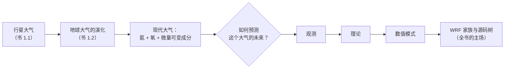
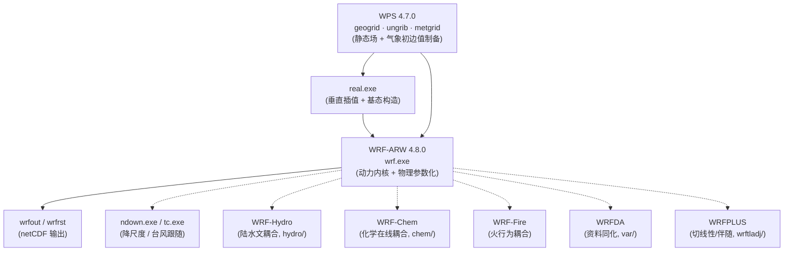

# 第 1 章 从行星大气到数值模式

> **本章任务**：用一次“视角跃迁”开始全书——先退到行星尺度看大气是什么、大气物理学研究什么，再落到一颗被称为“地球”的行星上，看它的大气如何演化成今天这个独一无二的氮氧大气；然后回答一个问题：**这样一个大气，为什么能被写进计算机**；最后给出 WRF 的家族地图与源码世界观。读完本章，你应当能回答：书第 1 章的三条“掌握要点”是什么；WRF-ARW 和 NMM 的区别；以及 WRF 源码树里每个目录是干什么的。
> **版本口径**：本教材全书基于 **WRF 4.8.0 + WPS 4.7.0**（本地源码与集群均已核验，见第 2 章）。

---

## 1.0 本章地图

- **1.1 大气物理学：对象与分支**——“大气物理”四个字的定义，以及它和 WRF 源码目录的一一对应；
- **1.2 行星大气**——八颗行星的大气概貌（书表 1.1），类地/类木之分的化学解释；
- **1.3 地球大气的演化**——原始大气 → 次生大气 → 现代大气三阶段（书 1.2），“我们为什么呼吸氮气”其实是演化问题；
- **1.4 从“观测—理论”到“数值模式”**——第三范式的诞生，以及参数化为什么不可避免；
- **1.5 WRF：家族与源码世界观**——ARW/NMM 之分、家族成员图、源码根目录导览；
- **1.6 全书地图与三类专栏体例**——五部二十一章怎么读，三类源码专栏的约定。

---

## 1.1 大气物理学：对象与分支

### 1.1.1 何谓“大气物理”

按课程第一讲的定义（PPT 1 讲 slide 6）：

> **大气物理**是研究大气的**物理现象**、**物理过程**及其**演变规律**的大气科学的分支学科。

关键词是“物理”：它不问“明天兰州下不下雨”（那是天气学的问法），而问“雨滴是怎样长大的”“辐射如何加热地表”“湍流如何输送动量”——**把天气舞台背后的物理机制拆开来讲清楚**。这门课（及本书）的讲法是：先在《大气物理学》（盛裴轩等，第 2 版，以下简称“书”）里把机制讲成方程，再打开 WRF 源码，看方程被翻译成了哪一行 Fortran。

### 1.1.2 学科分支：一张对照表看两头

大气物理学包括的学科分支（PPT 1 讲 slide 13）：**大气声学、大气光学、大气电学；大气热力学；大气辐射学；云和降水物理学；大气边界层物理学；平流层和中层大气物理学**。

这张名单乍看抽象，但每一个分支都恰好对应 WRF `phys/` 目录下的一族（或数族）源码文件——这正是本书第 III 部的骨架：

| 大气物理分支 | 书章（本书对应） | WRF 源码落点（典型文件） | 本书章节 |
|---|---|---|---|
| 大气热力学 | 书第 2–6 章 | `share/module_model_constants.F`、微物理内的饱和调整、积云的 CAPE 闭合 | ch11/13/15 |
| 大气辐射学 | 书第 5 章 | `module_ra_rrtmg_lw.F` / `module_ra_rrtmg_sw.F`、`radiation_driver` | ch12 |
| 云和降水物理学 | 书第 6 章 | `module_mp_thompson.F`、`mp_wsm6.F90`、`module_cu_*.F` | ch13/15 |
| 大气边界层物理学 | 书 6.8 | `module_bl_mynnedmf.F90`、`module_bl_ysu.F90`（`phys/physics_mmm/`） | ch14 |
| 陆气交换（边界层的下边界） | 书 4.2–4.3 | `module_sf_noahdrv.F`（Noah LSM） | ch16 |
| 大气电学 | （书第 1 版未展开） | `module_ltng_lpi.F` 等（4.8.0 新增动态闪电方案） | ch02/12 侧记 |
| 平流层与中层大气 | 书 4.4（分层） | `registry.dimspec` 的高层 η 面、重力波拖曳 `bl_gwdo.F90` | ch10/14 侧记 |
| 大气光学/声学 | 书 5.x（折射） | WRF 不直接模拟（尺度原因） | — |

> **读表须知**：右列的对应不是一一映射——WRF 的一个文件常同时服务多个分支（例如饱和调整横跨热力学与云物理），一个分支也常分散在多个文件。这种“多对多”正是数值模式的常态，也是本书坚持“物理 ↔ 语句”双栏对照的原因。

### 1.1.3 大气物理与大气科学其他分支的关系

课程第一讲（slide 14）给出三条关系，用 WRF 的视角复述会格外具体：

1. **与天气学**：各种天气系统是“舞台”，大气物理是“剧本的物理规则”——WRF 里两者合体：动力内核演化天气系统（第 21 章），物理参数化提供规则（第 III 部）；
2. **与气候学**：气候是物理过程通量的长期积分——WRF 的区域气候应用（如 CLWRF 诊断，ch20 会遇到）正是这一关系的体现；
3. **与大气探测、应用气象**：探测提供模式的初值与验证数据（本书 ch19 用 ERA5 验证），而应用气象（风电、光伏、城市規劃、农业灌溉）不断把新物理过程“塞回”模式——ch02 的版本沿革表里你会看到一长串这样的名字（风电场参数化、光伏板、灌溉、城市树木）。

课程还列了五个“一些科学问题”（slide 15）：平流层 BD 环流、对流云的模拟、大气中的湍流输送、**大气模式中的次网格过程**、热带海洋对大气的影响。注意其中第四个——“次网格过程”——它就是**参数化**（parameterization）问题的日常说法，是 1.4 节的主角，也是 WRF `phys/` 目录存在的理由。

---

## 1.2 行星大气（书 1.1，印刷页 2–3）

### 1.2.1 定义与分类

**定义**（书印刷页 2）：

> 行星大气是包裹着行星体的**中性气体和电气体的总称**。

太阳系原有 9 大行星；2006 年 8 月 24 日国际天文联合会决定冥王星不再算行星，太阳系只剩 **8 大行星**。按物理性质和化学组成，8 颗行星分两类、各 4 颗：

| 分类 | 成员 | 特征 |
|---|---|---|
| **类地行星** | 水星、金星、地球、火星 | 质量体积较小、**有固体表面**、化学组成以重物质为主 |
| **类木行星** | 木星、土星、天王星、海王星 | **无固体表面**、化学组成以氢、氦及甲烷等轻物质为主 |

另一种分类法以火星与木星之间的**小行星带**为界，分成离太阳较近的**内行星**与远离太阳的**外行星**（书注：包括冥王星的旧口径）。两种分类法比较一致。此外还有个实用口径：类地行星有固体表面、类木没有（PPT 1 讲 slide 6 备注）。

### 1.2.2 八大行星大气概况（书表 1.1）

书印刷页 2 的表 1.1（1 atm = 1013.25 hPa；日地距离取 1.0）：

| 行星 | 表面平均温度/K | 表面压力/atm | 重力加速度/(m·s⁻²) | 逃逸速度/(km·s⁻¹) | 距日平均距离① | 主要成分 | 说明 |
|---|---|---|---|---|---|---|---|
| 水星 | 固面 600~700 / 昼面 100 | — | 3.7 | 4.3 | 0.4 | — | 未发现大气 |
| 金星 | 750 | 90 | 8.8 | 10.3 | 0.7 | CO₂ 97%、N₂ 3% | 被浓硫酸的厚云雾覆盖 |
| 地球 | 288 | 1 | 9.8 | 11.2 | 1.0 | N₂ 78%、O₂ 21% | — |
| 火星 | 240 | 0.005~0.007 | 3.8 | 5.0 | 1.5 | CO₂ 95%、N₂ 3%、Ar、CO | 大气稀薄 |
| 木星 | 134（云顶） | 2（云顶） | 26.2 | 60 | 5.2 | H₂ 88.6%、He 11.2% | 大气厚度约 1000 km |
| 土星 | 78 | — | 11.3 | 36 | 9.5 | H₂、He、NH₃ | — |
| 天王星 | 62 | — | 9.7 | 21 | 19.2 | H₂、He | 浓密大气 |
| 海王星 | 低于 46 | — | 11.4 | 23 | 30.1 | H₂、CH₄ | 浓密云层 |

① 引文如此，指以日地距离为 1.0 的归一化距离。

**读表的两条主线**：

1. **表面压力横跨 5 个数量级**（金星 90 atm → 火星 0.005 atm）——为什么？1.2.3 节的“逃逸 + 演化”给出答案；
2. **地球是唯一的 N₂/O₂ 大气**——表里其余行星要么 CO₂ 为主（类地），要么 H₂/He 为主（类木）。地球大气在太阳系里的“不合群”，正是 1.3 节演化学说的出发点。

### 1.2.3 四颗类地行星的要点（书印刷页 2–3）

**水星**：类地行星中离太阳最近、质量最小（约地球的 5.54%），重力加速度 3.7 m/s²。1973 年“水手 10 号”探测：几乎不存在大气，也没有发现任何曾经被水浸渍过的痕迹（不存在水）。没有大气和水的调节作用，**昼夜温差高达 600 K 以上**。

**金星**——地球的“姐妹星”（大小、质量、密度都与地球接近），但大气完全不同：

- 大气总量是**地球的 90 倍**，浓密大气层分布在 100 km 高度以下；反射掉太阳光的 3/4（所以金星十分明亮）；
- 主要成分 **CO₂ 达 97%**（低层可能达 99%），约 3% 氮和少量水汽、一氧化碳等；
- 距金星地面 20~30 km 至 70 km 高空密布**浓硫酸云滴**组成的浓密云雾（呈黄色）；
- 温度层结与地球相反方向的故事：表面 750 K；0~60 km 高度内迅速降到 300 K；60 km 以上下降缓慢；68 km 以上接近不变（约 200 K）；
- 大气运动激烈：60 多千米高空风速达 **100 m/s**（地球表面风速大于 33 m/s 已是 12 级大风），闪电和雷暴频繁；
- 高温的成因：距太阳近（0.7 日地距离）→ 太阳辐射强、温度高 → 水和 CO₂ 只能以气态存在 → **CO₂ 强温室效应** + 浓密云层不能散热 → 表面温度最终平衡在 **750 K 左右**，且**没有季节、昼夜和纬度的区别**。

**火星**：质量最小、平均直径 6747 km（约为地球一半），地心引力仅为地球的 38% → **大气很稀薄**（0.005~0.007 atm），昼夜温差达 100 K。主要成分 CO₂（95%），还有少量氮和氩。比地球离太阳远，单位面积太阳辐射仅为地球的 43%，表面温度低。探测简史（书原文的几个锚点）：1962 年起苏联“火星”系列（火星 3 号登陆舱）；1999 年美国轨道探测器找到**干涸河床**证据；2004 年“勇气号”确认白色极冠大部分由**水冰**组成；2012 年 8 月 6 日“好奇号”登陆。

**内外行星为何分道扬镳**（书印刷页 3 的总结段，这是本章最“物理”的一段）：宇宙空间里化学元素丰度随原子量增加而减少，所以太阳系各行星大气形成初期**都以轻元素氢、氦和碳等为主**。之后：

- **内行星**：太阳辐射强烈 + 星球表面高温 + 太阳风作用 → 原始大气很快散佚 → 行星内部火山喷发及其他化学过程产生**第二大气**，以 CO₂ 为主——**地球是例外**；
- **外行星**：温度极低 → 原始大气消散缓慢 → 至今仍以氢、氦和甲烷等为主。

一句话：**“起点相同、演化分岔”**——距太阳的远近（温度）和行星质量（逃逸速度）决定了大气的命运。这条“温度 + 引力 vs 气体逃逸”的物理，在书第 2 章讨论大气逃逸时还会回到。

---

## 1.3 地球大气的演化（书 1.2，印刷页 3–5）

### 1.3.1 先提出反常：行星地球大气 vs 实际地球大气

如果我们认为各类地行星大气的形成遵循同样规律，那么根据金星、火星大气成分（20 世纪 70 年代测量）可以推断出“理论上的地球大气”——**行星地球大气**。书表 1.2（单位 hPa，引自王明星 1991）：

| 大气成分 | 金星 | 行星地球 | 火星 | 实际地球 | 实际/行星 |
|---|---|---|---|---|---|
| CO₂ | 90 000 | 300 | 5 | 0.3 | **1/1000** |
| N₂ | 1000 | 30 | 0.05 | 780 | **26** |
| O₂ | 0 | 0.3 | 0.1 | 210 | **700** |

三行数字三个谜：实际地球的 CO₂ 只有理论值的千分之一；氮多了 26 倍；氧干脆多了 700 倍（理论值近乎没有）。**演化论就是解释这三个谜的三段故事。**

### 1.3.2 演化研究的方法论前提

估计地球形成已有 **46 亿年**历史。在漫长演化中大气成分与结构发生很大变化——但由于无法得到演化过程中各阶段大气样本，只能根据地球的岩石结构和行星大气资料，结合物理学、化学、生物学原理和实验等，用**模拟推理方法**进行研究。起源和演变有多种学说，但都有一个共识：

> 必须把大气看成地球组合系统中的一部分——**由气圈、水圈、岩石圈和生物圈组成的地球系统是相互联系的，物质可以互相转化**，而大气仅是其中很小的一部分。

（用本书的话说：研究大气演化用的是“系统耦合”思路——这与 WRF 把大气拆成动力内核 + 多圈层物理参数化耦合的做法，在方法论上同源。）

### 1.3.3 三阶段演化

**(1) 原始大气**：以宇宙中最丰富的轻物质 **H₂、He 和 CO** 为主。由于太阳风（年轻恒星喷发的大量物质流，正值太阳形成初期）和地球升温的作用，原始大气逐渐向宇宙空间膨胀并逃散——**估计 45 亿年前或更早时候，地球上没有大气**。

**(2) 次生大气**（45 亿~20 亿年前，“还原大气”）：地球逐渐冷却（估计地表温度 −15~−10 ℃）以后，**造山运动、火山喷发**和从地缝中释放出地壳内原来吸附的气体，形成次生大气，主要成分 **CO₂、CH₄、NH₃ 和 H₂O** 等。

- 现代火山气体成分（夏威夷，书印刷页 3 表）：水蒸气 79.31%、二氧化碳 11.61%、二氧化硫 6.48%、氮气 1.29%、氧气 0、其他 0.73%——火山喷发含约 80% 水汽；
- 大气只能容纳少量水汽，大部分水汽形成云雾和降水 → **地表水（海洋和湖泊）**；
- 悖论：若以过去一个世纪火山喷发的蒸汽率外推地球形成初期，则现在地球水圈的总质量比“火山总注水量”**小两个数量级**——书给出的候选解释：海洋深处水的渗漏，或水汽被**紫外线辐射分解破坏**；
- 30 亿年前 CO₂ 浓度约为现在的 10 倍，丰富的 CO₂ 和水汽的温室效应使地表温度升到 **300 ℃ 左右**；在此高温下大量 CO₂ 又通过化学反应生成**碳酸盐**累积在地壳中——CO₂ 含量降低、温度随之降低（负反馈，教材第 16 章的陆面碳循环会再提“岩石风化汇”这个概念的现代版）。

**(3) 现代大气**（“氧化大气”）：以**氮气和氧气**为主。与生命现象的发展关系最为密切。

### 1.3.4 氧的来源：从光致离解到光合作用

地球上出现生物以前，大气中游离氧极少，臭氧浓度更小。少量氧来自水汽被太阳紫外辐射**离解（光致离解）**（书印刷页 4）：

$$
\mathrm{H_2O} + h\nu \longrightarrow \mathrm{H} + \mathrm{OH}, \tag{1.2.1}
$$

$$
\mathrm{H_2O} + h\nu \longrightarrow \mathrm{H_2} + \mathrm{O}. \tag{1.2.2}
$$

其中 $h$ 是普朗克常数，$\nu$ 是频率。光解生成的原子氧在第三者（M）存在条件下结合成分子氧：

$$
\mathrm{O} + \mathrm{O} + \mathrm{M} \longrightarrow \mathrm{O_2} + \mathrm{M}. \tag{1.2.3}
$$

但水汽离解产生的氧和氧原子对同一波段的太阳紫外辐射（$\lambda < 0.195\ \mu m$）有很强的吸收，会**反过来降低光解速度**——最终原始氧达到一个平衡浓度；按简单模式计算，这样产生的氧约为**现在大气氧浓度的千分之一**。分解出的氢气扩散到高空逐渐逃逸出地球；若氧逃逸得少、浓度大，氢和氧仍可能重新复合成水汽。

**主渠道是光合作用**（生物圈的作用导致了地球大气的进一步演化）：

- 约 30 亿年前，地球处于无氧环境（或只有水汽光解产生的极少量氧）；大气化学作用产生的氧是有限的；
- 最初的氧出现时，既逃避紫外线伤害、又需要可见光进行光合作用，因此最初只存在于**水面下 10 m 深处的海洋表面层**；水中的低级厌氧生命能够释放氧气；
- **约 6 亿年前**：大气氧浓度达到现在的**百分之一**；此期间高空臭氧浓度明显增加，臭氧削弱紫外线，生命能够到达水面；
- **约 4 亿多年前**：大气中氧达到现在的**十分之一**，并在高空逐渐形成臭氧层；臭氧层阻挡紫外线 → 植物由海洋移向陆地 → 繁茂的植物吸收更多 CO₂、放出更多氧；同时动物的呼吸和死亡消耗氧、排放 CO₂——在这样的演变中形成动态平衡；
- 大气 CO₂ 浓度从 3 亿年前的 **3000 ppmv** 下降到 **280 ppmv**（ppmv 是体积分数量，1 ppmv = 10⁻⁶）。

**氧的收支**：光合作用放出的氧约 10% 储存在现代大气中，其余以氧化物形式（Fe₂O₃、CaCO₃ 等）存在于地壳中；光合作用生成的碳有机体在地质变化中成为**矿物燃料**——按目前世界燃料消耗估算，人类一年燃烧的碳相当于植物光合作用 1000 年的生成总量。

> **源码侧记（全书第一处“物理 ↔ 语句”）**：上面 (1.2.1)–(1.2.3) 这类“光化学”过程在 WRF 的微物理/化学模块里都有对应物。第 13 章将精读的 Thompson 方案里有冰核化的三来源（其中之一即匀质冻结核化）；WRF-Chem 的光解速率计算（TUV，`phot_opt=4`）更是把 $h\nu$ 反应逐条编目。第 1 章不展开，但请记住这个观感：**教科书里一行方程，在模式里往往是一个子程序。**

### 1.3.5 氮与氩：两个“地球特供”问题

- **氮**：实际地球大气中氮的浓度远大于表 1.2 理论的“行星地球大气”（26 倍），这一现象**目前尚无满意的解释**。固然氮气化学性质稳定、火山喷发到大气中的氮能够保留和积累，但这同样适用于其他行星，不足以说明地球的特点。地球大气的高浓度氮应当与生命活动（生物圈的作用）有关：例如动物排泄物和腐烂遗体可直接分解或通过细菌分解为氮（书印刷页 5）。
- **氩**：现代大气中含量占第三位的**氩**，据认为是由地壳岩石中的 ⁴⁰Ca 和 ⁴⁰K 等同位素放射性衰变产生，并从地球诞生起就在大气中积累而成。

### 1.3.6 阶段小结与“掌握要点”

PPT 1 讲对本章的三条“掌握要点”（slide 18）及对应的达成路径：

| 掌握要点 | 达成路径 |
|---|---|
| ① 掌握主要几种行星大气的特点 | 表 1.1 + 四颗类地行星逐个过（水星无大气 / 金星浓密 CO₂+硫酸云 / 火星稀薄 CO₂ / 地球 N₂-O₂） |
| ② 掌握地球大气的形成和演化过程 | 三阶段叙事 + “温度/引力 vs 逃逸”的内外行星分岔机制 |
| ③ 掌握各演化阶段大气的组成 | 原始（H₂ He CO）→ 次生（CO₂ CH₄ NH₃ H₂O）→ 现代（N₂ O₂ + 可变成分）；表 1.2 的三行“谜底” |

课程的“大气概论掌握要点”总纲（slide 17）还预告了后续章节：大气成分的天气气候效应、水汽表述及互换（第 2 章）、状态方程/静力学方程/压高公式（第 3 章）、垂直分层结构（第 4 章）——它们将分别在第 11、10、10、10 章与 WRF 源码对接。

---

## 1.4 从“观测—理论”到“数值模式”

### 1.4.1 第三范式

大气科学的方法论经历了三个台阶：

1. **观测范式**：地面/探空/卫星积累事实（本章的行星大气数据正是 20 世纪 70 年代行星探测的产物）；
2. **理论范式**：流体力学 + 热力学把大气写成**闭合方程组**——连续方程、动量方程、热力学方程、状态方程、水物质方程（书第 2–4 章为它们备齐物理常数与分项）；
3. **数值范式**：方程组非线性、且真实大气初值永远不完备，解析解不存在 → 用计算机**数值积分**。1922 年 Richardson 手摇计算单点预报的失败，1950 年 Charney 等在 ENIAC 上的第一个成功数值预报，宣告第三范式诞生。今天的 WRF，就是这条线上七十多年工程化的产物。

### 1.4.2 数值模式 = 动力内核 + 物理参数化 + 同化 + 前后处理

一个现代数值天气预报系统通常拆成四块，WRF 全家桶一一对应：

| 模块 | 干什么 | WRF 家族对应 | 本书位置 |
|---|---|---|---|
| **动力内核** | 把可分辨尺度的方程组数值积分起来（输运、波动、稳定度） | `dyn_em/` + `share/` + `frame/`（ARW 内核） | ch03/10/21 |
| **物理参数化** | 处理**次网格过程**：辐射、云微物理、湍流边界层、积云、陆面…… | `phys/`（数十万行） | 第 III 部 |
| **资料同化** | 把观测吸进初值 | WRFDA（`var/`） | 不展开（书口径） |
| **前后处理** | 静态场+气象初边值制备 / 输出诊断 | WPS + `real.exe` / wrfout 工具链 | ch06–07/09 |

**参数化为什么不可避免**：模式格距（本书个例 3–9 km）远大于云滴、湍涡的尺度，这些过程发生在格点之间——“次网格”。数值上不可能逐一分辨，就用**可分辨量 + 经验关系**去估计它们的净效应：这就是 1.1.3 节“大气模式中的次网格过程”科学问题的工程答案。第 III 部每一章都是一个参数化家族的深读。

### 1.4.3 WRF 是什么

**WRF**（Weather Research and Forecasting Model，“天气研究与预报模式”）是美国 NCAR/NOAA 联合开发的开源中尺度数值模式，定位同时覆盖**业务预报**与**研究模拟**。要点：

- **可压缩、非静力**欧拉质量坐标动力内核（第 10 章细讲静力/非静力之别）；
- 嵌套网格（本书个例 9 km 套 3 km）、可移植 MPI/OpenMP 并行；
- 物理选项丰富（本书写作时，仅微物理方案号就有 0–106 可选）；
- 公共领域许可（public domain）——源码可自由改造，这也是本书“改造 WRF”路线（第 IV 部）的合法性来源（WRF 源码头部的 PUBLIC DOMAIN NOTICE 原文可参见 `source/.../README`）。

### 1.4.4 ARW 与 NMM 之分

WRF 计划历史上并存两个动力内核：

| | **ARW**（Advanced Research WRF） | **NMM**（Nonhydrostatic Mesoscale Model） |
|---|---|---|
| 开发方 | NCAR/MMM 系 | NCEP（美国环境预报中心）系 |
| 定位 | 研究为主、兼顾业务 | 业务为主（原 eta 模式后裔） |
| 垂直坐标 | η（ terrain-following，混合 σ-p） | 另一套混合坐标 |
| 本教材 | **只讲 ARW**（4.8.0 源码 `dyn_em/`） | 不展开（`README.NMM` 在 `doc/`） |

口语里说“WRF”通常已默认指 ARW。本书后续所有“WRF 源码”均指 ARW 内核的 4.8.0 版本。

---

## 1.5 WRF 家族与源码世界观

### 1.5.1 家族成员一图流

- **实线是本书主链**（ch06–ch08 全程实录）；虚线是家族扩展，按需取用。
- 另有两个“同根兄弟”值得知道：**MPAS**（下一代全球模式，与 WRF 共享部分物理库——第 14 章将看到 MYNN-EDMF 的 `phys/MYNN-EDMF/` 目录里同时有 `WRF/` 与 `MPAS/` 子目录）；**CCPP**（物理框架，NOAA 系用，4.7/4.8 的若干方案已“一码三用”于 WRF/MPAS/CCPP）。

### 1.5.2 源码根目录树一图流

WRF 4.8.0 解包后（本书口径 `source/WRFv4.8.0/WRFV4.8.0/`）：

| 目录 | 一句话职责 | 本书主场 |
|---|---|---|
| `main/` | 程序入口与链接成 exe（wrf/real/ndown/tc/ideal） | ch03/05 |
| `dyn_em/` | ARW 动力内核（solve_em 等）+ real 初始化 | ch07/21 |
| `phys/` | 物理参数化全家（微物理/辐射/PBL/积云/陆面/城市……） | 第 III 部 |
| `share/` | 驱动层与公共设施（mediation 系列、时间控制、IO 域模块） | ch03/08 |
| `frame/` | 框架层：域类型、Registry 生成物的消费者、并行通信包装 | ch04 |
| `Registry/` | Registry 源文件（模式的“基因库”） | ch04 |
| `inc/` | 构建时由 Registry 生成的 .inc/.F（不入库，clean 会删） | ch04/05 |
| `run/` | 运行目录： namelist 模板 + 查表数据（LANDUSE.TBL 等） | ch06–08 |
| `test/` | 理想算例目录（em_real、em_les 等 15 个） | ch05/18 |
| `external/` | 外部库（IO、RSL_LITE 并行通信、esmf_time 等） | ch09 侧记 |
| `tools/` | 构建工具（含 registry 程序本体） | ch04 |
| `var/` | WRFDA | 不展开 |
| `chem/` | WRF-Chem | 不展开 |
| `hydro/` | WRF-Hydro | 不展开 |
| `wrftladj/` | WRFPLUS 切线性/伴随 | 不展开 |
| `arch/` | 各平台编译配置样板（configure 读取） | ch05 |
| `cmake/` | CMake 构建路线（4.6 起可选） | ch05 |
| `doc/` | 源码自带 README 家族（NMM、混合坐标、IO 配置、rsl……） | 随章引用 |
| `.github/` 等 | CI 配置 | — |

> **一个容易混淆的点**：`inc/` 与 `Registry/` 的关系——`Registry/` 是人写的源文件，`inc/` 是构建时由 `tools/registry` 程序生成的中间产物。改物理先读懂 `phys/`，改变量先读懂 `Registry/`。这张表在第 3 章会展开成带调用关系的版本。

### 1.5.3 版本口径与核验声明

- 本教材锁定 **WRF 4.8.0**（2026-06-08 发布，本地源码 `README` 首行 `WRF Model Version 4.8.0`）与 **WPS 4.7.0**（2025-04-25 同步发布，本地源码 `README` 首行核验）；
- 书中所有源码引用给出**文件 + 符号**，不给行号（行号随版本漂移）；
- 所有“新特性”陈述在第 2 章逐条给出官方 release notes 出处或本地源码证据。

---

## 1.6 全书地图与三类专栏体例

### 1.6.1 五部二十一章

| 部 | 章 | 一句话 |
|---|---|---|
| **第 I 部 引言与世界观** | ch01–02 | 本章 + WRF 版本演化 |
| **第 II 部 WRF 全流程实战** | ch03–09 | 架构 → Registry → 编译 → WPS → real → 运行 → IO（贯穿兰州 2025-07 高温个例） |
| **第 III 部 物理过程族** | ch10–17 | 垂直坐标/成分气溶胶 → 辐射 → 微物理 → 边界层 → 积云 → 陆面 → 城市 |
| **第 IV 部 实验与改造** | ch18–20 | 理想算例 → 真实个例全流程 → **改造三级实战** |
| **第 V 部 动力内核入门** | ch21 | solve_em.F 全流程 |
| **附录** | app_a–d | 符号对照 / 术语 / 错误速查 / 参考文献 |

### 1.6.2 三类源码专栏（全书体例约定）

为把“理解 WRF”落到“能改造 WRF”，本书正文穿插三类专栏，用固定记号标注：

1. **【科研改造案例库】**——选取科研中各课题常改进的核心模块的 Fortran 代码：注明**哪个课题/哪篇论文、改了 WRF 哪个文件**，并给出**原始代码块 vs 修改后代码块**。小改动直接在原代码旁加注释；大改动按三种情形处理：① 有公开修改代码 → 直接收录；② 有公开思路 → 写伪代码；③ 均无 → 描述思路。**情况①还要再分两小类**：**已上游化**（改造被 WRF 官方接纳、进了官方发布版——`source/` 下的源码就是“改造后”状态，“原始代码块”须去 GitHub 历史或旧版本找，如第 15 章 MSKF 的 CMT、第 11 章 Thompson 气溶胶感知）与**外部补丁**（项目组自行维护、需自己动手打入，如第 19 章的单行改造）。判别三标志：源码里的署名注释（`!JTR` 等）、Registry 里的改造标记（`# CLWRF-WRF4G`、`# CDXWRF modification`）、官方 release notes 条目。
2. **【核心代码精讲】**——列出 WRF 中体现模块基本原理与公式、核心方程求解器的关键代码，逐段详细注释（如第 13 章的饱和调整求解器、第 14 章的 PBLH 判据、第 20 章 MYNN 的 θv 阈值一行）。
3. **【模块依赖树】**——对重要模块给出**文件级依赖/导入树**，每个节点（文件）标注它提供的函数与方法（如第 12 章 RRTMG 家族、第 14 章 MYNN-EDMF 三件套、第 16 章 Noah 三层结构）。

三者的关系：**依赖树**告诉你“有哪些文件、谁依赖谁”；**核心代码精讲**告诉你“原理在哪些行”；**科研改造案例库**告诉你“前人改过哪里、你可以怎么改”。第 20 章的三级实战就是把三者串起来的总演练。

---

## 1.7 本章小结与思考题

**一句话总结**：行星大气的多样性证明“初始条件 + 物理规律 + 时间”能演化出截然不同的大气；地球大气的独一无二证明“生物圈也是物理系统的一部分”；数值模式是把这三者写成方程并积分的工程化产物——WRF 就是其中你可以亲手打开、读懂并改造的那一个。

**思考题**（书第 1 章考点 + 模式视角）：

1. 用表 1.1 的数据解释：为什么内行星大气以 CO₂ 为主而外行星以 H₂/He 为主？（提示：逃逸速度与表面温度两个维度）
2. 表 1.2 中“实际地球/行星地球”的三列比值（1/1000、26、700）分别由哪些过程造成？哪一列至今没有完全定论？
3. 书 (1.2.1)–(1.2.3) 的光化学链为什么只能贡献现在氧浓度的约千分之一？“水面下 10 m”对早期生命意味着什么？
4. **模式视角**：如果把地球换成金星（90 atm、750 K、无水），WRF 的哪些参数化家族将失去意义？哪些反而更重要？（提示：陆面、云微物理、辐射——为第 III 部埋个伏笔）
5. **操作视角**：在 1.5.2 的目录表里找到：① 你想改 2 m 气温诊断量该从哪个目录入手；② 你想改云雨转化该从哪个文件家族入手。（答案分别在第 4/20 章与第 13 章）

**延伸阅读**：书第 1 章原文（印刷页 1–5）；WRF 官网 users 页（`www2.mmm.ucar.edu/wrf/users/`）；第 2 章把 4.8.0 的“新”讲清楚。