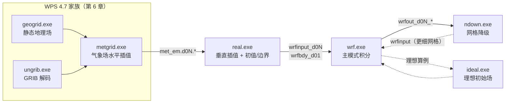
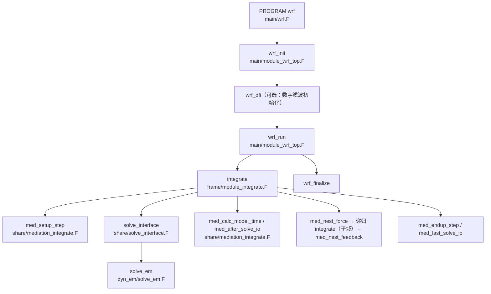
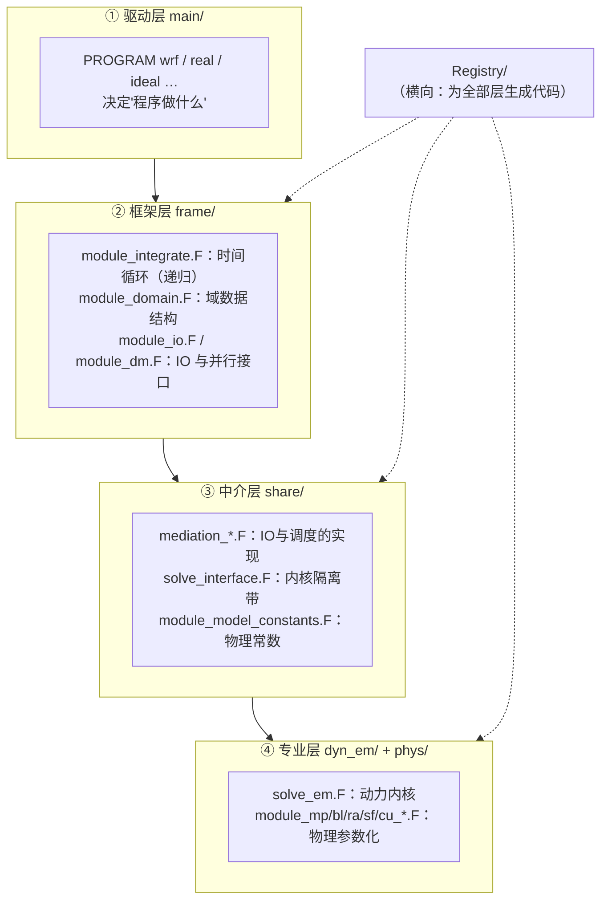

# 第 3 章 架构总览：一次预报的完整生命周期

> **本章定位**：第 II 部的开篇。不写任何物理，只回答一个工程问题——**一个气象场从“可执行文件被敲下回车”到“wrfout 文件落盘”，代码里到底发生了什么？**
> 本章建立的“调用链地图”和“目录树地图”将贯穿全书：后面每一章（改物理、加变量、调 IO）都会回到这里取坐标。

---

## 3.0 本章地图

### 你将在本章学会

1. WRF 四个可执行文件（wrf.exe / real.exe / ndown.exe / tc.exe）各自干什么、入口在哪；
2. 一次预报的完整调用链，精确到“文件 + 子程序”级别；
3. **WRF 的四层架构**（驱动层 / 框架层 / 中介层 / 专业层）——这是日后“改造 WRF”的导航地图：想改什么，就去哪一层；
4. 顶层目录树中每个目录的职责（拒绝黑盒）；
5. 两个贯穿全书的机制：**递归 integrate**（嵌套域如何推进）与 **med_* 中介函数**（IO 与调度如何被抽象）；
6. 实测：如何检查一个编译产物的依赖与版本（以及一个真实的坑：老集群上 `ldd` 会骗人）。

### 源码锚点总表（本章全部经过实测核验）

| 主题 | 文件 | 关键符号 |
|---|---|---|
| wrf.exe 入口 | `main/wrf.F` | `PROGRAM wrf` |
| 顶层初始化/运行/收尾 | `main/module_wrf_top.F` | `wrf_init`、`wrf_dfi`、`wrf_run`、`wrf_finalize` |
| 时间循环（心脏） | `frame/module_integrate.F` | `integrate`（递归） |
| 内核调用胶水 | `share/solve_interface.F` | `solve_interface` |
| 动力内核 | `dyn_em/solve_em.F` | `solve_em` |
| 中介层实现 | `share/mediation_integrate.F` | `med_setup_step`、`med_before_solve_io`、`med_last_solve_io`、`med_nest_force`、`med_nest_feedback`、`med_calc_model_time` 等 |
| 数据读入中介 | `share/mediation_wrfmain.F` | `med_initialdata_input`、`med_shutdown_io` |
| real.exe 入口 | `main/real_em.F` | `PROGRAM real_data` |
| ideal.exe 入口 | `main/ideal_em.F` | `PROGRAM ideal` |
| ndown.exe 入口 | `main/ndown_em.F` | `PROGRAM ndown_em` |
| tc.exe 入口 | `main/tc_em.F` | `PROGRAM tc_data` |
| 版本声明 | `inc/version_decl` | `release_version = 'V4.8.0'` |
| 理想算例集 | `test/`（15 个子目录） | `em_real`、`em_les`、`em_quarter_ss` … |
| 运行时数据 | `run/`（93 个文件） | `namelist.input`、`VEGPARM.TBL`、`RRTMG_LW_DATA` … |

### 读者前置

- 已会用 `cluster.py`（本项目工具）或任意方式在集群上执行命令；
- Fortran 能看懂 `USE`、`CALL`、`MODULE`、派生类型（`TYPE(x)`）；
- 不需要任何大气物理背景。

---

## 3.1 程序族：四个可执行文件

WRF 编译完成后，`main/` 目录下会生成四个核心可执行文件。先建立第一层印象——**它们不是四个平级的程序，而是“预处理 → 主模式 → 后续处理”的流水线成员**：



| 可执行文件 | 入口源文件 | 职责（一句话） | 典型输入 → 输出 |
|---|---|---|---|
| `wrf.exe` | `main/wrf.F` | **主模式**：从初值出发按时间步进积分，输出预报场 | `wrfinput_d0N` + `wrfbdy_d01` → `wrfout_d0N_*` |
| `real.exe` | `main/real_em.F` | 把 WPS 的 met_em 转成模式初值/边界：**垂直插值、基态构造、静力平衡检查**（第 7 章全文精讲） | `met_em.*` → `wrfinput_d0N`、`wrfbdy_d01` |
| `ndown.exe` | `main/ndown_em.F` | **网格降级**：粗网格结果插值生成细网格初值（用于“先粗后细”的两段式模拟） | `wrfout_d01` → 细网格 `wrfinput` |
| `tc.exe` | `main/tc_em.F` | **热带气旋个例**：把人工台风涡旋植入初始场 | `wrfinput` → `wrfinput`（含 bogus 涡旋） |

另有三个“非默认产出”的入口，知道即可（本教材不展开）：

- `main/ideal_em.F` → `ideal.exe`：**理想算例初始化**（配合 `test/` 目录，第 18 章实操）。注意它的 `PROGRAM` 名就是 `ideal`，与文件名不同——读源码时别被文件名误导。
- `main/convert_em.F` → `convert.exe`：老旧中间格式转换工具。
- `main/wrf_ESMFMod.F`、`main/wrf_SST_ESMF.F`：与 ESMF/NUOPC 耦合器接口（地球系统耦合用，本教材不展开）。

> **细节实证（四个入口的真实 PROGRAM 名）**：`main/wrf.F` → `PROGRAM wrf`；`main/real_em.F` → `PROGRAM real_data`；`main/tc_em.F` → `PROGRAM tc_data`；`main/ndown_em.F` → `PROGRAM ndown_em`；`main/ideal_em.F` → `PROGRAM ideal`。**注意 real/tc 的程序名与文件名完全不同**（`real_data`/`tc_data`）；同一目录下 `real_nmm.F` 的 PROGRAM 名同样是 `real_data`——两个内核的入口共享程序名（构建时只编译其一），这是 WRF 支持 ARW/NMM 双内核时代的遗留痕迹（命名缘由无官方文档说明，此处只记录事实）。搜索代码时永远以 `PROGRAM`/`SUBROUTINE` 声明为准，别猜文件名。这类“常识写不对”的坑，正是本教材坚持“一切结论以源码实测为准”的原因。

### 版本从哪来？

每个程序启动时打印的版本号并非手写，而是来自一个专门的 include 文件：

```fortran
! inc/version_decl 全文关键行
CHARACTER (LEN=*), PARAMETER :: release_version = 'V4.8.0'
```

`main/module_wrf_top.F` 的 `wrf_init` 里用它与程序名拼出：

```fortran
program_name = "WRF " // TRIM(release_version) // " MODEL"
```

所以你在 `rsl.out` 里看到的 `WRF V4.8.0 MODEL` 字样，源头就是 `inc/version_decl`。**这是验证“你手上这份源码到底是什么版本”的最快方法**——比看 README 更硬（第 2 章会讲 WRF 版本演化的完整脉络）。

---

## 3.2 一次预报的生命周期：主调用链

### 3.2.1 全景图

以下调用链为本章逐文件核验的实录（括号内为定义所在的源文件）：



把它读三遍，本章后面所有内容都是给这张图加注释。

### 3.2.2 wrf_init：起飞前的六件事

`wrf_init`（`main/module_wrf_top.F`）做的事情可以用六个短语概括，全部核验自源码：

1. **程序自报家门**：设置 `program_name`（见上节）。
2. **两阶段初始化 `init_modules`**：先 `init_modules(1)`（在 MPI 初始化**之前**），再 `init_modules(2)`（在 MPI 初始化**之后**）。这种“两阶段”模式是 MPI 程序的经典写法：能用单进程做的事（读文件、解析参数）放在 MPI_INIT 前，做完了再进并行世界。`init_modules` 会调用所有被链接进来的模块各自的初始化例程。

   ```fortran
   ! main/module_wrf_top.F（wrf_init 内）
   CALL init_modules(1)
   CALL WRFU_Initialize( defaultCalKind=WRFU_CAL_GREGORIAN )
   CALL init_modules(2)
   ```

   注意中间那行 `WRFU_Initialize`——**WRF 的时间管理器**（源自 ESMF 的时间库，代码在 `external/esmf_time_f90/`）。后面所有“闹钟”（什么时候输出、什么时候读边界）都由它管，第 4 节细说。

3. **读 namelist**：调用 `initial_config`，把 `namelist.input` 的内容装进 `model_config_rec` 这个巨型配置结构。分布式内存（dmpar）时只有主进程（monitor）读文件，然后广播给所有进程：

   ```fortran
   ! main/module_wrf_top.F（wrf_init 内，节选）
   #ifdef DM_PARALLEL
      IF ( wrf_dm_on_monitor() ) THEN
        CALL initial_config
      ENDIF
      CALL get_config_as_buffer( configbuf, configbuflen, nbytes )
      CALL wrf_dm_bcast_bytes( configbuf, nbytes )
      CALL set_config_as_buffer( configbuf, configbuflen )
   ```

   **这是“并行一致性”的第一个范例**：一个进程做 I/O，广播共享，避免 N 个进程各读一遍。以后你加自己的配置项时（第 20 章），也要走这个结构。

4. **物理套件配置与一致性检查**：
   ```fortran
   CALL setup_physics_suite
   CALL set_derived_rconfigs
   CALL check_nml_consistency
   CALL set_physics_rconfigs
   ```
   `check_nml_consistency` 就是 `share/module_check_a_mundo.F` 里的检查逻辑——你 namelist 写错方案组合时，wrf.exe 启动即报错并提示，多半出自这里。

5. **建立并行通信域**：`wrf_dm_initialize`（`frame/module_dm.F` 一派），确定本进程负责哪块网格。

6. **分配并初始化顶层域**：`alloc_and_configure_domain` + `Setup_Timekeeping`（后续 3.3 节说“域”是什么）。

> **可核验提示**：以上六步之外，`wrf_init` 在 dmpar 下还做 I/O quilt 进程的分配（哪些进程当“IO 服务器”）。这部分第 9 章（IO 体系）展开。

### 3.2.3 wrf_run：一行代码的重量

wrf_init 完成后，`main/module_wrf_top.F` 的 `wrf_run` 只做一件大事：

```fortran
! main/module_wrf_top.F（wrf_run 内）
CALL integrate ( head_grid )
```

`head_grid` 是**最外层域**（d01）的指针。整个模拟——几天到几个月、几百万个时间步——都是这一行触发的。进入 `integrate` 之后，控制权直到模拟结束才交还。

### 3.2.4 integrate：模式的心脏

`integrate` 在 `frame/module_integrate.F`。它是**递归子程序**（源码中通过接口声明支持递归调用），这是 WRF 处理嵌套域的关键设计。其主干（为可读性做了等价简化，关键字句保留原文）：

```fortran
! frame/module_integrate.F（integrate 主干，节选与等价简化）
IF ( .NOT. domain_clockisstoptime( grid ) ) THEN          ! ① 整体没过停止时刻
   ...
   DO WHILE ( .NOT. domain_clockisstopsubtime( grid ) )   ! ② 推进一步（子步循环）
      CALL med_setup_step ( grid , config_flags )         ! ③ 步前准备（IO 闹钟等）

      DO WHILE ( nests_to_open( grid , nestid , kid ) )   ! ④ 该开嵌套了吗？
         CALL alloc_and_configure_domain ( ... )
         CALL Setup_Timekeeping ( new_nest )
         CALL med_nest_initial ( grid , new_nest , config_flags )
      END DO

      CALL med_before_solve_io ( grid , config_flags )    ! ⑤ 步前 IO

      grid_ptr => grid
      DO WHILE ( ASSOCIATED( grid_ptr ) )                 ! ⑥ 对本层所有"兄弟"域
         CALL solve_interface ( grid_ptr )                !    ★ 动力内核入口
         CALL domain_clockadvance ( grid_ptr )            !    推进时钟
         grid_ptr => grid_ptr%sibling
      END DO

      CALL med_calc_model_time ( grid , config_flags )    ! ⑦ 记录模式时间
      CALL med_after_solve_io ( grid , config_flags )     ! ⑧ 步后 IO（诊断/输出）

      DO kid = 1, max_nests                                ! ⑨ 对每个子域：
         CALL med_nest_force ( grid_ptr , child )         !    父→子 边界强制
         CALL integrate ( child )                         !    ★ 递归推进子域
         CALL med_nest_feedback ( grid_ptr , child , ...) !    子→父 反馈（如开启）
      END DO

      CALL med_endup_step ( grid , config_flags )         ! ⑩ 步末收尾
   END DO
   ...
END IF
```

请特别注意三点（也是本书反复回访的三处）：

1. **循环变量是“时钟”不是“计数器”**：`domain_clockisstoptime` / `domain_clockisstopsubtime` / `domain_clockadvance` 全部由 WRFU 时间管理器提供。“子步”（subtime）机制专为嵌套域设计：子域在自己的时间轴上递归调用 `integrate`，自然地实现不同域用不同时间步（父域 1 步 = 子域 3 步，对应 namelist 的 `time_step` 与 `parent_time_step_ratio`）。
2. **⑥ 与 ⑨ 构成“同层并列 + 跨层递归”双重循环**：`sibling` 指针横向扫过同一父域下的所有子域；`integrate(child)` 纵向潜入下一层。一张“域树”（domain tree，`frame/module_domain.F` 的 `parents`/`nests`/`sibling` 指针）撑起了全部嵌套逻辑。
3. **med_* 函数把 IO 与调度“插”进循环**：③⑤⑧⑩ 全部是 `med_` 前缀的中介函数。它们在 `frame/module_integrate.F` 里**只有接口声明，实现在 `share/mediation_integrate.F`**——这是下一节“四层架构”的直接证据。

### 3.2.5 solve_interface 与 solve_em：从框架到内核

`integrate` 的第 ⑥ 步调用 `solve_interface`（`share/solve_interface.F`）。这个只有 80 行的文件是**框架层与动力学内核之间的隔离带**（文件头注释自称 `!WRF:MEDIATION_LAYER:ADT_BARRIER`），核心逻辑：

```fortran
! share/solve_interface.F（节选）
CALL model_to_grid_config_rec ( grid%id , model_config_rec , config_flags )
CALL set_scalar_indices_from_config ( grid%id , idum1 , idum2 )

CALL solve_em ( grid , config_flags &
! 参数列表由 include 文件展开
# include "actual_new_args.inc"
              )
```

两个技术细节：

- `actual_new_args.inc` 是**编译期生成的文件**（由构建系统从 Registry 生成，第 4 章详讲）。它展开成 59 个**附加实参**（4D 数组及其边界数组；其余状态变量统一通过 `grid` 域指针进入）。“WRF 的 solve_em 有一千多个参数”的传说实际对应旧约定文件 `actual_args.inc`（本构建 2749 项）——它是历史遗存，EM 主路径已不使用。详见第 4 章 §4.3.6（附勘误说明）。
- `model_to_grid_config_rec` 做的是“全局配置 → 本域配置”的复制（模式级 `model_config_rec` → 域级 `config_flags`）。WRF 里几乎所有子程序都靠 `config_flags` 获得 namelist 参数——这就是“**namelist 变量在代码里如何被读到**”的标准答案：不是每次都去查表，而是在入口处复制一次，然后一路传引用。

随后进入 `dyn_em/solve_em.F`（约 5200 行）——动力内核的时间步进主体。它的内部结构（RK 分裂、声波小步长、物理调用点）是第 21 章的主题；本章只需知道：**它是递归调用链的最深端，是把物理与动力学真正“算出来”的地方**。

### 3.2.6 数据流的另一半：初始化读入与收尾

`wrf_run` 开始之前，还有一个动作发生在 `wrf_init` 的深处：**把 real.exe 生成的初值读进来**。负责者是 `share/mediation_wrfmain.F` 的 `med_initialdata_input`——它读取 `wrfinput_d01`、`wrfbdy_d01`，并（首次运行时）触发 `start_domain` 做域初始化。模拟结束后，`wrf_finalize` → `med_shutdown_io` 递归关闭所有域的 IO 流。

至此闭环：**读初值（mediation_wrfmain）→ 时间循环（integrate）→ 每步插 IO（mediation_integrate）→ 算内核（solve_em）→ 收尾（med_shutdown_io）**。

---

## 3.3 源码目录树与四层架构

### 3.3.1 顶层目录树（实测清单）

以下是 WRF 4.8.0 源码树顶层目录的完整职责表（本地源码实测；带 ★ 的是本教材重点）：

| 目录 | 职责 | 代表文件/子目录 |
|---|---|---|
| `main/` | ★ **程序入口层**：所有可执行文件的 `PROGRAM` 与顶层驱动 | `wrf.F`、`real_em.F`、`module_wrf_top.F` |
| `frame/` | ★ **框架层**：域数据结构、时间循环、IO 接口、MPI 通信、Registry 生成物落点 | `module_domain.F`（domain 类型）、`module_integrate.F`（integrate）、`module_io.F`、`module_dm.F`、`nl_get_*.F`（生成） |
| `share/` | ★ **中介层**：IO/调度的“实现”、跨内核公共工具、大量物理辅助模块 | `mediation_*.F`、`solve_interface.F`、`module_model_constants.F`、`module_check_a_mundo.F` |
| `dyn_em/` | ★ **动力学内核**（ARW）：时间步进主体、平流/扩散/阻尼、嵌套初始化 | `solve_em.F`、`module_small_step_em.F`、`module_advect_em.F`、`module_initialize_real.F` |
| `phys/` | ★ **物理参数化层**：微物理、辐射、边界层、陆面、积云、城市冠层…… | `module_radiation_driver.F`、`module_mp_*.F`、`module_bl_*.F`、`module_sf_*.F` |
| `Registry/` | ★ **变量声明中枢**：所有状态变量/维度/IO 流的“户口本” | `Registry.EM_COMMON`、`registry.dimspec`、`registry.io_boilerplate` |
| `inc/` | 全局 include 文件 | `version_decl`、`wrf_io_flags.h` 等 |
| `external/` | 外部依赖与 IO 后端 | `esmf_time_f90/`（WRFU 时间库）、`io_netcdf/`、`io_pnetcdf/`、`RSL_LITE/`（通信） |
| `run/` | ★ **运行时数据与模板**：TBL 查找表、namelist 模板、化学/辐射数据 | `namelist.input`、`VEGPARM.TBL`、`RRTMG_LW_DATA`（共 93 个文件） |
| `test/` | ★ **理想算例集**（15 个） | `em_real/`、`em_les/`、`em_quarter_ss/`（第 18 章全表） |
| `arch/` | 编译配置定义（stanza 模板） | `Config.pl`、`configure.defaults`、`preamble`、`postamble` |
| `cmake/` | **CMake 构建体系**（新） | `wrf_case_setup.cmake`、`modules/`、`template/` |
| `tools/` | 构建与辅助工具 | `CodeBase/`（含 registry 生成程序）、`manage_externals/` |
| `chem/` | 化学模块（WRF-Chem，本教材不展开） | — |
| `var/` | 资料同化（WRFDA，不展开） | — |
| `hydro/` | 水文扩展（不展开） | — |
| `wrftladj/` | 切线/伴随模式（WRFPLUS，不展开） | — |
| `confcheck/` | 配置检查脚本 | — |

另有构建脚本（顶层）：`configure` / `compile`（传统）、`configure_new` / `compile_new`（CMake）、`clean`。

### 3.3.2 四层架构：改造 WRF 的导航图

把上面的目录按“层次”重新摆放，就得到 WRF 最核心的架构视图。**这张图决定了你以后“想改功能该动哪里”**：



**分层设计的关键证据**（也是“为什么这么分”的答案）：同一组 `med_*` 函数，**接口声明在 `frame/module_integrate.F`，实现在 `share/mediation_integrate.F`**。框架层说“我需要一个'步前准备'的钩子”，中介层说“我来实现”。于是：

- 想改 **IO 时机**（多久输出一次、输出什么）→ 动 `share/mediation_integrate.F`（`med_before_solve_io`/`med_after_solve_io`）+ namelist；
- 想改 **时间推进逻辑**（步长策略、nest 反馈顺序）→ 动 `frame/module_integrate.F`；
- 想改 **动力内核**（方程、离散）→ 动 `dyn_em/`；
- 想改 **物理过程** → 动 `phys/`，并在 `phys/module_*_driver.F` 里接线；
- 想 **加一个变量** → 先动 `Registry/`（第 4 章），让它贯穿全层。

> **给未来改造者的第一条军规**：动任何一处之前，先问“这个问题属于哪一层”。WRF 的层次不是装饰——跨层乱改（比如在 `share/` 里直接调 `phys/` 内部子程序）是后期维护噩梦的开始；本书第 20 章的三个改造实战都严格按层次走。

### 3.3.3 编译期生成物：你会经常撞见的“陌生文件”

初次读 WRF 源码的人会被一批“看起来像手写、但到处找不到定义”的文件困扰，它们全是**编译期自动生成**的：

| 生成物 | 生成者 | 用途 | 详情 |
|---|---|---|---|
| `actual_new_args.inc` | 构建系统（Registry 链路） | `solve_em` 等子程序的**附加实参列表**（4D 数组与边界数组，实测 59 项） | 第 4 章 §4.3.6 |
| `frame/module_state_description.F` | 同上 | 方案号/标量索引的 `PARAMETER` 定义（如 `THOMPSONAERO`） | 第 4 章 |
| `frame/nl_get_*.F`、`nl_set_*.F` | 同上 | namelist 逐项 get/set 例程（**真正内容在 `inc/nl_config.inc`**，经 cpp 分 16 片编译；源码树里的 `.F` 只是占位桩） | 第 4 章 §4.2.4、§4.3.4 |
| `share/solve_em.int` 内的 `dummy_new_args.inc` | 同上 | 接口形参声明（`solve_em.int` 本身是签入的模板，include 的是生成物） | 第 4 章 §4.3.6 |

**实践建议**：读源码时如果看到 `USE module_state_description` 或 `include “xxx.inc”` 而找不到文件，先别慌——到 `frame/`、`inc/` 或构建目录里找生成物，或者直接用“生成逻辑”反推（第 4 章手把手做一遍）。这正是第 4 章存在的意义。

---

## 3.4 三个贯穿全书的机制

### 3.4.1 递归 integrate 与域树

- 数据结构：`frame/module_domain.F` 的派生类型 `domain` 中，`parents(:)`、`nests(:)`、`sibling` 三个指针数组构成“域树”；
- 推进方式：父域一步 → `med_nest_force` 把父域状态插值给子域边界 → **递归** `integrate(子域)` 让子域自己按自己的时间步跑 → 可选 `med_nest_feedback` 把子域结果反馈回父域；
- 你在 `test/em_real/namelist.input` 里写的 `max_dom`、`parent_id`、`parent_grid_ratio`、`i_parent_start`……全部是在描述这棵树（第 6–7 章逐项精讲）。

### 3.4.2 med_* 中介函数

中介层的全集（`share/mediation_integrate.F` + `mediation_wrfmain.F` + 三个 `mediation_*_domain.F`）按职能分组：

| 职能 | 函数（节选） | 被谁调用 |
|---|---|---|
| 步前/步后 IO | `med_before_solve_io`、`med_after_solve_io`、`med_last_solve_io` | `integrate` |
| 时间与日志 | `med_calc_model_time`、`med_setup_step`、`med_endup_step` | `integrate` |
| 嵌套协调 | `med_nest_initial`、`med_nest_force`、`med_nest_feedback`、`med_nest_move` | `integrate`（含递归） |
| 初值/收尾 | `med_initialdata_input`、`med_shutdown_io` | `wrf_init` / `wrf_finalize` |
| 插值/反馈实现 | `med_interp_domain`、`med_feedback_domain`、`med_force_domain` | `mediation_*_domain.F` |

记住这个模式：**框架层给钩子，中介层做脏活**。第 8 章讲 restart、第 9 章讲 IO 体系时，你会在这些函数里进进出出。

### 3.4.3 WRFU 时间管理器

- 位置：`external/esmf_time_f90/`；
- 角色：所有“时钟”对象（`domain%alarms`、`domain_clock*` 系列函数）的提供者；
- 为什么重要：输出间隔、边界条件更新、restart 时机全由“闹钟”（Alarm）驱动。namelist 里的 `history_interval`、`frames_per_outfile`、`restart_interval` 最终都变成闹钟参数；
- 在第 8 章（restart）与第 9 章（IO）会大量使用。本章只需记住：**看到 `WRFU_` 前缀或 `_Alarm_`、`domain_clock` 字样的代码，都出自这个库**。

---

## 3.5 动手实操：集群编译产物巡览（实录）

> 本节所有输出为真实执行记录（集群 `/users/zhyuancheng2025/IceLake/wrf-4.8/build/WRF`，2026-10 构建）。

### 3.5.1 四件套与体积

```text
$ ls -la main/*.exe
ndown.exe   69930960   （≈67 MB）
real.exe    53715896   （≈51 MB）
tc.exe      52305920   （≈50 MB）
wrf.exe     82647976   （≈79 MB）
```

79 MB 的单一可执行文件，作为对照：一个典型 Linux 内核才 ~10 MB。WRF 把整个模式（含 15+ 微物理方案、10+ 边界层方案的全部代码）编成了这一个文件——**“方案选择”是运行时行为（namelist 决定），不是编译时行为**。这与很多“一个方案一个库”的模式设计不同，也是为什么它这么大。

### 3.5.2 检查二进制依赖：一个真实的坑

假设你要检查 wrf.exe 依赖哪些动态库，教科书做法是 `ldd`。但在老集群（CentOS 7 登录节点）上，你会看到：

```text
$ ldd main/wrf.exe
        not a dynamic executable
```

`not a dynamic executable`（“不是动态可执行文件”）！如果你据此认为“WRF 被静态链接了”，就**完全错了**。换用 `file` 与 `readelf` 交叉验证：

```text
$ file main/wrf.exe
... ELF 64-bit LSB executable, x86-64, ... dynamically linked (uses shared libs), ... not stripped

$ readelf -d main/wrf.exe
Dynamic section ... contains 39 entries:
 0x... (NEEDED)  Shared library: [libnetcdff.so.7]
 0x... (NEEDED)  Shared library: [libnetcdf.so.19]
 0x... (NEEDED)  Shared library: [libpnetcdf.so.7]
 0x... (NEEDED)  Shared library: [libimf.so]
 0x... (NEEDED)  Shared library: [libm.so.6]
 ...
```

真相：wrf.exe 是**动态链接**的，依赖 netCDF-Fortran、netCDF、PnetCDF（并行 IO）与 Intel Fortran 运行库（`libimf.so` 等）。`ldd` 的误报是老环境里 ldd 脚本对某些二进制的解析缺陷——**这类“工具撒谎”时刻，就是 `file` + `readelf -d` 的组合存在的意义**。

> **经验法则**（写进你的工具箱）：判断一个二进制的链接方式与依赖，永远用两条独立证据交叉验证：
> ① `file xxx.exe` → 看 `dynamically linked` / `statically linked`；
> ② `readelf -d xxx.exe | grep NEEDED` → 列出全部共享库依赖。
> 单一 `ldd` 的结论不可信（它本质上是“试着运行加载器”，在异构环境里行为不稳定）。

顺带地，`libpnetcdf.so.7` 的出现直接告诉我们：**这份构建启用了并行 netCDF IO**（对应 namelist 的 `io_form_history = 11`，第 9 章）。一次 readelf，就能反推构建配置——这是“读二进制”的乐趣。

### 3.5.3 run/ 目录：程序的“饭桌”

`run/` 是运行 wrf.exe/real.exe 的工作目录模板（93 个文件，实测部分清单）：

| 类别 | 文件（节选） | 给谁用 |
|---|---|---|
| namelist | `namelist.input`、`README.namelist` | 全部程序 |
| 陆面/下垫面参数表 | `VEGPARM.TBL`、`SOILPARM.TBL`、`LANDUSE.TBL`、`GENPARM.TBL` | Noah 等陆面方案（第 16 章） |
| 城市冠层 | `URBPARM.TBL`、`URBPARM_LCZ.TBL`、`URBPARM_UZE.TBL` | SLUCM/BEP/BEM（第 17 章） |
| 辐射数据 | `RRTMG_LW_DATA`、`RRTMG_SW_DATA`、`RRTM_DATA`、`CAM_ABS_DATA` | 辐射方案（第 12 章） |
| 微物理查找表 | `p3_lookupTable_*`、`ETAMPNEW_DATA`、`ishmael-*.bin` | 各微物理方案（第 13 章） |
| 其他 | `ozone.formatted`、`aerosol.formatted`、`CCN_ACTIVATE.BIN` | 化学/气溶胶相关 |
| 运行输出样例 | `rsl.out.0000`、`rsl.error.0000` | ——（说明此目录曾被执行过 wrf.exe） |

**一个重要的工程结论**：wrf.exe **必须在包含这些 TBL/DATA 文件的目录里运行**。程序启动时会从当前目录读取它们；缺文件时立即报错（`VEGPARM.TBL` 找不到是最常见的新手错误）。所以标准工作流是把 `run/` 里需要的文件复制（或软链接）到你的个例目录——第 6–8 章的实操会反复做这件事。

### 3.5.4 构建双轨：你看到的两套脚本

顶层既有 `configure` + `compile`，又有 `configure_new` + `compile_new`，这不是冗余：

| 体系 | 文件 | 特点 | 本教材用法 |
|---|---|---|---|
| 传统 | `configure`（sh，调用 `arch/Config.pl` 读 `arch/configure.defaults`）→ 生成 `configure.wrf`；`compile`（csh）→ 按 `configure.wrf` 编译 | 成熟、社区示例最多 | 集群上已用此体系编译（编译手册·第 5 章） |
| CMake（新） | `configure_new`（支持 `-p` 预选 stanza、`-- 传 CMake 选项`）→ `compile_new`（默认在 `_build/` 目录构建） | 现代化、支持安装目录 `-i` | 第 5 章精讲 + 实操对比 |

两套体系的产物是等价的（同一份源码、同一个编译器配置），**CMake 路线是 WRF 4.x 后期引入并逐步成熟的**——这正是第 2 章“模式演化”要讲的故事之一。本章只需记住它们的位置与分工。

---

## 3.6 常见错误与速查（本章版）

| 现象 | 原因 | 处理 |
|---|---|---|
| 找不到 `actual_new_args.inc` / `module_state_description.F` | 它们是编译期生成物，不在源码树里手写 | 到 `frame/` 或构建目录找；理解生成逻辑（第 4 章） |
| `ldd` 说 “not a dynamic executable” | 老环境 ldd 解析缺陷 | 用 `file` + `readelf -d` 复核（§3.5.2） |
| wrf.exe 启动时找不到 `VEGPARM.TBL` 等 | 没在“含 run/ 数据文件”的目录里运行 | 复制/软链 run/ 数据到个例目录（§3.5.3） |
| 找不到想改的代码位置 | 文件名 ≠ 程序名/子程序名 | 用 `grep -rn “SUBROUTINE 名字”` 全树定位，别猜文件名 |
| 想找“某个 namelist 项在代码里哪读的” | 它不是被直接读的 | 通过 `config_flags%xxx` 使用；读取发生在 `initial_config`（第 4、7 章） |
| 编译后程序行为与预期不符 | 改错层（四层架构 §3.3.2） | 先画清“属于哪一层”，再动手 |

---

## 3.7 延伸阅读

- **WRF-ARW 技术说明**：NCAR《ARW Version 4 Modeling System User's Guide》第 1–2 章（架构与程序流程的官方描述，与本实录互相印证）；
- **WRF 源码内文档**：`main/wrf.F`、`frame/module_integrate.F` 文件头的 `<DESCRIPTION>` 注释块——WRF 源码自带“文档”，用 Doxygen 格式写成，读源码前先读它；
- **第 2 章**（本书）：WRF 4.x → 4.8.0 的演化，理解你手上这版的来路；
- **第 4 章**（本书）：Registry 机制——本章反复提到的“编译期生成物”的制造者；
- **第 21 章**（本书）：`solve_em.F` 全流程——本章停在门口的那个 5200 行子程序。

---

## 3.8 补充专栏【模块依赖树】：驱动层从入口到内核

> 体例说明（见 ch01 §1.6.2）：本节给出**文件级调用/依赖树**，每个节点标注它提供的主要函数（全部经本地源码 `grep` 实测，括号内为定义位置行号附近）。§3.2 按时间顺序讲了“一次预报怎么跑”，这里按**静态结构**重排同一事实——改驱动层的人请以本节为地图。

```text
main/wrf.F                          PROGRAM wrf（进程入口：WRFU_Init → 三段式）
└─ main/module_wrf_top.F            【顶层驱动模块】
   ├─ wrf_init (line ~137)          起飞前六件事（§3.2.2）：配置读取/域树构造/IO 初始化/…
   ├─ wrf_run (line ~2013)          调用 integrate + 三个 med 节拍
   │   ├─ frame/module_integrate.F  RECURSIVE SUBROUTINE integrate (line 8)
   │   │                            —— 递归域树（§3.4.1）；文件内含 solve_interface /
   │   │                               med_* / jcdfi_* 的 INTERFACE 声明（line 179–212）
   │   ├─ share/solve_interface.F   SUBROUTINE solve_interface
   │   │                            —— 框架↔内核的适配器（§3.2.5）：
   │   │                               actual_new_args.inc 实参展开 → CALL solve_em
   │   │   └─ dyn_em/solve_em.F     SUBROUTINE solve_em（内核本体，第 21 章）
   │   ├─ share/mediation_integrate.F【每步节拍的中介函数】
   │   │   ├─ med_calc_model_time      (line 6)   当前预报时刻计算
   │   │   ├─ med_before_solve_io      (line 29)  步前 IO（历史/边界读入调度）
   │   │   ├─ med_after_solve_io       (line 430) 步后 IO
   │   │   ├─ med_pre_nest_initial     (line 452) 嵌套初始化前置
   │   │   ├─ med_nest_initial         (line 523) 嵌套初始化
   │   │   │   ├─ med_interp_domain        （父→子插值）
   │   │   │   └─ med_interp_domain_small  （小插值版）
   │   │   └─ med_last_ad_solve_io     (line 383)（WRFPLUS 伴随专用节拍）
   │   └─ share/mediation_wrfmain.F【起跑/收尾的中介函数】
   │       ├─ med_initialdata_input (+ _ptr)   读 wrfinput/wrfbdy → start_domain
   │       └─ med_shutdown_io (+ recurse)      收尾 IO
   └─ wrf_finalize (line ~2094)     收官（IO 关闭、内存释放、WRFU_Finalize）
```

**读树三则**：

1. **WRFPLUS 的“平行世界”就在这棵树里**：`module_wrf_top.F` 除 `wrf_run` 外还有 `wrf_run_tl`（line ~1435，切线性）、`wrf_run_ad`（line ~1678，伴随）及各自的 `_standalone` 变体——同一文件服务两套驱动模式（见 §3.9 案例一）；
2. **mediation 层是“节拍器”**：每步的 IO、每步的边界读入、嵌套初始化全部挂在 `med_*` 上。想“在某时刻插入自己的物理/诊断调用”，第一候选位置永远是 mediation 层或 solve_em 的物理段之后（ch20 一级的选位即此逻辑）；
3. **依赖方向单一**：`module_wrf_top` 依赖 `module_domain`（域树）、`module_dm`（并行）、`module_configure`（namelist 配置）三大框架件；`solve_em` 不回过头来调用 mediation——内核只知道物理，不知道 IO。这层边界就是 §3.3.2 四层架构的“代码版”。

---

## 3.9 补充专栏【科研改造案例库】：驱动层三案

### 案例一　WRFPLUS：把整个驱动层复制成“切线性/伴随”版

- **课题**：资料同化与敏感性分析（4DVar 需要切线性 TL 与伴随 AD 模式）；
- **改造对象**：`main/module_wrf_top.F`、`share/mediation_*.F`、`dyn_em/`（整套内核）→ 全部复制改写到 **`wrftladj/`** 目录；
- **原代码 vs 修改后**：不是“改”，而是“平行复制”——同一个 `module_wrf_top.F` 里 `wrf_run`（正算）、`wrf_run_tl`（切线性）、`wrf_run_ad`（伴随）并存，编译期由 `WRFPLUS=0/1` 宏选择（configure.wrf 的 `-DWRFPLUS=0` 可在本书编译命令里见到）；
- **收录方式**：情况③（思路级）——TL/AD 的逐行改写超出本书范围，但架构事实全部可核：`doc/README.WRFPLUS`、`wrftladj/` 目录、`module_wrf_top.F` 的四个 `_tl/_ad` 子程序（§3.8 读树一则）；
- **教学点**：驱动层“薄”（没有物理公式），改造通常不是改公式而是**加节拍/复制平行版本**——动手前先画 §3.8 那棵树。

### 案例二　WRF-Hydro：国家级水模型如何挂在 WRF 上

- **课题**：陆水文耦合（洪水预报、美国国家水模型 NWM 的动力内核）；
- **改造对象**：源码树新增顶层 **`hydro/`** 目录（本地树已核）；Noah/NoahMP 的地表产流交给陆文模块做地形路由；
- **原代码 vs 修改后**：情况③（架构级描述）——耦合切口在物理段与驱动层交界（LSM 输出 → 水文路由 → 部分通量回写），4.6 起 hydro 支持 CMake 构建、源文件全部改 `.F90`（4.6 release notes 原文）；
- **教学点**：**跨圈层耦合项目选择“新目录 + 最小切口”**，而不是把水文代码塞进 `phys/`——目录即模块边界（§3.3.1 目录树）的最好反例教材。

### 案例三　本书 ch20 一级：选位即架构

- **课题**：高温监测（本书教学实验 + 论文 2 的诊断需求）；
- **改造对象**：`dyn_em/solve_em.F`（更新点）＋ `dyn_em/start_em.F`（清零点）＋ Registry（ch04 案例）；
- **原代码 vs 修改后**：情况①·**未上游化**（本书原创补丁——完整代码在 ch20 §20.2.2，三块 diff 齐全；官方源码里没有 `T2_PEAK`，需照章自行实施）；
- **教学点**：`T2_PEAK` 的更新点插在 `first_rk_step_part1` 之后——**这个“在哪里插”的判断完全来自本章的驱动层节拍知识**（物理段产出 T2 → 之后立刻取大 → 每步一次）。读架构章不是白读的。

---

*本章所有源码结论均经本地 `source\WRFv4.8.0\WRFV4.8.0\` 实测核验；集群实录来自 `/users/zhyuancheng2025/IceLake/wrf-4.8/build/WRF`（2026-10）。*