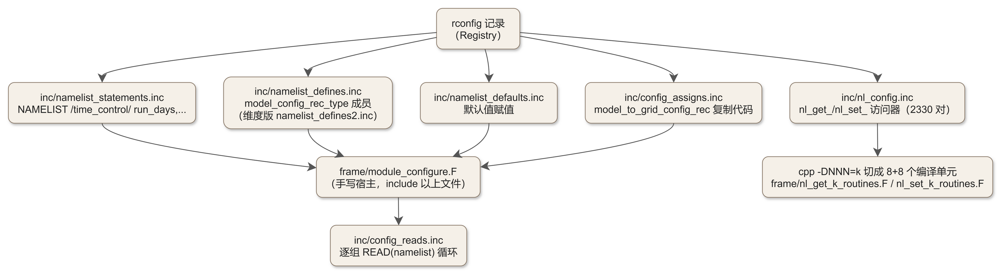

# 第 4 章 Registry 机制：模式的“基因”

> **本章定位**：第 II 部第二站，也是全书第一个真正的“深水区”。第 3 章给了你调用链地图与目录树地图；本章回答一个更底层的问题——**你写下一行变量声明之后，WRF 凭什么能自动把它变成“内存、namelist、IO、嵌套插值、通信”五套代码？**
> 学完本章，你将能够：读懂 `Registry.EM_COMMON` 的每一列、知道每一个生成物从哪来（以及谁在用）、并独立完成“给 WRF 增加一个诊断变量”的完整纸面设计——这正是第 20 章“改造 WRF 一级实战”的图纸。
> 本章所有结论均在本地源码（`source\WRFv4.8.0\WRFV4.8.0\`）与集群实际构建树（`IceLake/wrf-4.8/build/WRF/`）中实测核验。

---

## 4.0 本章地图

### 你将在本章学会

1. **为什么 WRF 需要 Registry**：一个“声明式中枢”如何替代手工维护成千上万行机械代码；
2. Registry 文件家族的 **include 树全貌**：`Registry/Registry`（自动合成）→ `registry.dimspec` → `registry.em_shared_collection` → `Registry.EM_COMMON` 与 20 余个功能 registry；
3. **state 记录的 11 列逐列解剖**，包括最容易读错的一列——IO 字母串；
4. **IO 字母串的完整语法**：`i/h` 流位、`r/b` 特殊位、`f/d/u/s` 嵌套变换，以及生成物里的“位号 ↔ 运行期流号”对照表；
5. **rconfig 与 namelist 的生成链**：从一行 `rconfig` 到 `namelist.input` 被真正读进内存的完整路径；
6. **package 记录**：物理方案号与变量开关的绑定机制（微物理/城市等方案在第 III 部反复回访此处）；
7. **生成链路与生成物地图**：`configure` → `compile` → `make` 如何触发 `tools/registry`，以及它写出的 480 个 `.inc` 文件分别由谁使用；
8. 一份**“给 WRF 加诊断变量”的纸上完整设计**（与第 20 章一级实战同图）。

### 源码锚点总表（本章全部实测核验）

| 主题 | 文件 | 关键符号/片段 |
|---|---|---|
| 核心变量声明 | `Registry/Registry.EM_COMMON` | `state`/`i1`/`rconfig`/`package` 记录（3727 行） |
| 维度定义 | `Registry/registry.dimspec` | `dimspec` 记录（100 条） |
| EM 主装配文件 | `Registry/Registry.EM` | `include registry.dimspec`、`include registry.em_shared_collection` |
| 共享文件清单 | `Registry/registry.em_shared_collection` | 20 余条 `include` |
| 自动合成的构建入口 | `Registry/Registry`（构建树内生成） | 首行警告“autogenerated from Registry/Registry.EM” |
| 合成脚本 | `compile`（WRF 根目录） | `echo '## WARNING ...' > Registry/Registry` + `cat Registry.EM >>` |
| IO 位定义 | `inc/streams.h` | `HISTORY_STREAM`/`INPUT_STREAM`/`MAX_STREAMS`/`BOUNDARY_STREAM`/`RESTART_STREAM` |
| IO 语法解析 | `tools/reg_parse.c` | state 记录 IO 字段解析段（`h/i`、`{n}`、`r`、`b`、`f/d/u/s`） |
| 生成器主体 | `tools/registry.c` | `main` 的 `gen_*` 调用序列 |
| 生成器家族 | `tools/gen_*.c` | `gen_defs.c`、`gen_allocs.c`、`gen_config.c`、`gen_args.c`、`gen_streams.c`、`gen_mod_state_descr.c`、`gen_wrf_io.c`、`gen_scalar_indices.c`、`gen_model_data_ord.c`、`gen_interp.c`、`gen_scalar_derefs.c` |
| 构建触发规则（传统） | `frame/Makefile` | `module_state_description.F : ../Registry/$(REGISTRY)` |
| 构建触发规则（cmake） | `tools/CMakeLists.txt` | `registry ${REGISTRY_DEFS} -DNEW_BDYS ${REGISTRY_FILE}` |
| 通信代码生成来源 | `arch/postamble`、`external/RSL_LITE/gen_comms.c` | `gen_comms_rsllite` 规则 |
| 生成物使用者（例） | `frame/module_domain_type.F` | `#include “state_subtypes.inc”`、`#include “state_struct.inc”` |
| 生成物使用者（例） | `frame/module_domain.F` | `alloc_space_field`、`dealloc_space_field` 内 `#include “allocs.inc”`/`“allocs_calls.inc”`/`“deallocs.inc”` |
| 生成物使用者（例） | `share/solve_interface.F` | `# include “actual_new_args.inc”` |
| 集群构建树实测 | `build/WRF/inc/`、`build/WRF/frame/` | `*.inc` 共 480 个；`module_state_description.F`；`nl_get_*`/`nl_set_*` |

### 读者前置

- 第 3 章的调用链地图（本章会多次回访 `solve_interface` 与 `integrate`）；
- 能读懂 Fortran 的 `TYPE`、`ALLOCATE`、`NAMELIST`；`#include`/`#ifdef` 预处理概念——本章的“代码生成”本质就是“用工具批量写 include 文件”。

---

## 4.1 为什么需要 Registry：一行声明，六处生成

### 4.1.1 先想清楚“不这么干会有多可怕”

假设没有 Registry，你要给 WRF 增加一个 2 m 气温的诊断场 `t2_peak`。为了让它像一个“真正的模式变量”那样工作，你至少要手工维护这些：

1. **域类型声明**：在 `TYPE(domain)` 里加一个 `grid%t2_peak` 字段（第 3 章讲过，域是 `frame/module_domain_type.F` 定义的巨型派生类型）；
2. **内存分配与释放**：在分配流程里写 `ALLOCATE(grid%t2_peak(...))`，释放流程里写 `DEALLOCATE`——还要保证两处的维度边界完全一致；
3. **状态表元数据**：WRF 的 IO 与打包系统不看你的变量本身，而是遍历一张“状态变量表”（每个变量登记：名字、单位、内存序、时间层数、分位、IO 位掩码……）。你要手工补登记；
4. **IO**：让它在 `wrfout` 里出现、在 restart 文件里保存、在边界文件中处理；
5. **嵌套**：开启嵌套时，它要从父域插值到子域（以及可能的反馈）——每个方向、每种插值函数、辅助字段都要写对；
6. **通信**：并行运行时，halo 交换、周期边界、维度换序（x/y/z 方向打包）都需要针对这个变量的代码。

而 WRF 有**上千个**这样的变量。手工维护 6 处 × 上千变量 = 必然失控。WRF 的答案是一块“基因”：**只写一行声明，六处代码全部自动生成**。

### 4.1.2 Registry 的哲学：声明式中枢

**Registry 中一行条目触发的六类代码生成**（详见 ch04 §4.2）：

| 编号 | 生成物 | 对应路径 |
|---|---|---|
| ① 域类型字段 | `inc/state_struct.inc` | `inc/` |
| ② 内存分配/释放 | `inc/allocs_N.F`、`deallocs_N.F` | `inc/` |
| ③ 运行期状态表 + IO 位掩码 | `tail_statevars`（嵌入 allocs 代码） | `frame/` |
| ④ 嵌套插值/反馈 | `inc/nest_*.inc` + IO 字母 `f/d/u/s` | `inc/` |
| ⑤ 通信代码 | `inc/HALO_*.inc`、`PERIOD_BDY_*.inc` | `inc/` |
| ⑥ rconfig 专属 namelist 读写 | `inc/namelist_*.inc`、`nl_config.inc` | `inc/` |

**原始条目示例**：`state real T2 ij misc 1 - i01rh01{22}{23}du ...`


作为一个工程学事实：**WRF 是 Fortran 写的，但 WRF 的可维护性靠一个小型 C 编译器实现**。这个编译器就是 `tools/` 下的 `registry` 程序——它由约二十个 C 源文件（`registry.c` + `reg_parse.c` + `gen_*.c` 家族）编译而成，专门“编译” Registry 这门小语言。你的工作流从此变成：

> 改 Registry（声明）→ 重跑 registry（生成）→ 编译（Fortran）→ 运行。

第 5 章的“增量重编译开发循环”与第 20 章的改造实战都建立在这条链上。

---

## 4.2 文件家族与记录语法

### 4.2.1 家族全景与 include 树

`Registry/` 目录下有 40 余个文件。它们分两类：

**核心文件（EM 构建必经）**

| 文件 | 职责 |
|---|---|
| `Registry.EM_COMMON` | **变量声明主文件**：动力学核心状态、namelist 参数、物理方案开关…… 3727 行 | 
| `registry.dimspec` | 维度定义表（100 条 `dimspec` 记录） |
| `registry.em_shared_collection` | 共享文件清单：把 20 余个功能 registry 汇总进 EM 构建 |
| `registry.io_boilerplate` | IO 标准变量与所有辅助流的 namelist 样板 |
| `Registry.EM` | EM 算例的**主装配文件**（描述性最强、体积最小） |

**功能 registry（按需装入，`registry.em_shared_collection` 决定）**

`registry.fire`（火灾）、`registry.stoch`（随机扰动）、`registry.les`、`registry.cam`、`registry.clm`、`registry.lake`、`registry.ssib`、`registry.noahmp`、`registry.sbm`、`registry.polrad`、`registry.afwa`、`registry.rasm_diag`、`registry.elec`、`registry.bdy_perturb`、`registry.hyb_coord`（混合坐标）、`registry.new3d_wif`、`registry.trad_fields`、`registry.solar_fields`、`registry.diags`、`registry.iau`、`registry.dyn_light`、`registry.CMAQ`、`registry.cordex` ——以及 WRF-Chem/WRFDA 等其它内核专用的 `Registry.EM_CHEM`、`Registry.wrfvar`、`Registry.tladj` 等（本教材不展开）。

`Registry.EM` 全文只有 48 行，它的“装配”靠 include 表达——这是读懂整棵树的入口：

```text
#  Registry file, EM（Registry/Registry.EM，48 行全文的骨架）
#INCLUDES
include registry.dimspec
include registry.em_shared_collection
state   real   landmask  ...（EM 专属少量记录）
state   real   SST       ... 等
package tracer_test1  tracer_opt==2  -  tracer:tr17_1,... 
package restofwrf     use_wps_input==0  -  -
package realonly      use_wps_input==1  -  state:u_gc,...
package tconly        use_wps_input==2  -  state:u_gc,...
```

```text
#  registry.em_shared_collection（节选，完整文件 24 行 include）
include Registry.EM_COMMON
include registry.io_boilerplate
include registry.fire
...（其余 20 项省略）
```

> **Registry 关联**：整个 include 树最终汇成构建树里的 `Registry/Registry` 一个文件（见 4.3.1）。**namelist 关联**：`Registry.EM` 里的 `package realonly/tconly` 与 real.exe 的两个模式（`use_wps_input`）相关，第 7 章讲 real 时会回访。

> **实测统计（Registry.EM_COMMON 单文件）**：3727 行中，`state` 起首的行约 1680 条（真实变量数略多，因为含反斜杠续行）、`rconfig` 约 800 条、`package` 280 条、`halo` 83 条、`typedef` 52 条、`i1` 43 条、`period` 33 条、`xpose` 14 条。这个“词汇表”就是本章下面要逐节讲的记录类型。

### 4.2.2 state 记录：11 列逐列解剖

`Registry.EM_COMMON` 文件头部用注释写明了 state 表的格式（原文）：

```text
# table entries are of the form
#<Table> <Type> <Sym>  <Dims> <Use> <NumTLev> <Stagger> <IO>  <DNAME> <DESCRIP> <UNITS>
```

| 列 | 名称 | 含义与取值 |
|---|---|---|
| 1 | `Table` | 记录类型：`state`（域状态）、`i1`（内核工作存储，见 4.2.7）、`rconfig`、`package`、`halo` 等 |
| 2 | `Type` | Fortran 类型：`real`/`integer`/`logical`/`double`/`character`，也可以是自定义派生类型名 |
| 3 | `Sym` | **变量符号名**（代码里的 `grid%t2`）；填 `-` 表示声明一个“数组族”本身（如 4D 数组，见案例 3） |
| 4 | `Dims` | 维度串，字母顺序**即 Fortran 声明顺序**（EM 中常见 `i`/`k`/`j`，如 `ij`、`ikj`、`ikjb`）；末尾可带修饰符 `b`（边界数组）、`t`（时间层）、`f` |
| 5 | `Use` | 逻辑分组：`misc`（与动力学解耦的杂项）、`dyn_em`（EM 动力学状态）、`tracer`/`chem`（4D 数组成员归属，见案例 3）等 |
| 6 | `NumTLev` | 时间层数（`u/v/w/t` 等预报量为 2；诊断量 1；土壤等为 `-` 表示非时间推进量） |
| 7 | `Stagger` | 网格分位：`X`/`Y`/`Z` 或组合（`XZ`）；`-` 为质量点非分位（交错网格在 ch10/ch21 详讲） |
| 8 | `IO` | **IO 字母串**（本章重头戏，见 4.2.3） |
| 9 | `DNAME` | 输出名：写进 wrfout 的 netCDF 变量名（如 `“T2”`）；`-` 表示不参与 IO |
| 10 | `DESCRIP` | 人类可读描述（wrfout 变量属性 `description`） |
| 11 | `UNITS` | 单位（wrfout 变量属性 `units`） |

#### 案例 1：`T2`——一个“全功能”的 2D 诊断场

```text
state    real   T2    ij   misc   1   -   i01rh01{22}{23}du   "T2"   "TEMP at 2 M"   "K"
```

逐列读：`real`（单精度）、`grid%t2`、二维（`ij` → (west_east, south_north)）、`misc` 组、1 时间层、无分位、IO 串见 4.2.3 全解、wrfout 变量名 `T2`、描述与单位如上。

#### 案例 2：`u`——带边界数组与时间层的预报量

```text
state    real   u   ikjb   dyn_em   2   X   \
     i0rhusdf=(bdy_interp:dt)   "U"   "x-wind component"   "m s-1"
```

注意三点：维度串以 `b` 结尾（带边界数组，生成物里会出现 `u_bxs/u_bxe/u_bys/u_bye/u_btxs/...` 共 4 侧 × 2 类）；2 个时间层（RK 时间推进需要保存上一时刻）；IO 串里的 `f=(bdy_interp:dt)` 给“父→子强制（force down）”指定了插值函数 `bdy_interp` 和辅助参数 `dt`（方括号语法见 4.2.3）。字段行较长时可以用反斜杠续行——Registry 解析器支持。

#### 案例 3：4D 数组族——`moist` 与 `tracer`

4D 数组（第四维是“成员名单”，如 `num_moist`）用两条记录配合声明。以化学示踪物为例（`Registry.EM`）：

```text
state   real    -      ikjftb   chem    1   -   -   -          ← 用 "-" 声明数组族"chem"本身
state   real    -      ikjftb   tracer  1   -   -   -          ← 数组族"tracer"
state   real    tr17_1 ikjftb   tracer  1   -   irhusdf=(bdy_interp:dt)  "tr17_1" ...
state   real    tr17_2 ikjftb   tracer  1   -   irhusdf=(bdy_interp:dt)  "tr17_2" ...
...
package tracer_test1  tracer_opt==2  -  tracer:tr17_1,tr17_2,tr17_3,tr17_4,tr17_5,tr17_6,tr17_7,tr17_8
```

规律：**`Sym` 为 `-` 的记录定义“数组族”（名字取第 5 列 `Use`）**；随后每条成员记录的 `Use` 列填该数组族名，把成员注册进去。成员名单顺序决定索引常量（生成物 `module_state_description.F` 里可见 `PARAM_tr17_1` 这类常量——见 4.2.5）。`Registry.EM_COMMON` 里 `moist` 族的成员就是 `qv/qc/qr/qi/qs/qg/qh` 等水物质——第 13 章微物理会频繁引用 `grid%moist(i,k,j,P_QV)` 的写法，其合法性来源就在这里。

#### 案例 4：`SST_INPUT`——“最少功能”的写法

```text
state    real   SST_INPUT   ij   misc   1   -   rh   "SST_INPUT"   "SEA SURFACE TEMPERATURE FROM WRFLOWINPUT FILE"   "K"
```

IO 串只有 `rh`（restart + history）：一个典型的“只在内部流转、不参与输入流读取与嵌套变换”的变量。

#### 两条“顺序敏感”的隐藏规则（源码注释原文）

Registry 文件的顺序**不是随便排的**，两处注释写得极其直白：

```text
# It is required that LU_INDEX appears before any variable that is
# interpolated with a mask, as lu_index supplies that mask.
...
# znw, znu, dzs, and zs must be listed before any 3-d fields
# in order for the grib output module to work correctly.
```

翻译：`LU_INDEX` 必须在所有使用掩膜插值的变量之前（掩膜由它提供）；`znw/znu/dzs/zs` 必须在任何 3D 场之前（GRIB 输出模块靠它们取垂直层）。**增改变量时，位置就是语义**——这类“代码生成器的隐式契约”正是深水区的典型特征。

> **Registry 关联**：本节全部字段含义直接对应生成物行为；**namelist 关联**：无（state 记录不产生 namelist 项）。

### 4.2.3 IO 字段：语法全解

#### 语法零件表（解析代码：`tools/reg_parse.c` 的 state 记录 IO 解析段）

| 零件 | 含义 | 解析行为（源码级） |
|---|---|---|
| `i` + 数字 | 输入流位：数字给出流号（0–9） | 设 `INPUT_STREAM + 数字` 位（`INPUT_STREAM = HISTORY_STREAM + MAX_HISTORY`） |
| `h` + 数字 | 历史（输出）流位 | 设 `HISTORY_STREAM + 数字` 位；未写数字则设基数位（主输出流） |
| `{n}` | 两位及以上的显式流号（大括号写法） | `atoi` 后设对应流位；`i{22}` 在输入区、`h{22}` 在历史区 |
| `r` | restart 文件 | 置 `restart` 标志 + `RESTART_STREAM` 位 |
| `b` | 边界（boundary）文件 | 置 `boundary` 标志 + `BOUNDARY_STREAM` 位 |
| `f` | 嵌套 **强制**（FORCE_DOWN，父→子） | 置 `nest_mask \|= FORCE_DOWN`，可跟 `=(fcn:aux)` 指定插值函数与辅助字段 |
| `d` | 嵌套 **插值下送**（INTERP_DOWN，父→子） | 置 `INTERP_DOWN`，ARW 缺省函数 `interp_fcn` |
| `u` | 嵌套 **反馈插值**（INTERP_UP，子→父） | 置 `INTERP_UP`，ARW 缺省函数 `copy_fcn` |
| `s` | 嵌套 **反馈平滑**（SMOOTH_UP） | 置 `SMOOTH_UP`，ARW 缺省函数 `smoother` |
| `=(fcn:辅助字段,...)` | 给 f/d/u/s 定制插值函数与参数 | 解析出函数名与辅助字段列表（例：`=(bdy_interp:dt)`） |

#### 位从哪来：`inc/streams.h`（源码树内签入文件）

```c
/* inc/streams.h（全文关键行）——Registry 工具的位定义 */
#ifndef MAX_HISTORY
# define MAX_HISTORY 12          ← 缺省 12；实际构建由 configure 传入
#endif
#define HISTORY_STREAM         0                       /* 历史流块起点 */
#define INPUT_STREAM           ((HISTORY_STREAM)+(MAX_HISTORY))
#define MAX_STREAMS  (2*(MAX_HISTORY)+2)
#define BOUNDARY_STREAM (2*(MAX_HISTORY)+1)
#define RESTART_STREAM (2*(MAX_HISTORY)+2)
#define IO_MASK_SIZE ((MAX_STREAMS)/(IWORDSIZE*8)+1)
```

本机（集群 oneAPI 构建）从 `arch/preamble` 传入 **`MAX_HISTORY = 25`**，故：历史块位 0..24、输入块位 25..49、边界位 51、restart 位 52。整个掩码打包在 `IO_MASK_SIZE` 个 4 字节整数里（集群 `configure.wrf` 里另有 `CONFIG_BUF_LEN = 65536` 等编译期常量）。

#### 位 → 运行期“流号”：生成物 `inc/switches_and_alarms.inc`

Registry 不仅解析 IO 串，还把“位号 ↔ 流”的对应关系写成了常量表（节选，实测自集群构建树）：

```text
INTEGER, PARAMETER :: history_only      = 1
INTEGER, PARAMETER :: input_only        = 26
INTEGER, PARAMETER :: auxhist1_only     = 2
INTEGER, PARAMETER :: auxinput1_only    = 27
...
INTEGER, PARAMETER :: auxhist24_only    = 25
INTEGER, PARAMETER :: auxinput24_only   = 50
```

（`restart_only = 2*MAX_HISTORY+1`、`boundary_only = 2*MAX_HISTORY+2` 的定义在签入文件 `frame/module_streams.F` 中。）配套生成物 `inc/io_form_for_stream.inc` 把每个流映射到它的 io_form 配置项：

```text
IF      ( stream .eq. restart_only ) THEN
  CALL nl_get_io_form_restart( 1, io_form )
ELSE IF ( stream .eq. input_only ) THEN
  CALL nl_get_io_form_input( 1, io_form )
ELSE IF ( stream .eq. history_only ) THEN
  CALL nl_get_io_form_history( 1, io_form )
ELSE IF ( stream .eq. auxinput1_only ) THEN
  CALL nl_get_io_form_auxinput1( 1, io_form )
ELSE IF ( stream .eq. auxhist1_only ) THEN
  CALL nl_get_io_form_auxhist1( 1, io_form )
...
```

**含义一句话**：IO 串里的每个数字/大括号流号，最后都落到某个 `io_form_*` 与某个实际文件流上。辅助流不是 WRF 的边角料——用户文档 `run/README.namelist` 明确写“all auxhist[1-24], auxinput[2-24] interval variables are domain dependent”，即最多 24 个历史辅助流 + 24 个输入辅助流。第 9 章讲 IO 体系时会用完整表格回访这里。

#### 回到 `T2`：逐字全解

`i01rh01{22}{23}du` 读作：

- `i01` → 输入流的 0 号与 1 号（**0 号是主输入流**，对应 `io_form_input`；1 号对应 `auxinput1`）；
- `r` → 加入 restart 文件；
- `h01` → 历史流的 0 号与 1 号（0 号 = 主 wrfout 流；1 号 = `auxhist1`）；
- `{22}{23}` → 历史流的 22、23 号。**这两个流有明确身份**：`share/module_check_a_mundo.F` 的报错文案写道：

  ```text
  --- ERROR: p_lev_diags requires auxhist23 file information
  --- ERROR: z_lev_diags requires auxhist22 file information
  ```

  即 **auxhist23 = 气压层诊断输出（p_lev_diags）、auxhist22 = 高度层诊断输出（z_lev_diags）**。所以 T2 这条 IO 串的用意是：这个场不仅进常规 wrfout，还要进气压层/高度层两个诊断产品。同族的 `Q2/U10/V10/XLAT/XLONG` 记录都带同样的 `{22}{23}` 片段——五个“近地层 + 坐标”场正是垂直诊断产品所需要的。
- `d`/`u` → 嵌套时父→子插值与子→父反馈插值。

再对照两条记录加深印象：

```text
state    real   PSFC   ij   misc   1   -   i01rh01du        "PSFC"  "SFC PRESSURE"  "Pa"
state    real   RAINC  ij   misc   1   -        rh01du     "RAINC"  "ACCUMULATED ... PRECIPITATION"  "mm"
```

PSFC 参与输入读取（`i01`），RAINC 不参与（只 `r` + `h`）——因为累计降水在冷启动时从零开始，没有“读回”的概念。

> **Registry 关联**：IO 字母串直接决定生成物 `io_mask` 位与运行期流注册；**namelist 关联**：你要在 `namelist.input` 里真正打开 auxhist22/23 输出，还需要 `auxhist22_interval`、`io_form_auxhist22` 等配置项——这些 namelist 项由 `registry.io_boilerplate` 与自动生成的 `io_boilerplate_temporary.inc` 共同声明（见 4.2.4）。

### 4.2.4 rconfig 记录与 namelist 生成链

#### 记录格式

```text
<rconfig> <Type> <Sym> <How set> <Nentries> <Default> <IO> <DNAME> <DESCRIP> <UNITS>
```

实例三连（均出自 `Registry.EM_COMMON`）：

```text
rconfig   integer run_days     namelist,time_control   1         0      irh  "run_days"  "NUMBER OF DAYS TO RUN"
rconfig   integer start_year   namelist,time_control   max_domains 1993  irh  "start_year" "4 DIGIT YEAR OF START OF MODEL" "YEARS"
rconfig   character  input_inname  namelist,time_control  1  "wrfinput_d<domain>"  -  "name of input infile"  ""
```

读法要点：

- 第 4 列 `How set` 写明**来源**：`namelist,<组名>` 表示该值来自 `namelist.input` 的某个组（`time_control`/`physics`/`domains`……）；
- 第 5 列 `Nentries`：`1` 为全局单值；`max_domains` 为**按域数组**（生成 `xxx(max_dom)` 并配套 `nl_get` 越界检查）；
- 第 6 列默认值：直接写进生成代码（字符串用引号且支持 `<domain>`/`<date>` 模板——运行时替换），`-` 表示无默认；
- 第 7 列 IO 列：rconfig 沿用与 state 相同的字母位掩码位置，惯例值 `irh`/`h`/`-`（本教材不依赖其语义，照抄同类既有值）。

#### 生成链：一行 rconfig 变成七个生成物



<!-- Mermaid 源码 → workspace/mermaid/ch04_registry_mechanism_02.mmd -->

关键机制注解（均已在 `tools/gen_config.c` 中核验）：

- `namelist_defines.inc` 生成的 `model_config_rec_type` 以两个哑元整数 `first_item_in_struct`/`last_item_in_struct` 收尾，使整个配置结构可以按连续内存缓冲一次性 MPI 广播——回看第 3 章 `wrf_init` 里的 `get_config_as_buffer`/`set_config_as_buffer`，谜底就在这里；
- `config_reads.inc` 生成的是一个 `SELECT CASE` 循环：逐组 `READ(UNIT=..., NML=time_control)`，读失败则调用 `wrf_alt_nml_obsolete` 报“该 namelist 变量已废弃”——你在终端里看到的那类报错就出自此；
- `nl_config.inc`（本构建实测 **32663 行**，含 **2330 个**唯一 `nl_get_*`/`nl_set_*` 子程序）通过 `#ifdef NL_get_ROUTINES` + `#if (NNN == k)` 机制，被 `frame/Makefile` 用 8 组 cpp 预处理编译成 16 个目标文件（避免单个巨型源文件拖垮编译器）：

  ```text
  /* 生成物 inc/nl_config.inc 头部（实测） */
  #ifdef NL_get_ROUTINES
  #if (NNN == 0)
  SUBROUTINE nl_get_run_days ( id_id , run_days )
    USE module_configure, ONLY : model_config_rec
    integer , INTENT(OUT) :: run_days
    ...
  ```

  ```make
  # frame/Makefile（实测规则）
  nl_get_0_routines.o : nl_access_routines.F module_configure.o
      $(CPP) -DNNN=0 -I../inc -DNL_get_ROUTINES nl_access_routines.F > yy0.f90
      $(FC) -o $@ -c ... yy0.f90
  ```

  注意 `frame/nl_access_routines.F` 全文只有一行：`#include “nl_config.inc”`。**源码树里同名的 `frame/nl_get_0_routines.F` 是内容为 `dummy; make needs this to be happy` 的占位文件**——真正的代码永远来自 cpp 产物。你在构建树里若看到这 16 个 `.F` 文件，别误以为它们是手写源码。

> **Registry 关联**：本节全部生成物来自 `tools/gen_config.c`；**namelist 关联**：这就是 `namelist.input` 一切参数的“进城路线”。第 7 章逐项讲 `namelist.input` 时，每一行的合法性都可以回到这里的 rconfig 记录。

### 4.2.5 package 记录：方案开关与内存开关

#### 格式与实例

```text
<package> <名称> <激活表达式> <停用表达式> <变量清单>
```

微物理方案是最好的一批例子（`Registry.EM_COMMON`，节选）：

```text
package   passiveqv      mp_physics==0    -    moist:qv
package   kesslerscheme  mp_physics==1    -    moist:qv,qc,qr
package   wsm6scheme     mp_physics==6    -    moist:qv,qc,qr,qi,qs,qg;state:re_cloud,re_ice,re_snow
package   thompson       mp_physics==8    -    moist:qv,qc,qr,qi,qs,qg;scalar:qni,qnr;state:re_cloud,re_ice,re_snow
package   morr_two_moment mp_physics==10  -    moist:qv,qc,qr,qi,qs,qg;scalar:qni,qns,qnr,qng;state:rqrcuten,rqscuten,rqicuten
```

（完整清单 280 条，覆盖微物理/边界层/陆面/城市/化学等所有方案族——第 III 部每个方案章都会回访对应的 package 行。）

#### 它生成什么（三重）

1. **方案号常量**——`frame/module_state_description.F` 开头的“package constants”：

   ```text
   INTEGER, PARAMETER :: passiveqv = 0
   INTEGER, PARAMETER :: kesslerscheme = 1
   ...
   INTEGER, PARAMETER :: thompson = 8
   ```

   于是代码里可以写 `IF ( mp_physics == thompson )`——数字方案号在代码中的**唯一合法来源**就是这里。你在 `namelist.input` 写的 `mp_physics = 6`，在源码里的等价物是 `wsm6scheme`。

2. **4D 数组索引常量**——同一文件后半部分的 `PARAM_NUM_*`、`PARAM_<成员名>`、`NUM_*`（实测例：`PARAM_NUM_moist = 13`、`NUM_moist`、`PARAM_tr17_1 = 3`；`PARAM_FIRST_SCALAR = 2`、`NUM_TIME_LEVELS` 出自同一生成器 `tools/gen_mod_state_descr.c`）。`grid%moist(i,k,j,P_QV)` 里的 `P_QV` 就诞生于此。

3. **运行期“用不用”函数**——`in_use_for_config`。`frame/module_configure.F` 手写函数骨架按首字母分发到 26 个生成文件，每个生成文件里是成百上千条判定（实测片段，`inc/in_use_for_config_q.inc`）：

   ```text
   IF(TRIM(vname).EQ.'qnwfa2d')THEN
     IF(uses.EQ.0)THEN
       in_use = model_config_rec%mp_physics(id).EQ.28
       uses = 1
     ELSE
       in_use = in_use.OR.model_config_rec%mp_physics(id).EQ.28
   ```

   含义：`qnwfa2d`（气溶胶数浓度）只有选 28 号微物理（Thompson aerosol-aware）时才“在用”。这个函数随后被分配代码逐变量调用（见 4.3.4）——**“方案选什么，就分配什么内存”**的机制闭环完成。

> **Registry 关联**：package → `module_state_description.F` + `in_use_for_config_*.inc`；**namelist 关联**：激活表达式左侧的 `mp_physics` 等正是 namelist 项（rconfig 记录声明）。这条“namelist 值 → package 开关 → 内存与代码路径”的链条会在 ch13（微物理）以 Thompson 为例完整展开。

### 4.2.6 dimspec 记录：维度的定义

`registry.dimspec`（100 条）定义所有维度字母。格式（文件头注释原文）：

```text
#<Table>  <Dim> <Order> <How defined>            <Coord-axis>  <Dimname in Datasets>
dimspec    i       1     standard_domain         x          west_east
dimspec    k       2     standard_domain         z          bottom_top
dimspec    j       3     standard_domain         y          south_north
dimspec    l       2     namelist=num_soil_layers z          soil_layers
dimspec    4       2     namelist=maxpatch        z          subgrid
dimspec    v       -     constant=1               z          one
```

三种定义来源：`standard_domain`（三维空间维，由域配置决定）、`namelist=<变量>`（由 namelist 决定长度，如土壤层数）、`constant=<值>`（编译期常量）。坐标轴 `x/y/z/c`（c = 非空间维）。

两个容易忽略的点：

- **`Order` 列不是 x/y/z 的自然顺序**：EM 内核里 `i=1、k=2、j=3`——对应驱动内部 `sd31/sd32/sd33` 三组维度区间（实测分配代码 `ALLOCATE(grid%ru_tendf_stoch(sm31:em31,1:num_stoch_levels,sm33:em33))` 即 (x, z, y) 次序。这也解释了为什么 state 记录的维度串写作 `ikj` 而非 `ijk`）；
- `ifdef` 块在 Registry 语言里合法（见 `registry.dimspec` 的 `ifdef EM_CORE=1`/`ifdef DA_CORE=0`）——这些开关在运行时由 `tools/registry` 的 `-D` 参数求值（见 4.3.2）。

### 4.2.7 其它记录速览 + `i1` 详解

| 记录 | 数量（EM_COMMON） | 一句话职责 |
|---|---|---|
| `i1` | 43 | 内核内部工作存储（见下） |
| `halo` | 83 | 指定哪些变量需要 halo 区域交换（生成 `HALO_*.inc` 通信代码） |
| `period` | 33 | 周期边界打包（生成 `PERIOD_BDY_*.inc`） |
| `xpose` | 14 | x/y/z 方向换序打包 |
| `typedef` | 52 | 派生类型声明（生成 `state_subtypes.inc`） |
| `include` | — | 引入其它 Registry 文件 |
| `ifdef`/`endif` | — | Registry 语言自带的预处理（由 `-D` 参数求值） |

#### `i1`：为什么有些变量不属于“域状态”

`i1` 表与 `state` 表写法相同，但生成物去向完全不同——**它们不进域类型、不进 IO、不参加实参传递，而是在 `dyn_em/solve_em.F` 内部声明成“自动数组”**（实测生成物 `inc/i1_decl.inc`）：

```text
real      ,DIMENSION(grid%sm31:grid%em31,grid%sm32:grid%em32,grid%sm33:grid%em33)  :: ru_tendf
real      ,DIMENSION(...)  :: rv_tendf
real      ,DIMENSION(...)  :: ww1
```

注意维度边界写作 `grid%sm31:grid%em31`——**用它自己的域对象描述自己的存储**，这是 Fortran 自动数组与 WRF 域结构的经典配合。`solve_em.F` 里紧邻 `#include “i1_decl.inc”` 的注释解释了动机（原文）：

```text
! Previous time level of tracer arrays now defined as i1 variables;
! the state 4d arrays now redefined as 1-time level arrays in Registry.
! Benefit: save memory in nested runs, since only 1 domain is active at a
! time. Potential problem on stack-limited architectures: increases
! amount of data on program stack by making these automatic arrays.
```

取舍准则（写给未来的你）：**要输出/重启/嵌套/被其它域看见 → 用 `state`；纯内核内部临时量 → 用 `i1`**（省内存，代价是压栈）。

---

## 4.3 生成链路：从声明到 480 个生成文件

### 4.3.1 谁在什么时候运行 registry

**Configure/Compile → Registry → 生成物的构建链**：

```text
./configure  ──→  configure.wrf（REGISTRY = Registry）
                   │
                   ▼
./compile  ──→  Registry/Registry（含过期检查）
                   │
                   ▼
          make → frame/Makefile 规则
                   │
                   ▼
          tools/registry -D... -DNEW_BDYS  Registry/Registry
                   │
                   ▼
          inc/ 与 frame/ 代码生成物
```


**第一步：configure。** 生成的 `configure.wrf` 里固定一行 `REGISTRY = Registry`（集群实测），同时把本机参数（`MAX_HISTORY`、`IWORDSIZE`、`COREDEFS` 等）写进编译变量。

**第二步：`compile` 脚本自动合成 `Registry/Registry`。** 这段逻辑直接写在 WRF 根目录的 `compile` 脚本里（本节引用为脚本源码原文，非生成物）：

```sh
if ( ! -f Registry/Registry ) then
  set overwrite=1
else
  head -2 Registry/Registry | tail -1 | grep EM > /dev/null
  ...（过期检查：Registry.EM 是否比 Registry/Registry 新）
endif
if ( $overwrite ) then
  echo copying Registry/Registry.EM to Registry/Registry
  echo '## WARNING: this file is autogenerated from Registry/Registry.EM. Changes may be lost' > Registry/Registry
  /bin/cat Registry/Registry.EM >> Registry/Registry
endif
```

于是在构建树里出现一个 **4810 字节的 `Registry/Registry`**：首行是警告，其余是 `Registry.EM` 的内容（实测）。不同内核（EM_CHEM、tladj、CONVERT、wrfvar……）各有一段近似逻辑，教材不展开。

> **坑位预警**：不要手改 `Registry/Registry`——它是 `compile` 的自动产物，`Registry.EM` 更新后会被覆盖。要改声明，改 `Registry.EM_COMMON`（或新建/修改被 include 的文件），然后重跑编译链路。

**第三步：make 触发 registry 程序。** 传统构建路线在 `frame/Makefile` 有一条命中率极高的规则（实测原文）：

```make
module_state_description.F : ../Registry/$(REGISTRY)
	( cd .. ; tools/registry $(ARCHFLAGS) $(ENVCOMPDEFS) -DNEW_BDYS Registry/$(REGISTRY) ; true ) ;
```

即：一旦 `Registry/Registry`（或其依赖）更新，就以上一级目录为工作目录运行 `tools/registry`。注意它由 `module_state_description.F` 这个目标文件“顺带触发”——`make` 的依赖机制保证了**只改 Registry 也能自动重生成**（第 5 章增量重编译循环的核心动作之一）。cmake 路线等价（`tools/CMakeLists.txt` 实测）：

```text
${CMAKE_BINARY_DIR}/tools/registry ${REGISTRY_DEFS} -DNEW_BDYS ${REGISTRY_FILE} > ${CMAKE_BINARY_DIR}/registry.log 2>&1
```

### 4.3.2 registry 程序内部流水线

`tools/registry.c` 的 `main` 就是生成流水线本体，实测调用序列（按执行顺序，省略次要项）：

```text
pre_parse(dir,fp_in,fp_tmp)        ← ① 预处理：展开 include、求值 ifdef/endif，产出临时文件
reg_parse(fp_tmp)                  ← ② 语法分析：构建各表（Domain/Packages/FourD/...）
check_dimspecs()                   ← ③ 维度一致性检查
gen_state_struct / gen_state_subtypes / gen_alloc / gen_dealloc / gen_scalar_indices
gen_module_state_description
gen_actual_args(_new) / gen_dummy_args(_new) / gen_dummy_decls(_new) / gen_i1_decls
gen_namelist_statements / gen_namelist_defines(×2) / gen_namelist_defaults / gen_namelist_script
gen_get_nl_config / gen_config_assigns / gen_config_reads
gen_wrf_io / gen_model_data_ord / gen_nest_interp / gen_nest_v_interp
gen_scalar_derefs / gen_streams / gen_comms
```

三个预处理器级事实：

1. **Registry 语言自带 `include` 与 `ifdef`**——由 `pre_parse` 求值，符号来自命令行 `-D`。`-D` 参数的构成即 `configure.wrf` 的 `ARCHFLAGS`（含 `COREDEFS`）加 `ENVCOMPDEFS`（本机为空）。`COREDEFS` 实测展开为：

   ```make
   COREDEFS = -DEM_CORE=$(WRF_EM_CORE) \
              -DNMM_CORE=$(WRF_NMM_CORE) -DNMM_MAX_DIM=2600 \
              -DDA_CORE=$(WRF_DA_CORE) \
              -DWRFPLUS=$(WRF_PLUS_CORE)
   ```

   这就是为什么 `registry.dimspec` 里能写 `ifdef EM_CORE=1`——求值与编译时的 `-DEM_CORE=1` 是同一批宏。
2. `registry` 程序还识别一批**行为开关**（`registry.c` 的选项解析，实测）：`-DDEREF_KLUDGE`、`-DIO_DEREF_KLUDGE`、`-DLIMIT_ARGS`、`-DMOVE_NESTS`、`-DDM_PARALLEL`、`-DNEW_BDYS`、`-DWRF_CHEM`、`-DWRF_KPP` 等；空闲开关会打印 `WARNING: ... obsolete ... Ignored.` 并继续——读构建日志时不必惊慌。
3. **第一步产物 `io_boilerplate_temporary.inc`**（`gen_io_boilerplate`）在读取 Registry 之前生成：自动为全部辅助流写 boilerplate namelist 声明；`registry.io_boilerplate` 随后 `include` 它，并用头部注释说明“手写定义可以覆盖自动定义”（auxinput1 就是被覆盖的例子）。

### 4.3.3 生成物地图（按功能分区）

以下为集群构建树实测清单（`build/WRF/inc/` 与 `build/WRF/frame/`），只列可核验主体：

| 分区 | 生成物（目录/文件） | 生成函数 | 主要使用者 |
|---|---|---|---|
| 域类型 | `inc/state_struct.inc`、`inc/state_subtypes.inc` | `gen_defs.c` | `frame/module_domain_type.F`（`TYPE(domain)` 本体） |
| 内存分配/释放 | `inc/allocs.inc`（接口）、`inc/allocs_calls.inc`（调用序列）、`inc/allocs_0.F…allocs_31.F`（32 片实现）、`inc/deallocs.inc`+`deallocs_0.F…deallocs_11.F`（12 片）、`inc/write_ddt.inc` | `gen_allocs.c` | `frame/module_domain.F` 的 `alloc_space_field`/`dealloc_space_field` |
| 内核工作存储 | `inc/i1_decl.inc` | `gen_defs.c` | `dyn_em/solve_em.F` |
| namelist | `inc/namelist_statements.inc`、`namelist_defines.inc`、`namelist_defines2.inc`、`namelist_defaults.inc`、`namelist_nametest.inc`、`namelist_script.inc` | `gen_config.c` | `frame/module_configure.F` |
| 配置访问 | `inc/nl_config.inc`（→cpp 8+8 片）、`inc/config_assigns.inc`、`inc/config_reads.inc` | `gen_config.c` | `frame/module_configure.F`、`frame/nl_*_routines.F`（cpp 产物） |
| 实参/形参 | `inc/actual_args.inc`、`actual_new_args.inc`、`dummy_args.inc`、`dummy_new_args.inc`、`dummy_decl.inc`、`dummy_new_decl.inc` | `gen_args.c` | `share/solve_interface.F`、`share/*.int`、`dyn_em/*`（见 4.3.6） |
| 标量表 | `inc/scalar_indices.inc`、`scalar_tables.inc`、`scalar_indices_init.inc`、`scalar_derefs.inc` | `gen_scalar_indices.c`、`gen_scalar_derefs.c` | `frame/module_configure.F`、`frame/module_domain.F` |
| 状态描述 | `frame/module_state_description.F` | `gen_mod_state_descr.c` | 全模式（方案号、`P_*` 常量） |
| 内存序 | `inc/model_data_order.inc` | `gen_model_data_ord.c` | `frame/module_driver_constants.F` |
| IO | `inc/wrf_bdyin.inc`、`wrf_bdyout.inc`、`io_form_for_stream.inc`、`io_form_for_dataset.inc` | `gen_wrf_io.c`、`gen_streams.c` | `share/wrf_bdyin.F`、`share/wrf_bdyout.F`、IO 管理 |
| 流与闹钟 | `inc/switches_and_alarms.inc`、`set_timekeeping_alarms.inc`、`set_timekeeping_defs.inc`、`check_auxstream_alarms.inc`、`med_auxinput_in.inc`、`med_hist_out_*.inc`、`module_io_domain_defs.inc`、`shutdown_closes.inc`、`fine_stream_input.inc` | `gen_streams.c` | `frame/module_streams.F`、`share/mediation_integrate.F`、quilt server |
| 嵌套 | `inc/nest_interpdown_*.inc`、`nest_forcedown_*.inc`、`nest_feedbackup_*.inc` | `gen_interp.c` | `share/mediation_interp_domain.F`、`mediation_force_domain.F`、`mediation_feedback_domain.F` |
| 通信 | `inc/HALO_*.inc`、`PERIOD_BDY_*.inc`、`XPOSE_*.inc`、`SHIFT_HALO.inc`、`REGISTRY_COMM_*_subs.inc` | `gen_comms`（RSL_LITE 版本） | `frame/module_comm_dm*.F`、`module_dm.F` |

**数量实测**：`inc/*.inc` 共 **480 个**；`allocs` 32 片 + `deallocs` 12 片；`nl_config.inc` 分 8×2 片。也就是说，一个中等规模的 EM 构建，Registry 直接产出**五百余个文件**——这就是“不手写”的意义。

`gen_comms` 的来路值得单独记一笔：`tools/Makefile` 里有一条 `gen_comms.c : gen_comms.stub` 规则（兜底：串行构建时复制桩文件）；而并行（RSL_LITE）构建时由 `arch/postamble` 的 `gen_comms_rsllite` 规则把 `tools/gen_comms_warning` 与 **`external/RSL_LITE/gen_comms.c`** 拼接成真正的实现（集群实测 `tools/gen_comms.c` 为 14 万余字节，含 `HALO` 相关内容）. 第 3 章我们看到的所有 `HALO_*.inc`，源头都在这里。

### 4.3.4 实景样本：分配代码与状态表

**样本 1：“接口 + 调用 + 分片实现”三件套。** `frame/module_domain.F` 的 `alloc_space_field` 里：

```text
#include "allocs.inc"          ← 32 个 allocs_N 子程序的接口块
...
#include "allocs_calls.inc"    ← CALL allocs_0(...) … CALL allocs_31(...) 的调用序列
```

`allocs_calls.inc` 每段调用形如（实测）：

```text
CALL allocs_7( grid, id, setinitval_in, tl_in, inter_domain_in, okay_to_alloc_in, num_bytes_allocated, &
           sd31, ed31, sd32, ed32, sd33, ed33, &
           sm31, em31, sm32, em32, sm33, em33, & ... )
```

而单个变量的分配样板在 `inc/allocs_7.F`（`t2` 恰好分在这一片，实测）：

```text
IF(okay_to_alloc.AND.in_use_for_config(id,'t2'))THEN
  num_bytes_allocated = num_bytes_allocated + &
  ((((em31)-(sm31)+1))*(((em33)-(sm33)+1))) * RWORDSIZE
  ...
```

每一条变量都会：① 先问 `in_use_for_config`（方案开关）与 `okay_to_alloc`；② 统计字节数；③ 执行 `ALLOCATE(grid%xxx(...))`；④ 在域的**状态变量链表**上登记元数据。元数据登记的完整样板（`inc/allocs_23.F` 的 `ru_tendf_stoch`，实测原文节选）：

```text
grid%tail_statevars%VarName        = 'ru_tendf_stoch'
grid%tail_statevars%DataName       = 'RU_TENDF_STOCH'     ← 即 wrfout 里的变量名
grid%tail_statevars%Description    = 'stochastic forcing, U '
grid%tail_statevars%Units          = 'm/s^2'
grid%tail_statevars%MemoryOrder    = 'XZY'
grid%tail_statevars%Stagger        = 'X'
grid%tail_statevars%Ntl            = 0
grid%tail_statevars%Ndim           = 3
grid%tail_statevars%Restart        = .TRUE.
grid%tail_statevars%rfield_3d => grid%ru_tendf_stoch
grid%tail_statevars%streams(1)     = 1          ! 00000001
grid%tail_statevars%streams(2)     = 2097152    ! 00200000
grid%tail_statevars%sd1 = ids ...（各维起止）
```

**这是全章最值得记住的 15 行**：Registry 的一行声明，到这里变成了①一块内存、②一条“域内变量登记”（VarName/DataName/Units/Stagger/Ndim/Restart）、③一组 IO 流位（`streams(*)` 里的位掩码，就是 4.2.3 的 IO 字母串的最终归宿）。第 9 章讲 wrfout 如何按流筛选变量输出时，用的就是这张链表。

**样本 2：边界文件 IO 代码**（`inc/wrf_bdyin.inc` 实测）：

```text
CALL wrf_ext_read_field (  &
     fid                , &  ! DataHandle
     current_date(1:19) , &  ! DateStr
     'U_BXS'            , &  ! Data Name
     grid%u_bxs(jms,kds,1)  , &  ! Field
     WRF_FLOAT          , &  ! FieldType
```

——`u` 记录由于带 `b` 修饰符与 `r/h` 位，自动获得了边界数组读写代码与边界文件中的名字 `U_BXS`。

**样本 3：nl 访问器的分片（已在 4.2.4 给出）**，此处补一个“坑位实拍”：构建树 `frame/nl_get_0_routines.F` 的内容就是那行占位文本 `dummy; make needs this to be happy`（本地源码树同文件亦然）——**它是制品而不是源码**。

### 4.3.5 防伪标记：如何一眼认出生成物

每个生成文件都由 `tools/misc.c` 的 `print_warning`/`close_the_file` 包上固定头尾：

```text
!STARTOFREGISTRYGENERATEDINCLUDE 'inc/allocs.inc'
!
! WARNING This file is generated automatically by use_registry
! using the data base in the file named Registry.
! Do not edit.  Your changes to this file will be lost.
!
...
!ENDOFREGISTRYGENERATEDINCLUDE
```

两个史料性细节：① 警告文本里的 `use_registry` 是历史名字（早期由 Perl 脚本生成），工具换成 C 程序后字符串一直没改；② 头尾标记是给**构建系统的依赖工具**用的（构建时按标记跟踪 include 依赖）——所以**永远不要在构建目录里手改带这个标记的文件**，任何一次重新生成都会覆盖你。

### 4.3.6 实参清单：`actual` 与 `dummy`、`new` 与 `old`

`gen_args.c` 生成四个实参文件，源码注释（原文）写明了新一代的生成范围：

```text
gen_actual_args()      /* only generate actual args for the 4d arrays */
gen_actual_args_new()  ...
gen_dummy_args()       /* only generate dummy args for the 4d arrays */
```

解析代码中还有两处一票否决（实测）：**`i1` 记录永远短路**（“short circuit any field that is not state”）；只有 `*_new` 版本才会置 `only4d` 标记、只收 4D 数组及其边界数组。实测数字（集群构建树）：

| 文件 | 条目数（`grid%...` 计数） | 用途 |
|---|---|---|
| `inc/actual_new_args.inc` | **59** | 调用端实参（4D 数组 + 其边界数组 + 少数特殊数组） |
| `inc/actual_args.inc` | **2749** | 旧约定的全量实参文件（本构建 EM 主路径未见 include 点） |
| `inc/dummy_new_args.inc` / `dummy_new_decl.inc` | 与 59 配套 | 声明端形参/局部声明 |

调用端清单（实测 grep）：`share/solve_interface.F`、`share/start_domain.F`、`share/dfi.F`、`share/mediation_{force,interp,feedback}_domain.F`、`share/mediation_nest_move.F` 用 `actual_new_args.inc`；声明端在 `share/solve_em.int`（接口模板）、`dyn_em/start_em.F`、`dyn_em/module_initialize_real.F`、`dyn_em/nest_init_utils.F`、`dyn_em/shift_domain_em.F` 等处用 `dummy_new_args.inc`/`dummy_new_decl.inc`。

> **勘误（对第 3 章表述的精化）**：第 3 章曾写“`actual_new_args.inc` 展开成几百个实参……是全部状态变量清单”。本章实测修正为：**`_new` 系列只含 4D 数组与边界数组（59 项）；其余状态变量通过 `grid` 域指针进入 `solve_em`，不再逐实参传递**。“上千个参数”的传说对应的是旧约定文件 `actual_args.inc`（本构建 2749 项）——它如今更多是历史遗存。第 3 章相应段落已同步修正。

---

## 4.4 实战三问（本章验收口）

### 4.4.1 问一：我从 namelist 读到一个变量，它在代码里经历了什么？

以 `mp_physics` 为例，完整链条（每一跳均可在源码/生成物中核验）：

**`mp_physics` 从 namelist 到物理驱动的完整链**：

```text
namelist.input:
  &physics mp_physics = 6
      │
      ▼
inc/namelist_statements.inc:
  NAMELIST /physics/ mp_physics
      │
      ▼
frame/module_configure.F:
  config_reads.inc 的 READ 循环
      │
      ▼
  model_config_rec%mp_physics(1) = 6
      │
      ├──→ nl_get_mp_physics(1, val)          （inc/nl_config.inc 生成）
      │      └──→ in_use_for_config 判定       （wsm6scheme=6 ↔ 变量开关）
      │
      └──→ model_to_grid_config_rec           （config_assigns.inc）
             └──→ config_flags%mp_physics
                   └──→ module_physics_driver  按 config_flags%mp_physics 分发
```


要点：`config_flags`（域级配置结构）才是运行期绝大多数子程序看到的“配置”；`nl_get_*` 是给不方便带 `config_flags` 的调用点准备的访问器。第 3 章 `solve_interface` 里的 `model_to_grid_config_rec` 正是第 6 跳。

### 4.4.2 问二：一个 state 变量如何到达 wrfout？

以 `T2` 为例：

1. Registry 一行声明（`Registry.EM_COMMON`）；
2. `inc/state_struct.inc` 生成域字段：实测行 `real ,DIMENSION(:,:) ,POINTER :: t2` —— `TYPE(domain)` 因此有了 `grid%t2`；
3. `inc/allocs_1.F` 生成分配代码（`in_use_for_config(id,'t2')` 守卫 + 字节统计 + `ALLOCATE`）；
4. 同一段分配代码登记状态表：`DataName = 'T2'`、`Restart=.TRUE.`、`streams(*)` 设为 IO 串解析出的位；
5. wrfout 写出时，IO 层遍历状态表、按“本次输出流”的位筛选变量，以 `DataName` 为 netCDF 变量名（第 9 章展开）；
6. 你 `ncdump wrfout` 看到的 `float T2(Time, south_north, west_east)`，其属性 `description/units` 也来自 Registry 第 10/11 列。

### 4.4.3 问三：`solve_em` 里的 4D 数组怎么拿到的？

以 `moist` 为例：`grid%moist` 本身是域字段（第 2 步已生成），但 `solve_em` 的接口额外通过 `actual_new_args.inc` 显式接收 `grid%moist`、`grid%moist_bxs/...`（59 项之一），在声明端由 `dummy_new_args.inc`/`dummy_new_decl.inc` 对称描述。动机层面可核验的只有两条源码注释（“只为 4D 数组生成”与“i1 短路”），本教材不对历史动机做过度推测；你需要掌握的是**机制**：改 4D 数组族（增删成员）时，接口实参/形参两侧都会自动同步——你永远不用手改这些清单。

---

## 4.5 动手实例：给 WRF 增加一个诊断变量的“纸上完整设计”

> 本实例与第 20 章“改造 WRF 一级实战”使用**同一张图纸**：第 20 章将按此图纸真实编译并运行验证；本章只完成设计（因为“编译—验证”循环需要先学第 5 章的增量重编译）。

### 4.5.1 需求与选型

**需求（贯穿兰州个例）**：输出“模拟时段内 2 m 气温过程最大值”场，服务第 19 章的高温过程分析（也在第 12/14 章敏感性实验中复用）。

**选型决策表**：

| 决策点 | 选择 | 理由（对照 4.2 各节规则） |
|---|---|---|
| 记录类型 | `state`（不是 `i1`） | 需要输出到 wrfout（IO）、需要跨 restart 保留（r），i1 三者皆无 |
| 维度 | `ij`（不新增 dimspec） | 2D 诊断场用现成 `i/j`；dimspec 只在引入新维度（如新层次数）时才动 |
| 时间层 | `1` | 过程最大值是单调累积量，不需要历史时刻（对照：预报量写 2） |
| 分位 | `-` | 质量点标量（对照：风场才需要 X/Y） |
| 类型 | `real` | 与 T2 同精度 |
| package | 不需要 | 永远激活（不是方案相关内存）——这也是“永远在用”的变量在生成物中表现为 `IF(okay_to_alloc...)` 直接成立 |
| namelist | 不需要 | 无配置项；若要做成“可选输出周期”，才需要仿照 auxhist 系列加 rconfig（留作进阶练习） |

### 4.5.2 Registry 行（完整设计稿）

写入 `Registry/Registry.EM_COMMON`（建议紧邻 `T2` 记录之后，方便对照）：

```text
state    real   T2_PEAK   ij   misc   1   -   rhd   "T2_PEAK"   "2 M TEMPERATURE MAXIMUM SINCE INITIALIZATION"   "K"
```

IO 串 `rhd` 逐字解释（对照 4.2.3 语法表）：

- `r`：写入 restart 文件——断点续跑后最大值不丢；
- `h`：写入主历史流（wrfout 每个输出时刻都带当前累计最大值）；
- `d`：嵌套时父→子插值（ARW 缺省 `interp_fcn`）——两域都想用时要写；若实验只用单域，可省（教材保留）；
- **不写 `i`**：冷启动无输入来源；若你希望“从上次运行的 wrfout 热启动继续累积”，再自行加 `i0` 并理解 WRF 对缺失输入变量的告警机制（`frame/module_domain.F` 的 `warn_me_or_set_mask`，细节留第 9 章）。

### 4.5.3 会发生什么：预期生成物变化清单

改完重编后，用这些**自检点**验证“图纸被执行”：

| # | 生成物 | 预期变化（可用 grep 自检） |
|---|---|---|
| 1 | `inc/state_struct.inc` | 出现 `real ,DIMENSION(:,:) ,POINTER :: t2_peak` |
| 2 | `inc/allocs_*.F`（某一片） | 出现 `in_use_for_config(id,'t2_peak')` 守卫、字节统计、`ALLOCATE(grid%t2_peak(...))`、`DataName = 'T2_PEAK'` |
| 3 | `inc/deallocs_*.F` | 对应 `DEALLOCATE` |
| 4 | `inc/actual_new_args.inc` | **不变**（非 4D 数组，不进实参清单） |
| 5 | `inc/nl_config.inc` | **不变**（无 rconfig 记录） |
| 6 | `frame/module_state_description.F` | **不变**（无 package） |

### 4.5.4 需要手写的代码（预告，不留悬念）

生成物只解决“存储与搬运”，**计算逻辑永远要手写**。本设计需要三处落点（第 20 章逐行实现）：

1. **清零点**：域初始化时置初值（例如 `share/start_domain.F` 的适配位置）——语义：初始等于 T2；
2. **更新点**：每步物理计算之后做逐点取大（候选落点：`solve_em.F` 的物理调用段之后）——语义：单调不减；
3. **重启读取**：零代码（`r` 位自动生效，重启文件里已有 `T2_PEAK`）。

### 4.5.5 影响面与代价预告

- **对现有模拟的影响**：新增一个二维场的内存与 IO 开销，对动力学无扰动（可做“加变量前后”短模拟对比，见第 20 章验证方法）；
- **重编译代价**：Registry 一变，`module_state_description.F` 目标被触发 → registry 重跑（数秒级）→ 依赖生成物的十几个编译单元重编链接（分钟级，实测数据见第 5 章）。**你即将学到的增量重编译循环，就是为这种改动服务的。**

---

## 4.6 速查卡与常见坑

### 速查卡 A：state 记录十一列

```text
state | <类型> | <符号> | <维度> | <分组> | <时间层> | <分位> | <IO串> | "输出名" | "描述" | "单位"
```

### 速查卡 B：IO 串字母表

```text
i<h/l 数字/{}> 输入流    h<数字/{}> 历史流    r 重启    b 边界
f 父→子强制   d 父→子插值   u 子→父反馈插值   s 反馈平滑
f/d/u/s 可跟 =(函数名:辅助字段,...)
```

### 速查卡 C：常用生成物 ↔ 用途

```text
state_struct.inc  域类型字段        allocs_N.F  分配+状态表登记     nl_config.inc  配置访问器
namelist_*.inc    namelist 读写      nest_*.inc  嵌套插值代码        HALO_*.inc    通信打包
module_state_description.F  方案号与 4D 索引常量
```

### 常见坑（每条都有实测坐标）

1. **顺序即语义**：`LU_INDEX` 与 `znu/znw/dzs/zs` 的位置要求是硬约束（4.2.2 引文）；新增变量插在“看起来顺眼”的位置可能破坏掩膜插值或 GRIB 输出。
2. **别手改 `Registry/Registry`**：`compile` 脚本会用 `Registry.EM` 覆盖它（4.3.1 引文）；要改就改被 include 的源文件。
3. **别手改生成物**：带 `STARTOFREGISTRYGENERATEDINCLUDE` 标记的文件会在任何一次 registry 重跑后被覆盖（4.3.5）。
4. **`frame/nl_get_0_routines.F` 是 dummy**：真实代码来自 `nl_config.inc` 的 cpp 分片（4.2.4/4.3.4）。
5. **`{n}` 与 `MAX_HISTORY`**：大括号流号受编译期 `MAX_HISTORY=25` 限制（本机）；`i012` 这类“数字串”是**拆开逐位**解析的多流写法，不是“第 12 流”。
6. **`i1` 与 `state` 的取舍**：要 IO/重启/嵌套/被引用 → `state`；纯内核临时量 → `i1`（内存 vs 栈的权衡写在 `solve_em.F` 注释里）。

---

## 4.7 本章核验清单

| # | 事实 | 证据（文件 → 符号/片段） | 验证方式 |
|---|---|---|---|
| 1 | state 记录 11 列格式 | `Registry/Registry.EM_COMMON` 头部注释 | 本地读 |
| 2 | EM_COMMON 3727 行；state/rconfig/package/i1/halo/typedef/period/xpose 计数 | 同上 | 本地计行统计 |
| 3 | `Registry.EM` 48 行；`registry.dimspec` 100 条 | 两文件 | 本地统计 |
| 4 | Registry/Registry 由 compile 脚本从 Registry.EM 合成 | `compile` | 脚本源码 + 集群文件（4810 字节、警告首行） |
| 5 | registry 调用规则与参数 | `frame/Makefile`；`configure.wrf`（`REGISTRY = Registry`、`COREDEFS`、`MAX_HISTORY = 25`） | 本地/集群读 |
| 6 | cmake 路线调用 | `tools/CMakeLists.txt` | 本地读 |
| 7 | 生成流水线顺序 | `tools/registry.c` `main` | 本地读 |
| 8 | IO 字母语法（i/h/{}/r/b/f/d/u/s） | `tools/reg_parse.c` | 本地读 |
| 9 | 位定义 | `inc/streams.h` | 本地读 |
| 10 | 运行期流号常量（history_only=1…auxinput24_only=50） | 生成物 `inc/switches_and_alarms.inc` | 集群实测（head/筛选） |
| 11 | auxhist22/23 = z/p 层诊断 | `share/module_check_a_mundo.F` 报错文案；`run/README.namelist` | 本地读 |
| 12 | `T2` 于 `inc/allocs_1.F` 的分配代码 | 生成物 | 集群 grep |
| 13 | 状态表元数据样板（`ru_tendf_stoch`） | `inc/allocs_23.F` | 集群读 |
| 14 | 域字段 `real ,DIMENSION(:,:) ,POINTER :: t2` | `inc/state_struct.inc` | 集群 grep |
| 15 | `i1_decl.inc` 自动数组与 solve_em 注释 | 生成物 + `dyn_em/solve_em.F` | 集群读 |
| 16 | `nl_config.inc` 2330 对访问器、32663 行；cpp 8+8 片 | 生成物 + `frame/Makefile` | 集群统计 |
| 17 | `in_use_for_config` 判定样板（qnwfa2d↔mp_physics==28） | `inc/in_use_for_config_q.inc` | 集群读 |
| 18 | 4D 数组族声明法（`-` 记录 + 成员 + package） | `Registry.EM` | 本地读 |
| 19 | actual/dummy 实参与形参的生成范围、59/2749 实测 | `tools/gen_args.c` + 生成物计数 | 本地读+集群计数 |
| 20 | gen_comms 来源链（stub / RSL_LITE） | `tools/Makefile`、`arch/postamble`、`external/RSL_LITE/gen_comms.c` | 本地读 |

---

*本章完。下一章：编译体系与增量重编译——你即将亲手把上面的“纸面设计”送进编译器。*

---

## 4.8 补充专栏【科研改造案例库】：Registry 级三案

### 案例一　CLWRF 诊断族：一次“成功上游化”的 Registry 改造

- **课题**：区域气候模拟（CLWRF = Climate Limited-area WRF；WRF4G 工作流项目，L. Fita 等）；
- **需求**：区域气候运行需要“每个诊断输出区间内的**统计量**”（最大/最小/平均/标准差及其出现时刻），而不是瞬时快照；
- **改造对象与原代码 vs 修改后**（情况①·已上游化：**已并入官方 4.8.0 源码**，可直接读）：
  1. `Registry/Registry.EM_COMMON`——原版无此块，改造后新增 `# CLWRF-WRF4G` 块（本地 1759 行起），约 24 个 state 记录、统一走 `rh3`（auxhist3 流）。摘录（原文照抄）：

```text
# CLWRF-WRF4G
state    real  T2MIN            ij      misc        1         -      rh3      "T2MIN"                 "MINIMUM TEMPERATURE AT 2M HEIGHT IN DIAGNOSTIC OUTPUT INTERVAL"                      "K"
state    real  T2MAX            ij      misc        1         -      rh3      "T2MAX"                 "MAXIMUM TEMPERATURE AT 2M HEIGHT IN DIAGNOSTIC OUTPUT INTERVAL"                      "K"
state    real  TT2MIN           ij      misc        1         -      rh3      "TT2MIN"                "TIME OF MINIMUM TEMPERATURE AT 2M HEIGHT IN DIAGNOSTIC OUTPUT INTERVAL"             "minute"
state    real  TT2MAX           ij      misc        1         -      rh3      "TT2MAX"                "TIME OF MAXIMUM TEMPERATURE AT 2M HEIGHT IN DIAGNOSTIC OUTPUT INTERVAL"             "minute"
...
```

  2. `phys/module_diag_cl.F`——新增模块，核心子程序 `clwrf_output_calc`（本地 line 14 起）：哑元表自带 `clwrfH`（诊断区间小时数）与全部 `*clmin/*clmax/*clmean/*clstd` 字段，内部用 `module_dm` 的 `wrf_dm_sum_real/wrf_dm_maxval` 做并行归约。该子程序由 `phys/module_diagnostics_driver.F` 在 `output_diagnostics=1` 时调用，**每输出区间重置**；
- **与本书 ch20 一级的对照**（重要）：同为“2 m 气温统计量”，CLWRF 的 `T2MAX` 是**区间重置**版（rh3 流 + 驱动器调度 + 独立 diag 模块），本书 `T2_PEAK` 是**自初始化以来不重置**版（rhd 流 + 手写清零/更新点）。两条路线的取舍详见 ch20 §20.2.1——**改造方案没有标准答案，只有与需求匹配的答案**；
- **教学点**：CLWRF 展示了“研究改造成品”的最高归宿——**进入官方源码**。它的 Registry 用法（成批同构 state + 专用 diag 模块 + rconfig 开关）是值得照抄的模板。

### 案例二　CORDEX-WRF 诊断模块（4.8.0 release notes 中的 PR #2245/#2322）

- **课题**：CORDEX 降尺度共同体需要的标准化输出（约 150 个诊断量）；
- **改造内容**：新增 namelist 节 **`&cordex`**（`output_cordex` 默认 0=关）与三个输出通道：`auxhist19`（主文件 wrfcdx）、`auxhist18`（高频 10 min，rain/colmax，用于对流系统追踪）、`auxhist23`（气压层插值 wrfpress）；学术出处 Fita et al. 2019 (GMD, 12, 1029–1066)；
- **收录方式**：情况①·**已上游化**（2026-10-11 复核勘误，推翻初稿“未检索到、待核”）——`Registry/registry.cordex`（文件头署名 L. Fita, CIMA, December 2017；rconfig 全部挂 `namelist,cordex`）与 `phys/module_diag_cordex.F`、`phys/module_diagvar_cordex.F` 均在 4.8.0 包内，由 `module_diagnostics_driver.F` 调度；`Registry/registry.em_shared_collection` 第 34 行 `include registry.cordex` 无条件进 EM 构建；`Registry.EM_COMMON` 第 68 行还留有 `# CDXWRF modification` 标记（ZS/DZS 挂 {19}=auxhist19 流）；`CDXWRF_1..4` 是按需加编译宏的分层 ifdef（直方图类统计诊断）；
- **教学点**：auxhist 高位流（18/19/23）+ 专用 namelist 节 + 专用 diag 模块，是“大包诊断”的官方通道；与 CLWRF 案例同构——**又一个“研究项目 → 官方源码”的完整样本**（CLWRF 走 rh3 常规流，CORDEX 走 auxhist 高位流：同一归宿的两种“上游化”落位策略）。

### 案例三　registry.noahmp：Registry 本身的“分治”改造

- **课题**：NoahMP 陆面方案变量众多（4.0 起独立成库）；
- **改造内容**：把 NoahMP 的变量从 `Registry.EM_COMMON` 拆到独立文件 **`Registry/registry.noahmp`**（本地已核，43 402 字节），由 include 树挂回主 Registry（ch04 §4.2 的 include 树图）；
- **原代码 vs 修改后**：情况③——这是**纯维护性重构**（无行为变化），但从 ch20 的“Registry 触发门”教训看，它与物理改造同样走全链重编；
- **教学点**：当你自己的改造需要加几十个变量时，学 NoahMP **开一个 `registry.mycase` include 文件**，比把 EM_COMMON 越改越长更可维护。

## 4.9 补充专栏【模块依赖树】：registry 生成器（tools/）的分工树

> `tools/` 下约 17 个 C 源文件构成一个“小型编译器”。树按**数据流**画：解析 → 内部表示 → 各生成器（对应 `tools/Makefile` 的 OBJ 清单，全部本地实测）。

```text
【解析层】                        【内部表示】
registry.c  ──── 驱动与流水线 ──► data.c / type.c        （变量表/类型系统）
reg_parse.c ──── 词法+语法解析                    misc.c / my_strtok.c（字符串工具）
（读 Registry include 树）
        │
        ▼ 按 gen_*.c 分发（每个生成器负责一族 .inc/.F 生成物）
├─ gen_defs.c / gen_mod_state_descr.c ──► 域类型字段（state_struct.inc）、
│                                          module_state_description.F（常量/包）
├─ gen_allocs.c / gen_scalar_derefs.c ──► allocs_N.F / deallocs_N.F（分配/释放/状态表）
├─ gen_config.c                        ──► nl_config.inc + namelist_*.inc（rconfig 读写链）
├─ gen_wrf_io.c                        ──► IO 位掩码/打包（wrf_io_flags.h、pack 相关）
├─ gen_scalar_indices.c                ──► 标量索引（scalar_indices inc 族）
├─ gen_args.c                          ──► actual_args.inc / actual_new_args.inc（solve 实参）
├─ gen_interp.c                        ──► 嵌套插值（nest_*.inc / interp_*.inc 族）
├─ gen_streams.c                       ──► 流表（streams.h、switches_and_alarms.inc）
└─ gen_model_data_ord.c                ──► 模型数据次序表
（通信代码特殊：gen_comms 由 external/RSL_LITE 提供——见 §4.4 生成物地图）
```

**读树三则**：

1. **改 Registry 行后“该查哪个生成物”由这棵树决定**：加 state → 先查 gen_defs/gen_allocs 的产物（`state_struct.inc`/`allocs_N.F`）；加 rconfig → 只查 gen_config 的产物（`nl_config.inc`）；IO 位错 → gen_wrf_io/streams（ch20 §20.2.3 六点自检正是按此编排）；
2. **生成器之间靠 data.c 的变量表解耦**——所以 Registry 的每一列语法错误会同时“惊动”多个生成器，报错却常出现在最下游；排错回到 `reg_parse.c` 的语法定义（ch04 §4.3）；
3. **registry 程序本身也要编译**（`tools/Makefile`，串行 C 编译器）——它不随 MPI 环境走，容器/集群上“tools 编不出来”是独立故障类（ch05/ch20 有实录）。