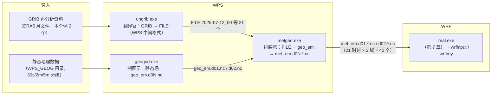

# 第 6 章 WPS：从 ERA5 到 met_em 的数据加工厂

> **本章定位**：第 II 部第四站。第 5 章让代码变成了可执行文件；本章让**原始数据**变成模式能吃的初始场与边界场。WPS（WRF Preprocessing System）是一个"数据加工厂"：把下载来的再分析资料（GRIB）和静态地理数据（地形、土地利用等）加工成 `met_em.*` 文件——它是 WPS 交给 `real.exe` 的交接单。
> 学完本章，你将能够：独立写出 `namelist.wps` 的四节配置（含域设计计算）；看懂 GEOGRID.TBL / METGRID.TBL / Vtable 三套"表系统"的运作方式；亲手完成 geogrid → ungrib → metgrid 三步并有据可查地验证产物；并在三个"深水区"（ungrib 的时间窗口、自动补缺、中间文件的层号编码）上获得源码级的理解——这三处是多数教程不讲、但迟早会绊住你的地方。
> 本章所有结论均以本地源码（`source\WPSv4.7.0\`）与集群实测（兰州个例 v2 域，2025-07）核验；运行环境（容器化提交）见配套《WRF 编译手册》。

---

## 6.0 本章地图

### 你将在本章学会

1. **WPS 三程序的数据流**：geogrid（静态场）/ ungrib（气象场翻译）/ metgrid（水平插值拼装）各自的输入与产物；
2. **`namelist.wps` 四节逐项**：`&share` 的时间窗口设计、`&geogrid` 的域设计与投影参数、`&ungrib`、`&metgrid`；
3. **三套表系统**：GEOGRID.TBL（地理数据源选择）、Vtable（GRIB 变量字典）、METGRID.TBL（字段与层映射）；
4. **ungrib 的时间窗口机制**（源码实证）：为什么整月 4 GB 的 GRIB 只写出窗口内的 21 个文件；
5. **中间文件（FILE:）格式**与它的层号编码"200100"之谜（源码实证）——读懂 METGRID.TBL 里的括号数字；
6. **兰州个例三步实录**：命令、日志、计时、产物结构与验证清单；
7. **常见错误速查**：从报错到根因的映射。

### 源码锚点总表（本章全部实测核验）

| 主题 | 文件（`WPSv4.7.0/` 内） | 关键符号/片段 |
|---|---|---|
| 三程序入口 | `geogrid/src/geogrid.F`、`ungrib/src/ungrib.F`、`metgrid/src/metgrid.F` | 各自主程序与流程骨架 |
| namelist 读取 | `geogrid/src/read_namelist.F`、`ungrib/src/read_namelist.F`、`metgrid/src/read_namelist.F` | `&share`/`&geogrid`/`&ungrib`/`&metgrid` 各组的字段清单 |
| **ungrib 窗口逻辑** | `ungrib/src/read_namelist.F`、`ungrib/src/ungrib.F` | `hstart`/`hend`、`ntimes = idts/interval+1`、`hdate > hend` 提前退出 |
| **时间自动补缺** | `ungrib/src/datint.F` | `Subroutine DATINT: Interpolating 3-d files...`、缺失时次时间插值 |
| **中间文件写出** | `ungrib/src/output.F` | 版本号 5 记录布局；跳过 (200100, 200200) 区间层 |
| **非气压层号编码** | `ungrib/src/rd_grib1.F`、`ungrib/src/parse_table.F` | `level = 200000+iprty`（默认 iprty=100 → 200100） |
| 变量字典 | `ungrib/Variable_Tables/Vtable.ECMWF` | 气压层/地面/土层三组映射（60+ 个 Vtable 之一） |
| GRIB 链接工具 | `ungrib/link_grib.csh` | GRIBFILE.AAA/AAB… 命名规则 |
| 地理数据源表 | `geogrid/GEOGRID.TBL.ARW` | `interp_option=<source>:<方法>`、`rel_path=<source>:<目录>`、`priority`、`optional` |
| 城市参数字段 | `geogrid/GEOGRID.TBL.ARW`（URB_PARAM/FRC_URB2D 段） | NUDAPT44_1km / urbfrac_nlcd2011 / gloucp2020_30s / gaia2020_30s |
| 中间场映射表 | `metgrid/METGRID.TBL.ARW` | `fill_lev = 目标层 : 源字段(源层)`、`derived`、`interp_option` |
| 表解析源码 | `metgrid/src/interp_option_module.F` | `get_fill_src_level`（括号内=源字段层号）、`get_constant_fill_lev`（const 关键字） |
| 插值主流程 | `metgrid/src/process_domain_module.F`、`metgrid/src/metgrid.F` | `Processing domain/date` 日志、并行分解 |
| 集群产物实测 | `cases/lanzhou2025/wps/` | geo_em.d01/d02、FILE:×21、met_em×42 |

### 读者前置

- 第 5 章（WPS 的构建；运行环境）；第 4 章的"表驱动生成"思维（WPS 同样是表驱动，只是表换了名字）；
- `&share` 等 namelist 语法（Fortran namelist 格式，与 `namelist.input` 同族）；
- 会用 `ncdump -h` 看 netCDF 头（本章全部验证动作的基础）。

---

## 6.1 WPS 是什么：数据加工厂与三程序分工

### 6.1.1 数据流全景



三个程序各管一段，**通过文件解耦**：

| 程序 | 输入 | 输出 | 一句话职责 |
|---|---|---|---|
| `geogrid.exe` | `&geogrid` + GEOGRID.TBL + WPS_GEOG 静态数据 | `geo_em.d01.nc`、`geo_em.d02.nc` | 把地形/土地利用/土壤/植被/城市参数等**不随时间变**的场，制图到各域的网格上 |
| `ungrib.exe` | `&ungrib`/`&share` + Vtable + GRIBFILE.* | `FILE:日期` 系列 | 把 GRIB 里的气象场**翻译**成 WPS 自有的中间格式（与网格无关） |
| `metgrid.exe` | `&metgrid` + METGRID.TBL + FILE: + geo_em | `met_em.d01.*.nc` 系列 | 把中间格式的气象场**水平插值**到各域网格，并把地理场合并进去，写成等压面分析文件 |

这个设计的直接好处：**换驱动数据只重跑 ungrib+metgrid；换网格只重跑 geogrid+metgrid**——三步的自变量互不纠缠。第 II 部后续（ch17/ch19 的域变化）就是踩在这条规则上。

### 6.1.2 目录结构与可执行文件

`WPSv4.7.0/` 的骨架（与教材第 5 章的 WRF 目录树对照）：

```text
WPSv4.7.0/
├── geogrid/          geogrid.exe 的源码；GEOGRID.TBL.ARW（ARW 核用的地理表）
├── ungrib/           ungrib.exe 的源码；Variable_Tables/（60+ 个 Vtable.*）；
│                     link_grib.csh（把 GRIB 文件链接成 GRIBFILE.* 的名字）
├── metgrid/          metgrid.exe 的源码；METGRID.TBL.ARW（ARW 核用的场表）
├── util/             辅助工具源码（plotgrids 等）与竖直层表（vertical_grid_*.txt）
├── arch/             编译器段库（与 WRF 同款的 configure.defaults 机制）
├── cmake/             cmake 化的痕证（WPS 也在向 cmake 迁移，本轮实操仍用传统路线）
└── configure / compile   传统构建入口（编译产物三 exe 放在各自目录）
```

注意一个易错点：**运行时 WPS 并不自动读取源码目录下的表**——它读取的是**运行目录**里的 `GEOGRID.TBL`、`METGRID.TBL`、`Vtable` 三个文件（通常用符号链接指过去）。本章实录将完整演示这个"三步链接+运行"模式。

---

## 6.2 namelist.wps 逐节精讲

以本教材贯穿个例的定稿配置为标本（兰州 2025-07，两域），逐节拆解。

### 6.2.1 `&share`：全局与时间窗口

```text
&share
 wrf_core = 'ARW',
 max_dom = 2,
 start_date = '2025-07-12_00:00:00','2025-07-12_00:00:00',
 end_date   = '2025-07-17_00:00:00','2025-07-17_00:00:00',
 interval_seconds = 21600,
 io_form_geogrid = 2,
/
```

| 项 | 含义 | 本个例取值与理由 |
|---|---|---|
| `wrf_core` | 目标动力核（`ARW` 或 `NMM`） | `ARW`——我们全程的 WRF 就是 ARW 核 |
| `max_dom` | 域总数 | 2（教学版两域；升三域时此处改 3 并补 d03 各节） |
| `start_date` / `end_date` | 起止时间（UTC），每域一个 | 12 日 00Z → 17 日 00Z，**共 5 天**。前 1 天是 spin-up（模式启动后的调整期），后 4 天（13–16 日）是分析段——见方案 §6.2 的个例设计 |
| `interval_seconds` | 驱动数据的时间分辨率（秒） | 21600 s = 6 小时（ERA5 月文件正是 00/06/12/18Z 四时次） |
| `io_form_geogrid` | geo_em 的输出格式 | 2 = netCDF（经典格式，通用性最好） |

窗口自检：5 天 ÷ 6 h = 20 个间隔 → **21 个时刻**；这也是后文 met_em 应有 21×2=42 个文件的由来。**时刻数公式：`(end − start)/interval + 1`。**

> 深水区预告：这个窗口不仅给 metgrid 用，**ungrib 也偷偷读它**（§6.4.3）——这是后文"为什么只解出 21 个时刻"的答案。

### 6.2.2 `&geogrid`：域与投影

```text
&geogrid
 parent_id         =   1,   1,
 parent_grid_ratio =   1,   3,
 i_parent_start    =   1,  27,
 j_parent_start    =   1,  27,
 e_we              =  90, 112,
 e_sn              =  90, 112,
 geog_data_res     = 'default','default',
 dx = 9000,
 dy = 9000,
 map_proj  = 'lambert',
 ref_lat   =  36.06,
 ref_lon   = 103.83,
 truelat1  =  35.0,
 truelat2  =  45.0,
 stand_lon = 103.83,
 geog_data_path = '/opt/app/wrf/WPS_GEOG/',
 opt_geogrid_tbl_path = './',
/
```

逐项要点（域设计是本节核心）：

- **`dx/dy`**：父域网格距。**d01 = 9000 m（9 km）**；子域由 `parent_grid_ratio` 推得 3 km、1 km——**dx 只写父域一个值**，这是初学者的第一个坑（写成一串会报错）。
- **`e_we/e_sn`**：每域的"网格点数"（含 1 个多余边界点：质量格点数 = e_we−1）。本个例：d01 90×90 → 质量网格 89×89，覆盖约 810 km × 810 km 的"西北区域"（含大尺度背景）；d02 112×112 → 111×111，覆盖约 336 km × 336 km 的"兰州+周边地形"。
- **`parent_grid_ratio`**：子/父网格距之比（本个例 3）。**约束**：`e_we(子) − 1` 必须能被 ratio 整除（111 = 3×37 ✓，这决定了 112 而非 111）。
- **`i_parent_start/j_parent_start`**：子域在父域中的起始位置（1 基）。手算口诀：子域的父域跨度 = `(e_we(子)−1)/ratio`，居中时起点 ≈ `(e_we(父) − 跨度)/2`。本个例：跨度 37，起点取 27（左右余量 26/26，基本居中）。
- **`map_proj='lambert'` + 投影五参数**：`ref_lat/ref_lon`（父域中心）、`truelat1/truelat2`（双标准纬线，本个例 35°/45°，紧扣兰州纬度带 36°N）、`stand_lon`（标准经线）。兰州位于 36.06N/103.83E——ref 取此值，意味着父域以兰州为中心铺开。
- **`geog_data_res`**：每个域用什么分辨率/来源的静态地理数据（`'default'` / `'30s'` / `'2m'` …）。它的确切语义见 §6.3。
- **`geog_data_path`**：WPS_GEOG 数据根目录；**`opt_geogrid_tbl_path='./'`**：在当前目录找 `GEOGRID.TBL`（这就是"运行目录放表"的配置侧缘由）。

### 6.2.3 `&ungrib` 与 `&metgrid`：本个例的最简形态

```text
&ungrib
 out_format = 'WPS',
 prefix = 'FILE',
/

&metgrid
 fg_name = 'FILE',
 io_form_metgrid = 2,
 opt_metgrid_tbl_path = './',
/
```

- `out_format='WPS'`：中间文件格式（另有 `SI`/`MM5` 两个历史格式，见 §6.4.2 格式规格）；
- `prefix='FILE'`：中间文件前缀——**我们熟悉的 `FILE:2025-07-12_00` 就是"前缀+冒号+时刻"命名**；
- `fg_name='FILE'`：metgrid 去哪里找气象场（前缀名，与 ungrib 的 prefix 对应）；可多个（多源混合时依次列出）；
- `io_form_metgrid=2`：met_em 输出格式（netCDF 经典）。

> 完整版 `namelist.wps`（含 `&ungrib` 的窗口项、`&metgrid` 的全部开关）见源码内 `namelist.wps.all_options` 与官方手册；本书按"正文讲常用、全量入附录"的原则处理（方案 §3.2）。

---

## 6.3 geogrid 与 GEOGRID.TBL：制图员的工作台账

### 6.3.1 职责与产物

geogrid 把**静态地理数据**插值到模拟网格上，产出 `geo_em.d0N.nc`——它包含：

- 网格几何：`XLAT_M/XLONG_M`（质量格点经纬度）以及 U/V 交错网格坐标、地图投影因子（MAPFAC_M/U/V）；
- 下垫面静态场：`HGT_M`（地形高度）、`LANDUSEF`+`LU_INDEX`（土地利用分数与主导类型）、`SOILTEMP`、`GREENFRAC`（月植被分数）、`LAI12M` 等；
- **城市参数族**：`URB_PARAM`（132 个城市参数）与 `FRC_URB2D`（城市面积占比）——第 17 章 BEP/BEM 的主角，此处先见其形。

本个例实测产物（质量网格）：

| 文件 | 大小 | 维度（实测 ncdump） |
|---|---|---|
| `geo_em.d01.nc` | 1.97 MB | 89×89（west_east/south_north）、21 类土地、16 类土壤、12 个月、`num_urb_params=132` |
| `geo_em.d02.nc` | 2.28 MB | 111×111（同上维结构） |

### 6.3.2 GEOGRID.TBL 语法：源数据选择的"双列映射"

`GEOGRID.TBL.ARW` 是一个纯文本表，每个字段一段（以 `====` 分隔），核心是两类行：

```text
name = HGT_M
        priority = 1
        dest_type = continuous
        smooth_option = smth-desmth_special; smooth_passes=1
        fill_missing=0.
        interp_option = gmted2010_30s:average_gcell(4.0)+four_pt+average_4pt
        interp_option =     gtopo_30s:average_gcell(4.0)+four_pt+average_4pt
        ...
        interp_option =       default:average_gcell(4.0)+four_pt+average_4pt
        rel_path = gmted2010_30s:topo_gmted2010_30s/
        rel_path =     gtopo_30s:topo_30s/
        ...
        rel_path =       default:topo_gmted2010_30s/
```

- **左侧是"源数据关键字"（source），右侧是行为**：`interp_option` 里是插值方法串（`average_gcell(4.0)` = 先按 4 km 网格平均，`four_pt` = 四点双线性，`average_4pt` = 四点平均……），`rel_path` 里是该源在 `geog_data_path` 下的子目录；
- **`geog_data_res` 就填这些关键字**（如 `'default'`、`'30s'`、`'2m'`）。一个域填一组（用 `+` 可串联多源，如 `'30s+default'` 表示"先 30s，缺了再用 default 补"）；
- `priority`：**同名字段多段并存**时（例如城市字段有多个数据源候选），优先级决定谁是主选、谁是后备；
- `optional=yes`：该数据在 WPS_GEOG 里缺失时允许跳过（不致命）。

本体例用 `'default'` 关键字，解读其实际落地（逐行对照表）：

| 字段 | `default` 关键字指向的真实数据 |
|---|---|
| `HGT_M`（地形） | `topo_gmted2010_30s/`（GMTED2010 30 角秒地形） |
| `LANDUSEF`（土地利用） | `modis_landuse_20class_30s_with_lakes/`（MODIS 20 类含湖） |
| `GREENFRAC` | `greenfrac_fpar_modis/` |
| `URB_PARAM`（132 参数，priority=1） | `NUDAPT44_1km/` |
| `FRC_URB2D`（城市占比，priority=1） | `urbfrac_nlcd2011/` |
| `ALBEDO` | `albedo_modis/` |

（后备源：`URB_PARAM` 的 priority=2 是 `gloucp2020_30s/`，`FRC_URB2D` 的 priority=2 是 `urbfrac_gaia2020_30s/`——第 17 章会回到这里讨论"用哪套城市数据"。）

> **实用提示**：想知道某个关键字在你的数据盘上到底指向哪个目录，直接在 `GEOGRID.TBL.ARW` 里搜 `rel_path = <关键字>:` 即可——这就是"表驱动"的查证方法。

---

## 6.4 ungrib 与 Vtable：GRIB 翻译官（含三个深水区）

### 6.4.1 职责、Vtable 与 GRIBFILE 命名

**职责**：读 GRIB 文件，按 Vtable 的字典翻译成 WPS 中间格式（`FILE:` 系列）——这一步**与网格无关**（输出保持源的原始网格：本例 ERA5 的 0.25° 经纬格）。

**Vtable**：GRIB 变量的"字典页"。以本个例用的 `Vtable.ECMWF` 为例（实测全表精简）：

| GRIB 参数 | 层类型 | 层范围 | metgrid 字段名 | 单位 | 说明 |
|---|---|---|---|---|---|
| 129 | 100（气压层） | — | GEOPT | m² s⁻² | 位势（等下由 metgrid 提升为 GHT） |
| 156 | 100 | — | HGT | m | 气压层位势高度 |
| 130 / 131 / 132 | 100 | — | TT / UU / VV | K / m s⁻¹ | 温度与风 |
| 157 | 100 | — | RH | % | 相对湿度 |
| 165/166 | 1（地面） | 0 | UU / VV | m s⁻¹ | 10 m 风 |
| 167 / 168 | 1 | 0 | TT / DEWPT | K | 2 m 温度 / 露点 |
| 172 | 1 | 0 | LANDSEA | 0/1 | 海陆掩膜 |
| 134 / 151 | 1 | 0 | PSFC / PMSL | Pa | 地面气压 / 海平面气压 |
| 235 / 31 / 34 | 1 | 0 | SKINTEMP / SEAICE / SST | K / 0/1 / K | 表层温度族 |
| 139/170/183/236 | 112（地下层） | 0-7 / 7-28 / 28-100 / 100-289 | ST000007/…/ST100289 | K | 四层土壤温度 |
| 39/40/41/42 | 112 | 同上 | SM000007/…/SM100289 | fraction | 四层土壤湿度（体积含水） |

看点：**左四列是"源方言"（GRIB），中间是"普通话"（metgrid 字段名）**；不同数据源（GFS/ECMWF/ERA5/…）只需要各自的一张 Vtable——源码内 60 余张正是这么来的。`Vtable.ECMWF` 的注释还专门说明"雪深单位换算在 `rrpr.F` 中做"——翻译官不仅翻单词，还负责单位归一。

**GRIBFILE 命名**：`link_grib.csh` 是配套脚本，把 GRIB 文件软链成 `GRIBFILE.AAA`、`GRIBFILE.AAB`……（三轮字母编号）。本个例两条：

```text
GRIBFILE.AAA → ERA5202507.grib          （4.35 GB，气压层全套：z/q/r/t/u/v，20–1000 hPa，32 层）
GRIBFILE.AAB → ERA5_surface.202507.grib （443 MB，地面场全套）
```

> 源数据背景：这是共享目录里 liuyl17 下载好的**整月** ERA5（2025-07，00/06/12/18Z 四时次、区域 [65N,60E]–[0N,150E]），另有配套的 CDS 下载脚本可作模板。作者的开放共享使其成为"零下载"路线的理想驱动。

### 6.4.2 中间文件格式与"200100 之谜"

**运行后先验证一件事**：`FILE:2025-07-12_00` 每个文件 65.6 MB、共 21 个。翻开源码 `ungrib/src/output.F` 与 `util/src/read_met_module.F`，中间文件（版本 5）的记录布局是：

```text
记录 1：版本号（整数 5＝WPS 格式；4＝SI；3＝MM5）
记录 2：hdate(字符×24) xfcst(实) map_source(字符×32) field(字符×9)
        units(字符×25) desc(字符×46) xlvl(实) nx(整) ny(整) iproj(整)
记录 3：投影参数（经纬度网格：startloc+lat1+lon1+dy+dx+earth_radius）
记录 4：数据面（nx × ny 个单精度实数）
（以上四记录为一组，逐字段重复；Fortran 无格式顺序文件，每记录带长度标记）
```

它是一摞"自我描述"的记录——字段名、单位、层、二维数据自包含（这也是为什么 metgrid 不需要知道源数据的任何"外部配置"）。

**谜题**：`METGRID.TBL.ARW` 里土壤字段的映射写成 `fill_lev = 7 : ST000007(200100)`——括号里的 200100 是什么？它不是土壤深度。答案在源码两处：

1. `ungrib/src/parse_table.F`：解析 Vtable 时，对大部分层类型给**优先级 `iprty = 100`**；
2. `ungrib/src/rd_grib1.F`：当 GRIB 层类型属于**非气压类**（地面 ktype=1、高度 105、土层 112 等）时，写中间文件用的层号是

```text
level = 200000 + iprty   →   200000 + 100 = 200100
```

也就是说：**在中间文件里，所有"非气压类"字段（地面场、2 m/10 m 场、土壤层）共享一个约定层号 200100**——它们靠**字段名**区分（ST000007 与 SM000007 各有其名），不靠层号。于是 METGRID.TBL 写 `ST000007(200100)` 的含义是："取名为 ST000007 的字段、其（唯一）层号 200100 的数据"。

（补充细节：`output.F` 还会**跳过 (200100, 200200) 开区间内的层号**——那是"更低优先级的重复来源"的标记区间；三行源码串起来，谜题闭环。这类问题没有捷径，只能读源码——但它只读一次终身受益。）

### 6.4.3 深水区：ungrib 的时间窗口机制

初次运行 ungrib 的人常问两件事："我的 GRIB 是整月的，为什么只得到窗口内的 21 个文件？"以及"我明明没写 `&ungrib` 的 start_date，它怎么知道窗口？"

源码答案（`ungrib/src/read_namelist.F`）：

- ungrib **直接读取 `&share`** 的 `start_date`/`end_date`——**只取第 1 个域的值**（`start_date(1)`，对子域的值无视）；
- `start_date` 与"多变量写法"（start_year/start_month/…）并存时，**`start_date` 优先**；
- 随后做校验：`interval_seconds` 必须大于 0 且**整除** (end−start)；时间步数 `ntimes = (end−start)/interval + 1`。

然后是执行侧的加速机制（`ungrib/src/ungrib.F`）：主循环按时间顺序处理 GRIB 记录，当遇到 `hdate > hend` 时**直接退出**（不读完文件）。两个机制叠加，得到与实测完全一致的行为：

- 4.35 GB 的整月气压层文件，**只扫描到 7 月 17 日 00Z 即停**（约读了前 17 天）；
- 只写出窗口内 21 个时刻的 `FILE:`；
- 全程 42 秒（其中还包括扫描跳过前 11 天的记录）——这就是为什么"整月文件"并不像想象中那样昂贵。

> 反向提醒：如果你的驱动数据是多时段/乱序拼接的 GRIB（非按时间排序），提前退出可能提前发生、丢数据——这种数据请先排序或用 `&ungrib` 的显式窗口项兜底（完整选项见附录）。

### 6.4.4 深水区：DATINT——不是错误的"错误信息"

ungrib 收尾时，日志里必打印一行为：

```text
Subroutine DATINT: Interpolating 3-d files to fill in any missing data...
```

它出自 `ungrib/src/datint.F`：ungrib 在写完所有可用时次后，会**逐一遍历 `ntimes` 个"应有"时刻**，把缺失的时刻用前后相邻时刻**在时间上线性插值**补齐（"Looking for data at time … / Found file: … / Interpolating …"）。本个例 21 个时刻全部存在，DATINT 实际上"无事可做"，但那行提示仍会打印——**它是流程通告，不是错误**。真正说明问题的，是你看到它后面跟着 "Interpolating to fill in … at level …" 的真实插值动作：说明你的 GRIB 缺时次，ungrib 在替你修。是否允许这种"自动修复"，取决于科研严谨性要求（有些研究严格要求驱动时刻与窗口完全对齐）。

### 6.4.5 ungrib.log 阅读指南

ungrib 日志最有用的是每个时刻的 **inventory 表**（`output.F` 打印）：行=层（气压层为 hPa），列=变量名，`X`＝该层有数据、其余符号＝无数据。运行后扫一眼数据成色（尤其检查地面变量族是否齐全），比事后 debug 省十倍时间。

---

## 6.5 metgrid 与 METGRID.TBL：拼装师与它的映射表

### 6.5.1 职责与并行

metgrid 把 `FILE:`（源网格）**水平插值**到 geo_em 定义的各域网格，并把静态场合并，写出 `met_em.d0N.时刻.nc`。它是**MPI 并行的**（本个例 `mpirun -np 8`），日志按 `Processing domain x of y / Processing 时刻 / FILE` 打印进度（对照 §6.6 实录节选）。

### 6.5.2 METGRID.TBL 语法

`METGRID.TBL.ARW` 每段对应一个**目标字段**：

```text
name=ST                      ← 目标字段（met_em 中出现的名字）
	z_dim_name=num_st_layers ← 该字段的"层"维名
        derived=yes              ← 派生字段：由其他字段换算/选层而来
# IF
        fill_lev =  10 : ST000010(200100)    ← 目标层10 ← 源字段 ST000010 的层 200100
        fill_lev =  40 : ST010040(200100)
        ...
# ELSE IF                    ← 不同驱动数据集的候选分支
        fill_lev =   7 : ST000007(200100)
        fill_lev =  28 : ST007028(200100)
        fill_lev = 100 : ST028100(200100)
        fill_lev = 289 : ST100289(200100)
```

三个要点：

1. **`fill_lev = <目标层> : <源字段>(<源层>)`** 是核心语法：括号里是**源字段在中间文件中的层号**（源码 `interp_option_module.F` 的 `get_fill_src_level`：*"level in source field must be an integer, enclosed in parentheses"*）；对非气压类字段就是 §6.4.2 的 200100 约定。
2. **IF/ELSE IF 分支**：ST/SM/SW 等派生字段为不同驱动数据集准备了多套层映射（GFS 的 0-10/10-40/40-100/100-200 cm、ECMWF 的 0-7/7-28/28-100/100-289 cm 等）。**metgrid 会挑"源字段存在"的那一支**——本个例走 ECMWF 支（目标层 7/28/100/289）。
3. 其余关键字：`interp_option`（水平插值方法与优先级）、`mask`（掩膜，如仅陆地）、`flag_in_output`（输出标志位）、`priority`（同名多段时的选序）。

### 6.5.3 met_em 结构实测解读

以 `met_em.d01.2025-07-12_00:00:00.nc` 为例（`ncdump -h` 实测摘录）：

```text
dimensions:
    Time = UNLIMITED ; DateStrLen = 19 ;
    west_east = 89 ; south_north = 89 ;               ← 与 geo_em.d01 一致（域网格）
    num_metgrid_levels = 32 ;                          ← 气压层数 = ERA5 驱动层数
    num_st_layers = 4 ; num_sm_layers = 4 ;            ← 土壤温/湿各 4 层（ECMWF 支）
    z-dimension0132 = 132 ; ...                        ← 城市参数维等静态场维（随 geo_em 带入）
variables: Times ; PRES(32层) ; GHT(32层) ; TT ; UU ; VV ; RH ; 地面族……
    SM100289: units = "fraction" ;
    SM100289: description = "Soil moisture of 100-289 cm ground layer" ;
```

对照记忆地图：**3D 云图 = 32 层等压面（PRES/GHT/TT/UU/VV/RH）**；**地面族 = PSFC/PMSL/T2/TH2/Q2/U10/V10/SKINTEMP/SNOW…**；**土壤族 = ST/SM/SW（各 4 层）**。所有字段名都能在 `METGRID.TBL.ARW` 中找到对应段——"表驱动"从源头到成品一路可视。

> 交接时刻：到这儿，WPS 的任务完成。42 个 met_em 文件将被移交 `real.exe`（第 7 章）——真实运行中通常把它们软链（或复制）到 WRF 运行目录。

---

## 6.6 兰州个例实录（教材流水线第 1 站）

> 运行环境说明：WRF/WPS 的编译与运行按配套《WRF 编译手册》的容器化方案执行；本节只记录**数据加工步骤**本身。所有命令都在 WPS 运行目录（`cases/lanzhou2025/wps/`）内执行。

### 6.6.1 准备（一次性）

```text
# 1) 表与 Vtable：软链到源码树构建出的三件
ln -sf <WPS构建>/geogrid/GEOGRID.TBL.ARW   ./GEOGRID.TBL
ln -sf <WPS构建>/metgrid/METGRID.TBL.ARW   ./METGRID.TBL
ln -sf <WPS构建>/ungrib/Variable_Tables/Vtable.ECMWF ./Vtable

# 2) GRIB 链接（命名 GRIBFILE.AAA/AAB）
ln -sf .../ERA5_2025/ERA5202507.grib        ./GRIBFILE.AAA
ln -sf .../ERA5_2025/ERA5_surface.202507.grib ./GRIBFILE.AAB

# 3) namelist.wps（§6.2 定稿版）
```

### 6.6.2 三步运行与实测计时

| 步骤 | 命令 | 耗时（实测） | 产物 |
|---|---|---|---|
| geogrid | `./geogrid.exe` | **16 s** | `geo_em.d01.nc`（1.97 MB）、`geo_em.d02.nc`（2.28 MB） |
| ungrib | `./ungrib.exe` | **42 s** | `FILE:2025-07-12_00` … `FILE:2025-07-17_00` 共 **21 个**（每个 65.6 MB） |
| metgrid | `mpirun -np 8 ./metgrid.exe` | **94 s** | `met_em.d01.*` 21 个 + `met_em.d02.*` 21 个 = **42 个**（合计约 0.3 GB） |

（geogrid 的 16 秒意味着它要为 89²+111² 两个网格 × 数十个字段做数据读取与插值——这个量级说明 Geo 数据与磁盘缓存配合良好。）

### 6.6.3 验证清单（每步都要有据）

```text
□ geogrid : ncdump -h geo_em.d01.nc      → 维度 89×89、num_urb_params=132
□ ungrib  : ls FILE:* | wc -l            → 21（=(5天×24h)/6h+1）
□ ungrib  : ungrib.log 的 inventory      → 气压层与地面字段列无大面积缺
□ metgrid : ls met_em* | wc -l           → 42
□ metgrid : ncdump -h met_em.d01.2025-07-12_00:00:00.nc
             → num_metgrid_levels=32、num_st_layers=4、num_sm_layers=4
□ metgrid : metgrid.log 首尾              → "Processing domain 1/2 …" 完整走完 21×2 组
```

### 6.6.4 个例进度条

```text
[✓] geogrid  [✓] ungrib  [✓] metgrid   →   [ ] real.exe（第 7 章）   [ ] wrf.exe（第 8 章）
```

产物现状：`cases/lanzhou2025/wps/` 总计约 1.6 GB（FILE: 21×65.6 MB 是大头）。met_em 已就绪——第 7 章的直接输入。

---

## 6.7 常见错误与速查

| 症状 | 根因 | 处理 |
|---|---|---|
| metgrid 报 `Could not open file METGRID.TBL` | 运行目录没有 METGRID.TBL（表不在默认路径） | 软链 `METGRID.TBL.ARW` 到运行目录，并设 `opt_metgrid_tbl_path='./'` |
| metgrid 报 `mandatory field TT was not found in any input data` | FILE: 数据里没有 TT（Vtable 不匹配 / GRIBFILE 未链 / 窗口不匹配） | 依次查 ①Vtable 是否配对的源 ②`ls GRIBFILE.*` 是否非空 ③`&share` 窗口与 GRIB 实际覆盖是否重叠 |
| `link_grib.csh` 报 `cannot execute` / `tcsh: not found` | 脚本是 csh 写的，环境缺 tcsh | 装/提供 tcsh（配套手册有离线方案） |
| ungrib 只输出部分时刻（如整月数据只出 21 个） | **这是正常行为**：&share 窗口机制（§6.4.3） | 要全月就扩窗口；不用改代码 |
| ungrib 日志里的 `DATINT: Interpolating…` | 流程通告（§6.4.4），恒打印 | 不用处理；若其后出现真实插值行，说明 GRIB 缺时次 |
| geogrid 报某字段找不到数据目录 | `geog_data_res` 关键字在 GEOGRID.TBL 中对应目录缺失 | 或换关键字/补数据；只影响该字段（`optional=yes` 时跳过） |
| geo_em 里城市相关字段缺失 | WPS_GEOG 无 NUDAPT44_1km / urbfrac 数据 | 检查 `rel_path` 对应目录；或接受跳过（urban 相关章节再处理） |
| 三程序运行报 GLIBC 类错误 | 不在容器内运行（宿主库版本不符） | 按配套手册的容器方案执行 |

---

## 6.8 延伸阅读

- 官方《WPS User Guide》——`namelist.wps` 全量项与各 TBL 的权威说明（本章是对它的"源码级注解版"）；
- `WPSv4.7.0/ungrib/Variable_Tables/README`——Vtable 家族导览（含"如何为新数据集写 Vtable"）；
- `WPSv4.7.0/geogrid/GEOGRID.TBL.ARW`——逐字段读一遍，你的城市/陆面数据意识会立刻升级（第 16/17 章大量回访）；
- 源码内 `namelist.wps.all_options`——把本个例的"最简四节"扩展到全量配置的对照表；
- 第 7 章——met_em 进入 real.exe 的下一站；第 17 章——城市参数族（URB_PARAM/FRC_URB2D）在 BEP/BEM 中的用法；第 19 章——本个例的完整科学分析。