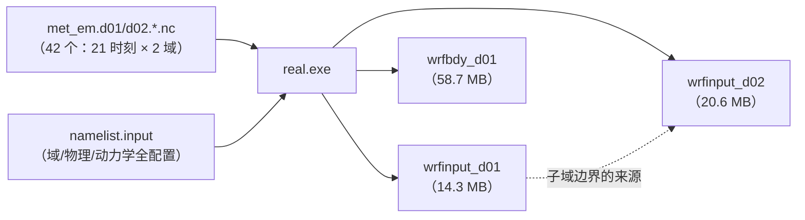

# 第 7 章 real.exe 与 namelist.input：从分析场到模式初值

> **本章定位**：第 II 部第五站。WPS 交来 42 个 `met_em` 文件；本章看它们如何被 `real.exe` 加工成模式的“出发状态”（`wrfinput_d01/d02`）与“沿途补给”（`wrfbdy_d01`）。同时逐节吃透 `namelist.input`——它是 WRF 的**总控制面板**，从第 8 章开始你运行的每一次模拟都由它说了算。
> 学完本章，你将能够：独立写出一份真实个例的两域 `namelist.input`（含自定义垂直层表的设计思路）；理解 real.exe 的三步工作（垂直插值、基态构造、边界加工）；读懂 `wrfinput` 的 172 个变量、`wrfbdy` 的边界结构；并把 `η` 坐标、基态/扰动分解这些概念从“名词”变成“见过实物”——第 10 章将在本章实物上做理论深挖。
> 本章所有结论均以本地源码（`source\WRFv4.8.0\WRFV4.8.0\`）与兰州个例实测（2026-10-10，real.exe 一次运行 44 秒）核验。

---

## 7.0 本章地图

### 你将在本章学会

1. **real.exe 的三步工作**：met_em（32 个等压面）→ 模式垂直层（49 层）的插值；基态（reference state）构造；边界时间序列加工；
2. **`namelist.input` 五节逐项**：以实战定稿配置为标本，掌握每一行有依据；
3. **`eta_levels` 自定义垂直层的设计**：从“为什么低层要加密”到一份可复现的 50 层表（生成逻辑全公开）；
4. **`&physics` 方案号表与两条选择纪律**：方案配对（边界层↔地面层）与“物理套装”（`-1` 与 `physics_suite`）机制；
5. **实测产物解读**：`wrfinput` 的维度与 172 个变量分组、`wrfbdy` 的 `Time=20` 与四边变量族；
6. **常见初始化错误速查**：域不匹配、层表、`p_top`、`interval_seconds`、`restart` 语义。

### 源码锚点总表（本章全部实测核验）

| 主题 | 文件 | 关键符号/片段 |
|---|---|---|
| real 主程序 | `main/real_em.F` | `PROGRAM real_data`（程序名与文件名不同！） |
| 初始化主流程 | `dyn_em/module_initialize_real.F` | `init_domain_rk`（垂直插值+基态构造的主体，约 3600 行） |
| 位势场计算 | `share/module_compute_geop.F` | `compute_geopotential`（PH/PHB 的出生地） |
| 物理套装 | `share/module_check_a_mundo.F` | `setup_physics_suite`（`-1` 的替换规则） |
| 时间管理/重启闹钟 | `share/set_timekeeping.F` | `RESTART_ALARM`（`restart_interval` 决定写 rst 的节奏） |
| 输入机制 | `share/input_wrf.F`、`share/input_wrf_...` | `restart_only`/`input_only` 流开关；域维核对 |
| 基态场变量声明 | `Registry/Registry.EM_COMMON` | `pb/mub/phb/t_init/al...`（第 4 章的表查询法直接可用） |
| 逐项官方注释 | `run/README.namelist` | 所有 namelist 项的英文释义（查询用） |
| 实测产物 | `cases/lanzhou2025/wrf/` | wrfinput_d01/d02、wrfbdy_d01、real.log、rsl.* |

### 读者前置

- 第 6 章（met_em 是什么）；第 4 章（Registry 查询法——本章“对照 Registry 找变量”会反复使用）；
- 干空气/湿空气状态方程、位温、气压与位势高度的关系（《大气物理学》第 3 章已学）——本章先用后深，第 10 章回炉。

---

## 7.1 real.exe 的职责：三步加工

### 7.1.1 输入与输出



三个产物、三条线索：

- **`wrfinput_d0N`**：各域的**初始状态**（起点时刻的完整三维状态快照）——它是“模式在大气剖面上起飞”的跑道；
- **`wrfbdy_d01`**：父域的**时变侧边界**（每 6 小时一组的边界值/倾向）——它让区域模式“贴着大尺度分析场走”；
- **子域没有 wrfbdy**：d02 的边界由父域 **插值提供**（嵌套机制，第 8 章的反馈选项与之相关）。所以 wrfbdy 只有 d01 一个文件，这是标准行为而非缺漏。

### 7.1.2 三步工作（源码级）

**第一步：垂直插值。** met_em 提供的三维场在 **32 个等压面**上；模式要的是 **49 个 η 层**（第 6 章交来的等压面高度 GHT 正是为这件事服务的）。`dyn_em/module_initialize_real.F` 的 `init_domain_rk` 负责这套插值：对每个格点，先由气压与地形构造模式的 η 坐标（含地面以下外推、模式顶以上外推的处理），再把 T/RH/风等插到模式层上。

**第二步：基态构造（reference state）。** WRF 的动力学变量采用“**基态 + 扰动**”分解存储——比如气压场分成 `PB`（基态）与 `P`（扰动）；干空气质量分成 `MUB`/`MU`；位势分成 `PHB`/`PH`。基态是一份**只随高度变化、全球通用的静力参考大气**，在 real 里生成并写进 wrfinput。你会在 §7.4 的变量清单里见到它们——第 10 章将专门讲“为什么这么干”（数值精度与静力平衡的取巧）。

**第三步：边界加工。** 把 21 个时刻的驱动场整理成边界时间序列：每条边界存“**值**（BXS/BXE/BYS/BYE）+ **倾向**（BTXS/BTXE/… 即时间导数）”，供模式在边界宽度内做指定边界（`specified`）与松弛。`wrfbdy_d01` 的 `Time` 维实测为 **20**——首尾 21 个时刻构成 20 个区段，每段一组值/倾向（§7.5 展开）。

> 补充：real 还负责把 `met_em` 里的静态场（地形、土地利用等）拷入 wrfinput；并做一系列一致性检查（域尺寸、层数、时间间隔……）——出错时正是这些检查在保护你（§7.6）。

---

## 7.2 namelist.input 逐节精讲（兰州个例定稿为标本）

以下配置与第 6 章的 WPS 配置构成**同一套个例**：2025-07-12 00Z 起报、两域 9 km/3 km、5 天。

### 7.2.1 `&time_control`：时间与输出节奏

```text
&time_control
 run_days                            = 5,
 run_hours                           = 0,
 ...
 start_year = 2025, 2025,   start_month = 07, 07,   start_day = 12, 12,   start_hour = 00, 00,
 end_year   = 2025, 2025,   end_month   = 07, 07,   end_day   = 17, 17,   end_hour   = 00, 00,
 interval_seconds                    = 21600,
 input_from_file                     = .true., .true.,
 history_interval                    = 180,    60,
 frames_per_outfile                  = 1000,   25,
 restart                             = .false.,
 restart_interval                    = 1440,
 io_form_history / restart / input / boundary = 2,
 debug_level                         = 0,
/
```

| 项 | 含义 | 本个例取值与依据 |
|---|---|---|
| `run_days/run_hours` | 运行时长（可选写法；与 `end_*` 二选一，时长字段非零时优先） | 5 天，与 WPS 窗口一致 |
| `start_*/end_*` | 起止时间 | 07-12_00Z → 07-17_00Z（前 1 天 spin-up + 4 天分析段） |
| `interval_seconds` | 边界数据时间间隔（**必须与 WPS 的 `&share` 一致**） | 21600 s |
| `input_from_file` | 各域是否有独立输入文件 | d01/d02 均 `.true.`（嵌套域各有 wrfinput） |
| `history_interval` | 输出（wrfout）频率（分钟） | d01 180 min（3 h）、d02 60 min（1 h）——按“论文2 分析需求 + 输出体量”取舍 |
| `frames_per_outfile` | 每个输出文件装多少帧 | d01 1000（全程一个文件）、d02 25（约每天一个文件）——避免出现 10 GB 级单文件 |
| `restart` | **是否为“续跑”运行** | `.false.`（新起报）。语义警示见下 |
| `restart_interval` | **写 restart 文件的节奏**（**单位：分钟**） | 1440（= 每天一份 `wrfrst_*`，兼作断点续跑的保险丝）。若误写 86400，实际是 60 天——单位陷阱的完整复盘在第 8 章 |
| `io_form_*` | 各类文件的 IO 格式 | 2 = netCDF 容器（本构建下默认即 netCDF4/HDF5，且带压缩；第 9 章展开） |
| `debug_level` | 调试输出级别 | 0（安静模式；排障时可调到 100/300） |

> **`restart` 的语义警示**（源码实证）：很多人的直觉是“`restart=.true.` 表示'开启 restart 输出'”——**恰恰相反**。`share/set_timekeeping.F` 显示：只要 `restart_interval` 系列非零，模式就会创建 `RESTART_ALARM` 定时写出 `wrfrst` 文件（与 `restart` 开关无关）；而 `restart=.true.` 的作用是“**本次运行以已有 wrfrst 为起点续跑**”。因此：新起报永远 `restart=.false.`；有一天你要从昨天崩掉的地方继续算，才把它改成 `.true.`。另外记住三个数字事实：`restart_interval` 的单位是**分钟**；还有 `restart_interval_d/_h/_m/_s` 四个分量写法（`_m` 优先于裸 `restart_interval`）；闹钟触发后，rst 文件的**时间戳对齐到步长**而不是整点。误用的实战后果与完整实验见第 8 章。

### 7.2.2 `&domains`：域、时间步与垂直层

```text
&domains
 time_step                           = 54,
 time_step_fract_num                 = 0,
 time_step_fract_den                 = 1,
 max_dom                             = 2,
 e_we                                = 90,   112,
 e_sn                                = 90,   112,
 e_vert                              = 50,    50,
 eta_levels                          = ...（50 值，见下）...,
 p_top_requested                     = 5000,
 num_metgrid_levels                  = 32,
 num_metgrid_soil_levels             = 4,
 dx                                  = 9000, 3000,
 dy                                  = 9000, 3000,
 grid_id / parent_id / i_parent_start / j_parent_start / parent_grid_ratio / parent_time_step_ratio,
 feedback                            = 1,
 smooth_option                       = 0,
/
```

**（1）时间步：`time_step = 54`。** 网格距 9 km 的时间步经验公式：`dt ≈ 6 × dx(km)`（单位秒）→ 54 s。嵌套子域按 `parent_time_step_ratio` 成比例缩小（3 → d02 步长 18 s）。时间步不是越大越好：**稳定性由 CFL 条件兜底**——放大的代价是某天模拟在半夜崩掉；这条公式是起点而非教条（ch10 会告诉你声波项与 CFL 的关系）。

**（2）域设置必须与 WPS 镜像一致。** `e_we/e_sn`（90/112）、嵌套四件套（ratio 3、parent_start 27/27）与第 6 章 `namelist.wps` 的 `&geogrid` **逐项对齐**——这一致性由 real.exe 强制检查（不一致直接报错退出，见 §7.6）。`dx/dy` 在这里写成“每域实际值”（与 WPS 写父域一个值不同——这是两套 namelist 口径的著名差异，别写错）。

**（3）垂直层设计：`e_vert = 50` 与 `eta_levels`。** 这是本章含金量最高的一节。

- **为什么需要“低层加密”**：近地面（尤其城市冠层、2 m 观测高度）的物理过程（湍流、辐射通量、城市能量收支）都对**最低几层的层厚**敏感；均匀厚层会把这些过程“抹平”。本个例按方案定稿采用“**50 层、低层加密**”（与论文2 的 BEP/BEM 需求同构）。
- **η 坐标速览**：模式的第 k 层的“位置”用 η 值描述——地面 η=1.000，模式顶 η=0.000；η 与气压的关系在 `p_top_requested = 5000 Pa` 与各点地面气压之间插值（严格定义留待第 10 章；现在只需记住“**地表到 5000 Pa 之间拉成 0→1 的标尺**”）。
- **`eta_levels` 表的设计逻辑**（可复现）：底部区间 Δη₀ = 0.002（在兰州地面气压约 850 hPa 时 ≈ **16 m 首层厚度**），随高度按比例因子 1.12 逐层变厚，到上限后保持等厚（本表上限解得 ≈0.0306，即 ≈249 m）。50 个 η 值如下：

```text
eta_levels = 1.000000, 0.998000, 0.995760, 0.993251, 0.990441,
             0.987294, 0.983770, 0.979822, 0.975401, 0.970449,
             0.964903, 0.958691, 0.951734, 0.943942, 0.935215,
             0.925441, 0.914493, 0.902233, 0.888501, 0.873121,
             0.855895, 0.836603, 0.814995, 0.790794, 0.763690,
             0.733332, 0.702777, 0.672221, 0.641666, 0.611110,
             0.580555, 0.549999, 0.519444, 0.488888, 0.458333,
             0.427777, 0.397222, 0.366666, 0.336111, 0.305555,
             0.275000, 0.244444, 0.213889, 0.183333, 0.152778,
             0.122222, 0.091667, 0.061111, 0.030556, 0.000000,
```

  （生成脚本 `workspace/scripts/gen_eta_levels.py`：从底部 Δη 起步、按因子增长、取上限、二分求得总长恰为 1.000 的上限值——**如果你是第一次自定义垂直层，直接背这个思路即可**：起点细、增长缓、顶部均匀、总数吻合、首尾严格 1.000→0.000、单调递减。）

- **约束清单**（real 会逐一检查）：`eta_levels` 值个数 = `e_vert`；从 1.000 到 0.000 **严格单调递减**；`p_top_requested` 必须**高于**驱动数据最高等压面（本例数据顶 20 hPa = 2000 Pa > 5000 Pa ✓）。同时这里的 `e_vert`（50）可以**大于** `num_metgrid_levels`（32）——多出的模式层由 real 做地面以下/顶以上的外推处理，属常规操作（参考个例 41 层同样配 32 层数据）。

**（4）`num_metgrid_levels / num_metgrid_soil_levels`**：与 met_em 实测维度一致（32 / 4）——这两个数不要“自己填大”，它们是**对输入文件的核对项**，与 WPS 输出的实际层数不符会直接报错。
- **`feedback = 1`**：嵌套域的双向反馈开关（子域结果插回父域），逐项机理在 ch08/ch21 涉及。

### 7.2.3 `&physics`：方案号与两条纪律

```text
&physics
 mp_physics                          = 8,     8,       ← Thompson 微物理
 ra_lw_physics                       = 4,     4,       ← RRTMG 长波
 ra_sw_physics                       = 4,     4,       ← RRTMG 短波
 radt                                = 30,    15,      ← 辐射调用间隔（分钟）
 sf_sfclay_physics                   = 5,     5,       ← MYNN 地面层方案
 sf_surface_physics                  = 2,     2,       ← Noah 陆面
 bl_pbl_physics                      = 5,     5,       ← MYNN2.5 边界层
 bldt                                = 0,     0,       ← 每步调用
 cu_physics                          = 1,     0,       ← d01: KF；d02: 关闭
 cudt                                = 5,     0,
 isfflx = 1, ifsnow = 1, icloud = 1,
 num_land_cat                        = 21,
 sf_urban_physics                    = 0,     0,       ← 城市方案（第 17/19 章启用）
/
```

**方案号的角色**：每一行选一个“方案编号”，WRF 在运行期按编号调度对应模块（《大气物理学》的热力学/辐射/云物理知识在第 III 部逐族对应）。本个例的组合逻辑：

- **辐射**：RRTMG 长波+短波（`ra=4`），`radt` 决定“多久算一次辐射”——9 km 域 30 分钟、3 km 域 15 分钟。辐射是全模式最贵的参数化之一，`radt` 是精度与速度的调节阀（ch12 会拿它做敏感性实验）；
- **边界层与地面层配对**：`bl=5`（MYNN2.5）与 `sfclay=5`（与 MYNN 配套的地面层方案）——**纪律一：边界层方案与地面层方案有推荐配对表**，乱配轻则偏差、重则报错（第 14 章给全表）；
- **陆面**：Noah（`surface=2`），`num_land_cat=21` 必须与 geo_em/met_em 的土地利用分类数一致（第 6 章实测 `land_cat=21` ✓）；
- **积云**：**纪律二：3 km 及以下尺度关闭积云参数化**（对流由模式显式解析），9 km 父域保留 KF（`cu=1`）——“d01 开、d02 关”是向下嵌套的标准做法；
- **`bldt=0`**：边界层过程每步调用（MYNN 的推荐设置）。

> **物理套装机制（`-1`）**：如果你看到别人（或模板）的 namelist 里方案号写 `-1` 外加一行 `physics_suite = 'CONUS'`——那不是笔误：`share/module_check_a_mundo.F` 的 `setup_physics_suite` 会把 `-1` 逐项替换为套装预设（CONUS：Tiedtke/Thompson/RRTMG/MYJ/Noah）。它省事但**不显式**——教材的立场是全部写实数，写入正文的类型即所见即所得（第 5 章 §5.4 的表注给了更多细节）。

### 7.2.4 `&dynamics`：动力学的“旋钮”

```text
&dynamics
 hybrid_opt                          = 2,
 w_damping                           = 0,
 diff_opt                            = 2,      2,
 km_opt                              = 4,      4,
 diff_6th_opt                        = 0,      0,
 base_temp                           = 290.
 damp_opt                            = 3,
 zdamp                               = 5000.,  5000.,
 dampcoef                            = 0.2,    0.2,
 khdif / kvdif                       = 0,      0,
 non_hydrostatic                     = .true., .true.,
 moist_adv_opt / scalar_adv_opt      = 1,      1,
 gwd_opt                             = 0,      0,
/
```

- **`hybrid_opt = 2`**：垂直坐标的“混合”模式——η 层在近地面跟随地形、在高层趋近等压面（现代 WRF 的默认选择；严格数学留待第 10 章）。它与 `eta_levels` 表协同工作；
- **`diff_opt/km_opt = 2/4`**：次网格湍流的处理路径——km_opt=4 表示水平用 Smagorinsky 型（由形变率决定混合系数），配合 `bl=5` 的 MYNN 垂直混合；
- **`damp_opt=3`**：模式顶附近的 Rayleigh 阻尼（抑制虚假的顶反射波），`zdamp/dampcoef` 控制起止高度与强度——小域长期积分（我们 5 天）的标准配置；
- **`gwd_opt=0`**：关闭重力波拖曳参数化——它是“大尺度+高山”场景的选项，且需要 WPS 侧额外的静态场配合；本个例两域尺度较小，取 0 简化链路（第 15/21 章再访）；
- **`non_hydrostatic=.true.`**：非静力（千米级模式的标准选择——第 10 章讲静力近似的来历与失效尺度）。

### 7.2.5 `&bdy_control` 与 `&namelist_quilt`

```text
&bdy_control
 spec_bdy_width                      = 5,
 specified                           = .true.
/

&namelist_quilt
 nio_tasks_per_group = 0,
 nio_groups = 1,
/
```

- **`specified=.true.` + `spec_bdy_width=5`**：d01 采用“指定边界”处理——最外 5 圈网格由 wrfbdy 的驱动值约束（这正是 wrfbdy 里 `bdy_width=5` 维度的来源，§7.5 实测对上）；`specified` 也支持按域细化（如只对 d01 打开）；
- **`&namelist_quilt`**：IO 专用进程组的配置（本个例 0 = 不启用）；机制在 ch09 详解。

---

## 7.3 实录：44 秒的初始化

### 7.3.1 运行目录构成（链接式）

真实运行的目录习惯是把“不可变件”全部软链过来、只让“可变件”（namelist 与输出）落地：

```text
cases/lanzhou2025/wrf/
├── real.exe / wrf.exe         → 链到 build/WRF/main/（第 5 章构建产物）
├── *.TBL / RRTMG* / CAM* …    → 链到 build/WRF/run/（namelist 会读的数据表与查找表，80+ 个）
├── met_em.d01.*.nc / d02.*.nc → 链到 ../wps/（42 个，第 6 章产物）
└── namelist.input             ← 本个例的"总控制面板"（本章主角）
```

### 7.3.2 运行与实测

```text
mpirun -np 8 ./real.exe
```

| 项 | 实测值 |
|---|---|
| 返回码 | rc=0（成功） |
| 耗时 | **44 秒** |
| `wrfinput_d01` | 14.3 MB |
| `wrfinput_d02` | 20.6 MB |
| `wrfbdy_d01` | 58.7 MB |
| 日志中的错误行 | 无 |

耗时构成值得留意：real 要做 89×89×50 与 111×111×50 两个网格的“32 层→49 层”插值 + 基态构造 + 21 个时刻的边界加工——44 秒说明初始化是**廉价的**，真正昂贵的是第 8 章的积分（d01 八千步、d02 两万四千步的量级）。

产物自检（第 7.4/7.5 节的细节解读均出自这两条命令）：

```text
ncdump -h wrfinput_d01     → 维度 89×89×49 / bottom_top_stag=50 / soil_layers_stag=4 …
ncdump -h wrfbdy_d01       → Time=20 / bdy_width=5 / 四边变量族 …
```

### 7.3.3 个例进度条

```text
[✓] geogrid  [✓] ungrib  [✓] metgrid  [✓] real.exe   →   [ ] wrf.exe（第 8 章）
```

---

## 7.4 `wrfinput` 逐变量解读（对照 Registry）

### 7.4.1 维度表

| 维度 | 实测值 | 含义 |
|---|---|---|
| `west_east / south_north` | 89 / 89 | d01 质量网格（= e_we−1） |
| `west_east_stag / south_north_stag` | 90 / 90 | 交错网格（U/V/W 用） |
| `bottom_top / bottom_top_stag` | **49 / 50** | 质量层 49 + 层界面 50（我们的 50 层 η 表在此落地） |
| `soil_layers_stag` | 4 | Noah 四层土壤 |
| `land_cat_stag` | 21 | 土地利用分类（与 `num_land_cat` 一致） |
| `dust_erosion_dimension` | 3 | 沙尘侵蚀维（来自 met_em 的静态场结构） |

### 7.4.2 172 个变量的分组地图

`wrfinput_d01` 实测共 **172 个 float 变量**。按职责分组（各组挑代表）：

| 组 | 代表变量 | 说明 |
|---|---|---|
| 几何与静态 | `XLAT/XLONG`、`LU_INDEX`、`VAR_SSO`、`EROD` | 从 met_em/geo_em 继承的“不随时间变”部分 |
| 坐标与层参数 | `ZNU/ZNW`（η 质量层/界面层）、`ZS/DZS`（土壤） | **你在 namelist 里写的 `eta_levels`，最终以 ZNU/ZNW 的形式住在这里** |
| 基态族 | `PB`、`PHB`、`MUB`、`ALB`、`T_BASE` | 静力参考大气（“基态+扰动”分解的底板） |
| 扰动初值 | `P`、`PH`、`MU`、`AL`、`T`、`THM`、`T_INIT`、`U/V/W`、`P_HYD` | 模式从这一刻开始演化的实际状态 |
| 水物质初值 | `QVAPOR`、`QCLOUD`、`QRAIN`、… | 由 met_em 的 RH 等场诊断而来 |
| 地面与地表 | `T2/TH2/Q2/PSFC/U10/V10` | 2 m/10 m 初值诊断 |
| 常数与缓存 | `FNM/FNP/RDNW/RDN/DNW/DN`、`CFN/CFN1`、`RDX/RDY/DTS/DTSEPS/RESM/ZETATOP/CF1..CF3` | η 坐标的换算系数与网格/时间步常量——**运行期“每步都要用”，预先算好存盘** |

这张表就是“模式世界里的一份完整快照”：real.exe 把 WPS 的“分析产品”翻译成了模式的“母语”。

> 实践方法：任何变量想知道来历，回到第 4 章的方法——在 `Registry/Registry.EM_COMMON` 搜变量名，读它的 `state` 行（维度、时间层数、IO 字母串）；搜不到时再到具体物理模块里找它第一次被赋值的位置。

---

## 7.5 `wrfbdy` 解读：边界的结构

`wrfbdy_d01` 实测头信息与变量族：

| 维度 | 值 | 含义 |
|---|---|---|
| `Time` | **20** | 边界记录数（首尾 21 个 met 时刻 → 20 个 6 h 区段） |
| `bdy_width` | **5** | 边界宽度（= `spec_bdy_width`） |
| `bottom_top` | 49 | 同质量层 |

变量命名法（以 U 为例）：`U_BXS/BXE/BYS/BYE` —— 四条边上的**边界值**（命名 = 变量 + `_B`（boundary）+ 网格方向与边位置后缀）；`U_BTXS/BTXE/BTYS/BTYE` —— 对应边的**时间倾向**（在 `_B` 后插入 `T`）。成对存在意味着模式在边界上做的是“值 + 斜率”的**线性时间插值**——两个 6 小时记录之间不再需要额外的中间时刻。

另有两个自带时间戳变量，实测名为：

```text
char md___thisbdytimee_x_t_d_o_m_a_i_n_m_e_t_a_data_(Time, DateStrLen) ;
char md___nextbdytimee_x_t_d_o_m_a_i_n_m_e_t_a_data_(Time, DateStrLen) ;
```

这串“被撑开的”名字是 WRF IO 层对 `THIS_BDYTIME...`（域名混入）的历史改写痕迹——**见怪不怪，它没坏**。读法：每段边界的起止时刻都在文件里自描述，无需外部记忆。

---

## 7.6 常见错误与速查（初始化类）

| 症状（real.exe 报错或异常） | 根因 | 处理 |
|---|---|---|
| `error opening wrfrst_d0N_开始时刻` + `RESTART run` 字样 | `restart=.true.` 被误当“开启 restart 输出”，模式去找不存在的续跑文件 | 新起报改回 `restart=.false.`（写 rst 由 `restart_interval` 控制，见 §7.2.1） |
| `e_we/e_sn mismatch` 或维度不符报错 | namelist 的域设置与 met_em 不一致（改了 WPS 忘了同步） | 两处逐项对齐（e_we/e_sn、nest 四件套、dx） |
| `eta_levels` 相关报错（数量/单调性） | 层表值个数 ≠ `e_vert`，或非严格递减 | 用 §7.2.2 的生成脚本重生成；核对首尾 1.000/0.000 |
| `p_top_requested` 报错（“top”相关） | `p_top_requested` 低于驱动数据最高等压面的高度 | 调大 `p_top_requested`（如 5000）或换含更高层的驱动数据 |
| `interval_seconds` 与 WPS 不一致 | 两套 namelist 忘了同步 | 保持 21600 一致 |
| `num_metgrid_levels` 不符 | 手改大了（它是对输入文件的核对项） | 查 met_em 实测层数（本个例 32） |
| 运行到物理初始化即停，提示方案不支持组合 | 边界层/地面层等方案乱配，或 `cu` 在 3 km 域开启 | 按 §7.2.3 配对与纪律检查 |
| real 无输出、快速退出 | 未在容器内运行（GLIBC 类）等环境问题 | 按配套手册的容器方案执行；先看 `rsl.error.0000` 首屏 |

> **诊断入口**：real/wrf 的“真日志”是运行目录里的 `rsl.error.0000`（主 MPI 秩）与 `rsl.out.0000`——大部分致命错误（FATAL CALLED）在此留下完整上下文。养成“出错先 `tail rsl.error.0000`”的习惯，从第 8 章开始成为肌肉记忆。

---

## 7.7 延伸阅读

- `run/README.namelist`（源码内）——官方逐项释义，本书未展开的项（DFI、FDDA、namelist_quilt 细节等）都在这里；
- `dyn_em/module_initialize_real.F` 的 `init_domain_rk`——什么想不通就翻它（约 3600 行，配合 `Registry` 查变量食用）；
- 第 10 章——η 坐标与基态/扰动分解的“为什么”；
- 第 8 章——拿着 wrfinput/wrfbdy 去真正积分 5 天，并处理“跑起来之后”的问题（包括本章埋下的 restart 实战续集）。

---

## 7.8 补充专栏【模块依赖树】：real.exe 的源码文件树

> real.exe 是**单进程程序**（无 MPI 分解），其调用树比 wrf.exe 短得多。全部节点本地实测。

```text
main/real_em.F
├─ PROGRAM real_data (line 3)
│    ├─ 读 namelist.input（合法性检查经 share/ 的 module_check_a_mundo 家族）
│    ├─ CALL med_sidata_input (line 280；子程序本体即在本文件 line 301–613)
│    │    ├─ 读 met_em*（module_io_domain / wrf_get_dom_* 接口，ch09 的 IO 层）
│    │    ├─ 域几何与投影恢复（share/ 的 llxy 家族）
│    │    ├─ 垂直插值 + 基态构造 → dyn_em/module_initialize_real.F【核心】
│    │    │    ├─ init_domain_rk / init_domain（η 面 → znu/znw/pb/t_init；第 10 章细讲）
│    │    │    ├─ 水汽处理分支：use_sh_qv（本地 line 1119/1744/1831/4123——
│    │    │    │    4.6 新开关：比湿/特湿直用 vs 先转 RH 再插值）
│    │    │    ├─ 土壤层插值 → 四层 STL/SMOIS（表驱动，ch16 回访）
│    │    │    └─ 城市参数兜底（FRC_URB2D=0.9 等，ch19 的"缺口"现场）
│    │    ├─ 边界场生成（dyn_em/module_bc.F 的 spec_bdy/lateral 系列 + med_latbound_in）
│    │    └─ 化学输入旁路（line 523–535：med_read_wrf_chem_input/emissopt3/bioemiss，
│    │         仅 WRF-Chem 使用）
│    └─ 写 wrfinput_d0N / wrfbdy_d01 / wrflowinp_d0N（io_form=2 时经 external/io_netcdf）
└─ 收尾：时间轴（share/set_timekeeping.F）与重启位（input_restart）
```

**读树三则**：

1. **`med_sidata_input` 在 real.exe 与 wrf.exe 里是两个同名函数**：wrf.exe 的在 `share/mediation_wrfmain.F`（读 wrfinput 做二次加工），real.exe 的在 `main/real_em.F` 内部（读 met_em 首次加工）——搜函数名时注意区分两个文件；
2. **real.exe 的全部“物理判断”集中在 module_initialize_real.F**（约 3600 行）：改“初始场怎么来”（换资料源、改插值权重、注入自定义场）只动它 + Registry；ch20 论文2 的参数场注入若嫌“wrfinput 事后改写”不够正式，正路就是在它里面加一个 met_em 读取分支；
3. **单进程性**：real.exe 不能 MPI 并行，但支持按域逐个处理；大域卡在 real 阶段时瓶颈通常是磁盘 IO 而不是计算（本书个例 44 s，§7.3）。

## 7.9 补充专栏【科研改造案例库】：real 层两案

### 案例一　use_sh_qv（4.6）：一次“减少一次换算”的小改造

- **课题**：初始化保真（湿热力学/云分辨率模拟对水汽初值的插值误差敏感）；
- **改造内容**（4.6 release notes：*Add a new namelist option “use_sh_qv = T” to allow for choosing to use SH or Qv data directly*）：原代码把 metgrid 输出的水物质**先转成 RH、垂直插值、再在模式层换回混合比**；新增开关后若 met_em 里直接有混合比/比湿（flag_qv/flag_sh），可**跳过 RH 往返**；
- **原代码 vs 修改后**（情况①·已上游化，已在源码内；本地 `dyn_em/module_initialize_real.F`）：

```fortran
! 原逻辑（use_sh_qv=.false.，默认）：一律从 RH 出发
1831        IF      ( .not.config_flags%use_sh_qv ) THEN
!              （RH → 垂直插值 → qv 由 rh*qs 得出）
! 新逻辑（use_sh_qv=.true. 且 met_em 带了 SH/QV 字段）：
1744         IF (config_flags%use_sh_qv .and. (flag_sh .eq. 1 .or. flag_qv .eq. 1)) THEN
!              （直接插值比湿/混合比，跳过换算）
```

（行号仅作定位参考；判据要点是 **“RH 往返”与“直用”两条路径并存于同一 IF 结构**。）

- **教学点**：①“多一次换算”看似无害——但 qs 依赖温度，RH 往返在温度强梯度层会引入系统差；②这类改造是**加开关 + 双路径**（默认行为不变）的典范，与 ch20 L3 的 `use_bem_2d_albedo` 开关完全同构。

### 案例二　ERA5 初始化的地形平滑 fatal（4.3.2 起）：本书 ch19 的坑在上游的回声

- **课题**：用 ERA5 等“少土壤层”资料做初边值时的边界地形平滑（lateral boundary topography smoothing）；
- **现象与改造**：4.3.2 release notes 原文——*A fatal error in the real program is now issued when a user requests lateral boundary topography smoothing, but lacks the first-guess soil elevation data to do the weighted averaging... We have seen this problem when a user chooses to initialize the model with ERA5 data*——即以前**静默**跳过（d01 高分辨率地形原样保留），现在改为**显式 fatal**；
- **与本书的关系**：ch19 的 ERA5 链路正踩在这类“隐性行为”上（对台勘误与质控六条）；上游把静默失败改成显式报错，与本教材 ch20 的“静默失败三例”（事故①⑤⑦）同一主题；
- **教学点**：**报错变多是进步**——初始化层的静默降级最伤科学结论；自己改造时也应学这个原则（宁可 fatal，不要替用户猜）。