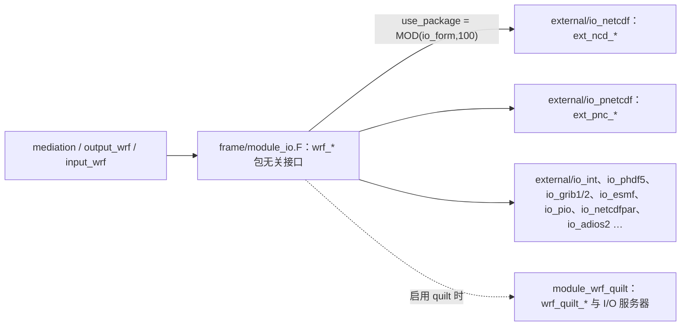

# 第 9 章 IO 系统：io_form、压缩与 quilt

> **本章定位**：第 II 部的“数据出口”章。前面各章反复出现 `io_form = 2` 这行“咒语”（第 6/7/8 章的 namelist 里都有它），本章把它彻底解密：**一个整数如何决定文件的命运**（格式、命名、压缩、写盘方式），并回答第 8 章留下的账——940 MB 的 wrfout 为什么是那个大小。你还将第一次亲手打开 **I/O quilt（I/O 服务器）** 这个机关，并读懂 `wrfout` 文件的完整档案。
> 学完本章，你将能够：解释 `io_form` 任意取值的含义（含 `+100/+200` 变体）；为不同场景选择正确的 IO 方案；看懂 netCDF4/HDF5 与 classic 两种落盘格式在大小与速度上的实测差异；会用辅助流（auxinput/auxhist）把外部数据“喂”进模式——这是第 17/20 章城市冠层参数场对接的前置技能。
> 本章所有结论均以本地源码与兰州个例实测核验（同场 10 分钟模拟的五种 IO 写法对照实验 + 四个样本文件的离线解剖）。

---

## 9.0 本章地图

### 你将在本章学会

1. **IO 架构三层**：中介层 → `module_io.F`（包无关接口）→ 各 IO 包（`external/io_*`）；
2. **`io_form` 编码规则**：低两位=包号（`use_package`）、`+100`=多文件、`+200`=单文件但禁用 IO 服务器；
3. **包清单**：13 个 io_form 编号从哪来（`Registry.EM_COMMON` 的 package 块）——又是第 4 章“一切皆注册表”的一次回响；
4. **五种写法的实测对照**：netCDF4（默认，带压缩）/ classic / PnetCDF / 多文件 / quilt，含文件大小、命名、写盘耗时的一手数据；
5. **quilt 机制**：为什么要有专职 I/O 进程、怎么开、开了以后 `mpirun` 的进程数怎么算；
6. **`wrfout` 档案解剖**：维度、218 个变量、`Times` 字符变量、`FieldType=104`、全局属性、补丁文件的坐标属性；
7. **辅助流**：auxhist1–24 / auxinput2–24 的用途与“怎么给模式投喂自定义数据文件”。

### 源码锚点总表（本章全部实测核验）

| 主题 | 文件 | 关键符号/片段 |
|---|---|---|
| IO 三层与三前缀 | `frame/module_io.F` | 模块头注释（`wrf_`/`ext_`/`wrf_quilt_`）；`SELECT CASE (use_package(io_form))` |
| io_form 编码 | `frame/module_io.F` | `use_package`、`multi_files`（函数头文档含 +100/+200 语义） |
| 包号清单 | `Registry/Registry.EM_COMMON` | `package io_netcdf io_form_restart==2` 等 13 条 |
| 常量生成物 | `frame/module_state_description.F`（构建生成） | `INTEGER, PARAMETER :: io_netcdf = 2`（小写） |
| netCDF 包行为 | `external/io_netcdf/wrf_io.F90` | `ext_ncd_open_for_write_begin`（netCDF4 创建+chunk cache）；`ext_ncd_write_field`（`NF_DEF_VAR_CHUNKING`、`NF_DEF_VAR_DEFLATE(…,2)`） |
| PnetCDF 包行为 | `external/io_pnetcdf/wrf_io.F90` | 文件名 `':'→'_'`；`NFMPI_CREATE(…,NF_64BIT_OFFSET)`；`NFMPI_SET_FILL(NF_NOFILL)` |
| classic 开关 | `Registry/registry.io_boilerplate` | `rconfig use_netcdf_classic namelist,time_control`（默认 `.false.`） |
| quilt | `frame/module_io_quilt_old.F`、`run/README.namelist` | 模块头设计文档；`&namelist_quilt`（`nio_tasks_per_group` 默认 0） |
| 状态位常量 | `external/ioapi_share/wrf_io_flags.h` | `WRF_REAL = 104`（即文件属性 `FieldType`） |
| 流常量 | `inc/streams.h`、`frame/module_io.F` | `io_form_for_stream`；流编号体系（第 4 章） |

### 读者前置

- 第 4 章的流系统与注册表（`IO` 列、`i01rh01…` 语法、auxhist/auxinput 流）；
- 第 8 章的输出章节（帧追加、体量账）；
- 会用任何 netCDF 工具（`ncdump`、Python `netCDF4`）打开文件。

---

## 9.1 IO 架构：三层与三个前缀

`frame/module_io.F` 的模块头注释把 IO 分层说得清清楚楚：

- **调用方**（`share/mediation_*.F`、`share/output_wrf.F`、`share/input_wrf.F`）面向的是 `module_io.F` 里的 `wrf_` 前缀例程（`wrf_open_dataset`、`wrf_write_field`…）——**包无关**；
- `module_io.F` 内部用 `SELECT CASE (use_package(io_form))` 把请求**分派**给具体 IO 包，包内例程一律 `ext_` 前缀（如 `ext_ncd_write_field` = netCDF 包的实现，`ext_pnc_…` = PnetCDF 包）；
- 若启用 quilt，`module_io.F` 还会调 `wrf_quilt_` 前缀的一套接口与 I/O 服务器通信（§9.4）。



`io_form` 出现在所有带 IO 的 namelist 项里：`io_form_history / restart / input / boundary`，以及每个辅助流各自的 `io_form_auxhistN / io_form_auxinputN`——**逐流独立选择**，这是流系统（第 4 章）的自然延伸。

---

## 9.2 `io_form` 的编码艺术

### 9.2.1 三个规则（源码原文）

`frame/module_io.F` 里两个小函数就是全部秘密：

```text
use_package(io_form) = MOD(io_form, 100)      ! 低两位 = 包号
multi_files(io_form) = (io_form ≥ 100 且 < 200)   ! +100 = 多文件模式
```

`multi_files` 的函数头文档值得原样翻译（很多坑都在这一页上）：

> 多文件格式会为**每个计算进程**各写一个文件；可以用在任何 IO 包上；但**只能用相同进程数读回**；不能与 IO quilt 服务器同时使用。
> 选择多文件的方式是在标准 io_form 上**加 100**；如果**加 200**，则仍是单文件写入，但**不使用 IO 服务器**。

于是三档语义一眼明白：

| 写法 | 例（网络组 netCDF） | 含义 |
|---|---|---|
| `2` | 单文件、用（若开启的）IO 服务器 | 常规 |
| `102` | 每个 MPI 进程一个文件 | 应急/调试（读回需同进程数） |
| `202` | 单文件、绕开 IO 服务器 | 调 quilt 问题时用 |

### 9.2.2 包号清单：13 个编号从哪来

在 `Registry/Registry.EM_COMMON` 末尾有一段低调但关键的表：

```text
# only need to specify these once; not for every io_form* variable
package   io_intio    io_form_restart==1
package   io_netcdf   io_form_restart==2
# Placeholders for additional packages (we can go beyond zzz
# but that will entail modifying frame/module_io.F and frame/md_calls.m4)
# Please note these are placeholders; HDF has not been implemented yet.
package   io_hdf      io_form_restart==3
package   io_phdf5    io_form_restart==4
package   io_grib1    io_form_restart==5
package   io_esmf     io_form_restart==7
package   io_yyy      io_form_restart==8
package   io_zzz      io_form_restart==9
package   io_grib2    io_form_restart==10
package   io_pnetcdf  io_form_restart==11
package   io_pio      io_form_restart==12
package   io_netcdfpar io_form_restart==13
package   io_adios2   io_form_restart==14
```

- 这些行和物理方案 `package`（第 4 章：`thompson mp_physics==8`）是**同一套机制**：注册表为“被选中的包”生成整数常量——生成物在 `frame/module_state_description.F` 里，形如 `INTEGER, PARAMETER :: io_netcdf = 2`（注意是小写名）；`md_calls.m4` 生成的分派代码通过 `USE module_state_description` 使用它们；
- 编号缺 6、且 3/8/9 是占位（源码注释明说“can go beyond zzz…HDF has not been implemented”）——**清单以这段注册表为准，不要背第三方教程里的旧表**。

各包实现目录与成熟度（本构建）：

| io_form | 包 | 实现目录 | 状态 |
|---|---|---|---|
| 1 | io_intio（二进制内部格式） | `external/io_int` | 老格式，调试用 |
| 2 | io_netcdf（netCDF 库） | `external/io_netcdf` | **默认主力**（本构建为 netCDF4/HDF5） |
| 3/8/9 | io_hdf/io_yyy/io_zzz | — | 占位 |
| 4 | io_phdf5（并行 HDF5） | `external/io_phdf5` | 需专用库；不支持 quilt |
| 5/10 | io_grib1 / io_grib2 | `external/io_grib1`/`io_grib2` | 输出 GRIB，罕见 |
| 7 | io_esmf | `external/io_esmf` | 耦合用 |
| 11 | io_pnetcdf | `external/io_pnetcdf` | **大并行首选**（需构建含 PnetCDF） |
| 12 | io_pio | `external/io_pio` | 需外部库 |
| 13 | io_netcdfpar | `external/io_netcdfpar` | 并行 netCDF 库路线 |
| 14 | io_adios2 | `external/io_adios2` | 新式 staging IO |

**实践建议**：教学、单机、小并行用 `2`；大规模并行且构建启用 PnetCDF 时用 `11`；要“每进程一文件”做应急或兼容旧流程用 `102`（记住读回限制）。

---

## 9.3 对照实验：同一场模拟的五种写法

### 9.3.1 实验设计

同一份 10 分钟短测配置（np=8、其余完全一致），只改 `io_form_history`（及一处 quilt/一处 classic 开关），各跑一次（作业归档：`ch09_exp/SUMMARY.txt`）：

| 变体 | 关键设置 | rc/时长 | 首写（创建） | 二写（稳态） | 产物 | 魔数（前 4 字节） | 大小 |
|---|---|---|---|---|---|---|---|
| io2 | `io_form_history=2` | 0 / 41 s | 1.92 s | 0.685 s | 1 个文件 | `89 48 44 46` | 34.7 MB |
| io11 | `=11`（PnetCDF） | 0 / 30 s | 2.23 s | 2.08 s | 1 个文件，**名字被改写** | `43 44 46 02` | 93.7 MB |
| io102 | `=102`（多文件） | 0 / 29 s | 1.89 s | 0.102 s | **8 个补丁文件** | `89 48 44 46` | 合计 ≈43.0 MB |
| io2q | `=2` + `&namelist_quilt nio_tasks_per_group=1` | 0 / 28 s | 1.52 s | **0.0237 s** | 1 个文件 | `89 48 44 46` | 34.7 MB |
| io2c | `=2` + `use_netcdf_classic=.true.` | 0 / 27 s | 0.251 s | 0.0666 s | 1 个文件 | `43 44 46 02` | 93.7 MB |

> 读表须知：①“首写”发生在 t=0，含**建文件与定义全部变量元数据**，天然比“二写”贵；②“写盘 Timing”是**调用侧耗时**（第 8 章 `module_timing.F`），异步落盘/压缩/服务器都会影响其解读，横比时看数量级与趋势，不要当成磁盘吞吐测试；③五个变体在同一天内先后运行，缓存冷热与次序对“总时长”有影响，故“总时长”列只作参考。

### 9.3.2 五个发现（各自都有源码背书）

**发现 1：`io_form=2` 默认写出的是 netCDF4/HDF5，且带压缩。** 魔数 `89 48 44 46` 是 HDF5 签名（“CDF” 是 classic netCDF 的签名）。源码：`external/io_netcdf/wrf_io.F90` 的 `ext_ncd_open_for_write_begin`——构建启用 netCDF4 特性时，默认走 `create_mode = nf_netcdf4` 并调 `NF_SET_CHUNK_CACHE`；写变量时 `ext_ncd_write_field` 对每个变量做 `NF_DEF_VAR_CHUNKING` 并调用 `NF_DEF_VAR_DEFLATE(…, compression_level)`，其中 `compression_level = 2`。离线解剖（本地 Python）看得更直接：

```text
T2 : filters={'zlib': True, 'shuffle': True, 'complevel': 2, ...}  chunking=[1, 45, 45]
THM: chunking=[1, 49, 45, 45]
```

**发现 2：classic 开关。** `&time_control` 里 `use_netcdf_classic=.true.`（第 4 章式 rconfig，出处 `Registry/registry.io_boilerplate`）让同一条“io_form=2”路线改写 classic 64 位格式：即 io2c 的 `43 44 46 02`（CDF-2）。

**发现 3：大小差异的账算得平。** 三个全网格文件装的**净数据完全一样**（2 帧 × 46.81 MB 声明量）：classic 家族（io11/io2c）落盘 ≈93.67 MB（几乎零开销），netCDF4 家族（io2/io2q）≈34.7 MB——**zlib-2 压缩省掉约 63%**。第 8 章生产输出单帧 ≈23 MB 的秘密到此结清。

**发现 4：PnetCDF 会改写文件名。** io11 的产物叫 `wrfout_d01_2025-07-12_00_00_00`——**冒号被换成了下划线**。源码在 `external/io_pnetcdf/wrf_io.F90` 的创建段：对文件名逐字符扫描，`':' → '_'`（注释说明历史上还改过 `'-'`，现已取消）。同时文件用 `IOR(NF_CLOBBER,NF_64BIT_OFFSET)` 创建（CDF-2）并启用 `NFMPI_SET_FILL(NF_NOFILL)`（预填充=关，省一次全文件写）。
**实践警告**：文件名变了，脚本里按冒号匹配的“自动找文件”逻辑会失手；读回时用 `wrfout_d01_*` 通配。

**发现 5：多文件模式=每进程一个文件；quilt=写盘几乎瞬时返回。**
- io102 产出 `wrfout_d01_2025-07-12_00:00:00_0000 … _0007` 共 8 个补丁文件（NP=8），每个 5.0–5.6 MB；离线解剖其 `_0003` 号：网格 44×22、属性 `WEST-EAST_PATCH_START_UNSTAG = 46`——**文件里自带补丁坐标**，拼接由读方负责；
- io2q 的稳态写盘只剩 **0.0237 s**：数据交给专职 IO 服务器后立即返回，写盘与计算重叠——quilt 存在的意义一目了然（§9.4）。

### 9.3.3 该选哪个？

| 场景 | 建议 | 理由 |
|---|---|---|
| 教学、小规模、便于后处理 | `2`（默认） | netCDF4+HDF5+压缩，工具链最通用，文件小 |
| 要经典 CDF 兼容性（老工具/审稿人指定） | `2` + `use_netcdf_classic=.true.` | 一次实验即验证 |
| 大规模并行、写盘占比重 | `11`（PnetCDF）或 `2`+quilt | 前者集合写；后者重叠写 |
| 应急调试/兼容每进程文件流程 | `102` | 注意：**读回必须同进程数**；文件名带 `_序号` |
| 调 quilt 疑难 | `202` | 单文件且绕开服务器 |

---

## 9.4 quilt（I/O 服务器）入门

### 9.4.1 机制（`module_io_quilt_old.F` 头注导读）

- **是什么**：一组**专职 I/O 的 MPI 进程**。计算进程把写请求发给服务器后立即返回去算——I/O 与计算重叠（文档注明：目前**只重叠输出**）；
- **开几个**：`nio_tasks_per_group`。文档的建议：**内存装得下就 1 个**——不够再加；
- **分组**：`nio_groups` 目前**必须为 1**；
- **不支持的包**：PHDF5、MCEL（它们自带并行 I/O，无需服务器）；
- **配置入口**：`&namelist_quilt`（默认 `nio_tasks_per_group=0`，即**关闭**——`run/README.namelist` 原文 “default value is 0: no quilting”）。

### 9.4.2 开了 quilt 以后的进程账

启用 quilt 时，`mpirun -np` 的总数 = **计算进程 + 服务器进程**。我们的实验：`-np 8` + `nio_tasks_per_group=1` → 日志出现

```text
 Quilting with   1 groups of   1 I/O tasks.
 Ntasks in X            1 , ntasks in Y            7
```

即 7 个计算补丁（分解随之变成 1×7）+ 1 个服务器。**教训**：开 quilt 前算好进程总数；否则你要么浪费核、要么实际计算域变小。对照不开 quilt 的日志永远是 `0 I/O tasks`（第 8 章所有运行都属此类）。

---

## 9.5 流系统再进一步：辅助流（auxhist / auxinput）

第 4 章已经讲清流编号与 `IO` 列（`h/i/r/b` 等）的生成机制，这里补上“高阶用法”：

- **辅助历史流 auxhist1–24**：除主 `wrfout` 外的第二、三…套输出。典型用途是**垂直诊断量**：本构建里 auxhist22 = z 层插值诊断、auxhist23 = p 层插值诊断（`share/module_check_a_mundo.F` 会直接报错提醒“z_lev_diags requires auxhist22”）。每套辅助流都要**分别**设置 `auxhistN_interval / frames_per_outfile / io_form_auxhistN`；
- **辅助输入流 auxinput2–24**：把外部数据文件按周期“喂”给模式。最著名的是 `auxinput4`——通过 `wrflowinp_d<domain>` 周期更新 SST/植被等下垫面场；城市/人为热参数场也走这条路（第 17/20 章，论文2 的 BEM 改造会把自定义参数写到 auxinput 流里读入）；
- **命名约定**：流名模板来自注册表 `rconfig io_form_*` 与 `auxinputN_inname`（如 `“wrflowinp_d<domain>”`），生成 `io_form_for_stream`（`frame/module_io.F`）供分派使用；
- 本个例未开启任何辅助流（默认全 0）——所以你看到的历史输出只有 `wrfout` 系列。

---

## 9.6 `wrfout` 档案解剖（四个样本的离线结论）

把实验产物拉回本地用 Python `netCDF4` 解剖（四个样本：netCDF4 版、classic 版、PnetCDF 版、多文件补丁）：

| 观察项 | 实测（d01 全网格样本） | 说明 |
|---|---|---|
| 变量数 | **218** | 介于 wrfinput（172，“原料”最省）与 rst（660，“完整备份”最全）之间：wrfout 是**精选的诊断产品** |
| 维度 | `Time / bottom_top=49 / bottom_top_stag=50 / west_east=89 / south_north=89 / soil_layers_stag=4 / DateStrLen=19` | 交错维只服务于 U/V/W 等交错变量 |
| `Times` | 字符变量 `(Time, DateStrLen)`，值为 `2025-07-12_00:00:00`、`2025-07-12_00:10:48` | **帧时间轴**：本文件含 2 帧（帧追加机制，第 8 章） |
| 全局属性 | `TITLE=' OUTPUT FROM WRF V4.8.0 MODEL'`、`START_DATE`、`GRID_ID=1`、`DX=DY=9000`、`MAP_PROJ=1`（Lambert）、`WEST-EAST_GRID_DIMENSION=90`… | 投影/网格自描述——后处理库（wrf-python 等）靠它们自动还原坐标 |
| 关键属性 | `FieldType = 104` | 值出自 `external/ioapi_share/wrf_io_flags.h` 的 `WRF_REAL`，WRF 自描述类型标记 |
| 补丁文件差异 | `WEST-EAST_PATCH_START_UNSTAG=46`、网格 44×22 | 多文件模式下每个补丁文件只带自己的子网格与坐标属性 |

> 读文件的三条实用提醒：① `Time` 是**无限维**，帧数随追加增长，后处理记得读取全部帧；② 交错变量（U/V/W）的网格比质量网格**大 1 格**（U 的 `west_east_stag=90`），画图混用要对齐；③ PnetCDF 产物文件名无冒号（§9.3.2 发现 4）。

---

## 9.7 常见坑与选择指南

| 症状 | 根因 | 处理 |
|---|---|---|
| 读回多文件产物报维度错 | `io_form=10x` 每进程一文件，读回进程数不同 | 用相同进程数读；或改单文件 |
| 脚本找不到 PnetCDF 的输出文件 | 文件名冒号被换成下划线 | 通配 `wrfout_d0*_*` 匹配；重写脚本 |
| wrfout 突然变大 2–3 倍 | 有人打开了 `use_netcdf_classic`（或换构建） | 见表 §9.3.1；按需取舍 |
| 开了 quilt 后计算域变小/报错 | `mpirun -np` 没把服务器进程算进去 | 总数=计算+服务器；核对日志 `N tasks / I/O tasks` |
| 辅助流完全不产出 | 只设置了 `auxhistN_interval` 没设 `io_form_auxhistN` | 每条流三件套：interval、frames、io_form 都要给 |
| 想用 PHDF5 又开 quilt | 文档明确不支持 | 二选一 |

---

## 9.8 延伸阅读

- `frame/module_io.F`——函数头注释（三个前缀、`multi_files` 全文）是本领域最好的 A4 纸；
- `external/io_netcdf/WRFIO.doc` 与各包目录的 `README`——IO API 设计文档；
- `run/README.namelist` 的 `&namelist_quilt` 段与 `auxhist/auxinput` 条目；
- 第 17/20 章——把本章的 auxinput 机制用在城市冠层参数场投喂上。

## 本章小结

1. IO 系统三层结构：调用方只认 `wrf_*`；`module_io.F` 用 `use_package(io_form)=MOD(io_form,100)` 分派到 `ext_*` 包；quilt 走 `wrf_quilt_*`；
2. `io_form` = 包号（低两位）+ 模式位（`+100` 多文件、`+200` 禁服务器）；包号清单的权威出处是 `Registry.EM_COMMON` 的 package 块（第 4 章机制的又一应用）；
3. 本构建 `io_form=2` 默认 **netCDF4/HDF5 + zlib-2 压缩**（34.7 vs 93.7 MB 实测），`use_netcdf_classic` 可切 CDF-2；PnetCDF 产物 CDF-2 且**文件名冒号变下划线**；
4. quilt 用专职进程把 I/O 与计算重叠（实测写盘调用侧 0.024 s 量级），开启时 `-np` 要计入服务器进程；
5. `wrfout` 是“精选诊断”（218 变量），帧追加、自描述属性齐全；auxinput/auxhist 是后续自定义数据与诊断输出的两条大动脉。

---

## 9.9 补充专栏【模块依赖树】：IO 栈的文件级全景

> 把本章三层结构画成树。所有节点本地实测；`md_calls.inc` 的 40 个 `wrf_get/put` 子程序族即 ch20 陷阱⑤“丢 CONTAINS”的主角。

```text
【调用方】share/mediation_integrate.F（med_hist_out / med_restart_out / med_before_solve_io）
          share/mediation_wrfmain.F（med_initialdata_input → 读 wrfinput/wrfbdy）
          phys/module_diagnostics_driver.F（auxhist 类诊断的调度侧）
        │  只认 wrf_open_for_{read,write}_begin / wrf_put_dom_ti* / wrf_get_var...
        ▼
【翻译层】frame/module_io.F
          ├─ #include "md_calls.inc"  ← 40 个 wrf_get/put_{td,ti}_{dom,var}_{real,int,double,char}_{fd,fs}
          │                              （frame/Makefile 的 md_calls.inc : md_calls.m4 规则生成；
          │                               m4 缺失 → 0 字节 → 全站 IO 接口消失 = ch20 陷阱⑤）
          ├─ use_package(io_form) = MOD(io_form,100)   → 选包
          └─ filtno / 多文件逻辑（io_form+100）
        ▼
【包装层】share/module_io_domain.F       把"域+变量"翻译成"handle+DataName"
          frame/module_io_quilt.F        quilt 服务器协议（wrf_quilt_* ，经 &namelist_quilt 启用）
          share/module_io_wrf.F          历史流打包（wrf_ext_write_field 系；位掩码来自 Registry 生成物 wrf_io_flags.h）
        ▼
【实现包】external/io_netcdf/            io_form 2/11 的 netCDF 端（zlib 压缩、CDF-2、
          │                               PnetCDF 由 io_pnetcdf 分支提供——文件名冒号变下划线）
          external/io_int/               内部 IO（intIO：restart/中间态，含 mpi-io）
          external/io_grib1/ io_grib2/   GRIB 输出（`write_grib` 场景）
          external/esmf_time_f90/        时间类型（Times 属性的来源）
        ▼
【底层】netCDF-C/HDF5 / PnetCDF 库（集群 install-oneapi，ldd 可查）
```

**读树三则**：

1. **“变量名 → 流号 → 位掩码 → 打包”四件事分属四层**：Registry 定前两件（ch04）、`wrf_io_flags.h`/`switches_and_alarms.inc` 定流号常量、module_io.F 家族做搬运——诊断“某变量没写进 wrfout”时按这个顺序查（io 串漏 `h` 位 → 不在流表 → 打包层根本不知道它）；
2. **quilt 是协议不是格式**：它插在包装层，`io_form` 仍决定最终落盘格式——所以“开了 quilt 变慢/变快”与“io_form=11 变大变小”是两个独立维度；
3. **C 侧与 Fortran 侧的边界在 `external/io_netcdf`**：`WRFIO.doc` 说的“三种打开方式（head/serial data/distr data）”对应 real.exe（单进程读）与 wrf.exe（并行读写）两种用法——同一个 netCDF 文件，两套打开协议。

## 9.10 补充专栏【科研改造案例库】：IO 层三案

### 案例一　netCDF4 并行压缩写（4.4 起）：一次“换后端”的性能改造

- **课题**：大域高频输出（气候降尺度、业务加密输出）的写盘瓶颈；
- **改造内容**（4.4 release notes：*The ability to write compressed NetCDF4 files in parallel, via NetCDF V4.7.4 (and later)... Performance is slower than pnetcdf, but can be notably faster than regular NetCDF on parallel file systems*）：io_netcdf 包启用 HDF5 并行路径 + zlib 压缩；
- **原代码 vs 修改后**：情况③——对用户只是 io_form 取值差异；本书 ch09 §9.3 的五档对照实测（34.7 vs 93.7 MB）正是这个特性的第一手数据；
- **教学点**：IO 改造的评判永远是“体积 × 时间 × 兼容性”三元；PnetCDF（快、大）与压缩 netCDF4（小、兼容）没有绝对赢家。

### 案例二　CORDEX-WRF 的三通道诊断输出（4.8；呼应 ch04 §4.8 案例二）

- **课题**：降尺度共同体的标准化输出；
- **改造内容**：`&cdxwrf` namelist 节 + auxhist19（主）/auxhist18（10 min 高频 rain/colmax）/auxhist23（气压层插值）三条流——**“一个研究项目占三个辅助流”是大型诊断改造的资源规划样板**；
- **教学点**：WRF 的辅助流号是稀缺资源（历史/输入各几十个位），立项前先画流位表；`MAX_HISTORY=25` 等编译期上限（configure.wrf）是硬约束。

### 案例三　本书 ch20 L3：用“输入流 0”喂参数场

- **课题**：论文2 的屋顶反照率逐格参数场（`ALBROF_2D`）；
- **改造内容**（情况①，全链代码在 ch20 §20.4.2）：Registry 行 `state real ALBROF_2D ij misc 1 - i0rh ...`——`i0` = 随**输入流 0（wrfinput）**进模式，`rh` = 重启保留 + 历史输出（诊断核对用）；注入用 python 脚本改写 wrfinput（`ch20_inject_albrof.py`），开关 `use_bem_2d_albedo` 控制是否生效；
- **与“正路”的关系**：更正式的通道是 **auxinput 流**（独立的 `&auxinput15` 之类闹钟 + `interval` 语义，ch09 §9.5 打好的机制基础）；本书选输入流 0 是因为参数场**静态**（无时间维）且要复用 real.exe 的插值链；
- **教学点**：**静态参数场走输入流 0，时变强迫走 auxinput**——选择依据是“随不随时间变 + 要不要过 real”，不是“哪个更高级”。