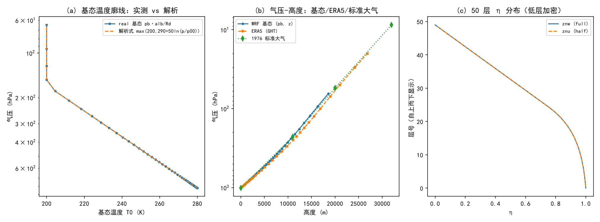

# 第 10 章 垂直坐标与静力平衡：从大气压力到 WRF 的 η 坐标

> **本章定位**：第 III 部（物理过程族）的第一章，也是全书“大气物理 → 模式内核”最大的一次合流。书第 3 章（大气压力）给出了一切静力关系的源头——静力学方程、压高公式、三种大气模式、位势高度；书第 4 章前半（分层与大气质量）给出全局图景。本章的任务是：**把这些纸面公式逐条搬到 WRF 的垂直坐标系里**——你会亲眼看到 `pb`（基态气压）、`alb`（基态比容）、`phb`（基态位势）如何由书上的公式在 `real.exe` 里被“组装”出来。
> 学完本章，你将能够：熟练推导并运用书第 3 章全部核心公式；说清 WRF 的 η 坐标（含混合坐标）如何用最少的假设把地形“贴”进坐标系；理解“基态 + 扰动”分解的动机与实现；并独立完成一次“手算压高公式 vs 模式基态”的核对实验（本书第一个“轻轨”实验）。
> 本章所有源码结论以本地源码核验；实验为本项目兰州个例实测（本地 Python，2026-10-10）。

---

## 10.0 本章地图

### 10.0.1 书小节结构（对应关系）

| 书 | 内容 | 本章对应节 |
|---|---|---|
| 3.1（p30–33） | 大气静力学方程和气压-高度公式、大气标高 | §10.1 |
| 3.2（p33–35） | 大气模式：等温 / 多元 / 均质 | §10.2 |
| 3.3（p35–37） | 气压-位势高度公式 | §10.3 |
| 3.4（p37–41） | 标准大气 | §10.4 |
| 4.1（p48–55） | 大气分层（热力/化学/电磁/气压） | §10.5 |
| 4.2（p55–56） | 大气质量及其垂直分布 | §10.6 |
| 模式 | η 坐标、基态、混合坐标 | §10.7、§10.8 |

### 10.0.2 考点清单（PPT 3、PPT 4 前半原句归纳）

1. **静力学方程**：受力平衡的假设与推导；方程三种形式；适用条件；
2. **压高公式**：微分形式积分；垂直气压梯度与单位气压高度差（含表 3.1 的用法）；
3. **大气模式**：等温 / 多元 / 均质大气的定义、压高公式与**上界**；均质大气的自动对流减温率 34.2 K·km⁻¹；
4. **大气标高**：定义式、与温度的关系（Hp=29.27Tv）、“1/e”含义；
5. **位势与位势高度**：重力位势、Z=Φ/g₀、位势米 gpm、采用位势高度的两个优点；
6. **标准大气**：定义（WMO 口径）、1976 美国标准大气的分层温度结构、用途；
7. **分层**：四种分层法；对流层（三条特征、对流层顶判据 2 K/km）、平流层（到 50 km、四条特征）、中间层（到 85 km、-100~-90 ℃、夜光云）、热层（500 km、1000~2000 K）；匀和层/非匀和层的分界（86–90 km）与平均摩尔质量 28.964×10⁻³ kg/mol；外大气层、电离层与磁层；
8. **大气质量**：柱质量 m₀=p₀/g；总质量估算 ≈5.12×10¹⁵ t；垂直分布（对流层内集中约 3/4）。

### 10.0.3 源码锚点总表（本章全部实测核验）

| 主题 | 文件 | 关键符号/片段 |
|---|---|---|
| 基态解析面气压 | `dyn_em/module_initialize_real.F` | `p_surf = p00*EXP(-t00/a+((t00/a)**2-2g·ht/a/Rd)**0.5)` |
| 基态气压/温度/比容 | 同上 | `pb=c3h*(p_surf-p_top)+c4h+p_top`；`temp=MAX(tiso, t00+A*LOG(pb/p00))`；`alb=(r_d/p1000mb)*(t_init+t0)*(pb/p1000mb)**cvpm` |
| 基态位势（静力积分） | 同上 | `phb(k)=phb(k-1)+alb(k-1)*phm*LOG(pfd/pfu)`（hypsometric_opt=2，对数气压形式） |
| η 系数（混合坐标） | `dyn_em/nest_init_utils.F` | `compute_vcoord_1d_coeffs`：`znu=0.5(znw(k+1)+znw(k))`；Klemp 多项式；`c1=dB/dη`、`c2=(1-c1)(p00-pt)`、`c3=B`、`c4=(η-B)(p00-pt)` |
| 混合坐标设计文档 | `Registry/registry.hyb_coord` | 文件头注释（Pd 公式、C1–C4 定义）；`hybrid_opt`/`etac` rconfig |
| 基态命名表来源 | `Registry/Registry.EM_COMMON` | `base_pres/base_temp/base_lapse/iso_temp/base_pres_strat/base_lapse_strat`（real only） |
| 基态常量读取 | `dyn_em/module_initialize_real.F` | `const_module_initialize`（6 个 namelist 项） |
| 全位势与等压面高度 | `dyn_em/module_big_step_utilities_em.F`、`share/module_compute_geop.F` | `calc_php`（半层平均）；`compute_500mb_height`（按 p 面插值位势） |
| 逐层初始化的输入 | `wrfinput_d01` 实测 | `ZNW/ZNU/DNW/C1F..C4H`、`PB/PHB/ALB/MUB` 全部在文件里（第 7 章 172 变量表的再解读） |

### 10.0.4 与前后章的衔接

- 第 7 章看的是 `wrfinput` 的“变量清单”，本章打开其中**基态族**（PB/PHB/ALB/MUB）与**系数族**（ZNU/ZNW/C1F…C4H）的内脏；
- 第 11 章（成分与水汽）将用到本章的虚温概念；第 12 章（辐射）依赖本章的高度/气压关系做光学路径；
- 第 18 章理想算例中的坐标设置、第 17/20 章城市改造中的垂直加密，都以本章为地基。

---

## 10.1 静力学方程与压高公式（书 3.1）

### 10.1.1 大气压力与单位【考点】

- **大气压力**：单位面积上直至大气上界整个空气柱的重量（气象学定义）；微观上是分子撞击。
- 标准值：1 atm = ρ_Hg(0 ℃)·g₀·0.76 m = **1013.25 hPa**（ρ_Hg=1.35951×10⁴ kg·m⁻³，g₀=9.80665 m·s⁻²）。
- 地面气压范围 980–1040 hPa；随高度**按指数**减小：10 km 处约剩海平面的 25%，青藏高原（4000+ m）地面气压约 600 hPa。

### 10.1.2 大气静力学方程（推导）【考点】

假设：水平方向压强/温度/湿度变化小、等压面等温面近水平、空气无水平运动。对厚度 dz、截面积 1 的**单位截面积气柱**做受力分析：下表面受力 p+(∂p/∂z)dz 向上，上表面受力 p 向下，气块质量 m=ρdz：

```text
p − (p + (∂p/∂z)dz) − mg = 0
```

整理得**大气静力学方程**（书式 3.1.1）：

```text
−(1/ρ)(∂p/∂z) = g        (3.1.1)
```

左端为单位质量空气所受垂直气压梯度力；当它与重力平衡时，大气处于流体静力平衡。由它导出气压随高度的变化（书 3.1.2、3.1.3）：

```text
∂p/∂z = −ρg              (3.1.2)
dp/dz = −ρg              (3.1.3)   ← 主要形式（限定在 p=p(z) 的均质条件下）
```

**物理读数**：dz>0 则 dp<0——气压随高度增加而减小；变化快慢取决于密度（低层密度大气压降得快）。**适用条件**：静止或匀速垂直运动时完全成立；一般大气中垂直加速度 ≤0.1 cm·s⁻²（比 g 小 4 个数量级），所以除积云环流等强垂直运动区外都很好成立——这是全章所有结论的地基，也是 WRF 的动力框架大量使用静力近似的底气。

引湿空气状态方程后，静力学方程还有便于应用的**湿形式**（书 3.1.4）：

```text
dp/p = −(g/(R_d T_v))dz    (3.1.4)     T_v = T(1+0.608q)（虚温）
```

由此再定义两个“天气学用得上”的量【考点】：

```text
垂直气压梯度   G_z = −∂p/∂z = ρg p/(R_d T_v) ≈ 3.42·p/T_v   (hPa/100m)   (3.1.5)
单位气压高度差 −dz/dp = R_d T_v/(p g) ≈ 8000(1+αt_v)/p           (m/hPa)  (3.1.6)
```

**表 3.1（书 p31）速记**：1000 hPa 处 0 ℃ 时约 **8.0 m/hPa**；500 hPa 约 16.0；100 hPa 约 80.0——同温度下“越到高空，气压变化一个单位所需的厚度越大”。这也直接回答了考点设问：越冷、越干的空气，气压随高度降得越快；高空同样的 Δp 对应更厚的 Δz。

### 10.1.3 压高公式（积分形式）【考点】

把 (3.1.4) 从 (z₁,p₁) 积到 (z₂,p₂)（书 3.1.7、3.1.8）：

```text
p₂ = p₁ · exp[ −(1/R_d)∫(z₁→z₂)(g/T_v)dz ]              (3.1.7)
z₂ − z₁ = −R_d∫(p₁→p₂)(T_v/g)dlnp = R_d∫(p₂→p₁)(T_v/g)dlnp   (3.1.8)
```

以及“气压=上方柱重”的积分表达（书 3.1.9）：p = ∫(z→∞) ρg dz。**这就是“压高公式”的主形式**：只要知道虚温沿气压的分布，就能算高度差（气象探空、压力高度计、模式垂直插值全靠它）。严格说 g 随高度变化，但变化慢，常按常数处理。

### 10.1.4 大气标高【考点】

- 气压标高 Hp ≡ −(∂lnp/∂z)⁻¹（3.1.10）；密度标高 Hρ ≡ −(∂lnρ/∂z)⁻¹（3.1.11）；
- 对流层内 Γ≈6.5 K·km⁻¹，两标高近似相等，统称**大气标高 H**；平面平行假设下 dp/dz 与 p 成正比，与 (3.1.4) 对照得：

```text
H_p = R_d T_v / g ≈ 29.27·T_v  (m)      (3.1.13)
p₂ = p₁·exp(−(z₂−z₁)/H_p)               (3.1.15)
```

- **物理意义**：Hp 是把气压减小到当前位置的 1/e（0.37 倍）所需上升的高度增量；取 Tv=273 K → **Hp≈7990 m≈8 km**（书原例）。

---

## 10.2 大气模式：三种温度剖面的假定世界（书 3.2）【考点】

对 (3.1.7)/(3.1.8) 直接积分几乎不可能（T_v(z) 无解析式），于是对温度分布做假设，得到三种“模式大气”——**WRF 的基态正是一件“逐点套用这些假设”的工程作品**（§10.7）：

### 10.2.1 等温大气（p33–34）

T_v ≡ 常数：

```text
p₂ = p₁·exp[−(g/R_d T_v)(z₂−z₁)] = p₁·exp(−(z₂−z₁)/H_p)   (3.2.1)
z₂−z₁ = H_p·ln(p₁/p₂),  H_p=29.27 T_v                       (3.2.2)
z₂−z₁ = 18410(1+t_v/273.15)·ln(p₁/p₂)   （拉普拉斯压高方程，(3.2.3)）
p₂/p₁ = ρ₂/ρ₁                                                (3.2.4)
```

要点：压强与密度**同步**按指数下降（标高相等）；高度趋于无穷时气压、密度趋于零但不等于零——**等温大气没有上界**。书例 3.1 给出经典应用：由拉普拉斯压高方程把**本站气压订正到海平面**（气象观测的日常动作；这也是 WRF 里海平面气压诊断的物理前身）。

### 10.2.2 多元大气（p34）

T_v = T_v0 − Γz（线性递减，Γ=−∂T_v/∂z）：

```text
ln(p₂/p₁) = (g/(R_dΓ))·ln[(T_v0−Γz₂)/(T_v0−Γz₁)]           (3.2.7)
p₂/p₁ = [1 − Γ(z₂−z₁)/T_v1]^{g/(R_dΓ)}                      (3.2.8b)
z₂−z₁ = (T_v1/Γ)[1 − (p₂/p₁)^{R_dΓ/g}]                      (3.2.9)
上界： H_T = T_v0/Γ                                          (3.2.10)
```

要点：**多元大气有上界**（p=0 处即上界高度）；等温大气是 Γ→0 的特例（上界→∞）。

### 10.2.3 均质大气（p35）

ρ ≡ 常数：

```text
p = p₀ − ρgz            （书 3.2.3 节；线性递减）
H = p₀/(ρg) = R_dT₀/g ≈ 8 km          (3.2.11–3.2.12)
Γ = −∂T/∂z = g/R_d = 34.2 K·km⁻¹     （自动对流减温率）
```

要点：均质大气温度随高度**线性下降**（因为密度不变而气压线性降）；减温率达到 g/R=34.2 K·km⁻¹ 时密度不再随高度减小，再大则密度上增下减→自动对流——**34.2 K·km⁻¹ 是大气静力稳定性的第一道红线**（第 13 章热力学再相见）。

> **三模式对照**（自测用）：等温→指数压强、无上界；多元→幂律压强、上界 Tv0/Γ；均质→线性压强、上界 p0/ρg、超大减温率。三者的压高公式都能写成“由 (3.1.7) 代入各自 T(z)”的一条积分——记住这条主线，不必背三套公式。

---

## 10.3 位势与位势高度（书 3.3）【考点】

- 重力位势 Φ：把单位质量空气沿法线抬升 dz 克服重力做功 dΦ=gdz，故 Φ = ∫(0→z) g dz（J/kg）；g 随纬度与高度变化（g(z)=g(0)R²/(R+z)²）；
- **位势高度 Z ≡ Φ/g₀**（g₀=9.80665 J·kg⁻¹·gpm⁻¹），单位**位势米 gpm**：1 gpm = 9.80665 J/kg。用 Z 后重力加速度“消失”：

```text
dΦ = gdz = g₀dZ                     (3.3.6)
dp = −ρg₀dZ = −ρdΦ                   (3.3.7)
dp/p = −(g₀/(R_dT_v))dZ              (3.3.8)
Z₂−Z₁ = (R_d/g₀)∫(p₂→p₁)T_v dlnp      (3.3.10)  ← 气压-位势高度公式
等温：p₂=p₁exp[−(g₀/(R_dT_v))(Z₂−Z₁)]；(Z₂−Z₁)=(R_dT_v/g₀)ln(p₁/p₂)  (3.3.11–12)
多元：Z₂−Z₁=(T_v1/Γ)[1−(p₂/p₁)^{R_dΓ/g₀}]                            (3.3.14)
```

- **采用位势高度的优点**（考点原题）：①不必考虑 g 随高度和纬度的变化——实测气压温度即可算位势高度；②理论上处理大气能量等问题更方便（垂直坐标取 Z 时重力无水平分量，方程简化）。
- 数量感：100 km 以下，位势高度与几何高度的差 <1.6%（书表 3.4 结论）——日常可互换，高空要区分。

---

## 10.4 标准大气（书 3.4）【考点】

- 定义（WMO 口径）：**能粗略反映周年、中纬度状况、国际上承认的假定大气温度、压力、密度垂直分布**；假定空气服从理想气体定律与流体静力学方程；
- 1976 年美国标准大气：地面 288.15 K / 1013.25 hPa；对流层顶 11 km 216.65 K；平流层等温至 20 km；32 km 处 228.65 K 等（分层折线见 §10.5 表）；
- 用途：压力高度计校准、飞机性能计算、火箭/弹道设计基准、气象制图；
- 中国国家标准：GJB5601-2006 中国参考大气等（书 p37–41 有完整表）。

> 与模式的连接：WRF 的基态并不是标准大气（它有自己的 base_temp=290 K、base_lapse=50 K 等参数），但**设计思路同源**——用一条可解析的温度-气压关系当“参考骨架”。标准大气在模式里的近亲是 `run/` 下没有的“外部参考”：**你的驱动数据（ERA5）**才是真身。

---

## 10.5 大气的分层与结构（书 4.1）【考点】

### 10.5.1 四种分层法

| 分层依据 | 分层结果 |
|---|---|
| 热力结构 | 对流层 / 平流层 / 中间层 / 热层 |
| 化学成分 | 匀和层（<86–90 km）/ 非匀和层（90–500 km） |
| 电磁特性 | 电离层（60–(500~1000) km）/ 磁层（其上） |
| 大气压力结构 | 外大气层（逸散层）与气压层（500 km 以下） |

### 10.5.2 热力分层要点（PPT 重点原三条 + 各层）

| 层 | 范围 | 温度 | 特征 |
|---|---|---|---|
| 对流层 | 地面→~12 km | 随高度递减（平均 6.5 K/km） | ①温度随高度减低 ②垂直混合强 ③气象要素水平分布不均匀；集中约 3/4 大气质量与几乎全部水汽 |
| 平流层 | 对流层顶→~50 km | 随高度**升高**（递减率为负） | ①稳定、垂直运动弱 ②透明度高 ③水汽极少；含臭氧层、QBO 等过程 |
| 中间层 | 50→85 km | 随高度减低 | 臭氧稀少+CO₂ 15 μm 散热 → 顶温可到 −100~−90 ℃；不稳定；夜光云 |
| 热层 | 85→500 km | 随高度升高 | 空气稀薄、热传导为主；顶温 1000–2000 K 趋于常数 |

- **对流层顶的判据（考点原句）**：温度垂直递减率**减小到 2 K/km 或更小**的最低高度；气团与锋面的定义（水平温湿相对均匀的大范围空气/冷暖气团交界面）也在本节；
- 匀和层内各种成分比例不变，平均摩尔质量 **M_d=28.964×10⁻³ kg/mol**；非匀和层内重力分离与光化学使比例随高度变化，平均摩尔质量随高度减小（这就是书 3.1.3 末尾“各气体成分分压标高与摩尔质量成反比、重的气体标高小”的物理背景）；
- 外大气层（500–3000 km）：粒子可逃逸到星际空间，故又称逃逸层；电离层 60 km 起；磁层及其辐射带（范艾伦带）保护地球生物免遭太阳风与宇宙线——分层章的人文收尾。

---

## 10.6 大气质量及其垂直分布（书 4.2）【考点】

- 单位截面积气柱质量（取地面任意远处为上界）：

```text
m₀ = ∫(0→∞)ρdz = −(1/g)∫(p₀→0)dp = p₀/g          (4.2.1)
```

- 取 g=9.8 m·s⁻²、全球平均地面气压 p₀=985 hPa：**m₀≈10044 kg·m⁻²**；
- 地球半径 R_E=6.37×10⁶ m → 总质量 = m₀·4πR_E² ≈ **5.12×10¹⁵ t**（气圈约为水圈质量的 1/273、不及固体地球的百万分之一）；
- 任意气层 [p₁,p₂] 间的柱质量 m=(p₁−p₂)/g（4.2.2）；占比如 (p₁−p₂)/p₀（4.2.3）→ **表 4.1**：对流层内集中约 **3/4** 的大气质量；
- 注意误差方向：g 随高度减小，“把 g 当常数”估出的 m₀ 比实际略大——书里连误差方向都替你想好了。

---

## 10.7 WRF 中的对应（一）：η 坐标与基态构造

> 这一节是全书的“合流点”之一。读法建议：先把它当作“书 3.1/3.2 的三条公式如何在真实代码里落地”的故事。

### 10.7.1 为什么需要 η 坐标

z 坐标（等离面）遇地形会“切”进地里；p 坐标（等压面）在陡坡附近产生巨大的气压梯度二力误差。WRF 选择 **η（地形跟随）坐标**：地面永远对应 η=1、模式顶对应 η=0，中间层随地形起伏——既贴地又不“破地”。我们的 50 层 `eta_levels`（首层 Δη=0.002）就定义在这个坐标里；`znw`（50 个界面值，1→0）与 `znu`（49 个质量层值）实为同一张表的两行：

```text
znu(k) = 0.5·(znw(k+1) + znw(k))        （dnw=Δη、rdnw=1/Δη 同族）
```

**实测核对**（本个例 `wrfinput` 文件）：znu 与 0.5(znw(k+1)+znw(k)) 的最大偏差 = **0.0**；首层几何厚度 15.38 m（设计目标“首层≈16 m”达成）。

### 10.7.2 从“σ 型”到“混合型”：hybrid_opt 与 Klemp 系数

纯地形跟随坐标在平流层高处会带来误差（等η面与等压面偏离大），WRF 4.x 默认 **`hybrid_opt=2`（Klemp 三次多项式混合坐标，配 `etac=0.2`）**：低层贴地形（B≈η），高层过渡为等压面（B→0）。`dyn_em/nest_init_utils.F` 的 `compute_vcoord_1d_coeffs` 是全部实现的所在：

- `c3f(k) = B(η)`：hybrid_opt=2 时用 Klemp 多项式（含 etac 的 B1…B5 系数），并强制 `c3f(1)=1`、`c3f(top)=0`、`η<etac` 段直接取 0（等压段）；
- `c4f(k) = (znw − c3f)·(p1000mb − p_top)`；
- 半层（界面）系数：`c3h=0.5(c3f(k+1)+c3f(k))`、`c4h=(znu−c3h)(p1000mb−p_top)`；
- 基压梯度：`c1f=d(c3h)/d(znu)`（内点差分；底=1、顶=0）、`c2f=(1−c1f)(p1000mb−p_top)`；半层用 `c1h`、`c2h`；
- **单调性检查**：用同一套 p_surf 公式逐列验证“参考气压随高度单调递减”，不满足时提示 **降低 etac**（高地形区的实用提示，直接写在报错文案里）。

`Registry/registry.hyb_coord` 是这套设计的**官方文档**（本文件头注释原文）：干气压 Pd = BF(Pds−Pt) + (η−BF)(P0−Pt) + Pt；并列出 C1–C4 的定义与“MUT=C1·Pcb+C2、MU=C1·Pc”的分解式。C1F…C4H 与 PCB/PC 都是注册表状态变量——所以它们**在 wrfinput/rsl 里都实打实存在**（本个例文件实测：C1F…C4H 全在）。

### 10.7.3 基态构造：书 3.1/3.2 的代码化（本个例逐行核对）

`real.exe` 在 `module_initialize_real.F` 里按下列顺序搭出基态（常数来自 `&dynamics`：`base_pres=100000`、`base_temp=290`、`base_lapse=50`、`iso_temp=200` —— `const_module_initialize` 读取，注册表 `Registry.EM_COMMON` 声明，全部标注 “real only”）：

1. **地面气压的解析式**（把 T=t00+a·ln(p/p00) 代入压高公式反演得到的闭式解）：

```text
p_surf = p00·exp[ −t00/a + ((t00/a)² − 2g·ht/(a·R_d))^0.5 ]
```

  实测：公式 81903.711 Pa vs 文件 MUB+p_top=81903.703 Pa（**差 0.008 Pa**，浮点舍入级）。

2. **基态气压廓线**（η 坐标上的分段定义）：`pb = c3h·(p_surf−p_top)+c4h+p_top`；
3. **基态温度廓线**（书 3.2 的“多元+等温”混合体）：

```text
temp = MAX( tiso, t00 + a·ln(pb/p00) )        （p<p_strat 时另有平流层分支）
```

  实测：由文件反推 T0=pb·alb/Rd 与解析式**最大偏差 0.0001 K**；tiso=200 K 封顶自 pb<16530 Pa（≈16.5 hPa）的 4 层生效——这就是“多元大气顶部接等温大气”的分段模式（类比书 3.2 的上界讨论）。
4. **基态比容**（状态方程，位温形式）：`alb = (R_d/p1000mb)·(t_init+t0)·(pb/p1000mb)^cvpm`，其中 cvpm=R_d/c_p−1、t0=300 K 为位温参考常数、t_init 为基态位温扰动。代回验证即 R_dT0/pb——**严格的状态方程**；
5. **基态位势**（静力积分，即压高公式的有限形式；默认 `hypsometric_opt=2` 用对数气压写法）：

```text
phb(1) = ht·g
phb(k) = phb(k−1) + alb(k−1)·phm·ln(pfd/pfu)     （opt=2；opt=1 为 Δp 差商形式）
```

  代码注释原文：“**Integrate base geopotential, starting at terrain elevation. This assures that the base state is in exact hydrostatic balance with respect to the model equations.**”——**基态与模式方程严格静力平衡**是设计红线；
  实测：用文件里的 alb 与 c 系数**重演**该积分，与文件 PHB 的最大残差 **0.039 m²/s²**（量程 195000 的 2×10⁻⁷）——机器精度级的一致。

### 10.7.4 完整场与位势高度在模式中的用法

- 完整气压 p = PB+P（基态+扰动）；完整位势 Φ = PHB+PH，质量层上的 Φ 由 `calc_php` 做半层平均：`php = 0.5(phb(k)+phb(k+1)+ph(k)+ph(k+1))`；
- `share/module_compute_geop.F` 的 `compute_500mb_height` 是“气压-位势高度公式”的直接应用：逐列按气压找到目标 p 面，插值位势得 500 hPa 高度（TC 追踪等用途）——书中“由气压算高度”的公式在此有了岗位；
- 高层的松驰层（w_damping、damp_opt）与 p_top 都挂在 η 坐标的顶部——第 18 章的坐标实验会回访。

---

## 10.8 动手实验：手算压高公式 vs real 基态（轻轨）

**脚本**：`workspace/scripts/ch10_experiment.py`（WRFlearn 环境，需 `netCDF4+numpy+matplotlib`）——数据为兰州个例的 `wrfinput_d01` 与 `met_em.d01`（已拉回本地，§附录）。**所有数字已实测**，读者应能复现。

### 10.8.1 核对清单与结果

| # | 核对项 | 结果 |
|---|---|---|
| 1 | znu = 0.5(znw(k+1)+znw(k)) | 最大偏差 0.0；首层 15.38 m |
| 2 | T0 = pb·alb/Rd vs max(200, 290+50·ln(pb/10⁵)) | **最大偏差 0.0001 K**；200 K 封顶自 pb<16530 Pa |
| 3 | p_surf 解析式 vs MUB+p_top | 81903.711 vs 81903.703 Pa（**0.008 Pa**） |
| 4a | 重演静力积分 phb（对数气压形式） | 最大残差 **0.039 m²/s²**（2×10⁻⁷ 量程） |
| 4b | 逐层 dz vs α·Δp/g（有限差分压高公式） | 中位相对偏差 7.6×10⁻⁵，最大 1.7×10⁻² |
| 5 | 位势高度 Z 与几何高度之差 | 1.67 km 处 +0.57 m；12.4 km 处 +4.23 m |
| 6 | ERA5 廓线逐层（30 段）手算压高 vs GHT 差 | 中位残差 **+0.76 m**，最大 11.2 m |
| 7 | 气压标高 | 近地面 Tv≈294 K → Hp=8605 m（书：273 K→7990 m） |
| 8 | 大气总质量（书 4.2 复算） | p₀=985 hPa → m₀=10051 kg/m²、**5.125×10¹⁵ t**（书：10044 / 5.12×10¹⁵） |

> **结论 1**：书上的压高公式（含其等温/多元变体）**一字不差地活在现代模式里**——基态气压、温度、比容、位势四件套都能用纸面公式按文件逐位复现。
> **结论 2**：WRF 的“基态”是一次工程折中：分段解析温度（多元+等温封顶）+ 解析地面气压 + 静力积分位势；**其唯一硬约束是“与模式方程的静力平衡”**（残差机器精度级）。
> **结论 3（口径差警示）**：met_em 里 geog 地形 1665 m，而 ERA5 柱自身的地面位置 ≈1948 m——**驱动数据与目标网格的“地形口径”相差 284 m**。这不是 bug，而是所有“再分析场降尺度”问题的日常：WPS/real 的垂向插值与外推、以及你在第 6/7 章学到的核对习惯，都是为它服务的。在兰州河谷这类复杂地形区做任何“气压-高度”比较前，先问一句：**你比的是谁家的地面？**

### 10.8.2 图与复现



三联图：(a) 基态温度 T0 的“实测 vs 解析式”；(b) 气压-高度四曲线：WRF 基态、ERA5（GHT）、1976 标准大气（可见兰州 7 月比标准大气“暖而厚”）；(c) 50 层 η 分布（低层加密，向顶部逐渐变厚）。

### 10.8.3 可自行扩展的变体

- 改 `base_temp`（如 250 K）重跑 real，对照 p_surf/T0 廓线的变化——体会“基态只是参考系”；
- 用书表 3.1 手算某气压面的单位气压高度差，再与 (6) 的逐层结果比对；
- 把 (8) 的质量估算换成“质量垂直分布”：用 ERA5 廓线算各高度以下的质量占比，对照书表 4.1。

---

## 10.9 思考题与习题

1. （推导）由静力学方程 dp/dz=−ρg 与 T_v=T_v0−Γz 出发，完整推出多元大气压高公式 (3.2.8b) 与上界 (3.2.10)；并说明为什么等温大气是其 Γ→0 的极限、均质大气对应 Γ=g/R_d。
2. （计算）兰州地面气压 850 hPa、地面虚温 300 K。用单位气压高度差 (3.1.6) 估算 850→700 hPa 的厚度；再用压高公式（等温近似）精确计算，比较两者误差。
3. （计算）用 p₀=850 hPa 的兰州氣柱，估算该地单位截面积大气质量 m₀（g 取 9.81），并换算为“以海平面 985 hPa 为参考”的占比。
4. （概念）“位势高度”为什么不等于几何高度？在什么高度差达到 1%？用 g(z)=g(0)R²/(R+z)² 估算。
5. （模式）解释 `base_lapse=50 K` 与 `base_temp=290 K` 的物理含义（提示：在 p=p00/e 处的基态温度是多少？）；若把它们改得很大，模式会出什么问题？
6. （模式）为什么必须做“基态+扰动”分解？把全量气压直接存入变量会付出什么代价？（提示：读第 7 章 T_INIT 与本章 §10.7.3，再从数值精度角度思考）
7. （综合）解释“输入数据地形 vs 目标网格地形”不一致时，real.exe 需要做哪些处理；结合实验结论 3 说明为什么不能直接拿 met_em 的 GHT 与 wrfinput 的高度场混用。

---

## 10.10 延伸阅读

- 书 3.5（p41–46）气压时空分布、气压场五型式——本章未展开，教师课件有完整图表；
- 书 4.3（p56–60）海洋（下边界面）——与第 12/19 章的热环境话题相接；
- Klemp, J. B. (2011)：混合垂直坐标的技术论文（`hybrid_opt=2` 的“Klemp cubic form”由来）；
- 源码：`dyn_em/module_initialize_real.F`（`init_domain_rk` 基态段）、`dyn_em/nest_init_utils.F`（`compute_vcoord_1d_coeffs`）、`Registry/registry.hyb_coord`（一页纸读完混合坐标设计）；
- 第 11 章——虚温、水汽与成分，把本章的 T_v 展开成一条完整的热力学链。

## 10.11 术语速查（中英对照）

| 中文 | 英文 | 备注 |
|---|---|---|
| 流体静力平衡 | hydrostatic balance | 本章一切公式的地基 |
| 静力学方程 | hydrostatic equation | dp/dz=−ρg |
| 压高公式 | hypsometric equation | 亦称气压-高度公式 |
| 大气标高 | scale height | Hp=R_dT_v/g≈29.27T_v |
| 等温/多元/均质大气 | isothermal / polytropic / homogeneous atmosphere | 三种假定模式 |
| 重力位势 / 位势高度 | geopotential / geopotential height | Z=Φ/g₀，单位 gpm |
| 标准大气 | standard atmosphere | WMO 口径，1976 US 表 |
| 匀和层/非匀和层 | homosphere / heterosphere | 分界 86–90 km |
| 地形跟随坐标 | terrain-following coordinate | η |
| 混合坐标 | hybrid coordinate | 高层拉平为等压面 |
| 基态 | base state | PB/PHB/ALB/MUB 一族 |
| 虚温 | virtual temperature | T_v=T(1+0.608q) |
| 对数气压形式 | log-pressure form | hypsometric_opt=2 |

---

## 10.12 补充专栏【模块依赖树】：基态与坐标的文件树

> 静力平衡与 η 坐标涉及“三条腿”：**坐标定义（Registry）→ 基态构造（real）→ 每步使用（内核）**。全部节点本地实测。

```text
【坐标定义】Registry/registry.hyb_coord        混合坐标系数表（一页纸：A/B 面定义）
             └─ include 进 Registry.EM_COMMON → 生成 rconfig hybrid_opt 的语义与合法域
【初始化期】dyn_em/module_initialize_real.F
             ├─ init_domain_rk                 由 eta_levels/e_vert/p_top_requested 生成
             │                                  znu(zw)/znw（半/整层 η）、c1f/c2f（hybrid 系数）
             ├─ 基态：t_init/pb/phb/al/ph_1（静力平衡积分的离散实现——本章 (10.x) 的代码版）
             └─ dyn_em/nest_init_utils.F  compute_vcoord_1d_coeffs   混合系数一行化计算
【内核期】  dyn_em/solve_em.F                每步用 c1*ph + c2（hybrid_opt=2 的线性组合读基态）
             ├─ dyn_em/module_big_step_utilities_em.F   蚀small-step 中的静力项/omega 项
             └─ share/module_model_constants.F  g、R_d、c_p（压高公式的常数落地）
【诊断期】  share/module_compute_geop.F       位势高度订正（本章 ζ=Z+δZ 的话题）
```

**读树三则**：

1. **“静力平衡”在模式里不是一个约束模块，而是一次基态减法**：wrfout 里的 `P`/`PH` 是扰动量，`PB`/`PHB` 是基态——第 19 章“T 是扰动位温”的换算坑，根子在本章这棵树的初始化分支；
2. **hybrid 系数（c1/c2）在 real 期一次算好、内核每步只做线性组合**——这是“能预计算的东西绝不进时间步内”的 WRF 惯例（同类：coszen 的区间中点，ch12）；
3. **改垂直分层（e_vert/eta_levels）= 改 Registry 层配置 + real 全链**，不需要重编译，但必须重跑 real——与 ch20 “Registry 级改动”不同，这是“运行级改动”。

## 10.13 补充专栏【科研改造案例库】：坐标与基态两案

### 案例一　hybrid_opt 成默认（4.0）：一次“换地基”的官方改造

- **课题**：减少平流层 eta 面的漂移（Klemp 2011，cubic 形式的 σ-p 混合坐标）；
- **改造内容**：3.9 引入选项、4.0 转默认（`hybrid_opt=2`；退回用 `=0`）——涉及 `registry.hyb_coord`（新 Registry 子文件）、`module_initialize_real.F`（c1/c2 系数与基态构造）、`solve_em`/`module_big_step_utilities_em.F`（每步组合方式）三处联动，外加 WPS/real 输出格式的兼容性处理（4.0 notes 明确“老 wrfinput/wrfbdy 可用但要选项配合”）；
- **收录方式**：情况③（官方已完成）；读者若要退回纯 eta（如复现老文献），改一行 namelist 即可——**“官方改造留下的开关”是复现旧结果的标准接口**；
- **教学点**：坐标改动是典型的“低频但全局”改造——文件数不多，但每一处都必须同批改（对照 ch20 事故④“漏一处调用点”的放大版）。

### 案例二　use_theta_m 默认化（4.0）：变量语义的版本迁移

- **课题**：湿大气中的能量一致性（湿位温 θ_m 使热力方程在含湿时的守恒性更好）；
- **改造内容**：`use_theta_m=1`（4.0 起默认）使 wrfout 的 `T` 变成“扰动湿位温”；消费点在 `dyn_em/module_big_step_utilities_em.F`（本地 line 958–1136 的 `IF ( use_theta_m .EQ. 1 )` 分支，蚀small-step 的温度诊断处）与 `share/module_check_a_mundo.F`（合法性）；
- **对本书个例的直接影响**：ch19 §19.4 的 T-lnP 诊断一开始把 `T+290` 当温度用，得到 LCL≈485 hPa 的荒谬解——根因就是本例：**模式变量语义随版本变了，教科书公式没变**；
- **教学点**：升级版本先读 release notes 的“默认值变更”句（ch02 §2.2.1 的两条）；对下游诊断脚本而言，**变量语义是比变量名更隐蔽的 API**。