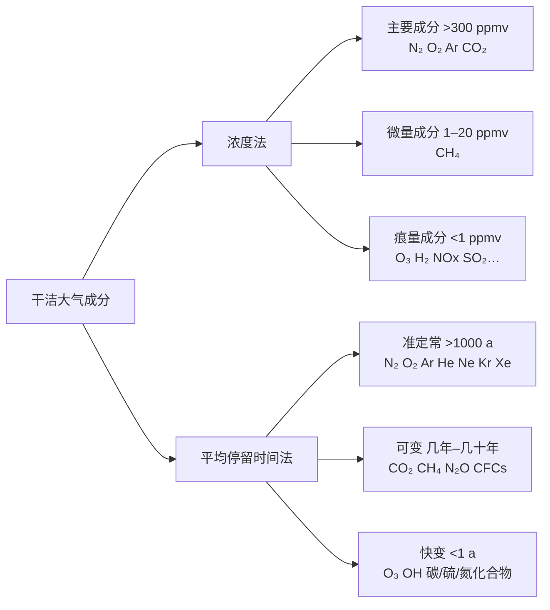
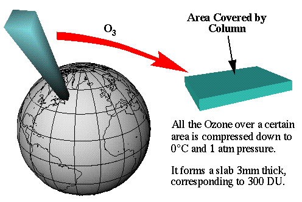
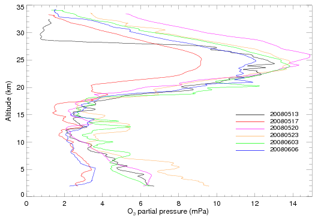
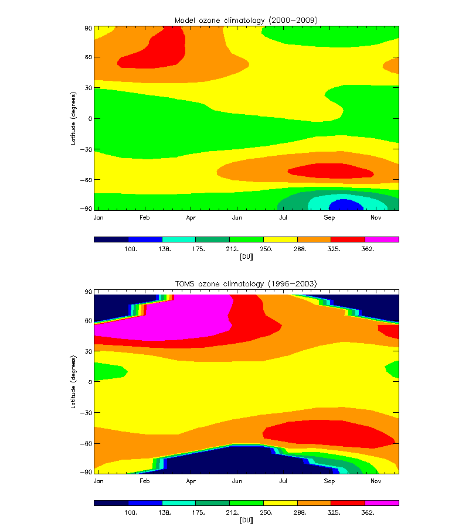
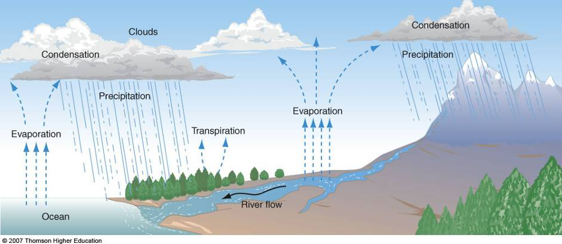
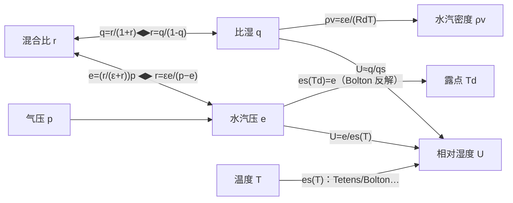
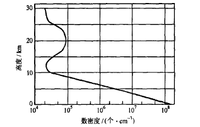
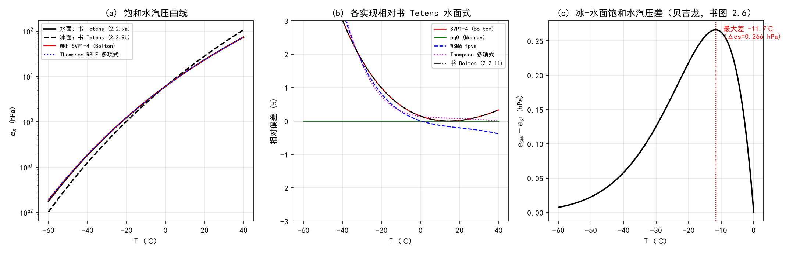
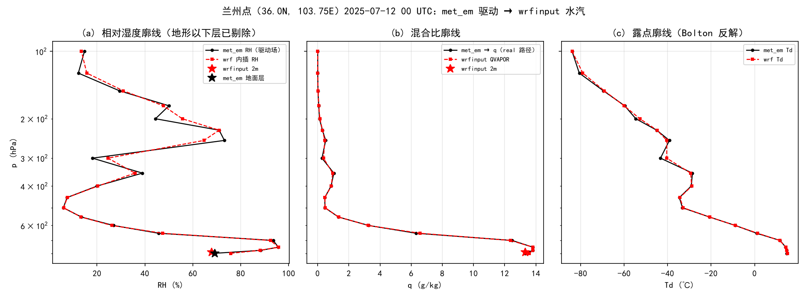
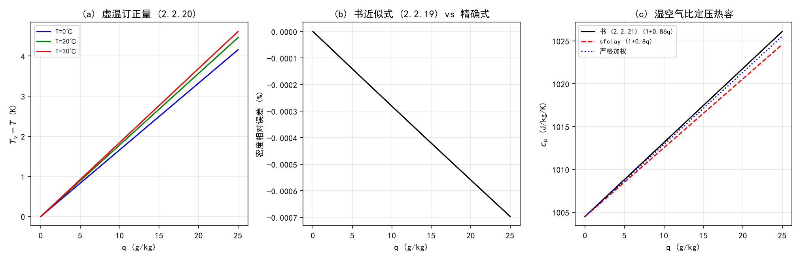

# 第 11 章 大气成分、水汽与气溶胶：从成分表到 WRF 的水物质族

> 本章对应《大气物理学》第二章“地球大气的成分及分布”（印刷页 6–28，全书核心章之一）与课程 PPT“2-1 干洁大气”“2-2-3 水汽和气溶胶”。
> 物理主线：干洁大气成分与分类 → 痕量气体（碳/臭氧/硫/氮）→ 湿度的全部参量 → 饱和水汽压公式体系 → 虚温与湿空气状态方程 → 气溶胶。
> 源码主线：`share/module_model_constants.F` 常数表 → Registry 的 moist 水物质族与水汽初始化 → **饱和水汽压的五种实现**（SVP1-4 / pq0 / WSM6 内联 / Thompson 多项式 / MM5 三段式）→ 气溶胶到辐射的接口。
> 一句话总结本章在全书里的位置：**这一章回答“模式里的空气是什么做的、水以什么身份存在、它的相变阈值从哪来”，是后面热力学（第 14 章）、微物理、辐射（第 12 章）的全部地基。**

---

## 11.0 本章地图

### 11.0.1 书小节结构（对应关系）

| 书节 | 标题 | 印刷页 | 本章对应节 | PPT |
|---|---|---|---|---|
| 第二章 引言 | 温室气体、痕量成分总论 | 6–8 | 11.1.1–11.1.2 | 2-1 |
| 2.1 | 干洁大气 | 6–18 | 11.1 | 2-1 |
| 2.1.1 | 干空气状态方程 | 8–9 | 11.1.3 | 2-1（末 3 页） |
| 2.1.2 | 碳的化合物（CO₂、CH₄、CFCs） | 9–11 | 11.1.4 | 2-1 |
| 2.1.3 | 臭氧 | 11–15 | 11.1.5 | 2-1 |
| 2.1.4 | 硫的化合物 | 16 | 11.1.6 | 2-1 |
| 2.1.5 | 氮的化合物 | 16 | 11.1.6 | 2-1 |
| 2.1.6 | 氢、氦和气体的逃逸 | 17–18 | 11.1.7 | 2-1 |
| 2.2 | 大气中的水汽 | 18–25 | 11.2 | 2-2-3 |
| 2.2.1 | 大气湿度的表示方法 | 19–22 | 11.2.1、11.2.2 | 2-2-3 |
| 2.2.2 | 湿空气的状态方程 | 23–24 | 11.2.3 | 2-2-3 |
| 2.2.3 | 水汽的分布 | 24–25 | 11.2.4 | 2-2-3 |
| 2.3 | 大气气溶胶 | 25–28 | 11.3 | 2-2-3 |
| 2.3.1 | 气溶胶粒子的谱分布 | 25–26 | 11.3.1 | 2-2-3 |
| 2.3.2 | 气溶胶粒子的来源 | 27 | 11.3.2 | 2-2-3 |
| 2.3.3 | 气溶胶粒子在大气过程中的作用 | 27–28 | 11.3.3 | 2-2-3 |

### 11.0.2 考点清单（PPT 自标考点原句归纳）

**PPT 2-1“干洁大气”重 点：**

1. 干、湿空气的状态方程；
2. 大气湿度的表示方法及相互转换；
3. 一些主要痕量成分的分布特征及在大气过程中的作用。

**PPT 2-2-3“水汽和气溶胶”：**

- 重点：湿度的五个表示法（混合比与比湿 / 水汽压 / 水汽密度 / 相对湿度 / 露点和霜点）及互转；湿空气状态方程（虚温）；
- 难点：饱和水汽压（Tetens 公式水面/冰面、Goff-Gratch、Kelvin 公式——参考）；
- 了解：水汽的分布；
- 气溶胶：分类（尺度分类 + 环境学分类）、谱分布（Junge 谱、广义 Γ 谱）、来源、五种作用、直接/间接/半直接辐射效应。

**本章在这些考点之外补充的“源码向”考点：**

- 书中的每一个湿度参量在 Registry/wrfout 里的名字与单位对照；
- 饱和水汽压公式体系 ↔ WRF 里五种实现的数值对照（本实验实测差异 ≤3.5%）；
- real.exe 的“RH → 混合比”转换链（本实验用兰州 met_em + wrfinput 逐位复现）。

### 11.0.3 源码锚点总表（本章全部实测核验）

| 书内容 | WRF 锚点（文件 + 符号） | 状态 |
|---|---|---|
| 干空气状态方程 (2.1.3)、比热 (2.1.4) | `share/module_model_constants.F`：`r_d`、`cp`、`r_v`、`cv`、`cpv`、`mwdry` | ✅ 已核验 |
| 干/湿空气露点饱和公式（Tetens、Bolton） | `share/module_model_constants.F`：`SVP1`–`SVP4`（=SVP1,SVP2,SVP3,SVPT0）；`module_sf_sfclay.F` 中的 `E1`/`QSFC`/`QGH`/`TVCON`/`CPM`/`RHOX` | ✅ 已核验 |
| Murray/Tetens 公式、马格纳斯系数 | `module_model_constants.F`：`pq0`、`a2`、`a3`、`a4`；`cm1`、`cm2`、`cm3`；`phys/module_diag_functions.F`：`calc_rh` | ✅ 已核验 |
| 克劳修斯-克拉珀龙方程 (2.2.6) | `phys/physics_mmm/mp_wsm6.F90` 中 fpvs 内联展开（`xa`、`xb`、`xai`、`xbi`、`psat`、`ttp`） | ✅ 已核验 |
| 冰面/水面饱和水汽压 | `phys/module_mp_thompson.F`：`RSLF`、`RSIF`（八阶多项式 + Murphy-Koop 注释） | ✅ 已核验 |
| 戈夫-格雷奇（冰面）与三段式 | `dyn_em/module_initialize_real.F`：`rh_to_mxrat1`（A0–A6 多项式、Bolton 支、`C1`/`C2`/`C3`/`EIS` 冰支）、`rh_to_mxrat2` | ✅ 已核验 |
| §2.2.1 全部参量互换 | `module_initialize_real.F` 的 `rh_to_mxrat*`：`q1`（比湿）→`q=q1/(1−q1)`（混合比，书 (2.2.2) 之逆）；`module_sf_sfclay.F` 全线；`module_diag_functions.F` 的 `calc_rh`/`VirtualTemperature`/`SaturationMixingRatio`/`TLCL` | ✅ 已核验 |
| 湿空气状态方程/虚温 (2.2.17)–(2.2.20) | `module_model_constants.F`：`EP_1`(=0.608)、`EP_2`(=0.622)、`p608`、`rvovrd`；`module_sf_sfclay.F` 的 `TVCON`、`THVX`、`RHOX` | ✅ 已核验 |
| 湿比热 (2.2.21)–(2.2.22) | `module_sf_sfclay.F`：`CPM(I)=CP*(1.+0.8*QX(I))`（≈ 书 (2.2.21)） | ✅ 已核验 |
| 水物质变量族（比湿/混合比） | `Registry/Registry.EM_COMMON`：`state real qv … moist`；`module_state_description.F` 中 `P_QV` 等包号 | ✅ 已核验 |
| 气溶胶数浓度变量 | `Registry.EM_COMMON`：`QNWFA2D`/`QNIFA2D`/`QNBCA2D`（auxinput17 排放场）、`QNWFA`/`QNIFA`/`QNBCA`（3D）、`QNOCBB2D`/`QNBCBB2D`；`module_radiation_driver.F`：`gt_aod` | ✅ 已核验 |
| 气溶胶 → 辐射光学性质 | `phys/module_ra_aerosol.F`：`calc_aerosol_goddard_sw`、`calc_aerosol_rrtmg_sw`（AOD550、Ångström 指数、SSA、ASY、类型、RH）；Registry：`aer_opt`、`aer_type`、`aer_aod550_val` | ✅ 已核验 |
| 温室气体混合比（表 2.3） | `phys/module_ra_rrtmg_lw.F`：`co2`、`ch4`、`n2o`、`cfc11`、`cfc12`、`co2vmr`…；`read_CAMgases` | ✅ 已核验 |

### 11.0.4 与前后章的衔接

- **向前（第 10 章）**：压高公式与基态构造解决“p 从哪来”；本章解决“ρ、T 与湿度的关系从哪来”——虚温把它们接起来。
- **向后（第 12 章 辐射）**：气溶胶光学性质（`calc_aerosol_*`）、温室气体混合比（`co2vmr` 等）、水物质有效半径（`RE_CLOUD`/`RE_ICE`/`RE_SNOW` 已在 Registry）都在第十一章埋下接口。
- **向后（第 14 章 热力学、第 19 章 个例）**：饱和水汽压公式是所有凝结/蒸发算法的门槛；`QVAPOR` 是初始场的第一个湿度变量。

---

## 11.1 干洁大气：成分、分类与痕量气体（书 2.1）

### 11.1.1 干洁大气与浓度表示法

**干洁大气**指除水汽以外的纯净大气（简称干空气）。教材与 PPT 把描述成分浓度的方式分成两大类：

- **绝对浓度**：单位体积中的质量，kg/m³、mg/m³、μg/m³；
- **相对浓度**：混合比（体积混合比、质量混合比）。教材注：
  - **ppm**（part per million，百万分之几）、**ppb**（part per billion，十亿分之几）、**ppt**（part per trillion，万亿分之几）分别对应 $10^{-6}$、$10^{-9}$、$10^{-12}$；
  - 体积混合比 ${\rm ppm_v}$、质量混合比 ${\rm ppm_m}$ 应分写清楚（书与 PPT 用 ppmv/ppmm）。

书 表 2.1（印刷页 7）给出对流层内主要成分的数字，是必须记住的一级常数：

| 气体 | 相对分子质量 | 体积分数(%) | 质量分数(%) |
|---|---|---|---|
| N₂ | 28.0134 | 78.084 | 75.52 |
| O₂ | 31.9998 | 20.948 | 23.15 |
| Ar | 39.948 | 0.934 | 1.28 |
| CO₂ | 44.0099 | 0.033 | 0.05 |

表 2.2 给出次要成分（部分）：Ne 18.18 ppmv、He 5.24 ppmv、Kr 1.14 ppmv、Xe 0.087 ppmv（准定常成分）；H₂ 0.4–1.0 ppmv、CH₄ 1.2–1.5 ppmv、N₂O 0.25–0.6 ppmv、CO 0.01–0.2 ppmv（可变成分；注意表值是 2013 版教材口径，当前 CH₄ 已接近 1.8 ppmv）。两个数字对照要记牢：**N₂+O₂ 占干空气体积的 99.03%，其余全体不到 1%。**

### 11.1.2 成分的两套分类法【考点】

**（1）按浓度分类（浓度法）：**

- 主要成分：浓度 >300 ppmv——N₂、O₂、Ar、CO₂；
- 微量成分：浓度 1–20 ppmv——CH₄ 等；
- 痕量成分：浓度 <1 ppmv——O₃、H₂、氮氧化物、硫化物等。

**（2）按平均停留时间分类（寿命法）**——平均停留时间定义为“该种成分的所有分子更新一次所需的时间，即平均寿命”：

- **准定常成分**：平均寿命 >1000 a，如 N₂、O₂、Ar、He、Ne、Kr、Xe；
- **可变成分**：平均寿命几年到几十年，如 CO₂、CH₄、N₂O、CFCs；
- **快变成分**：平均寿命 <1 a，如 O₃、OH 和碳、硫、氮的化合物。



**为什么记两套分类**：浓度法回答“有多少”，寿命法回答“变得有多快”——后者才是全球变化问题（温室气体、臭氧洞）的技术入口；也正因为 CO₂、CH₄、CFCs 的寿命是“几年到几十年”，人类活动才有加速改变它们的空间。

### 11.1.3 干空气状态方程（书 2.1.1）【考点·推导必会】

空气可以看成多种化学成分的混合理想气体。由**道尔顿分压定律**，混合理想气体的压强等于各成分分压强之和：

$$p = p_1 + p_2 + \cdots = \sum_i p_i$$

混合理想气体的状态方程与平均摩尔质量（书 (2.1.1)、(2.1.2)）：

$$pV = nR^*T = \frac{m}{\bar M} R^* T = mRT,\qquad
\bar M = \frac{m}{n} = \frac{m}{\sum_i m_i/M_i} = \frac{1}{\sum_i (m_i/m)(1/M_i)}$$

式中 $R^*$ 是摩尔气体常数，$R$ 是混合理想气体的比气体常数。利用表 2.1 的质量分数可以算出 90 km 以下干空气的平均摩尔质量：

$$M_d = 28.9644\times 10^{-3}\ \text{kg}\cdot\text{mol}^{-1}\ \Rightarrow\
R_d = \frac{R^*}{M_d} = 287.05\ \text{J}\cdot(\text{kg}\cdot\text{K})^{-1}$$

于是**干空气状态方程**（书 (2.1.3)）写作 $p = \rho_d R_d T$。比热容按同样的加权方式（书 (2.1.4)）：$c_p = 1004$ J/(kg·K)，$c_v = 717$ J/(kg·K)。

> **源码对照（细节见 11.4.1）**：`share/module_model_constants.F` 里 `r_d = 287.`、`cp = 7.*r_d/2.`（=1004.5）、`mwdry = 28.966`——与书中 287.05、1004、28.9644 的差别均在 0.02% 以内（本实验实测见表 11-实验 A 组）。

### 11.1.4 碳的化合物：CO₂、CH₄、CFCs【考点】

**CO₂** 是“最重要的温室气体”。书 2.1.2 的要点：

- 源：矿物燃料燃烧和工业活动（主要人工源）、死亡生物体的腐败和呼吸作用；
- 汇：海洋（巨大的储存库）、植被；海洋吸放由海-气 CO₂ 分压差决定——高纬寒冷海面是汇，热带低纬海面是源，**全球平均是大气向海洋输送 CO₂**；
- 循环反应式（书 p9）：
  - 光合作用 $n{\rm CO_2} + n{\rm H_2O} \longrightarrow [{\rm CH_2O}]_n + n{\rm O_2}$
  - 呼吸作用 $[{\rm CH_2O}]_n + n{\rm O_2} \longrightarrow n{\rm CO_2} + n{\rm H_2O}$
- 冰芯记录：1 万年前最近一次冰河期尚未转暖时，大气 CO₂ 浓度比 200 ppmv 还低；图 2.1 为 IPCC 依据南极冰芯（D47、D57、Siple 山、南极点）与夏威夷 Mauna Loa 观测的 1000 年 CO₂ 曲线。

书 表 2.3（印刷页 11，引自 IPCC）是“痕量气体台账”，考试常考其中 CO₂/CH₄/N₂O/CFC-11 四行：

| 气体 | 工业化前 | 1994 | 2005 | 浓度年变化 | 年变化率 | 大气中寿命 |
|---|---|---|---|---|---|---|
| CO₂ | 约 280 ppmv | 358 ppmv | 379 ppmv | 1.85 ppmv/a | 0.48 %/a | 50–200 aᵃ |
| CH₄ | 约 700 ppbv | 1720 ppbv | 1774 ppbv | 1.6 ppbv/a | 0.1 %/a | 12 a |
| N₂O | 约 275 ppbv | 312 ppbv | 319 ppbv | 0.7 ppbv/a | 0.22 %/a | 120 a |
| CFC-11 | 0 | 268 pptv | 251 pptv | −1.85 pptv/a | −0.73 %/a | 50 a |
| HCFC-22（CFC 代用品） | 0 | 110 pptv | 169 pptv | 3.2 pptv/a | 3.2 %/a | 12 a |
| CF₄ | 0 | 72 pptv | 74 pptv | 0.2 pptv/a | 0.03 %/a | 50000 a |

ᵃ 表下注明：CO₂ 对不同汇有不同的消失率，没有单一寿命。
到 2005 年，CO₂、CH₄、N₂O 比工业化前（约 1750 年）分别增加约 35%、153%、16%；CFC-11 近年已开始减少。

**CH₄**：主要是湖泊、沼泽里生物体腐败后被细菌分解生成；天然气、工业废水也是来源。大气 CH₄ 的 80% 来自地表生物源（严格无氧环境）。1984 年全球测量平均 1.625 ppmv，而冰芯气泡显示 3000 年前到 150 年前一直保持 0.6–0.8 ppmv——**近一两百年显著增加**。CH₄ 既是温室气体又是化学活性气体：对流层被 OH 氧化（${\rm CH_4+OH}\to{\rm CO_2+H_2O}$），平流层被 OH、Cl、O(¹D) 破坏。

**CFCs（氟氯化碳）**：由氯、氟、碳原子组成，大气中原本不存在的有机化合物。CFC-11、CFC-12 即氟里昂-11（CFCl₃）与氟里昂-12（CF₂Cl₂），性质稳定无毒，曾广泛用作制冷剂、喷雾发射剂、发泡剂和电子清洁剂。正因惰性，**对流层内逐年累积并可输送进平流层，在平流层光化学分解出 Cl，破坏臭氧层**；同时它们又是温室气体（对应表 2.3 中 CFC-11 的“负增长”——蒙特利尔议定书生效后的效果）。

### 11.1.5 臭氧（O₃）【考点·重头】

**分布特征**（书 p11 + PPT）：臭氧主要分布在 **10–50 km** 的平流层大气中，**极大值在 20–30 km** 高度之间；12–15 km 以上含量增加特别显著，再往上到 55 km 已极小。近地面含量很少。

**为什么重要**：臭氧对太阳紫外辐射（0.2–0.29 μm）有强烈吸收，是大气中最重要的微量成分之一——① 臭氧层阻挡强紫外辐射到达地面，保护地球生命（没有臭氧层“这个世界就不能存在”）；② 臭氧层吸收的紫外辐射能量使平流层升温，决定平流层温度场与大气垂直结构，使地面平均温度降低约 1–2℃。

**浓度表示**（PPT）：ppmm、ppmv、mPa、**Dobson Unit（DU）**。DU 定义：把某面积上空的全部臭氧压缩到 0℃、1 atm，**1 DU = 0.01 mm 厚度**；典型的全球总量 300 DU 对应 3 mm 厚的纯臭氧层。



**产生与消亡（Chapman 理论，1930）**：只考虑氧的光致离解，基本光化学反应为（书 (2.1.5)–(2.1.7)）：

$${\rm O_2} + h\nu \longrightarrow {\rm O} + {\rm O}\qquad(2.1.5)$$
$${\rm O} + {\rm O_2} + {\rm M} \longrightarrow {\rm O_3} + {\rm M}\qquad(2.1.6)$$
$${\rm O} + {\rm O} + {\rm M} \longrightarrow {\rm O_2} + {\rm M}\qquad(2.1.7)$$

分子氧吸收**波长短于 0.24 μm** 的紫外辐射而离解；由于这部分紫外辐射向下传输时被大气吸收，光离解系数随高度降低，而分子氧浓度随高度又逐渐增加——两种因素的综合使**氧的离解率约在 42 km 处达到最大**（书 p11 原文）。损耗反应为 ${\rm O_3}+h\nu\to{\rm O_2}+{\rm O}$ 与 ${\rm O_3}+{\rm O}\to 2{\rm O_2}$（PPT）。Chapman 理论预言的下层平流层臭氧偏多，说明真实大气还依赖 HOx/NOx/ClOx 等催化循环——这是后续章节的内容。



**季节与纬度变化**：全球臭氧总量随季节和纬度显著变化（下图为模式气候学与 TOMS 卫星观测的对照，教材 PPT 原图）：



**臭氧洞（PPT 定义）**：① 臭氧低值区（低于 **220 DU**）的范围大，经常超过 $10^6$ km²；② 低值持续时间长，经常为 2–4 个月。**形成机理**：动力原因——冬季极涡冷且稳定；化学原因——催化反应

$${\rm Cl} + {\rm O_3} \longrightarrow {\rm ClO} + {\rm O_2},\qquad
{\rm ClO} + {\rm O} \longrightarrow {\rm Cl} + {\rm O_2}$$

Cl 主要来自 CFCs 在紫外辐射下分解释放的活性氯。合计 ${\rm O_3}+{\rm O}\to 2{\rm O_2}$——Cl 只是催化剂。

**对流层臭氧**：呈增加趋势；臭氧是强氧化剂，能促进 SO₂ 氧化和 NOx 转化，加速酸雨和光化学烟雾形成；同时是重要温室气体。对流层臭氧的源：平流层以扩散和湍流方式输送（对流层顶的间断处是主要通道）+ 对流层内的光化学反应。

### 11.1.6 硫与氮的化合物【考点】

**硫的化合物**（书 2.1.4 + PPT）：种类有 SO₂、H₂S、硫酸盐颗粒。大气中 80%–90% 的硫存在于 SO₂ 和 H₂S 中。它们不稳定、在大气中经（光）化学反互相转化。**SO₂ 是最重要的一种**，是大气环境酸化和**酸雨**形成的根源之一：SO₂ 可氧化成硫酸和硫酸盐，也能先被云滴和雨滴吸收后在液相氧化成硫酸/硫酸盐，使降水呈酸性。习惯上用 pH 衡量酸碱度，由于大气中 CO₂ 使降水本底偏酸，**pH<5.6 称为“酸雨”**（pH=5.6 并非严格意义上的降水本底值）。**硫酸盐的干湿沉降是大气酸沉降的主要成分**：

- 干沉降：质粒在干的状况下移出大气——重力下沉、附粘移出；
- 湿沉降：质粒受雨雪或云雾滴影响而下沉到下垫面——凝长下沉、碰并下沉（对应云内清除与云下清除）。

硫化物来源于地球表面：土壤分解和生物体腐烂放出 H₂S 与 SO₂，火山喷发喷出 H₂S、SO₂ 及硫酸盐。H₂S 在大气中很快被氧化，所以浓度不大；海浪溅起的泡沫蒸发后产生的海盐颗粒中含硫酸盐——**海洋是硫酸盐颗粒的重要来源**。估计大气中硫化物的一半来自自然过程，另一半可能来自人类活动；自工业化以来，大气硫酸盐气溶胶浓度在海洋上大约增加了 2–4 倍，陆地上增加了 4–15 倍。

**氮的化合物**（书 2.1.5 + PPT）：关注的不是平均寿命长达几百万年的 N₂ 分子，而是微量的 NO、NO₂、N₂O、N₂O₃ 以及 NH₃ 等——它们关系到大气光化学烟雾、酸沉降和平流层臭氧变化。NO 和 NO₂ 浓度最高，统写为 NOₓ；N₂O₃、N₂O₅、HNO₂、HNO₃ 等合称**奇氮**。**奇氮化合物是光化学烟雾的先驱物**：它与碳氢化合物的反应是造成低层大气臭氧高浓度的最主要成因。主要来源：化石燃料燃烧（高温条件）、汽车尾气、生物体燃烧、闪电、土壤排放，其中人为排放占相当大比重。降水时 NO₂ 溶于水生成硝酸及硝酸盐沉降，降水冲刷氮化合物的同时也变成酸性降水。NH₃ 来自地表（工业废气、土壤细菌分解、动物粪便），易溶于水生成 NH₄OH，能部分中和降水中的硫酸和硝酸、降低酸度；铵盐溶液蒸发后留下的铵盐粒子是很好的凝结核（书 p17）。

**光化学烟雾**（书 p28 专栏 + PPT）：汽车、工厂排放的碳氢化合物（HC）和氮氧化合物（NOₓ）等一次污染物在阳光作用下发生复杂光化学反应，生成臭氧、醛、酮、酸、PAN（过氧乙酰硝酸酯）等二次污染物，混合形成有害的光化学烟雾（洛杉矶烟雾是最著名的例子）。形成条件：**天气晴朗、湿度小、微风、近地层有逆温、大气稳定**；中午烟雾浓度最大，午后随日照减弱和风速加大逐渐消散。核心反应（PPT）：

$$2{\rm NO}+{\rm O_2}\to 2{\rm NO_2};\quad
{\rm NO_2}+h\nu \to {\rm NO}+{\rm O};\quad
{\rm O}+{\rm O_2}\to {\rm O_3};\quad
{\rm O_3}+{\rm NO}\to {\rm NO_2}+{\rm O_2}$$

### 11.1.7 氢、氦与气体的逃逸（书 2.1.6）

氢和氦都是宇宙中最丰富的元素，但在地球大气中却是微量成分——原因是漫长的地球大气演化过程中，它们逐渐扩散到高空并**逸出地球**。要点：

- 500 km 以上的高空，氢原子、氦原子和氧原子是大气的主要成分；高层大气中的氢原子主要来自平流层和中间层的水汽分子与甲烷分子的光致离解，也来自太阳高能质子捕获电子。高层大气中新产生的氢气大约与逃逸量相当。
- 逃逸的物理门槛：物体逃离地球需满足能量守恒，设 $z$ 为离地面高度，

$$\tfrac{1}{2}Mv_e^2 > \frac{GM_EM}{R_E+z}$$

逃逸出去的主要是氢原子和氦原子，**地球大气的起始逃逸高度约在 400–500 km**。
- 行星对比：金星、火星都有类似逃逸现象；水星温度高、重力小更利于逃逸；外行星气温低、重力大，氢氦不易逃逸，至今保留在行星表面，成为外行星大气的主要成分。
- 低层大气中氢的自然源是海洋表面、土壤表面及光化学过程；人为排放（汽车尾气）已成为重要来源，30 年来低层大气氢浓度增加约 35%，北半球平均 0.576 ppmv、南半球 0.552 ppmv。氦来自地壳中放射性元素 ²³⁸U、²³²Th 的衰变产物。

---

## 11.2 大气中的水汽（书 2.2）【考点·重点】

水汽在大气中比例很小（0.1%–3%），但是**最活跃**的成分、重要的温室气体，积极参与对流层天气现象的形成和消散。大气中的水汽只占全球总水量的 **0.001%**（海洋储存 97.6%）；中国处于欧亚大陆东南部，水汽主要来源于南海和印度洋。



### 11.2.1 大气湿度的表示方法（书 2.2.1）【考点·逐个记牢】

水汽和干空气的混合气体称为**湿空气**；表示湿空气中水汽含量的物理量称为**空气湿度**。测量水汽含量最基本的方法是称重法（直接测量一定体积湿空气中的水汽质量和干空气质量）——由此得到**最基本的两个量：混合比与比湿**，其余参量都是导出量。

**（1）混合比 r 与比湿 q**（书 (2.2.1)、(2.2.2)）：

$$r = \frac{m_v}{m_d},\qquad q = \frac{m_v}{m_d + m_v},\qquad q = \frac{r}{1+r}$$

通常大气中 $r, q < 0.04$，因此可以认为 $q \approx r$；单位 g/g 或 g/kg。

**（2）水汽压 e**：大气中水汽的分压强。假设湿空气中水汽的摩尔分数为 $\chi_v = n_v/(n_d+n_v)$，则 $e = \chi_v p$（书 (2.2.3)）。令 $\varepsilon = M_v/M_d = 0.622$，可导出

$$\chi_v = \frac{r}{\varepsilon+r},\qquad
e = \frac{r}{\varepsilon+r}p \qquad (2.2.3)'$$
$$r = \frac{\varepsilon e}{p-e}\qquad (2.2.4),\qquad
q = \frac{\varepsilon e}{p-0.378e}\qquad (2.2.5)$$

由于大气中通常 $e<60$ hPa，可近似 $q \approx r \approx \varepsilon e/p$。（0.378 = 1−ε。）

**（3）饱和水汽压 eₛ、饱和混合比**：一定温度下纯水汽与水（冰）处于相态平衡时的水汽压，**仅与温度有关**（表 2.5a 平液面、表 2.5b 平冰面，书 p20）。严格说湿空气的饱和水汽压不等于纯水汽的饱和水汽压，但一个大气压下误差小于 1%（干空气存在使三相点降低约 0.0098 K），实际工作中忽略两者差别。饱和混合比与饱和比湿（书 (2.2.12a)、(2.2.12b)）：

$$r_s = \frac{\varepsilon e_s(T)}{p-e_s(T)} \approx \frac{\varepsilon e_s(T)}{p},\qquad
q_s = \frac{\varepsilon e_s(T)}{p-0.378e_s(T)} \approx \frac{\varepsilon e_s(T)}{p}$$

**（4）水汽密度 ρᵥ（绝对湿度）**：纯水汽可看成理想气体，$e = \rho_v R_v T$（书 (2.2.13)），故

$$\rho_v = \frac{e}{R_v T} = \frac{\varepsilon e}{R_d T}\qquad (2.2.14)$$

单位 g·m⁻³，表示单位体积湿空气中含有的水汽质量。

**（5）相对湿度 U**：一定温度和压强下，水汽和饱和水汽的摩尔分数之比：

$$U_w = \left[\frac{\chi_v}{\chi_{vs}}\right]_{p,T}
= \left[\frac{e}{e_s(T)}\right]_{p,T}\qquad (2.2.15)$$

冰面相对湿度 $U_i$ 同理（把 $e_s$ 换成冰面饱和水汽压）。与混合比、比湿的关系（书 (2.2.16)）：

$$U_w = \frac{r}{r_s}\cdot\frac{\varepsilon+r_s}{\varepsilon+r} \approx \frac{r}{r_s} \approx \frac{q}{q_s}$$

**（6）露点 Td 与霜点 Tf**：湿空气**定压降温**达到饱和时的温度称为露点 $T_d$（对冰面饱和则称为霜点 $T_f$）。冷却时 $q$、$r$、$e$ 都保持不变，$e_s(T)$ 随温度降低而减小，当 $e_s(T)=e$ 时达到饱和。要点：① 露点完全由空气的**水汽压**决定，**等压过程中是保守量**，可由露点仪直接测得；② 大气中总是含有丰富凝结核，气温降到露点就会在凝结核表面凝结，因此相对湿度一般不超过 101%；③ 由于冰面饱和水汽压比水面低，空气先达到霜点还是露点取决于冰面条件（先霜后露的“双饱和”过程，见书 2.2.1 节文字与图 2.7）。

书 表 2.6（印刷页 23）是湿度参量总表——**“应用”一栏就是考试的逻辑**：

| 名称 | 符号 | 单位 | 测量方法 | 应用 |
|---|---|---|---|---|
| 混合比 | r | g/g, g/kg | 绝对法（称重法） | 在气块无相变的绝热过程中保持常量，常用于理论计算 |
| 比湿 | q | g/g, g/kg | 绝对法（称重法） | 同上 |
| 水汽密度 | ρᵥ | g/m³, kg/m³ | 绝对法（称重法） | 表示水汽绝对含量，常用于理论计算 |
| 水汽压 | e | hPa | 通风干湿表 | 表示水汽绝对含量 |
| 露点 | T_d | ℃ | 露点仪 | 预报露、霜、云和雾等现象是否出现 |
| 霜点 | T_f | ℃ | （同上） | 同上 |
| 相对湿度 | U_w, U_i | % | 通风干湿表和毛发湿度计 | 表示空气接近饱和的程度，也可用来推算其他湿度参量 |

**参量互换网络**（已知 $(T,p,q)$ 或 $(T,p,e)$ 即可求其余全部）：



**一个手算范例**（本实验实测，见 11.6）：$T=25℃$、$p=1000$ hPa、$q=12$ g/kg（兰州盛夏典型值）：

- $r = q/(1-q) = 12.146$ g/kg；
- $e = rp/(\varepsilon+r) = 19.153$ hPa；
- $\rho_v = e/(R_vT) = 13.9$ g/m³；
- $U = e/e_s(T) = 60.47\%$；由 $e$ 反解 **$T_d = 16.83℃$**（验证 $e_s(T_d)=19.153$ hPa，与 $e$ 逐位相等）；
- 正逆互换闭合误差：r→q→r 为 0，e→r→e 为 0，q→e→q 为 $1.5\times10^{-16}$（机器精度）。

### 11.2.2 饱和水汽压的公式体系（书 2.2.1 三、四）【考点·背公式家族】

饱和水汽压随温度的变化，理论上由**克拉珀龙-克劳修斯方程**决定（书 (2.2.6)）：

$$\frac{d e_s}{dT} = \frac{L_v e_s}{R_v T^2}$$

假定相变（汽化）潜热 $L_v$ 为常数，可得到积分表达式（书 (2.2.7)）：

$$e_s(T) = e_{s0}\exp\left[\frac{L_v}{R_v}\left(\frac{1}{T_0}-\frac{1}{T}\right)\right]$$

实际上 $L_v$ 随温度降低而略有增加，因此理论值与实验值并不完全符合。**世界气象组织（WMO）建议**较精确的**戈夫-格雷奇（Goff-Gratch）公式**：

- 平液面（−49.9~100℃）：$\lg e_s = 10.79574(1-T_{00}/T) - 5.02800\lg(T/T_{00}) + 1.50475\times10^{-4}[1-10^{-8.2969(T/T_{00}-1)}] + 0.42873\times10^{-3}[10^{4.76955(1-T_{00}/T)}-1] + 0.78614$
- 平冰面（−100~0℃）：$\lg e_{si} = -9.09685(T_{00}/T-1) - 3.56654\lg(T_{00}/T) + 0.87682(1-T/T_{00}) + 0.78614$

其中 $T_{00}=273.16$ K 是水的三相点温度。若令 $L_v$ 近似为 $T$ 的线性函数，则由 (2.2.6) 积分可得**马格纳斯（Magnus）公式**：

$$\lg e_s(T) = -\frac{2937.4}{T} - 4.9283\lg T + 23.5518\qquad (2.2.8a)$$

实际工作中最常用的是简单的 **Tetens 经验公式（Murray, 1986）**：

$$e_s = 6.1078\exp\left[\frac{17.2693882\,(T-273.16)}{T-35.86}\right]\qquad (2.2.9a)\ \text{水面}$$
$$e_{si} = 6.1078\exp\left[\frac{21.8745584\,(T-273.16)}{T-7.66}\right]\qquad (2.2.9b)\ \text{冰面}$$

转换成以 10 为底的指数形式：$e_s = e_{s0}10^{at/(t+b)}$，$t$ 为摄氏温度；**水面 $a=7.5$、$b=237.3$；冰面 $a=9.5$、$b=265.5$**。**Bolton（1980）指出**，低温下 (2.2.9a) 的误差较大，0℃ 以下求水面饱和水汽压时采用下式更合适（书 (2.2.11)）：

$$e_s = 6.112\exp\left(\frac{17.67\,t}{t+243.5}\right)$$

**为什么水面和冰面常数不同**：同温度下**冰面饱和水汽压小于水面饱和水汽压**——这正是云雾降水形成发展中的重要事实（贝吉龙假说），数值上**冰水差在 −12℃ 附近最大**（书图 2.6；本实验实测最大值出现在 **−11.7℃**，Δeₛ=0.266 hPa——见 11.6）。

> **PPT 补充**：Kelvin 公式（曲面饱和水汽压高于平面，$\sigma$ 为水汽表面能）作为深度知识参考——它解释了为什么云滴要在凝结核上形成（后接第 12 章微物理）。

### 11.2.3 湿空气状态方程与虚温（书 2.2.2）【考点·每年都考】

水汽和干空气组成的混合理想气体，其平均摩尔质量（书 (2.2.17)）：

$$M_{\text{湿}} = \frac{m_d+m_v}{\dfrac{m_d}{M_d}+\dfrac{m_v}{M_v}}
= \frac{1}{\dfrac{1-q}{M_d}+\dfrac{q}{M_v}}
= \frac{M_d}{1-q+\dfrac{M_d}{M_v}q}
= \frac{M_d}{1+0.608q}$$

由此湿空气的比气体常数（书 (2.2.18)）与状态方程（书 (2.2.19)）：

$$R_{\text{湿}} = R_d(1+0.608q),\qquad
p = \rho R_d (1+0.608q)T$$

同一压力和温度下，**湿空气密度比干空气小，含水汽越多密度越小**。定义**虚温**：

$$T_v = (1+0.608q)T\qquad (2.2.20)$$

于是 $p = \rho R_d T_v$——**引用虚温后，湿空气便可看成干空气，用干空气的状态方程表示**。虚温订正量：

$$\Delta T_v = T_v - T = 0.608\,qT = 0.378\,\frac{e}{p}T$$

**空气温度越高、水汽越多，虚温订正量越大；大气低层虚温订正量不可忽略**（书 p24 原文）。湿空气的比定压/比定容热容（书 (2.2.21)、(2.2.22)）：

$$c_p = c_{pd}(1+0.86q),\qquad c_v = c_{vd}(1+0.96q)$$

（精度要求不高时可取 $c_p\approx c_{pd}$、$c_v\approx c_{vd}$。）

**把这三个式子连起来读**：湿度三兄弟 $q\to(1+0.608q)\to T_v$ 的意义是——模式的动力学和辐射几乎都喜欢“干空气的公式”，虚温就是让湿空气继续用干空气公式的“等效温度”。WRF 的 `EP_1=0.608`、`EP_2=0.622`、`p608` 三个常数就是这三条公式的全部家当（见 11.4.1、11.5.1）。

### 11.2.4 水汽的分布（书 2.2.3）

- 温度高有利于水面蒸发：热带水汽最多，随纬度增加而减少。极端记录——美国标准大气（1976）观测到的最高露点 34℃，出现在阿拉伯半岛沙迦（Sharjah）海滨，若取气压 1000 hPa，混合比约 **35 g/kg**，为现已测得的湿度最大值；最低值在南极东方站（Vostok，海拔 3470 m），地面气温 −88.2℃ 时饱和水汽混合比仅 $10^{-4}$ g/kg——两者相差 **5 个数量级**。
- 水汽年变化明显：北京夏季水汽混合比有时可达 30 g/kg，冬季有时小于 5 g/kg。
- **垂直分布**：对流层内水汽一般随高度减小，但有时观测到**湿度逆增**（往往与逆温层同时存在，因逆温的稳定结构阻止水汽向上输送）。全球纬圈平均：**约 90% 的水汽在 500 hPa 以下**（中纬度约 5 km），**其中 50% 集中在 850 hPa 以下**（约 1.5 km）。
- **平流层**：水汽分布比较均匀，约在 1–3 ppmv 范围变化；贝母云（约 25 km）和夜光云（约 80 km）可依据所在高度的霜点估算水汽混合比。极区冬季平流层可冷至 −80℃ 以下，某些痕量成分凝结形成极地平流层云（PSC，PPT 原图）。
- 平流层水汽的源汇仍在研究中：哈得来环流上升空气携带的丰富水汽在上升中大部分凝结成云和雨降落，使对流层顶附近降到极小值；少部分水汽穿过对流层顶进入平流层后向极地移动；**强雷暴穿透对流层顶可给平流层补充水汽**——据估计，雷暴云的这些部分若有 1% 的气化，就能使平流层内水汽增加 1 ppmv。

---

## 11.3 大气气溶胶（书 2.3）【考点】

### 11.3.1 气溶胶的分类与谱分布（书 2.3.1）

**定义**：气溶胶是悬浮在气体中的固体和（或）液体微粒与气体载体组成的多相体系；习惯上“大气气溶胶”就是指大气中悬浮着的各种固体和液体粒子。云、雾滴、冰晶、雨滴等水质物粒子是第四篇的内容，本章只讲其他固态/液态气溶胶粒子。

**（1）按尺度分类（云降水学分类）**：

- **爱根核**（Aitken nuclei）：半径 r < 0.1 μm；
- **大粒子**：0.1 μm < r < 1.0 μm；
- **巨粒子**：r > 1.0 μm。

大气中还有小离子（半径 <0.005 μm，电子得失形成）与大离子（相当于爱根核尺度）。（不同尺度粒子用**空气动力学等效直径**等概念描述——书 p26 专栏。）

**（2）环境学分类（PPT）**：TSP、降尘、PM10、PM2.5、尘粒、粉尘、灰等。直径大于 10 μm 的粒子会逐渐沉降到地面（称**降尘**）；小粒子称为**飘尘**；10 μm 以下能滞留在人的呼吸道中，小于 5 μm（特别是 <1 μm）能深入肺部——与健康危害直接相关。

**数密度量级**：海洋上空平均约 $10^3$ 个/cm³，田野 $10^4$ 个/cm³，城市上空可达 $10^5$ 个/cm³ 或更高（书 p25）。

**（3）谱分布**：表示粒子浓度与粒子大小之间的函数关系。

- **Junge 谱**（荣格谱分布，20 世纪中期德国科学家 Junge 对平流层及相对干净对流层大量观测提出）：

$$\frac{dN}{d(\lg D)} = C D^{-\nu}\qquad (2.3.1)$$

  写成对数形式 $\lg[dN/d(\lg D)] = C_1 - \nu\lg D$（书 (2.3.2)）。$\nu$ 一般在 **2~4** 之间；大陆上直径大于 0.1 μm 的粒子可取 **ν≈3**；该式适用于半径 0.1–2 μm 的干净大气溶胶，对煤烟型城市污染大气误差较大。
- **广义 Γ 谱（Deirmandjian 谱）**：范围跨度大，可突出小粒子分布特性（第十七章 (17.5.6) 的指数型公式）；按气溶胶来源分为**大陆型（霾 L）、海洋型（霾 M）和高层型（霾 H）**三类。
- 谱分布随环境变化（内陆/海洋/城市上空对照，书图 2.8），**降水能清除 80%–90% 的气溶胶粒子**，所以雨后往往能见度好转、空气清新。
- **垂直分布**：对流层内气溶胶浓度随高度按指数减少，对流层顶处最小；平流层内在 **20 km 左右出现一个气溶胶层（荣格层）**，平均尺度仅 0.1–1 μm，估计与火山喷发和宇宙尘埃有关；火山爆发后不久，平流层下部微粒浓度常增加 **10 倍以上**（书图 2.9）。



### 11.3.2 气溶胶粒子的来源（书 2.3.2）

气溶胶粒子的主要来源是地面，分自然与人类活动两大类，宇宙尘埃也是一个来源：

1. **土壤、岩石风化及火山喷发的尘埃**：农业耕作使大片裸露地面，风把沙漠和干旱区的地表细粒土刮上天空形成沙尘暴、尘暴。全球每年从几大沙漠区进入大气的沙尘气溶胶达 **$(10\sim20)\times10^8$ t**，约占对流层气溶胶的**一半**。1991 年 6 月菲律宾皮纳图博（Pinatubo）火山喷发，喷发物进入平流层 18–30 km，随平流层纬向风运动，**3 周内自西向东环绕地球一周**，半年后扩散到全球。
2. **烟尘及工业粉尘**：大工业和城市地区烟尘很多；工矿业产生二氧化硅粉尘及放射性粉尘等，对人体有害。这一类气溶胶浓度的**日变化**是考点：清晨人类生产生活开始，大气常处于逆温稳定状态不利于扩散，低层浓度达到极大；**中午前后垂直对流输送强，浓度降到极小**；黄昏后对流减弱浓度又增大；夜间大部分活动停止后可能再次减小。
3. **海沫破裂干涸成核**：海浪冲击下海面形成大量空气泡并很快破裂，生成众多盐水滴，蒸发干涸后成为 **>2 μm 的海盐巨核**及大量 **0.3 μm 的爱根核**——海洋上气溶胶粒子的主要来源。
4. **气-粒转化**：爱根核还常由大气中微量气体转化而来——SO₂ 经光化学氧化生成硫酸盐溶液微滴，微滴蒸发后成为硫酸盐质点；NO/NO₂ 溶于水生成亚硝酸和硝酸，进而与海盐质点反应生成硝酸盐颗粒。**城市大气中爱根核和大粒子浓度大，说明由污染气体转化形成的粒子是城市大气气溶胶的一个重要来源。**
5. **微生物、孢子、花粉等有机物质点**。
6. **宇宙尘埃**：由宇宙空间进入大气（包括流星燃烧产生的灰尘）；粗略估计一昼夜降落到地球上的宇宙尘埃约 **550 t**。

总体：气溶胶粒子主要来源于自然现象，但随工业发展和人口增加，人类活动产生的粒子日益增多，已造成环境污染。

### 11.3.3 气溶胶在大气过程中的五种作用【考点】

书 2.3.3 把作用归纳为五类（印刷页 27–28）：

1. **在云雾降水中的作用**：如果大气非常纯净、没有杂质，由水汽分子凝聚“自发生成”云雾微滴及冰晶是极为困难的（需要相对湿度达百分之几百；纯净水滴冻结成冰晶也需要 −40~−30℃ 的低温）。实际大气中云雨过程几乎不可能离开气溶胶：它们充当**凝结核、冰核、凝华核**，是云雾产生并存在长大的基础；**吸湿性巨核**能在较低过饱和度下形成大水滴，有利于云滴碰并长大。
2. **对大气辐射过程的影响**：气溶胶能削弱（吸收和散射）太阳辐射，将部分太阳辐射散射回宇宙空间，使入射到地面的能量减少、降低低层大气温度；另一方面，具吸光性的气溶胶层吸收太阳辐射后自身增温，并通过大气运动传输热量、提高大气温度。典型例子：**皮纳图博火山（15°N, 120°E）喷发后的第二年（1992 年）是北半球近 10 年最冷的年份**，南半球受影响小；同时平流层升温显著，估计低纬（30°N~30°S）平流层升温大于 2℃。
3. **对大气光学特性的影响**：气溶胶粒子对太阳光的散射和吸收会影响大气能见度。大气中悬浮大量细小烟粒、尘埃或盐粒时天空混浊并呈浅蓝色或微黄色，称为**霾**；沙尘暴时天空呈黄褐色，**能见度可减小到 50–100 m**。
4. **对大气电学特性的影响**：低层大气中的离子主要由宇宙射线产生，地壳内及大气中的放射性物质也能使气体电离；小离子被爱根核吸附后成为大离子。晴天大气电场方向向下、地面带负电荷，正负离子在电场作用下形成**垂直传导电流**；因小离子迁移率大，传导电流大小主要取决于小离子的浓度和迁移率。当大气中气溶胶粒子浓度很大时小离子被捕获减少——城市冬季在逆温层影响下，上午 7–10 时大气污染较重，此时小离子浓度减少、传导电流减小，**大气电场达到极大值**。
5. **在大气化学过程中的作用**：固态粒子能吸附微量气体，液态粒子能溶解微量气体，它们起化学反应后生成新的物质微粒——如燃烧排出的 NO、NO₂、SO₂ 在紫外辐射下氧化，遇水滴生成硝酸、亚硝酸、硫酸及各种盐类。若大气处在逆温稳定状态、对流很弱，大量有毒物质悬浮空中，造成严重的**大气污染事件**。

**气溶胶的辐射效应（PPT 三分类）**——这是考试与模式的直接接口：

- **直接辐射效应**：气溶胶粒子对太阳辐射的吸收和散射。区域直接辐射强迫主要由粒子光学特性、区域地表反照率与气溶胶垂直分布决定；**吸湿性粒子还与当地水汽含量有关**。
- **第一类间接效应（“云反照率”效应）**：气溶胶粒子增加时，在水汽含量一定的情况下使**云滴数增加而云滴半径减小**，增大云的短波反照率；粒子浓度、大小、吸湿性直接影响云滴的浓度和大小，进而改变云的短波辐射效应。
- **第二类间接效应**：云滴半径减小伴随浓度增大，可能**减少降水概率**，从而改变云的厚度及生命周期——延长云的生命周期、增大云覆盖率，既增强短波反射（冷却）也增强长波增暖，**最终的净辐射作用为冷却**；降水概率减少还可能改变大气中水汽含量与热量的垂直分布，进而改变地球水分循环。
- **半直接辐射效应**：对流层中的气溶胶粒子通过**吸收太阳辐射给对流层一个加热效应**，改变对流层大气的相对湿度和稳定度，进而改变对流层内云的形成和寿命。

> **预告（第 12 章）**：WRF 中气溶胶的“直接效应”落实在辐射方案的谱段光学性质里（`module_ra_aerosol.F`），间接效应落实在微物理对云滴谱的影响里（Thompson 气溶胶感知方案）——本章 11.5.6 先看接口。

---

## 11.4 WRF 中的对应（一）：水分与气溶胶的“身份档案”

### 11.4.1 常数表逐项对照：`share/module_model_constants.F`

WRF 把书里第二章散落的全部常数集中在一个模块里。逐项对照（左=书，右=源码，第三列=用途）：

| 书中符号/数值 | WRF 符号 | 源码值 | 用途 |
|---|---|---|---|
| $M_d=28.9644\times10^{-3}$ kg/mol | `mwdry` | 28.966 g/mole | 干空气摩尔质量 |
| $R_d=287.05$ | `r_d` | 287. | (2.1.3) 干空气状态方程 |
| $c_{pd}=1004$ | `cp` | 7*r_d/2 = 1004.5 | 干空气定压比热 |
| $c_{vd}=717$ | `cv` | cp−r_d = 717.5 | 干空气定容比热 |
| （由 ε 反推 ≈461.5） | `r_v` | 461.6 | 水汽比气体常数 |
| — | `cpv` | 4*r_v = 1846.4 | 水汽定压比热（(2.2.21) 用的） |
| ε = 0.622 | `EP_2` | r_d/r_v = 0.622 | (2.2.4)、(2.2.5) 的 ε |
| 0.608（(2.2.20) 系数） | `EP_1`、`p608` | r_v/r_d−1 = 0.608 | 虚温 |
| 6.1078 hPa | `psat` | 610.78 Pa | Tetens 前端常数 |
| Tetens/Bolton (2.2.11) | `SVP1`、`SVP2`、`SVP3`、`SVPT0` | 0.6112 kPa、17.67、29.65、273.15 K | 饱和水汽压（kPa） |
| Murray (2.2.9a) | `pq0`、`a2`、`a3`、`a4` | 379.90516、17.2693882、273.16、35.86 | 饱和混合比（见 11.5.2） |
| 马格纳斯 (2.2.8a) | `cm1`、`cm2`、`cm3` | 2937.4、4.9283、23.5518 | 马格纳斯式 |
| $L_v=2.5\times10^6$、$L_s=2.85\times10^6$、$L_f=3.5\times10^5$ | `XLV`、`XLS`、`XLF` | 同值 | 潜热 |
| 潜热随温度线性化 | `XLV0`、`XLV1`、`XLS0`、`XLS1` | 3.15e6、2370、2.905e6、259.532 | $L(T)=A-B T$ 形式 |
| ρ水=1000、ρ雪=100 | `rhowater`、`rhosnow` | 1000、100 | 微物理 |
| — | `rhoair0` | 1.28 | 0℃、1000 hPa 干空气密度 |

**本实验的数值核对**（11.6 A 组）：`r_d` 相对书 $R_d$ 差 **0.017%**；`mwdry` 相对 $M_d$ 差 **0.006%**；`r_v` 相对由 ε 反推的书值差 **0.02%**——即：**书与源码的常数差异都在 0.02% 以内，可以放心互相引用，但不能混写数值**（写代码时务必用源码值，否则“复现”实验会对不上）。

> **三个注意**（新手陷阱）：
> 1. `SVP1` 的单位是 **kPa**（不是 hPa！）：6.112 hPa = 0.6112 kPa；
> 2. `r_v/r_d−1` = `p608` = `EP_1` 是**同一个 0.608**，出现在不同模块、名字不同；
> 3. 潜热常数有两套风格：`XLV/XLS/XLF`（0℃ 定点值）与 `XLV0/XLV1`…（线性温度修正 $L=A-BT$）——**用哪套取决于模块**，例如 WSM6 内部另外用 Kirchhoff 关系构造修正系数（11.5.3）。

### 11.4.2 Registry 里的水物质族：`qv…qh` 与“气溶胶数浓度”

书 §2.2.1 的所有湿度参量在模式状态里只有一个源头变量——`QVAPOR`（混合比）。`Registry/Registry.EM_COMMON` 中 `moist` 数组的定义（节选）：

```text
state   real    qv             ikjftb   moist       1         -     \
  i0rh01usdf=(bdy_interp:dt) "QVAPOR"           "Water vapor mixing ratio"      "kg kg-1"
state   real    qc             ikjftb   moist       1         -     \
  i0rhusdf=(bdy_interp:dt)   "QCLOUD"           "Cloud water mixing ratio"      "kg kg-1"
state   real    qr             … "QRAIN"  "Rain water mixing ratio"   "kg kg-1"
state   real    qi             … "QICE"   "Ice mixing ratio"          "kg kg-1"
state   real    qi2/qi3        … "QICE2"/"QICE3"（双/三冰型方案的冰）
state   real    qs             … "QSNOW"  "Snow mixing ratio"         "kg kg-1"
state   real    qg             … "QGRAUP" "Graupel mixing ratio"      "kg kg-1"
state   real    qh             … "QHAIL"  "Hail mixing ratio"         "kg kg-1"
```

三个观察：

1. **全部是混合比 `kg kg-1`**——呼应表 2.6 中“混合比在气块无相变的绝热过程中保持常量，常用于理论计算”。模式内部不存比湿、不存水汽压、不存相对湿度；**wrfout 里的 QVAPOR 就是 $r$**（若要相对湿度需自行换算，见 11.5.2 的 `calc_rh`）。
2. 水物质的“族谱”决定了微物理方案能吃什么：`qv/qc/qr/qi/qs/qg/qh` + 双冰 `qi2/qi3`——单参、双参、双冰型方案的差别就体现在用到族里的哪几个成员（ch04 已讲 `-` 记录 + 成员 + package 的组织法）。
3. **气溶胶也是状态变量**：`QNWFA`/`QNIFA`/`QNBCA`（水友好、冰友好、黑碳气溶胶数浓度，Thompson 气溶胶感知方案用），其地表排放场 `QNWFA2D`/`QNIFA2D`/`QNBCA2D` 通过 auxinput17 读入；生物质燃烧碳 `QNOCBB2D`/`QNBCBB2D` 同理。另有 `RE_CLOUD`/`RE_ICE`/`RE_SNOW`（有效半径）——它们是气溶胶-云-辐射链条在 Registry 里的完整接线图，第 12 章展开。

### 11.4.3 水汽的生成：real.exe 的“RH → 混合比”转换链

驱动场（met_em）通常只给相对湿度，而模式要的是混合比——这条转换链全部写在 `dyn_em/module_initialize_real.F` 的 `rh_to_mxrat1`/`rh_to_mxrat2` 里，行为由两个 namelist 开关决定（默认值直接来自 Registry）：

- `rh2qv_method = 1`（默认）：`rh_to_mxrat1`——“old MM5 method”；
- `rh2qv_wrt_liquid = .true.`（默认）：RH 相对水面定义；
- `use_sh_qv = .false.`（默认）：输入水汽场不是比湿时按 RH 处理。

`rh_to_mxrat1` 的逻辑（书 §2.2.2 与 §2.2.1 的全部公式都在这里原样出现）：

```fortran
! wrt_liquid = .true. 分支（默认）：整层都按水面
es = .01*rh*svp1*10.*EXP(svp2*(t-svpt0)/(t-svp3))
q  = MAX(eps*es/(p/100.-es), 1.E-6)
```

即：$e_s$ 用 **Bolton 公式 (2.2.11)**（`svp1*10=6.112` hPa），先乘 RH 得水汽压 $e$，再由 (2.2.4) 得 $r$。

```fortran
! wrt_liquid = .false. 分支：三段温度
t >= 0℃          ew = A0+t(A1+t(A2+t(A3+t(A4+t(A5+t·A6)))))     ! 6 阶多项式
-47℃ <= t < 0℃   ew = es0*exp(17.67*t/(t+243.5))                ! 混合相（Bolton 型）
t < -47℃         rhs = -c1*(tf/tk-1.) - c2*lg10(tf/tk) + c3*(1.-tk/tf) + lg10(eis)
                 ew = 10.**rhs                                  ! 戈夫-格雷奇冰面式
```

随后统一换算（`module_initialize_real.F` 的 `rh_to_mxrat1` 内）：

$$q_1 = \frac{M_w e}{M_w e + M_a(p-e)} \quad(\text{比湿}) \qquad \longrightarrow \qquad q = \frac{q_1}{1-q_1}\quad(\text{混合比})$$

**第二步就是书 (2.2.2) 的逆运算 $r = q/(1-q)$**——教材里“混合比与比湿的互换”在模式初始化里是逐格点执行的核心操作。注意这段的三段式体现了“**混合相用 Bolton、深冷用冰面饱和**”的工程折衷：真实大气在 −20℃ 仍多按冰面饱和，但混合相区间用水的公式是主流云方案约定。

> **本实验实测（11.6 D 组）**：用 met_em 的 RH/T/p 逐一重演上式，再与 wrfinput 的实际 QVAPOR 对照——**地面 T2/Q2 与 met_em 地面层逐位一致**（$T_2=20.57℃$、$Q_2=13.310$ g/kg）；18 层大气的混合比 RMS 偏差 0.071 g/kg（相对约 2%），主要来自垂直内插的网格差异。

---

## 11.5 WRF 中的对应（二）：饱和水汽压的五种实现（源码精读）

书 §2.2.1 给了饱和水汽压的“公式家族”（CC 方程、Goff-Gratch、Magnus、Tetens、Bolton）。有意思的是：**这五套公式在 WRF 源码里全都存在**，被不同模块按各自的历史与精度需求选用。先给总览表，再逐个精读：

| # | 实现 | 位置（文件 + 符号） | 公式来源 | 典型使用者 |
|---|---|---|---|---|
| 1 | SVP1–SVP4 | `share/module_model_constants.F`；`module_sf_sfclay.F` 的 `E1` | Bolton (2.2.11) | 近地面层、边界层、积云、辐射等近 30 个文件 |
| 2 | pq0/a2/a3/a4 | `module_model_constants.F`；`phys/module_diag_functions.F` 的 `calc_rh` | Murray (2.2.9a) | 诊断函数库（RH、LCL、虚温等） |
| 3 | fpvs 内联 | `phys/physics_mmm/mp_wsm6.F90`（经 `module_mp_wsm6.F` 调用） | CC 方程 (2.2.6) 积分（线性 $L_v(T)$） | WSM6 微物理 |
| 4 | RSLF/RSIF | `phys/module_mp_thompson.F` | 八阶多项式（Flatau 拟合）；注释给出 Bolton 与 Murphy-Koop | Thompson 微物理 |
| 5 | 三段式 | `dyn_em/module_initialize_real.F` 的 `rh_to_mxrat1`；`rh_to_mxrat2`（WMO 新法） | 多项式 + Bolton + Goff-Gratch | real.exe 初始化 |

### 11.5.1 SVP1-4（Bolton）：最通用的那一套，以 `module_sf_sfclay.F` 为例

`share/module_model_constants.F`：

```fortran
REAL, PARAMETER :: SVP1=0.6112    ! kPa
REAL, PARAMETER :: SVP2=17.67
REAL, PARAMETER :: SVP3=29.65     ! K
REAL, PARAMETER :: SVPT0=273.15   ! K
```

即 $e_s[\text{kPa}] = 0.6112\exp\left[\dfrac{17.67(T-273.15)}{T-29.65}\right]$——**与书 (2.2.11) 的 Bolton 公式逐项相同**（6.112 hPa = 0.6112 kPa；$t+243.5 = T-29.65$）。

**最佳读法**：`phys/module_sf_sfclay.F`（近地面层）几乎把书 §2.2.2 全实现了一遍，一段代码可以对照五个书式：

```fortran
QX(I) = QV1D(I)                      ! 混合比（QVAPOR）
TVCON = (1.+EP1*QX(I))               ! 书 (2.2.20)：1+0.608q
THVX(I) = THX(I)*TVCON               ! 潜在温度版虚温 θv = θ(1+0.608q)
E1 = SVP1*EXP(SVP2*(TGDSA(I)-SVPT0)/(TGDSA(I)-SVP3))   ! 书 (2.2.11)：Bolton
if(xland(i).gt.1.5 ...) E1 = E1*SALINITY_FACTOR        ! 海面：盐水 es 平均低 2%
QSFC(I) = EP2*E1/(PSFC(I)-E1)        ! 书 (2.2.4)：rs = εe/(p−e)
E1 = SVP1*EXP(SVP2*(T1D(I)-SVPT0)/(T1D(I)-SVP3))       ! 最低模式层气温的 es
QGH(I) = EP2*E1/(PL-E1)              ! 该层饱和混合比（PL=p/1000，kPa 单位）
CPM(I) = CP*(1.+0.8*QX(I))           ! 书 (2.2.21)：cp=cpd(1+0.86q) 的近似
RHOX(I) = PSFC(I)*1000./(R*SCR4(I))  ! 密度：p/(Rd·θv) —— 虚温形式的 (2.2.19)
```

- **虚温**：代码直接用混合比代入 $1+0.608q$（书 (2.2.20) 的 $q$ 是比湿）；两者在 q≈12 g/kg、T≈25℃ 时给出的 $T_v$ 差约 0.03 K，量级上可忽略，但**写论文对比公式时要知道这个口径差异**。
- **湿比热**：`(1+0.8q)` 与书 `(1+0.86q)` 在 q=20 g/kg 时差 1.2 J/(kg·K)（0.1%，本实验实测）。
- **盐度因子**：`SALINITY_FACTOR` 让海面饱和水汽压降低约 2%——呼应书 p22“海面盐水饱和水汽压偏低”与海洋气溶胶的讨论。
- **单位**：`SVP1*EXP(...)` 给出 kPa；子程序内部把气压换成 kPa 后做除法（`PL=P1D(I)/1000.`，`PSFC*1000.` 还原 Pa 算密度）——**单位错一个 1000 倍是这里最经典的 bug**。

### 11.5.2 pq0 与 `calc_rh`（Murray）

`phys/module_diag_functions.F` 的诊断函数库（供输出诊断用）使用另一套常数：

```fortran
FUNCTION calc_rh(p, t, qv)
  REAL, PARAMETER :: pq0=379.90516
  REAL, PARAMETER :: a2=17.2693882
  REAL, PARAMETER :: a3=273.16
  REAL, PARAMETER :: a4=35.86
  q  = qv/(1.0+qv)                   ! 混合比 → 比湿（书 (2.2.2)）
  qs = pq0/p*exp(a2*(t-a3)/(t-a4))   ! 饱和混合比
  rh = 100.*q/qs                     ! 相对湿度（限幅 1~100）
```

三个细节都值得记：

1. **pq0 的来历**：$pq0/0.622 = 379.90516/0.622 = 610.78$ Pa = **6.1078 hPa**——正是 Tetens 前端常数；也就是说 $q_s[p] \approx \varepsilon e_s/p$ 把 (2.2.12b) 的近似形式直接做成了代码。
2. 分母常数 `a2/a3/a4` 即 Murray (2.2.9a) 的 **17.2693882、273.16、35.86**——书 (2.2.9a) 在源码里的原样落地。
3. 计算顺序：**先 r→q 再查饱和**——`calc_rh` 的存在提醒我们：模式里只有 QVAPOR 一个湿度变量，其他参量（RH、Td、ρᵥ）都是即时算出、即时丢弃的（这正是书表 2.6“应用”栏的现实版本）。

同文件里的 `VirtualTemperature`（虚温）、`SaturationMixingRatio`（$w_s$）、`TLCL`（抬升凝结温度）、`Thetae`（相当位温，用 Bolton 1980 式）、`Pwat`（可降水量）等函数都沿这条“诊断链”展开，第 14 章热力学还会回到它们。

### 11.5.3 WSM6 的 fpvs 内联展开：CC 方程 (2.2.6) 的代码化身

WRF 4.8 的 WSM6 是“薄壳”结构：`phys/module_mp_wsm6.F`（`module_mp_wsm6::wsm6`）只做切片整理，真正的核心在 `phys/physics_mmm/mp_wsm6.F90`（`module mp_wsm6`，`mp_wsm6_run`）——**读 WSM6 要读后者**（4.8 重构的重要变化，ch05 编译视角下的“新目录”也在这里）。

饱和水汽压的注释里写着“Inline expansion for fpvs”，展开如下：

```fortran
hsub = xls        ! 2.85e6   升华潜热
hvap = xlv0       ! 2.5e6    汽化潜热（0℃ 值，由调用方传入）
cvap = cpv        ! 4*r_v    水汽定压比热
ttp  = t0c + 0.01 ! 273.16 K
```

完整逻辑（去注释）：

```fortran
dldt = cvap-cliq;  xa = -dldt/rv;  xb =  xa + hvap/(rv*ttp)
dldti= cvap-cice;  xai= -dldti/rv; xbi = xai + hsub/(rv*ttp)
tr = ttp/t
qsat(1) = psat*exp(log(tr)*xa )*exp(xb *(1.-tr))   ! 水面饱和水汽压 es [Pa]
qsat(2) = psat*exp(log(tr)*xai)*exp(xbi*(1.-tr))   ! 冰面（t<ttp 时）
qsat    = ep2*qsat/(p-qsat)                        ! → 饱和混合比（书 (2.2.4)）
rh      = max(q/qsat, qmin)                        ! “水面相对湿度”的逐点值
```

**这正是书 (2.2.6) 的积分版**：把 $L_v$ 取为温度的线性函数 $L(T)=L_0-(c_{pv}-c_l)(T-T_{00})$ 代入 $\dfrac{de_s}{e_s}=\dfrac{L(T)}{R_vT^2}dT$ 积分，得到

$$\ln\frac{e_s}{e_0} = -\frac{c_{pv}-c_l}{R_v}\ln\frac{T_{00}}{T} + \left[\frac{L_0}{R_vT_{00}} - \frac{c_{pv}-c_l}{R_v}\right]\left(1-\frac{T_{00}}{T}\right)$$

与代码逐项对应：`xa=−(cpv−cliq)/rv` 是 log 项系数，`xb=xa+Lv/(rv·T00)` 是括号项——**一行代码就是一次解析积分**。冰面分支同理，只是把 $c_l\to c_i$、$L_v\to L_s$。这也是为什么它比 Bolton 公式在物理上更“自洽”（潜热随温度变化的效应内置其中）。

### 11.5.4 Thompson 的 RSLF/RSIF：八阶多项式与“注释里的教科书”

`phys/module_mp_thompson.F` 用两个函数分别算水面（`RSLF`）与冰面（`RSIF`）饱和混合比：

```fortran
REAL FUNCTION RSLF(P,T)
  REAL, PARAMETER:: C0=.611583699E03, C1=.444606896E02, … C8=-.321582393E-13
  X = MAX(-80., T-273.16)
  ESL = C0+X*(C1+X*(C2+X*(C3+X*(C4+X*(C5+X*(C6+X*(C7+X*C8)))))))
  ESL = MIN(ESL, P*0.15)
  RSLF = .622*ESL/(P-ESL)
! 注释里给出两个替代实现：
!   ESL = 612.2*EXP(17.67*X/(T-29.65))          ← 又一个 Bolton 型（与 SVP1-4 同宗）
!   ESL = Murphy 和 Koop (2005) 的解析式           ← 现代最精确的经验式
```

要点：

- 这是 **Flatau 等的多项式拟合**（−80℃ 到 +50℃ 精度很高），`X=MAX(-80., T-273.16)` 是防止低温外推失控的限幅；`ESL=MIN(ESL, P*0.15)` 是“水汽压最多占气压 15%”的物理上限保护（即使 1050 hPa、55℃ 也只占约 15%——代码注释原文如此）。
- 最后一步仍回归书 (2.2.4)：`RSLF=.622*ESL/(P-ESL)`（`.622` 即 ε）。
- **注释里的 Bolton 替身**（`612.2*EXP(17.67X/(T−29.65))`）与 `module_model_constants.F` 的 SVP1-4 是一族；说明 WRF 的代码审查者也把它们视作可互换选项——这正是本章实验 B 组要做数值对照的动机。

顺带记一个易混点：同一文件中还有密度计算

```fortran
rho(k) = 0.622*p1d(k)/(R*t1d(k)*(qv1d(k)+0.622))
```

这是把 $r$ 写成 $\rho=\varepsilon p/[(1+r/\varepsilon)R_dT]$ 的近似形式——与书 (2.2.19) 的 $p=\rho R_d(1+0.608q)T$ 差一个 $(1+r)$ 因子，在 r≈12 g/kg 时约差 1%。（模式里这类“各自算各自的”密度几乎不影响预报效果，但**做公式核对实验时如果不注意，会以为书错了**——这正是本类实验要选对量进行对照的原因，见 11.6 变体 3。）

### 11.5.5 MM5 三段式与 Goff-Gratch 常数核对

`rh_to_mxrat1` 的冰面分支（t<−47℃）用**戈夫-格雷奇冰面式**（书 p21 下式）：

$$\lg e_{si} = -c_1(t_f/t_k-1) - c_2\lg(t_f/t_k) + c_3(1-t_k/t_f) + \lg(\text{eis})$$

源码常数 `c1=9.09718`、`c2=3.56654`、`c3=0.876793`、`eis=6.1071`、`tf=273.16` 与书中 WMO 式常数（9.09685、3.56654、0.87682、0.78614）几乎一致（第三位小数上有版本差异：$c_3$ 与前端 $\lg(6.1071)$ 的组合 vs 书的 $0.87682$ 与 $0.78614$；数值差异在 −50℃ 处约 0.1%，本实验冰面表已实测核对）。`rh_to_mxrat2` 则是 Registry 注释所称的“**new WMO method**”——real 的新旧两条路并存，默认走旧路（method 1），这是为了与 legacy 结果一致。

### 11.5.6 气溶胶 → 辐射接口（前瞻第 12 章）

`phys/module_ra_aerosol.F` 提供两个子程序：`calc_aerosol_goddard_sw`（Goddard 短波，11 个谱段）与 `calc_aerosol_rrtmg_sw`（RRTMG 短波）。输入语义（文件头注释）：来自 namelist 或辅助文件的气溶胶光学量：

- `aer_aod550_opt`：550 nm 气溶胶光学厚度（AOD）的来源（1=namelist 常数 `aer_aod550_val`，默认 0.12；2=auxinput15 的 2D 时变场）；
- `aer_angexp_opt`：Ångström 指数（1=常数，默认 1.3；2=auxinput15；3=由气溶胶类型估计并**用 WRF 中的 RH 调节**——吸湿性增长的直接体现）；
- `aer_ssa_opt`、`aer_asy_opt`：单次散射反照率与不对称因子；
- `aer_type`：气溶胶类型（Registry 注释：1=rural、2=urban；模块注释还提到 maritime）——由类型查光学参数表。

`phys/module_radiation_driver.F` 里的调度逻辑（`aer_opt`）：

- `aer_opt=1`：驱动侧常数 AOD；
- `aer_opt=2`：从 auxinput15 读 2D AOD550（`AOD5502D`）；
- `aer_opt=3`：**从 Thompson 气溶胶感知微物理的预报量直接算 3D AOD**——`gt_aod(p, DZ8W, t, qv, qnwfa, qnifa, qnbca, …)` 把水友好/冰友好/黑碳数浓度换算成 AOD，再交给 `calc_aerosol_rrtmg_sw`；几个 `taod5502d/3d` 诊断量还会输出到 wrfout（配合 `QNWFA` 等变量）。

**与书 §2.3.3 的对照**：WRF 里的“**直接效应**”＝AOD→谱段光学性质→辐射传输（本节接口）；“**间接效应**”＝气溶胶数浓度→微物理（`QNWFA` 对云滴数的影响）——“第一类（云反照率）/第二类（云生命周期）”的物理描述在模式里对应微物理方案中的云滴谱与自动转换过程（第 12、14 章展开）。而“**半直接效应**”的物理（吸收加热改变稳定度）则隐含在辐射加热率反馈里。

**温室气体的落地**（书表 2.3 与 RRTMG 常数的完美对应）：`phys/module_ra_rrtmg_lw.F` 中，`ghg_input=1` 时用 `read_CAMgases` 读时变温室气体；否则取 IPCC (2007) 2005 年值：

```fortran
co2   = (280. + 90.*exp(0.02*(yr-2000)))*1.e-6   ! WRF v4.2 起的年变化函数
ch4   = 1774.e-9                                   ! 1774 ppbv
n2o   = 319.e-9                                    !  319 ppbv
cfc11 = 0.251e-9                                   !  251 pptv
cfc12 = 0.538e-9                                   !  538 pptv
```

把常数与书表 2.3 的 2005 年列对照：CH₄ **1774 ppbv**、N₂O **319 ppbv**、CFC-11 **251 pptv**、CFC-12 **538 pptv**——**逐个逐位相同**；CO₂ 用年变化函数在 2005 年给 $280+90e^{0.1}=379.5$ ppmv，也复现表中 379 ppmv。也就是说：**书表 2.3 不是“背景知识”，它是 RRTMG 的输入常数表**。这些体积混合比（vmr）在长波方案内先由混合比换算（`h2ovmr = qv*amdw`），再逐层填入辐射传输（第 12 章细读）。

---

## 11.6 动手实验（轻轨，无需集群）

脚本：`workspace/scripts/ch11_experiment.py`（可复现）；数据：`workspace/data/ch10/met_em.d01.2025-07-12_00.nc`、`wrfinput_d01.nc`（兰州 d01，2025-07-12 00 UTC=08 BJT 起报）。四组核对与结果：

### 11.6.1 清单与结果

**A 组·湿度参量互换闭合性**（$T=25℃$、$p=1000$ hPa、$q=12$ g/kg）：

| 项目 | 结果 |
|---|---|
| r→q→r 闭合 | 误差 0（双精度恒等） |
| e→r→e 闭合（书 (2.2.4)） | 误差 0 |
| q→e→q 闭合（书 (2.2.5)） | 误差 $1.5\times10^{-16}$（机器精度） |
| $e=19.153$ hPa，$\rho_v=13.9$ g/m³ | (2.2.3)′/(2.2.14) 两写法一致（差 $5.6\times10^{-6}$） |
| $T_d=16.828℃$ | 验证 $e_s(T_d)=19.15293=e$（逐位相等） |
| U 三种算法 | $e/e_s=60.468\%$，$q/q_s=60.180\%$，(2.2.16) 式 $=60.468\%$ |

> **教学注解**：$q/q_s$ 与 $e/e_s$ 差 0.29 个百分点——因为 (2.2.5) 分母带了 $0.378e$ 的修正；在 q≈r 的近似下 (2.2.16) 才与 $e/e_s$ 严格同值。**这类“近似式在什么条件下成立”的量化，正是本实验的第一个目的。**

**B 组·饱和水汽压六种实现对照**（节选，单位 hPa）：

| T(℃) | 书 Tetens 水面 (2.2.9a) | WRF SVP1-4 | pq0 (Murray) | WSM6 fpvs | Thompson 多项式 | MM5 三段式 |
|---|---|---|---|---|---|---|
| −40 | 0.1840 | 0.1896 | 0.1840 | 0.1901 | 0.1904 | 0.1894 |
| −12 | 2.4326 | 2.4457 | 2.4326 | 2.4413 | 2.4410 | 2.4437 |
| 0 | 6.1034 | 6.1120 | 6.1034 | 6.1034 | 6.1114 | 6.1077 |
| 20 | 23.3665 | 23.3695 | 23.3665 | 23.3176 | 23.3828 | 23.3567 |
| 40 | 73.7079 | 73.9490 | 73.7079 | 73.4220 | 73.7136 | 73.7361 |

- 水面各实现的最大相对差异 **3.44%**（−40℃），在 0–40℃ 的常见范围 ≤**0.7%**——**日常温度下六套公式互差远小于 1%，低温才分道扬镳**（这正是书强调“低温用 Bolton”的原因）。
- 冰面：书 Tetens-ice（2.2.9b）、WSM6、Thompson 三者互相差 <1%（−12℃：2.167 / 2.159 / 2.173 hPa）——三套现代实现高度一致。
- **贝吉龙核对**：冰-水面饱和水汽压之差 Δeₛ 在 **−11.7℃ 最大（0.266 hPa）**——与书“差值在 −12℃ 时最大”的表述吻合（书图 2.6）。

**C 组·虚温、密度与湿比热**：

- $\Delta T_v = 0.608qT$：q=20 g/kg 时，30℃ 下订正 **+3.69 K**、0℃ 下 +3.29 K——**虚温订正量在盛夏低层近 4 K，绝不可忽略**。
- 书 (2.2.19) 近似式 vs 精确式密度：相对偏差 ≤ **0.0006%**（q≤25 g/kg）——书的近似式实际上几乎精确。
- 湿比热（q=20 g/kg）：书 (2.2.21) 1021.78、sfclay 的 (1+0.8q) 1020.57、严格加权 $(1-q)c_{pd}+q c_{pv}$ 1021.34 J/(kg·K)——三者差 <0.12%。

**D 组·实测复现（met_em → real 路径 → wrfinput）**：

兰州点（36.0N, 103.75E）2025-07-12 00 UTC。用 met_em 的 RH/T/p 重演 `rh_to_mxrat1` 的默认分支，与 wrfinput 的 QVAPOR 对照：

| 层次 | p(hPa) | RH_met(%) | q_met(g/kg) | q_wrf(g/kg) | Δq(g/kg) |
|---|---|---|---|---|---|
| k=10 | 775 | 88.36 | 13.8040 | 13.8033 | −0.0007 |
| k=12 | 700 | 93.55 | 12.4771 | 12.3779 | −0.0992 |
| k=14 | 600 | 26.90 | 3.2762 | 3.2373 | −0.0388 |
| k=16 | 500 | 5.93 | 0.4681 | 0.4829 | +0.0148 |
| k=24 | 175 | 50.00 | 0.0693 | 0.0673 | −0.0020 |
| k=31 | 20 | 0.16 | 0.0031 | 0.0032 | +0.0001 |

- **统计（地面以上 18 层）**：Δq 平均 +0.0088 g/kg，RMS **0.0711 g/kg**（相对约 2%），最大 |Δq| 0.244 g/kg——残差主要来自驱动场与模式垂直网格之间的内插差异（两套网格不同，见 ch07）。
- **地面**：met_em 地面层 $T=20.57℃$、RH=69.1%、q=13.310 g/kg；wrfinput **$T_2=20.57℃$、$Q_2=13.310$ g/kg——逐位一致**——这是 real.exe “RH→混合比”链在真实数据上的直接证据。
- **饱和检查**：wrfinput 全柱 RH 最大 98.67%、超饱和层数 0——刚经过饱和调整的初始场没有矛盾值（可用作任何输出的体检项）。
- 附注：wrfinput 的 PSFC（791.63 hPa）与 met_em 地面气压（798.96 hPa）并不相等（两套地形/基态口径，ch10 已讨论）；由 PSFC 算出的 RH2=67.8% 与 met_em 的 69.1% 之差主要来自这一气压口径，而非水汽本身。

### 11.6.2 图与复现







复现命令（本地 WRFlearn 环境）：

```bash
"D:\Code\miniforge3\envs\WRFlearn\python.exe" d:\Code\Learn\WRF\workspace\scripts\ch11_experiment.py
```

### 11.6.3 可自行扩展的变体

1. **改一个常数做敏感性**：把 SVP1 从 0.6112 改到 0.6122（+0.16%）重算 q 廓线——这就是“改常数必先量后果”的最小实验，为 ch20 的源码改造热身。
2. **复现 `calc_rh` 与十进式**：用 `pq0/a2/a3/a4` 与三段式两种方式从同一 (T, p, q) 算 RH，量化两套公式在 −20~−40℃ 的差异（预期 <1%）。
3. **密度口径对照**：实现 Thompson 的 `0.622p/(RdT(qv+0.622))` 与书 (2.2.19)、(2.2.20) 三种密度算法，在同一廓线上比较（预期 ~1% 量级差）——练习“没有唯一正确的实现，只有明确口径的实现”。
4. **DU 计算器**：给一条臭氧廓线（如 PPT 的探空图数据），把 $O_3$ 分压积分成柱总量并换算 DU；再与卫星/气候学的 300 DU 对比。
5. **Junge 谱拟合**：用书图 2.8 的数据点拟合 $\nu$，比较城市/海洋/内陆三种环境（预期城市 ν 偏离 3）。

---

## 11.7 思考题与习题

**直接取材书习题（p28）：**

1. 地球大气中大部分臭氧局限于平流层中，为什么？（提示：用 42 km 离解峰的三因素论证 + 平流层输送）
2. 什么是大气气溶胶粒子？它在哪些大气过程中有重要作用？如果假想大气中完全不存在大气气溶胶，地球大气的状况会有什么改变？（提示：从五种作用逐条反推）

**湿度参量与公式：**

3. 某气块 $T=30℃$、$p=1000$ hPa、露点 $T_d=20℃$。求 e、r、q、U（分别用相对水面；再答若按冰面相对湿度会怎样变化）。
4. 证明书 (2.2.16) 在 $q\ll\varepsilon$ 时退化为 $U\approx q/q_s$，并估算 $q=20$ g/kg 时该近似的相对误差（实验 A 组给出 0.29 个百分点，请解释来源）。
5. 为什么模式状态变量用混合比而不用比湿？（用表 2.6 的应用栏与 (2.2.2) 的互换关系回答）
6. 用 Bolton 公式推导露点反解：由 $e$ 求 $T_d$ 的解析式，并解释为什么它是等压保守量。

**源码与模式：**

7. 在 `module_model_constants.F` 中找出 $0.608$ 的三种写法（`EP_1`、`p608`、`rvovrd−1`），并各举一个使用它的模块。
8. `rh_to_mxrat1` 与 `rh_to_mxrat2` 的区别是什么？为什么默认用后者不常用的“旧法”？（提示：`rh2qv_method` 的 Registry 注释）
9. 为什么 WSM6 的饱和水汽压公式不需要写 $6.1078$？（提示：看 `psat` 与 xa/xb 的构造）
10. 有人说“Thompson 方案里 $\rho=0.622p/(R_dT(q_v+0.622))$ 与书 (2.2.19) 矛盾”。请定量比较两式在 $q_v=15$ g/kg、$p=850$ hPa、$T=10℃$ 下的差异，并说明“矛盾”还是“口径不同”。
11. 顺查一个气溶胶量：本次教学个例（`mp_physics=8` 非气溶胶感知）的 wrfinput 里有没有 `QNWFA`？如果要打开气溶胶-辐射链路，namelist 需要改哪几项（`mp_physics`、`aer_opt`…）？（第 12、19 章会用到）

---

## 11.8 延伸阅读

- 《大气物理学》第 2 版：第二章全文（印刷页 6–28）；第 12 章云雾降水微物理（气溶胶作为凝结核的展开）；第 17 章（Γ 谱参数与光学）；附录 表 C 常用物理常数（可与 11.4.1 常数表对照）。
- 原始文献：Murray F.W. (1966/1986) Tetens/Murray 公式；Bolton D. (1980, MWR) 湿绝热与饱和水汽压式；Goff & Gratch (1946) WMO 建议式；Murphy & Koop (2005, QJRMS) 冰与过冷水汽压综述（Thompson 代码注释即引用）；Flatau et al. (1992) 多项式拟合。
- 源码：`share/module_model_constants.F`（起点）；`dyn_em/module_initialize_real.F` 的 `rh_to_mxrat1/2`；`phys/module_diag_functions.F`；`phys/physics_mmm/mp_wsm6.F90`；`phys/module_mp_thompson.F` 的 `RSLF/RSIF`；`phys/module_ra_aerosol.F`；`Registry/Registry.EM_COMMON` 的 moist 块。
- 数据与工具：ECMWF ERA5 文档（RH 为相对水面）；WPS `Vtable.ERA5`（决定 met_em 里有没有 SPECHUMD）；本实验脚本与图（`workspace/scripts/ch11_experiment.py`）。
- **论文 2 对接**：气溶胶与城市下垫面（BEP/BEM 章节的伏笔）——气溶胶数浓度、人为热与城市 UHI 的耦合在第 17/19 章展开；本章的 `QNWFA` 等变量届时是“从气溶胶到辐射”的通道。

---

## 11.9 术语速查（中英对照）

| 中文 | 英文/符号 | 一句话 |
|---|---|---|
| 干洁大气 | dry clean air | 除水汽以外的纯净大气 |
| 混合比 | mixing ratio, r | $m_v/m_d$，无相变绝热守恒，模式状态变量 |
| 比湿 | specific humidity, q | $m_v/(m_d+m_v)$，与 r 互换 $r=q/(1-q)$ |
| 水汽压 | vapor pressure, e | 水汽分压强，hPa |
| 饱和水汽压 | saturation vapor pressure, eₛ | 仅与 T 有关；Tetens/Bolton/Goff-Gratch 等 |
| 水汽密度（绝对湿度） | absolute humidity, ρᵥ | $e/(R_vT)$，g/m³ |
| 相对湿度 | relative humidity, U | $e/e_s$（等压近似 $q/q_s$） |
| 露点/霜点 | dew point / frost point, T_d/T_f | 定压降温达（水/冰面）饱和的温度，等压保守 |
| 虚温 | virtual temperature, T_v | $T(1+0.608q)$，让湿空气继续用干空气状态方程 |
| 克拉珀龙-克劳修斯方程 | Clausius-Clapeyron | $de_s/dT=L e_s/(R_vT^2)$ |
| 贝吉龙假说 | Bergeron process | 冰水饱和差（−12℃ 最大）驱动冰晶增长 |
| 气溶胶 | aerosol | 悬浮固/液粒子多相体系 |
| 爱根核/大粒子/巨粒子 | Aitken/ large/ giant nuclei | r<0.1 / 0.1–1.0 / >1.0 μm |
| 荣格谱 | Junge spectrum | $dN/d\lg D = CD^{-\nu}$，ν≈2–4 |
| 广义 Γ 谱 | (generalized) gamma distribution | Deirmandjian 谱，大陆/海洋/高层三型 |
| 直接/间接/半直接效应 | direct / indirect / semi-direct effects | 吸收散射 / 云反照率与生命周期 / 吸收加热改变稳定度 |
| 光化学烟雾 | photochemical smog | NOₓ+HC+UV，PAN 等二次污染物 |
| 多布森单位 | Dobson Unit, DU | 0.01 mm STP 臭氧厚度，全球总量约 300 DU |
| 奇氮 | odd nitrogen | NOₓ、N₂O₃、N₂O₅、HNO₂、HNO₃ 等 |

---

*本章交付信息：书页扫描直读（印刷页 6–28 共 14 页逐页核对公式编号与常数）、源码锚点 20 余处、轻轨实验四组（闭合/六实现对照/虚温密度/实测复现）、三张自算图 + 六张 PPT 原图。所有“实测值”均出自 `workspace/scripts/ch11_experiment.py` 的一次运行输出。*

---

## 11.10 补充专栏【模块依赖树】：常数—成分—气溶胶的文件树

> 本章的源码内容天然分三股：**常数**（`module_model_constants`，全模式引用）、**成分/温室气体输入**（ghg/o3）、**气溶胶**（qnwfa/qnifa 状态 + 光学模块）。

```text
【常数】share/module_model_constants.F
        R_d/R_v/ε/c_p/c_pv/L_v/L_s/L_f、p1000mb、κ、g、stefan-boltzmann…
        （第 12 章辐射、第 13 章微物理、第 14 章 MYNN 的 kind_phys 常数模块
          phys/MYNN-EDMF/…common 另有一套独立定义——"常数也有平行世界"）
【成分输入】share/module_input_chem? → 实际主链：
        Registry（ghg_input/o3input/co2_flag 等 rconfig）
        ├─ phys/module_radiation_driver.F → ghg 档案读取（CAMtr_volume_mixing_ratio*
        │    4.3.1 起新增 CMIP6 SSP 档案）→ module_ra_cam_support.F（RRTMG 的
        │    CO2/O3/N2O/CH4/CFC 浓度剖面）
        └─ o3input：CAM 臭氧档案（ozone.lat/plev） vs RRTMG 内置廓线（o3input=0）
【气溶胶】Registry state：qnwfa2d/qnwfa3d、qnifa2d/qnifa3d（ice-friendly/water-friendly，
        mp_physics==28 专属，in_use_for_config 判定——ch04 §4.4 实测样板）
        ├─ phys/module_ra_aerosol.F        气溶胶光学（ra_aerosol_type 选择）
        └─ phys/module_mp_thompson.F       aerosol-aware 路径（Act 的 CCN 活化、
             dust_emis 的冰核源；Thompson 的调用壳是微物理驱动器
             module_microphysics_driver.F 的 CASE 分支——ch13 §13.2）
```

**读树三则**：

1. **“常数表”是最值得精读的 300 行**：本章 11.x 的常数对照（书附录 C vs 源码）完成后，全书后续章引用常数不再重复验证；同时记住 MYNN 子模块自带一套 `kind_phys` 常数——**跨方案比较常数时先查它的定义域**；
2. **气溶胶状态变量是“条件存在”的**：`qnwfa/qnifa` 只在 mp=28 时分配（`in_use_for_config`）——这就是 ch04 讲的 package 机制的实感：变量在，物理不选它就等于不存在；
3. **成分档案（CAMtr 文本文件）是纯输入**：改温室气体情景（SSP1-2.6 等）不需要动代码，换 `CAMtr_volume_mixing_ratio_RCP/SSP` 文件即可——“数据即改造”的又一例。

## 11.11 补充专栏【科研改造案例库】：成分与气溶胶三案

### 案例一　Thompson-Eidhammer 气溶胶感知微物理（3.8/4.0 一线的经典改造，本书 mp=8 的“隐藏功能”）

- **课题**：气溶胶-云相互作用（ACI）：用**水溶性**（qnwfa）与**冰溶性**（qnifa）气溶胶浓度预报 CCN/IN 活化，替代纯诊断的活化方案（Thompson & Eidhammer 2014 JAS）；
- **改造对象与原代码 vs 修改后**（情况①：全部在官方源码内）：
  - Registry 新增 4 个 state（qnwfa2d/3d、qnifa2d/3d）+ 输入档案（`qr_acr_qg…` 类查表文件）；
  - `module_mp_thompson.F` 的核化分支由“固定 profile 诊断 IN”改为“读 qnifa 活化”；`dust_emis=1`（4.0）再把扬尘接成冰核源（GOCART 式方案内嵌）；
  - 4.8.0 又把“人为气溶胶混合”推进 PBL（MYNN 的 bl_mynn_mixaerosols，见 ch02 §2.3.1 #7）——**气溶胶从辐射通道（被动光学）一路打进云微物理（主动核化）和边界层（湍流混合）三个家族**；
- **教学点**：这是一条“跨 4 个家族”的改造长链（Registry→辐射→微物理→PBL），是 ch20 之后你自己立项时最现实的复杂度参照。

### 案例二　CESM 气溶胶-积云交互（aercu_opt，4.0）

- **课题**：气候尺度上的气溶胶间接效应（MSKF 积云 + 专用 Morrison 方案 mp=40 + CESM RCP4.5 气溶胶气候场）；
- **改造内容**（4.0 notes）：新增 `aercu_opt`（0/1/2：关 / 仅 MSKF / MSKF+Morrison）与 30 层 10 类气溶胶输入文件；`aercu_fct` 调节浓度；
- **教学点**：与案例一对比——**同一科学问题（ACI）在“云分辨率”与“积云参数化”两端各有一套实现**；选哪条取决于你的格距与科学问题，而不是方案先进性。

### 案例三　温室气体的“数据化”演进（4.3.1–4.3.2）

- **课题**：辐射强迫的情景模拟（RCP→CMIP6 SSP）；
- **改造内容**：4.3.2 为 RRTMG 短波加入**时变温室气体**（此前长波已支持），4.3.1 新增 CMIP6 SSP 档案（input4MIPs v1.2.x）——代码侧只是“读档案的时间插值”扩展，**科学能力完全由档案数据定义**；
- **与本书的关系**：ch12 精读时实测的 `ghg_input=1`/`o3input=2` 默认值（隐性输入）在这条演进线上有了完整语境；
- **教学点**：当你的改造“只是换数据”时，**把数据接口做对（单位、时间插值、缺测）比写代码更费力**——ch19 的 ERA5 对台勘误是同一教训。