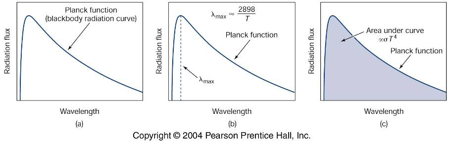
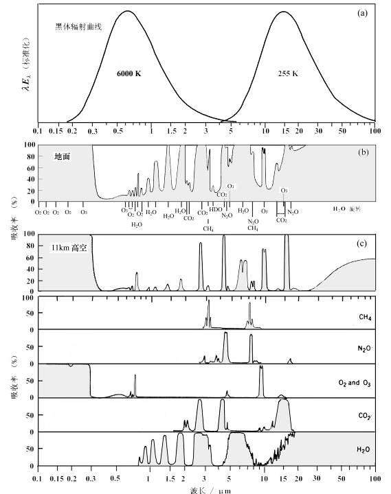
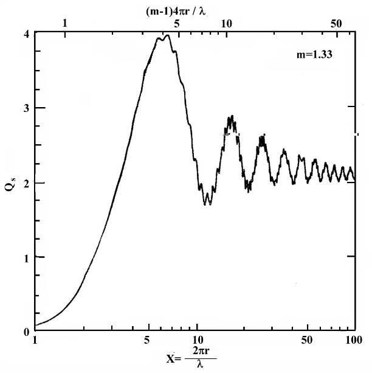
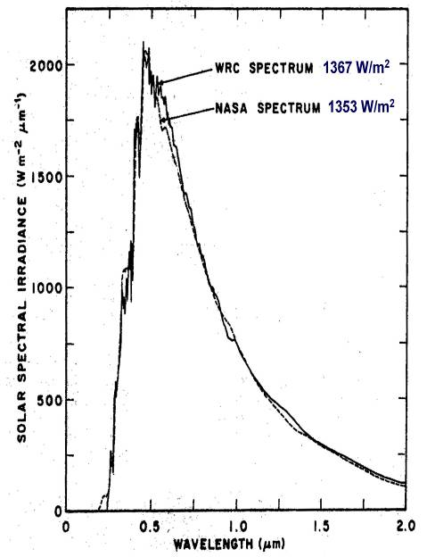
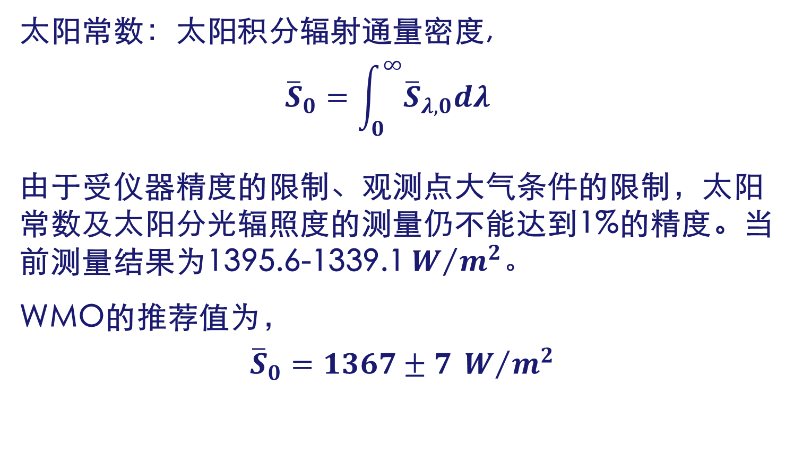
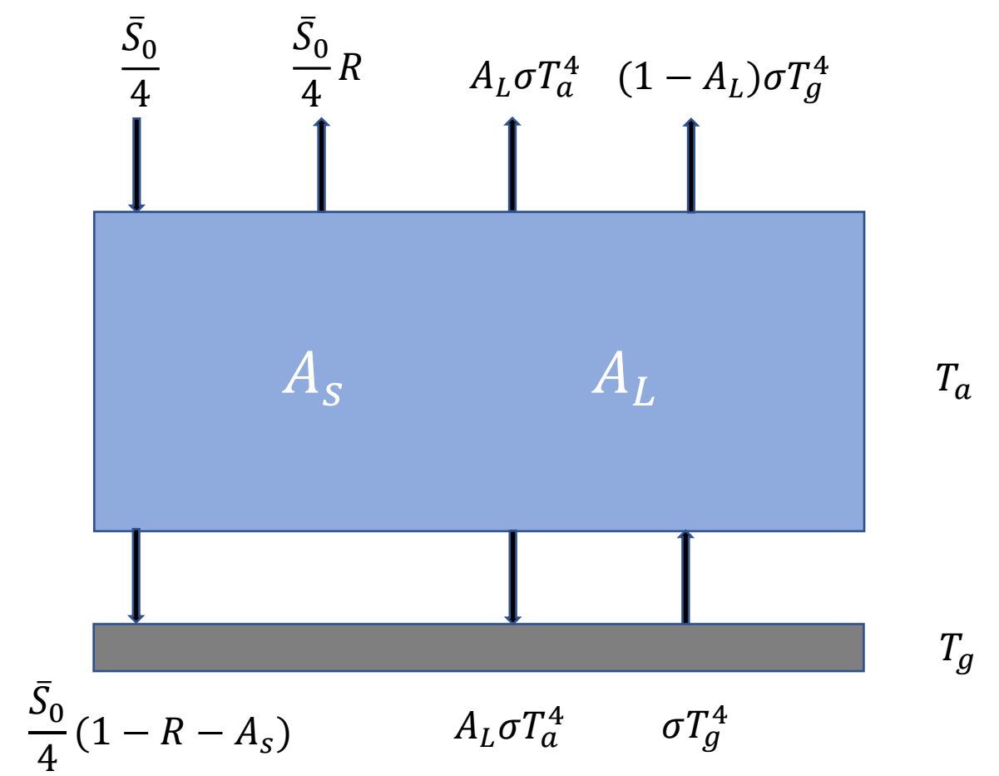
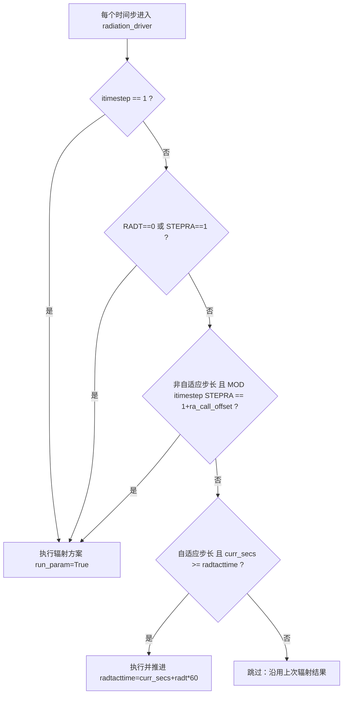
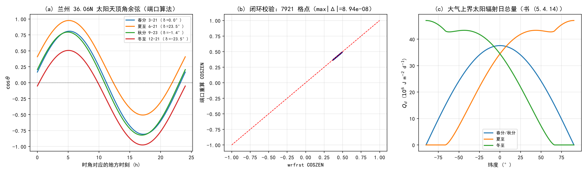
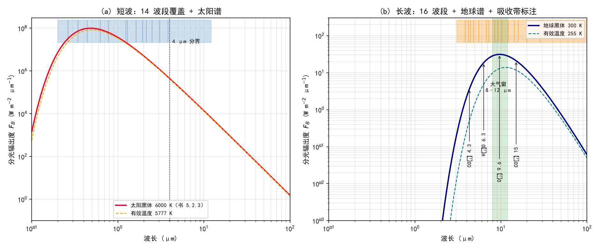
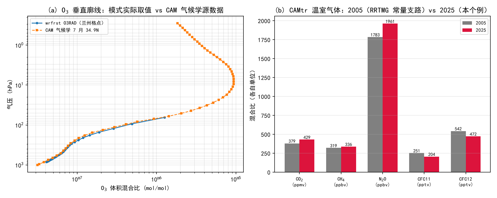

# 第 12 章 辐射过程族：从四定律到 RRTMG

> **本章定位**：书第五章（印刷页 62–122）是全书最重的物理章之一，也是 WRF 里“唯一与太阳直接对话”的物理过程——辐射方案决定了模式里的昼夜、地表能量、云与气溶胶的加热，是理解天气与气候模拟一切能量源头的钥匙。
>
> **本章用法**：12.1–12.6 按书 5.1–5.6 顺序精讲考点（公式编号全部按书，页码为印刷页）；12.7–12.8 把书里的每一条公式落到 WRF 源码；12.9 是六组轻轨实验，其中包含一次“逐格逐位”的太阳几何闭环复现；12.10 是考点化的习题。所有“实测”数字出自 `workspace/scripts/ch12_experiment.py` 的一次运行（日志 `workspace/logs/ch12_experiment.log`）。

---

## 12.0 本章地图

### 12.0.1 书小节结构与对应关系

| 书节（印刷页） | 本章节 | 一句话 |
|---|---|---|
| 5.1 辐射的基本概念（62–65） | 12.1 | 辐射通量、辐亮度、辐照度、立体角；朗伯定律 |
| 5.2 辐射的物理规律（66–71） | 12.2 | 吸收反射透射；普朗克/斯特藩-玻尔兹曼/维恩/基尔霍夫四定律；短长波之分 |
| 5.3 地球大气与辐射的相互作用（72–83） | 12.3 | 选择吸收与吸收带、大气窗；瑞利/米散射；比尔定律与光学厚度 |
| 5.4 太阳辐射在大气中的传输（84–102） | 12.4 | 太阳常数；赤纬/时角/天顶角；大气上界日总量；直接辐射的五项削弱；反照率 |
| 5.5 地球-大气系统的长波辐射（103–108） | 12.5 | 地面灰体；长波三特点；施瓦茨恰尔德方程；漫射因子 1.66；OLR |
| 5.6 地面、大气及地-气系统的辐射平衡（109–119） | 12.6 | 温室效应两层模式；地面/大气/地气系统的辐射差额；观测的辐射平衡 |
| —（WRF 对应） | 12.7–12.8 | `module_radiation_driver.F` 的骨架、太阳几何、RRTMG 谱段/气体/云光学 |
| —（实验与习题） | 12.9–12.10 | 六组轻轨实验 + 考点习题 |

### 12.0.2 考点清单（PPT 5-1~5-6 自标考点归纳）

课程 PPT 为第五章设了六讲，各讲自标的“重点/掌握要点”合起来就是考试大纲：

1. **5-1 辐射的基本概念**：描述辐射场的物理量（辐射通量 Φ、辐亮度 L、辐照度 E、立体角）及相互关系（E–L 积分）；各向同性/均匀/定常三个场概念；净辐照度；点源与平行辐射；朗伯体与朗伯定律。
2. **5-2 辐射的物理规律**：吸收率 A、反射率 R、透射率 τ；黑体、灰体；**普朗克定律、斯特藩-玻尔兹曼定律、维恩位移定律、基尔霍夫定律**（四定律）；有效温度 5777 K 与色温；短波/长波以 4 μm 分界；太阳辐射与地球辐射相对大小。
3. **5-3 地球大气与辐射的相互作用**：选择吸收与分子能级（E = Ee+Ev+Er）；主要吸收带（H₂O 6.3 μm、CO₂ 15 μm、O₃ 9.6 μm 与 Hartley 带）与 8–12 μm 大气窗；谱线增宽；瑞利散射（b=4）与米散射（b<4）；天空颜色四个经典问题；比尔定律与光学厚度、光学质量、订正因子。
4. **5-4 太阳辐射在地球大气中的传输**：太阳常数（1367/1366 W·m⁻²）；太阳谱与大气外界辐射能；**太阳赤纬/时角/天顶角/方位角**（时差与经度订正）；大气上界日总量 Qd；地面直接辐射的五项削弱与相对大气质量；“长法”测大气外界谱；阳伞效应；地面/云/行星反照率。
5. **5-5 地球-大气系统的长波辐射**：地面长波灰体（ε≈0.82–0.99）；长波传输三特点（漫射、忽略散射、吸收+放射并重）；**施瓦茨恰尔德方程及其解**；漫射因子 1.66；OLR 的推导与四点物理意义。
6. **5-6 地球-大气系统的辐射平衡**：**净辐射（辐射差额）概念**；温室效应两层辐射平衡模式（Tg=278.6 K、Ta=247.7 K）；地面短波/长波净辐射、大气逆辐射、地面有效辐射；变温率；观测的辐射平衡（100 单位制）。

### 12.0.3 源码锚点总表（本章全部实测核验）

| 主题 | 源码位置 | 对应书节 |
|---|---|---|
| 辐射调用节拍 radt | `phys/module_radiation_driver.F` 的 `radiation_driver`（radtacttime / stepra / ra_call_offset） | —（模式的工程问题） |
| 赤纬、太阳常数、日地距离 | `phys/module_radiation_driver.F` 的 `radconst`；`phys/module_ra_rrtmg_sw.F` 的 `earth_sun` | 5.4.2 |
| 天顶角余弦、时角、时差 | `phys/module_radiation_driver.F` 的 `calc_coszen` | 5.4.1/5.4.2 |
| 相对大气质量（Kasten-Young） | `phys/module_radiation_driver.F` 的 `radiation_driver` 内 SWDN 分解段（airmass 式） | 5.4.3 |
| 短波谱段、太阳常数基准 | `phys/module_ra_rrtmg_sw.F`（wavenum1/2、rrsw_scon=1368.22） | 5.2.3/5.4.1 |
| 长波谱段 | `phys/module_ra_rrtmg_lw.F`（wavenum1/2、nbndlw=16） | 5.3.2 |
| 温室气体 | `phys/module_ra_rrtmg_lw.F` 的 `rrtmg_lwrad`（GHG_INPUT 分支）；`phys/module_ra_clWRF_support.F` 的 `read_CAMgases` | 5.2.3/5.6.2 |
| 臭氧廓线 | `phys/module_ra_cam_support.F` 的 `oznini`；`phys/module_radiation_driver.F` 的 `ozn_time_int`/`ozn_p_int`；`phys/module_ra_rrtmg_lw.F` 的 `inirad` 兜底 | 5.3.2 |
| 云光学与有效半径 | `phys/module_ra_effective_radius.F` 的 `effectRad`；`module_ra_rrtmg_lw.F` 的 inflglw 分支 | 5.3.3（散射的工程化） |
| 气溶胶光学挂接 | `phys/module_ra_aerosol.F`（承第 11 章）；`module_radiation_driver.F` 的 aer_opt 分支 | 11.5.6/5.3.2 |
| 通量/加热率诊断 | `module_ra_rrtmg_lw/sw.F`（RTHRATEN 等传参）；`Registry.EM_COMMON` package 块 | 5.5.3/5.6.4 |
| namelist 与默认值 | `Registry/Registry.EM_COMMON`：ra_lw_physics/ra_sw_physics/radt/ghg_input/o3input/aer_opt/swint_opt | — |

### 12.0.4 与前后章的衔接

- **承第 11 章**：11.5.6 留下的“气溶胶 → 辐射接口”在本章 12.8.4 兑现；表 2.3/2.4 的温室气体浓度（2005 列）在 12.8.2 与 RRTMG 常量支路逐项对上。
- **启第 13 章**：辐射只关心“云的光学厚度（与含水量、有效半径有关）”，而含水量与滴谱由微物理方案决定——`has_reqc/has_reqi/has_reqs` 与 `effectRad` 正是两族方案的握手处。
- **启第 17/19 章**：城市冠层的长波放射（BEP/BEM 的屋面辐射温度）通过地表与辐射方案进入能量平衡；兰州个例的 `SWDOWN`/`GLW`/`OLR` 是第 19 章“晴热高温”诊断的主角之一。

---

## 12.1 辐射的基本概念（书 5.1，印刷页 62–65）

### 12.1.1 电磁波谱与四个描述量

自然界一切物体都在不停地以电磁波形式放射能量，同时接收来自周围的电磁波——这种能量传递方式称为**辐射**，以这种方式传递的能量称为**辐射能**。电磁波以横波形式传播，速度即光速 $c=3\times10^8$ m/s。波长 $\lambda$、频率 $f$、波数 $\nu$ 与速度 $c$ 的关系（书 (5.1.1)）：

$$
\lambda\cdot f=c,\qquad \nu=\frac{1}{\lambda}=\frac{f}{c}\tag{5.1.1}
$$

大气科学中波长的常用单位是 $\mu m$（$10^{-6}$ m），紫外与可见光段也可用 nm（$10^{-9}$ m）；红外波段传输问题里常用波数（cm⁻¹），因为它正比于光子能量。太阳、地球与大气辐射的波长主要在 $0.1\sim120\ \mu m$ 之间（书 图 5.1）；可见光波段集中了太阳辐射的主要能量，且不同波长给人不同色彩感觉（书 表 5.1：紫 0.40–0.43 / 靛 0.43–0.45 / 蓝 0.45–0.50 / 绿 0.50–0.57 / 黄 0.57–0.60 / 橙 0.60–0.63 / 红 0.63–0.76 μm）。

描述辐射场有四个基本量：

1. **辐射通量** $\Phi$（radiant flux）：单位时间通过某一平面的辐射能，单位 J/s 即 W。
2. **辐亮度** $L$（radiance）：辐射传输方向上的单位球面角内，通过垂直于该方向单位面积、单位波长间隔的辐射通量。立体角 $\Omega=\sigma/r^2$（单位球面度 sr），光度计测量示意（书 图 5.2）给出定义式：

$$
L(x,y,z,\theta,\varphi,\lambda,t)=\frac{d\Phi}{dA\,d\Omega\,d\lambda}\tag{5.1.3}
$$

其单位为 W·m⁻²·sr⁻¹·μm⁻¹。辐亮度是辐射场最复杂的量：它是位置 $(x,y,z)$、方向 $(\theta,\varphi)$、波长 $\lambda$ 与时间 $t$ 的函数（书 (5.1.2)）。由此引出三个场的概念——**各向同性**（$L$ 与方向无关）、**均匀辐射**（$L$ 与位置无关）、**定常辐射**（$L$ 与时间无关）。

3. **辐射通量密度** $E$：辐射场内任一点处通过单位面积的辐射功率（W·m⁻²）。表示面元**接受**的记为 $E$，称**辐照度**（irradiance）；表示从物体表面**发射**的记为 $F$，称**辐出度**（emittance）。辐照度是各方向辐亮度在法线方向分量的累加：

$$
E=\int L\cdot\cos\theta\,d\Omega\tag{5.1.4}
$$

4. **立体角**与几何因子：以上各式的 $\theta$ 是辐亮度方向与面元法线之间的夹角。

### 12.1.2 净辐照度与辐射源

计算水平面上的辐射通量密度时，对上半球与下半球分别积分（书 (5.1.5)）：

$$
\begin{cases}
E^{\uparrow*}=\left|\displaystyle\int_0^{2\pi}\!\!\int_0^{\pi/2}L\cdot\cos\theta\cdot\sin\theta\,d\theta\,d\varphi\right|\\[2mm]
E^{\downarrow*}=\left|\displaystyle\int_0^{2\pi}\!\!\int_{\pi/2}^{\pi}L\cdot\cos\theta\cdot\sin\theta\,d\theta\,d\varphi\right|
\end{cases}\tag{5.1.5}
$$

二者之差为**净辐射通量密度（净辐照度）**：

$$
E^{*}=E^{\downarrow*}-E^{\uparrow*}\tag{5.1.6}
$$

净辐照度为正表示气层收入大于支出、温度升高；反之为负则降温——这一条是第 12.6 节“变温率”的直接前身。

**辐射源**往外发射辐射。最简单的是**点源**：其辐照度随距离按反平方规律衰减（书 (5.1.7)）：

$$
E=\frac{W}{4\pi r^2}\tag{5.1.7}
$$

**平行辐射**是点源在足够远处的极限。太阳到地球的距离 $d=1.5\times10^8$ km，而大气辐射学讨论的最大尺度是地球半径 $R_E=6371$ km，在此范围内太阳辐射强度仅变化 $[(d+R_E)/d]^2=1.000084$——因此把太阳直接辐射当平行光处理，其辐照度不随距离变化。对平行辐射，射线所张立体角为零，辐亮度的概念不再适用，只需知道方向与通量密度。当太阳天顶角为 $\theta$ 时，大气上界水平面接收的太阳辐射通量密度为：

$$
S'=S\cos\theta\tag{5.1.8}
$$

### 12.1.3 面辐射源、朗伯体与朗伯定律

**面辐射源**可以向 $2\pi$ 立体角中发射辐射能。对平面平行大气，水平方向的辐射分量对局地能量平衡不起作用，因此只关心垂直方向的辐射通量密度。通过单位面积在面源法线方向射出的能量即**辐出度** $F=\int F_\lambda d\lambda$。

若辐亮度不随方向 $\theta$ 变化，该面源称为**朗伯体**（如黑体、太阳、陆地表面）；平静水面有反射，不能当朗伯面处理。例题 5.1（书 p66）证明：从无限大朗伯面来的辐亮度与从半球空间的辐亮度同样积分，平行于此表面的辐照度为：

$$
E=\int_0^{2\pi}\!\!\int_0^{\pi/2}L\cos\theta\sin\theta\,d\theta\,d\varphi=\pi L\tag{5.1.9}
$$

结合互易性得到**朗伯定律**：

$$
F=\pi L\tag{5.1.10}
$$

【考点】朗伯定律把“面源的辐出度”与“方向不变的辐亮度”用常数 $\pi$ 联系起来；因为黑体是朗伯体，所以“黑体的 $F_B$ 与 $B=F_B/\pi$”这组关系（见 12.2.2）在辐射计算中处处使用。

---

## 12.2 辐射的物理规律（书 5.2，印刷页 66–71）【考点·四定律】

### 12.2.1 吸收率、反射率、透射率；黑体与灰体

射至物体的辐射能分成三部分：被吸收的 $Q_a$（变为内能等）、被反射的 $Q_r$、被透射的 $Q_t$。能量守恒：

$$
Q_0=Q_a+Q_r+Q_t\tag{5.2.1}
$$

定义**吸收率** $A=Q_a/Q_0$、**反射率** $R=Q_r/Q_0$、**透射率** $\tau=Q_t/Q_0$（又称透光率），有：

$$
A+R+\tau=1\tag{5.2.2}
$$

不透明物体 $\tau=0$，则 $A+R=1$——反射率大的物体吸收率一定小。对较宽谱段（如可见光波段、太阳辐射）常将物体表面的反射辐射通量与入射辐射通量之比称为**反照率**。不同物体对不同波长有不同的 $A$ 与发射率，构成该物体的**吸收光谱**或**辐射光谱**。

- **绝对黑体**：对所有波长全部吸收，$A=1$（相应 $R=0,\tau=0$）。自然界没有绝对黑体；实验室“人工黑体”是一个内壁涂烟熏黑的开小孔密闭空腔——设内壁反射率 $R=0.1$，辐射经过 $n=4$ 次反射后被吸收 $1-R^4$，吸收率即可达 0.9999。
- **灰体**：吸收率 $A$ 不随波长变化，但 $A<1$。地面对长波辐射的吸收率近于常数，故取地面为灰体。

### 12.2.2 普朗克定律

绝对黑体的分光辐出度由普朗克定律给出（书 (5.2.6)）：

$$
F_B(\lambda,T)=\frac{2\pi c^2h}{\lambda^5}\left(e^{\frac{ch}{k\lambda T}}-1\right)^{-1}
=\frac{c_1}{\lambda^5}\left(e^{c_2/\lambda T}-1\right)^{-1}\tag{5.2.6}
$$

其中第一辐射常数 $c_1=2\pi c^2h=3.7427\times10^{-16}$ W·m²，第二辐射常数 $c_2=ch/k=14388\ \mu m\cdot K$（$c$ 光速、$h$ 普朗克常数、$k$ 玻尔兹曼常数）。黑体是朗伯体，其分光辐亮度为：

$$
B(\lambda,T)=\frac{1}{\pi}F_B(\lambda,T)=\frac{c_1}{\pi\lambda^5}\left(e^{c_2/\lambda T}-1\right)^{-1}\tag{5.2.7}
$$

书 图 5.4/表 5.2 给出不同温度的黑体谱线与特征值（表 5.2 精选，$B_{\lambda\max}$ 单位 W·m⁻²·μm⁻¹·sr⁻¹、$F_T$ 单位 W·m⁻²）：

| $T$/K | $\lambda_{\max}$/μm | $B_{\lambda\max}(T)$ | $F_T$ |
|---|---|---|---|
| 10 000 | 0.290 | $4.095\times10^8$ | $5.670\times10^8$ |
| 6000 | 0.483 | $3.185\times10^7$ | $7.348\times10^7$ |
| 3000 | 0.964 | $9.952\times10^5$ | $4.592\times10^6$ |
| 1000 | 2.911 | $4.095\times10^3$ | $5.670\times10^4$ |
| 500 | 5.808 | $1.280\times10^2$ | $3.544\times10^3$ |
| 300 | 9.638 | $9.852$ | $4.592\times10^2$ |
| 220 | 13.183 | $2.111$ | $1.328\times10^2$ |

由此可得三条重要结论（书 p69）：

1. 理论上任何温度的绝对黑体都辐射 $0\sim\infty$ μm 的波长，但温度不同则辐射能量集中的波段不同——**随温度下降，辐射能量集中的波段向长波方向移动**。
2. 温度升高，各波段能量均加大；积分辐出度 $F_T$ 迅速加大且能量集中段向短波移动（加热铁块由暗红→亮橙→白亮）。
3. 每一温度下都有辐射最强的波长 $\lambda_{\max}$，且随温度升高而变小。

### 12.2.3 斯特藩-玻尔兹曼定律与维恩位移定律

**斯特藩-玻尔兹曼定律**：绝对黑体的积分辐出度与温度的四次方成正比（书 (5.2.8)–(5.2.10)）：

$$
F_T=\int_0^\infty F_B(\lambda,T)\,d\lambda=\sigma T^4,\qquad
\sigma=\frac{c_1\pi^4}{15c_2^4}=5.6696\times10^{-8}\ \text{W·m}^{-2}\text{·K}^{-4}\tag{5.2.8/5.2.10}
$$

由此可由温度求黑体的积分辐出度，或反过来由辐射测温度——将物体当绝对黑体反算出的温度称**有效温度**。据此估算太阳表面有效温度约 5777 K（与真实值略有差异）；若不是绝对黑体，反算温度会偏低。

**维恩位移定律**：黑体谱极大值对应的波长与温度之积为常数（书 (5.2.11)–(5.2.13)）：

$$
\frac{\partial F_B(\lambda,T)}{\partial\lambda}=0
\ \Longrightarrow\ \lambda_{\max}=\frac{2897.8}{T}\ (\mu m)\tag{5.2.11/5.2.13}
$$

例如 6000 K 黑体 $\lambda_{\max}=0.483\ \mu m$（蓝光）。由辐射最强的波长反推温度是**光谱测温**的基础，得到的温度称**颜色温度（色温）**。太阳的色温约 6037 K（由 $\lambda_{\max}\approx0.48\ \mu m$ 用 (5.2.13) 反解）——高于有效温度 5777 K，这一对数字（有效温度 vs 色温）是常考对照。

### 12.2.4 基尔霍夫定律与比辐射率

**基尔霍夫定律**：在热平衡条件下，任何物体的单色辐出度 $F_{\lambda,T}$ 与其吸收率 $A_{\lambda,T}$ 之比是一个普适函数 $f(\lambda,T)$，只与波长和温度有关，与物体性质无关：

$$
\frac{F_{\lambda,T}}{A_{\lambda,T}}=f(\lambda,T)\tag{5.2.3}
$$

对若干物体在同一温度下，有（书 (5.2.4)）：$F^{(1)}/A^{(1)}=F^{(2)}/A^{(2)}=\dots=f(\lambda,T)$；黑体 $A_{\lambda,T}=1$ 时其辐出度就等于该普适函数，因此基尔霍夫定律表明“任何物体的辐出度与吸收率之比都等于同一温度下黑体的辐出度”。定义物体辐出度与黑体辐出度之比为**比辐射率** $\varepsilon_{\lambda,T}$，则定律又可写成：

$$
\varepsilon_{\lambda,T}=A_{\lambda,T}\tag{5.2.5}
$$

即**物体的比辐射率等于其吸收率**。这条定律的意义在于：把吸收能力与放射能力联系起来——只需要知道物体的吸收光谱，其辐射光谱也就确定了；反之，要研究大气辐射过程，首先确定地球与大气的吸收率。

### 12.2.5 太阳辐射与地球辐射的差别

太阳表面与地球大气的温度差别很大，辐射能量集中的谱段不同：

| 辐射体 | 等效温度 | $\lambda_{\max}$/μm | 主要能量集中 | >98% 能量所在波段 |
|---|---|---|---|---|
| 太阳 | 6000 K | 0.483 | 0.296–0.879 μm | 0.17–4.0 μm |
| 地面 | 300 K | 9.638 | 5.97–17.7 μm | 3.33–80 μm |
| 大气（平流层下层） | 220 K | 13.183 | — | 4.55–109.1 μm |

因此在大气物理学中常称太阳辐射为**短波辐射**、地球与大气辐射为**长波辐射**，二者以 **4 μm** 为分界（书 图 5.6）。太阳谱中可见光区（0.40–0.76 μm）能量占积分能量的 44%、紫外区占 8%、红外区占 48%。

就强弱而言：虽然太阳表面的辐射通量在所有波长都远大于地球，但随距离平方衰减后，在大气上界太阳的长波辐射通量密度仅约 10 W·m⁻²，而地球出射的长波辐射通量密度约 270 W·m⁻²。因此在讨论大气辐射（含大气遥感）时：

- 可见光与近红外（$\lambda<3\ \mu m$）：只考虑太阳辐射，忽略地球大气的热辐射；
- 红外与微波（$\lambda>7\ \mu m$）：只考虑地气热辐射；
- 中红外 3–7 μm：两者数量级接近，须同时考虑——这是遥感中“太阳污染”的物理根源。

> **PPT 原图（5-2）**：黑体辐射三定律的组合示意。
>
> 

---

## 12.3 大气与辐射的相互作用（书 5.3，印刷页 72–83）【考点】

大气对辐射的作用主要有吸收、散射和折射；与能量收支关系最大的是**吸收**与**散射**。

### 12.3.1 吸收的物理机制：选择吸收与谱线增宽

**吸收**指投射到介质上的辐射能的一部分转变为物质本身的内能或其它形式的能量。大气中各气体成分与气溶胶粒子具有**选择吸收**特性——哪些波长被吸收由分子与原子的结构及其运动状态决定。

单个分子处于某一运动状态时，内部总能量由三部分组成（书 (5.3.1)）：

$$
E=E_e+E_v+E_r\tag{5.3.1}
$$

$E_e$（绕原子核转动的外层电子动能与静电势能）、$E_v$（原子在平衡位置附近的振动能量）、$E_r$（分子绕质量中心的转动能量）。辐射频率 $f$ 与波数 $\tilde\nu$ 满足 $f=\Delta E/h$、$\tilde\nu=\Delta E/hc$——这就是分子吸收或发射谱线的位置；由于能级分立，谱线由有限个非常窄的吸收（发射）线组成，其间是“光谱间隙”。**吸收光谱与发射光谱一致**。

理论上谱线宽度为零，实际上从未观测到单色谱线。谱线增宽的原因有三（书 5.3.1）：

1. **自然增宽**：受激能级有限寿命与能量损耗造成（可忽略）；
2. **压力增宽**：分子频繁碰撞使发射辐射位相无规则变化（**与压力成正比**，低层大气主导）；
3. **多普勒增宽**：分子随机运动的多普勒频移（**与温度有关**，高层大气渐显）。

由压力增宽（洛伦兹线型）与多普勒增宽（高斯线型）卷积得到**沃伊特（Voigt）线型**：混合线型的线翼衰减比洛伦兹线型快得多，线翼处近似仍为洛伦兹型。（书 图 5.7）

### 12.3.2 大气吸收光谱与大气窗

书 图 5.8 是本章最重要的图之一：（a）太阳（6000 K）与地球（255 K）黑体谱；（b）整层大气吸收谱；（c）11 km 以上大气吸收谱；（d）整层大气中各成分的吸收谱。几个必记的结论：

- **0.29 μm 以下的紫外辐射几乎全部被吸收**——吸收者是 O₂、O（原子氧）与 O₃；这部分吸收主要发生在平流层中下部，紫外辐射光解氧分子产生原子氧并最终形成臭氧层。
- 可见光波段（0.4–0.75 μm）只有非常少量的吸收。
- 近红外波段主要是 H₂O 与水汽的吸收，到 2.7 μm 附近水汽和 CO₂ 有较强吸收带，再往后 CH₄ 加入；红外波段吸收较强，主要吸收体是 H₂O 与 CO₂。**14 μm 以外大气可看成黑体**，辐射不能透过大气传向外空。
- **8–12 μm 大气窗**：大气的吸收很弱。这一区域只有 9.6 μm 附近臭氧有一个较强吸收带；地表温度约 300 K、黑体辐射能量主要集中在 10 μm 附近，而大气对这一波长范围吸收很少——地面发出的长波辐射通过窗区可顺利发送到宇宙空间。这是“窗区遥感反演地表温度”的物理基础。

主要吸收带汇总（书 表 5.4，单位为 μm）：

| 成分 | 强吸收带 | 弱吸收带 |
|---|---|---|
| 水汽 H₂O | 1.4、1.9、2.7、6.3、13.0–1000 | 0.9、1.1 |
| 二氧化碳 CO₂ | 2.7、4.3、14.7 | 1.4、1.6、2.0、5.0、9.4、10.4 |
| 臭氧 O₃ | 4.7、9.6、14.1 | 3.3、3.6、5.7 |
| 甲烷 CH₄ | 3.3、3.8、7.7 | — |
| 一氧化二氮 N₂O | 4.5、7.8 | 3.9、4.1、9.6、17.0 |
| 一氧化碳 CO | 4.7 | 2.3 |

要点：

- **水汽**：吸收约 20% 的太阳能量，几乎覆盖长波辐射整个波段；6.3 μm 振动带、大于 12 μm 转动带。液态水吸收系数很大（100 m 厚云相当于黑体，一般可把云体表面当黑体表面）。
- **二氧化碳**：>2 μm 红外区有吸收，较强中心 2.7、4.3、15 μm；其中 **15 μm 最重要**（2.7 μm 与水汽带重叠，4.3 μm 处太阳辐射已弱）。
- **臭氧**：紫外区最强的是 Hartley 带（0.22–0.30 μm）、较弱的 Huggins 带（0.32–0.36 μm），可见光区有较弱的 Chappuis 带；臭氧层吸收太阳辐射能量的 2% 左右——这是平流层上部温度较高的原因。红外区有 4.7、9.6、14.1 μm 较强吸收带。
- **氧气**：O₂ 主要吸收在 <0.25 μm 紫外（舒曼-龙格带 0.125–0.2026 μm、赫兹堡带 0.1961–0.2439 μm），但由于太阳辐射在 0.25 μm 以下的能量不足 0.2%，吸收能量并不多。O₂ 还有 0.76 μm 与 0.69 μm 弱带（“氧 A 带”是遥感常用通道）。

> **PPT 原图（5-3）**：整层大气吸收光谱与各成分吸收谱。
>
> 

### 12.3.3 散射：尺度参数与三区制

**散射**：入射辐射遇到大气颗粒物，一部分能量改变原来的传播方向射向四面八方。其微观图像：电磁波使粒子内正负电荷中心偏移构成电偶极子（多极子），在电磁波激发下作受迫振动并向各方向发射次生电磁波。散射光波长与原始波相同、且有固定位相关系。散射与吸收的两点差异：散射不产生分子内能状态变化，用电磁波与电子理论（Mie 理论）解释；散射不是选择性的，它在各波长上都发生。

定义无量纲**尺度参数**：

$$
\alpha=\frac{2\pi r}{\lambda}
$$

按 $\alpha$ 分三种区制（书 5.3.3）：

| 区制 | 条件 | 典型 | 说明 |
|---|---|---|---|
| 瑞利散射（分子散射） | $\alpha\ll1$（$r\ll\lambda$） | 气体分子对可见光 | 体积散射系数与波长 4 次方成反比 |
| 米散射（大颗粒散射） | $\alpha\approx1$ 或 $>1$ | 尘埃、云滴（0.1–10 μm） | 通用理论（G. Mie 1908）；球状粒子散射取决于 $\alpha$ 与复折射指数 $m$ |
| 几何光学散射 | $\alpha\gg1$ | 大雨滴 | 虹、晕等由反射折射形成 |

**散射削弱系数**：散射截面 $\sigma_{sc}$ 表示一个粒子的散射能力，单位体积中各粒子散射截面之和为体积散射削弱系数（书 (5.3.11)）：

$$
k_{sc}=\int_0^\infty\sigma_{sc}(r,\lambda,m)\,n(r)\,dr\tag{5.3.11}
$$

对大颗粒散射常用近似（书 (5.3.16)）：

$$
k_{sc,\lambda}\approx C\lambda^{-b}\tag{5.3.16}
$$

分子散射 $b=4$；大颗粒散射 $b<4$——一般气溶胶在太阳辐射段 $b$ 约 1–2；当 $b=0$ 时散射系数不随波长变，即灰暗的天空（大气气溶胶粒子很大、或有大颗粒时）。

**散射效率因子** $Q_{sc}$ = 粒子散射截面与几何截面之比。水滴（$m=1.33$）的 $Q_{sc}$ 随 $\alpha$ 变化（书 图 5.10）：$\alpha$ 从 0 增大时 $Q_{sc}\to4$ 附近出现第一个极大值（$\alpha\approx6$，粒子半径与波长相当，散射效率最高）；$\alpha$ 继续增大，$Q_{sc}$ 以波动方式变化并最终趋向于 2。吸收增强时曲线上的振动消失。

四个经典问题（PPT 5-3 自问，考试常以简答出现）：

1. **正午太阳偏白、旭日夕阳偏红**：正午阳光直射穿过大气层厚度最小，被散射掉的短波成分不太多；早晚阳光斜射穿过的大气厚度大得多，短波（蓝紫）被散射掉、透过长波（红），故呈红色。
2. **云雾呈白色**：小水滴在可见光范围内属米散射，散射光强与波长关系不大（$\alpha$ 约 17–69），各波长散射相近，故呈白色。
3. **天空呈蓝色（阴天变灰白）**：晴空由空气分子散射太阳光——分子 $r\sim10^{-4}$ μm 对 0.5 μm 可见光 $\alpha\approx0.001\ll1$，属瑞利散射，散射效率与 $\lambda^4$ 成反比，蓝光散射远大于红光，故天空蓝色。气溶胶颗粒（0.1–10 μm）用米散射处理，对不同波长散射相近，散射光光谱向太阳光靠拢，天空颜色变灰白。
4. **若没有大气，天空是什么颜色？** 漆黑一片（无散射光），太阳仍亮。

**瑞利散射的三条基本特征**：① 散射光强与波长 4 次方成反比（天空蓝色之源）；② 自然光入射时前后向散射对称分布；③ 散射光有很高的偏振度。**米散射的主要特点**：① 随尺度数增大，前向散射在总散射中的比值迅速增大（米效应，日周光、日晕与此有关）；② 散射效率 $Q_{sc}$ 随 $\alpha$ 呈振动变化并趋于常数，强吸收时振动消失；③ 散射截面随波长而变——$\alpha$ 很小时与 $\lambda^{-4}$ 成正比，$\alpha$ 增大时变为 $\lambda^{-n}$（0<n<4），$\alpha$ 相当大时与波长无明显关系。

> **PPT 原图（5-3）**：水滴的散射效率因子随尺度数变化。
>
> 

### 12.3.4 比尔定律与光学厚度

**布格-朗伯定律（比尔定律）**：设单色平行定向辐射的辐照度 $E_\lambda$ 经过有吸收作用的气层 $dl$ 后变为 $E_\lambda+dE_\lambda$，则（书 (5.3.17)）：

$$
dE_\lambda=-E_\lambda\sigma_{ab,\lambda}N\,dl=-E_\lambda k_{ab,\lambda}\,dl\tag{5.3.17}
$$

其中 $N$ 为分子数密度、$\sigma_{ab}$ 为单粒子吸收截面、$k_{ab}=N\sigma_{ab}$ 为体积吸收系数。积分得指数衰减规律：

$$
E_{\lambda,l}=E_{\lambda,0}\,e^{-\int_0^l k_{ab,\lambda}\,dl}\tag{5.3.18}
$$

实践中常用与质量相联系的形式：**质量吸收系数** $k'_{ab,\lambda}=k_{ab,\lambda}/\rho$（单位 cm²/g），于是 $E_{\lambda,l}=E_{\lambda,0}\exp\left(-\int k'_{ab,\lambda}\rho\,dl\right)$（书 (5.3.20)/(5.3.21)）。对散射与吸收同时存在，定义**衰减系数（削弱系数）** $k_{ext,\lambda}=k_{sc,\lambda}+k_{ab,\lambda}$：

$$
E_{\lambda,l}=E_{\lambda,0}\,e^{-\int k_{ext,\lambda}\,dl}\tag{5.3.22}
$$

**光学厚度**：沿传输路径单位截面上所有吸收和散射物质产生的总削弱（无量纲）：

$$
\delta=\int_0^l k'_{ext}\rho\,dl=\int_0^l k_{ext}\,dl\tag{5.3.23}
$$

对某一波长即为分光光学厚度 $\delta_\lambda$；**整层大气垂直光学厚度**定义为

$$
\delta_\lambda(0)=\int_0^\infty k_{ext,\lambda}(z)\,dz=\int_0^\infty k'_{ext,\lambda}(z)\,\rho\,dz\tag{5.3.26}
$$

$\delta_\lambda(0)$ 也常记为 $\delta_0$，它代表大气光学特性，是大气辐射与大气光学中很重要的物理量。利用光学厚度，衰减规律写成：

$$
E_{\lambda,l}=E_{\lambda,0}\,e^{-\delta_\lambda}\tag{5.3.25}
$$

**光学质量**：辐射束沿传输路径在单位截面气柱内所吸收或散射的气体质量（单位 M·L⁻²）：

$$
u=\int_0^l\rho\,dl\tag{5.3.27}
$$

日光垂直入射时，用均质大气概念有 $u=\rho_0H$（$\rho_0$ 海平面空气密度，$H$ 均质大气高度）。光学质量还可用标准状态下气体厚度表示（水汽、臭氧多用此口径）。由于吸收系数随温度、压力变化（吸收分子与所处状态有关），需引入**订正光学质量**：将吸收系数写成

$$
k'_{ab,\lambda}(p,T)=k^*_{ab,\lambda}\left(\frac{p}{p_0}\sqrt{\frac{T_0}{T}}\right)^{n}\tag{5.3.29}
$$

其中 $\left(\frac{p}{p_0}\sqrt{\frac{T_0}{T}}\right)^{n}$ 为**订正因子**，指数 $n$ 由实验定：LOWTRAN 模型中 $n(\mathrm{H_2O})=0.9$、$n(\mathrm{CO_2})=0.75$、$n(\mathrm{O_3})=0.4$。代入光学厚度定义得

$$
\delta_\lambda=k'_{ab,\lambda}\tilde u,\qquad
\tilde u=\int_0^l\left(\frac{p}{p_0}\sqrt{\frac{T_0}{T}}\right)^{n}\rho\,dl\tag{5.3.30/5.3.31}
$$

于是 $E_{\lambda,l}=E_{\lambda,0}\exp(-k^*_{ab,\lambda}\tilde u)$（书 (5.3.32)）。**单色透过率** $\tau_\lambda$ 为穿过一段大气路径前后辐射通量密度之比：

$$
\tau_\lambda=\frac{E_{\lambda,l}}{E_{\lambda,0}}=e^{-\delta_\lambda}=\exp(-k^*_{ab,\lambda}\tilde u)\tag{5.3.33}
$$

整层大气垂直方向的透过率称**透明系数** $P_\lambda=e^{-\delta_\lambda(0)}$。对纯吸收路径，**吸收率**为

$$
A_\lambda=1-\tau_\lambda=1-e^{-\delta_\lambda}=1-\exp(-k^*_{ab,\lambda}\tilde u)\tag{5.3.34}
$$

**注意**：一个气层的吸收率并不与吸收物质的多少成正比，而是呈指数关系；只有当吸收物质很少（弱吸收）时才有 $A_\lambda\approx k^*_{ab,\lambda}\tilde u$——此时吸收率与物质光学质量成正比（书 (5.3.35)，这是常考的“线性近似”条件）。

实际工作中很难测准单一波长的吸收系数，分光测量得到的辐测量实质上是波数间隔 $\Delta\nu=\nu_2-\nu_1$ 内的平均值——**透过率函数**定义为

$$
\tau_{\Delta\nu}=\frac{1}{\Delta\nu}\int_{\nu_1}^{\nu_2}\tau(\nu,l)\,d\nu=\frac{1}{\Delta\nu}\int_{\nu_1}^{\nu_2}\exp(-k^*_{ab,\lambda}\tilde u)\,d\nu
$$

考虑每条吸收线的影响、通过数值积分逐条谱线计算的方法称为**逐线积分（line-by-line，LBL）**——计算量特别大，结果通常用来验证其它方法或作为基本数据库。实际应用中已建立了不少计算大气透过率函数的模式（书 p84 的 Leckner 透过函数即一例，见 12.4.4）。

---

## 12.4 太阳辐射在大气中的传输（书 5.4，印刷页 84–102）

### 12.4.1 太阳与太阳常数

地球的绝大多数能量来自太阳（地热 24 TW、月光 2 TW 均可忽略；地球大气系统接收的太阳辐射能约 $180\,000$ TW，人类使用的总能量约为太阳辐射能的万分之一）。太阳是巨大的炽热等离子体球：**氢约 71%、氦约 27%**；它的连续谱基本就是光球层发射的谱，被太阳大气吸收后形成大量**夫琅禾费暗线**（已鉴定 90 多种化学元素）。太阳大气分为光球层、色球层与日冕；光球层半径约 $6.96\times10^5$ km（地球表面上的张角约 0.5°）。

太阳辐射按性质分热辐射与非热辐射：热辐射源于处于热平衡或局域热平衡的源，谱分布服从一定温度下的玻尔兹曼分布。太阳辐射能量的 99.5% 在 **0.28–1000 μm**，主要源自光球层；辐射功率比较稳定，其谱分布与 5777 K 黑体接近。波长范围以外的紫外、X 射线、γ 射线与大毫米射电波，尽管只占太阳总能量的 0.575%，但在太阳耀斑爆发时功率可增十倍到百倍，且与太阳黑子变化关系良好（黑子相对数 $R=K(10g+f)$，周期约 11 年）。

**太阳常数**：以日地平均距离 $d_0$ 处的辐照度为标准，大气上界与日光垂直平面上的太阳积分辐照度称为太阳常数：

$$
\bar S_0=\int_0^\infty \bar S_{0,\lambda}\,d\lambda\tag{5.4.1}
$$

历史与当前推荐值：早期地面测量做不到 1% 精度；世界气象组织（WMO）1981 年推荐的太阳常数最佳值是 $\bar S_0=1367\pm7$ W·m⁻²；近 30 年卫星观测平均取 $S_0=1366\pm3$ W·m⁻² 较合适（Lean & Rind 1998; Liou 2002）；而 TIM 的总辐照度监测给出 $S_0=1361$ W·m⁻² 更可信（Gerhard Kramm et al., 2011）。太阳常数并非“常数”，有约 0.08% 的 11 年周期变化（与太阳活动周期一致）。模式里取哪个值见 12.8.6——这是本章最重要的“书 vs 源码”差异点之一。

**例题 5.2（书 p88，有效温度与色温）**：以 $S_0=1366$ W·m⁻² 利用斯特藩-玻尔兹曼定律，因日、地间能量守恒有 $\sigma T_e^4\cdot4\pi R_\odot^2=S_0\cdot4\pi d_0^2$，代入 $R_\odot$、$d_0$、$\sigma$ 得 $T_e=5777$ K；再由太阳光谱中最强波长 $\lambda_{\max}=0.48\ \mu m$ 计算颜色温度 $T_c=2898/0.48=6037$ K。$T_c$ 与 $T_e$ 值不一致，说明太阳并非严格黑体。

### 12.4.2 太阳几何：赤纬、时角、天顶角与方位角

地球以椭圆轨道绕太阳旋转（公转），轨道面为黄道面；日地平均距离 $d_0=(149\,597\,892\pm500)$ km，称一个天文单位（AU），轨道偏心率 0.0167。地球约在 1 月 3 日离太阳最近（近日点 0.973 AU），在 7 月 4 日离太阳最远（远日点 1.017 AU）。以日地平均距离 $d_0$ 为标准的辐照度需按距离订正：

$$
\bar S_0'=\bar S_0\left(\frac{d_0}{d}\right)^2=\bar S_0 d_m^2,\qquad d_m=d_0/d\tag{5.4.2}
$$

$d_m$ 称为**日地距离订正因数（地球轨道偏心率订正因子）**。注意：日地距离的变化并不是造成四季变化的原因——造成季节变化的是地球自转轴的倾斜。黄赤交角 $\varepsilon=23^\circ27'$（≈23.45°），太阳直射点在南北纬 $23^\circ27'$ 之间移动。

对地面处于纬度 $\varphi$、经度 $\lambda$ 的观测者，太阳天顶角 $\theta$ 与方位角 $a$ 可用以下公式计算（书 (5.4.3a/b)）：

$$
\begin{cases}
\cos\theta=\sin\varphi\sin\delta+\cos\varphi\cos\delta\cos\omega\\[1mm]
\cos a=\dfrac{\sin\delta-\sin\varphi\cos\theta}{\cos\varphi\sin\theta}
\end{cases}\tag{5.4.3a/5.4.3b}
$$

其中 $\delta$ 为**太阳赤纬**（日地中心连线与赤道平面的夹角，变化于 $\pm23^\circ27'$ 之间），$\omega$ 为**时角**——定义为观测点的经圈与太阳重合后（即当地正午）地球自转的角度，每天从 0° 变到 360°，正午时刻时角为 0°，上午为负、下午为正，每小时对应 15°。日出日落时刻 $\theta=90^\circ$，由 (5.4.3) 可得（书 (5.4.4)/(5.4.5)）：

$$
\cos\omega_0=-\tan\varphi\tan\delta,\qquad
\cos a_0=\frac{\sin\delta}{\cos\varphi}\tag{5.4.4/5.4.5}
$$

这里 $\omega_0$ 和 $a_0$ 分别为日出或日落时刻的太阳时角和方位角。例如北半球春分/秋分 $\delta=0$，$\omega_0=\pm90^\circ$、$a_0=90^\circ$ 和 270°，即昼夜等长、太阳正东方升起、正西方落下；夏至 $\delta=23.5^\circ$，$\varphi=66.5^\circ$ 处 $\omega_0=\pm180^\circ$，说明北极圈内全天太阳不落。

**太阳时与标准时**：太阳相继两次经过同一地方子午圈经历的时间为一个太阳日。真太阳时数值上等于太阳视面中心的时角加 12 小时；但真太阳日长短不一（地球公转轨道是椭圆的），因此实用的**平太阳时**是等长的时间。真太阳时与平太阳时之差称为**时差**：

$$
\eta=\text{真太阳时}-\text{平太阳时}\tag{5.4.6}
$$

时差在一年中变化于 +16 分 25 秒至 −14 分 15 秒之间。实用换算关系（书 (5.4.7)）：

$$
\text{真太阳时}=(\text{当地标准经度的平太阳时}+\text{经度订正})+\eta,\qquad
\text{经度订正}=-4\times(\lambda_s-\lambda)\ \text{min}
$$

其中 $\lambda_s$ 为当地标准经度（北京时 $\lambda_s=120^\circ$）。

**例题 5.3（书 p90）**：北京 39.8°N、116.5°E，1996 年 11 月 13 日：由天文年历查得该日 $\delta=-17.9^\circ$、时差 $\eta=15.72$ min；由 (5.4.4) 算出日出日落时角 $\omega_0=\pm74.39^\circ$、即 $\pm4.959$ h；把真太阳时换算成北京时后得出日出与日落分别为北京时 7 时 0 分 44 秒和 16 时 55 分 49 秒，昼长 9.918 h。这一整套计算在 WRF 里由一个子程序 `calc_coszen` 完成（见 12.7.3），而“时差”正是代码里以 229.18 为系数的 `eot` 多项式。

### 12.4.3 大气上界的太阳辐射能

不同时刻太阳处于不同高度，入射到大气上界水平面上的太阳辐照度是（书 (5.4.12)）：

$$
S_0'=S_0\cos\theta=S_0 d_m^2\left(\sin\varphi\sin\delta+\cos\varphi\cos\delta\cos\omega\right)\tag{5.4.12}
$$

对地面上任意一点 $(\varphi,\lambda)$，**大气上界单位面积上接收到的太阳辐射日总量**为（积分区间为日出日落之间，$T$ 为一昼夜的时间）：

$$
Q_d=\int_{t_1}^{t_2}S_0'\,dt
=\frac{T}{\pi}d_m^2 S_0\left(\omega_0\sin\varphi\sin\delta+\cos\varphi\cos\delta\sin\omega_0\right)\tag{5.4.13/5.4.14}
$$

书 图 5.14 给出全球各纬度日总量等值线（单位 $10^5$ J·m⁻²·d⁻¹）。要点：$Q_d$ 随纬度的变化是决定地球上各纬度间气候差异的基本因素；$S_0'$ 的日变化与 $Q_d$ 的年变化使气温具有日变化与年变化——但气温并非简单取决于二者，影响气候的因子十分复杂。例如夏至日北半球自赤道向极地太阳辐射日总量是**增加**的：北极全天有日照，日总量是赤道的 1.37 倍，但这并不意味着北极气温比赤道高。（本项结论在 12.9 实验 E 中数值复核。）

### 12.4.4 太阳直接辐射的削弱与相对大气质量

太阳直接辐射进入大气后，各气体成分与气溶胶粒子吸收和散射太阳辐射，造成直接辐射的衰减。由于大气对不同波长的削弱程度不同，到达地面的太阳直接辐射光谱与大气上界明显不同（书 图 5.15：大气上界/海平面的太阳辐射谱）。当假设各吸收、散射过程相互独立，总距离衰减系数为（书 (5.4.15)）：

$$
k_\lambda=k_{\lambda,R}+k_{\lambda,p}+k_{\lambda,O}+k_{\lambda,v}+k_{\lambda,a}\tag{5.4.15}
$$

下标依次代表：气体分子散射 R、气溶胶粒子散射 p、臭氧吸收 O、水汽吸收 v、其它均匀混合气体（主要是 CO₂ 和 O₂）吸收 a。在与日光垂直的平面上，地面分光直接辐照度为

$$
S_\lambda=S_{\lambda,0}\exp\left(-\int_0^\infty k_\lambda\,dl\right)
=S_{\lambda,0}\exp\left[-(\delta_{\lambda,R}+\delta_{\lambda,p}+\delta_{\lambda,O}+\delta_{\lambda,v}+\delta_{\lambda,a})\right]\tag{5.4.16}
$$

也可按各组分透过率的乘积写：

$$
S_\lambda=S_{\lambda,0}\,\tau_{\lambda,R}\,\tau_{\lambda,p}\,\tau_{\lambda,O}\,\tau_{\lambda,v}\,\tau_{\lambda,a}\tag{5.4.17}
$$

**相对大气质量** $m$：日光自天顶角 $\theta$ 倾斜入射时与自天顶入射时的光学厚度之比（书 (5.4.18)/(5.4.19)）：

$$
m=\frac{\delta_\lambda(\theta)}{\delta_\lambda(0)}=\frac{\int_0^\infty k_\lambda\rho\,dl}{\int_0^\infty k_\lambda\rho\,dz}\tag{5.4.18}
$$

若 $k_\lambda$ 为常数（空气组成不变），简化为光学质量之比——均匀混合气体的相对大气质量。**平面平行均一大气且 $\theta<60^\circ$** 时 $m=\sec\theta$；实际大气是球面分层且有折射，1966 年 Kasten 给出球层公式，又拟合出简便的经验公式（世界气象组织推荐，书 (5.4.22)）：

$$
m=\frac{1}{\cos\theta+0.1500\,(93.885-\theta)^{-1.253}}\tag{5.4.22}
$$

（$\theta$ 以度计）当太阳天顶角小于 86° 时公式误差不大于 0.1%，$\theta=89.5^\circ$ 时误差不大于 1.25%；一般情形已足够准确。当地面气压非 $p_0=1013.25$ hPa 时需作气压修正（书 (5.4.23)）：$m(p)=m\cdot p/p_0$。水汽与臭氧的相对大气质量另有经验式（书 (5.4.24)/(5.4.25)，$\theta$ 大时与均匀气体差别显著）。

书 表 5.5 给出太阳天顶角与相对大气质量的对照（$\sec\theta$、Kasten 经验公式、蒋龙海等按 1976 标准大气积分数值三层列）。选摘：

| $\theta$/° | $\sec\theta$ | Kasten (5.4.22) | 蒋龙海等 |
|---|---|---|---|
| 10 | 1.0154 | 1.0148 | 1.0154 |
| 30 | 1.1547 | 1.1536 | 1.1543 |
| 60 | 2.0000 | 1.9927 | 1.9939 |
| 75 | 3.8637 | 3.8081 | 3.8106 |
| 85 | 11.4739 | 10.3231 | 10.3168 |

（12.9 实验 D 逐点复算：Kasten 公式与表中该列逐位吻合。）

**各分量的光学厚度**（书 5.4.3 简单模式，p94–98）：

- **空气分子散射**（Rayleigh）：$k_{\lambda,R}(z)=\left(\rho(z)/\rho_0\right)\times1.0563\times10^{-6}\lambda^{-4}$（书 (5.4.28)，$\rho_0=1.293$ kg·m⁻³）；整层垂直光学厚度 $\delta_{\lambda,R}(0)=0.00844\lambda^{-4}$（(5.4.29)）；考虑折射率随波长变化修正为（Robinson 1966）

$$
\delta_{\lambda,R}(0)=0.0088\,\lambda^{-4.05}\tag{5.4.30}
$$

  例如 $\lambda=0.52$ μm 的绿光，$\delta_{\lambda,R}(0)=0.124$，整层大气透过率为 0.894。
- **气溶胶散射**（Ångström 1964）：$\delta_{\lambda,p}(0)=\beta\lambda^{-\alpha}$（书 (5.4.32)）。$\beta$ 为**浑浊度系数**（随大气中气溶胶质点总量而变，清洁地区约 0.1 或更小，污染地区较大：北京秋季平均 $0.097\pm0.068$、春季 $0.204\pm0.105$）；$\alpha$ 为**波长指数**，与气溶胶平均半径有关，半径越小越趋近分子散射、$\alpha$ 越趋近 4（书 表 5.6：$\alpha=0$ 对应 $r>2.0\ \mu m$，$\alpha=2.0$ 对应 0.22–0.25 μm，$\alpha\ge3.8$ 对应 $\le0.02\ \mu m$）。
- **臭氧吸收**：$\delta_{O_3}(0)=k_{O_3}u_{O_3}m_{O_3}$（书 (5.4.33)；$u_{O_3}$ 为臭氧总量、单位 m），$k_{O_3}$ 查表（书 表 5.7，0.29 μm 处高达 3800 cm⁻¹ 量级，随波长迅速下降）。臭氧总量的经验式（书 (5.4.34)）：$\lg P=-0.951+1.118\lg e$（$P$ 水汽总量 cm，$e$ 地面水汽压 hPa，左大康等 1991）。
- **水汽吸收**：订正光学质量 $\tilde u_v=0.795P_v$（Leckner 1978），光学厚度

$$
\delta_v(\theta)=\frac{0.2385\,k_{v,\lambda}P_v m_v}{\left(1+20.07\,k_{v,\lambda}P_v m_v\right)^{0.45}}\tag{5.4.36}
$$

  （$k_{v,\lambda}$ 查书 表 5.8。）
- **均匀混合气体吸收**：订正光学质量 $\tilde u_a=4.71$ km（Leckner），

$$
\delta_{a,\lambda}(\theta)=\frac{1.41\,k_{a,\lambda}m}{\left(1+118.93\,k_{a,\lambda}m\right)^{0.45}}\tag{5.4.38}
$$

  （$k_{a,\lambda}$ 查书 表 5.9；氧在 0.76 μm 附近有很强的吸收带需特别注意。）

注意 (5.4.36)/(5.4.38) 与 (5.3.34) 的关系：它们都是“**弱吸收趋线性、强吸收趋饱和**”的透过函数形式（对照 12.3.4 的 $A=1-e^{-k\tilde u}$，Leckner 形式是其经验拟合）。这套参数的典型计算示例见书 图 5.17：设地面气压 1000 hPa、浑浊度系数 $\beta=0.1$、臭氧总量 0.35 cm、可降水量 2.0 cm，给出太阳天顶角 30°/60°/80° 时地面上太阳直接辐射光谱。

**长法（大气上界太阳光谱的地面测量）**：若一段时间内大气的光学特性 $\delta_\lambda$ 不变，地面所测太阳直接辐射谱仅随相对大气质量 $m$ 变化：

$$
S_{\lambda,m}=S_{\lambda,0}\exp\left[-\delta_\lambda(0)\,m\right]\tag{5.4.20}
$$

对两侧取对数，$\ln S_{\lambda,m}$ 与 $m$ 呈直线关系，外推到 $m=0$ 即得 $S_{\lambda,0}$——这就是**长法**。局限性：需长时间观测使 $m$ 有足够变化范围；必须晴朗稳定天气；紫外、红外波段需补足。（书 习题 11 即给定五个天顶角的地面直接辐射实测值，要求用此法反推 $S_{0,\lambda}$、$\delta_\lambda$ 与 $P_\lambda$；12.9 实验 D 已给出可脚本化的步骤。）

### 12.4.5 天空散射、阳伞效应与反照率

**天空散射辐射**：晴朗无云或全天有云的白昼天空总是明亮的，这些光是空气分子与气溶胶散射太阳辐射的结果。瑞利散射总存在、与波长四次方成反比；米散射因大气颗粒物而存在、光谱接近入射辐射。散射以米散射为主时，太阳周围天空表现出很强的散射光强（**日周光**——气溶胶含量越高越明显）。

**阳伞效应**：由云和气溶胶（特别是火山灰）对太阳辐射的强散射作用导致到达地面的太阳辐射能减少的现象，又称反射效应。1991 年皮纳图博火山喷发后一年，产生约 0.6℃ 的冷却，但 2 年之内又回到背景温度水平。强火山喷发后平流层火山灰与气溶胶一方面削弱太阳直接辐射（约减少 20%），另一方面增加了向地面的散射（总辐射减少约 5%、散射辐射增加约 15%）。

**地面对太阳辐射的反射和吸收**：平均而言，每年入射地球的太阳辐射约 30% 由地球和大气反射与散射回太空（地球行星反照率 0.3），19% 被大气选择性吸收，51% 被地表吸收。

**地面反照率**（表 5.10）：水面 6–8%、阔叶林 13–15%、草地/沼泽 10–18%、水稻田 12–18%、灌木 16–18%、田野 15–20%、草原 20–25%、沙漠 25–35%、冰川/雪被 >50%。水面反照率随太阳高度角变化大：高度角 >30° 时小于 10%，5° 左右可达 40% 以上。积雪在可见光和近红外波段反照率高且变化较小（理论上地面不满足朗伯体假设，反照率与入射/射出方向有关，称二向性反照率）。

**NDVI（归一化差分植被指数）**（书 (5.4.41)）：

$$
\mathrm{NDVI}=\frac{\mathrm{Ch2}-\mathrm{Ch1}}{\mathrm{Ch2}+\mathrm{Ch1}}\tag{5.4.41}
$$

植被在近红外段的反射率远大于可见光段，其突变发生在约 0.7 μm 附近——用 NOAA 卫星通道 1（0.58–0.68 μm）与通道 2（0.7–1.1 μm）分别测地面反照率并计算之。云、水、雪 R>NIR → NDVI<0；岩石、裸土 R≈NIR → NDVI≈0；植被 R<NIR → NDVI>0，且植被覆盖度越大 NDVI 越大。

**云的反照率**（表 5.11）：既依赖于云的厚度、相态、微结构与含水量，也和太阳高度角及下垫面反照率有关。一般随厚度、含水量而增大：大而厚的积雨云 92%、海上厚层云 64%、陆地淡积云 29%、陆上卷云 36%（平均约 60%）。云覆盖大约 50% 的地球表面。

**行星反照率**：地球-大气系统的反照率，表示射入地球的太阳辐射被大气、云及地面反射回宇宙空间的总百分数。它由三部分组成：地球表面的反照率、云反照率、大气的后向散射作用。卫星观测在 20 世纪 60 年代后渐趋一致：NIMBUS-2 测值 0.295–0.300、TIROS-7 0.32、NIMBUS-3 0.284、NIMBUS-4 0.30、ERBE（1985）0.297；**全球行星反照率一般取 0.30**（书 表 5.12 列 1908–2010 年的估计系列）。地球接收的平均太阳辐射强度约为 341 W·m⁻²，其 1% 的变化是 3.41 W·m⁻²，与 CO₂ 倍增造成的辐射强迫相近——因此准确判断行星反照率变化在气候变化研究中至关重要。

**冰雪-反照率正反馈**：地表反照率增加 → 净辐射减小 → 感热与潜热减少 → 大气辐合上升减弱 → 云和降水减少 → 土壤湿度减小 → 地表反照率增加——正反馈。高纬冰雪覆盖增大反照率、减少系统吸收的辐射、降低气温，降温又使冰雪面积扩展——放大冷异常；反之极地海冰融化使反照率减小、吸收更多太阳辐射、气温升高、加速海冰融化。

> **PPT 原图（5-4）**：太阳辐射谱标准。
>
> 
>
> **PPT 原图（5-4）**：太阳常数与大气外界太阳光谱。
>
> 

---

## 12.5 地球-大气系统的长波辐射（书 5.5，印刷页 103–108）

地球-大气系统（地面、气体、云与气溶胶）的温度为 200–300 K，其辐射能量主要集中在 **4–120 μm**，称长波辐射或地球辐射。

### 12.5.1 地面的长波辐射特性

地面对长波辐射的吸收率近于常数，可认为地面为**灰体**；对短波辐射的吸收率一般在 0.5 以下（除冰雪表面），且随波长变化大。书 表 5.13 给出各类表面长波吸收率（或比辐射率）：土壤 95–97%、沙土 91–95%、岩石 82–93%、沥青路 95.6%、土路 96.6%、植被 95–98%、海水 96%、纯水 99.3%、陈雪 97%、雪 99.5%——**地面长波吸收率在 0.82–0.99 之间**。地面积分辐出度：

$$
F=A_g\sigma T_g^4\quad\text{或}\quad F=\varepsilon_g\sigma T_g^4\tag{5.5.1/5.5.2}
$$

书 表 5.14 给出 $\varepsilon_g=0.95$ 时不同地表温度的地面放射能量：−40℃→159、0℃→300、20℃→398、40℃→518 W·m⁻²。注意数值已经与地面收到的太阳辐射能接近；但日落后没有太阳能收入，这个放射仍在继续——这就是地面夜间降温的物理原因。

### 12.5.2 长波辐射在大气中的传输特点（与短波对比）

1. **辐射源性质**：地球与大气都是放射红外辐射的辐射源，通过大气中任一平面射出的是具有各个方向的**漫射辐射**；而太阳直接辐射（短波段的主要入射源）是平行辐射。在长波段，到达地面的太阳直接辐射远小于地球与大气的红外辐射，常可不予考虑。
2. **散射**：大气对长波辐射的散射削弱极小，可以忽略；**一般只考虑吸收作用**（云对长波吸收很大，薄云即可视为黑体）。
3. **吸收与放射并重**：大气不仅是削弱介质，它本身也放射辐射，有时甚至其放射超过吸收部分——因此必须把吸收与放射同时考虑。

总之，长波辐射在大气中的传输是一种**漫射辐射**在无散射但有吸收又有放射的介质中的传输。

### 12.5.3 施瓦茨恰尔德方程及其解

考虑一束单色辐射通过厚度 $dl$ 的薄气层，其辐亮度因吸收削弱 $dL_\lambda=-k_{ab,\lambda}L_\lambda dl$；同时根据基尔霍夫定律该层发射的辐亮度为 $A_\lambda B_\lambda(T)=k_{ab,\lambda}B_\lambda(T)dl$（$B_\lambda(T)$ 为普朗克函数）。经过 $dl$ 并考虑吸收与放射后，辐亮度变化为（书 (5.5.3)/(5.5.4)）：

$$
\mu\frac{dL_\lambda}{dz}=-k_{ab,\lambda}\left[L_\lambda-B_\lambda(T)\right]\tag{5.5.4}
$$

其中 $\theta$ 为辐射传输方向与天顶方向的夹角、$\mu=\cos\theta$，上式称为**施瓦茨恰尔德（Schwarzschild）方程**。普朗克函数 $B_\lambda(T)$ 代表源函数，表征由于热辐射造成辐亮度的增强；空气中温度 $T=T(z)$ 随高度变化。

由于垂直坐标 $z$ 应用不太方便，常引进**光学厚度坐标** $\delta$（书 图 5.21；约定自上界向下为正）：

$$
\delta(z)=\int_z^\infty k_{ab,\lambda}\,dz=\int_z^\infty k'_{ab,\lambda}\rho\,dz,\qquad
d\delta=-k_{ab,\lambda}\,dz\tag{5.5.5/5.5.6}
$$

在大气上界 $z=\infty$ 处 $\delta=0$；在地面 $z=0$ 处 $\delta=\delta_0$（整层大气垂直光学厚度）。施瓦茨恰尔德方程变为：

$$
\mu\frac{dL_\lambda}{d\delta}=L_\lambda-B_\lambda(T)\tag{5.5.7}
$$

规定 $0\le\theta\le90^\circ$ 时辐射传输向上为 $+\mu$，向下为 $-\mu$。这是一阶线性常微分方程，在适当的边条件下可解，解的形式为（书 (5.5.8a/b)）：

$$
\begin{aligned}
L_\lambda(\delta,+\mu)&=L_\lambda(\delta_0,\mu)\,e^{-(\delta_0-\delta)/\mu}
+\int_{\delta_0}^{\delta}B_\lambda[T(\delta')]\,e^{-(\delta-\delta')/\mu}\frac{d\delta'}{\mu}\\
L_\lambda(\delta,-\mu)&=L_\lambda(0,-\mu)\,e^{-\delta/\mu}
+\int_0^{\delta}B_\lambda[T(\delta')]\,e^{-(\delta-\delta')/\mu}\frac{d\delta'}{\mu}
\end{aligned}\tag{5.5.8a/5.5.8b}
$$

这表明：在已知吸收物质的吸收系数与光学厚度以及介质温度分布后，可从理论上计算大气辐射场分布。解的物理读法：**第一项是边界（地面或大气上界）辐射经路径衰减的贡献，积分项是沿途各气层自身放射再被削弱后的贡献**。

### 12.5.4 漫射透过率与漫射因子 1.66

考虑厚度 $dz$ 的薄层大气，$\theta$ 方向单色辐射通过该层的衰减 $dL_\lambda=-L_\lambda k_{ab,\lambda}\sec\theta\,dz=L_\lambda\,d\delta/\mu$（书 (5.5.9)）。辐射由地面向上至 $z$ 处，只考虑气层吸收削弱时（5.5.8a）化为

$$
L_\lambda(\delta,\mu)=L_\lambda(\delta_0)\,e^{-(\delta_0-\delta)/\mu}\tag{5.5.10}
$$

设地面为朗伯面（$E_\lambda(\delta_0)=\pi L_\lambda(\delta_0)$），半球各方向积分给出 $z$ 高度上的辐照度，由此定义**漫射辐射透过率**：

$$
\tau_{1,\lambda}(\delta_0-\delta)=\frac{E^{\uparrow*}_\lambda(\delta)}{E^{\uparrow*}_\lambda(\delta_0)}
=2\int_0^1 e^{-(\delta_0-\delta)/\mu}\mu\,d\mu
=2E_3(\delta_0-\delta)\tag{5.5.12/5.5.13}
$$

其中 $E_n(X)=\int_1^\infty e^{-X\eta}\,d\eta/\eta^n$ 为**指数积分**，且 $dE_n(X)/dX=-E_{n-1}(X)$。而平行辐射的透过率是指数函数 $\tau_\lambda=e^{-(\delta_0-\delta)}$（书 (5.5.14)）——两种函数有差别（书 图 5.22：$2E_3(X)$ 比 $e^{-X}$ 值小，即漫射辐射的透过率小于平行辐射）。

若硬要把漫射透过率写成指数形式：$\tau_{1,\lambda}=e^{-\beta(\delta_0-\delta)}$，其中 $\beta$ 是订正系数。为了校正指数函数与指数积分函数之间的差异，$\beta$ 随透过率不同而有变化；但在 $\tau_{1,\lambda}=0.2\sim0.8$ 范围内取

$$
\tau_{1,\lambda}=e^{-1.66(\delta_0-\delta)}\tag{5.5.16}
$$

即**把漫射辐射当平行辐射处理时，应当将其光学厚度加大 1.66 倍**。$\beta=1.66$ 称为**漫射因子**。其原理：$(\delta_0-\delta)$ 是该层大气的垂直光学厚度，垂直方向辐射的光学路径最短，其它方向路径都要加长，对各个方向积分后的最终效果是加大 1.66 倍。（这个 1.66 是长波/红外窗区遥感与模式中常用的经典常数。）

### 12.5.5 大气顶部射出的长波辐射：OLR

地气系统从大气顶部向外射出的长波辐射（**Outgoing Longwave Radiation，OLR**）在决定地球大气气候方面有十分重要的意义。因是漫射辐射，到达大气顶的长波辐射来自半球各个方向，令 $E^{\uparrow*}_{l,\infty}$ 表示 OLR，它是对所有方向、所有波长的辐亮度积分。

假定地面为黑体、温度 $T_g$，则边界条件为 $\delta=\delta_0$ 处 $L_\lambda(\delta_0)=B_\lambda(T_g)$；根据长波传输方程的解，从大气顶部 $\delta=0$ 处向外射出的长波单色辐亮度为（书 (5.5.17)）：

$$
L_\lambda(0,\mu)=B_\lambda(T_g)\,e^{-\delta_0/\mu}
+\int_0^{\delta_0}B_\lambda[T(\delta)]\,e^{-\delta/\mu}\frac{d\delta}{\mu}\tag{5.5.17}
$$

假设大气放射是各向同性的，对半球空间积分后得到大气上界的单色辐射通量密度：

$$
E^{\uparrow*}_\lambda(0)=\pi B_\lambda(T_g)\,\tau_{1,\lambda}(\delta_0)
+\int_0^{\delta_0}\pi B_\lambda[T(\delta)]\,d\tau_{1,\lambda}(\delta)\tag{5.5.21}
$$

其中 $\tau_{1,\lambda}(\delta_0)=2\int_0^1e^{-\delta_0/\mu}\mu\,d\mu$（书 (5.5.19)）。求地气系统从大气顶部向外射出的总长波辐射，则需对所有波长积分：$E^{\uparrow*}_{l,\infty}=\int_0^\infty E^{\uparrow*}_\lambda(0)\,d\lambda$（书 (5.5.22)）；理论上可对谱线逐一积分得到，但实际做不到，需选用适当的谱带模型与足够大的频率间隔（这正是模式辐射方案存在的意义——见 12.8）。

推导公式时需特别注意其物理意义（书 p108 四点）：

1. 各高度上发射的长波辐射量为该点温度所对应的黑体辐射量乘以其比辐射率（吸收率）；
2. 这一辐射在传输到大气上界时要受到它上部各层大气的吸收衰减；
3. 大气层顶部的出射辐射是地面和各层大气辐射之和；
4. 地球大气顶部总的长波出射辐射（OLR）为各波长出射辐射之和。

---

## 12.6 地面、大气及地-气系统的辐射平衡（书 5.6，印刷页 109–119）

因为辐射热交换，地球、大气以及地-气系统的辐射能量收支状况由短波和长波辐射的总和来决定。系统或物体收入辐射能与支出辐射能的差值称为**辐射差额**，也称为**净辐射**：

$$
\text{辐射差额}=\text{辐射能收入}-\text{辐射能支出}\tag{5.6.1}
$$

辐射差额决定物体是升温还是降温：为正值表示能量有盈余、温度上升；为负值表示有亏欠、温度下降；收支平衡则温度不变。

### 12.6.1 地-气系统辐射平衡与温室效应模式

把地-气系统当作一个半径为 $r$（约等于地球半径）的球，对短波辐射的反射率（行星反照率）为 $R$，其接收的太阳短波辐射为 $S_0\pi r^2(1-R)$；设地-气系统可看做黑体，有效温度为 $T_e$，向宇宙发射的长波辐射为 $4\pi r^2\sigma T_e^4$；达到辐射平衡时：

$$
S_0\pi r^2(1-R)=4\pi r^2\sigma T_e^4
\ \Longrightarrow\
T_e=\left[\frac{S_0(1-R)}{4\sigma}\right]^{1/4}\tag{5.6.2}
$$

取 $S_0=1366$ W·m⁻²、$R=0.3$，可算出 $T_e\approx255$ K（−18℃）——这就是地-气系统辐射平衡时的**有效温度**。平衡温度取决于两个因素：太阳常数（主要由日地距离决定）与行星反照率（与海洋反射、陆面反射、云的反射有关）。由上也可导出地球表面收到的太阳短波平均辐照度 $S_0(1-R)/4=239.05$ W·m⁻²（与地球发射的长波辐出度数值接近）。

书 表 5.15 给出五颗行星的轨道与有效温度：水星（$R=0.06$，442 K）、金星（0.78，227 K）、地球（0.3，255 K）、火星（0.17，216 K）、木星（0.45，106 K）——地球的有效温度在 0℃ 上下（宜居液态水）与其它行星对比鲜明；而实际地表平均温度约 15℃，是**大气温室效应**的结果。

**温室效应的两层辐射平衡模式**（书 图 5.25）：设地球表面温度 $T_g$（黑体）、大气层温度 $T_a$、行星反照率 $R$；大气层对短波辐射的平均吸收率 $A_s$、对长波的平均吸收率 $A_l$；不考虑大气对太阳辐射的反射（$\tau_s=1-A_s$ 透射与吸收），可写出地面和大气顶的辐射平衡方程（书 (5.6.3)）：

$$
\begin{cases}
\dfrac{\bar S_0}{4}(1-R)=\sigma T_a^4 A_l+\sigma T_g^4\,(1-A_l)\\[2mm]
\dfrac{\bar S_0}{4}(1-R-A_s)+\sigma T_a^4 A_l=\sigma T_g^4
\end{cases}\tag{5.6.3}
$$

（第一式：大气顶收入=大气向太空放射+地面向上辐射透过大气层射出的部分；第二式：地面收入=大气短波段透过的部分+大气逆辐射）求解得（书 (5.6.4)）：

$$
\begin{cases}
T_g^4=\dfrac{\bar S_0}{4}\cdot\dfrac{2(1-R)-A_s}{\sigma(2-A_l)}\\[2mm]
T_a^4=\dfrac{\bar S_0}{4}\cdot\dfrac{A_s+A_l(1-R-A_s)}{\sigma A_l(2-A_l)}
\end{cases}\tag{5.6.4}
$$

取 $\bar S_0=1366$、$A_l=0.8$、$A_s=0.2$、$R=0.3$ 代入得 $T_g=278.6$ K、$T_a=247.7$ K（12.9 实验 F 逐位复算）。可见**大气层的存在使地面平衡温度高于全球的有效温度（255 K），而大气层的平均温度却低于全球的有效温度**。这一模式的讨论价值在于定性结论：大气中水汽、二氧化碳和臭氧等含量增加 → $A_l$ 加大 → 地面增温（温室气体增加将导致全球变暖）；云量增加使反照率 $R$ 增大 → 地面温度降低；大气对太阳辐射吸收率 $A_s$ 增加 → 地面温度降低。（书 表 5.16 给出不同因子的敏感性算例；注意该表敏感性行与 (5.6.4) 的独立变量重算不一致，写作 12.9 实验 F 时已作勘误标注。）

> **PPT 原图（5-6）**：温室效应辐射平衡模式示意。
>
> 

### 12.6.2 辐射差额随纬度的变化

上面的讨论把地球和大气当作一个整体，没有考虑水平方向的差异。把地球和大气分割为一系列纬带，对每一纬带，其辐射平衡方程可写为（书 (5.6.5)）：

$$
S_w(1-R_w)=E^{\uparrow*}_w(T_w)+F(T_w)\tag{5.6.5}
$$

$S_w$ 为该纬度带收到的太阳辐射，$R_w$ 为该纬度带的行星反照率（与下垫面性质有关，冰面上显著变大：$R_w=0.6$），$E^{\uparrow*}_w$ 为净放射长波（写成温度的经验函数 $E^{\uparrow*}=a+bT_w$，书 (5.6.6)），$F(T_w)$ 为沿水平方向向相邻纬带输送的能量（$F(T_w)=K_0(T_w-\bar T)$，书 (5.6.7)）。联立可得：

$$
T_w=\frac{S_w(1-R_w)+K_0\bar T-a}{b+K_0}\tag{5.6.8}
$$

Budyko（1969）取 $a=204$ W·m⁻²、$b=2.17$ W·m⁻²·K⁻¹、$K_0=3.81$ W·m⁻²·K⁻¹、$T_c=-10℃$，算得纬带平均温度（书 表 5.17：5°N 27.7℃、25°N 22.3℃、45°N 8.5℃、65°N −4.8℃、85°N −13.5℃）与大气纬向平均温度分布大体一致。**两极与赤道的辐射差额不平衡——低纬盈余、高纬亏欠——正是大气环流与海洋环流产生的根本驱动力。**

### 12.6.3 地面的辐射差额

地面净辐射通量密度 $E_0^*$ 是水平面上太阳短波净辐射通量密度与长波净辐射通量密度之和（书 (5.6.9)/(5.6.10)）。分项：

**（1）短波净辐射**：入射到水平地面的太阳短波辐射（直接辐射+天空散射辐射）$E^{\downarrow*}_{s,0}=S\cos\theta+E^{\downarrow*}_s$（书 (5.6.11)）；射出部分是地面反射 $E^{\uparrow*}_{s,0}=R_sE^{\downarrow*}_{s,0}$，故

$$
E^{*}_{s,0}=E^{\downarrow*}_{s,0}-E^{\uparrow*}_{s,0}=(1-R_s)\,E^{\downarrow*}_{s,0}\tag{5.6.12}
$$

**（2）大气逆辐射**：入射到地面的长波辐射来自整层大气，称**大气逆辐射**——由大气本身的热辐射与云的热辐射两部分组成，没有明显的日变化。晴天大气逆辐射通量密度写成 $\varepsilon_0\sigma T^4$（$T$ 为百叶箱温度、$\varepsilon_0$ 为**晴天大气发射率**）。早期用布伦特（Brunt）经验式 $\varepsilon_0=a+b\sqrt e$；1963 年 Swinbank 提出仅用百叶箱气温作变量的经验公式（书 (5.6.14)/(5.6.15)）：

$$
\varepsilon_0=aT_s^2,\quad a=\frac{5.31\times10^{-14}}{\sigma}
\ \Longrightarrow\
E^{\downarrow*}_{l,0}=5.31\times10^{-14}\,T_s^6\tag{5.6.14/5.6.15}
$$

（常数不随地点而变，长时段平均日总量计算满意；高原地区因水汽吸收的压力效应需修正。）如果天空有云，大气逆辐射大大加强；北京地区有云天气的经验公式（赵文广等/左大康等，1991，书 (5.6.16)）：

$$
E^{\downarrow*}_{l,0}=\left[0.613+0.0557\sqrt e+0.086(1-s)\right]\sigma T_s^4
$$

其中 $s$ 是日照百分率（用它代替云量可以排除透明高云的干扰，且仪器易于观测）。

**（3）地面向上的长波辐射**：包括地面发射的长波辐射和地面反射的部分大气逆辐射（书 (5.6.17)）：

$$
E^{\uparrow*}_{l,0}=\varepsilon_g\sigma T_g^4+(1-\varepsilon_g)E^{\downarrow*}_{l,0}
$$

**（4）地面长波净辐射和地面有效辐射**：一般情况下 $E^{\uparrow*}_{l,0}>E^{\downarrow*}_{l,0}$，表明地面净长波辐射的作用是使地面冷却。定义地面向上的长波辐射和大气逆辐射之差为**地面有效辐射** $E_0$：

$$
E_0=E^{\uparrow*}_{l,0}-E^{\downarrow*}_{l,0}
=\varepsilon_g\left(\sigma T_g^4-E^{\downarrow*}_{l,0}\right)\tag{5.6.19}
$$

$E_0$ 的数值约为 68.79–139.56 W·m⁻² 之间；在晴朗干燥的夜间地面有效辐射大、地面降温厉害（霜冻常在此类夜间发生）。云层能增强大气的逆辐射使地面有效辐射减小——低云且云量大时地面有效辐射可能只有无云时的 1/4，因此阴天像给地面盖了“被子”，日夜温差不太大。由此，地球表面的辐射差额（净辐射）就是地面所吸收的太阳短波辐射和地面放出的有效辐射（长波）之差：

$$
E^{*}_0=E^{\downarrow*}_{s,0}(1-R_s)-\varepsilon_g\left(\sigma T_g^4-E^{\downarrow*}_{l,0}\right)
=E^{*}_{s,0}-E_0\tag{5.6.20/5.6.21}
$$

在白天无云条件下 $E^{*}_0$ 是正值、地面升温；夜间无太阳辐射 $E^{*}_0$ 为负值、地面降温。从全年平均值看，各地面净辐射通量密度 $E^{*}_0$ 都是正的——地面辐射收入总是大于支出，多出的能量用于地面使水分蒸发、以潜热形式或热对流方式直接给予大气。内陆与海洋相比：洋面反射小→有效辐射小→辐射差额大；内陆温度变化大→有效辐射变化大。（书 图 5.26 的两站观测曲线展示了总辐射/净辐射/反射辐射/有效辐射的日变化。）

### 12.6.4 大气的辐射差额与变温率

大气辐射差额可分层讨论。对一层厚 $\Delta z$ 的薄层大气，其上、下边界净辐射通量密度为 $E^{*}(z+\Delta z)$ 与 $E^{*}(z)$，则该气层辐射差额为（书 (5.6.22)）：

$$
\Delta E^{*}=E^{*}(z+\Delta z)-E^{*}(z)\tag{5.6.22}
$$

$\Delta E^{*}>0$ 意味着收入大于支出、气层增温；反之降温。于是这层大气的**变温率**（温度倾向）为（书 (5.6.23)）：

$$
\frac{\partial T}{\partial t}=\frac{1}{\rho c_p}\frac{\Delta E^{*}}{\Delta z}\tag{5.6.23}
$$

利用静力方程可将 (5.6.23) 转换成用气压表示的形式，即

$$
\frac{\partial T}{\partial t}=-\frac{g}{c_p}\frac{\Delta E^{*}}{\Delta p}=-\gamma_d\frac{\Delta E^{*}}{\Delta p}\tag{5.6.24}
$$

其中 $\gamma_d=g/c_p$ 为干绝热减温率（气压坐标下坐标方向翻转，故出现负号）。变温率物理要点：

- **短波部分**取决于这层大气对太阳辐射的吸收能力：有吸收则增温；对太阳辐射没有吸收则增温率为零。一般而言，短波辐射平衡不会使气层冷却。
- **长波部分**引起的变温率取决于吸收物质（水汽、二氧化碳、臭氧）的多少及气层本身的温度。对流层中三种气体都产生红外辐射冷却，**总的变温率约 −2.5～−2 ℃/d**：水汽红外辐射引起的降温最强（可达 −1 ℃/d，其变温率因高空水汽量减少而减小），其次是 CO₂（可达 −0.5 ℃/d），臭氧仅约 −0.1 ℃/d。在平流层，CO₂ 的红外放射降温最强（高层空气稀薄、温度低）；在臭氧层中 O₃ 的变温率为正值（吸收太阳紫外而增温）。（书 图 5.27，Manabe & Strickler 1964。）

若用一维辐射平衡模式直接算温度垂直分布，实际大气中往往不正确——很可能出现超绝热层；实际大气除非贴地气层，超绝热减温率并不出现，原因是空气温度垂直递减率达到干绝热减温率时，对流活动必然发生（书 6.5.3 节），对流输送的结果将使温度递减率减小。因此在利用一维辐射平衡模式计算温度垂直分布时，必须在每一步检查是否有超绝热现象，若出现应及时加入对流调整（实际计算时取临界值 6.5 ℃/km）。加入对流调整的一维**辐射对流模式**是气候研究的基本工具。

**整层大气的辐射差额**（书 (5.6.25)）：$E^{*}_{\infty}=E^{\uparrow*}_{\infty}-E^{\downarrow*}_{\infty}$。从全球长期平均看，大气上界净辐射应为零（$E^{\downarrow*}_{\infty}=0$ 后 $E^{*}_{\infty}=0$），而地面净辐射通量密度 $E^{*}_0$ 一般为正；因此整层大气而言辐射差额为负值，缺少的那部分能量通过地面提供的显热和潜热得到补偿。若分别考虑短波和长波收支：

$$
E^{*}_{\infty}=Q_a+E_0-E^{\uparrow*}_{l,\infty}\tag{5.6.26}
$$

$Q_a$ 是大气吸收的太阳短波辐射，$E_0$ 是地面有效长波辐射，$E^{\uparrow*}_{l,\infty}$ 是透过大气上界射向空间的长波辐射。

**地-气系统的辐射差额**（书 (5.6.27)）：把地面到大气上界作为一个整体，其辐射能净收入就是地-气系统的辐射差额，它由大气和地面的辐射差额之和构成：

$$
E^{*}_{ag}=E^{*}_{\infty}+E^{*}_0
=Q_a+E^{\downarrow*}_{s,0}(1-R_s)-E^{\uparrow*}_{l,\infty}\tag{5.6.27}
$$

即地-气系统的辐射差额就是以地面为下底、以大气上界为顶的整个垂直气柱内接收到的太阳短波辐射与大气上界向太空放出的长波辐射之差，也就是大气顶部的净辐射。地-气系统的辐射差额随季节、纬度、云量、云状、下垫面性质及大气成分等因素而变化：**平均而言，两极和高纬地区的辐射差额为负，赤道和热带地区为正；但对整个地-气系统而言辐射差额为零**——地气系统的热状况没有明显变化。

### 12.6.5 观测到的辐射平衡

**大气顶部观测到的辐射平衡**：几年时间尺度上地球作为整体处于辐射平衡。当能量以短波辐射形式进入地球大气系统时，必须有相同数量的能量以长波辐射形式离去：

$$
E^{*}_{\infty}=\int(1-R)E^{\downarrow*}_{s,\infty}\,ds-\int E^{\uparrow*}_{l,\infty}\,ds=0\tag{5.6.28}
$$

其中 $E^{\downarrow*}_{s,\infty}$ 由太阳常数和地球绕太阳轨道的倾角、偏心率及近日点经度所决定——这些天文因子的变化可能与地球气候在数千年或更长时间的变化有关，但对 10 年尺度以下的气候变化并不重要。**行星反照率在赤道地区最小（约 20% 或更小）、向两极逐渐增大（极地达 60%~95%）**——极地的高反照率主要是由于冰雪覆盖和太阳入射天顶角较大的缘故；热带区域的极小值位于海洋上，副热带大陆的反照率稍大（云分布相关）。书 图 5.28 给出大气顶部入射/反射太阳辐射的纬向分布，图 5.29 给出地-气系统吸收短波、发射长波和净辐射的纬向分布：30°N–30°S 之间长波高值区约 250 W·m⁻²；35°N–35°S 以内净辐射年平均为正、之外为负——低纬多余的能量以大气环流形式输向高纬。

**地球表面观测到的辐射平衡**：全球地表面的年平均净辐射通量密度（Budyko 1986，书 图 5.30）随纬度增加而减小：赤道附近 160–180 W·m⁻²，60° 纬度减小为 20–40 W·m⁻²。全球大多数地区地面净辐射通量密度向下；但在极区冬季，地面净辐射是向上的（极夜太阳入射为零）。同一纬度上海洋净辐射大于陆面，其最大值达 180 W·m⁻²（热带海洋）；第二个极大值位于大陆；热带的最小值位于沙漠地区（沙地反射率较大、云量少、土壤湿度小且地面温度高）。

**地-气系统总辐射平衡的 100 单位制**（书 图 5.31，Piper & Hought 1992）：把入射太阳辐射作为 100 个单位——20 个单位被平流层臭氧、对流层水汽和气溶胶以及云吸收，30 个单位被空气分子、云及地面散射或反射回太空（云反射 20 + 地面反射 6 + 空气后向散射 4），50 个单位被地球表面吸收。在被地面吸收的 50 个单位中：20 个以长波辐射形式进入大气、30 个经湍流和对流以感热和潜热形式传输给大气；在 20 个单位的地球长波辐射中，14 个被大气（主要是水汽和 CO₂）吸收、6 个直接进入太空。所以大气共吸收了 20（太阳短波）+14（长波）+30（感热潜热）个单位，再以长波辐射形式向太空发射 64 个单位，达到平衡。

---

## 12.7 WRF 中的对应（一）：辐射驱动与太阳几何

前面六节是“物理的书”，从这里开始是“模式的书”。WRF 的辐射子系统由三部分组成：**调度层**（什么时候算）、**几何层**（太阳在哪里、通量怎么折算）与**方案层**（RRTMG 等怎么算透过率与加热率）。三者的入口都是 `phys/module_radiation_driver.F` 的 `radiation_driver`。

### 12.7.1 调用节拍：radt 与四条触发路径

辐射传输计算量很大（尤其 RRTMG），不可能每个时间步都算一遍——模式用 namelist 参数 **`radt`（单位：分钟）** 控制辐射的调用间隔。`radiation_driver` 中的进入条件是四条“或”逻辑（源码注释原文即如此组织）：



- 第 1 条：`itimestep=1`（起报第一步必算，保证有初值）；
- 第 2 条：`RADT=0`（或等价地把 `STEPRA` 置 1）表示“每个时间步都算”——最贵；
- 第 3 条：常规路径——每 `stepra` 步算一次（`stepra` 由 `radt` 按当前时间步长折算）；`ra_call_offset` 用于把调用相位错开；
- 第 4 条：自适应步长（`adapt_step_flag`）下的时间闸门 `radtacttime`（状态变量，Registry 描述为“LW SW ACTIVATION TIME in s”）。

课本意义的**时间分辨率警示**：`radt` 是“物理间隔”而不是“计算间隔”——辐射场在两算之间被保持（或按 `swint_opt` 的插值路径做几何插值，见 12.7.5）。我们教学个例取 `radt=30,15` 分钟（d01/d02），是“生产级”的节约设置；把 `radt` 拉长（如 60/90 分钟）对短波日变化的失真，是第 12.9.3 节留给大家的集群小实验。

> **考点提示**：`radt` 的两个极端都可以从物理上理解——`radt` 太小（趋近 0）等于逐时步求解辐射，精度最高但“不值得”；`radt` 太大则太阳高度角与云场在两次调用之间被冻结，短波在日出日落附近会“跳变”。模式平衡点在 10–30 分钟量级。

### 12.7.2 `radconst`：赤纬与太阳常数

子程序 `radconst(XTIME,DECLIN,SOLCON,JULIAN,DEGRAD,DPD)` 计算两个量：太阳赤纬 `DECLIN` 与太阳常数 `SOLCON`。其实现与书 (5.4.2)/(5.4.3) 的对应关系：

| 源码 | 公式/常数 | 书对应 |
|---|---|---|
| `OBECL=23.5*DEGRAD` | 黄赤交角 23.5° | 书 23°27′（=23.45°）——模式取整为 23.5° |
| `SXLONG=DPD*(JULIAN-80.)`（J≥80） | 太阳黄经按日序线性推进 | 近似的太阳视运动（书 5.4.2 的天文年历查表法） |
| `DECLIN=ASIN(SINOB*SIN(SXLONG))` | 赤纬的正弦公式 | 书未给闭式，按天文年历查 $\delta$（例题 5.3） |
| `ECCFAC=1.000110+0.034221cos+0.001280sin+0.000719cos2+0.000077sin2` | 轨道偏心率订正因子（Paltridge & Platt 1976） | 书 (5.4.2) 的 $d_m^2$——同一物理量的多项式实现 |
| `SOLCON=1370.*ECCFAC` | 太阳常数基准取 **1370 W·m⁻²** | 书推荐 1367±7（WMO 1981）/1366±3（近 30 年） |

三个“书 vs 源码”的差异点值得记录：

1. **黄赤交角**：书按天文常数写 23°27′，源码用 23.5°（差异 0.05°，赤纬误差量级 0.1° 以内）；
2. **太阳常数基准**：源码取 1370 W·m⁻²，书里 WMO 推荐是 1367、现代卫星观测 1366/1361——**模式里的 1370 是“经典 RRTM 时代”的取值**，比现代值高约 0.3%（对本个例的光照量影响同量级）；
3. **赤纬算法**：源码用“从春分点起算的黄经线性推进”这一简化天文公式，没有含时差与岁差的完全模型——对照 12.9 实验 C，它对 2025-07-12 的赤纬与书式结果在 0.001° 量级一致。

`DPD`（degrees per day for earth's）定义为 `360./365.`，来源于 `share/module_model_constants.F`。JULIAN 是当前时间（ESMF 时钟的 `currentDayOfYearReal`）——实测发现它采用**零基日序**（1 月 1 日 = 0），与日常“日序”相差 1（见 12.7.4）。

### 12.7.3 `calc_coszen`：书 (5.4.3a) 的代码化身

子程序 `calc_coszen` 把书 5.4.2 的四个公式一次性实现：

```fortran
da = 6.2831853071795862*(julian-0.5)/365.
eot = (0.000075+0.001868*cos(da)-0.032077*sin(da) -0.014615*cos(2*da)-0.040849*sin(2*da))*229.18
xt24 = mod(xtime,1440.)+eot
tloctm = gmt+xt24/60.+xlon(i,j)/15.
hrang(i,j) = 15.*(tloctm-12.)*degrad
coszen(i,j) = sin(xxlat)*sin(declin) + cos(xxlat)*cos(declin)*cos(hrang(i,j))
```

四行对照（逐项都能在书里找到出处）：

| 源码行 | 物理量 | 书对应 |
|---|---|---|
| `eot=...×229.18` | **时差**（方程 of time，分钟） | 书 (5.4.6)：$\eta=真太阳时-平太阳时$，年变化 +16m25s∼−14m15s |
| `xt24=mod(xtime,1440)+eot` | 当日分钟数 + 时差订正 | 书 (5.4.7)：真太阳时换算链 |
| `tloctm=gmt+xt24/60+xlon/15` | 地方时 = 起报时刻 + 经度订正 | 书 (5.4.7) 的经度订正（每 15° 一小时） |
| `hrang=15(tloctm-12)` | **时角**（正午为 0、每时 15°） | 书 5.4.2 时角定义原句 |
| `coszen=sinφsinδ+cosφcosδcosω` | **天顶角余弦** | 书 (5.4.3a)，逐符号一致 |

两处工程细节值得注意：

1. **调用时刻取中点**：`radiation_driver` 里调用 `calc_coszen` 时用的时间是 `xtime+radt*0.5`——即把 $\cos\theta$ 算在辐射区间（长度为 radt）的中点，用中点角代表整段区间的平均太阳高度。这是对“辐射结果在区间内被保持”的一阶补偿；12.7.4 的实测正是用这一点反推出的。
2. **限幅**：`coszen=min(max(coszen,-1.),1.)`——数学上 $\sin\varphi\sin\delta+\cos\varphi\cos\delta\cos\omega$ 已在 [−1,1]，限幅是防御浮点误差（模式里许多三角函数量的标准动作）。

`calc_coszen` 输出的 `coszen` 与 `hrang` 存回模式状态（`grid%coszen`/`grid%hrang`），供地表方案（计算太阳高度角相关参数）与输出诊断使用；`radconst` 的 `DECLIN`/`SOLCON` 也存回（`declinx`/`solconx` 供 surface driver）。

### 12.7.4 闭环实测：逐格复现 WRF 的太阳几何

我们在本地用 Python 把 `radconst` 与 `calc_coszen` 逐行移植（`workspace/scripts/ch12_experiment.py` C 组），然后拿**重启文件的真实状态量**对照：`wrfrst_d01_2025-07-12_00_05_24.nc` 里存有 `COSZEN`、`HRANG`、`DECLIN`、`SOLCON` 四个数组（89×89 格点）。这个文件是 5 天生产运行在起报后 5.4 分钟写出的重启文件——状态量来自起报第一步（itimestep=1）的辐射调用。

结果（全 7921 格点）：

| 量 | 端口重算 | wrfrst 状态 | 最大偏差 |
|---|---|---|---|
| `DECLIN` | 0.382866 rad | 0.382866 rad | $9.9\times10^{-9}$ rad |
| `SOLCON` | 1324.575 W·m⁻² | 1324.575 W·m⁻² | $1\times10^{-4}$ W·m⁻² |
| `COSZEN` | —（逐格） | —（逐格） | $8.9\times10^{-8}$（float32 精度） |
| `HRANG` | —（逐格） | —（逐格） | $0$（逐位相同） |

其中两个关键“暗门”是实测反推出来的：

- **JULIAN = 192**（零基日序）而不是直觉的“7 月 12 日 = 193”——用 193 重算赤纬会差 $2.6\times10^{-3}$ rad（0.15°），用 192 后降到 $10^{-8}$ rad；
- **coszen 的评估时刻是起报时刻 + 15 min**（= `xtime + radt/2`，radt=30 min）——用 0 min 重算最大偏差 5×10⁻²，用 15 min 后降到 10⁻⁸：**这从数值上证实了“区间中点”补偿的存在**。

> **实验结论**：书 (5.4.3a) 的公式与 WRF `calc_coszen` 逐符号一致，本个例的 `COSZEN`/`HRANG`/`DECLIN`/`SOLCON` 四个场可以用书上的公式在本地完整复现——这是“书本公式 ↔ 模式源码 ↔ 模型真实输出”三段闭环的最小而完整的例子。
>
> 

### 12.7.5 辐射量进入模式状态：诊断变量族与 SW 的几何插值

RRTMG 算完一次辐射后，模式得到两大类输出：

1. **加热率**（温度倾向族）：`RTHRATEN`（总）、`RTHRATENLW/SW`（长/短波），对应书 (5.6.23)/(5.6.24) 的 $\partial T/\partial t$——长波的 −2～−2.5 ℃/d 冷却与短波的白天增温就是通过它进入预报方程的；
2. **通量族**（诊断输出，`Registry.EM_COMMON` 的 `rrtmg_lwscheme`/`rrtmg_swscheme` package 行列出）：地面短波 `SWDOWN`、地面长波 `GLW`、大气顶长波 `OLR`、地面/大气顶/云顶/晴空的上下行通量（`SWDNB/SWUPB/SWDNT/SWUPT`、`LWDNB/LWUPB/...` 及各自的 `C` 后缀“晴空”版本与 `AC...` 累积版本）。

这些变量的命名规则很直观：`SW/LW`（短/长波）+ `DN/UP`（向下/向上）+ `B/T`（bottom 地面 / top 大气顶文件头）+ `C`（clean，晴空）。它们是第 19 章个例诊断里检查“晴天热力过程”第一手数据。

另外，与 `radt` 节拍配套的短波插值选项 `swint_opt`（`0` 关闭、`1` 纯几何订正、`2` FARMS）值得单独一提：`swint_opt=1` 时，每个时间步都用当前的 `coszen_loc`（由起点时刻直接算得）把上一次辐射调用的 `SWDOWN/SWDDIR` 按幂律重新折算——源码用两对指数 `(Bx,bb)` 与 `(Gx,gg)` 描述“辐照度随 $\cos\theta$ 的幂律关系”，并对上一区间的两个端点做对数斜率估计。配套的斜程大气质量用的是 Kasten-Young 系（`exp(-ht/8434.5)/(coszen+0.50572(θ+6.07995)^{-1.6364})`，$\theta$ 以度计）——与书 (5.4.22) 的 Kasten 公式同族，但属于另一支（Young 1994）。这个选项是“刷出平滑日变化曲线”的工程开关，值得在个例诊断时按需打开。

---

## 12.8 WRF 中的对应（二）：RRTMG 谱段、气体与云光学

物理上“对所有波长积分”做不到（书 5.5.5 结尾原话），实际方案用**谱段**（band）近似。本节按“谱段 → 气体 → 臭氧 → 气溶胶 → 云”的顺序把 RRTMG 的输入清单过一遍。

### 12.8.1 谱段：16 长波 + 14 短波

`module_ra_rrtmg_lw.F` 的长波 16 波段（波数 cm⁻¹ 及对应波长 μm，源码数组实测）：

| 波段 | cm⁻¹ | μm | 对应书的吸收带/窗区 |
|---|---|---|---|
| LW1 | 10–350 | 1000–28.6 | 水汽转动带远翼（13–1000 μm 强吸收带） |
| LW2 | 350–500 | 28.6–20.0 | 水汽转动带 |
| LW3 | 500–630 | 20.0–15.9 | 水汽转动带 + N₂O 17 μm |
| LW4 | 630–700 | 15.9–14.3 | **CO₂ 15 μm 带核心** |
| LW5 | 700–820 | 14.3–12.2 | CO₂ 带外翼 + 水汽连续 |
| LW6 | 820–980 | 12.2–10.2 | **大气窗主体（8–12 μm 的右半）** |
| LW7 | 980–1080 | 10.2–9.26 | **窗区 + O₃ 9.6 μm 带** |
| LW8 | 1080–1180 | 9.26–8.47 | **O₃ 9.6 μm 带 + 窗区左缘** |
| LW9 | 1180–1390 | 8.47–7.19 | N₂O 7.8、CH₄ 7.7 |
| LW10 | 1390–1480 | 7.19–6.76 | H₂O 6.3 带外翼 |
| LW11 | 1480–1800 | 6.76–5.56 | **H₂O 6.3 μm 带** |
| LW12 | 1800–2080 | 5.56–4.81 | H₂O 连续 |
| LW13 | 2080–2250 | 4.81–4.44 | CO₂ 4.3 μm |
| LW14 | 2250–2380 | 4.44–4.20 | CO₂ 4.3 μm 带外翼 |
| LW15 | 2380–2600 | 4.20–3.85 | 4 μm 分界附近 |
| LW16 | 2600–3250 | 3.85–3.08 | 短波近红外边缘 |

`module_ra_rrtmg_sw.F` 的短波 14 波段覆盖 820–50000 cm⁻¹（0.2–12.2 μm）：SW1–SW13 覆盖 3.85→0.2 μm（2600→50000 cm⁻¹），第 14 个波段 SW14 为 820–2600 cm⁻¹（12.2–3.85 μm）——**它跨越了书里“4 μm 分界”，覆盖近红外与热红外交叠段**：太阳在这个段的能量虽少，但遥感与长波窗区交界处不能忽略。

> **观察点**：书 5.3.2 的“选择吸收 + 大气窗”在模式里的直接体现，就是长波谱段的划分——LW6–LW8 这三个“窗段”吸收弱，是地面长波辐射逃逸到太空的主通道；LW4 则把 CO₂ 15 μm 这个“最重要温室带”单列出来。RRTMG 每个波段内部用 **k 分布（相关 k 方法）**把成千上万条谱线压缩成若干个 g 点（`ng` 数组：LW/SW 每段分 16 个），这是“谱线积分”与“工程可算”之间的全部秘密。

>
> 

### 12.8.2 温室气体：`ghg_input` 的两条支路

RRTMG 需要 5 种长寿命温室气体的体积混合比：CO₂、CH₄、N₂O、CFC11、CFC12。`rrtmg_lwrad` 中的分支（`sw` 同构，见 12.0.3 锚点表）：

- **`ghg_input=1`（Registry 默认值！）**：调用 `read_CAMgases(yr,julian,...)` 从工作目录的 **`CAMtr_volume_mixing_ratio`** 文件按年份插值取值——这是 CLWRF 风格的“时变温室气体”通道。该文件覆盖 1765–2500 年（`run/` 目录还带 SSP/RCP 情景版本），我们教学个例 2025 年行的实测值：

  | 气体 | 2025 取值 | 单位 |
  |---|---|---|
  | CO₂ | 429.030 | ppmv |
  | N₂O | 335.980 | ppbv |
  | CH₄ | 1960.651 | ppbv |
  | CFC11 | 204.429 | pptv |
  | CFC12 | 471.673 | pptv |

- **`ghg_input=0`**：用 2005 年 IPCC 常量（CH₄=1774 ppbv、N₂O=319 ppbv、CFC11=0.251 pptv、CFC12=0.538 pptv），CO₂ 则用年函数 `co2=(280+90*exp(0.02*(yr-2000)))*1e-6`。这组常量与书 表 2.3/2.4 的“2005 年”列一致（第 11 章已逐项核对），其中 CH₄、N₂O 恰为书表所列。

> **教学要点**：默认 `ghg_input=1` 意味着“**设了 `ra_lw_physics=4` 就自动吃 CAMtr 文件**”——若工作目录缺少该文件会直接报错退出（`read_CAMgases` 的 `wrf_error_fatal`）。这是从书到模式的一道典型“隐性依赖”：说明书上只写了“RRTMG 需要温室气体浓度”，模式的实现却是“从某个文件名固定的数据文件里插值”。

### 12.8.3 臭氧：`o3input` 的两条支路

臭氧输入由 `o3input` 控制（Registry 默认值 **2**）：

- **`o3input=2`（默认）**：使用 **CAM 臭氧气候学**。链路为：初始化时 `oznini`（`module_ra_cam_support.F`）读工作目录的 `ozone.formatted`（12 个月 × 64 纬度 × 59 层，配合 `ozone_lat.formatted`/`ozone_plev.formatted`，层顶 0.28 hPa）；每个辐射时刻 `ozn_time_int` 把气候学插值到当前日序（月间插值），再由 `ozn_p_int` 按对数气压插到模式层，结果存入状态变量 **`o3rad`**（单位 mol/mol）。RRTMG 拿到 `o3rad` 后直接作为 `o3vmr` 使用。
- **`o3input=0`**：调用 RRTMG 内部的 `inirad` 生成一条**默认臭氧廓线**（随气压的标准廓线），并把结果写回 `O33D` 作为诊断输出（源码注释“output o3 for o3input=0”）。

实测（`wrfrst` 的 `O3RAD`，兰州柱）：从近地面 837 hPa 的 $4.10\times10^{-8}$ 增大到模式顶 64.5 hPa 的 $1.27\times10^{-6}$（VMR），峰值位置在模式顶（真实臭氧层峰在 8 hPa 附近，超出 $p_{top}=50$ hPa 的模式范围）。我们又把气候学源数据按 log-p 插值到模式层做对照：**中位相对差 5.3%**——差异来源是“月间插值 + 纬度 64 点插值 + 垂直插值”三层逼近，这正说明 `o3rad` 确实来自该气候学文件（而不是别的来源）。

> **个例参数快照**：本章教学个例（`ra_lw/sw=4,4`、`radt=30,15`）没有显式设置 `o3input`/`ghg_input`——因此实际走的是 **默认路径**：CAMtr（2025 年温室气体）+ CAM 臭氧气候学。写论文时应把这两个“隐性输入”写进方法说明（它们会影响平流层温度与 OLR 的绝对值）。
>
> 

### 12.8.4 气溶胶（承第 11 章）

第 11 章已经讲过三重气溶胶-辐射挂接（`aer_opt=0/1/2/3`：无 / GOCART 气候学 / 按化学场 / 按数浓度 + 化学拓扑）。从辐射角度看，气溶胶进入 RRTMG 的方式是按波长提供**气溶胶光学厚度（AOD）与单次散射反照率（SSA）、非对称因子**——对应书的 (5.4.32) Ångström 公式 $\delta_{\lambda,p}=\beta\lambda^{-\alpha}$ 的多波段版。RRTMG 的长波一侧另有一组 `TAUAERLW1..16` 参数（16 个长波波段的气溶胶光学厚度），只在 WRF-Chem 编译时启用。教学个例 `aer_opt=0`（无气溶胶），所以第 19 章的沙尘/霾情景如果需要研究“气溶胶直接效应”，必须先把 `aer_opt` 打开——这是第 17/19 章的一个待做实验。

### 12.8.5 云光学与有效半径

对云的辐射处理，RRTMG 需要每个格点的**云量与云光学厚度**。云光学厚度由云水/云冰路径与**有效半径**（effective radius，$r_e$）共同决定——后者正是“微物理方案 → 辐射方案”的接口，也是本书跨章节的主动线之一。

`module_ra_rrtmg_lw.F` 用四个旗标选择云光学路径（`inflglw`/`iceflglw`/`liqflglw` 与 has_req*）：

| 条件 | 旗标 | 行为 |
|---|---|---|
| 默认 | `inflglw=2, iceflglw=3, liqflglw=1` | 使用 RRTMG 内置参数化（冰用 Fu 1996 广义有效尺度、水用对应参数化），有效半径由方案内部估计 |
| `has_reqc≠0`（微物理直接给出云水有效半径） | `inflglw=3` | 用 `re_cloud`；小于 2.5 μm 时海洋兜底 10.5 μm、陆地 7.5 μm |
| `has_reqi≠0` | `inflglw=4, iceflglw=4` | 用 `re_ice`；过小值用温度查表（`retab`，对应 −94℃～−19℃ 的表）兜底 |
| `has_reqs≠0` | `inflglw=5, iceflglw=5` | 用 `re_snow` |
| P3 微物理特例 | — | 把冰归入雪类处理后再置零（源码注释“special case for P3”） |

当微物理不提供有效半径时，`module_ra_effective_radius.F` 的 `effectRad` 可以从质量与数浓度直接算（Bae et al. 2016）：

- 云水：$r_e=\mathrm{clamp}(3/\lambda_c,\ 2.51,50)$ μm，其中 $\lambda_c$ 由 $\Gamma$ 分布的质量—尺度参数关系反解（对数谱的斜率）；
- 云冰：$r_e=\mathrm{clamp}(0.75\times0.163\times11.9\sqrt{\rho q_i/n_i},\ 10.01,125)$ μm；
- 雪（含霰加权）：$\lambda_s$ 由截距参数 $n_{0s}$（**温度依赖**，$n_{0s}=2\times10^6 e^{0.12\Delta T}$ 的形式）与质量反解，$r_e=\mathrm{clamp}(0.5/\lambda_s,\ 25,999)$ μm。

> **与书的联系**：第 12.3.3 节的散射理论告诉我们“散射特性由尺度参数 $\alpha=2\pi r/\lambda$ 与复折射指数 $m$ 决定”；辐射方案把这些打包成“光学厚度 + SSA + 不对称因子”的三参数输入，而**有效半径就是那个 $r$ 的文雅版本**（面积加权平均半径，直接对应米散射效率因子计算里使用的粒径）。于是书的“米散射”一节与模式里的“云光学”模块之间，是同一个物理在两个抽象层次上的呈现。

### 12.8.6 太阳常数与日地距离的双重处理

WRF 里“太阳给多少能量”由三个数决定，需要小心区分：

1. **`radconst` 给出的 `SOLCON`**：$1370\times\text{ECCFAC}$——含**轨道偏心率订正**的“当天日地上的太阳常数”，是模式实际使用的短波总能量基准（个例实测 1324.575 W·m⁻²，比 1370 低约 3.3%——正值 7 月远日点附近）；
2. **RRTMG 内部的参考值 `rrsw_scon=1368.22`**：模块常数，用于把“输入的 scon”按波段缩放（`solvar(ib)=scon/rrsw_scon`）——整套谱分布数据是按这个基准制作的；
3. **`earth_sun(dyofyr)` 函数**：另一套轨道订正（1.000110+0.034221cosγ+0.001289sinγ+0.000719cos2γ+0.000077sin2γ，Iqbal 1.2.1），但 WRF 默认 `dyofyr=0`、`adjes=1.0`——**不重复订正**，因为订正已经在第 1 步做完了。

> **与 12.4.1 对照**：书的 $S_0$ 是“日地平均距离”的定义值（1367 或 1366），$\bar S_0'=\bar S_0 d_m^2$ 是订正后的实时值。WRF 的 `SOLCON` 直接就是“实时值”，只不过其平均基准是 1370 而不是 1367/1366（约 +0.25%）。若要做“太阳常数敏感性”实验（书 习题 5），改 `radconst` 里的基准是最直接的侵入点——这也是第 20 章源码改造教学的一个候选案例。

### 12.8.7 方案族与 namelist 速查

`ra_lw_physics` / `ra_sw_physics` 的方案号（Registry.EM_COMMON package 行实测）：

| 号 | 长波 `ra_lw_physics` | 短波 `ra_sw_physics` |
|---|---|---|
| 1 | RRTM（AER，老一代） | Dudhia（简单短波） |
| 2 | — | GSFC（Goddard 短波） |
| 3 | CAM | CAM |
| **4** | **RRTMG（本书主角）** | **RRTMG** |
| 5 | Goddard | Goddard |
| 7 | FLG（地表方案专用） | FLG |
| 14 | RRTMK（k 分布气象学版） | RRTMK |
| 31 | Held-Suarez（理想） | — |
| 99 | GFDL | GFDL |

方案族差异一粒沙：RRTM 是 RRTMG 的前身（16 波段但无 McICA 云重叠随机化与 Δ-Eddington 二流）；CAM 自带气溶胶与化学场（需要 OZMIXM/AEROSOLC 数据）；Goddard 需要微物理提供有效半径（`re_cloud_gsfc` 等，缺则直接报错）。教学与论文 2 统一站在 **RRTMG（=4）** 上：它在精度、速度与可改性之间平衡最好，且是 WRF 官方推荐的长短波组合。

**本章相关的 namelist 与默认值速查**：

| 参数 | Registry 默认 | 本章个例 | 说明 |
|---|---|---|---|
| `ra_lw_physics` | −1（必设） | 4,4 | RRTMG 长波 |
| `ra_sw_physics` | −1（必设） | 4,4 | RRTMG 短波 |
| `radt` | 0（每时间步） | 30,15 | 辐射调用间隔（min） |
| `ghg_input` | **1** | （用默认） | 1=CAMtr 时变；0=2005 常量 |
| `o3input` | **2** | （用默认） | 2=CAM 臭氧气候学；0=内置廓线 |
| `aer_opt` | 0 | （用默认） | 气溶胶光学（0 关） |
| `swint_opt` | 0 | （用默认） | 短波几何插值（0 关） |
| `icloud` | 1 | 1 | 辐射里是否含云影响（1=含） |
| `cldovrlp` | 1 | （用默认） | 云重叠假设（RRTMG/McICA） |
| `slope_rad`/`topo_shading` | 0/0 | 0 | 坡度辐射与地形遮蔽 |

---

## 12.9 动手实验（轻轨，无需集群）

实验脚本：`workspace/scripts/ch12_experiment.py`（一次运行完整复现本章全部数字，日志 `workspace/logs/ch12_experiment.log`）。六组对照：

| 组 | 内容 | 依赖 |
|---|---|---|
| A | 四定律数值核验（σ 推导 / S-B 积分 / Wien argmax / 表 5.2 对照） | numpy |
| B | RRTMG 谱段提取与“书吸收带 ↔ 波段”对照 | numpy |
| C | 太阳几何闭环（`radconst`/`calc_coszen` 端口 ↔ `wrfrst` 状态量） | + wrfrst 文件 |
| D | 相对大气质量与 Rayleigh 光学厚度（书 表 5.5 / (5.4.30)） | numpy |
| E | 大气上界日总量 Qd（书 (5.4.14) 与 1.37 倍结论） | numpy |
| F | 两层温室模式（书 (5.6.4)/表 5.16）+ CAMtr 温室气体 + O3RAD 实测 | + 源码 run/ 数据 |

### 12.9.1 A 组：四定律的数值闭环

用书自己的两个常数 $c_1=3.7427\times10^{-16}$、$c_2=14388$ μm·K 出发：

1. **σ 的推导**：按书 (5.2.10) 计算 $\sigma=c_1\pi^4/(15c_2^4)=5.671416\times10^{-8}$，与书给的 $5.6696\times10^{-8}$ 差 **0.032%**——差异来自书里 $c_1$、$c_2$ 自身的舍入（这两个常数是按更精确值计算的）。
2. **斯特藩-玻尔兹曼**：对 $T=5777/6000/300/255/220$ K，数值积分 $\int_0^\infty F_B\,d\lambda$（对数网格 4×10⁵ 点）与 $\sigma T^4$（书值）相对差 **0.011%–0.032%**——定律与常数体系自洽。
3. **维恩位移**：数值谱线峰值 $=2897.8/T$ 精确到网格分辨率；与书 表 5.2 的 $\lambda_{\max}$ 列最大差 26 nm（0.2%，书表按 4 位有效数字取整）。
4. **表 5.2 的 $B_{\lambda\max}$ 列**：用 $B=F_B/\pi$（书 (5.2.7)）计算，11 行中 10 行相对差 ≤0.03%；仅 300 K 行差 1.04%（书值 9.852 vs 复算 9.954——书表在该行取了较粗的 $\lambda_{\max}$）。

> **工程警示**：$F_B$ 的单位换算极易错——$c_1/\lambda^5$ 以米制给出 W·m⁻²·m⁻¹，转“per μm”需乘 $10^{-6}$、把 $\lambda$ 换 μm 后等价于乘 $10^{24}$。本实验初版就因漏掉这一步得到“积分比 σT⁴ 小 25 个数量级”的荒谬结果——这是数值实现中最常见的“常数单位陷阱”，对照量级（300 K 峰值约 31 W·m⁻²·μm⁻¹）即可立刻发现。

### 12.9.2 C/E 组：太阳几何与日总量

已在 12.7.4 报告闭环结果。补充两个“书结论的数值复核”：

- **昼长**（书 (5.4.4)）：2025-07-12 兰州格点（36.06°N, 103.83°E），$\omega_0=\pm106.92^\circ$ → 昼长 **14.256 h**（几何昼长，未计大气折射与日面半径，二者合计约再长 0.1–0.2 h）。
- **夏至日总量**（书 (5.4.14)，$S_0=1366$、$d_m=1$）：赤道 $34.45\times10^6$、90°N $47.06\times10^6$ J·m⁻²·d⁻¹，**比值 1.366**——与书“北极是赤道的 1.37 倍”一致。

### 12.9.3 D 组：相对大气质量

对 θ=10°–85° 逐点计算：$\sec\theta$ 列与书 表 5.5 第一列恒等（1.0154…11.4739）；Kasten (5.4.22) 与表中“Kasten 经验公式”列逐位吻合（1.0148…10.3231，θ=60° 时 1.9928 对 1.9927 的末位差来自有效数字舍入）；Rayleigh 垂直光学厚度 $\delta_R(0.52\ \mu m)=0.1244$（书 0.124，透过率 0.883）。

**可扩展变体（书 习题 11 的脚本化）**：给定五个天顶角的地面直接辐射实测值，用 (5.4.20) 作 $\ln S$–$m$ 直线拟合外推 $m=0$，即得大气上界分光辐照度 $S_{0,\lambda}$ 与光学厚度 $\delta_\lambda$——三行 numpy（polyfit）即可完成“长法”全过程。

### 12.9.4 F 组：两层温室模式与头脑实验

- **基准行逐位复现**：$A_l=0.8$、$A_s=0.2$、$R=0.3$、$\bar S_0=1366$ → $T_g=278.6$ K、$T_a=247.7$ K（与书完全一致）；行星有效温度 $T_e=254.8$ K（书 255 K）；地面接收平均短波 $S_0(1-R)/4=239.05$ W·m⁻²（书 239.05，逐位）。
- **敏感性行的勘误（重要）**：书 表 5.16 的另外六行用 (5.6.4) 单独改变一个自变量**无法复现**：

  | 场景 | 书表 $T_g$ | 按 (5.6.4) 复算 $T_g$ |
  |---|---|---|
  | $R\uparrow0.32$（云量增） | 278.3 | **276.2** |
  | $R\downarrow0.28$（云量减） | 278.9 | **280.9** |
  | $A_l\uparrow0.82$（温室气体增） | 283.2 | **279.8** |
  | $A_l\downarrow0.78$ | 274.1 | **277.4** |
  | $A_s\uparrow0.21$ | 276.0 | **278.0** |
  | $A_s\downarrow0.19$ | 281.2 | **279.2** |

  书表的敏感性（如 $R$ 变 0.02 仅 0.3 K）与公式量级（同一变化约 2.4 K）不符，且 $A_l$/$A_s$ 两组的方向与幅度也无法用任何“单一变量 + (5.6.4)”解释——**书表这六行很可能出自另一套近似或另有笔误**（不作为考试计算依据；但“定性方向”仍成立：$R\uparrow$ 降温、$A_l\uparrow$ 增温、$A_s\uparrow$ 降温）。考试若出现“计算题”，请一律从 (5.6.4) 出发复算。
- **CAMtr 温室气体**（12.8.2 表）与 **O3RAD**（12.8.3）已并入模式轨。

### 12.9.5 可扩展的集群小实验（生产轨）

按方案 v2，本章预留一个**集群辐射节拍敏感性实验**（小型、8 核以内）：

1. **radt 拉长对照**：同一起报时段（1 天即可），d02 设 `radt=15`（基准）/`60`/`120`（或 `ra_sw_physics=0` 关短波）三组短模拟，对比 `SWDOWN` 日循环、`T2` 与地面能量收支的失真程度——预期日循环峰值相位与幅度对 `radt` 敏感，验证“辐射场在区间内被保持”的工程事实；
2. **ghg_input/o3input 切换**：`ghg_input=0`（2005 常量）vs 默认（2025 CAMtr），对比平流层温度与 OLR；`o3input=0`（内置廓线）vs 默认（CAM 气候学），对比 OLR 与平流层加热率；
3. 运行方式沿用 `workspace/scripts/cluster.py`（不写 mem、小任务 ≤8 核）；建议 d01 关闭只跑 d02 以省机时。

（该实验为本章的“重”选项，待批量实验窗口统一安排；本地六组轻轨实验已覆盖全部书考点与源码主链。）

---

## 12.10 思考题与习题

**直接取材书思考题（p120）：**

1. 大气气溶胶对太阳辐射能量在大气中的传输有什么影响？
2. 太阳常数具体数值的测定有什么重要意义？
3. 夏至日到达北极地点的太阳辐射日总量比在赤道处的大，但气温仍比赤道处的低，这是什么原因？
4. 若地面为 270 K 的黑体，其最强辐射波长为 10.7 μm；假设大气与地面温度相同，大气辐射与地面辐射相同吗？大气的最强辐射波长也是 10.7 μm 吗？
5. 在地面上测量大气上界太阳辐射光谱依据什么原理？有什么局限性？
6. 地面温度变化是由哪些因素引起的？为什么地面气温最高值不出现在太阳辐射最强的正午，而最低值出现在凌晨的日出之前？
7. 造成高纬和低纬地区地-气系统辐射收支不平衡的主要因素是什么？这种差异对大气运动有什么作用？

**公式与计算（取材并改写自书习题 p120–121，附提示）：**

8. 若太阳常数 $S_0=1366$ W·m⁻²，计算：（1）太阳表面的辐射出射度；（2）全太阳表面的辐射通量；（3）整个地球得到的太阳辐射通量占太阳发射辐射通量的比例。（提示：$\sigma T_e^4$ 与 $4\pi R_\odot^2$、地球截面 $\pi R_E^2$；可用实验 A 组的 σ 与 例题 5.2 的 $T_e$）
9. 求大气上界太阳直接辐射在近日点和远日点的相对变化值。（提示：(5.4.2) 与 0.973/1.017 AU）
10. 设太阳表面为 5800 K 的黑体，地球大气上界表面为 300 K 的黑体，在日地平均距离时，求大气上界处波长 10 μm 的太阳单色辐照度及地球的单色辐射出射度。（提示：分别算 $B_\lambda$ 后按几何因子折算；对照实验 A 组的 $F_B(10\ \mu m, 300\ K)$）
11. 如果太阳常数增加 4%，则太阳表面有效温度升高多少度？地球表面有效温度升高多少度？（行星反射率为 0.3）（提示：$T\propto S^{1/4}$）
12. 求夏至日在赤道与极点（$\varphi=90°N$）大气上界水平面上太阳辐射日总量的比值。（实验 E 组已给出 1.366 的数值答案，请解析验证）
13. 若不考虑日地距离变化，假定 $d=d_0$，求北半球纬度 $\varphi=0°,40°,90°$ 处，在春分、夏至、秋分、冬至时大气上界水平面上太阳辐射日总量 $Q_d$，并说明这三个纬度上 $Q_d$ 年变化的不同特点。
14. 设有一气层，只考虑其吸收作用：波长 λ、射入气层前的辐射通量密度为 10 W·m⁻²·μm⁻¹，经气层后吸收物质的含量 $u=1$ g·cm⁻²，吸收后辐射通量密度为 5 W·m⁻²·μm⁻¹，求该气层的吸收率及质量吸收系数。（提示：用 (5.3.34) 的指数式反解，注意“弱吸收近似”不适用）
15. 对 λ=0.32 μm 的太阳辐射，若只考虑大气的气体分子散射与 O₃ 的吸收：地面气压为 1 atm、臭氧总量 $u_{O_3}=2$ mm、太阳天顶角 θ=40°，求整层大气对此波长的透射率。（提示：(5.4.30) 的 δ_R(0) 与 表 5.7 的 $k_{O_3}$、以及 $m$ 与 $m_{O_3}$）
16. 白天无云，设地面为黑体 $T_g=300$ K，气压 $p=1000$ hPa；云底也为黑体 $T_b=280$ K，气压 $p_b=800$ hPa；中间大气为等温（$T=285$ K）的灰体，其长波漫射透射率 $\tau_r=0.4$。试求：（1）地面的有效辐射；（2）求出变温率 $\partial T/\partial t$（℃/3h），说明中间气层的温度将增加还是降低；（3）如果云底温度 $T_b$ 改为 260 K，则气层温度的变化将如何？（提示：这是 (5.5.16) 漫射因子与 (5.6.22) 变温率的综合题）

**源码与模式（自编）：**

17. `calc_coszen` 中的 `eot` 多项式如果“不除 229.18”（即漏乘分钟系数），`coszen` 会偏多少弧度？用本个例（xtime=15 min、gmt=0、103.83°E）估算，并解释为什么这个错误在中午前后不易被发现。
18. 为什么 `radconst` 用 1370 而现代观测是 1361？若要把模式改成 1366（书推荐值），需要改哪个文件、哪个符号（常量级描述）？改动后 `SOLCON`、`SWDOWN` 的预期相对变化是多少？
19. 在 `wrfrst` 文件里找出 `O3RAD` 与 `COSZEN`，验证：为什么 `O3RAD` 的峰值在模式顶（64.5 hPa）而不是 8 hPa？（提示：$p_{top}=50$ hPa 与 CAM 气候学的 59 层范围）
20. `ghg_input=1` 时 CO₂ 从 CAMtr 文件取 2025 年值约 429 ppmv；如果工作目录里删掉该文件，模式会在什么阶段报什么错？（提示：`read_CAMgases` 的 `wrf_error_fatal`）这对“可移植的个例目录”意味着什么？
21. 若把 `ra_sw_physics` 从 4 改成 1（Dudhia），书 5.3.2 的“大气窗”概念在短波方案里还有对应物吗？Dudhia 短波有几个谱段、分别代表什么？（提示：读 `module_ra_sw.F` 的参数说明，与 RRTMG 的 14 段对照）

---

## 12.11 延伸阅读

- 《大气物理学》第 2 版：第五章全文（印刷页 62–122）为本篇根基；第 8–9 章（湍流与边界层）解释地面能量如何耗散；第 10 章（非均匀下垫面）与城市热岛辐射相关（第 17 章）；第 16–17 章（散射与光学现象）把 5.3.3 的散射理论展开；附录 表 C（物理常数）与 $c_1$、$c_2$、$\sigma$ 对照。
- 原始文献与经典书目：Planck M. (1901)《On the law of distribution of energy in the normal spectrum》；Kasten F. & Young A.T. (1989) *Revised optical air mass tables and approximation formula*（12.7.5 与 (5.4.22) 两个 airmass 分支的出处）；Leckner B. (1978) 透过函数；Robinson (1966)、Ångström (1964)、Swinbank (1963)、Manabe & Strickler (1964)、Budyko (1969)、Paltridge & Platt (1976)、Iqbal (1983)《An Introduction to Solar Radiation》、Liou《An Introduction to Atmospheric Radiation》（本书 5.x 的多数原始出处的现代版本）、Bae S.Y. et al. (2016, Adv. Meteorol.)（`effectRad` 的文献）。
- RRTMG 技术文档：Mlawer et al. (1997) RRTM；Iacono et al. (2008) RRTMG（WRF 源码头部注释引用的即为这套谱带数据说明）；Clough et al. (2005) 相关 k 分布。阅读 RRTMG 源码时建议先看每个波段的 `totplnk`（Planck 积分表）与 `chi_mls`（VMR 表），再看 `setcoef`/`taumol`——这是“书 §5.5 的谱线积分”到“模式可算”的完整实现路径。
- 源码文件清单（本章核验过的全部）：`phys/module_radiation_driver.F`（`radiation_driver`/`radconst`/`calc_coszen`/`ozn_time_int`/`ozn_p_int`）；`phys/module_ra_rrtmg_lw.F` 与 `module_ra_rrtmg_sw.F`（谱段、温室气体、云光学旗标、`earth_sun`）；`phys/module_ra_effective_radius.F`（`effectRad`）；`phys/module_ra_cam_support.F`（`oznini`）；`phys/module_ra_clWRF_support.F`（`read_CAMgases`）；`phys/module_ra_aerosol.F`；`share/module_model_constants.F`（`DPD`）；`Registry/Registry.EM_COMMON`（方案号、默认值、package 行）；`run/` 目录的 `CAMtr_volume_mixing_ratio` 与 `ozone*.formatted`。
- 数据与工具：本实验脚本 `workspace/scripts/ch12_experiment.py`、（可选）集群脚本 `workspace/scripts/cluster.py`；理论复核用 MetPy（12.9.3 的 airmass 计算可用 `metpy.calc` 对照）。
- **论文 2 对接**：城市冠层的辐射关节——BEP/BEM 中屋面/墙体温度通过地表长波放射与辐射方案耦合；论文 2“三层域嵌套 + BEP/BEM”在不改变辐射方案（保持 RRTMG）的前提下改变了下垫面的比辐射率与反照率输入（`ROOF_*2D` 参数族中的 α/ε 即书 表 5.10/5.13 的城市化版本）。第 17 章的“下垫面参数源码详解”与第 19 章的“城市冠层对照双跑”都会回到本章的 `SWDOWN`/`GLW`/`OLR` 诊断量。

---

## 12.12 术语速查（中英对照）

| 中文 | 英文/符号 | 一句话 |
|---|---|---|
| 辐射通量 | radiant flux, Φ | 单位时间通过某平面的辐射能，W |
| 辐亮度 | radiance, L | 单位面积、单位立体角、单位波长间隔的辐射通量 |
| 辐照度/辐出度 | irradiance $E$ / emittance $F$ | 接收/发射的辐射通量密度，W·m⁻² |
| 立体角 | solid angle, Ω | 锥体截球面积与半径平方之比，单位 sr |
| 净辐照度 | net irradiance, $E^{*}$ | 下向减上向，决定气层升温/降温 |
| 朗伯体/朗伯定律 | Lambertian surface / Lambert's law | 辐亮度不随方向变；$F=\pi L$ |
| 吸收率/反射率/透射率 | absorptivity/reflectivity/transmissivity | $A$、$R$、$\tau$，$A+R+\tau=1$ |
| 黑体/灰体 | blackbody / grey body | $A=1$ / $A$ 不随波长变且 <1 |
| 普朗克定律 | Planck's law | 黑体分光辐出度公式；$c_1$、$c_2$ |
| 斯特藩-玻尔兹曼定律 | Stefan-Boltzmann law | $F_T=\sigma T^4$ |
| 维恩位移定律 | Wien's displacement law | $\lambda_{\max}T=2897.8$ μm·K |
| 基尔霍夫定律 | Kirchhoff's law | $\varepsilon_{\lambda,T}=A_{\lambda,T}$ |
| 比辐射率 | emissivity, ε | 物体辐出度与黑体之比 |
| 有效温度/色温 | effective/color temperature | S-B 反算 / Wien 反算 |
| 选择吸收 | selective absorption | 吸收随波长剧烈变化 |
| 吸收带/大气窗 | absorption band / atmospheric window | 强吸收谱段 / 8–12 μm 弱吸收区 |
| 谱线增宽 | line broadening | 自然/压力/多普勒 → Voigt 线型 |
| 瑞利散射/米散射 | Rayleigh / Mie scattering | $\alpha\ll1$（$\lambda^{-4}$）/ $\alpha\sim1$（$\lambda^{-b},b<4$） |
| 尺度参数 | size parameter, α | $2\pi r/\lambda$ |
| 散射效率因子 | scattering efficiency, $Q_{sc}$ | 散射截面/几何截面，大粒子趋 2 |
| 比尔定律 | Beer–Bouguer–Lambert law | 指数衰减 $E=E_0e^{-\delta}$ |
| 光学厚度 | optical depth, δ | 沿路径削弱总量（无量纲） |
| 光学质量/订正光学质量 | optical mass, $u$/$\tilde u$ | 气柱内吸收物质质量；含 p-T 订正 |
| 相对大气质量 | air mass, m | 斜程与垂直光学厚度之比；(5.4.22) 经验式 |
| 浑浊度系数/波长指数 | turbidity coefficient β / Ångström exponent α | $\delta_p=\beta\lambda^{-\alpha}$ |
| 太阳常数 | solar constant, $S_0$ | 日地平均距离处垂直太阳光的辐照度 |
| 赤纬/时角/天顶角 | declination δ / hour angle ω / zenith angle θ | (5.4.3) 太阳几何三兄弟 |
| 时差 | equation of time, η | 真太阳时−平太阳时 |
| 日总量 | daily total, $Q_d$ | 大气上界单位面积日累积辐射能 |
| 反照率/行星反照率 | albedo / planetary albedo | 反射比；全球取 0.30 |
| 施瓦茨恰尔德方程 | Schwarzschild equation | 长波传输的基本方程（吸收+放射） |
| 漫射因子 | diffusivity factor | 1.66（漫射当平行处理的等价光学厚度倍数） |
| OLR | outgoing longwave radiation | 大气顶射出的长波辐射 |
| 大气逆辐射 | atmospheric counter-radiation | 大气向地面的长波辐射 |
| 地面有效辐射 | effective radiation of surface, $E_0$ | 地面向上长波与大气逆辐射之差 |
| 辐射差额/净辐射 | net radiation | 收入−支出 |
| 温室效应/两层模式 | greenhouse effect / two-layer model | $T_g=278.6$ K、$T_a=247.7$ K |
| 变温率 | heating/cooling rate | $\partial T/\partial t$，长波冷却 −2～−2.5 ℃/d |
| 相关 k 分布 | correlated-k distribution | RRTMG 的谱带积分方法（每段 16 个 g 点） |
| CAMtr 文件 | CAMtr_volume_mixing_ratio | 时变温室气体数据文件（`ghg_input=1`） |
| 有效半径 | effective radius, $r_e$ | 微物理→辐射的云光学接口量 |

---

*本章交付信息：书页扫描直读（印刷页 62–121 共 54 页，公式编号与表 5.1–5.17 全部核对）、源码锚点 30 余处（含 RRTMG 波段数组、温室气体分支、臭氧链路、云光学旗标）、轻轨实验六组（含太阳几何“逐格逐位”闭环与两层温室勘误）、三张自算图 + 六张 PPT 原图。所有“实测值”出自 `workspace/scripts/ch12_experiment.py` 的一次运行输出（日志 `workspace/logs/ch12_experiment.log`）。本章勘误记录：表 5.16 的六行敏感性数值与 (5.6.4) 复算不符（见 12.9.4）、表 5.2 的 300 K 行 $B_{\lambda\max}$ 取整偏粗。

---

## 12.10 补充专栏【模块依赖树】：辐射家族的文件树

> 辐射族以 **driver + 日/短波方案 + 公共支撑** 三层组织。全部文件名本地实测（`phys/` 目录 + CMakeLists/Makefile 交叉核验）。

```text
phys/module_radiation_driver.F            唯一入口：radt 节流 → sw/lw 各一次
│                                          （CASE 分派 ra_sw/ra_lw 方案号；coszen 调度）
├─ 日期/太阳几何
│   ├─ share/module_model_constants.F      日长、SB 常数
│   └─ phys/module_radconst? 系列 + calc_coszen（太阳天顶角，区间中点口径——12.3）
├─ 长波（ra_lw_physics=4 精读主线）
│   ├─ module_ra_rrtmg_lw.F                主壳：预置 profiling、波段 16、通量/加热率
│   │   ├─ module_ra_rrtmg_lwf.F           fast 版（同一算法、去诊断分支）
│   │   └─ module_ra_rrtmg_lwk.F           K 变体（4.x 后期引入的 RRTMG-K 路线）
│   │       └─（内部 k-g 带表 module_ra_rrtmg_lw_kgb?*.F90 数据文件族）
│   └─ module_ra_cam_support.F             CO2/O3/N2O/CH4/CFC 浓度剖面（ghg_input=1）
├─ 短波（ra_sw_physics=4 主线）
│   ├─ module_ra_rrtmg_sw.F（+ _swf/_swk 同族三件）
│   ├─ module_ra_gsfcsw.F / module_ra_goddard.F（ra=5 Goddard，4.1 接入）
│   └─ module_ra_rrtmg_aero_optical_util_cmaq.F   气溶胶光学工具（CMAQ 接口）
├─ 其他方案：module_ra_cam.F（CAM 长短波）、module_ra_hs? 等
├─ 云光学（icloud=1 → 云水/冰有效半径 → 每方案的光学转换）
│   ├─ module_mp_thompson.F 内 calc_effectRad 系（方案自算 re，13.x 闭环）
│   └─ effr 输出流（effr_diagnostics?，12.x 提及）
└─ 消费者
    ├─ phys/module_sf_noahdrv.F / module_sf_urban.F    SWDOWN/GLW 进陆面/城市（ch16/17）
    └─ module_diagnostics_driver.F                      CLWRF/CORDEX 诊断（ch04 案例）
```

（带 `?` 的名字为数据文件族通配写法；其余均为实测文件名。）

**读树三则**：

1. **“driver 唯一入口”是辐射族的安全设计**：radt 节流、白天旗标、coszen、剖面准备都集中一处——你给辐射加诊断（如 CLWRF）时**不要碰各方案本体**，在 driver 与 diagnostics_driver 层做；
2. **同一算法三份编译实体（lw/lwf/lwk）**：fast 版给业务、K 版给前沿测试——选型走 namelist，不改代码；这与 PBL 家族“一方案一文件”的松散组织不同；
3. **辐射是“全局共享量”的最大生产者**：SWDOWN/GLW 被陆面、城市、海冰同时消费——改辐射接口（加输出量）必须走 Registry + driver 传递链（ch20 L3 的传参链是同款思路）。

## 12.11 补充专栏【科研改造案例库】：辐射层三案

### 案例一　cldovrlp=5（4.4）：云重叠假设的当代化

- **课题**：云垂直重叠结构对辐射传输的影响（传统随机重叠低估深层云的连续性）；
- **改造内容**（4.4 notes）：RRTMG 新增**指数-随机重叠**（exponential-random，cldovrlp=5），配套**去相关长度** idcor（固定 2500 m 或随行星边界层顶/对流深度变化）；
- **原代码 vs 修改后**：情况①（源码内 `module_ra_rrtmg_lw/sw` 的重叠矩阵分支；rconfig `cldovrlp`/`idcor`）；本书 12.x 讲的传统 cldovrlp=1~4 五种假设在源码里就是一个 SELECT CASE——**云重叠是“假设可枚举”问题的完美标本**；
- **教学点**：这类改造的验证方式是“同一云场换重叠假设看通量”——正是 ch12 轻轨实验手法的放大版。

### 案例二　Goddard 辐射接入（4.1）：一个方案的“全家桶”耦合

- **课题**：水凝物一致的光学性质（size/shape/spectrum-consistent 单次散射库 Yang et al. 2013）+ HITRAN2012 分子吸收；
- **改造内容**（4.1 notes）：`module_ra_goddard.F` + `module_ra_gsfcsw.F`（ra_lw/sw=5），与 Goddard 4ICE 微物理（mp=7）**成对设计**（有效半径直通）；
- **教学点**：辐射-微物理耦合是“双向接口”问题——微物理给 re、辐射给加热率；换一边必须检查另一边的单位与粒径假设（ch12 12.7 的 icloud 机制讨论在此升级）。

### 案例三　时变温室气体与 SSP 档案（4.3.1–4.3.2；与 ch11 案例三互为表里）

- **课题**：情景模拟（RCP→SSP）下的辐射强迫；
- **改造内容**：CAMtr 档案族扩展（`CAMtr_volume_mixing_ratio_RCP*` → `..._SSP*`）+ RRTMG 短波时变化（4.3.2）；
- **教学点**：辐射侧的“数据化改造”到此完成闭环——**当代辐射强迫实验的代码工作量趋近于零，数据工程量趋近于无穷**；这也是 ch11/ch12 反复出现的“数据即改造”主题。