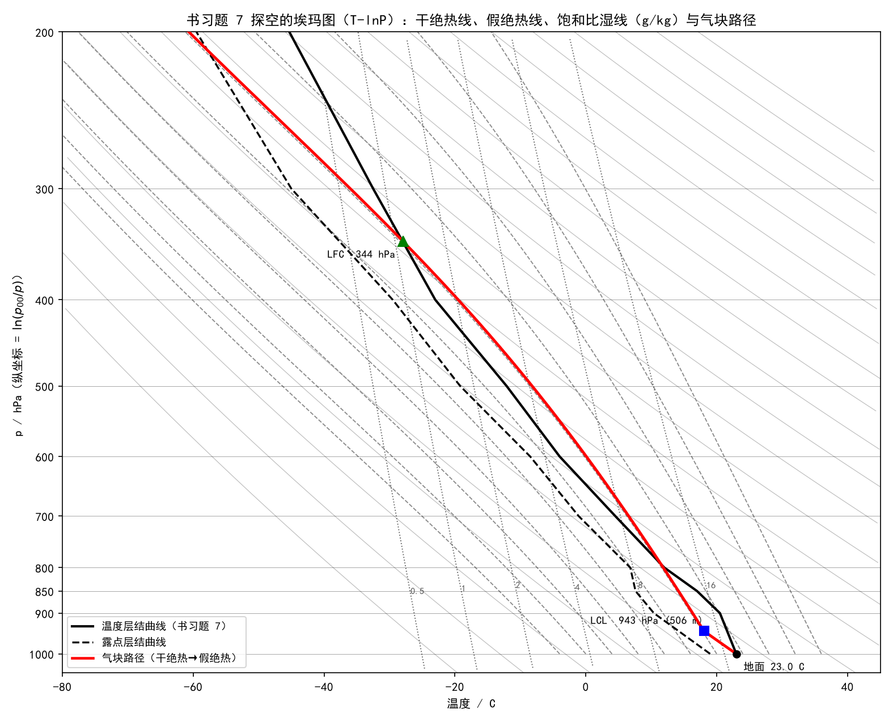
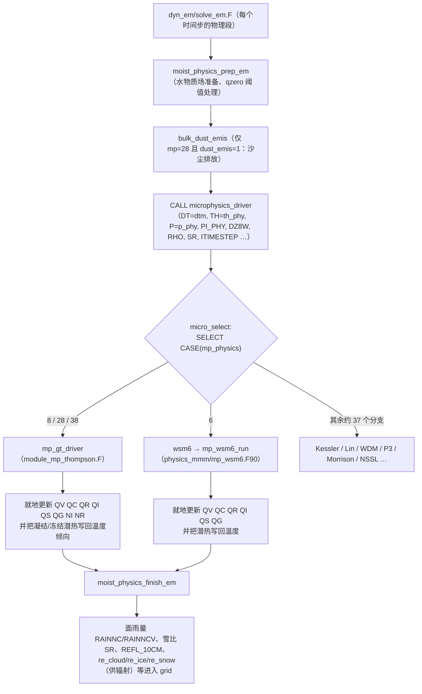
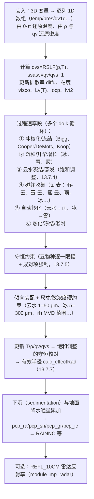
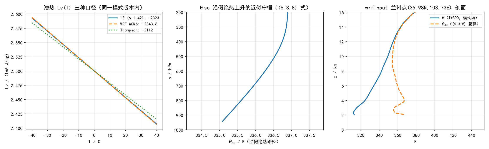
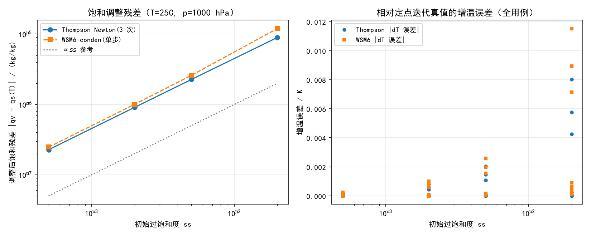

# 第 13 章 微物理方案族：从大气热力学到 Thompson 与 WSM6

> 前两章我们讲了辐射如何加热大气（第 12 章）、水汽与气溶胶如何进入模式（第 11 章）。但云、雨、雪、霰这些“看得见的天气”是怎么在模式里长出来的？答案在**微物理方案（microphysics parameterization）**：它负责水汽的相变、凝结核化、冰晶生成、雨滴碰并增长、粒子下落——模式中唯一直接产生降水的过程链。
>
> 微物理的计算对象是“含水量与数浓度”，而支配它们演变的物理规律全部来自大气热力学：第一定律给出潜热与温度变化的关系，第二定律给出熵与相变的判据，假绝热方程给出饱和气块升降的温度路径，热力学图解给出预报员分析云与稳定度的工具。本章先系统梳理《大气物理学》第六章（大气热力学基础，印刷页 123–169）的热力学工具（13.1–13.5），再把它们与 WRF 的微物理实现逐一对接（13.6–13.8），最后用本地实验闭环验证（13.9）。
>
> 本章用书第六章 6.1–6.7（PPT 未到，考点节先按书要点自拟，标注“待 PPT 校准”）；6.8（静力稳定度）留给第 14 章，6.9（整层升降）留给第 15 章，6.4 图解的实操留给第 19 章。

---

## 13.0 本章地图

### 13.0.1 书小节结构与对应关系

| 书（第六章·大气热力学基础） | 印刷页 | 本章对应 | 定位 |
|---|---|---|---|
| 6.1 应用于大气的热力学基本规律 | 123–134 | 13.1 | 第一/第二定律、态函数、相变潜热、克拉珀龙-克劳修斯方程；微物理一切相变项的物理来源 |
| 6.2 大气中的干绝热过程 | 134–137 | 13.2 | 泊松方程、位温、γd；干绝热调整、位温诊断的物理来源 |
| 6.3 可逆的饱和绝热过程和假绝热过程 | 138–141 | 13.3 | 饱和气块升降方程、湿绝热减温率、假相当位温；**饱和调整（saturation adjustment）的数学原型** |
| 6.4 大气热力学图解 | 142–146 | 13.4 | 埃玛图/斜 T-lnP/温熵图构造原理与能量图解；第 19 章实操分析的基础 |
| 6.5 绝热混合过程 | 147–149 | 13.5.1 | 水平/垂直/湍流混合；混合雾、逆温层 |
| 6.6 等压冷却过程 | 149–150 | 13.5.2 | 露、霜、雾的凝结物理；与“凝结核化/蒸发”的接口 |
| 6.7 温湿参量 | 150–153 | 13.5.3 | 相当温度、湿球温度、假湿球位温、假相当温度；保守性参量与气团分析 |
| （6.8 静力稳定度 / 6.9 整层升降 / 6.10 逆温层） | 154–169 | **第 14/15 章** | 边界层与积云章使用；本章不展开 |

本章 WRF 侧对象：`phys/module_microphysics_driver.F`（方案分发）+ `phys/module_mp_thompson.F`（精读）+ `phys/physics_mmm/mp_wsm6.F90`（对照）+ Registry/namelist 方案号。

### 13.0.2 考点清单（自拟版，待 PPT 校准）

> 第 6 章课件未到。以下按书 6.1–6.7 的“名词/简答/计算/模式视角”四类先拟；PPT 到货后补“考点透视”并校准。书思考题 7 题、习题 8 题的完整解答见 13.10。

**名词解释（拟）**：准静力条件；位温；虚位温；密度温度；干绝热减温率；湿绝热减温率；抬升凝结高度（LCL）；假相当位温（θse）；相当位温（θe）；相当温度；湿球温度；假湿球位温（θsw）；焚风；埃玛图；能量图解（雅可比判据）。

**简答/证明（拟）**：
- 干绝热、饱和绝热、假绝热三种过程中，哪些量保守？哪些增大、减小？（书思考题 2）
- 云团绝热下沉时 T、p、q、Td、RH、θ、θse 如何变化？（书思考题 3）
- 埃玛图上干绝热线的位温标注关系 θ′ = Cθ 的证明（书思考题 4）。
- 干绝热上升时 e^0.286/T 不变（书习题 2）。
- 焚风原理（假绝热过程的实际应用）。
- 等压绝热混合的效果：谁升温、谁降温、何时凝结（(6.5.1)–(6.5.5)）。

**计算（拟）**：位温与虚位温（(6.2.8)/(6.2.11)）；LCL 估算式 zc≈123(T−Td)（(6.2.23)）与精确解对照；γs 闭式（(6.3.5)）与数值积分对照；θse 计算（(6.3.8)）；等压混合终态（(6.5.1)/(6.5.2)）；等压冷却凝结水量（(6.6.5)–(6.6.7)）；干湿球公式反演湿度（(6.7.5)）。书习题 1–8 全解见 13.10。

**模式视角补充（拟，带答案）**：
1. WRF 的饱和调整在解哪个方程？（答：凝结潜热与饱和水汽压的联立——书 (6.6.3) 的思想，见 13.7.4/13.9.3）
2. 微物理里哪些量是“保守”的？为什么方案要专门写守恒约束段？（见 13.7.5）
3. θse 为什么能用于气团/锋面分析？在模式诊断里怎么算？（见 13.5.3/13.9.2）

### 13.0.3 源码锚点总表（本章全部实测核验）

| 源码文件 | 符号/结构 | 对应物理 |
|---|---|---|
| `phys/module_microphysics_driver.F` | `micro_select: SELECT CASE(mp_physics)`；约 39 个分支 CASE；`CASE (THOMPSON)`、`CASE (WSM6SCHEME)` 调用实录 | 方案分发（13.6） |
| `phys/module_mp_thompson.F` | `thompson_init`、`mp_gt_driver`、`calc_effectRad`、`RSLF`/`RSIF`、`GAMMCF`/`GSER` | Thompson 精读（13.7） |
| `phys/physics_mmm/mp_wsm6.F90` | `mp_wsm6_run`、`fpvs`、`slope_wsm6` 族、`nislfv_rain_plm`、语句函数 `conden`/`xlcal` | WSM6 对照（13.8） |
| `phys/module_mp_wsm6.F` | `subroutine wsm6`（薄适配层，转调 physics_mmm 实体） | WSM6 结构（13.8.1） |
| `Registry/Registry.EM_COMMON` | `rconfig mp_physics`；`package thompson / thompsonaero / wsm6scheme …`（moist/scalar/state 变量清单） | 方案号与状态变量（13.6.4） |
| `run/README.namelist` | `mp_physics (max_dom)` 0–106 全表；`hail_opt`、`mp_zero_out` 等 | 用户手册口径（13.6.4） |
| `share/module_model_constants.F` | `RE_QC_BG/RE_QI_BG/RE_QS_BG`、`RE_QC_MAX/RE_QI_MAX`、`XLV/XLS`、`CLIQ/CICE/PSAT/r_v` | 常数闭合（13.8.4） |

### 13.0.4 与前后章的衔接

- **承第 11 章**：饱和水汽压公式族（SVP1–4、pq0、fpvs、RSLF/RSIF）在第 11 章逐一定位；本章 13.7/13.8 把它们放回各自的方案语境，并给出“同一模式版本内三套 Lv(T) 口径”的完整对照（13.9.2）。
- **承第 12 章**：第 12 章结尾留下接口伏笔——微物理算出的云水/云冰/雪有效半径 `re_cloud/re_ice/re_snow` 与 `has_reqc/has_reqi/has_reqs` 标志供辐射方案使用。本章 13.7.6 闭合这一接口（`calc_effectRad` 与背景半径常数）。
- **启第 14/15 章**：书 6.8 静力稳定度、6.9 整层升降在第 14 章（边界层）与第 15 章（积云）展开；本章的 θse、γs、气块路径是那两章的预备知识。
- **启第 19 章**：13.4 的埃玛图原理与 13.9.1 的探空实验，是第 19 章“T-lnP 实操与个例诊断”的预演。

---

## 13.1 应用于大气的热力学基本规律（书 6.1，印刷页 123–134）【考点】

### 13.1.1 系统、气块模型与准静力条件

大气热力学所研究的对象被理想化为**开放系或封闭系**：

- **未饱和湿空气系统**：干空气 + 水汽的二元单相系，当作封闭系处理（水汽含量不变）；
- **含液态水（或冰）的饱和湿空气系统**：干空气 + 水汽 + 液态水（或冰）的多相系，是最复杂、也是与云直接相关的系统。

一个关键简化是**“常把它当作封闭系处理”**：只要所研究的空气体积足够大，或所研究的是被包含在大块空气中的小部分空气，与外界交换的影响可以忽略。书里特别提醒（p123）：**“对于那些与外界湍流混合交换强烈而发生变化了的空气，或正在消退的积云单体，封闭系的假设就不太合适了。”**——这句话在第 14 章（边界层湍流混合）会有正面回应。

**气块（微团）模型**三条假定（印刷页 124）：

1. 气块内压强、温度和湿度都均匀分布，各物理量服从热力学定律和状态方程；
2. 气块运动时是绝热的——过程进行得足够快，来不及与环境交换热量；
3. 气块的气压能不断调整到与环境气压相同，即满足**准静力条件**：

$$p \equiv p_e \quad \text{且} \quad \frac{\mathrm{d}p}{\mathrm{d}z} = \frac{\partial p_e}{\partial z} \tag{6.1.1}$$

第 3 条是“准静力”而不是“静力”：气块可以有垂直加速度（非静力），但气块气压随时与环境气压相等——WRF 的 `dyn_em` 非静力方程、以及每小时步的声波处理，正是把这条假定数值化的产物（第 21 章动力内核）。

> **模式视角**：气块模型的“绝热 + 准静力”两条假定，就是微物理方案里“饱和气块沿假绝热方程求温度”（13.7.4）与“用静力学关系换算高度”（13.9.1）的根据。真实模式中微物理在网格尺度上做的也是同一件事：先按绝热过程算相变，再由热力学方程修正温度。

### 13.1.2 热力学第一定律在大气中的形式

热力学第一定律（能量守恒与转化）：系统内能变化 = 吸收热量 + 外界对系统做功。

$$U_2 - U_1 = Q_e + A + M \tag{一般形式}$$

对质量不变的封闭系 $U_2 - U_1 = Q_e + A$；对无穷小准静止过程，外界做功只有体积变化功 $\delta A = -p\,\mathrm{d}V$（膨胀时 dV>0、外界做负功），于是

$$\mathrm{d}U = \delta Q_e - p\,\mathrm{d}V \tag{6.1.2}$$

常温常压大气可视为理想气体，内能仅是温度 $T$ 的函数。对**单位质量**的湿空气系统，记比容 $\alpha$（体积/质量）：

$$\delta Q = c_v\,\mathrm{d}T + p\,\mathrm{d}\alpha \tag{6.1.3}$$

$$\delta Q = (c_v + R)\,\mathrm{d}T - \alpha\,\mathrm{d}p = c_p\,\mathrm{d}T - \frac{RT}{p}\,\mathrm{d}p \tag{6.1.4}$$

$$\delta Q = c_p\,\mathrm{d}T - \alpha\,\mathrm{d}p = c_p\,\mathrm{d}T - \frac{1}{\rho}\,\mathrm{d}p \tag{6.1.5}$$

式 (6.1.4)(6.1.5) 是**大气中热力学第一定律的基本形式**，本章将反反复复用到它：一切绝热过程（δQ=0）的温度变化都由气压变化决定；一切相变过程都把 $\delta Q$ 换成潜热项。

> **符号约定（务必过目）**：本书用 $\delta Q$ 表示系统**吸收**的热量。WRF 源码里对应的是“倾向”（tendency）：潜热释放使 `tten` 增加、凝结使 `qvten` 减小——符号与对时间的导数约定见 13.7。

### 13.1.3 热力学第二定律与态函数【考点】

第一定律管能量守恒，第二定律管**过程方向**。熵的定义（沿可逆过程积分）：

$$S - S_0 = \int_{(x_0)}^{(x)} \frac{\delta Q_\text{r}}{T} \tag{6.1.6}$$

第二定律的普遍表述：

$$S - S_0 \ \geq\ \int_{(x_0)}^{(x)} \frac{\delta Q}{T} \tag{6.1.7}$$

不可逆过程取不等号、可逆过程取等号。对无穷小过程

$$\mathrm{d}S \ \geq\ \frac{\delta Q}{T} \ ; \qquad \text{可逆过程} \quad \mathrm{d}S = \frac{\delta Q_\text{r}}{T} \tag{6.1.8–6.1.9}$$

**绝热过程**（δQ=0）中 $S-S_0 \geq 0$：系统经绝热过程到达另一平衡态时，**熵永不减少**；可逆时熵不变、不可逆时熵增加——“判断绝热过程方向”的熵增加原理。

把 (6.1.2) 与 (6.1.8) 结合：

$$T\,\mathrm{d}S \ \geq\ \delta Q = \mathrm{d}U + p\,\mathrm{d}V \tag{6.1.10}$$

$$\mathrm{d}U \ \leq\ T\,\mathrm{d}S - p\,\mathrm{d}V \tag{6.1.11}$$

其余态函数（书中逐一给出，记住簇结构即可）：

| 态函数 | 定义 | 微分形式 | 意义 |
|---|---|---|---|
| 焓 $H$ | $H = U + pV$ | $\mathrm{d}H \leq T\,\mathrm{d}S + V\,\mathrm{d}p$ (6.1.12) | 等压过程焓增量 = 吸收热量 |
| 吉布斯函数 $G$ | $G = H - TS$ | $\mathrm{d}G \leq -S\,\mathrm{d}T + V\,\mathrm{d}p$ (6.1.14) | 等温等压判据 $\mathrm{d}G \leq 0$ (6.1.15) |
| 自由能 $F$ | $F = U - TS$ | $\mathrm{d}F = -S\,\mathrm{d}T - p\,\mathrm{d}V$ (6.1.19) | |

定压热容与焓的关系：

$$c_p = \left(\frac{\partial Q}{\partial T}\right)_p = \left(\frac{\partial H}{\partial T}\right)_p \tag{6.1.13}$$

**热力学基本微分方程**（以 $U$ 为 $S,V$ 函数）：

$$\mathrm{d}U = T\,\mathrm{d}S - p\,\mathrm{d}V \tag{6.1.17}$$
$$\mathrm{d}H = T\,\mathrm{d}S + V\,\mathrm{d}p \ ;\qquad \mathrm{d}F = -S\,\mathrm{d}T - p\,\mathrm{d}V \ ;\qquad \mathrm{d}G = -S\,\mathrm{d}T + V\,\mathrm{d}p \tag{6.1.18–6.1.20}$$

由 $G(T,p)$ 的交叉导数相等（麦克斯韦关系之一）：

$$\left(\frac{\partial S}{\partial p}\right)_T = -\left(\frac{\partial V}{\partial T}\right)_p \tag{6.1.21}$$

**比熵与比焓的计算**（印刷页 127–128）——这是把热力学搬进“单位质量大气”的关键一步：

$$\mathrm{d}s = \left(\frac{\partial s}{\partial T}\right)_p \mathrm{d}T + \left(\frac{\partial s}{\partial p}\right)_T \mathrm{d}p \tag{6.1.22}$$
$$\mathrm{d}s = \frac{c_p}{T}\,\mathrm{d}T - \left(\frac{\partial \alpha}{\partial T}\right)_p \mathrm{d}p = c_p\,\mathrm{d}\ln T - \alpha\beta_p\,\mathrm{d}p \tag{6.1.28}$$

其中 $\beta_p = \frac{1}{\alpha}\left(\frac{\partial\alpha}{\partial T}\right)_p$ 为**定压膨胀系数**。对未饱和湿空气（理想气体，$\alpha = RT/p$）：$\alpha(\partial...)=0$ 项消去，得

$$\mathrm{d}s = c_p\,\mathrm{d}\ln T - R\,\mathrm{d}\ln p \tag{6.1.30}$$
$$s = c_p\ln T - R\ln p + \text{常数} \tag{6.1.32}$$

$$\mathrm{d}h = c_p\,\mathrm{d}T \ ;\qquad h = c_p T + \text{常数} \tag{6.1.31, 6.1.33}$$

> **记忆锚点**：位温的定义式 (6.2.8) 就是把 (6.1.30) 积分到“熵不变”的等价表述——13.2.2 会看到 $\mathrm{d}s = c_p\,\mathrm{d}\ln\theta$ (6.2.13)。**“位温是熵的另一种写法”**，这是本章第一个“保守量”。

### 13.1.4 含液态水的饱和湿空气系统：潜热、相平衡与克劳修斯-克拉珀龙方程【考点】

#### （1）相变潜热

单位质量物质从相 1 变到相 2，按第一定律吸收的相变潜热：

$$L = (u_2 - u_1) + p(\alpha_2 - \alpha_1) = h_2 - h_1 \tag{6.1.34}$$

**潜热等于比焓之差**——所以等压相变过程中，焓就是“吸收的热量”的账本。汽化潜热 $L_v$（液→汽）、升华潜热 $L_s$（固→汽）、融化潜热 $L_f$（固→液）满足 $L_s = L_v + L_f$。

#### （2）化学势与相平衡条件

1 mol（或 1 g）物质的吉布斯函数称为**化学势**：

$$\mu = u + p\alpha - Ts \tag{6.1.35} \qquad \mathrm{d}\mu = -s\,\mathrm{d}T + \alpha\,\mathrm{d}p \tag{6.1.36}$$

两相平衡必须满足**热平衡 + 力学平衡 + 相变平衡**：

$$T_1 = T_2 = T \ ;\qquad p_1 = p_2 = p \ ;\qquad \mu_1(T,p) = \mu_2(T,p) \tag{6.1.37}$$

#### （3）克拉珀龙-克劳修斯方程

沿相平衡曲线 $(T,p) \to (T+\mathrm{d}T, p+\mathrm{d}p)$，由 $\mu_1+\mathrm{d}\mu_1 = \mu_2+\mathrm{d}\mu_2$ 与 (6.1.36) 可得相平衡曲线斜率：

$$\frac{\mathrm{d}p}{\mathrm{d}T} = \frac{s_2 - s_1}{\alpha_2 - \alpha_1} \tag{6.1.38}$$

再用 (6.1.39) $s_2 - s_1 = \dfrac{L}{T}$（由 (6.1.34) 与 $\mu=h-Ts$ 得）：

$$\frac{\mathrm{d}p}{\mathrm{d}T} = \frac{L}{T(\alpha_2 - \alpha_1)} \tag{6.1.40a} \qquad \xrightarrow{\ \alpha_\text{液} \ll \alpha_\text{汽}\ } \qquad \frac{\mathrm{d}p}{\mathrm{d}T} = \frac{L_v}{T\alpha_2} \tag{6.1.40b}$$

用水汽状态方程 $\alpha_2 = R_v T/p$ 换成习惯的饱和水汽压 $e_s$，即回到第二章的 (2.2.6)：

$$\frac{\mathrm{d}e_s}{\mathrm{d}T} = \frac{L_v e_s}{R_v T^2} \tag{2.2.6}$$

> **来源说明**（书原话）：此式由克拉珀龙（Clapeyron）先得到、由克劳修斯（Clausius）用热力学理论导出，故称克拉珀龙-克劳修斯方程。**“应指出，此方程适用于平液面，而在讨论云、雨滴等的相变过程时必须考虑液曲面的影响。”**（印刷页 129）——液曲面修正即开尔文方程，第 11 章已讲（气溶胶章），微物理方案中与“凝结增长/曲率修正”直接相关。

#### （4）基尔霍夫方程与 Lv(T)

潜热随温度变化。对水-汽相变，把 (6.1.34) 对温度求导并用麦克斯韦关系，得**基尔霍夫方程**：

$$\frac{\mathrm{d}L_v}{\mathrm{d}T} = c_{pv} - c_w \tag{6.1.41b}$$

给定定压热容数据即可积分。书给出实测数据的简单表达式（$t$ 为摄氏温度）：

$$L_v = 2.5\times 10^6 - 2323\, t \qquad (\mathrm{J\,kg^{-1}}) \tag{6.1.42}$$

> **同名不同值——注意**：这是全书第一次出现“同一个物理量、不同资料/方案取不同常数”的现象。第 13.9.2 节将把书 (6.1.42)、WRF 的 `xlv1=cliq−cpv=2343.6`（`mp_wsm6.F90` 语句函数 `xlcal`）与 Thompson 的 $2106-4218=-2112$（`module_mp_thompson.F` 中 `lvap` 的更新式）**三套斜率放在一张图上**：同一份 WRF 4.8.0 源码内并存的三种口径，差在 ±10% 以内，但对云滴蒸发速率、深对流感热潜热分配会有系统性影响。**“常数不是物理，常数是选择。”**

#### （5）含液态水饱和湿空气的熵

对干空气、水汽、液态水三元混合物，用各分量的比熵与相变项合成，最终得到（印刷页 130–131）：

$$\mathrm{d}s = (m_d c_{pd} + m_s c_w)\,\mathrm{d}\ln T - m_d R_d\,\mathrm{d}\ln p_d + \mathrm{d}\!\left(\frac{m_s L_v}{T}\right) \tag{6.1.45}$$

其中 $m_s$ 为水质物（水汽 + 液态水）总质量。除以 $m_d$ 换成混合比记法——**饱和湿空气在绝热（等熵）过程中的表达式**：

$$(c_{pd} + r_t c_w)\,\mathrm{d}\ln T - R_d\,\mathrm{d}\ln p_d + \mathrm{d}\!\left(\frac{r_s L_v}{T}\right) = 0 \tag{6.1.46}$$

其中 $r_t = r_v + r_w$ 为**总水质物混合比**、$r_s$ 为**饱和混合比**（饱和时 $r_v = r_s$）。

> **(6.1.46) 是本章与 WRF 源码之间最重要的一座桥**：6.3 节用它推导饱和绝热过程的全部结论（印刷页 138 原文：“可逆的饱和绝热过程可用含液态水饱和气块的等熵过程表达式 (6.1.46) 进行讨论”）；而微物理方案中的**饱和调整**，数值上解的就是它——见 13.7.4 与 13.9.3。

### 13.1.5 大气中的能量形式与“静力能”【考点】

书 6.1.5（印刷页 132–134）把大气能量拆成四种基本形式与若干组合。先有一个重要概念——**密度温度** $T_\rho$（Emanuel 1994 引入）：

$$T_\rho = T\,\frac{1 + r/\varepsilon}{1 + r_t} \tag{6.1.53}$$

$r$ 为水汽混合比、$r_t$ 为水质物总混合比。系统不含凝物时退化为**虚温** $T_v$：

$$T_\rho = T\,\frac{1 + r/\varepsilon}{1 + r_t} \approx T(1 + 0.608 r) = T_v$$

由比容的混合公式（(6.1.54)），忽略液态水/冰的比容项（比空气小 3 个量级、混合比只有 10⁻³ 量级），再引入密度温度，状态方程保持理想气体形式：

$$\alpha = \frac{R_d T_\rho}{p} \qquad \text{或} \qquad p = \rho R_d T_\rho \tag{6.1.56}$$

**密度温度的意义**（书 p132 原话）：**“密度温度可看成在同一压力下，当干空气密度等于含水凝物的饱和湿空气系统的密度时，该系统所具有的温度。”** 它比虚温更彻底地计入液态水/冰的密度贡献，在讨论湿大气对流时有广泛应用。**微物理方案里凡涉及浮力、下沉速度的地方（第 14/15 章），实际使用的都是这类广义虚温。**

四种基本能量（比能，单位质量）：

| 形式 | 表达式 | 公式号 |
|---|---|---|
| 内能 | $u = c_v T$ | (6.1.57) |
| 位能（重力位势） | $\Phi \approx gz$ | (6.1.59) |
| 动能 | $E_k = \frac{1}{2}(u^2+v^2+w^2) = \frac{1}{2}V^2$ | (6.1.63) |
| 潜热能 | $E_L = L q$ | (6.1.64) |

组合形式：

$$h = c_p T \quad (\text{显热/感热}) \ ;\qquad c_pT = c_vT + RT \quad (\text{内能 + 压力能}) \tag{6.1.65–6.1.66}$$

$$h_m = c_p T + L q \quad (\text{温湿能}) \tag{6.1.67}$$

$$\Phi_d = c_pT + gz \quad (\text{干静力能 / 蒙哥马利势}) \tag{6.1.68}$$
$$\Phi_m = c_pT + gz + Lq \quad (\text{湿静力能}) \tag{6.1.69}$$

$$E_d = c_pT + gz + \tfrac{1}{2}V^2 \ ;\qquad E_m = c_pT + gz + \tfrac{1}{2}V^2 + Lq \tag{6.1.71–6.1.72}$$

两个重要结论：整层气柱的内能与位能之和 $\dfrac{1}{g}\int_0^{p_0} c_p T\,\mathrm{d}p$ **都随温度变化**，可合称总势能（(6.1.70)）；其中 $E_p \approx 0.40\,U$（(6.1.62)）。且有量级判断——**全势能中只有约 5% 可以转换为动能**，称为有效势能（书 p134）。

> **模式视角**：`c_pT + gz`（干静力能）在数值模式中几乎“处处在场”：WRF 的状态变量之一就是 $\theta$（与 $c_pT$ 只差 $(p/p_0)^{\kappa}$ 因子），基态加扰动的分解（ch10）本质上是在分解这类能量。而**湿静力能 $\Phi_m$ 的守恒性**是季风、锋面、深对流分析中最常用的工具（第 19 章会再遇）。

---

## 13.2 干绝热过程与位温（书 6.2，印刷页 134–137）【考点】

### 13.2.1 干绝热过程与泊松方程

当讨论的是**未饱和湿空气（无相变）**的绝热升降，称**干绝热过程**；它是可逆过程。由 (6.1.4)，绝热（δQ=0）时温度变化完全由气压变化决定：

$$\mathrm{d}T = \frac{RT}{c_p}\,\frac{\mathrm{d}p}{p} \tag{6.2.1}$$

从初态 $(p_0, T_0)$ 到 $(p, T)$ 积分（$\kappa = R/c_p$）：

$$\frac{T}{T_0} = \left(\frac{p}{p_0}\right)^{\kappa} \tag{6.2.2}$$

这就是**泊松方程**。对未饱和湿空气，$\kappa$ 本身随比湿变化：

$$\kappa = \frac{R_d}{c_{pd}}\cdot\frac{1 + 0.608q}{1 + 0.86q} \quad \approx\ \kappa_d = \frac{R_d}{c_{pd}} \tag{6.2.3}$$

由于大气中比湿总小于 0.04，$\kappa/\kappa_d > 0.99$，故实用中取

$$\frac{T}{T_0} = \left(\frac{p}{p_0}\right)^{0.286} \tag{6.2.4}$$

> **模式视角**：WRF 的状态变量是位温扰动 $\theta'$（`T` 变量，基准 300 K），而热力学方案拿到的是 `TH`（位温）与 `PII`（$\pi = (p/p_{00})^{\kappa}$）——两者相乘还原真实温度 $T = \theta\pi$，正是 (6.2.4) 的工程化写法。见 13.6.3 的调用实录。

### 13.2.2 干绝热减温率

假设环境处于静力平衡，气块干绝热上升时因膨胀降温、下沉时压缩增温。定义未饱和湿空气温度随高度的变化率负值为**干绝热减温率** $\gamma_d$：

$$\gamma_d = -\frac{\mathrm{d}T}{\mathrm{d}z}$$

由 (6.1.5) 与静力学 $\mathrm{d}p/\mathrm{d}z = -\rho_e g$（$\rho_e$ 环境密度），一般式为

$$\gamma = -\frac{\mathrm{d}T}{\mathrm{d}z} = \frac{\rho_e}{\rho}\cdot\frac{g}{c_p}\cdot\frac{T_e}{T_v} \tag{6.2.5}$$

对未饱和湿空气：

$$\gamma = \frac{g}{c_p} = \frac{g}{c_{pd}(1 + 0.86q)} \tag{6.2.6}$$

对比湿很小的情形（干空气）：

$$\gamma_d = \frac{g}{c_{pd}} = 9.76\ \mathrm{K\,km^{-1}} \approx 9.8\ \mathrm{K\,km^{-1}} \tag{6.2.7}$$

以位势米为单位时同样写作 $\gamma_d = g_0/c_{pd} = 9.76\ \mathrm{K\,gpkm^{-1}}$。**记忆值 9.8 K/km** 是全班同学必须条件反射的数字。

### 13.2.3 位温与虚位温【考点】

把空气块干绝热压缩或膨胀到标准气压 $p_{00}$（取 1000 hPa）时所具有的温度，即**位温**（由 (6.2.2)）：

$$\theta = T\left(\frac{p_{00}}{p}\right)^{\kappa} = T\left(\frac{1000}{p}\right)^{\kappa} \tag{6.2.8}$$

$$\theta = T\left(\frac{1000}{p}\right)^{0.286} \tag{6.2.9}$$

未饱和湿空气的位温以干空气位温代替（$\theta_d-\theta$ 一般 < 0.1 K）。**虚位温**：

$$\theta_v = T_v\left(\frac{1000}{p}\right)^{\kappa} \tag{6.2.10} \qquad \theta_v = \theta(1 + 0.608q) \tag{6.2.11}$$

**位温的核心性质**（印刷页 136 推导）：对 (6.2.8) 取对数微分

$$\mathrm{d}\ln\theta = \mathrm{d}\ln T - \kappa\,\mathrm{d}\ln p \tag{6.2.12}$$

与 (6.1.30) 对比立得

$$\mathrm{d}s = c_p\,\mathrm{d}\ln\theta \tag{6.2.13}$$

$$\delta Q = c_p T\,\frac{\mathrm{d}\theta}{\theta} = c_p T\,\mathrm{d}\ln\theta \tag{6.2.14}$$

由此得出书上的结论：**“空气块得到热量时位温增加；放出热量时位温降低；干绝热过程是等熵过程，位温保持不变。”**

**“位温在干绝热过程中保持不变，称为在干绝热过程中具有保守性。”**（p136 原话）位温以及后面要介绍的假相当位温等具有保守性的物理量，在研究中“不随气块高度（或压强）的改变而改变，好像是一种性质稳定的示踪物，便于我们追溯气块或气流的源地以及研究它们以后的演变”。

垂直方向上：

$$\frac{1}{\theta}\frac{\partial\theta}{\partial z} = \frac{1}{T}(\gamma - \Gamma) \quad\Rightarrow\quad \frac{\partial\theta}{\partial z} = \frac{\theta}{T}(\gamma - \Gamma) \approx \frac{\theta}{T}(\gamma_d - \Gamma) \tag{6.2.15a–6.2.15b}$$

$$\frac{\partial\theta_v}{\partial z} \approx \frac{\theta_v}{T_v}(\gamma_d - \Gamma_v) \tag{6.2.16}$$

对流层内一般 $\Gamma < \gamma_d$，故 $\partial\theta/\partial z > 0$：**位温随高度增加**。(6.2.15) 是判别大气层结的重要关系式——第 14 章展开。

### 13.2.4 干绝热上升时的露点变化与抬升凝结高度【考点】

未饱和气块被强迫抬升时（视为绝热），水汽压随环境气压减小而按混合比守恒的方式降低，露点也随之降低。**露点递减率**推导（印刷页 137）：

$$\frac{\mathrm{d}T_d}{\mathrm{d}z} = \frac{\mathrm{d}T_d}{\mathrm{d}e}\cdot\frac{\mathrm{d}e}{\mathrm{d}z} \tag{6.2.17}$$

用克拉珀龙-克劳修斯 (2.2.6) 与“干绝热中水汽混合比守恒 ⇒ $(1/e)\mathrm{d}e/\mathrm{d}z = (1/p)\mathrm{d}p/\mathrm{d}z$”（(6.2.18)(6.2.19)），得

$$\frac{\mathrm{d}T_d}{\mathrm{d}z} = -\frac{g R_d T_d^2}{L_v R_v T_e} \approx -6.3\times 10^{-6}\,\frac{T_d^2}{T_v} \tag{6.2.20}$$

取 $T_v = 288\,\mathrm{K}$、$T_d = 280\,\mathrm{K}$ 时 $\mathrm{d}T_d/\mathrm{d}z \approx -0.0017\,\mathrm{K\,m^{-1}}$：**露点以约 1.7 K/km 的速率向上递减**，而气温以 9.8 K/km 递减——温度降得更快，两者终将相遇，达到饱和并发生凝结。这个**“气块因绝热抬升而达到饱和的高度”就是抬升凝结高度（Lifting Condensation Level, LCL）**，也就是常见对流云的云底高度。

实用估算式（线性化 (6.2.21)(6.2.22) 后求交点）：

$$T(z) = T_0 - 0.98\times 10^{-2}(z - z_0) \tag{6.2.21}$$
$$T_d(z) = T_{d0} - 0.17\times 10^{-2}(z - z_0) \tag{6.2.22}$$
$$z_c \approx 123\,(T_0 - T_{d0}) \quad (\text{米，温度用}\ ^\circ\mathrm{C}) \tag{6.2.23}$$

> **实验对照（13.9.1）**：用书习题 7 的探空（地面 23.0 ℃、露点 19.0 ℃）——估算式给 $123\times4 = 492\,\mathrm{m}$；而“干绝热线与饱和比湿线求交”的精确解给 $z_{LCL} = 506\,\mathrm{m}$（$p_{LCL} = 942.9$ hPa、$T_{LCL}=18.06\,^\circ$C），差 +2.8%。**估算式在温湿条件温和时很好用；但它假设露点递减率为常数 0.17 K/100 m，温度露点差大、气块很干时误差会增大。**书也提醒：地面露点 $T_0 - T_{d0}$ 一天内变化大，加上对流运动本身偏离绝热假定，“按此推算的云底高度与实测的云底高度有时相差很大”。

---

## 13.3 饱和绝热过程、假绝热过程与假相当位温（书 6.3，印刷页 138–141）【考点】

### 13.3.1 可逆饱和绝热过程与假绝热过程

气块干绝热上升到凝结高度后继续上升，水汽凝结并释放潜热——**释放的潜热加热气块**，使温度递减率小于 $\gamma_d$。此时有两种理想化处理（书图 6.1）：

- **可逆饱和绝热过程（湿绝热过程）**：凝结出的液态水**全部保留在气块内**；下沉时凝结的水分又蒸发，沿绝热过程回到原来状态。过程可逆、绝热 ⇒ **等熵**，可用 (6.1.46) 讨论：

$$(c_{pd} + r_t c_w)\,\mathrm{d}\ln T - R_d\,\mathrm{d}\ln p_d + \mathrm{d}\!\left(\frac{r_s L_v}{T}\right) = 0$$

- **假绝热过程**：凝结物**一旦形成便全部从气块中降落并带走少量热量**，气块下沉时无法沿原路返回（开放系、不可逆）。但“严格来说也不是绝热的”，由于液态水混合比 $r_w = 0$，把 (6.1.46) 中的 $r_t$ 换成 $r_s$，得到**假绝热方程**：

$$(c_{pd} + r_s c_w)\,\mathrm{d}\ln T - R_d\,\mathrm{d}\ln p_d + \mathrm{d}\!\left(\frac{r_s L_v}{T}\right) \approx 0 \tag{6.3.1}$$

一般 $r_s c_w \ll c_{pd}$，近似：

$$c_{pd}\,\mathrm{d}\ln T - R_d\,\mathrm{d}\ln p_d + \mathrm{d}\!\left(\frac{r_s L_v}{T}\right) \approx 0 \tag{6.3.2}$$

把 $L_v$ 当常数、略去高阶小项 $\frac{L_v}{T^2}r_s\,\mathrm{d}T$，得到**最常用的饱和气块上升热量方程**：

$$c_{pd}\,\mathrm{d}T - R_d T\,\mathrm{d}\ln p_d + L_v\,\mathrm{d}r_s \approx 0 \tag{6.3.3}$$

（三项依次为：显热、膨胀功、潜热。）

### 13.3.2 湿绝热减温率

由 (6.3.3) 对高度求导，并代入静力关系 $\mathrm{d}p/\mathrm{d}z = -\rho g \approx -\frac{p g}{R_d T_v}$：

$$\frac{\mathrm{d}T}{\mathrm{d}z} = \frac{1}{c_{pd}}\left[\frac{R_d T}{p}\frac{\mathrm{d}p}{\mathrm{d}z} - L_v\frac{\mathrm{d}r_s}{\mathrm{d}z}\right] \tag{6.3.4}$$

整理后得到**假绝热过程的垂直减温率**（湿绝热减温率）：

$$\gamma_s = -\frac{\mathrm{d}T}{\mathrm{d}z} = \gamma_d\cdot\frac{1 + L_v r_s/(R_d T)}{1 + \varepsilon L_v^2 r_s/(c_{pd} R_d T^2)} \tag{6.3.5}$$

（书中 $\varepsilon L_v^2 r_s/(c_{pd}R_d T^2)$ 一项利用 $\varepsilon/R_d \equiv 1/R_v$ 可等价写成 $L_v^2 r_s/(c_{pd}R_v T^2)$。）由于 (6.3.5) 分母大于分子对应项，$\gamma_s \le \gamma_d$；另外由 (6.3.4) 直接可得它与干绝热减温率的关系：

$$\gamma_s = -\frac{\mathrm{d}T}{\mathrm{d}z} = \gamma_d + \frac{L_v}{c_{pd}}\frac{\mathrm{d}r_s}{\mathrm{d}z} \tag{6.3.6}$$

因饱和比湿随高度减小（$\mathrm{d}r_s/\mathrm{d}z \le 0$），可知 $\gamma_s \le \gamma_d$。**数值特征**（书 p139 + 本章实验 13.9.1）：

| 气压 | T（沿假绝热路径） | γs 闭式 (6.3.5) | γs 数值微分 | γd |
|---|---|---|---|---|
| 1000 hPa | 18.1 ℃（LCL 附近） | 9.74 | 9.74 | 9.77 |
| 850 hPa | — | 4.20 | 4.17 | 9.77 |
| 700 hPa | — | 3.89 | 3.85 | 9.77 |
| 500 hPa | — | 3.41 | 3.36 | 9.77 |
| 300 hPa | — | 2.85 | 2.79 | 9.77 |

（单位 K/km。表中两列 0.1–1% 的差来自 (6.3.5) 推导中的近似；实际大气中还有一个关键事实：**暖湿的下部气层 $\gamma_s$ 平均约 4 ℃/km，干冷的上部气层 $\gamma_s$ 与 $\gamma_d$ 相差很小（6–7 ℃/km 甚至更接近干绝热）**——这正是暴雨需要暖湿气团的原因。）

> **模式视角**：微物理方案里饱和调整时“凝结一部分水汽会把气块温度抬高多少”，其线性化系数 $\mathrm{d}q_s/\mathrm{d}T$ 就是 (6.3.5) 分母里的那一项原型。13.7.4、13.9.3 会把这个系数在 Thompson 与 WSM6 里的两种写法逐字对照。

### 13.3.3 假相当位温与相当位温【考点】

由含液态水饱和湿空气的比熵表达式 (6.1.45)，导出假绝热过程比熵的微分式：

$$\mathrm{d}s \approx c_{pd}\,\mathrm{d}\ln T - R_d\,\mathrm{d}\ln p_d + \mathrm{d}\!\left(\frac{r_s L_v}{T}\right) \tag{6.3.7}$$

书上由 (6.3.7) 与类似 (6.2.13) 的推导，“定义一个新的气象温度——**假相当位温** $\theta_{se}$，或称绝热相当位温”：

$$\boxed{\ \theta_{se} = \theta_d \cdot \exp\!\left(\frac{r_s L_v}{c_{pd} T}\right)\ } \tag{6.3.8}$$

其中 $\theta_d$ 是湿空气中所含干空气的位温：

$$\theta_d = T\left(\frac{1000}{p_d}\right)^{R_d/c_{pd}} \tag{6.3.9}$$

（$p_d$ 为干空气分压。）对 (6.3.8) 取对数再微分可得

$$\mathrm{d}s \approx c_{pd}\,\mathrm{d}\ln\theta_{se} \tag{6.3.10} \qquad s \approx c_{pd}\ln\theta_{se} + \text{积分常量} \tag{6.3.11}$$

——**假绝热过程（近似等熵）中假相当位温近似不变**；且对饱和气层还可证明（用 (6.2.15) 与 (6.3.6)）：

$$\frac{\partial\theta_{se}}{\partial z} \approx \frac{\theta}{T}(\gamma_s - \Gamma) \tag{6.3.12}$$

说明：**在饱和气层中若减温率 $\Gamma = \gamma_s$，则该层内假相当位温 $\theta_{se}$ 是一常数。**

**关键结论（书 p140 原话）**：“上述讨论的都是饱和空气块，对于未饱和湿空气块，其假相当位温等于该空气块于绝热上升到饱和状态后的假相当位温；仍可用 (6.3.8) 式计算，但式中的 $T$ 需采用干绝热上升到凝结高度时的温度 $T_c$、和饱和混合比 $r_s$（与气块的初始混合比相同）。由于干绝热上升过程中，干空气的位温 $\theta_d$ 和混合比都是保守量，凝结温度 $T_c$ 又是确定的，由 (6.3.8) 式可知，假相当位温在此过程中保持不变。”

**“综上所述，假相当位温在干、湿绝热过程中均是保守的。由于假相当位温的保守性，气象学上常用它作气团和锋面的分析。”**

欧美习惯还常用“相当位温” $\theta_e$（定义与 $\theta_{se}$ 类似）：

$$\theta_e = \theta\,\exp\!\left(\frac{L_v q_s}{c_p T}\right) \tag{6.3.13}$$

> **实验对照（13.9.1）**：从 LCL（291.2 K、942.9 hPa）出发沿假绝热线数值积分到 200 hPa，用 (6.3.8) 复算全程 $\theta_{se}$：**335.08 K → 336.89 K，最大漂移 0.54%**。严格守恒的只有精确的等熵判据 (6.3.10) 对应的完整熵；(6.3.8) 本身是“忽略液态水热容 + $L_v$ 视为缓变”的近似式，所以积分个几百 hPa 后有千分之几的漂移完全正常——**引用“θse 保守”时务必记住这是近似保守**。
>
> 全球年均位温/相当位温的纬向-垂直剖面（书图 6.2，引自 Peixoto & Oort 1992）展示了两点：位温随高度单调增加（对流层内层结稳定的表现），然后在对流层顶/平流层下层近似为常数（等熵面近水平）；而 θe 的大值区集中在赤道对流层中低层水汽大处（**湿热气团**），表明这些地区有利于垂直运动发展。

### 13.3.4 焚风：假绝热过程的一个应用

**焚风（foehn，源自德文）指气流过山以后形成的干而暖的地方性风。**原理（书图 6.3）：潮湿气流经迎风坡被迫抬升，到达凝结高度 $z_c$ 后沿假绝热减温率上升（凝结潜热释放，减温慢）；过山顶后水汽已大量凝结降落，气流沿干绝热下沉（减温快——**增温速率 9.8 K/km 大于爬坡时的减温速率**）。结果：**山前山后同一高度上，气流的温度、湿度都不同——背风面出现温度高、湿度小的干热风。**

实例（书 p141）：阿尔卑斯山北麓（相对湿度下降 40%–50%、气温高 10–12 ℃）、北美落基山东坡、我国**天山南麓乌鲁木齐等地、大兴安岭和太行山的东麓**。不同地区焚风成因不尽相同（有的主要是干绝热下沉，如太行山东麓），但共同点都是**过山气流的绝热过程不对称**。

> **模式视角**：焚风是对“干绝热减温率 ≠ 湿绝热减温率”最直观的应用。第 14 章的山谷风/下坡风、第 19 章的个例剖面诊断里，用“气块轨迹是沿 γd 还是 γs”可以直接判断气流来路与云底位置。

---

## 13.4 大气热力学图解（书 6.4，印刷页 142–146）【考点】

### 13.4.1 图解的四条要求

大气热力学图解的引入，“提供了利用探空资料迅速而直观地研究局地大气垂直结构及其特性的良好工具”（p142）。书上列出四条要求：

1. 坐标最好是最能实测得到的气象要素（温度、压强、湿度或其简单函数），纵坐标大致和高度成正比；
2. 图上的各组线条是直线或近似直线；
3. 坐标的尺度要使各组线条之间夹角尽可能大，便于区分各种热力学过程；
4. **为便于计算大气运动的能量，图解上的面积最好和能量成正比，即能量图解**。

### 13.4.2 温度对数压力图解（埃玛图）的构造

**温度对数压力图解（Emagram）简称 T-lnp 图**，是我国各气象台站广泛使用的图解（图 6.4）。它以温度为横坐标、气压的对数为纵坐标：

$$x = T \ \text{或}\ T_d \tag{6.4.1}$$
$$y = \ln\frac{p_{00}}{p} = \ln\frac{1000}{p} \tag{6.4.2}$$

利用 $\ln(Cp) = \ln C + \ln p$ 的性质可以证明：1000–200 hPa 与 250–50 hPa 的距离相等（对数坐标压缩上部），从而**节省篇幅**；气压小于 200 hPa 时图中各线采用括号内的气压、位温及饱和比湿数值。

三大基本线族及其方程：

**（1）干绝热线 = 等位温线**（对 (6.2.9) 取对数）：

$$y = \frac{1}{\kappa_d}(\ln\theta - \ln x) \tag{6.4.3}$$

**（2）等饱和比湿线**（由饱和比湿公式与饱和水汽压经验公式积分）：

$$y = 4098\left(\frac{1}{x - 36} - \frac{1}{T_0 - 36}\right) \quad (x\ \text{用绝对温度}) \tag{6.4.4}$$

这是一组双曲线；由于等温线就是等饱和水汽压线，而压强 $p$ 随 $y$ 增加而减小，“因此图解中的等饱和比湿线 $q_s(T,p)$ 看来像是一组偏离等温线的近似直线”。

**（3）假绝热线**：过去印制的埃玛图中，假绝热线不是由方程作图的，而是“根据假绝热过程的简化方程 (6.3.3) 逐段画出来的”，比较繁复也不精确；现在一般“在微机上利用 $\theta_{se}$ 的公式绘制使用”。

**（4）能量性质（埃玛图是能量图）**：由状态方程可知单位质量气块对外做功 $\delta a = p\,\mathrm{d}\alpha$，一个循环中

$$a = \oint p\,\mathrm{d}\alpha = \oint (R\,\mathrm{d}T - \alpha\,\mathrm{d}p) = -\oint \alpha\,\mathrm{d}p = R\oint T\,\mathrm{d}(-\ln p) = R\oint T\,\mathrm{d}\ln\frac{p_{00}}{p} = R\,\sigma' \tag{6.4.5}$$

“$\sigma'$ 就是埃玛图上循环曲线所包围的面积”——**面积 = 功 = 能量**。现用埃玛图上 1 cm² 的面积等于 74.5 J·kg⁻¹ 的功。

### 13.4.3 图解的应用

**（1）绘制大气层结曲线**：把探空各高度实测的温度、露点和压强点绘在图上、连成折线，得到**温度层结曲线**与**露点层结曲线**（即本章图 13.1 中的黑实线/黑虚线）。

**（2）求等压面间厚度**：实际大气是虚温与压强的关系复杂，用等温大气公式算厚度有困难，可用图解法求**平均虚温**：

$$Z_{gd} - Z_{gl} = \frac{R_d}{g_0}\int_{p_1}^{p_2} T_v\,\mathrm{d}\ln\frac{p_{00}}{p} = \frac{R_d \bar{T}_v}{g_0}\ln\frac{p_1}{p_2} \tag{6.4.6}$$

式中 $\int_{p_1}^{p_2} T_v\,\mathrm{d}\ln\frac{p_{00}}{p}$ 对应图上阴影面积（书图 6.5：用等温线 $BAD$ 使它与 $ADE$ 面积相等，$BAD$ 对应的温度即平均虚温 $\bar{T}_v$）。**实际工作中必须用这种“等面积法”求平均虚温**。

**（3）绘制气块的路径曲线（状态曲线）**：气块状态随气压（高度）变化的曲线。初始状态 $(T_0, p_0, q_0)$ 的未饱和气块外力抬升，先沿干绝热上升；当水汽压降为 $q_0$ 对应的饱和值（露点）时达到抬升凝结高度 LCL；LCL 以上沿假绝热上升（图 6.6）。**“在 LCL 以上，饱和湿空气块将以假绝热过程上升，其比湿等于该空气块的温度和压强所对应的饱和比湿。”**

> **本章图 13.1（实验 13.9.1）就是一例完整应用**：书习题 7 探空 + 气块路径 + LCL/LFC 标注。



> 图中灰实线为干绝热线族（250–450 K 每 10 K 一条）；灰虚线为假绝热线族（1000 hPa 处 −4 至 36 ℃ 每 4 ℃ 一条，由 (6.3.3) 数值积分）；灰点线为饱和比湿线（0.5/1/2/4/8/16 g/kg，按 $\varepsilon e_s/(p-e_s)$ 直接计算）；黑实线/黑虚线为书习题 7 探空的温度/露点层结曲线；红线为地面气块（23.0 ℃、露点 19.0 ℃）的路径曲线——干绝热到 LCL（942.9 hPa，18.06 ℃，506 m）后转假绝热；绿三角为 LFC（343.8 hPa，约 8 km，气块首次高于环境温度）。

### 13.4.4 斜 T-lnp 图与温熵图

**斜 T-lnp 图（Skew-T Log-P diagram，又称斜埃玛图）**：把 T-lnp 图中的等温线顺时针旋转 45°，使其与等压线大致成 45° 交角，等温线变为**一组从左到右倾斜向上的平行直线**：

$$y = \ln\frac{p_{00}}{p} = \ln\frac{1000}{p} \tag{6.4.7}$$
$$x = T + Cy = T + C\ln\frac{p_{00}}{p} = T + C\ln\frac{1000}{p} \tag{6.4.8}$$

（$C$ 为常数。斜率 $a$ 对所有等温过程都是常数、截距 $b$ 随温度 $T$ 而变。）T-lnp 图中“大多数温度探空曲线都集中在 45° 的狭窄角度范围内”，斜 T-lnp 图把它展开、**能比较清楚地反映大气温度层结曲线和露点层结曲线的斜率变化**，且仍是能量图，因而在英美等国得到广泛应用、也是 MetPy 等现代工具的标准出图形式。

**温熵图（tephigram）**：两个坐标分别是

$$x = T \ (\text{或}\ T_d), \qquad y = \ln\theta$$

由 (6.2.13) 知 $\ln\theta$ 与比熵 $s$ 之间存在线性关系（$s = c_p\ln\theta + \text{常数}$），故两个坐标分别是 $T$ 和 $s$，称为温熵图。干绝热线就是等位温线（与等温线成 90° 交角）；等压线是一组对数曲线。

### 13.4.5 能量图解的一般原理

以压强 $p$ 和比容 $\alpha$ 为坐标的图（p-α 图）是最典型的能量图解：闭合曲线包围的面积代表单位质量物体对外做的功（顺时针为正）。问题是：**一张新的图解，其面积是否与能量成正比？** 判据是雅可比行列式：

对两个坐标系 $Oxy$ 与 $Ouw$，$u = u(x,y)$、$w = w(x,y)$，微元面积

$$\mathrm{d}\sigma' = \mathrm{d}u \times \mathrm{d}w = J\,\mathrm{d}\sigma \tag{6.4.9}$$
$$J = \begin{vmatrix} \dfrac{\partial u}{\partial x} & \dfrac{\partial u}{\partial y} \\[2mm] \dfrac{\partial w}{\partial x} & \dfrac{\partial w}{\partial y} \end{vmatrix} \tag{6.4.10}$$

$J$ 称为雅可比（Jacobi）行列式，“可作为面积的伸缩系数”。**若 $J = 1$，两坐标系面积相等；若 $J$ 为常数，则新图面积的伸缩比恒定——新图上的面积就仍和功成正比，也就是能量图。**

**例题 6.1（书 p147）**：计算埃玛图对 p-α 图的雅可比。埃玛图坐标 $u = T = p\alpha/R$，$w = -\ln p$，则 $J = -1/R$，因为 $J$ 是常数，所以是能量图；同理温熵图的雅可比为 $J = -1/c_p$，也是能量图。“$-$”号表示与 p-α 图面积符号相反，即**逆时针走向为正**。

---

## 13.5 绝热混合、等压冷却与温湿参量（书 6.5–6.7，印刷页 147–153）

### 13.5.1 绝热混合过程（书 6.5）

#### （1）绝热等压混合（水平混合）

两个温度湿度不同的空气块绝热等压混合（大气中的水平混合），因为没有凝结，可按态函数焓 $H$ 计算（$\Delta H = m_1\Delta h_1 + m_2\Delta h_2 = 0$）：

$$T = \frac{m_1 T_1 + m_2 T_2 + 0.86(m_1 q_1 T_1 + m_2 q_2 T_2)}{m(1 + 0.86\bar{q})} \tag{6.5.1}$$

$$\bar{q} = \frac{m_1 q_1 + m_2 q_2}{m} \tag{6.5.2}$$

若略去水汽影响：

$$T \approx \frac{m_1 T_1 + m_2 T_2}{m} \tag{6.5.3}$$

水汽压与位温也近似为质量加权平均：

$$\bar{e} \approx \frac{m_1 e_1 + m_2 e_2}{m} \tag{6.5.4} \qquad \bar{\theta} \approx \frac{m_1 \theta_1 + m_2 \theta_2}{m} \tag{6.5.5}$$

书上小结：“混合后的 $q$，$T$，$e$ 和 $\theta$ 都由初值的质量加权平均得到。(6.5.5) 式说明空气块绝热混合的效果是：**位温高的气块混合时，位温降低，即它放出热量；位温低的气块混合时吸收热量，位温升高；若两空气块位温相等，则达到热量平衡。**”

**湿度较大的未饱和空气块混合后，有可能发生凝结**（书图 6.10）：混合状态达到过饱和（$e > e_s(T)$）后将凝结、释放潜热加温，“最终达到平衡 $(T_1, e_s(T_1))$，成为含液态水的饱和气块”。**这种等压混合过程能产生混合雾**（如冬季水面上的蒸汽雾；喷气机尾迹、开水壶喷出的雾都是同一原理）。

#### （2）不同高度空气的绝热混合（垂直混合）

对流或湍流过程产生垂直混合。讨论分三阶段（印刷页 148）：

1. 两气块分别经**绝热膨胀/压缩移动到某一参考高度**（气压 $p$）处：比湿不变、位温不变、温度按干绝热变化；
2. 在 $p$ 处**等压绝热混合**：混合后的位温与比湿为质量加权平均 $\theta \approx \frac{m_1\theta_1 + m_2\theta_2}{m}$、$q \approx \frac{m_1 q_1 + m_2 q_2}{m}$；
3. 混合气块再绝热膨胀/压缩回到原来的高度：$T(p_1) = \theta(p_1/1000)^{\kappa_d}$、$T(p_2) = \theta(p_2/1000)^{\kappa_d}$——**“这表明，混合气块最后的温度与参考气压 $p$ 的大小无关。”**

但要注意：**“不能用 (6.5.3) 和 (6.5.4) 式直接计算垂直混合气块的温度和水汽压”**（因为体积不同，质量加权要用到位温与比湿）。

#### （3）湍流混合层

整个气层因湍流或对流产生垂直混合（图 6.11、6.12）。整层空气充分均匀混合后，位温和比湿将趋于一致：

$$\bar{\theta} \approx \frac{\int_0^m \theta\,\mathrm{d}m}{m} = \frac{\int_0^{z} \rho\theta\,\mathrm{d}z}{\int_0^{z} \rho\,\mathrm{d}z} = -\frac{\int_{p_1}^{p_2} \theta\,\mathrm{d}p}{p_1 - p_2} \tag{6.5.6}$$

由 (6.2.15a) 当 $\partial\theta/\partial z = 0$ 时 $\Gamma = \gamma_d$，所以**该气层的垂直减温率将趋于干绝热减温率**：

$$T(p) = \bar{\theta}\left(\frac{p}{1000}\right)^{\kappa_d} \tag{6.5.7}$$

书上给出两个重要推论：其一，原来 $\partial\theta/\partial z>0$ 的气层经湍流混合后，上层热量向下、下层向上，“混合层内温度垂直分布趋于 $\gamma_d$”，其上方形成**湍流逆温层**（$\Gamma < 0$）——“逆温层是绝对稳定层，它对上下空气的对流起着削弱抑制作用”；其二，**近地面气层的湍流混合（非绝热变化）**：晴热夏天或沙漠地区，地面加热造成超绝热层（$\Gamma > \gamma_d$，“地面温度有时能比几米高的气温高出 2–3 ℃”），过渡到午后湍流混合加热使上下位温趋于一致并趋于干绝热减温率，“对流的层结”成为热对流发展的温床。

> **模式视角**：13.5.1 是“湍流边界层在纸上的一页预演”：第 14 章的边界层方案（MYNN/BouLac）本质就是给这三阶段混合过程设定系数化的数值实现；而“混合层内 $\theta$ 守恒”正是边界层诊断中最常用的判据。

### 13.5.2 等压冷却过程（书 6.6）【考点】

气压变化慢而小、可近似看成等压过程。**等压冷却达到饱和则能凝结**——夜间辐射冷却使固体表面出现露和霜；低层暖湿空气移到较冷的下垫面“会逐渐冷却而形成平流雾”；清晨常见的辐射雾等“都是空气等压冷却凝结的产物”。在这样过程中“封闭系内空气因失去热量而降温，但凝结放出的潜热又加热了空气，使冷却过程减缓”。

书写出等压过程的焓增量形式（δQ = dh ≈ cp dT + Lv dqs）：

$$\delta Q = \mathrm{d}h \approx c_p\,\mathrm{d}T + L_v\,\mathrm{d}q_s \tag{6.6.1}$$

其中 $\mathrm{d}q_s = q_s(T_0 + \mathrm{d}T) - q_s(T_0) < 0$ 为**凝结后的饱和比湿与开始凝结时的饱和比湿之差**（$T_0$ 是开始凝结的温度）——用克拉珀龙-克劳修斯 (2.2.6)：

$$\mathrm{d}q_s \approx \mathrm{d}\!\left(\frac{\varepsilon e_s}{p}\right) = \frac{\varepsilon}{p}\,\mathrm{d}e_s = \frac{\varepsilon}{p}\cdot\frac{L_v e_s}{R_v T^2}\,\mathrm{d}T \tag{6.6.2}$$

代入 (6.6.1)：

$$\delta Q = \left(c_p + \frac{\varepsilon L_v^2 e_s}{p R_v T^2}\right)\mathrm{d}T \tag{6.6.3}$$

或把 $\mathrm{d}T$ 换成 $\mathrm{d}e_s$ 表示（介绍的是同一件事的不同自变量）：

$$\delta Q \approx \left(\frac{c_p R_v T^2}{L_v e_s} + \frac{\varepsilon L_v}{p}\right)\mathrm{d}e_s \tag{6.6.4}$$

**应用方式**：书中给出两个方向——**“如果测得等压冷却过程中气压和温度的变化（例如昼夜温差），就可估算单位质量空气释放的热量；反之如果能够估计等压冷却过程中的热量损失（例如辐射损失），也可以利用 (6.6.3) 和 (6.6.4) 式计算此过程中的温度变化 $\mathrm{d}T$ 和饱和水汽压的变化 $\mathrm{d}e_s$。”**

凝结出的**液态水含量**（单位体积空气中凝结的水量），由凝结过程终、初两态的饱和水汽密度差得到：

$$\mathrm{d}\rho_w = -\mathrm{d}\rho_v = -\frac{1}{R_v}\mathrm{d}\!\left(\frac{e_s}{T}\right) = -\frac{1}{R_v}\left(\frac{\mathrm{d}e_s}{T} - \frac{e_s\,\mathrm{d}T}{T^2}\right) \tag{6.6.5}$$

用克拉珀龙-克劳修斯方程改写：

$$\mathrm{d}\rho_w = -\frac{1}{R_v T} e_s\left(\frac{L_v}{R_v T} - 1\right)\mathrm{d}T \tag{6.6.6}$$

设 $T = 300\,\mathrm{K}$，$\frac{L_v}{R_v T}\approx 20 \gg 1$，略去第二项简化：

$$\mathrm{d}\rho_w \approx -\frac{\mathrm{d}e_s}{R_v T} \tag{6.6.7}$$

$$\delta Q = -\left(\frac{c_p R_v T^2}{L_v e_s} + \frac{\varepsilon L_v}{p}\right)\mathrm{d}\rho_w \tag{6.6.8}$$

**结论**：“有雾时，大气能见度与雾的液态水含量有关。根据饱和水汽压随温度变化的特点，由 (6.6.7) 式可知，**在不同的气温下，若降低同样的温度 $\Delta T$，则温度高的比温度低的空气凝结出的水量多**。在埃玛图上同样也很容易得出这个结论。所以，能见度差的浓雾多出现在暖湿的天气。”

### 13.5.3 温湿参量（书 6.7）【考点】

大气热力学中，把温度、湿度、气压按不同物理过程组合成一些特征量来描述空气状态，统称**温湿参量**。前面已提出：温度、比湿、混合比、露点、位温等；本节再介绍**相当温度、湿球温度、假相当温度、假湿球温度和假湿球位温、假相当位温**——“在不同的大气热力过程中，它们有的具有保守性，有的不保守”。

#### （1）相当温度和湿球温度

考虑由未饱和湿空气和水组成单位质量系统，经**等压绝热（蒸发）过程**（本小节讨论的目的），新定义的参量：

由等压绝热过程焓守恒（(6.7.1)(6.7.2)）：

$$c_{p}T + L_v r \approx c_{p}T' + L_v r' \tag{6.7.2}$$

**端点情形 1（假想的全部蒸发）**：假设系统经等压绝热**凝结**过程（假想的过程）成为**绝对干空气**（水汽全部凝结并放出潜热使空气升温）：

$$T_e = T + \frac{L_v r}{c_{pd}} = T + \Delta T \tag{6.7.3}$$

$T_e$ 称为**相当温度**或**等压相当温度**：“由于在绝热的孤立系中，水汽未饱和时不可能凝结，只会自动蒸发，故自然界中并不存在等压绝热凝结过程，只存在其逆过程，即等压绝热蒸发过程。因此可将相当温度定义为：**系统经等压绝热蒸发过程成为湿空气 $(p, T_e, r)$ 以前，绝对干燥的空气所应具有的温度。也就是说，相当温度是这个等压绝热蒸发过程中可能有过的最高温度。**”

以 273 K 附近的 $L_v = 2.5\times10^6$ J·kg⁻¹、$c_{pd} = 1004$ J·kg⁻¹·K⁻¹ 代入：$\Delta T = 2490\,r$——**每 1 g/kg 的水汽相当于约 2.5 K 的增温**，这是本节最实用的换算。

等压相当位温：$\theta_e = T_e(1000/p)^{0.286}$。书提醒：“**不过上式定义的相当温度很少用，现在国内外文献上的相当位温多指 6.3.2 小节中的 (6.3.8) 或 (6.3.13) 式定义的假相当位温或相当位温，希读者注意。**”

**端点情形 2（实际蒸发到饱和）**：系统内液态水蒸发使空气降温到饱和：

$$T + \frac{L_v r}{c_{pd}} \approx T_w + \frac{L_v r_s(T_w)}{c_{pd}} \tag{6.7.4}$$

$T_w$ 称为**湿球温度**——等压绝热蒸发过程中系统冷却到的**最低温度**。“由于 (6.7.4) 式难以直接计算得到湿球温度（因 $r_s$ 本身也是 $T_w$ 的函数），所以只能用逐次逼近法去求解。” 利用 $r \approx \varepsilon e/p$ 关系可导出水汽压：

$$e = e_s(T_w) - \frac{c_{pd}\,p}{\varepsilon L_v}(T - T_w) = e_s(T_w) - A p (T - T_w) \tag{6.7.5}$$

其中 $T$ 是干球温度，$A$ 称为**湿度计算常数**：

$$A = \frac{1}{\varepsilon L_v}\cdot\frac{\kappa}{D}$$

$\kappa$ 为热扩散系数、$D$ 为水汽扩散系数，“$A$ 值可近似取 $6.2\times10^{-4}$，实际测量时，不同类型温度表的 $A$ 值有差异，而且随风速变化，应特别注意”。**这就是干湿球温度表测湿的物理基础**——通风良好条件下测出的 $T$ 与 $T_w$，代入 (6.7.5) 即得水汽压 $e$，进而得露点。

实用提示（书原话）：“顺便指出，从云层降落的雨滴会在空气中将会蒸发而使其周围空气冷却，若周围空气达到饱和，则雨滴表面温度也可用湿球温度表示。”——**雨滴蒸发冷却与湿球温度的联系，正是微物理中“雨滴蒸发”参数化的物理图像。**

#### （2）假湿球温度和假湿球位温

在埃玛图上（书图 6.13）：空气由原来状态 $A$ 沿**干绝热线**上升到抬升凝结高度 $C$ 后，再沿**假绝热线**下降到原来的气压 $B$ 处，则 $B$ 处的温度即为**假湿球温度** $T_{sw}$（或称绝热湿球温度）。可以证明：$T_{sw}$ 总是小于湿球温度 $T_w$，“但两者之间差别不大，不超过 0.5 ℃”。

**假湿球位温 $\theta_{sw}$**：把假湿球温度 $T_{sw}$ 沿着假绝热线降到 1000 hPa 处所具有的温度，“显然，**假湿球位温在干绝热和湿绝热过程中都是保守的**”。

#### （3）假相当位温和假相当温度

本章 13.3.3 已给出（(6.3.8) 重述）：

$$\theta_{se} = \theta_d\exp\!\left(\frac{r_s L_v}{c_{pd}T}\right)$$

“由上式可看出，假相当位温实际上是**饱和气块上升过程中，水汽全部凝结所释放的潜热加热空气后达到的位温，也就是气块绝热上升到 $r_s \to 0$ 时的位温值**。用上述计算比较麻烦，使用埃玛图却很容易将它确定（图 6.14）：**令气块由 $A$ 沿干绝热线上升，到达抬升凝结高度 $C$ 后再按假绝热线上升，直到所有水汽耗尽，再沿该假绝热线的渐近线——干绝热线下降到 1000 hPa 处所应具有的温度。实际上那条干绝热线的位温值就是假相当位温值，并且已经标在假绝热线上。假相当位温在干绝热和湿绝热过程中都是保守的。**”

**假相当温度**（由 (6.3.8) 反解）：

$$T_{se} = \theta_{se}\left(\frac{p}{1000}\right)^{\kappa_d} = \theta_{se}\left(\frac{p}{1000}\right)^{0.286} \tag{6.7.6}$$

“因此，假相当温度可定义为：**令气块干绝热上升，到达凝结高度后又按假绝热过程上升，直到所有水汽耗尽，再沿干绝热过程下降到原来的气压处所应具有的温度。**假相当温度也称为绝热相当温度。可以证明它永远大于相当温度。”

**保守性总结（必记）**：假相当温度在热力学过程中不保守，实用意义不如假相当位温。自由大气中的热力过程大多可近似看作干绝热或湿绝热过程，而**假相当位温 $\theta_{se}$ 和假湿球位温 $\theta_{sw}$ 在这两个过程中都可认为是保守的**——所以书上说它们“常用于气象学中分析气团和锋面，也常用于鉴别有水汽凝结过程的焚风”。

各温湿参量大小关系（书图 6.15）：

$$T_{sw} < T_w < T < T_e < T_{se} \qquad \text{和} \qquad \theta_{sw} < \theta < \theta_{se}$$

最后一行是本章留给“气团分析”的钥匙：**两个气团的 $\theta_{se}$ 是否相等，判断它们是否同源；一层的 $\theta_{se}$ 随高度是否减小，判断是否为对流性不稳定**（6.8、6.9，第 14/15 章展开）。

> **模式视角**：微物理方案每天要算成千上万次“饱和调整”——本质上就是在求 (6.7.4) 那种“凝结-蒸发-温度的联立解”；而模式诊断的 θse 剖面（13.9 实验 D 组）与观测探空对比，是判断模式湿对流潜力的常备手段。

---

## 13.6 WRF 中的对应（一）：微物理在模式中的位置与方案族全景

### 13.6.1 调用链：微物理挂在哪个环节

与辐射“按 `radt` 节拍触发”（第 12 章）不同，**微物理在每一个时间步都被调用一次**。调用点在 `dyn_em/solve_em.F` 的物理段，前后各有一个“准备/收尾”：



几个工程细节（全部源码实测）：

- 驱动实参里 `DT = dtm`（不是主步长变量 `dt`）、`TH = th_phy`（位温）、`P = p_phy`（扰动气压）、`PI_PHY`、`DZ8W`（层厚）、`RHO`、`ITIMESTEP`；调用前置零 `grid%sr`；`BENCH_START(micro_driver_tim)` 给它单独计时；
- 对 `mp_physics = thompsonaero` 还有一个前置步骤 `bulk_dust_emis`（沙尘排放进入 `qnifa2d`）——气溶胶感知方案在调用链上就比别人“多一步”；
- 微物理直接改写 `grid` 上的水物质与温度，属于**逐网格点的就地更新**（in-place），与辐射“只算倾向、由框架汇总”的方式不同。

> **教学提示**：微物理与辐射是本科算例里最贵的两个物理过程（第 8 章的 5 天算例：微物理+辐射占了大部分计算时间）。做敏感性实验（改方案、改参数）时，先看 `rsl.out` 的 micro 计时段，是性能分析的第一步。

### 13.6.2 分发的结构：一个 `SELECT CASE` 管住全家

`phys/module_microphysics_driver.F` 的核心是唯一的一个入口分发：

```fortran
micro_select: SELECT CASE(mp_physics)
   CASE (KESSLERSCHEME)  …
   CASE (WSM6SCHEME)     …
   CASE (THOMPSON)       …
   CASE (THOMPSONAERO)   …
   CASE (MORR_TWO_MOMENT) …
   CASE (P3_1CATEGORY)   …
   …
END SELECT micro_select
```

实读清单（约 39 个分支，按出现顺序节选）：`KESSLERSCHEME`、`MKESSLERSCHEME`、`RCON_MP_SCHEME`、`THOMPSONAERO`、`THOMPSONGH`、`THOMPSON`、`TEMPO`、`NTU`、`FAST_KHAIN_LYNN_SHPUND`、`FULL_KHAIN_LYNN`、`JENSEN_ISHMAEL`、`MORR_TWO_MOMENT`、`P3_1CATEGORY`、`P3_1CATEGORY_NC`、`P3_2CATEGORY`、`P3_1CAT_3MOM`、`MORR_TM_AERO`、`MILBRANDT2MOM`、`NSSL_2MOM`、`GSFCGCESCHEME`、`NUWRF4ICESCHEME`、`LINSCHEME`、`SBU_YLINSCHEME`、`WSM3SCHEME`、`WSM5SCHEME`、`WSM6SCHEME`、`WSM6RSCHEME`、`WSM7SCHEME`、`WDM5SCHEME`、`WDM6SCHEME`、`WDM7SCHEME`、`UDMSCHEME`、`ETAMPNEW`、`FER_MP_HIRES`、`FER_MP_HIRES_ADVECT`、`CAMMGMPSCHEME`、`LSCONDSCHEME`、`MADWRF_MP`、`P3_1CAT_3MOM` 等。

每个 CASE 的“三段式”结构（读懂一个就会读全部）：

1. `CALL wrf_debug(100, 'microphysics_driver: calling xxx')`——调试输出；
2. 一串 `IF (PRESENT(QV_CURR) .AND. PRESENT(QC_CURR) …) THEN`——**按方案的实际需要检查可选实参是否到齐**（检查不过就是 `wrf_error_fatal`，这是“变量契约”被破坏时的第一道防线）；
3. `CALL 具体方案(...)`——键名实参（keyword arguments）逐项传递。

**变量契约**（不同方案拿到的东西不一样，比较三种）：

| | Thompson（8/28/38） | WSM6（6） |
|---|---|---|
| 水物质 | QV QC QR QI QS QG + **NI/NR**（数浓度） | QV QC QR QI QS QG（只有质量） |
| 热力学 | TH（位温）、PII（π）、P、W、DZ | TH、PII、P、DELZ + **全部物理常数** |
| 降水累计 | RAINNC(V)、SNOWNC(V)、GRAUPELNC(V)、SR | RAINNC(V)、SNOWNC(V)、GRAUPELNC(V)、SR |
| 诊断 | REFL_10CM、diagflag、do_radar_ref | REFL_10CM、diagflag、do_radar_ref |
| 辐射接口 | re_cloud/re_ice/re_snow + has_reqc/re_qi/re_qs | 同名 |
| 气溶胶 | （仅 28/38）QNC、QNWFA、QNIFA、QNBCA、QNWFA2D… | — |

> **两种“常数风格”**：Thompson 的常数写在模块声明区（`rho_w=1000`、`Nt_c=100.E6`…），CASE 里不传；WSM6 的全部常数都从 `module_model_constants` 经接口显式传入（`CPD=cp, CPV=cpv, XLV0=xlv, CLIQ=cliq, PSAT=psat …`）。哪种更好？没有定论——**改常数时，模块内部式的“改一处全局生效”，接口式的“看着传参就知道值从哪来”**。这个区别在你自己动手改造方案（第 20 章）时是真实存在的分岔口。

### 13.6.3 温度与位温的换算：`TH`/`PII` 与书 (6.2.4)

方案内部要算饱和水汽压、潜热、浮力，都需要**真实温度**，但 WRF 传进来的是位温和 $\pi$：

$$T = \theta \cdot \pi, \qquad \pi = \left(\frac{p}{p_{00}}\right)^{\kappa}, \qquad p = p_\text{base} + p'$$

（$p_{00} = 1000$ hPa；`TH` 是位温，`P` 是扰动气压、`PB` 才是基态——第 10 章的基态分解在这里派上用场。）这就是泊松关系 (6.2.4) 的逐格点实现。Thompson 里还能看到它更“土”的写法——直接用 p、θ 和干空气常数反推密度：`rho = 0.622·pres/(R·temp·(qv+0.622))`（注意分母里的 $q_v + \varepsilon$ 正是 $\varepsilon(1+q_v/\varepsilon)$ 的改写，等价于湿空气状态方程）。

### 13.6.4 方案号与状态变量：Registry × README 双表

**用户手册口径**（`run/README.namelist`）与**内部注册口径**（`Registry/Registry.EM_COMMON` 的 `package` 块）逐条对齐后的 0–106 方案号表（节选常考段）：

| 号 | 方案 | 备注 |
|---|---|---|
| 0 | 无微物理（passiveqv） | 只平流水汽 |
| 1 | Kessler | 暖云方案（教材最简范例） |
| 2 | Lin et al. | 老牌混合相 |
| 3 / 4 / 6 | WSM3 / WSM5 / WSM6 | 简化冰相 / 加雪 / 加霰 |
| 5 | Ferrier（HRW 业务版） | NCEP 业务线 |
| 7 | Goddard 4-ice | |
| 8 | **Thompson**（本章精读） | 双矩雨滴 |
| 9 | Milbrandt-Yau 2-mom | |
| 10 | Morrison 2-mom | |
| 11 | CAM 5.1 | |
| 13 | SBU-YLin | |
| 14 / 16 | WDM5 / WDM6 | 加入 CCN 数浓度（qnn/qnc/qnr） |
| 18 | NSSL 2-mom | 业务雷达同源 |
| 24 / 26 / 27 | WSM7 / WDM7 / UDM | 雪-雹分列或多矩 |
| **28** | **Thompson aerosol-aware** | +气溶胶（qnwfa/qnifa/qnbca），沙尘排放、火排放 |
| 29 | RCON | =28+液相反修改（在研） |
| 30 / 32 | HUJI 谱二元（快/全） | 谱方法 |
| 38 | Thompson + 双矩霰/雹（4.5 新增） | 冰相升级 |
| 40 | Morrison + CESM 气溶胶气候值 | |
| 50–53 | P3 四变体（1/2 冰类、云水单/双矩） | 下一代冰相 |
| 55 | Jensen-ISHMAEL | 冰晶各向异性 |
| 56 | NTU 多矩 | |
| 88 | TEMPO | Thompson 业务改造版 |
| 95 / 96 / 97 | Ferrier 旧 Eta / Madwrf / Goddard GCE | |
| 106 | WSM6r | 改写版 |

Registry 侧的关键差别是**状态变量清单**（moist / scalar / state 三组）：

- `wsm6scheme: mp_physics==6 → moist:qv,qc,qr,qi,qs,qg; state:re_cloud,re_ice,re_snow`
- `thompson: mp_physics==8 → moist:qv,qc,qr,qi,qs,qg; scalar:qni,qnr; state:re_cloud,re_ice,re_snow`
- `thompsonaero: mp_physics==28 → …scalar:qni,qnr,qnc,qnwfa,qnifa,qnbca; state:…,qnwfa2d,qnifa2d,taod5503d,taod5502d`

读法：**`moist` 是各方案都动的含水量；`scalar` 是方案私有的数浓度/气溶胶；`state` 是跨方案共用的诊断（如 `re_cloud` 给辐射、`taod550` 给气溶胶光学厚度诊断）。**选一个方案，就是选一张变量清单。

配套 namelist 开关（与方案号常一起出现）：

```fortran
mp_physics       = 8,          ! 各域可不同
mp_zero_out      = 0,          ! 水物质小值清零策略（0/1/2）
hail_opt         = 0,          ! WSM6/WDM6 的雹开关
wif_input_opt    = 0,          ! 28/29/88：water/ice-friendly 气溶胶输入（2=加黑碳）
num_wif_levels   = 30,
use_aero_icbc    = .false.,    ! 28/29：气溶胶初始/边界用气候值还是常数
```

### 13.6.5 微物理的下游接口

- **到辐射**：`re_cloud/re_ice/re_snow` + `has_reqc/has_reqi/has_reqs`——第 12 章的伏笔，本章 13.7.7 闭合；
- **到地面/陆面**：`RAINNC/RAINNCV`（累积/步长降水，分大尺度）、`SNOWNC`、`GRAUPELNC`、`SR`（雪水比）——陆面水收支的输入，第 16/19 章使用；
- **到诊断**：`REFL_10CM`（模拟雷达反射率，Thompson/WSM6 均可输出）——第 19 章与观测雷达对比；
- **到气溶胶**：气溶胶感知方案会反过来消耗 CCN/IN，改变云滴数（13.7.6）。

---

## 13.7 WRF 中的对应（二）：Thompson 方案精读

> 精读对象：`phys/module_mp_thompson.F`（约 5700 行）。它是 WRF 里最“教科书化”的方案之一——粒子谱、质量-落速关系、冰核化、饱和调整全部写在明面上，Greg Thompson 本人的注释把参考文献与可改造点都标了出来。**精读一个 5700 行的方案不是为了背代码，而是为了学会“一个现代体相微物理方案的解剖结构”**，之后读 Morrison、P3（选读）都会快得多。

### 13.7.1 定位与预报量

模块头部注释给出的方案简史（原文）：

- 起源 Reisner 等 (1998)，后经 Thompson 等 (2008, MWR) 重写为“改进的雪参数化”版本；
- **v3.1 起为双矩雨滴**（预报雨滴数浓度）；
- **v3.6 起为气溶胶感知（aerosol-aware）**：`mp_physics=8` 用单矩云水 + 常数云滴数 `Nt_c`；`mp_physics=28` 用双矩云滴数（不超过 `Nt_c_max`）；
- **v4.4 起（2018）加入三矩霰/雹**（`mp_physics=38`、`thompsongh`）。

因此 Thompson 在 WRF 内是一个**方案族**：8（基础）/ 28（+气溶胶）/ 38（+双矩雹），共用同一个 `mp_gt_driver`，用几个逻辑开关控制分支（`is_aerosol_aware`、`is_hail_aware`、`dustyIce`、`homogIce`）。

**预报量清单**（模块接口与 Registry 一致）：

| 变量 | 含义 | 类别 |
|---|---|---|
| `qv/qc/qr/qi/qs/qg` | 水汽、云水、雨、云冰、雪、霰 质量混合比 | moist |
| `ni` | 云冰数浓度 | scalar（8/28/38） |
| `nr` | 雨滴数浓度（**双矩雨滴的关键**） | scalar |
| `nc`（28） | 云滴数浓度 | scalar |
| `nwfa / nifa / nbca`（28） | 水友好/冰友好/黑碳气溶胶质量浓度 | scalar |
| `ng / qb / volg`（38） | 雹数浓度 / 体积混合比 | scalar |

**常数云滴数**（模块声明区）：`Nt_c = 100×10⁶ m⁻³`（海洋性）、注释建议大陆性用 `300×10⁶`；上限 `Nt_c_max = 1999×10⁶`。**背景气溶胶**（无输入资料时）：`naIN0=1.5E6、naIN1=0.5E6`（冰核）；`naCCN0=300E6、naCCN1=50E6`（CCN）；`naBC0=150E6、naBC1=25E6`（黑碳）——下标 0/1 对应陆/海，单位 m⁻³。

> **与第 11 章的接口**：这些常数就是第 11 章“气溶胶数浓度与核化”的落点：**气溶胶不是背景知识，它是模式里的一个可预报/可输入的量**。`mp=28` 方案让 CCN 数成为时间空间可变场（`qnwfa`“水友好”即吸湿性 CCN/云凝结核），这才是它比 `mp=8` 物理上更完整的地方。

### 13.7.2 粒子谱与质量-落速关系（方案的“物性表”）

现代体相方案的骨架由三套关系式固定：**谱分布 $N(D)$、质量-尺度关系 $m(D)$、落速-尺度关系 $v(D)$**。Thompson 的选择（全部源码实测）：

**（1）谱分布**：广义伽马分布

$$N(D) = N_0\, D^{\mu}\exp(-\lambda D)$$

- 雨、霰、冰：$\mu_r = \mu_g = \mu_i = 0$（指数谱，即 Marshall-Palmer 型）；
- 云滴：$\mu_c$（由数浓度 $N_t$ 计算，方案自定）；
- **雪：双伽马（Field et al. 2005）**——系数 `mu_s=0.6357, Kap0=490.6, Kap1=17.46, Lam0=20.78, Lam1=3.29`。这是 Thompson 方案最“贵”也最招牌的一块：雪的谱形随温度/冰水含量变化，而不是固定指数谱。

**（2）质量-尺度幂律** $m = a_m D^{b_m}$：

| 类别 | $a_m$ | $b_m$ | 来源 |
|---|---|---|---|
| 雨 | $\pi\rho_w/6$（≈524） | 3.0 | 球形 |
| 雪 | **0.069** | **2.0** | Field et al. 2005（非球、低密度） |
| 云冰 | $\pi\rho_i/6$（≈466） | 3.0 | 球形（$\rho_i=890$） |
| 霰 | $\pi\rho_g/6$（$\rho_g$ 9 档：50→800） | 3.0 | 按密度档切换 |

**（3）落速-尺度幂律** $v = a_v D^{b_v}\exp(-f_v D)$：

| 类别 | $a_v$ | $b_v$ | $f_v$ | 来源 |
|---|---|---|---|---|
| 雨 | 4854 | 1.0 | 195 | Ferrier 1994 |
| 雪 | 40 | 0.55 | 100 | Thompson et al. 2008 |
| 云冰 | 1493.9 | 1.0 | 0 | |
| 云滴 | 0.316946E8 | 2.0 | 0 | |
| 霰 | 按密度档数组（Heymsfield Best-Reynolds 关系） | ≈0.641 | 0 | 计算得到 |

**物性常数**：`rho_w=1000`（水）、`rho_s=100`（雪）、`rho_i=890`（冰）、`rho_g` 9 档（50–800，`idx_bg1=5` 对应默认档 400）；雪、霰、雨的密度不是常数而是“谱的函数”（这正是“双矩/多矩”的用武之地）。

> **与书的关系**：书第 12 章（云降水微物理，本课程外）讲粒子谱与增长方程；在模式里，这三套关系加上**一个时间步内的微物理过程速率为零假设的体相积分**（用十几张查找表代替逐谱积分），就是“体相参数化”的全部。**每一项速率都可以追溯到 $N(D)$ 的某个矩**——这是第 20 章“给方案加一个诊断量”时的基本方法（诊断量往往就是某个矩）。

### 13.7.3 `mp_gt_driver` 全景：一个 4200 行的“微物理车间”

`mp_gt_driver` 是模块内唯一的主子程序（其余只有 `thompson_init` 与几个工具函数 `calc_effectRad`/`RSLF`/`RSIF`/`GAMMCF`/`GSER`）。它的执行顺序（实读结构）：



**查表策略**（方案性能的关键）：`thompson_init` 预先算出十几族查找表并驻留内存——粒径谱 100 档（`nbins=100`）；云水含量档 37 档（1E-6→1E-2 kg/m³）、云冰 64 档、雨/雪/霰 37 档；雨截距 `N0r`/霰截距 `N0g` 各 37 档（1E6→1E10 / 1E2→1E6）；冰数浓度 `Nt_i` 55 档（1→1E6）；冰核数 `Nt_IN` 55 档；**气溶胶查表**（数浓度 `ta_Na` 10→10000、上升速度 `ta_Ww`、温度 `ta_Tk` 7 档、平均半径 `ta_Ra`、吸湿性 `ta_Ka`）；温度档 `Tc` 9 档（0 到 −40 ℃，每 5 ℃）。大表族包括碰并/冻结/自动转化/蒸发等（`tcg_racg`、`tpi_qcfz`、`tps_iaus`、`tpc_wev`…）。

> **设计哲学**：把“三重积分”（谱 × 相对落速 × 碰撞核）预处理成查表，运行期只做**双线性/三线性插值**。代价是初始化时要算几秒（`write_thompson_tables` 选项可把表写盘供检查）；收益是每个格点每步只做插值。**“穷举算完一次，之后只查表”**——这是所有高效体相方案的共同策略（WSM6 同样如此，13.8）。

### 13.7.4 饱和调整：Newton 迭代解一个隐式方程【本章核心对照点】

**问题**：一个时间步内所有过程（碰并、冻结、沉降……）算完后，网格可能处于过饱和（$q_v > q_s$，必须凝结）或“有云水但欠饱和”（$q_c>0$、$q_v<q_s$，必须蒸发）的状态。**凝结/蒸发多少水、温度升高/降低多少，两者互相耦合**——这正是书 6.6 节等压冷却问题的翻版：凝结放热 → 温度升高 → 饱和水汽压升高 → 凝结量减小。要同时满足：

$$T' = T + \frac{L_v}{c_p}\Delta q, \qquad q_v - \Delta q = q_s(T')$$

**Thompson 的解法**（源码实读，位于“Cloud water condensation and evaporation / 滴核化”段）：

```fortran
clap = (qv - qvs) / (1. + lvt2*qvs)          ! 线性化初值
do n = 1, 3                                   ! 固定 3 次牛顿迭代
   fcd  = qvs*EXP(lvt2*clap) - qv + clap      ! 目标函数 F(Δ) = qs·e^{lvt2·Δ} - qv + Δ
   dfcd = qvs*lvt2*EXP(lvt2*clap) + 1.        ! 导数
   clap = clap - fcd/dfcd
enddo
```

其中 `lvt2 = lvap²·ocp/(Rv·T²)`、`ocp = 1/(Cp·(1+0.887·qv))`、`lvap = lvap0 + (2106−4218)(T−273.15)`。**这段代码的数学实质**：

1. $q_s(T')$ 用克劳修斯-克拉珀龙的**指数线性化**：$q_s(T') \approx q_s(T)\exp\!\big(\lambda\,\Delta q\big)$，$\lambda = \dfrac{L_v^2}{c_p R_v T^2}$——注意这就是书 (6.6.2)（$\mathrm{d}q_s = \frac{\varepsilon}{p}\frac{L_v e_s}{R_v T^2}\mathrm{d}T$ 换算而来）与 (6.6.3)（凝结放热的“有效热容” $c_p + \frac{\varepsilon L_v^2 e_s}{p R_v T^2}$）的合体；
2. 迭代变量 $\Delta q$ 是**凝结量**，牛顿法求 $F(\Delta q) = q_s e^{\lambda \Delta q} - q_v + \Delta q = 0$ 的根；
3. 迭代结束把结果写回倾向：`qvten −= clap·odt`、`qcten += clap·odt`、**`tten += lvap·ocp·clap·odt`**（凝结潜热加热）——书 (6.6.3) 的 $\delta Q \leftrightarrow$ 这里的 `lvap·clap`。

**为什么用固定 3 次而不是收敛判据？** 固定次数 = 确定的计算量 + 无分支，适合向量化/GPU；初始线性化已把误差压到二阶小量，牛顿迭代理论上每步平方收敛，第 3 次是“保险 + 固定开销”的工程折中。**这是“数值工程”取舍的教科书案例。**

配套的两件事：

- **液滴核化**：凝结量 $\Delta q > 0$ 时，若气溶胶感知则用 `activ_ncloud(temp, w, nwfa)`（一个基于气溶胶数、上升速度和温度的活化查表）确定新滴数，否则用常数 `Nt_c`；
- **蒸发**：$\Delta q<0$ 时，用 `Dc_star`（单步内可能蒸发完的最大滴径）+ 查表 `tpc_wev/tnc_wev` 给出的“可蒸发滴数比例”来同时减云水质量与数浓度——**“质量可以瞬间蒸发，数浓度不行”**的物理（大滴先缩小、小滴先消失）。

> **实验对照（13.9.3）**：把这段算法逐行移植为 Python，在 T=25 ℃、p=1000 hPa、初始过饱和 0.2%–2% 的用例上与“阻尼定点迭代真值”对比：**3 次牛顿后饱和残差 ≤ 2×10⁻⁵ kg/kg，增温误差 ≤ 0.008 K**；WSM6 的单步解析式（13.8.3）持平在 ≤0.012 K。在“每日每格点都要算”的尺度上，这几毫开尔文的差别由**方法阶数**决定，而不是“谁更精确”的哲学问题。

### 13.7.5 守恒与正定：五道“保险丝”

物理速率算完之后、写回倾向之前，`mp_gt_driver` 有一段注释明确的安全处理：**“Ensure we do not deplete more hydrometeor species than exists”**（不要消耗超过存量的水凝物）。逐物种实施：

1. **冰沉积总量限制**：当冰面过饱和时，所有“沉积增长”项（冰核化 + 冰沉积 + 雪沉积 + 霰沉积 + 气溶胶冻结）之和不得超过 $\rho(q_v - q_{vsi})/\Delta t$；欠饱和时同幅度限制升华——**一句话：不能让冰把水汽抽到冰面过饱和以下**；
2. **逐物种比例缩放**：云水、云冰、雨、雪、霰各自计算“消耗速率总和”与 `rate_max = −qx/Δt` 比较，超限则把该物种相关项**同比缩放**（`ratio = rate_max/sump`）；
3. **成对项强制守恒**：涉及两物种交换的项（`prr_rcg`/`prg_rcg`、`prs_rcs`/`prr_rcs` 等）在缩放后可能不再配对，专门再强制一次（取绝对值最小值、赋相反号）；
4. **尺寸/数浓度硬约束**：云水质量加权平均直径限定 1–50 μm、总量数浓度 ≤ `Nt_c_max`；云冰 5–300 μm、≤999 个/L；雨滴中值体积直径 37 μm–2.5 mm（**即“雨滴不可能无限小，也不能像弹珠一样大”**）；霰按密度分档；
5. **正定与下限**：所有含水量下限 `R1=1E-12`、数浓度下限 `R2=1E-6`；温度倾向分冰/水两个分支（下一条）。

**温度倾向的两个分支**（源码 3163–3181）：

- $T < 0\,^\circ$C：用 `lsub`（升华潜热）配凝华/沉积/冰核化项、用 `lfus2 = lsub − lvap(T)` 配冻结/淞附项；
- $T \ge 0\,^\circ$C：用 `lfus` 配融化项、`lsub` 配升华项。

**这正对应书 6.1.4 的相变潜热账本 (6.1.34)——只不过“一项一项对号入座”变成了 if 分支。**

> **改造提醒**：如果你给方案加了新的增长项（比如给雨加一个收集霰的项），**必须同时在守恒段里给它“上保险”**——否则新项会把某个物种抽成负值，模式在几百步后崩给你看。第 20 章的改造实战会再演示一遍。

### 13.7.6 冰核化的三个来源（专栏：从-10℃的一朵冰晶说起）

大气的冰晶从哪来？方案的答案是一个“三来源”逻辑（`BEGIN NEW ICE NUCLEATION` 段）：

1. **均质冻结**：$T < 235.16$ K（≈ −38 ℃）时，纯水液滴自己冻——代码里是最短的一行 `elseif (rr(k) > R1 .and. temp(k) < HGFR)`，雨滴/云滴整块转冰；阈值 235.16 K 就是书第 11 章提过的“均质冻结核化温度”。
2. **沉积（凝华）核化——冰核在起作用**：条件 `ssati ≥ 0.25 或（ssatw > 0 且 T < 253.15 K）`（即“≈ −20 ℃ 以下、水汽接近饱和”）：
   - 气溶胶感知（`dustyIce .and. is_aerosol_aware`）：用 **DeMott et al. (2010)** 的沙尘核化参数化（输入 `nifa` 冰友好气溶胶数）——这就是“沙尘天致冰”的参数化；
   - 否则用 **Cooper (1986)** 温度依赖曲线：$N = \min(250\,\mathrm{L^{-1}},\ 5.0\,e^{0.304(273.15-T)})$（代码：`xnc = MIN(250.E3, TNO*EXP(ATO*(T_0-temp(k))))`，TNO=5.0、ATO=0.304，注意换算到 m⁻³ 后上限 250E3）。
3. **液滴冻结（Bigg 1953）与气溶胶均质冻结（Koop 2001）**：雨滴/云滴在略冷于 0 ℃ 时按 Bigg 的“体积-温度”概率冻结（查表完成，输入含 `idx_IN`——由冰核数定档，默认 1.0 个/L）；气溶胶感知开启时，−38 ℃ 之前的**云滴携带的气溶胶**在 $T<238\,\mathrm{K}$、冰面过饱和 ≥0.4 条件下按 Koop et al. (2001, Nature) 冻结。

新冰晶的初始质量 `xm0i = 1.E-12 kg`——**“先定数浓度、再配质量”**：`pri_inu = xm0i·pni_inu`。这就是为什么 Thompson 的数浓度是“半独立”的：每个新冰晶从最小的尺码开始，之后靠沉积增长与碰并长大（**与书 6.6/6.7 的“凝结增长”一脉相承**）。

### 13.7.7 有效半径接口闭节：`calc_effectRad`

第 12 章结尾的问题——“辐射要云滴有效半径，微物理给不给？”——在这里闭环。`mp_gt_driver` 每个格点调 `calc_effectRad`，输出三个量：

$$r_{e,c} = \frac{1}{2}\frac{3 + \nu_c}{\lambda_c}\ (\text{下限 }2.51\,\mu m) \quad r_{e,i} = \frac{1}{2}\frac{3+\mu_i}{\lambda_i} \quad r_{e,s} = \frac{1}{2}\frac{smoc}{smob}\ (\text{雪矩比})$$

然后统一限幅：

```fortran
re_cloud = MAX(RE_QC_BG, MIN(re_qc1d, 50.E-6))
re_ice   = MAX(RE_QI_BG, MIN(re_qi1d, 125.E-6))
re_snow  = MAX(RE_QS_BG, MIN(re_qs1d, 999.E-6))
```

背景值来自 `share/module_model_constants.F`：`RE_QC_BG = 2.49E-6`、`RE_QI_BG = 4.99E-6`、`RE_QS_BG = 9.99E-6`（m）；上限 50 / 125 / 999 μm。**为什么有“背景值”？** 因为辐射方案按 `radt` 调用（可能滞后），若微物理此刻无云，`re_*` 必须有合理值可用——框架给出“无云时的标准半径”。

> **教学闭环**（第 12 章 ↔ 本章）：`has_reqc/has_reqi/has_reqs` 三个标志位告诉辐射“这几个场是不是有效”。**换任何带有效半径输出的方案（WSM6/WDM6/Morrison…），辐射都不用改一行**——这就是“变量契约”的胜利。你自己写的新方案如果想接辐射，最小工作量就是补一个 `calc_effectRad` 等价物。

### 13.7.8 改造指南：哪些能动、哪些别动

模块头部注释直接给了“用户可改”与“慎改”清单：

| 类别 | 可动项 | 说明 |
|---|---|---|
| 云滴数 | `Nt_c`（8 方案常数）、`Nt_c_max` | 海洋 100/cm³ / 大陆 300/cm³ 只是参考值 |
| 谱参数 | 雨/霰谱形（指数 or 广义伽马） | 改 $N(D)$ 需同步改所有矩相关公式（注释警告） |
| 物性 | 雨/霰/冰/雪的密度常数 | 但雪是 Field 双伽马、密度非固定，“需改动全文件” |
| 幂律关系 | 质量/落速幂律常数、容量、收集效率 | 注释：“Other values users can modify” |
| **别动** | 其余常量 | 原话：**“Remaining values should probably be left alone.”** |

而**真正要改的物理**（比如论文 2 的 BEP/BEM 路线、或给气溶胶加新源）不在这张表上——那属于第 20 章的“改造实战”。最后记住 Thompson 的两张牌：**双矩雨滴**（雨滴数浓度预报 → 雨滴谱自动变宽/收窄）与**气溶胶感知**（28）——这正是它被选为本书贯穿个例基线方案的原因（方案 v2 §6）。

---

## 13.8 WRF 中的对应（三）：WSM6 对照与方案差异表

### 13.8.1 结构：一薄一厚的双层安排

WSM6 在 WRF 4.8.0 里采用**双层结构**（实测）：

- 薄层：`phys/module_mp_wsm6.F`——只有几十行的适配壳：`module module_mp_wsm6` 内部 `use mp_wsm6, only: mp_wsm6_run, refl10cm_wsm6`（再 `use mp_wsm6_effectrad`），并把老的 `subroutine wsm6(...)` 接口保留为对外接口（驱动 `USE module_mp_wsm6` 后照旧调用 `wsm6`）；
- 厚层：`phys/physics_mmm/mp_wsm6.F90`——真正的实体内核（`mp_wsm6_init` / `mp_wsm6_run` / `fpvs` / 四个 `slope_*` 斜率函数 / `nislfv_rain_plm` 沉降 / `refl10cm_wsm6`），旁附 `mp_wsm6_effectRad.F90`（有效半径）。

**这种“老接口 + 新实体”的安排是 WRF 4.x 里一轮大规模代码整理（physics_mmm）的产物**：接口不变（所有老代码、所有 namelist 都不用动），但内核换成了更规范、更可复用的版本。对读代码的人来说，**教训是“看到 `phys/` 里的文件别急着读，先看它是不是壳”**——一句话省几天。

另有两个“旁证”：`wrftladj/` 下有伴随（TL/AD）版本 `module_mp_wsm6r_tl.F`/`_ad.F`（变分同化用的翻译版，不在本章范围）；WSM6 的兄弟方案 WSM7 = 同内核 + 雹类别（由 `hail_opt`/独立方案号 24 控制）。

### 13.8.2 饱和水汽压 `fpvs`：克劳修斯-克拉珀龙的积分式

`mp_wsm6.F90` 的 `fpvs` 函数（第 11 章曾从调用侧看过）在实体里的原形是：

$$e_s(T) = p_{sat}\left(\frac{T_{tp}}{T}\right)^{x_a}\exp\!\left[x_b\left(1 - \frac{T_{tp}}{T}\right)\right]$$

$$x_a = \frac{c_{liq} - c_{pv}}{R_v} = 5.077, \qquad x_b = x_a + \frac{L_{v0}}{R_v T_{tp}} = 24.904$$

冰面分支用 $x_{ai} = (c_{ice}-c_{pv})/R_v = 0.562$、$x_{bi} = x_{ai} + L_{s0}/(R_v T_{tp}) = 23.165$，判据是 `t<ttp .and. ice==1`（$T_{tp} = 273.16$ K）。把 $e_s$ 换算成饱和混合比（`qsat`），再叠加 0.99p 封顶与 `qmin` 下限——**这就是 WSM6 全部的“湿度热力学”**。

> **数值核验（本章实验）**：$e_s(20\,^\circ\mathrm{C}) = 2332$ Pa（真值 2338 Pa，差 0.3%）；本章所有公式与实验统一使用此式，保证“书上—源码—实验”同口径。第 11 章讲过它的家族关系：与 SVP1–4（Bolton）、pq0（Murray）、RSLF/RSIF（多项式）同属“饱和水汽压的工程近似”，选定哪一个对逐小时模拟的影响小于 0.5%。**你在自己改方案时，别混用两个公式（一处 RSLF、一处 fpvs），否则收支会出现系统性小偏差。**

### 13.8.3 饱和调整对照：单步解析式 vs 三阶牛顿

WSM6 的饱和调整只有一行（`conden` 语句函数）：

$$\Delta q = \frac{\max(q_v, q_{min}) - q_s}{1 + \dfrac{x_l^2}{R_v\,c_{pm}}\cdot\dfrac{q_s}{T^2}}$$

$$c_{pm} = c_{pd}(1 - q_v) + q_v c_{pv}, \qquad x_l = 2.5\times10^6 - (c_{liq}-c_{pv})(T - T_0)$$

对比 Thompson 的三次牛顿迭代（13.7.4），两种做法的完整对照：

| 维度 | Thompson | WSM6 |
|---|---|---|
| 解法 | 牛顿迭代（固定 3 次）解 $q_s e^{\lambda\Delta q} = q_v - \Delta q$ | 单步解析式（对线性化方程直接求解，不迭代） |
| 饱和水汽压线性化 | 指数型 $e^{\lambda \Delta q}$（$\lambda = L_v^2 \cdot ocp/(R_v T^2)$） | 有理型 $1/(1 + \lambda' q_s)$（$\lambda' = L_v^2/(R_v c_{pm} T^2)$） |
| 热容 | $ocp = 1/(C_p(1+0.887 q_v))$ | $c_{pm} = c_{pd}(1-q_v) + q_v c_{pv}$ |
| $L_v(T)$ | $2.5\times10^6 - 2112\,t$ | $2.5\times10^6 - 2343.6\,t$ |
| 凝结核化 | 气溶胶活化查表或常数 $N_t$ | 无（单矩） |
| 残差（本章实验，ss≤2%） | ≤ 2.1×10⁻⁵ kg/kg | ≤ 2.6×10⁻⁵ kg/kg |
| 增温误差（对定点真值） | ≤ 0.008 K | ≤ 0.012 K |

两种线性化的关系值得写下来（这是“读论文常遇到的式子的等价变形”）：

$$\frac{1}{1 + \lambda' q_s} \quad \longleftrightarrow \quad e^{-\lambda \Delta q} \approx \frac{1}{1 + \lambda \Delta q}$$

前者对 $\Delta q$ 是“一次到位的闭式解”，后者要靠迭代才能回到闭式——**在 $\Delta q$ 很小的典型情形（|ss|≲2%），两者差别在二阶以上**；一旦遇到剧烈过程（强上升、深对流核心）出现大过饱和，三阶牛顿的路径更稳。**这就是“简单 vs 稳健”在这么一行公式上的体现。**

WSM6 的更新（与 Thompson 逐项对读）：

```fortran
pcond = conden(T, q, qsat, xl, cpm)                ! 凝结（正）/ 蒸发（负）速率
pcond = MIN(MAX(pcond/dt, 0.), max(q,0.)/dt)       ! 上限：不能把水汽抽负
if (qc > 0 .and. work1 < 0) pcond = MAX(conden, -qc/dt)   ! 上限：蒸发的云水不超过存量
q  = q  - pcond*dt
qc = MAX(qc + pcond*dt, 0.)
T  = T + pcond*xl/cpm*dt                            ! 潜热加热（书 (6.6.3)）
```

**与 6.6 节对照**：书上“凝结放出潜热又加热空气，使冷却过程减缓”（(6.6.3) 的有效热容 $c_p + \varepsilon L_v^2 e_s/(p R_v T^2)$）——WSM6 的 `cpm` 与 `conden` 分母就是这个有效热容的代码化。**一行代码，三分之一页书。**

### 13.8.4 其余结构性差异与方案差异表

| 维度 | Thompson（8） | WSM6（6） |
|---|---|---|
| 矩数 | 双矩雨滴（+冰数、28 的气溶胶） | 单矩（只有质量） |
| 雪谱 | Field et al. 2005 双伽马 | 指数谱（诊断截距） |
| 冰核化 | Cooper/DeMott/Koop 三来源 | Bigg（更简化） |
| 沉降 | 逐类落速通量（谱矩方法） | `nislfv_rain_plm`：**分段线性（PLM）平流**做整柱沉降 |
| 常数风格 | 模块内部常数 | 接口显式传入（`CPD=cp, CPV=cpv, XLV0=xlv …`） |
| 气溶胶 | 28 支持（qwfa/nifa/nbca） | 无（CCN 版是 WDM6 的兄弟方案 16） |
| 有效半径 | `calc_effectRad` | `mp_wsm6_effectRad.F90`（同契约） |
| 雹 | 38（双矩雹） | `hail_opt=1` / WSM7（24） |
| 典型定位 | 研究基线（本书个例基线） | 教学/业务折中（速度快，物理适中） |

> **PLM 沉降是什么？** 降水粒子的下落是“自下而上”的输运问题：若用显式欧拉差分，大粒子的库朗数会超限、产生振荡甚至负值。WSM6 采用分段线性方法（Piecewise Linear Method）把“每层下落通量”做得单调、正定——**这是微物理里第二个“数值工程”主题**（第一个是守恒约束，13.7.5）。对读代码的你来说：**在微物理文件里遇到 `nislfv`（NISLFV 是 “Ni S-L Fall Velocity” 的缩写，来自作者姓氏）或者一大段“通量循环”，先把它认成“沉降数值方法”再往下读**。

### 13.8.5 选方案的简单逻辑（写给自己的备忘）

- **教学、通用个例、追求速度**：WSM6（或 WSM5）——物理够用、开销小、社区广泛使用；
- **研究基线（本书贯穿个例的选择）**：Thompson（8）或 28（需要气溶胶时）——双矩雨滴 + 冰核化细节，且有效半径/雷达反射率接口完备；
- **城市/气溶胶主题（论文 2 的路线）**：Thompson 28（气溶胶可变）或 WDM6（有 CCN 数浓度）；
- **冰相/降水微观研究**：P3、Morrison、NSSL、Jensen-ISHMAEL（本书“差异表”层级，不做精读）；
- **换方案意味着换变量清单**（13.6.4）：`scalar` 变量会变、`auxinput` 可能需要变、水量收支诊断要重新对齐——**“只改一个数字”是不存在的。**

---

## 13.9 动手实验（轻轨，无需集群）

> 脚本：`workspace/scripts/ch13_experiment.py`（A/B/C/D 四组）与 `workspace/scripts/ch13_exercises.py`（书习题 1–8 数值解答）；日志 `workspace/logs/ch13_experiment.log`、`ch13_exercises.log`；图 `doc/figs/ch13_*.png`。全部用 WRFlearn 环境（numpy/matplotlib/netCDF4）本地运行，每一步都可复现。

### 13.9.1 A 组：埃玛图与探空诊断（书习题 7 的完整预演）

用书习题 7 的探空表（印刷页 169）画出 T-lnP 图（图见 13.4.3），并计算：

| 诊断量 | 数值 | 备注 |
|---|---|---|
| 地面气块混合比 q₀ | 13.94 g/kg | 由 Td=19.0 ℃、1000 hPa |
| LCL（精确解） | **942.9 hPa，T=18.06 ℃，z=506 m** | 干绝热线 × 等饱和比湿线求交 |
| LCL（书 (6.2.23) 估算） | 123×(23.0−19.0)=492 m | 差 +2.8%（估算式用整数系数） |
| LFC | 343.8 hPa（z≈7972 m） | 气块路径首次高于环境温度 |
| 气块路径净能量 | 正能区 +711 J/kg；负能区 −1330 J/kg | 近似（未虚温订正） |
| 对流温度（CCL 下推） | **30.8 ℃** | CCL：842.6 hPa（习题 7(3) 的答案） |

**读图训练**：在图上验证三件事——① 露点层结曲线（黑虚线）始终位于温度曲线左侧；② 气块红线在 LCL 以上斜率变缓（γs < γd）；③ 正能区（气块红线在环境黑线右侧的部分）集中在 343.8 hPa 以上——**这正是“要发生热雷雨，地面必须先加热到约 31 ℃（对流温度）”的图形解释。**

### 13.9.2 B/D 组：保守性、湿绝热减温率与潜热三口径

**（1）γs 的闭式 vs 数值积分**（数字见 13.3.2 表）：在 850–300 hPa 范围内两列差 0.1–1%，验证 (6.3.5) 的近似程度；顺带验证 $\gamma_s \le \gamma_d$（9.77 K/km）。

**（2）θse 的“近似保守”**：沿假绝热线从 LCL 积分到 200 hPa，θse 从 335.08 K 漂到 336.89 K（+0.54%）。结论：**（6.3.8）在几百 hPa 的绝热过程中可用于保守性推理，但做定量收支时要意识到它是近似式。**

**（3）潜热三口径**（本章 13.1.4 的伏笔）：

| 口径 | 表达式 | Lv(−20 ℃) | Lv(+20 ℃) |
|---|---|---|---|
| 书 (6.1.42) | 2.5×10⁶ − 2323 t | 2.5465×10⁶ | 2.4535×10⁶ |
| WRF `xlcal`（WSM6） | 2.5×10⁶ − 2343.6 t | 2.5469×10⁶ | 2.4531×10⁶ |
| Thompson `lvap` | 2.5×10⁶ − 2112 t | 2.5422×10⁶ | 2.4578×10⁶ |

三者在 ±0.5% 以内，但 Thompson 的斜率明显更小（对冷云的凝华/融化分配会有一点点系统性差别）。**记住现象本身：同一个物理量，在同一份源码里的两个方案用了不同常数——参数化不是唯一的。**

**（4）θse 剖面（D 组，真实 WRF 数据）**：读 `wrfinput_d01.nc` 中兰州附近格点（35.98N, 103.73E）的 49 层剖面，用 (6.3.8)（按饱和混合比）计算 θse，检验了“θ 随高度单调增、θse 在对流层中低层接近常数”的结构。



> 左：Lv(T) 三口径；中：θse 沿假绝热路径（近似守恒，漂移 ≤0.54%）；右：wrfinput 剖面 θ 与 θse。

### 13.9.3 C 组：饱和调整三法对照（重头戏）

把 Thompson 的 3 次牛顿、WSM6 的 `conden` 单步解析式、以及“阻尼定点迭代真值”三者放在同一套用例上（T = −10/0/25 ℃，p = 700/850/1000 hPa，初始过饱和 ss = 0.05%–2%）：

**代表性结果（T=25 ℃，p=1000 hPa）**：

| ss | Thompson Δq 残差 | Thompson ΔT | WSM6 残差 | WSM6 ΔT | 真值 ΔT |
|---|---|---|---|---|---|
| 0.002 | 9.1×10⁻⁷ | 0.0249 K | 1.0×10⁻⁶ | 0.0250 K | 0.0245 K |
| 0.005 | 2.3×10⁻⁶ | 0.0622 K | 2.6×10⁻⁶ | 0.0624 K | 0.0611 K |
| 0.020 | 9.0×10⁻⁶ | 0.2479 K | 1.2×10⁻⁵ | 0.2496 K | 0.2436 K |

**结论**：在模式实际遇到的过饱和范围内（≪1% 为常态），两种方案与真值的差别在毫开尔文量级；残差都随 ss² 标度（二阶）；Thompson 经过 3 次牛顿后残差略小、WSM6 单步一气呵成。**真正要记住的是物理图像**：饱和调整 = “凝结多少 ↔ 升温多少”的隐式方程（书 (6.6.3)），方案差异只是求解它的数学手法（13.7.4 vs 13.8.3）。



> 左：残差 vs 过饱和度（双对数）；右：增温误差（全部用例）。Thompson=3 次牛顿，WSM6=单步解析，真值=阻尼定点迭代（收敛到机器精度）。

### 13.9.4 可扩展的集群小实验（生产轨，预留）

与第 12 章同样风格，预留一组“方案切换对照”短模拟：同一兰州个例，`mp_physics = 6` 与 `8` 各跑 24 小时，对比地面降水（RAINNC）、降水频率、雷达反射率（REFL_10CM）与假相当位温剖面——用于第 19 章的“模式敏感性”演示（是否执行待个例配置冻结后决定，见方案 v2 §7）。

---

## 13.10 思考题与习题（书 p168–169 全解 + 模式视角补充题）

### 13.10.1 思考题（7 题）

**1. 若地球大气由氧组成，则干绝热减温率仍是 9.8 K/km 吗？为什么？（提示：氧的摩尔定容热 $C_V = 21.06$ J/(mol·K)）**

不是。$\gamma_d = g/c_p$，而 $c_p = (C_V + R)/M$：氧的摩尔定压热 $C_p = 21.06 + 8.31 = 29.37$ J·mol⁻¹·K⁻¹，摩尔质量 $M = 32$ g/mol，故 $c_p = 29.37/0.032 = 918$ J·kg⁻¹·K⁻¹，$\gamma_d = 9.81/918 \approx 10.7$ K/km ≠ 9.8 K/km。**结论：$\gamma_d$ 由“分子组成 → 摩尔热容 → 比热容”决定，9.8 是地球（双原子为主、M=29）专属的数值。**

**2. 分析空气块在绝热（干绝热、饱和绝热和假绝热）升降过程中哪些量保守、哪些变大、哪些变小？**

| 过程 | 保守量 | 增大 | 减小 |
|---|---|---|---|
| 干绝热（未饱和） | θ、q、e/p（(6.2.19)） | — | —（T、p 随升降而变） |
| 饱和绝热（可逆，等熵） | θse（近似）、总水量 $r_t$、熵 s | 含水量 $r_w$（上升时） | T、rs（上升时） |
| 假绝热（不可逆） | θse（近似） | —（凝结物即时移除） | T、rs、总水量（凝结物落出） |

要点：**位温是干绝热过程的保守量，假相当位温是全部三个过程的（近似）保守量**；饱和后 rs 随 T、p 的变化是“湿绝热变缓”的根源。

**3. 云团（含凝结水滴的饱和气块）绝热下沉过程中，温度、压强、比湿、露点、相对湿度、位温及假相当位温将如何变化？**

温度升高（先按湿绝热、水滴蒸发完后按干绝热）；压强增大；比湿：**液水蒸发使其不断增大**，水滴耗尽后不再变化；露点：饱和段随温度同步升高（Td=T）；相对湿度：饱和段≈100%，液水耗尽后转 <100%；**位温增大**（压缩+凝结/蒸发潜热的净效果）；假相当位温近似不变（保守量）。

**4. 证明：θ′ = Cθ（θ 与括号内位温 θ′ 的关系，C = p/p′；κ = 0.288）。**

同一条干绝热线上任一点 $(T, p)$：按 (6.2.9)，$\theta = T(1000/p)^\kappa$；而括号内位温 θ′ 是对括号内气压 p′ 的位温，$\theta' = T(1000/p')^\kappa$。两式相除：

$$\frac{\theta'}{\theta} = \left(\frac{p}{p'}\right)^{\kappa} = C^{\kappa}$$

即 **θ′ = C^κ·θ**（现用埃玛图 κ=0.288）。题面写作 θ′ = Cθ 是对“图上标注口径”的简化说法，严格换算要带 κ 次幂——这正好提醒你**埃玛图上所有“沿干绝热带”的换算都是幂次的，不是线性的**。

**5. 根据 qs = 0.622 es/p，能否利用埃玛图估计饱和水汽压？（提示：p = 622 hPa）**

能。取 p = 622 hPa：$q_s = 0.622\,e_s/62200$（Pa），换成 g/kg 后数值上 $q_s\,[\mathrm{g/kg}] = e_s\,[\mathrm{hPa}]$——**在 622 hPa 等压线上读出某温度的饱和比湿（g/kg），其数值就是饱和水汽压（hPa）**。这是老一代预报员在埃玛图上“人肉反查 es”的标准技巧。

**6. 假如以绝热气块模型作为积云的原始模型，分析云内温度、上升气流速度和含水量的垂直分布特点。**

温度沿假绝热减温率（云底以下沿干绝热）；上升速度由浮力积分 $\frac{1}{2}w^2 = \int g\frac{T_p-T_e}{T_e}\mathrm{d}z$ 决定（即正能区面积）；含水量：未降水时等于沿途凝结量 $q_w = q_0 - q_s(T,p)$，随高度先增后减（可达最大值后因冰化/降水再减小）。**“绝热气块模型 = 一个不断把正能区面积换成上升速度、把凝结量换成含水量的机器。”**

**7. 什么情况下可用 LCL 估算对流云的云底高度？什么情况下可用 CCL 估算？自由对流高度（LFC）有什么物理意义？**

- **LCL**：适用于**被强迫抬升**的未饱和气块（地形抬升、锋面抬升等）——云底 ≈ 气块达到饱和的高度；若气块很干、温度露点差大，估算误差增大（(6.2.23) 的系数来自线性化）；
- **CCL**：适用于**热力对流**（午后地面加热）：地面露点的等饱和比湿线与环境温度层结曲线的交点高度；用“对流温度”判断是否够热（如习题 7：要加热到 30.8 ℃）；
- **LFC**：气块路径首次高于环境温度的高度——**从 LFC 起气块获得正浮力、可以“自由”上升**。LFC 以下需要触发能量，LFC 以上由浮力接管——这就是“热雷雨需要一个临门一脚”的物理意义。

### 13.10.2 习题（8 题，数值解答）

> 计算口径与本章实验一致（`workspace/scripts/ch13_exercises.py` 可复现）。

**1.** p = 950 hPa，T = 5 ℃，Uw = 60%：e = 0.6×871 = 523 Pa → **q ≈ 3.4 g/kg；Td ≈ −2.1 ℃；Tv ≈ 278.7 K；θ ≈ 282.3 K（≈9.1 ℃）**。

**2.** 证明：干绝热过程满足 (6.2.19) $\mathrm{d}e/e = \mathrm{d}p/p$，结合泊松关系 $p \propto T^{1/\kappa}$ 得 $\mathrm{d}e/e = \frac{1}{\kappa}\,\mathrm{d}T/T$，即 $\kappa\,\mathrm{d}\ln e = \mathrm{d}\ln T$，积分得 $e^{\kappa}/T = \mathrm{const}$。**κ = 0.286 时 e^0.286/T 沿干绝热不变**（实验脚本数值核验通过）。

**3.** 先：e = 797 Pa，RH = 34%（$e_s(20\,^\circ\mathrm{C}) = 2332$ Pa）；干绝热升到 850 hPa 后 T = 6.7 ℃，q 守恒使 e = 678 Pa，$e_s(6.7\,^\circ\mathrm{C}) = 979$ Pa → **RH ≈ 69%**。（相对湿度约翻倍，但仍未饱和。）

**4.** e = 0.8×3158 = 2526 Pa → Td ≈ 21.3 ℃。降温到 20 ℃ 已低于露点 → **会产生雾**；按混合比差法（终态 20 ℃ 饱和），**凝结水量 ≈ 1.5 g/m³**（(6.6.5) 式同量级）。这与 13.5.2 的结论一致：**同样降温 5 ℃，暖湿空气凝结出的水量更多。**

**5.** 510 hPa 处 qs = 0.0025 → es = 204 Pa → **T = −14.2 ℃，θ = 313.9 K**；由 θse 守恒（(6.3.8)）反推凝结高度态：**LCL ≈ 748 hPa（T ≈ 4.4 ℃），未到凝结高度以前的位温 θ ≈ 301.5 K**。两端 θse 均为 322.0 K——守恒核验通过。

**6.** 迎风：LCL = 891 hPa；沿假绝热到 700 hPa 山顶：**T ≈ −2.1 ℃，qs = 4.7 g/kg，凝结量 C ≈ 3.3 g/kg**；携水 30%C = 1.0 g/kg 下坡：先沿饱和（假绝热）下沉至 758 hPa 携带水蒸发完毕（T ≈ 1.6 ℃），随后干绝热下沉。**背风 950 hPa：T ≈ 20.0 ℃，q ≈ 5.7 g/kg，θ ≈ 297.5 K，θse ≈ 312.3 K**（与迎风侧 θse 一致——焚风过程 θse 守恒的完整检验！）。**同高度升温 6 ℃、减湿 2.3 g/kg——教科书式的焚风。**

**7.** （探空表见书 p169）
（1）900 hPa：**q = 8.8 g/kg，qs = 17.1 g/kg，RH = 52%**；
（2）**LCL = 942.9 hPa；CCL = 842.6 hPa；LFC = 343.8 hPa（约 8 km）**。气块路径在 LFC 以下全程低于环境（负能区 −1330 J/kg），正能区 +711 J/kg 高悬——**典型“有条件不稳定但需要强触发”的层结**；
（3）**对流温度 ≈ 30.8 ℃**（CCL 沿干绝热线下推到 1000 hPa）；
（4）**900–1000 hPa：Δθe = −6.5 K → 对流性不稳定**；**800–850 hPa：Δθe ≈ +0.6 K → 基本中性（不算对流性不稳定）**。

**8.** 气块自 900 hPa（280 K、饱和）沿假绝热上升到 700 hPa：**ΔT ≈ 7.6 K（相对环境）**；浮力积分：**未作虚温订正 w ≈ 24 m/s；作虚温订正 w ≈ 26.5 m/s**。（虚温订正使浮力增大 ~10%——这正是 (6.2.11)/(6.1.53) 存在的理由。）

### 13.10.3 模式视角补充题（3 题，带答案）

**补 1. WRF 的“饱和调整”在解哪个方程？**

联立“凝结放热 ⇒ 升温”与“升温 ⇒ 饱和水汽压增大 ⇒ 凝结量减少”的隐式方程：$T' = T + \frac{L_v}{c_p}\Delta q$、$q_v - \Delta q = q_s(T')$（书 (6.6.3) 的应用）。Thompson 令 $q_s(T') \approx q_s e^{\lambda \Delta q}$ 后用 3 次牛顿迭代；WSM6 用有效热容直接一步解出。**两者都必须在每个时间步、每个格点求解一次——这就是“饱和调整”的名字来源。**

**补 2. 微物理里哪些量保守？为什么方案还要专门写守恒约束段？**

物理保守量：可逆绝热过程中的总水量与（近似）假相当位温。但**数值上守恒不自动成立**：所有过程速率在离散时间步里线性叠加，可能把某个物种“抽成负值”或“消耗超过存量”。所以 Thompson/WSM6 都写了约束段（13.7.5）：逐物种限幅、成对项强制、尺寸/数浓度封顶。**守恒约束是“物理守恒定律的数值执行者”，不是新的物理。**

**补 3. θse 为什么能用于气团/锋面分析？在模式里怎么得到它？**

干绝热与湿绝热过程中近似保守（13.3.3、13.9.2）→ 像“示踪物”一样标记气块源地与经历；气团分析看两个气团的 θse 是否同源，锋面分析看 θse 的梯度带。WRF 输出中没有现成的 θse 变量——需要用 T（或 THETA）、P、QVAPOR 按 (6.3.8) 诊断计算（本章 13.9.2 实验 D 组、第 19 章剖面诊断都这么做）。

---

## 13.11 延伸阅读

**书内**：
- 本书 6.1–6.7 的推导细节（印刷页 123–153）；书末部分习题答案从印刷页 545 起；
- **书第 12 章“云降水微物理”**（本课程范围外）：粒子谱、凝结/碰并增长、冰相过程——本章“体相参数化”的物理原型，学有余力者先读该章再回看 13.7 会通畅得多；
- 书第 7–8 章（动力学、湍流）：第 14 章边界层的前置。

**文献**（Thompson 源码头部引用的原始文献，按“从哪读起”排序）：
- Thompson, Field, Rasmussen & Hall (2008, *Mon. Wea. Rev.*)：Thompson 方案主参考文献（雪参数化+双矩雨滴）；
- Thompson & Eidhammer (2014, *JAS*)：气溶胶感知（已含 Black Carbon 的 28 方案）；
- Field, Hogan, Brown, Illingworth, Choularton & Cotton (2005, *QJRMS*)：双伽马雪谱；
- Cooper (1986)、Bigg (1953)、DeMott et al. (2010)、Koop et al. (2001, *Nature*)：冰核化三来源的原始文献（13.7.6）；
- Skamarock et al.：**WRF Model Technical Note**（NCAR）——第 8 章物理部分对方案有官方简述，与源码对读最省力。

**工具**：
- **MetPy**（Python）：斜 T-lnp 图出图与热力学参量计算的标准库，第 19 章实操使用；与本章手工实现对照可做交叉验证；
- 书第 6 章参考文献中的 Eagleman (1985)、Iribarne & Godson (1981)——图解与热力学推导的经典教科书。

## 13.12 术语速查（中英对照）

| 中文 | 英文 | 一句话 |
|---|---|---|
| 干绝热减温率 | dry adiabatic lapse rate, γd | 9.8 K/km（=g/cp） |
| 湿绝热减温率 | saturated/pseudoadiabatic lapse rate, γs | 暖湿层约 4 K/km |
| 位温 | potential temperature, θ | 干绝热过程的保守量 |
| 虚位温 | virtual potential temperature, θv | 计入水汽的浮力当量 |
| 密度温度 | density temperature, Tρ | 计入凝物密度效应（Emanuel） |
| 相当温度 | equivalent temperature, Te | 水汽全凝结时的最高温度 |
| 湿球温度 | wet-bulb temperature, Tw | 等压绝热蒸发的饱和温度 |
| 假湿球位温 | pseudowet-bulb potential temperature, θsw | 干/湿绝热中保守 |
| 假相当位温 | pseudoequivalent potential temperature, θse | 干/湿绝热中近似保守；气团分析 |
| 相当位温（欧美） | equivalent potential temperature, θe | θse 的美式近亲 |
| 抬升凝结高度 | lifting condensation level, LCL | 强迫抬升的云底估计 |
| 对流凝结高度 | convective condensation level, CCL | 热对流云底；配对流温度 |
| 自由对流高度 | level of free convection, LFC | 正浮力起始高度 |
| 饱和调整 | saturation adjustment | 每步解“凝结↔升温”隐式方程 |
| 体相微物理 | bulk microphysics | 用谱矩描述整谱，省算力 |
| 单矩 / 双矩 | single- / double-moment | 只预报质量 / 还预报数浓度 |
| 粒子谱 | particle size distribution, PSD | 伽马/指数/双伽马等形态 |
| 碰并 | collection / accretion | 大粒子撞小粒子 |
| 自动转化 | autoconversion | 云滴→雨滴的自发起步 |
| 沉降 | sedimentation | 粒子重力下落（数值上最讲究） |
| 有效半径 | effective radius, re | 微物理→辐射的关键接口 |
| 气溶胶感知 | aerosol-aware | CCN/IN 随时间的可预报方案 |
| 云凝结核 / 冰核 | CCN / IN | 第 11 章的主角，本处变“参数” |
| 冰核化 | ice nucleation | Cooper/DeMott/Koop/Bigg 四路 |

---

> **本章小结**：我们沿着“书第六章的热力学工具 → WRF 微物理实现”这条线走完了一个完整闭环——从第一定律到饱和调整的隐式方程，从位温到方案里的守恒约束，从假相当位温到气团分析。**微物理是把“水汽→云→雨”写成代码的地方，而支撑它的全部是热力学。**下一章（第 14 章，边界层方案族）将把 6.8 节的静力稳定度、13.5 节的湍流混合展开成 MYNN 与 BouLac 两套闭合方案——那里是“混合层”从纸上走进模式的下一站。

（第 13 章完。考点节为自拟版本，待第 6 章 PPT 到位后校准；书页引用为印刷页码。）

---

## 13.10 补充专栏【模块依赖树】：微物理家族的文件树

> 微物理是 `phys/` 里文件数最多的一族。按**方案谱系**组织（命名即血统：wsm/kessler/thompson/morrison/nssl/p3/sbm/tempo…）。全部文件名本地实测。

```text
【驱动器】phys/module_microphysics_driver.F
          CASE (mp_physics) 分派（39 个 CASE，13.2 精读）；壳层做 mp_zero_out、
          降水路径统计（prec_acc_d*）、有效半径输出调度
├─ 单矩谱系
│   ├─ phys/module_mp_kessler.F            mp=1（无冰；暖雨鼻祖）
│   ├─ physics_mmm/mp_wsm6.F90            mp=6（本书对照方案；4.6 起移入共享库）
│   │   └─ physics_mmm/mp_wsm6_effectRad.F90   re 计算（12 章云光学的接口件）
│   ├─ phys/module_mp_wsm3.F / _wsm5.F / _wsm7.F / _wsm6r.F   谱系补全
├─ 双矩谱系
│   ├─ phys/module_mp_thompson.F           mp=8/28（本书精读主线；气溶胶感知见 11.11 案例一）
│   ├─ phys/module_mp_wdm5.F / _wdm6.F / _wdm7.F    双矩 5/6/7 类
│   ├─ phys/module_mp_morr_two_moment.F    mp=10（双矩 Morrison；_aero 变体=mp40）
│   ├─ phys/module_mp_p3.F                 mp=28 家族的 P3 组件（4.0 双冰类选项）
│   ├─ phys/module_mp_nssl_2mom.F          mp=18（4.6 三矩化：雨/霰/雹 + CCN 预报）
│   ├─ phys/module_mp_udm.F                mp=27（4.7 UFS 双矩 7 类，Hong）
│   └─ phys/module_mp_milbrandt2mom.F / _jensen_ishmael.F（mp=55，冰形演化）等
├─ 分档/特殊谱系
│   ├─ phys/module_mp_fast_sbm.F           SBM 快速分档（4.2 大更新；BUILD_SBM_FAST=1）
│   │   （另有 full_sbm / SBM_polar_radar / sbu_ylin / etanew / ntu / gsfcgce 系 / lin /
│   │     fer_hires / cammgmp_driver / wsm*_accel 等——phys/ 下 mp 类文件共 32 个，实测）
│   └─ TEMPO（4.8：module_mp_tempo_{driver,main,cfgs,aerosols,ml,diags,utils,params}.F90
│             —— 本 tarball 未随包，NCAR/TEMPO 仓库 v3.0.0，ch02 §2.3.1 #11）
└─ 公共支撑
    ├─ phys/module_mp_radar.F（physics_mmm/ 亦有）       雷达反射率诊断（do_radar_ref）
    └─ run/ 下查表：ETAMPNEW? 等（各方案数据文件）
```

**读树三则**：

1. **驱动器的 CASE 分派让“换方案 = 改一行 namelist”**，但**方案间的输出语义差异**（如 PBLH/雨强单位、re 是否自算）仍要逐案核对——ch12 的 icloud/effr 讨论是入口；
2. **共享库迁移的“半血统”**：WSM6 已入 `physics_mmm/`（4.6），而 wsm3/5/7 仍在 `phys/` 顶层——同一谱系两种位置，引用路径时以本地树为准；
3. **方案与“驱动器外的消费者”耦合**：辐射吃 re（ch12）、雷达反射率吃 do_radar_ref（ch19 诊断）、气溶胶吃 qnwfa/qnifa（ch11）——改微物理输出接口时把这三家列入回归清单。

## 13.11 补充专栏【科研改造案例库】：微物理层四案

### 案例一　Thompson mp=38（4.5）：给经典方案“加装二矩霰”

- **课题**：深对流中霰/雹的落速与密度谱偏差（Jensen et al.）；
- **改造内容**（4.5 notes）：Thompson 方案内新增**霰/雹的二矩预报 + 预报密度**类别（mp=38），同时改一矩霰的 Y 截距关系、湿增长/混合相过程改用**湿球温度**；需数据文件 qr_acr_qg_mp38V1.dat；
- **原代码 vs 修改后**：情况①（`module_mp_thompson.F` 内 mp=8 与 38 共存——同一文件、不同编译路径与查表）；
- **教学点**：**“单文件双方案”是 Thompson 系的演进模式**（8/28/38 三个号一个文件）——读 Thompson 源码时必须先确认自己在哪条编译路径上。

### 案例二　NSSL 三矩化（4.6）：雨滴破碎这样的“物理级”大改

- **课题**：冷池偏暖、雨核雨滴过大（观测约束）；
- **改造内容**（4.6 notes）：**显性雨滴破碎**（3-moment rain）、霰→雹转化与冻滴的反射率守恒改进、更准的饱和混合比、新的 CCN 核化（始终预报活化数）等；落速默认参数同步变更（icdx 3→6、ehw0 0.5→0.9）；
- **原代码 vs 修改后**：情况①（`module_mp_nssl.F` 系；doc/README.NSSLmp 官方说明）；
- **教学点**：大改的 release notes 会**列出默认参数变化**——升级后“结果变了”先查这里，而不是怀疑自己的配置（与 4.5.2 WDM6 600 倍 bug 同一话题：微物理默认值的漂移是模式间对比的头号陷阱）。

### 案例三　RCON 暖雨（4.7）与 TEMPO（4.8）：Thompson 系的“下一代”

- **课题**：暖雨事件的系统性偏差（Conrick et al. 2023 MWR）→ 业务化重构（Thompson-Eidhammer Microphysics for Operations）；
- **改造内容**：RCON 把云滴谱 Γ 改**对数正态**、云水低层沉降成“毛雨模态”（module_mp_rcon.F）；TEMPO 走独立仓库 + 查表重构（ccn_activate.bin 已入 run/），aerosol-aware/hail-aware 双开关（tempo_aerosolaware/hailaware）；
- **教学点**：**从“魔改 Thompson”到“开新仓库”**——当补丁规模跨过某个阈值，独立仓库（可挂子模块、可挂 CI）比继续往 Thompson 里塞分支更可维护（ch05 §5.8 案例三的两条路线在此收束）。

### 案例四　WDM6 自动转化率 600 倍 bug（4.5.2 修复）：版本口径的最痛一课

- **课题**：无（这是 bug 修复）——4.5.2 notes：*The cloud autoconversion rate was off by a factor of 600... resulted in doubling the surface rainfall in some tests*，自 V4.0 起在库；
- **教学点**：**跨版本对比实验前，先核对“该版本修了什么”**；本书 ch13 的 Thompson 精读全部基于 4.8.0，读者若用 4.2–4.5 复现需自查 WDM6/WDM7 相关结果的可比性。