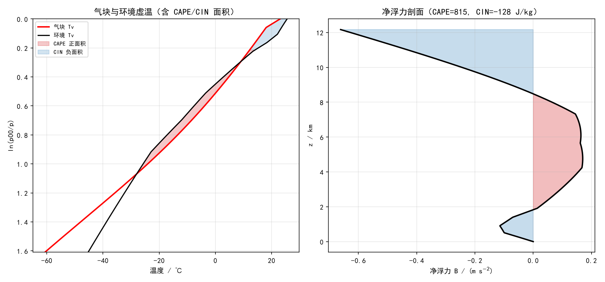
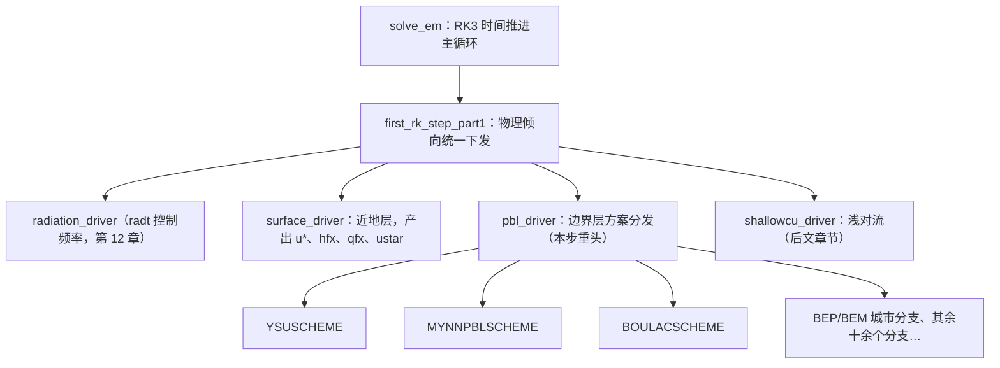
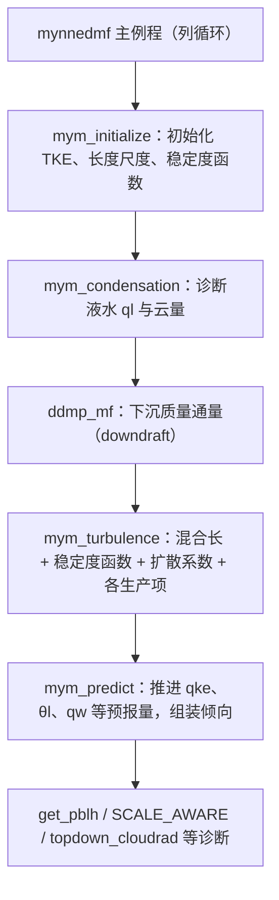
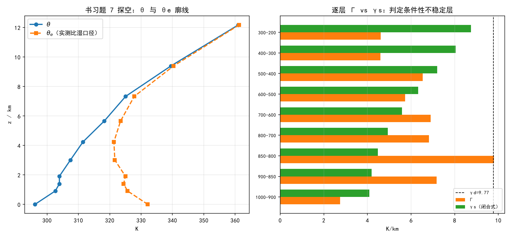
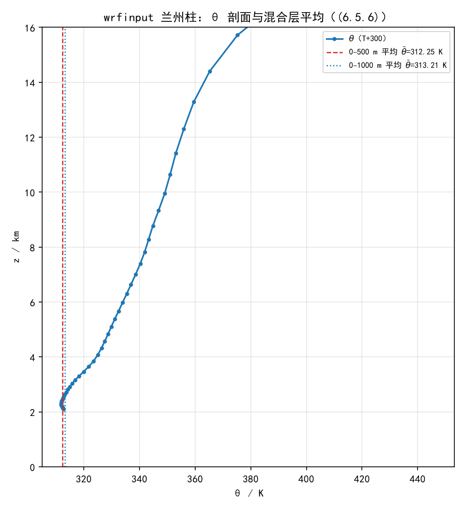

# 第 14 章 边界层方案族：从静力稳定度到 MYNN 与 BouLac

> 上一章我们看完了"云和雨怎么在网格里长出来"。但所有水汽、热量、动量的垂直输送都发生在最下面的一两公里——**大气边界层（planetary boundary layer, PBL）**：白天被地表加热搅拌成"混合层"，夜里冷却成"稳定边界层"，顶上一个逆温盖。模式网格（几公里）远大于湍流涡旋（几米到几百米），于是 PBL 方案的核心任务只有一句话：**用少数几个预报量（如 TKE、位温、水汽）近似描述一整层湍流涡旋的统计效应**。
>
> 本章的物理基础是《大气物理学》6.8 节"大气静力稳定度"（印刷页 154–163）：气块法判据、不稳定能量、CAPE/CIN、薄层法与夹卷。这些是判断"湍流能否发展、云能否长起来"的动力学判据，也是每个 PBL 方案内部实际在做的事（只是用连续方程写成了代码）。WRF 侧我们精读两个方案：**MYNN-EDMF**（TKE 闭合+质量通量，本书贯穿个例基线的备选、4.8 的默认研究型选择）与 **BouLac**（TKE+混合长，论文 2 的 PBL 首选、与 BEP/BEM 城市冠层兼容），并用 **YSU**（一阶非局地闭合）作对照。
>
> 书 6.9（整层升降）、6.10（逆温层）留给第 15/后文；书第 8–9 章（湍流、边界层）在课程范围外，本章 14.4 节用"模式视角"的方式补齐必要概念（TKE 方程、闭合阶数、相似理论要素），仅作延伸引用。

---

## 14.0 本章地图

### 14.0.1 书小节结构与对应关系

| 书（第六章） | 印刷页 | 本章对应 | 定位 |
|---|---|---|---|
| 6.8 大气静力稳定度（引言、判据） | 154–156 | 14.1 | 气块法、净阿基米德浮力、(6.8.1)–(6.8.15)；**PBL 方案判定湍流发展的物理原型** |
| 6.8.2 条件性不稳定 | 157–161 | 14.2 | 不稳定能量积分 (6.8.16)(6.8.17)、CAPE/CIN、LFC、热雷雨预报（图 6.20–6.22） |
| 6.8.3 薄层法与夹卷 | 161–163 | 14.3 | 补偿下沉、薄层法判据 (6.8.18)–(6.8.21)、Bjerknes 1938 |
| （6.5 绝热混合 / 湍流混合层） | 147–149 | 已在 ch13 13.5.1 | 混合层 θ 守恒 (6.5.6)——本章 14.8 用模型剖面复核 |
| （6.9 整层升降 / 6.10 逆温层） | 164–169 | **第 15 章 / 后文** | 对流性不稳定（位势不稳定）在那里正式展开 |
| （第 8–9 章：湍流、边界层） | — | 14.4（模式视角） | 课程范围外；TKE 方程、闭合、相似理论只作"够用即止"的介绍 |

本章 WRF 侧对象：`phys/module_pbl_driver.F`（分发）+ `phys/MYNN-EDMF/`（精读一）+ `phys/module_bl_boulac.F`（精读二）+ `phys/module_bl_ysu.F`/`physics_mmm/bl_ysu.F90`（对照）。

### 14.0.2 考点清单（自拟版，待 PPT 校准）

> 第 6 章课件未到，以下按书 6.8 自拟；PPT 到货后补"考点透视"并校准。6.8 两小节的书内习题已在第 13 章章末（习题 7 的第 2/4 问、习题 8 就是稳定度题），本章 14.9 节把它们从"稳定度视角"重述一遍并补模式题。

**名词解释**：静力稳定度（层结稳定度）；绝对不稳定；条件性不稳定；绝对稳定；净阿基米德浮力；不稳定能量；对流有效位能（CAPE）；对流抑制能量（CIN）；自由对流高度（LFC）；平衡高度（EL）；薄层法；补偿下沉；热泡。

**简答**：气块法三条基本假定及其局限；由 (6.8.6) 推导三层判据 (6.8.10)–(6.8.12)；θ/θse 判据 (6.8.13)–(6.8.15) 与 Γ 判据的关系（何时一致、何时不一致——实验 E1 的 1000–900 hPa 层）；条件性不稳定的三种亚型（潜在/真潜/假潜）；薄层法如何修正气块法（(6.8.18)–(6.8.21) 的物理读解）；烟云扩散五型与层结的对应。

**计算**：给探空算 Γ、判层结类型；浮力加速度 B 与 ΔEk 积分（面积法）；CAPE/CIN 估算；薄层法判据代数；对流温度与热雷雨判别。

**模式视角补充**（带答案，见 14.9）：PBL 方案里"稳定度判据"以什么形式出现？（稳定度函数/Richardson 数）；为什么 CAPE/CIN 的虚温订正对华北干环境如此重要（实验 E2：LFC 8 km → 1.8 km）；混合长 el 在方案里扮演什么角色？

### 14.0.3 源码锚点总表（本章全部实测核验）

| 源码文件 | 符号/结构 | 对应物理 |
|---|---|---|
| `dyn_em/solve_em.F` → `dyn_em/module_first_rk_step_part1.F` | `CALL first_rk_step_part1` → `CALL pbl_driver`（BENCH `pbl_driver_tim`） | PBL 在 RK 第一步内调用（14.5） |
| `phys/module_pbl_driver.F` | `CASE (…)` 约 20 个分支（YSUSCHEME/MYNNPBLSCHEME/BOULACSCHEME/MYJPBLSCHEME…）；BOULAC/MYNN 调用实录 | 方案分发（14.5） |
| `phys/MYNN-EDMF/`（Makefile 符号链接实锤） | `module_bl_mynnedmf.F90`（主体 mynnedmf + mym_* + dmp_mf/ddmp_mf + boulac_length）、`WRF/module_bl_mynnedmf_common.F90`（常数）、`WRF/module_bl_mynnedmf_driver.F90`（适配） | MYNN-EDMF 精读（14.6） |
| `phys/module_bl_boulac.F` | `subroutine boulac`（+ `boulac1D`、`pbl_height`）；常数 ck_b/ceps_b/vk/temin；igamma 三选 | BouLac 精读（14.7） |
| `phys/module_bl_ysu.F` → `phys/physics_mmm/bl_ysu.F90` | 薄壳 `subroutine ysu` → 实体 `bl_ysu_run`（CCPP 风格） | YSU 对照（14.7） |
| `Registry/Registry.EM_COMMON` | `bl_pbl_physics==` package 族（0/1/2/3/4/5/7/8/9/10/11/12/16/17/99）+ 状态量清单 | 方案号与状态变量（14.5.3） |
| `run/README.namelist` | `bl_pbl_physics` 0–99 表；`bl_mynn_closure`（2.5/2.6 默认/2.7/3.0）；`tke_budget`、`icloud_bl` 等 | 用户手册口径（14.5.3） |

### 14.0.4 与前后章的衔接

- **承第 13 章**：13.5.1 的"湍流混合三阶段"与混合层 θ 守恒 (6.5.6) 在本章从"纸上"变成方案（14.4）；饱和调整解决"水"的问题，PBL 方案解决"垂直输送"的问题，两者共同决定云与降水模拟的成败。
- **本章 ↔ 第 12 章**：MYNN 的次网格云量 `cldfra_bl/qc_bl/qi_bl` 通过 `icloud_bl`（默认 1）耦合进辐射——第 12 章"云光学与有效半径"的又一个输入源。
- **启第 17 章（城市冠层）**：BouLac 与 BEP/BEM 的耦合通道在源码里全链可见（14.7.4）；MYNN 与 BEP 的兼容性问题（论文 2 选 BouLac 的原因）会在那里展开。
- **启第 15 章**：6.9 的整层升降与对流性不稳定，将由本章 14.1.3 留的"θe 判据不一致案例"接续。

---

## 14.1 大气静力稳定度：概念与判据（书 6.8 前段，印刷页 154–156）【考点】

### 14.1.1 层结稳定度与气块法

**大气静力稳定度（层结稳定度）**：处于静力平衡的大气中，一个空气块受到动力或热力扰动后产生垂直运动，**这个偏离平衡位置的垂直运动能否继续发展**，由大气层结（温度与湿度的垂直分布）决定。判断方法就是第 13 章已经用熟了的**气块法**（微位移后的三种结局：继续发展 = 不稳定；回到原位 = 稳定；随遇平衡 = 中性）。

气块的垂直运动方程（书 6.8 引言推导）：

$$\frac{\mathrm{d}w}{\mathrm{d}t} = -\frac{1}{\rho}\frac{\partial p}{\partial z} - g \tag{6.8.1}$$

环境处于静力平衡：$\partial p_e/\partial z = -\rho_e g$；利用准静力条件 $p \equiv p_e$，代入 (6.8.1)：

$$\frac{\mathrm{d}w}{\mathrm{d}t} = g\,\frac{\rho_e - \rho}{\rho} = B \tag{6.8.2}$$

**$B$ 称为净阿基米德浮力**。物理读解（书原话）："当气块上升到新位置后，若气块密度比环境空气的密度小（因温度高或湿度大），则 $B>0$，加速度为正，气块将继续上升；反之，$B<0$，加速度为负；若 $B=0$，加速度等于零。"

用状态方程把密度差换成温度差——**关键一步**（$\rho_e/\rho = T_v/T_{ve}$）：

$$\frac{\mathrm{d}w}{\mathrm{d}t} = g\,\frac{T_v - T_{ve}}{T_{ve}} \tag{6.8.3}$$

$$\frac{\mathrm{d}w}{\mathrm{d}t} = g\,\frac{T - T_e}{T_e} \quad (\text{近似式，忽略 } T_v \text{ 订正时}) \tag{6.8.4}$$

> **第 13 章的伏笔在此收线**：第 13 章习题 8 明确指出"虚温订正使浮力增大 ~10%"，本章实验 E2 会展示它在真实探空上可以**把 LFC 从 8 km 拉回 1.8 km**（华北干环境）。**在干旱区做对流分析，不看虚温的浮力积分等于没算。**

### 14.1.2 三层判据（γd / γs 分界的来源）

设 Γ 为环境（气层）的垂直减温率、γ 为气块的减温率。气块微位移 dz 后：气块温度 $T = T_0 - \gamma\,\mathrm{d}z$、环境温度 $T_e = T_0 - \Gamma\,\mathrm{d}z$，于是

$$T - T_e = (\Gamma - \gamma)\,\mathrm{d}z \tag{6.8.5}$$

代入 (6.8.4)：

$$\frac{\mathrm{d}w}{\mathrm{d}t} = g\,\frac{\Gamma - \gamma}{T_e}\,\mathrm{d}z \tag{6.8.6}$$

由此得到**气块法第一组判据**（图 6.16）：

$$\Gamma > \gamma \quad \text{绝对不稳定}; \qquad \Gamma = \gamma \quad \text{中性}; \qquad \Gamma < \gamma \quad \text{绝对稳定} \tag{6.8.7–6.8.9}$$

注意这里的 $\gamma$ 对未饱和气块取 $\gamma_d$、对饱和气块取 $\gamma_s$（第 13 章 (6.2.7)/(6.3.5)），因此把判据具体化为**三层判据**（图 6.17）：

$$\Gamma > \gamma_d \quad \textbf{绝对不稳定} \tag{6.8.10}$$
$$\gamma_d > \Gamma > \gamma_s \quad \textbf{条件性不稳定} \tag{6.8.11}$$
$$\Gamma < \gamma_s \quad \textbf{绝对稳定} \tag{6.8.12}$$

书上的解读要点（p156）：

- **"绝对"一词是指判据 (6.8.10) 和 (6.8.12) 式对于未饱和气块和饱和气块都适用**；
- 除了近地面的气层有可能达到超绝热（$\Gamma > \gamma_d$）外，**绝对不稳定的情况是很少的**；
- **"条件性不稳定"是指大气层结对于饱和气块是不稳定的，而对未饱和气块是稳定的**——"如果存在局地的强对流或动力因子的强烈抬升作用，使空气上升到凝结高度以上，那么条件性不稳定就可能变成不稳定，往往会造成局地性的雷雨天气"；
- 由于干绝热线与假绝热线同时是等位温线与等相当位温线（第 13 章！），立即得到**位温形式的判据**：

$$\frac{\partial \theta}{\partial z} < 0 \quad \text{绝对不稳定} \tag{6.8.13}$$
$$\frac{\partial \theta}{\partial z} > 0 \ \text{且}\ \frac{\partial \theta_{se}}{\partial z} < 0 \quad \text{条件性不稳定} \tag{6.8.14}$$
$$\frac{\partial \theta_{se}}{\partial z} > 0 \quad \text{绝对稳定} \tag{6.8.15}$$

（假湿球位温 $\theta_{sw}$ 的垂直变化率与 $\theta_{se}$ 一样，也可作为判据。）

> **实验 E1（14.8）现场复盘**：书习题 7 探空的 1000–900 hPa 层：$\Gamma = 2.75 < \gamma_s = 4.08$，气块判据判"**绝对稳定**"；但该层 $\theta_e$ 随高度**减小**（∂θe/∂z = −7.11 K/km），位温判据判"**条件性不稳定**"——**两套判据出现分歧**。这不是题错了：气块法看"单个未饱和气块能否被抬到饱和"，而 θe 的垂直递减看"整层被抬升后能否获得不稳定能量"（对流性不稳定，6.9.2 节正式定义，第 15 章展开）。**同一份探空、两套判据、两种用途——这正是"稳定度分析"最常见的一个坑。**

### 14.1.3 表 6.1：温湿参量的保守性总结（与第 13 章的接口）

书在 6.8 开头还给出了一张总结表（表 6.1，"主要温湿参量的保守性"），把第 13 章 6.7 节各参量在四类过程中的保守性汇总：$\theta_{se}$、$\theta_{sw}$ 在**干绝热、饱和绝热、等压加热/冷却、等压蒸发/凝结**四类过程中都保守（C）；$\theta$ 只在干绝热与等压（无相变）过程中保守；温度、湿球温度等都不保守。**记住这个表就记住了"该用哪个参量追踪气块"**：追踪干过程用 θ，追踪云/湿过程用 θse。

### 14.1.4 应用：层结与烟云扩散的五种类型（图 6.18）

书 6.8 结尾用"烟云的形态"给层结判据做了一个直观展示（图 6.18）：

| 类型 | 层结条件 | 特征 |
|---|---|---|
| **扇形** | 稳定（逆温） | 水平铺展、垂直扩散小；晴天夜间常见 |
| **熏烟型** | 逆温破坏中（日出后 2–3 h） | 烟体向下蔓延、**地面浓度很大——工业区晨间烟雾弥漫祸首** |
| **环链型** | 整层不稳定 | 大尺度湍流涡旋、垂直方向明显起伏；晴天强日照 |
| **锥型** | 中性层结 | 水平与垂直均匀弥散（锥形柱体）；阴天或大风 |
| **屋脊型** | 逆温层抬升中（上部稳定、下部不稳定） | "屋脊"形态；傍晚逆温自地面建立时 |

> **模式视角**：烟云五型就是"用烟做示踪剂的花式稳定度实验"。对模式来说，同样的信息藏在 θ/Ri 剖面里——**PBL 方案每次调用都在默默做这张表的判定**（14.4 节）。

---

## 14.2 条件性不稳定与不稳定能量（书 6.8.2，印刷页 157–161）【考点】

### 14.2.1 浮力做功与不稳定能量

书先从气候平均说起：**从地面到 15 km，热带大气平均而言是条件性不稳定的**（近地面薄层除外）——这就是热带对流普遍性的层结背景。但三层判据 (6.8.10)–(6.8.12) 只看"气层的一小段"；对厚度较大的气层，气块沿路径会先后遇到"稳定段"与"不稳定段"，必须做**有限位移（有限振幅）分析**：把浮力沿气块整个运动路径积分。

由 (6.8.3) 出发，两边乘 $w = \mathrm{d}z/\mathrm{d}t$、对高度积分（浮力做的功 = 动能增量）：

$$\frac{1}{2}w^2 - \frac{1}{2}w_0^2 = \Delta E_k = \int g\,\frac{T_v - T_{ve}}{T_{ve}}\,\mathrm{d}z \tag{6.8.16}$$

**不稳定能量 $\Delta E_k$**：气块沿路径获得的净动能增量。路径上浮力正功大于负功（积分为正）→ 气块越升越有劲 → 净不稳定；积分为负 → 中途被减速停下。

书随即给出**埃玛图面积法**。利用静力方程换元 $\mathrm{d}\ln p = -\mathrm{d}z/(R_d T_{ve})$：

$$\Delta E_k = R_d \int (T_v - T_{ve})\,\mathrm{d}\ln\frac{p_{00}}{p} \tag{6.8.17}$$

在埃玛图（纵横坐标 $\ln p$ – $T$）上，$T_v - T_{ve}$ 是气块曲线与环境曲线的水平距离、$\mathrm{d}\ln(p_{00}/p)$ 是纵向间隔——**两条曲线围成的面积正比于不稳定能量**（图 6.19）：气块曲线在环境曲线右侧围出的记为**正面积 $A_+$**（浮力做正功），左侧的记为**负面积 $A_-$**（抑制）。

> **与第 13 章的接口**：第 13 章的饱和调整解决"气块里的水如何相变"，本章 (6.8.16)(6.8.17) 解决"相变后的浮力账怎么算"。两件事在模式里是两套代码（微物理 vs PBL），但物理上共用同一份 $T_v$：微物理把水相变改写 $T$ 与 $q_v$，PBL/对流方案用 $T_v$ 判决浮力——**同一个虚温，两条流水线**。

### 14.2.2 条件性不稳定的三种亚型（图 6.20）

把"面积账"画全，条件性不稳定分三类（图 6.20）：

| 类型 | 面积结构 | 气块命运 | 天气含义 |
|---|---|---|---|
| **(a) 潜在不稳定型** | 低层负面积 $A_-$，高层正面积 $A_+$ | 被迫抬升越过第一交点（**LFC**）后净浮力转正、自由上升；到第二交点 D 后减速 | 需要触发（强抬升或强热力）才爆发对流 |
| **(b) 绝对稳定型** | 全程负面积 | 怎么抬都往下沉，浮力始终为负 | 无对流 |
| **(c) 绝对不稳定型** | 全程正面积 | 一路上浮力为正、直接起飞 | **夏季午后热雷雨**型（地面强烈加热即触发） |

对 (a) 型再细分（书里的标准分类）：

- **真潜不稳定**：正面积大于负面积（$\mathrm{CAPE} > |A_-|$）——只要气块被抬到 LFC 以上，正面积足以维持自由上升；
- **假潜不稳定**：负面积大于正面积（抑制超过可供能量，$\mathrm{CIN} > \mathrm{CAPE}$）——即使越过 LFC，总账仍为负，必须靠持续的外强迫"推着走"，强迫一撤对流即断。

两个交点的高度各有名字：低层第一个交点 = **自由对流高度（LFC，level of free convection）**——气块从"被迫抬升"转为"自由上升"的分界；高层第二个交点 D 即现代天气学中的**平衡高度（EL，equilibrium level）**——正浮力终止处（若动能没耗完，气块还会冲过 EL 一小段，即"过冲"）。

### 14.2.3 CAPE、CIN：现代天气预报的两把标尺

书在此正式引入现代天气分析的两个核心量（引彭治班等 2001 的定义）：

- **对流有效位能（CAPE, convective available potential energy）**：LFC 到 EL 之间的**正面积**（单位 J/kg）——单位质量气块从 LFC 升到 EL 的最大动能"收入"，衡量对流一旦触发后能有多强；
- **对流抑制能量（CIN, convective inhibition）**：地面到 LFC 之间的**负面积**（取绝对值，单位 J/kg）——气块从地面抬到 LFC 需要外界预支的能量，衡量"触发门槛有多高"。

经验量级：雷暴日 CAPE 数百至数千 J/kg；CIN 从几到几百 J/kg（CIN 过大则"有能量放不出来"，晴热闷天常见）。

**[实验 E2 现场]** 用同一份探空（书习题 7；地面 23 ℃、露点 19 ℃）做浮力积分（方法与代码见 14.8）：

| 口径 | LFC | EL | CAPE | CIN |
|---|---|---|---|---|
| 未订正（第 13 章近似式） | 343.8 hPa（约 8 km） | — | +711 J/kg | −1330 J/kg |
| **虚温订正（本章 E2）** | **807.7 hPa（1827 m）** | **340.4 hPa（8491 m）** | **815 J/kg** | **−128 J/kg** |

虚温订正把 LFC 从 8 km 拉回 1.8 km、CIN 缩小一个量级——**干旱区（华北型）探空做对流分析，不订虚温等于没算**：云内外水汽差贡献的密度浮力，恰恰是"能不能轻易触发"的决定因素。第 13 章曾用未订正口径读图（"正能区高悬在 343.8 hPa 以上"），本章这张表就是对那幅图的"修订版"。



**热雷雨预报流程（图 6.21、6.22）**——书的"传统预报三件套"：

1. **定 CCL**：取早晨低层平均比湿 $q_0$，作等饱和比湿线，与温度层结曲线的交点 = **对流凝结高度（CCL）**（第 13 章已学：LCL 用气块自身属性、CCL 用地面露点的"当天口径"）；
2. **算对流温度**：从 CCL 沿干绝热线下降到地面，得到"**当天热对流可能发生的地面温度下限**"（对流温度）——预报就是看午后最高气温能否超过它（第 13 章实验：该探空需加热到约 **30.8 ℃**）；
3. **估云顶高度**：从 CCL 沿湿绝热线上升，找正负面积相等处 N（净不稳定能量 $\Delta E_k = 0$ 的高度）——理论云顶。

书用 Wood Ward（1960）的热泡（thermal）试验照片（图 6.21）说明对流的第一步——地面受热不均产生的上升气块；图 6.22 把上述流程完整画在晨探空上。

> **模式视角**：CAPE/CIN 是**诊断量**而非预报量——WRF 主程序不做这套面积积分（日常用 `wrf-python`/后处理诊断），**但 PBL 方案每次调用都在做同一积分的"局部版"**：TKE 方程里的浮力产生项就是 (6.8.16) 的微元形式（$\overline{w'\theta_v'}/\theta_v \cdot g$ 的离散化）；14.4–14.7 将看到，"哪一层还算边界层"的判定（PBLH 诊断）就是"局地 LFC"的工程简化（位温超近地值 Δθ、或 Richardson 数超临界）。

---

## 14.3 薄层法与夹卷：当气块法遇见补偿下沉（书 6.8.3，印刷页 161–163）【考点】

### 14.3.1 气块法的局限

气块法假定**环境静止**。但质量守恒要求：上升气流带走的质量必须由周围空气**下沉补偿**。观测事实（书原文）：

- 补偿下沉气流的速度约为云内上升速度的 **25%–50%**；
- 补偿下沉的范围是云半径的 **1–5 倍**。

于是有三个新效应：
1. **环境被改变**：补偿下沉绝热增温，使环境层结被"改造"——上升区越旺，环境越稳定（负反馈）；
2. **夹卷（entrainment）**：上升气流边缘与环境不断混合，环境干空气稀释浮力、蒸发云水（第 13 章微物理的"夹卷"在此有了动力来源）；
3. **两区共享质量通量约束**：这就是**薄层法（slice method，Bjerknes 1938）**的出发点。

### 14.3.2 薄层法模型与判据

薄层法把大气竖直切出一薄层（图 6.23），层内分两个区域：

| 符号 | 含义 |
|---|---|
| $A_1, w_1, \gamma_1$ | 上升区面积、垂直速度、减温率（饱和上升时 $\gamma_1 = \gamma_s$） |
| $A_2, w_2, \gamma_2$ | 补偿下沉区面积、速度、减温率（干下沉时 $\gamma_2 = \gamma_d$） |
| $\rho_1 \approx \rho_2$ | 两区密度（密度近似相等） |

质量守恒（层内上升与下沉的质量输送相抵）$\rho_1 A_1 w_1 = \rho_2 A_2 w_2$，取 $\rho_1 \approx \rho_2$：

$$A_1 w_1 = A_2 w_2 \qquad\Rightarrow\qquad \frac{\mathrm{d}z_1}{\mathrm{d}z_2} = \frac{w_1}{w_2} = \frac{A_2}{A_1}$$

即**面积小的一侧速度大**——与第 10 章质量坐标里"流管截面积与速度成反比"的输运守恒是同一个物理。

对上升区写浮力加速度、代入两区减温率差，得**薄层法基本公式**：

$$\frac{\mathrm{d}w}{\mathrm{d}t} = \frac{g}{T_{v0}}\left[(\Gamma - \gamma_1) - (\gamma_2 - \Gamma)\,\frac{A_1}{A_2}\right]\mathrm{d}z_1 \tag{6.8.18}$$

对比气块法 (6.8.6)：方括号第一项是上升区自身的浮力（老熟人 (6.8.5)），第二项 $(\gamma_2 - \Gamma)A_1/A_2$ 是**补偿下沉对层结的修正**——它总是反向作用：上升区越不稳定，补偿（下沉升温）越强。

判据（(6.8.19)(6.8.20)）：

$$(\Gamma - \gamma_1) - (\gamma_2 - \Gamma)\,\frac{A_1}{A_2} \;\gtrless\; 0 \quad\text{（> 0 不稳定；= 0 中性；< 0 稳定）}$$

最常用特例——**上升区饱和（$\gamma_1 = \gamma_s$）、补偿区干下沉（$\gamma_2 = \gamma_d$）**（(6.8.21)）：

$$\frac{\Gamma - \gamma_s}{\gamma_d - \Gamma} \;\gtrless\; \frac{A_1}{A_2}\ \left(=\frac{w_2}{w_1}\right)$$

**这个不等式的读法（书点的关键"天气学智慧"）**：
- 左侧由层结决定（给定探空下是常数）；右侧由**积云密度**（面积比 $A_1/A_2$）决定；
- 层结条件性不稳定时（分子为正）：**上升区面积越小（积云少而强）→ $A_1/A_2$ 小 → 判据越易满足 → 越不稳定**；
- 反之：**积云数量越多（面积占比大）→ 判据越难满足 → 趋于稳定**。

书由此给出结论：**条件性不稳定大气中，"积云密度"存在自我调节机制**——云越少，每朵云越强、越易发展；云一多，大量补偿下沉把环境改造成稳定层结，抑制对流继续增多。这是现代**对流自组织**研究的雏形思想。

**[实验 E4 数值演示]** 取 $\Gamma = 6.0$ K/km、$\gamma_s = 4.2$ K/km：左侧 $= (6.0-4.2)/(9.8-6.0) = 0.477$。即 $A_1/A_2 < 0.477$ 时判不稳定——换算成面积占比 $A_1/(A_1+A_2) \approx 0.32$，**上升区占薄层面积不到 1/3（云少而强）才利于发展**；超过 1/3 则层结趋于稳定。数值细节见 14.8（E4 表）。

书的历史注脚：薄层法由**皮叶克尼斯（Bjerknes, 1938）**首提；因 $A_1/A_2$ 在真实大气中难以测量，天气预报业务中少用，但作为**对流参数化的概念基础**被完整继承。

> **模式视角（直通 14.6）**：薄层法的"两区结构"就是现代**质量通量（mass-flux）参数化**的雏形——EDMF（eddy-diffusivity/mass-flux）把 $A_1$、$w_1$ 显式写进方案：强上升气流**羽流（plume）**的面积分数 $a$、垂直速度 $w$、夹卷率 $\varepsilon$ 全是预报量。MYNN-EDMF 里的 `edmf_a`（羽流面积）、`maxmf`（最大质量通量）、`ztop_plume`（羽流顶）就是 $A_1$、$A_1 w_1$、云顶高度的代码化身（14.6.5 精读）。而 BouLac/MYNN 里 TKE 耗散项"该用哪个特征长度"（14.7）则是薄层法"特征尺度"思想的另一支延续。

---

## 14.4 边界层物理总论：模式视角的"够用即止"（书第 8–9 章范围外）

> 书第 8–9 章系统讲授湍流与边界层，超出课程范围；本节只补"读 PBL 源码必需"的概念。全部内容在 14.5–14.7 的源码里都能找到对应，不展开推导。

### 14.4.1 边界层：定义与结构

**大气边界层（PBL）**：直接受地表（摩擦、加热、蒸发）影响、湍流充分混合、且有明显日变化的最低层大气。典型厚度：

| 时段 | 结构 | 厚度 |
|---|---|---|
| 白天（晴热） | 对流混合层（CBL，C = convective） | 1–2 km（沙漠午后可 3–4 km） |
| 夜间 | 稳定边界层（SBL） | 几十至几百米（其上为残余层） |
| 过渡（日出后/日落前） | 夹卷/中和区 | — |

PBL 顶通常是一个**逆温盖**（书 6.10 逆温层——第 15 章后文）；盖的上方是只有大尺度运动、没有（或少有）湍流的**自由大气**。模式网格（公里级）远大于湍流涡旋（米至百米级），因此 PBL 方案的全部工作就是：**用格点平均量（u、v、θ、q）近似表征一整层湍流涡旋的统计输送效应**。

### 14.4.2 TKE 方程：PBL 方案的心脏

对湍流做雷诺分解（$u = \bar u + u'$ 等），定义**湍流动能（TKE）** $e = \frac{1}{2}\left(\overline{u'^2} + \overline{v'^2} + \overline{w'^2}\right)$，其收支方程为：

$$\underbrace{\frac{\partial e}{\partial t} + \bar U\frac{\partial e}{\partial x} + \bar V\frac{\partial e}{\partial y} + \bar W\frac{\partial e}{\partial z}}_{\text{局地变化}+\text{平流}} = \underbrace{-\overline{u'w'}\frac{\partial \bar U}{\partial z} - \overline{v'w'}\frac{\partial \bar V}{\partial z}}_{P_s\ \text{剪切生产}} + \underbrace{\frac{g}{\theta_{v0}}\overline{w'\theta_v'}}_{P_b\ \text{浮力生产/消耗}} - \underbrace{\varepsilon}_{\text{耗散}} + \underbrace{T}_{\text{输运}}$$

各项的读法：

| 项 | 物理 | 符号约定 |
|---|---|---|
| $P_s$ | 风切变"撕出"湍涡 | 一般 > 0（生产；夜间 SBL 的主力） |
| $P_b$ | 浮力做功（与书 (6.8.16) 同一物理的微元） | 白天 > 0（热力生产）；强逆温 < 0（消耗） |
| $\varepsilon$ | 黏性把涡动能磨成热 | 永远消耗；$\varepsilon \approx e^{3/2}/L$（L = 特征长度） |
| $T$ | 湍流+压力脉动把 e 搬走/搬来（如"云顶注入"top-down 过程、热泡向上输运） | 可正可负 |

**闭合问题**：方程右端出现三阶量（$\overline{u'w'}$、$\overline{w'\theta_v'}$）——未知数多于方程数，必须做假设。PBL 方案的历史就是一部"闭合假设进化史"：

| 闭合阶数 | 预报量 | 假设 | WRF 方案示例 |
|---|---|---|---|
| 一阶（K 理论） | 仅平均场 u,v,θ,q | $K$ 由相似理论/经验给定，通量 = −K×梯度 | MRF；**YSU**（在 K 理论上加非局地项与夹卷处理，故称"非局地一阶"） |
| 1.5 阶（预报 TKE） | 平均场 + TKE | $K = c\,L\,\sqrt{e}$（L 仍诊断） | **MYJ、BouLac、MYNN**（基础闭合） |
| 1.5 阶 + 质量通量（EDMF） | 平均场 + TKE + 羽流量 | 网格内一部分湍流输送用"羽流（plume）"显式描述 | **MYNN-EDMF**、UW、GFS-EDMF、QNSE-EDMF |

> **第 14.3 节在此收线**：薄层法的两区模型（$A_1$、$w_1$）就是 EDMF 里羽流面积、羽流速度的直接祖先——**纸上的取胜判据 (6.8.21)，六十年后变成了代码里对羽流面积的约束**。

### 14.4.3 相似理论要素表（读写源码的"字母表"）

| 符号 | 名称/定义 | 在方案里的角色 |
|---|---|---|
| $u_*$ | 摩擦速度 $\sqrt{\tau/\rho}$ | 机械湍流强度；SBL 限高尺度（u*×700，14.5.4） |
| $w_*$ | 对流速度 $(g\, h\, \overline{w'\theta_v'}_0/\theta_{v0})^{1/3}$ | 对流湍流强度；方差廓线的尺度因子（BouLac 源码直接出现） |
| $L$ | Monin–Obukhov 长度 | 稳定性参数 $z/L$（近地层方案输出） |
| $h$ | PBL 高度 | 归一化高度 $z/h$；一切相似廓线的分母 |
| $\gamma$ | 逆梯度项（counter-gradient） | 混合层里"通量不按梯度走"的修正（14.7 BouLac 的 igamma 三选） |

### 14.4.4 从物理到程序：PBL 方案的统一骨架

不管哪个方案，代码都做同样三件事：

1. **判层**：确定 PBL 高度（PBLH）与层数索引（KPBL）——即"哪些层属于湍流混合区"（判据 = 14.5.4 的表）；
2. **算交换系数**：给出 $K_m$（动量）、$K_h$（热量/水汽）的垂直廓线（由 TKE+长度尺度，或相似理论+非局地项）；
3. **时间步进**：把 K 代入垂直扩散方程，**隐式**（三对角求解，subroutine 通常叫 `diff` 或类似）得到 u、v、θ、q 的倾向（RUBLTEN/RVBLTEN/RTHBLTEN/RQVBLTEN…），并输出湍流通量 w'u'、w'θ' 等诊断量。

> **为什么 PBL 每步调用、辐射按 `radt` 低频调用？** 辐射计算昂贵且时变慢（几小时内太阳角变化有限），所以用 `radt`（分钟）控制频率，两次调用之间倾向保持不变；而 PBL 直接吃地表通量、要对流响应，**隐式扩散求解每步一次代价也不高**——于是默认每时间步调用（namelist 参数 `bldt=0`；旧版可设 >0 降低频率，但会明显改变结果，现代个例一般保持 0）。这套"节奏学"是读物理代码时最先要建立的框架。

---

## 14.5 WRF 对应（一）：调用链、分发与 namelist

### 14.5.1 调用链（实测）



要点（与第 12/13 章对照）：

- WRF 的三阶 Runge–Kutta 时间积分把**物理过程集中安排在第一步**（`dyn_em/module_first_rk_step_part1.F`）——辐射、近地层、边界层、浅对流都在这一个子程序内**依序**调用；微物理是例外，在 `solve_em` 里直接调用（第 13 章）；
- **顺序即依赖**：surface_driver 先于 pbl_driver——PBL 方案必须消费近地层算出的 u*、感热通量 hfx、潜热通量 qfx；
- PBL 在 `BENCH_START(pbl_driver_tim)` 性能计时包裹内，是逐时间步的常客（bldt=0）；
- **每个时间步一次**与第 13 章"微物理每步多次调用"（因积云尺度调整）形成鲜明节奏对比。

### 14.5.2 `module_pbl_driver.F`：一个子程序装下全部方案族

`phys/module_pbl_driver.F` 只有一个主分发例程。它先用参数化选择判据（`bl_pbl_physics` 等）落到不同 `CASE` 分支，再把 WRF 的三维场"翻译"成各方案要的接口：

| driver 内的分支（联络名） | 对应方案 | 备注 |
|---|---|---|
| `YSUSCHEME` | YSU | 一阶非局地，对照方案（14.7） |
| `MYNNPBLSCHEME` | MYNN-EDMF | 精读一（14.6） |
| `BOULACSCHEME` | BouLac | 精读二（14.7）；携带 BEP/BEM 双向数组 |
| `MYJPBLSCHEME` / `QNSEPBLSCHEME` | MYJ / QNSE | 1.5 阶族 |
| `ACMPBLSCHEME` | ACM2 | 非局地+局地混合 |
| `SHINHONGSCHEME` / `GBMPBLSCHEME` / `TEMFPBLSCHEME` / `CAMUWPBLSCHEME` | Shin-Hong / GBM / TEMF / UW | 研究型 |
| `MRFSCHEME` / `GFSSCHEME` | MRF / GFS-EDMF | 老牌与新世代 |
| `EEPSSCHEME` / `KEPSSCHEME` | TKE-ε / TKE-ε-TPE | 湍流闭合新家族 |
| `SURFDRAGSCHEME` / `fitchscheme` / `mavscheme` | 特殊/教学分支 | 不做常规 PBL 扩散 |
| （另有 `SELECT CASE(sf_urban_physics)` 段置 `flag_bep`） | BEP/BEM 标志位 | 进入 YSU/MYJ/BouLac 分支后决定是否装卸城市双向耦合数组（第 17 章） |

**BOULAC 分支现场**（写作时实测）：调用 `boulac` 时传入 FRC_URB2D/IDIFF/FLAG_BEP 与整套 BEP 双向数组（`a_u_bep`…`b_e_bep`、`dlg_bep`、`sf_bep`、`vl_bep`），TKE 与混合长命名为 `tke_pbl`/`el_pbl`，湍流通量为 `wu_tur/wv_tur/wt_tur/wq_tur`，再输出 `exch_h/exch_m` 与 `pblh`。**城市冠层与 PBL 的耦合通道在此一目了然**（论文 2 关心的兼容性，14.7.4 汇总）。

**MYNN 分支现场**：调用 `mynnedmf_driver`，接口长得多——除常规场外带 `Qke/qke_adv`、`Sh3d/Sm3d`、`Tsq/Qsq/Cov`、`qWT/qSHEAR/qBUOY/qDISS`（TKE 收支诊断）、`qc_bl/qi_bl/cldfra_bl`（次网格云）、`edmf_a/w/qt/thl/ent`（羽流量）、以及 `bl_mynn_*` 选项组与 `tke_budget` 开关。**接口长度≈方案复杂度**，这是读 WRF 物理代码的一条经验。

### 14.5.3 方案号、Registry 与 namelist

**Registry 的 package 声明**（`Registry/Registry.EM_COMMON`，`bl_pbl_physics==` 系列）决定"哪个方案编译进可执行文件、携带哪些状态量"：

| 方案号 | Registry 联络名 | 携带的状态量（节选） |
|---|---|---|
| 0 | lesscheme | （无 PBL） |
| 1 | ysuscheme | — |
| 2 | myjpblscheme | `tke_pbl`、`el_pbl` |
| 3 | gfsscheme | — |
| 4 | qnsepblscheme | EDMF 状态量族 |
| 5 | mynnpblscheme | `qke`、`sh3d`、`sm3d`、`tsq`、`qsq`、`cov`、`cldfra_bl`、`qc_bl`、`qi_bl`、`el_pbl`、`tke_pbl`（标量 `qke_adv`） |
| 7 | acmpbl | — |
| 8 | boulacscheme | `el_pbl`、`tke_pbl`、`wu_tur`、`wv_tur`、`wt_tur`、`wq_tur` |
| 9/10/11/12/16/17 | camuwpbl / temfpbl / shinhong / gbmpbl / eepsscheme / kepsscheme | — |
| 99 | mrfscheme | — |

**用户视角的 namelist 表**（`run/README.namelist` 口径）：

| `bl_pbl_physics` | 方案 | 常用搭配/备注 |
|---|---|---|
| 0 | 无 | — |
| 1 | YSU | 经典；配 `topo_wind`、`ysu_topdown_pblmix` |
| 2 | MYJ | 配 Eta 近地层（sf_sfclay=2） |
| 3 | GFS-EDMF | 混合 EDMF |
| 4 | QNSE-EDMF | — |
| 5 | **MYNN** | 配 `sf_sfclay_physics` 1/2/5；**旧选项 6 已于 4.5 移除，闭合阶数改由 `bl_mynn_closure` 控制** |
| 7 | ACM2 | 非局地+局地混合 |
| 8 | **BouLac** | 论文 2 首选；与 BEP/BEM 城市冠层兼容 |
| 9 | UW-CAM5 | — |
| 10 | TEMF | — |
| 11 | Shin-Hong | 尺度自适应 |
| 12 | GBM | — |
| 16 / 17 | TKE-ε / TKE-ε-TPE | 新家族 |
| 99 | MRF | 老代码参照 |

**联动 namelist**（每个都直接改 PBL 行为）：

- `bldt`：调用间隔（分钟），0 = 每时间步（现代默认）；
- `bl_mynn_closure`：MYNN 闭合阶数——**2.5 / 2.6（默认）/ 2.7（TTE）/ 3.0**；
- `bl_mynn_tkeadvect`：TKE 标量平流开关；`tke_budget`（4.5 起）输出 TKE 各项收支；
- `icloud_bl`（默认 1）：把 MYNN 次网格云 `cldfra_bl/qc_bl/qi_bl` 耦合进辐射（第 12 章的"云量输入源"之一）；
- `bl_mynn_cloudmix`（默认 1）：次网格云水参与混合；
- `ysu_topdown_pblmix`：YSU 的云顶向下混合开关；
- `topo_wind`：仅 YSU 的地形波拖曳选项；`grav_settling`：MYNN 重力沉降（雾/云水下沉）；`mfshconv`：浅对流质量通量选项。

### 14.5.4 PBLH 诊断：书 6.8 判据的"代码版"

模式不像预报员那样画气块曲线，它要**每个格点每步**回答"边界层多高"。主流判据三类（全部实测于源码）：

| 判据 | 方案 | 实现要点（源码实录） |
|---|---|---|
| **θv 阈值法** | BouLac `pbl_height`、MYNN `get_pblh` | BouLac：以 `θv(sfc)+0.5 K` 为阈值，向上找 θv 首次超过的层并插值；MYNN：最低 200 m 内找最小 θv，再找 θv 超过（min θv + Δθv）的层——**Δθv 陆地 1.25 K / 水体 0.75 K** |
| **临界 Richardson 数法** | YSU | 用总体 Richardson 数：对流混合层取临界值 0（找混合层顶）；稳定情形取 0.25（`brcr_sb`），另有随罗斯贝数变化的版本（`brcr_sbro`） |
| **TKE 阈值法** | MYNN（可选，`stable_method=0`） | TKE（qke/2）降到近地面最大值的 5% 处（Kosovic & Curry 2000），并限制在 θv 法结果 ±350 m 内 |

MYNN 还做了一个**昼夜混合**：稳定边界层用 Koracin & Berkowicz (1988) 的 `u*×400 m / u*×700 m`（按 θv 法结果用 tanh 权重平滑过渡），最终 PBLH = 稳定法 × (1−wt) + θv 法 × wt，`wt = ½tanh((PBLH_θv−200)/170)+½`。这一段代码（`get_pblh`）不长，却包含了"昼夜两套物理、按连续权重融合"的典型工程设计思路。

> **教学读解**：三类判据就是"局地 LFC"的工程简化——气块法的 (6.8.13)-(6.8.15) 在这里变成"θv 超过近地值 Δθv"，(6.8.6) 的浮力判据变成"Ri 超临界"。**诊断量 PBLH 不进预报链**（它只输出），但它决定交换系数的截断高度、进而出模式的风、温、湿廓线——**一个"诊断量"却决定了整个低层的预报质量**。

---

## 14.6 精读一：MYNN-EDMF（`phys/MYNN-EDMF/`）

### 14.6.1 文件布局与版本史

先在目录层面搞清楚"读哪个文件"——**编译实体是一个独立目录** `phys/MYNN-EDMF/`（由 `phys/Makefile` 用符号链接规则挂进编译链；`phys/physics_mmm/bl_mynn.F90` 是 CCPP 体系的副本，主编译不走）：

| 文件 | 角色 |
|---|---|
| `phys/MYNN-EDMF/module_bl_mynnedmf.F90` | **主体**：初始化、判定、凝结、湍流、EDMF 全部核心子程序 |
| `phys/MYNN-EDMF/WRF/module_bl_mynnedmf_common.F90` | 常数模块（tref、TKmin、svp 系数、ep_3 等） |
| `phys/MYNN-EDMF/WRF/module_bl_mynnedmf_driver.F90` | WRF 适配层（子程序 `mynnedmf_driver`：把 WRF 三维场与 `bl_mynn_*` 选项翻译成主体接口） |

主体代码头部自带一条**版本史注释**（教材级史料，原文摘要）：

| 版本 | 对应 WRF | 配套业务模型 | 备注 |
|---|---|---|---|
| V1.0 | WRF v3.0–3.4.1 | HRRR v1 | 最早的 MYNN2.5 移植 |
| V4.0 | WRF v4.0–4.4 | HRRR v4 | 大规模重构 |
| V5.0 | WRF v4.5–4.7 | — | 4.5 起移除旧方案号 6，闭合由 namelist 控制 |
| **V6.0** | **WRF v4.8** | CCPP / MPAS 共用 | 拆为独立仓库维护（NCAR/MYNN-EDMF） |

主体参考文献 7 条，三组核心：**Nakanishi（2001/2004/2006/2009）**（Level 3.0 闭合与混合长家族）、**Olson et al.（2019，NOAA TM-61）**（MYNN-EDMF 的 WRF 实现文档——读代码的官方"说明书"）、**Puhales（2020）与 Olson et al.（2026，GSL-77）**（新版本改进）。

### 14.6.2 变量约定：中心量 vs 界面量（读代码的第一把钥匙）

MYNN 主体对"每个变量住在哪"极其自觉（头部注释原文说明）：

| 位置 | 变量 |
|---|---|
| **格点中心（center）** | 风 u/v/w、位温 θ、水汽 qv、液水 ql、**qke = 2×TKE**、混合长 `el`、液水位温 thl、总水 qw |
| **格点界面（face）** | 扩散系数（EXCH_H/EXCH_M）、稳定度函数 sh/sm、所有通量（w'u'、w'θ' 等） |

**为什么 qke 是 2×TKE 而不是 TKE**？历史原因：代码从"方差量"（速度方差两次方之和）写起，2e = u'²+v'²+w'² 正好是三个方差之和，不用除 2。读代码时看到 `qke/2` = TKE。**参照温度 `tref = 300 K`** 出现在浮力与虚温计算里（`tv0 = 0.608·tref`），这与 BouLac 用局地 θ0 不同——记住这个差异，14.7 对比时要考。

### 14.6.3 主流程：一列一循环，六个子程序

主体子程序 `mynnedmf` 对每个格点（列）做同一个流水线（实测调用顺序）：



关键子程序清单（主体头部自带）：

| 子程序 | 功能 |
|---|---|
| `mym_initialize` | 初始化（含闭合阶数相关的常数表） |
| `mym_condensation` | 诊断液水与次网格云量 |
| `dmp_mf` / `ddmp_mf` | 上升羽流（dynamic multi-plume）/ 下沉质量通量 |
| `mym_length`（含 `boulac_length`） | 主混合长 |
| `mym_level2` | Level-2 稳定度函数（shaw 家族） |
| `mym_turbulence` | 扩散系数与生产项组装（含 counter-gradient） |
| `mym_predict` | 湍流量预报（时间推进） |
| `get_pblh` / `scale_aware` / `topdown_cloudrad` | 诊断与后处理（14.6.8） |

### 14.6.4 凝结与次网格云：`mym_condensation`

对每列，`mym_condensation` 做一件"微物理不做、辐射又急需"的事：**用局地湍流统计（方差 tsq/qsq、协方差 cov）把格点平均的水汽"分配"成一小朵云**——输出次网格液水 ql 与**云量（cloud fraction）**。云量公式采用 **Chaboureau–Bechtold** 参数化（DMP 子程序注释里明确列入的功能清单），通过 namelist `icloud_bl`（默认 1）送入辐射（第 12 章的又一个云量输入源）。

**注意分工**：这里的"云"不是微物理云（第 13 章的 qc 是格点平均量），而是 **PBL 尺度内的湍流云**——白天混合层顶的积云街、边界层顶的薄云。它决定辐射怎么"看见"这些次网格云。

### 14.6.5 EDMF：给混合层装上"羽流"

**DMP（dynamic multi-plume）**是 MYNN-EDMF 区别于传统 1.5 阶方案的部分。读取 `dmp_mf` 头部注释，功能清单原文直译：

- **尺度自适应衰减（scale-aware tapering as dx → 0）**：网格越小，网格内可分辨的湍流涡越多，参数化该做的越少——羽流强度随 dx 减小而衰减（`scale_aware` 子程序实现）；
- TKE 的羽流输运（可选项，`bl_mynn_tkeadvect`）；
- Chaboureau–Bechtold 云量与辐射耦合；
- 大量数值稳定限制（`maxwidth`、`maxmf`、`maxtkeprod` 等）。

**双羽流结构**（与书 14.3 薄层法"两区"直接对读）：

| 组件 | 子程序 | 物理 | 对应薄层法 |
|---|---|---|---|
| 上升羽流 | `dmp_mf` | 多根速度/面积不同的羽流（强羽流卷吸、弱羽流保守），输出 `edmf_a`（面积分数 a）、`edmf_w`（速度 w）、`edmf_qt/thl`（携带的湿/热）、`edmf_ent`（夹卷率 ε） | 上升区 $A_1$、$w_1$、$γ_1$ |
| 下沉补偿 | `ddmp_mf` | 补偿下沉的质量通量 `maxmf_dd`、云顶冷却项 `cldtop_cooling` | 补偿区 $A_2$、$w_2$ |

namelist 侧的旋钮（README 口径）：`bl_mynn_edmf`（总开关，推荐 1）、`bl_mynn_edmf_mom`（动量输送）、`bl_mynn_edmf_tke`（TKE 输送）、`bl_mynn_mixlength`（混合长选项）等。**把书 (6.8.21) 的 $A_1/A_2$ 判据与这里的 `edmf_a`、`maxmf` 对照着读，就是这一章最有价值的"纸—码对照"训练。**

### 14.6.6 混合长的"亲缘证据"：`boulac_length`

MYNN 的混合长不是凭空发明——主体中有一个子程序名叫 **`boulac_length`**，其注释原文：

> "taken from the BouLac scheme in WRF-ARW and modified for integration into the MYNN PBL scheme"
> （取自 WRF-ARW 的 BouLac 方案，经修改后并入 MYNN 边界层方案）

**这是本章两个精读对象"血缘关系"的代码级证据**：MYNN 主混合长 `mym_length` 在求解过程中调用 `boulac_length`（BouLac 风格的长度计算——用局地 TKE 与浮力/剪切的特征尺度），再叠上自己的修正。所以 14.7 读 BouLac 时，看到的其实是"MYNN 混合长的祖先"。

### 14.6.7 常数模块速查（`module_bl_mynnedmf_common`）

| 常数 | 值 | 含义/出处 |
|---|---|---|
| `tref` | 300 K | 参考温度（浮力计算基准） |
| `gtr` | g/300 | 浮力系数（与 tref 配套） |
| `tv0` | 0.608×300 | 虚温修正系数（书 (6.1.46)！） |
| `TKmin` | 253 K | 全水相转换下限（Tripoli & Cotton 1981） |
| `tice` / `tliq` | 238 K / 269 K | 冰/液水温度界限 |
| `ep_3` | 0.378 | ε 相关常数（书 (6.3.5) 的 ε！） |
| `xlscp` | (xlv+xlf)/cp | 凝结-冻结总潜热/cp |
| `wfa_max` / `wfa_min` | 800e10 / 1e6 | 气溶胶（CCN）上下限 |
| `svp1/2/3` | 0.6112 kPa / 17.67 / 29.65 | **Bolton 形式饱和水汽压**（与第 11 章 SVP 家族同源） |

> **跨章连线**：`tv0`、`ep_3`、`svp1/2/3` 这三个常数分别对应第 6 章虚温公式 (6.1.46)、第 6 章潜热公式 (6.3.5) 的 ε、第 11 章饱和水汽压的 Bolton 拟合——**PBL 方案里藏着半部《大气物理学》第 6 章的公式库**。

### 14.6.8 输出清单与 TKE 收支诊断

`mynnedmf` 的输出可分四组：

1. **倾向**：RUBLTEN、RVBLTEN、RTHBLTEN、RQVBLTEN（+ 云水 qc/qi 的倾向）→ 进入 RK 时间积分；
2. **系数**：EXCH_H、EXCH_M（界面扩散系数）；
3. **湍流诊断量**：`qke`（2×TKE）、`sh3d/sm3d`（稳定度函数三维场）、`tsq/qsq/cov`（方差与协方差）、`el_pbl`（混合长）；
4. **次网格云与羽流**：`qc_bl/qi_bl/cldfra_bl`（送给辐射）、`edmf_a/w/qt/thl/ent`（羽流场，送给诊断分析）。

`tke_budget`（namelist，4.5 起）打开后，输出 TKE 方程的**各项收支**：输运 `qWT`、剪切生产 `qSHEAR`、浮力生产 `qBUOY`、耗散 `qDISS`——**14.4.2 那张 TKE 方程表，在模式输出里逐项可见**。这是做"为什么这个个例 PBL 长不起来/长飞了"诊断的入口。

---

## 14.7 精读二：BouLac（`phys/module_bl_boulac.F`）与 YSU 对照

### 14.7.1 家族史与常数表

BouLac 方案得名于 **Bougeault & Lacarrere (1989)**（*Monthly Weather Review*, 117, 1872–1890）——用预报的 TKE 同时决定**混合长**（而不是靠相似理论外定），是 1.5 阶闭合的经典之作。WRF 版本的实现者是 **Alberto Martilli（CIEMAT，2006）**——记这个名字：他同时是城市冠层 BEP 方案的作者，**BouLac 与 BEP 的"天然亲缘"从作者开始就已注定**（14.7.4）。

文件结构比 MYNN 简单得多：`module_bl_boulac.F` 是**直接模块**（没有薄壳/实体双层），一个主例程 `boulac`（列循环），内部 `boulac1D`、`pbl_height`、`length_bougeault`、`cdtur_bougeault`、`tke_bougeault`、`shear`、`buoy`、`diff` 一套子程序。

| 常数 | 值 | 含义 |
|---|---|---|
| `ck_b` | 0.4 | 扩散系数（$K = c_k\,L\,\sqrt{e}$ 的系数） |
| `ceps_b` | 1/1.4 | 耗散系数（$\varepsilon = c_\varepsilon\sqrt{e}/L$ 的系数） |
| `vk` | 0.4 | von Kármán 常数 |
| `temin` | 1e-4 | TKE 下限（防除零） |

代码里有一行全大写注释：**"TKE IS NOT ADVECTED!!"**（TKE 没有平流项！）——这是 BouLac 与 MYNN（可选 TKE 平流 `bl_mynn_tkeadvect`）的一个工程差异：PBL 内的局地 TKE 收支不含水平/垂直输送，简化但便宜。**读注释读大写，全是重点。**

### 14.7.2 列内流程：打包 → 判层 → 方差廓线 → 求解

主例程 `boulac` 对每列做（实测）：

1. **打包 1D**：u/v/th/q/qc/tke/rho/θ0/dz 装进一维数组（BEP 打开时，多装入 `dlg`、`dl_u`、`sf`、`vl` 四个城市数组）；
2. **判层** `pbl_height`：以 `θv(sfc) + 0.5 K` 为阈值上找——注释原文自称"**an approach similar to MYNN**"（与 MYNN 类似的方法，与 14.5.4 对读）；
3. **尺度参数**：$w_* = (g\,w's'\cdot h/\theta_0)^{1/3}$（源码 `wstar`），温度尺度 $t_* = w's'/w_*$；
4. **混合层方差廓线**（相似理论，用于逆梯度与稳定度）：$t^2 = 1.8\,(z/h)^{-2/3}\,t_*^2$，$w^2 = 1.8\,(z/h)^{2/3}\,(1 - 0.8\,z/h)^2\,w_*^2$；
5. **逆梯度 gamma 三选**（namelist `igamma`，默认 1）：

| igamma | 出处 | 说明 |
|---|---|---|
| **1（默认）** | Troen & Mahrt | 经典混合层逆梯度修正 |
| 2 | Deardorff（Therry & Lacarrere 修正） | 对流尺度版本 |
| 3 | Holtslag & Moeng | LES 拟合版本 |

6. **求解** `boulac1D`（下一小节）→ **解包输出**：`exch_h/exch_m`、湍流通量 `wu/wv/wt/wq`（→ Registry 的 `wu_tur/wv_tur/wt_tur/wq_tur`）、混合长 `dlk`（→ `el_pbl`）、TKE（→ `tke_pbl`）、`pblh`。

### 14.7.3 `boulac1D`：TKE 方程与"双长度"

**生产项**：`shear` 子程序给出剪切生产 $-\overline{u'w'}\partial U/\partial z - \overline{v'w'}\partial V/\partial z$，`buoy` 子程序给出浮力项（并顺带算出逆梯度 gamma 廓线——它随后以 $[K_{z+1}\gamma_{z+1} - K_z\gamma_z]/\mathrm{d}z$ 的形式加进 θ、q 的扩散方程右端，就是 14.4.3 表里那个"通量不按梯度走"的修正）。

**耗散项**：`tke_bougeault` 内的组装极简——

```fortran
te1 = max(te(iz), temin)
dl1 = max(dls(iz), 0.1)
td(iz) = -ceps_b * sqrt(te1) / dl1     ! 耗散（写入隐式系数 a_e）
a_e(iz) = a_e(iz) + td(iz)
b_e(iz) = b_e(iz) + sh(iz) + bu(iz)    ! 源项（剪切+浮力）
```

**读法**：把 TKE 方程整理成"隐式系数 a_e × 新值 = 显式源 b_e"的标准三对角形式——**TKE 本身也像 θ、q 一样走同一个 `diff` 求解器**。于是整个方案的结构豁然开朗：**四个标量（u、v、θ、q）+ 两个云量（qc）+ 一个 TKE，共七条扩散方程，共享一个三对角内核**。

**双长度** `length_bougeault`：由 TKE 廓线分别向上/向下积分得到 $l_{up}$、$l_{dn}$（Bougeault-Lacarrere 的核心思想——**混合长由湍流自己的能量分布决定**），再合成：

| 长度 | 合成 | 用途 |
|---|---|---|
| `dls` | $\sqrt{l_{up}\, l_{dn}}$ | 耗散（$e^{3/2}/l$ 的 l） |
| `dlk` | $\min(l_{up}, l_{dn})$ | 扩散系数 |

BEP 打开时两条长度再与城市长度 `dl_u` 做调和平均 $1/l \leftarrow 1/l + 1/l_u$（建筑尺度限制涡的尺寸——城市低层湍流被楼宇"裁短"）。

**扩散系数** `cdtur_bougeault`：$K = c_{k}\, \bar l_{k}\, \sqrt{\bar e}$（界面插值取加权平均），并有下限 `max(K, 0.1)` m²/s——**防止静稳条件下 K→0 导致数值僵死**。这一个小钳位，是"物理方案与数值工程妥协"的微观标本。

### 14.7.4 城市耦合与论文 2 对接

- **Registry**：`bl_pbl_physics=8`（boulacscheme）携带 `el_pbl/tke_pbl/wu_tur/wv_tur/wt_tur/wq_tur`；
- **driver 接口全链**（14.5.2 实录）：`flag_bep` + `a_u_bep…b_e_bep`、`dlg_bep`、`dl_u_bep`、`sf_bep`、`vl_bep`——BEP/BEM 与 PBL 的双向耦合在 BouLac 分支里是"一等公民"；
- **官方兼容清单**（`run/README.namelist` 原文）：BEP（`sf_urban_physics=2`）与 BEM（=3）"**works only with YSU, MYJ and BouLac PBL**"（只与 YSU、MYJ、BouLac 搭配）；
- **推论（论文 2 的方案选择依据）**：MYNN 不在三方案清单内——**要做城市冠层（BEP/BEM）双向耦合，BouLac 是唯一带 TKE 的合法选项**。搭配 `TKE IS NOT ADVECTED` 的简化实现与 `dl_u` 调和限长，BouLac 成为"城市边界层—热岛—湍流"研究的标准配置（第 17 章展开）。

### 14.7.5 YSU：一阶非局地对照片

YSU（**Hong, Noh & Dudhia 2006**）代表另一条技术路线：**不预报 TKE**，只用大尺度量诊断"混合多强"。

- **文件家族**（读法示范）：`phys/module_bl_ysu.F` 是**薄壳**（`module module_bl_ysu; use bl_ysu`，保留旧接口 `subroutine ysu`）→ `phys/physics_mmm/bl_ysu.F90` 是实体（CCPP 风格的 `bl_ysu_run` + init/finalize，文件里还有给 CCPP 回归测试用的 `NEED_B4B_DURING_CCPP_TESTING` 编译开关）；**同一个方案两副面孔，读代码先找壳**；
- **非局地 K 理论**：K 由相似理论廓线给出，混合层内加**逆梯度非局地项**（源码里的 `hgamt/hgamq`，正是 14.4.3 表里的 counter-gradient）；
- **判层**：总体 Richardson 数法（14.5.4），常数 `brcr_ub = 0`、`brcr_sb = 0.25`，外加随罗斯贝数变化的 `brcr_sbro = min(0.16(10^{-7}Ross)^{-0.18}, 0.3)`；
- **对流尺度**：`wstar3 = g\,w's'_0\,h/\theta_0`（与 BouLac 的 $w_*^3$ 完全同款——**相似理论是全家族公用语言**）；
- **云顶向下混合**（`ysu_topdown_pblmix = 1`）：对含云层（`qc+qi > 0.01 g/kg`）额外引入一个 "wstar3_2" 与组合尺度 `wm3 = wstar3 + 5·ust3`——模拟**云顶长波辐射冷却驱动的自上而下混合**（层积云/海洋性边界层的经典机制）；
- **特色选项**：`topo_wind`（地形波拖曳，仅 YSU 有）、默认科氏参数 `cori = 1e-4`。

### 14.7.6 三方案差异总表（本章收官对照）

| 维度 | **YSU** | **MYNN-EDMF** | **BouLac** |
|---|---|---|---|
| 闭合 | 一阶（K 理论 + 非局地项） | 1.5 阶（TKE）+ EDMF 羽流 | 1.5 阶（TKE） |
| 预报量 | 无（全诊断） | `qke = 2TKE`（可选平流） | `tke_pbl`（**不平流**） |
| 非局地机制 | 逆梯度项（hgamt/hgamq） | **质量通量羽流**（dmp/ddmp_mf） | 逆梯度项（igamma 三选） |
| 混合长 | 相似理论解析式 | `mym_length` + `boulac_length`（亲缘！） | 双长度 $l_{up}/l_{dn}$（TKE 自洽） |
| PBLH 判据 | Ri 数（0 / 0.25 / Rossby 版） | θv 阈值（陆 1.25 K / 水 0.75 K）+ 昼夜混合 | θv 阈值（+0.5 K，自注"similar to MYNN"） |
| 次网格云 | 无（云顶混合是低阶近似） | **有**（Chaboureau–Bechtold + `icloud_bl`） | 无 |
| 尺度自适应 | 无 | **有**（`scale_aware`，dx 越小羽流越弱） | 无 |
| 城市 BEP/BEM | 支持（官方清单） | **不支持**（官方清单外） | **支持 + dl_u 限长** |
| 特色 namelist | `ysu_topdown_pblmix`、`topo_wind` | `bl_mynn_closure`、`tke_budget`、`bl_mynn_edmf*` | `igamma` |
| 适用定位 | 业务经典、快速稳定 | 研究型标配：次网格云、羽流、CCPP | 城市/冠层研究、TKE 对比基准 |

> **本章选型小结**：跑通用个例，YSU 与 MYNN 都能出合理结果；一旦进入"云—边界层相互作用""千米级尺度自适应"主题，MYNN-EDMF 是 4.8 的默认研究选择（V6.0、CCPP 共用、NOAA 官方文档齐全）；一旦叠上城市冠层（论文 2），BouLac 是唯一合法 TKE 选择。**"选方案"的本质是选"物理过程与网格尺度的匹配"，而不是选"新旧"。**

---

## 14.8 轻轨实验：书 6.8 判据全线数值复算（E1–E4）

复现方式：脚本 `workspace/scripts/ch14_experiment.py`（Python 环境 WRFlearn），完整日志 `workspace/logs/ch14_experiment.log`。四组实验分别对应书 6.8 的四块物理。

### 14.8.1 E1：稳定度判据表（书习题 7 探空，逐层双判据）

| 层（hPa） | Γ (K/km) | γs (K/km) | θ (K) | θe (K) | ∂θ/∂z | ∂θe/∂z | 判据 (6.8.10–12) | θ/θe 判据 |
|---|---|---|---|---|---|---|---|---|
| 1000–900 | 2.75 | 4.08 | 296.1 | 332.1 | 7.13 | −7.11 | 绝对稳定 (6.8.12) | **θ↑且θe↓ 条件性不稳定** |
| 900–850 | 7.17 | 4.19 | 302.6 | 325.7 | 2.70 | −2.55 | 条件性不稳定 (6.8.11) | θ↑且θe↓ 条件性不稳定 |
| 850–800 | **9.80** | 4.47 | 303.9 | 324.4 | −0.03 | 1.15 | **绝对不稳定 (6.8.10)** | θ↓ 绝对不稳定 |
| 800–700 | 6.82 | 4.93 | 303.9 | 325.0 | 3.20 | −3.08 | 条件性不稳定 (6.8.11) | θ↑且θe↓ 条件性不稳定 |
| 700–600 | 6.89 | 5.59 | 307.5 | 321.6 | 3.26 | −0.24 | 条件性不稳定 (6.8.11) | θ↑且θe↓ 条件性不稳定 |
| 600–500 | 5.73 | 6.32 | 311.5 | 321.3 | 4.80 | 1.50 | 绝对稳定 (6.8.12) | θe↑ 绝对稳定 |
| 500–400 | 6.53 | 7.20 | 318.3 | 323.5 | 4.08 | 2.62 | 绝对稳定 (6.8.12) | θe↑ 绝对稳定 |
| 400–300 | 4.60 | 8.05 | 325.1 | 327.8 | 7.00 | 6.07 | 绝对稳定 (6.8.12) | θe↑ 绝对稳定 |
| 300–200 | 4.61 | 8.75 | 339.5 | 340.4 | 7.72 | 7.51 | 绝对稳定 (6.8.12) | θe↑ 绝对稳定 |

（γd = 9.77 K/km，按探空平均温度算。）



**三个教学点**：

1. **850–800 hPa 层超绝热（Γ=9.80 > γd）→ 绝对不稳定**——这是近地面强烈加热日的典型特征（书 (6.8.10) 的"很少见"特例在晴热个例里天天见）；
2. **600 hPa 以上全部绝对稳定**——对流只能长到 600–500 hPa 附近，再往上被层结"掐住"；
3. **1000–900 hPa 层两判据分歧**（本章最重要的"坑"）：气块判据看单气块（未饱和、绝对稳定），θe 判据看整层抬升（θe 随高度锐减 −7.11 K/km，条件性不稳定）——**同一层大气，两种判据给出相反结论**。这不是矛盾，而是两种用途：前者回答"气块自己能不能起来"，后者回答"整层被系统性抬升后能否集体爆发"。这正是书 6.9.2 **对流性不稳定（位势不稳定）** 的切入口——第 15 章主线。

### 14.8.2 E2：CAPE/CIN 虚温订正版（书 (6.8.16)(6.8.17) 的数值实现）

方法：地面气块（T=23 ℃、Td=19 ℃）先算 LCL（**942.9 hPa**），其上沿假绝热线、其下沿干绝热线构造气块路径；把浮力 $\mathrm{d}E_k = g(T_v - T_{ve})/T_{ve}\,\mathrm{d}z$ 逐层累加（等价于 (6.8.17) 在 ln p 坐标下的面积积分，**含虚温订正**）：

| 量 | 数值 |
|---|---|
| LFC | **807.7 hPa（z = 1827 m）** |
| EL | **340.4 hPa（z = 8491 m）** |
| CAPE | **815 J/kg** |
| CIN | **−128 J/kg** |
| 对照：ch13 未订正口径 | 正 +711 / 负 −1330 J/kg（LFC 高悬 343.8 hPa） |

曲面积色图见 14.2。**从"−1330 的巨额抑制、8 km 高的 LFC"到"−128 的轻触、1.8 km 的 LFC"，全部由虚温订正带来**——虚温订正不是精度修补，而是**定性改变**。

### 14.8.3 E3：混合层 θ 守恒与兰州柱剖面（跨章复核）

对兰州个例的 `wrfinput` 柱（35.98°N、103.73°E，地形 z0 = 2092 m）取清晨剖面，按书 (6.5.6) 做质量加权平均（第 13 章 13.5.1 的方法在模型数据上的应用）：

| 混合深度 | 质量加权平均 θ |
|---|---|
| 0–500 m | 312.25 K |
| 0–1000 m | 313.21 K |
| 0–2000 m | 316.90 K |

清晨近地面 300 m 内 ∂θ/∂z ∈ [−0.0069, +0.0020] K/m——**弱层结、同时存在薄超绝热夹层的清晨过渡态**；白天加热后这条廓线会被 PBL 方案改造成"均匀混合层 + 顶逆温"，就是 14.4.1 表格里的 CBL 结构。



### 14.8.4 E4：薄层法判据扫描（书 (6.8.21) 的"积云密度调节"）

取 Γ = 6.0、γs = 4.2 K/km（条件性不稳定层），判据左端 = (6.0−4.2)/(9.8−6.0) = **0.477**：

| A1/A2 = w2/w1 | 判定 | 物理 |
|---|---|---|
| 0.1 | **不稳定** | 上升区面积占比小 → 云少而强 → 有利发展 |
| 0.3 | **不稳定** | 同上（未越过 0.477 临界） |
| 0.5 | 稳定 | 积云密集 → 补偿下沉占主导 → 抑制发展 |
| 1.0 | 稳定 | 上升下沉面积相当（w1 = w2），平均层结就是稳定判据 |
| 2.0 / 5.0 | 稳定 | 上升区反而"少速"——大面积弱上升无法对抗补偿 |

**从 0.3 到 0.5 的翻转就是书里"自我调节机制"的全部数学内容**——薄层法用一个不等式解释了"为什么积云不会无限增多"。

### 14.8.5 实验—公式—源码对照总表

| 实验 | 书公式 | 源码锚点 |
|---|---|---|
| E1 | (6.8.10)–(6.8.15) | `get_pblh` / `pbl_height`（判层就是这两组判据的代码化） |
| E2 | (6.8.16)(6.8.17) | TKE 方程浮力项；`tke_budget` 的 `qBUOY` 输出 |
| E3 | (6.5.6) | `diff` 扩散求解器对 θ 的瞬时改造结果 |
| E4 | (6.8.18)–(6.8.21) | EDMF 羽流面积 `edmf_a`/`maxmf`（MYNN） |

---

## 14.9 习题（自拟版，含答案；书内题回看）

### 14.9.1 书内习题回看

书 6.8 的两道相关习题（习题 7 的第 2/4 问、习题 8）已在第 13 章 13.10 全解（含数值）。本章只提示两个"口径升级"：

- 习题 7 第 2 问的层结判定，升级为 **E1 的双判据表**（θ 判据与 θe 判据在 1000–900 hPa 层分歧）；
- 第 4 问的能量面积，升级为 **E2 的虚温订正版**（LFC 8 km → 1.8 km）——考试若给探空并问"热雷雨可能性"，两个口径都写、说明差异，是满分答案。

### 14.9.2 名词解答（自拟）

| 名词 | 要点 |
|---|---|
| 静力稳定度（层结稳定度） | 受扰气块偏离平衡后的垂直运动能否继续发展，取决于层结；气块法三结局 |
| 净阿基米德浮力 B | (6.8.2) $B = g(\rho_e-\rho)/\rho$；温度/虚温形式 (6.8.3)(6.8.4) |
| 绝对不稳定 | Γ > γd（对未饱和与饱和气块均不稳定，近地面常见） |
| 条件性不稳定 | γd > Γ > γs（对未饱和稳定、对饱和不稳定；需触发） |
| 绝对稳定 | Γ < γs（对两者都稳定） |
| 不稳定能量 ΔEk | (6.8.16) 浮力沿路径积分 = 动能增量；面积法 (6.8.17) |
| CAPE | LFC→EL 正面积（J/kg）；对流的"强度预算" |
| CIN | 地面→LFC 负面积（取绝对值）；对流的"触发门槛" |
| LFC / EL | 气块开始自由上升 / 正浮力终止（第二交点 D） |
| 薄层法 | 两区质量守恒 + 层结修正 (6.8.18)；判据 (6.8.21)；积云密度自调节 |
| 补偿下沉 | 上升区的质量补偿（0.25–0.5 倍速度、1–5 倍半径），改变环境层结 |
| 热泡 | 受热不均产生的上升气块（Wood Ward 1960 试验），热对流第一步 |

### 14.9.3 简答与计算（自拟，附答）

**1. 气块法的三条基本假定是什么？各在什么情况下失效？**
答：① 环境静止（忽略补偿下沉——强对流群下失效，薄层法修正）；② 气压与环境相同（准静力，强对流上升气流内部气压扰动可忽略、对气块判据影响小，但雹暴尺度需要考虑）；③ 与环境无混合（忽略夹卷——积云边缘、干环境失效，必须引入夹卷率）。三条假定本质是"把气块当隔离系统"——真实对流三条都不同程度被破坏。

**2. 由 (6.8.6) 推导三层判据 (6.8.10)–(6.8.12)，并说明为什么"绝对"二字有限定。**
答：对未饱和气块 γ = γd、饱和气块 γ = γs。若 Γ > γd：两种气块都满足 Γ > γ（不稳定）；若 Γ < γs：两种都稳定；γd > Γ > γs 时，未饱和气块 Γ < γd 稳定、饱和气块 Γ > γs 不稳定——"条件性"。故 (6.8.10)(6.8.12) 的"绝对"是指**对两类气块都不依赖条件**。

**3. 用 E1 表中 1000–900 hPa 层的数据（Γ = 2.75 K/km）判定层结，并解释两判据分歧。**
答：Γ < γs → 气块判据"绝对稳定"（单个未饱和气块抬不起来）；但 ∂θe/∂z = −7.11 K/km < 0 → θe 判据"条件性不稳定"（整层被抬升后集体爆发）。分歧根源：气块法逐点看局地稳定度，θe 判据看整层的"潜在储备"——**前者管触发，后者管爆发**。

**4. 已知 CAPE = 815 J/kg、CIN = −128 J/kg（E2）。估算气块从 LFC 升到 EL 能获得的最大垂直速度。**
答：$\frac{1}{2}w_{max}^2 = \mathrm{CAPE}$ → $w_{max} = \sqrt{2\times815} \approx 40$ m/s（理想上限；真实因夹卷、水负载、环境补偿远小于此）。**这个数量级算例说明：CAPE 的单位 J/kg 就是"m²/s²"——开方就是速度。**

**5. 薄层法判据 (6.8.21) 中，为什么"云少"反而"利于发展"？（用 E4 数值）**
答：判据左端 0.477 固定；A1/A2 = 0.3 时 0.477 > 0.3 → 净浮力为正（发展）；A1/A2 = 0.5 时 0.477 < 0.5 → 补偿下沉的层结修正压过浮力（抑制）。云少 → 补偿区面积大、单个上升柱间相互干扰小、单位质量吸入的环境空气（夹卷）少 → 每根柱更强。**这就是"积云密度自调节"的代数证明。**

**6. 烟云五型中"熏烟型"对应什么层结与什么时段？为什么说它是工业区晨间的祸首？**
答：逆温破坏期（日出后 2–3 h）——夜间逆温盖仍在近地、但已开始从下往上被破坏：烟囱排入逆温层顶的烟迅速向下蔓延到地面，地面浓度骤增。模式里对应"清晨 SBL 崩溃（breakup）"时段，是城市空气质量研究最关注的窗口。

### 14.9.4 模式视角题（带答案，本章特色）

**7. PBL 方案里的"稳定度判据"以什么形式出现？与书的判据如何对应？**
答：三种形式。① **稳定度函数**（sh/sm；MYNN 的 `mym_level2/3`）——把书的 Γ vs γd/γs 判据连续化为"浮力对湍流生产是正还是负"的系数；② **PBLH 判据**（YSU 总体 Richardson 数临界值 0/0.25；MYNN/BouLac 的 θv 超阈值 Δθ）——局地 LFC 的工程简化；③ **TKE 方程的浮力项**（含符号）——(6.8.16) 的微元版。**书的判据回答"稳定不稳定"，模式需要"稳定多少"——所以判据都进化成了连续函数。**

**8. 为什么 CAPE/CIN 的虚温订正对华北干环境如此关键？（用 E2 数据）**
答：未订正时忽略了水汽对密度的贡献（$T_v = T(1+0.608q)$）。该探空低层干、中层湿度骤减：气块在 LCL 以上凝结释放潜热的同时，其 $T_v$ 因 q 变化被显著低估/高估——未订正口径把 LFC 推到 8 km（−1330 的巨额 CIN）；订正后 LFC 落到 1.8 km（−128）。**同一份探空，"能不能下雷雨"的结论完全不同。**

**9. 混合长 el 在 1.5 阶方案里扮演什么角色？MYNN 与 BouLac 的取法有何亲缘？**
答：$K \sim l\sqrt{e}$——l 决定"涡有多大、K 有多强"，是闭合的关键假设。BouLac 用 TKE 廓线双向积分得 $l_{up}/l_{dn}$（自洽）；MYNN 的主混合长 `mym_length` 内部调用 **`boulac_length`**（源码注释"taken from the BouLac scheme…"）——**MYNN 的混合长直接继承了 BouLac 的思路**，这是两方案"血缘"的代码证据。

**10. 为什么 PBL 方案默认每个时间步调用，而辐射按 radt 低频调用？（14.4.4 的"节奏学"）**
答：PBL 直接消费地表通量、要求对流的快速响应（隐式三对角求解稳定且便宜），故 bldt=0 每步调用；辐射昂贵、场演变慢（太阳角小时内变化有限），用 radt 降频，两次调用间倾向冻结。**调用频率是"物理时变速度 × 计算成本"的商。**

**11. 什么是"TKE IS NOT ADVECTED"？对城市冠层研究意味着什么？（BouLac 源码注释）**
答：BouLac 的 TKE 方程不含平流/输运项——TKE 只在本地生产、耗散、扩散。对城市冠层意味着：楼宇尾流产生的 TKE 不能水平输送到下游街区，低估"上游建筑对下游湍流的贡献"。MYNN 提供可选 TKE 平流（`bl_mynn_tkeadvect`）——**但 MYNN 不支持 BEP/BEM，于是"城市 + TKE 输运"在 4.8 里无法同时拥有**——这正是可写进论文讨论的"模式能力边界"。

**12. qke = 2×TKE 是历史包袱还是有意设计？读代码时怎么避免踩坑？**
答：设计约定（三个速度方差之和，省除以 2）。凡看到 `qke`、`qsq`、`tsq` 带平方量纲处都要注意；输出 tke_budget 各项时确认单位（qke 系的量除以 2 才是 TKE）。**读代码先读头部注释的"变量位置与单位约定"表——这是 MYNN 的第一课。**

---

## 14.10 延伸与衔接

- **后文（第 15 章）**：书 6.9 整层升降（对流性不稳定/位势不稳定）——本章 E1 的"θe 判据分歧"将在那里正式收线；相关的积云参数化族（书 6.9 与对流方案）是下一章主题；
- **背靠章节**：书 6.5（湍流混合，(6.5.6) 混合层 θ 守恒——13.5.1 与本章 E3）；书 6.10（逆温层，PBL 顶的物理）；书第 8–9 章（湍流与边界层系统理论，本章 14.4 的完整版）；
- **核心论文**：Bougeault & Lacarrere (1989, MWR 117)；Hong, Noh & Dudhia (2006, MWR 134，YSU)；Nakanishi (2001, BLM；2004/2006/2009)；Olson et al. (2019, NOAA TM-61，MYNN-EDMF 实现文档)；Martilli et al. (2002, BLM，BEP 城市冠层)；
- **源码与仓库**：`phys/MYNN-EDMF/`（4.8 编译实体，独立仓库 NCAR/MYNN-EDMF）；`phys/module_bl_boulac.F`；`phys/physics_mmm/bl_ysu.F90`；`run/README.namelist`；`Registry/Registry.EM_COMMON`（`bl_pbl_physics` 段）；
- **实验脚本**：`workspace/scripts/ch14_experiment.py`（E1–E4 全套，可复跑）；
- **留待集群的对照实验**（用户复核清单）：MYNN（5）vs BouLac（8）vs YSU（1）同个例 24 h 对照——重点看 PBLH 日变化、T2、10 m 风与近地层的差异（注意：BouLac 才带 wu_tur 等通量输出，YSU 无 TKE 输出）。

---

## 14.11 本章术语中英对照

| 中文 | 英文 | 备注 |
|---|---|---|
| 静力稳定度（层结稳定度） | static (stratification) stability | 书 6.8 主题 |
| 绝对不稳定 / 条件性不稳定 / 绝对稳定 | absolutely unstable / conditionally unstable / absolutely stable | (6.8.10)–(6.8.12) |
| 净阿基米德浮力 | net Archimedean buoyancy | (6.8.2) |
| 不稳定能量 | instability energy | (6.8.16) |
| 对流有效位能 | convective available potential energy (CAPE) | LFC→EL 正面积 |
| 对流抑制能量 | convective inhibition (CIN) | 地面→LFC 负面积 |
| 自由对流高度 | level of free convection (LFC) | 第一交点 |
| 平衡高度 | equilibrium level (EL) | 第二交点 D |
| 对流凝结高度 | convective condensation level (CCL) | 热对流云底 |
| 对流温度 | convective temperature | 热雷雨下限地面温度 |
| 薄层法 | slice method | Bjerknes 1938 |
| 补偿下沉 | compensating subsidence | 上升区的质量补偿 |
| 夹卷（率） | entrainment (rate) | ε |
| 热泡 | thermal | Wood Ward 1960 |
| 大气边界层 | planetary boundary layer (PBL) | 本章主题 |
| 对流混合层 / 稳定边界层 | convective mixed layer / stable boundary layer (SBL) | 昼夜两种形态 |
| 边界层高度 | PBL height (PBLH) | 诊断量 |
| 湍流动能 | turbulent kinetic energy (TKE) | $e$；模式里 qke = 2e |
| 闭合（阶数） | closure (order) | 一阶/1.5 阶/EDMF |
| 交换系数（扩散系数） | exchange coefficient (eddy diffusivity) | K；EXCH_H/EXCH_M |
| 混合长 | mixing length | el / dlk |
| 逆梯度项 | counter-gradient term | γ；igamma |
| 质量通量 | mass flux | MF |
| 羽流 | plume | edmf_a / edmf_w |
| 涡扩散—质量通量 | eddy-diffusivity/mass-flux (EDMF) | MYNN-EDMF |
| 尺度自适应 | scale-aware | dx→0 衰减 |
| 次网格云（量） | subgrid cloud (fraction) | cldfra_bl |
| 总体理查森数 | bulk Richardson number | YSU brcr |
| 摩擦速度 / 对流速度 | friction velocity ($u_*$) / convective velocity ($w_*$) | 相似理论 |
| 城市冠层 / 建筑效应参数化 / 建筑能量模型 | urban canopy / BEP / BEM | 第 17 章 |

---

> **本章小结**：从书 6.8 的气块法判据，到 (6.8.16)–(6.8.21) 的能量与薄层法；从 PBL 方案的 TKE 方程与闭合谱系，到 MYNN-EDMF 的羽流与 BouLac 的双长度、YSU 的对照——**一条"纸上的浮力判据"演化为"每个格点每步运行的微分方程组"的完整路径已经走通**。下一章（第 15 章）进入书 6.9：整层升降与对流性不稳定——本章 14.1 留下的"θe 判据分歧"与 14.3 留下的"积云密度"，将在对流与积云参数化里全部兑现。