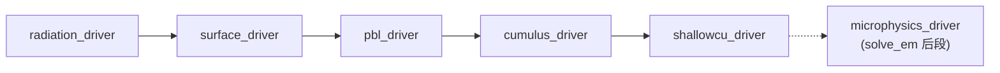
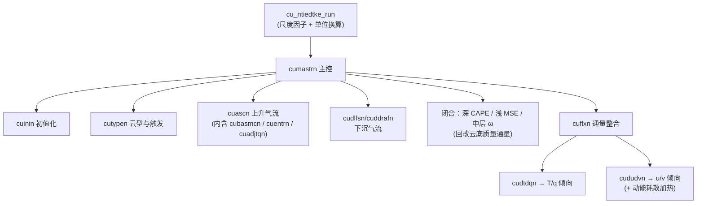
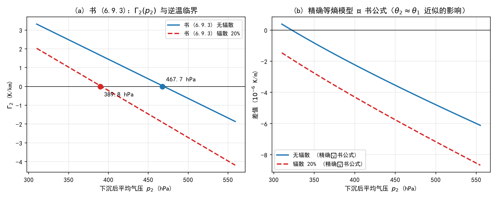
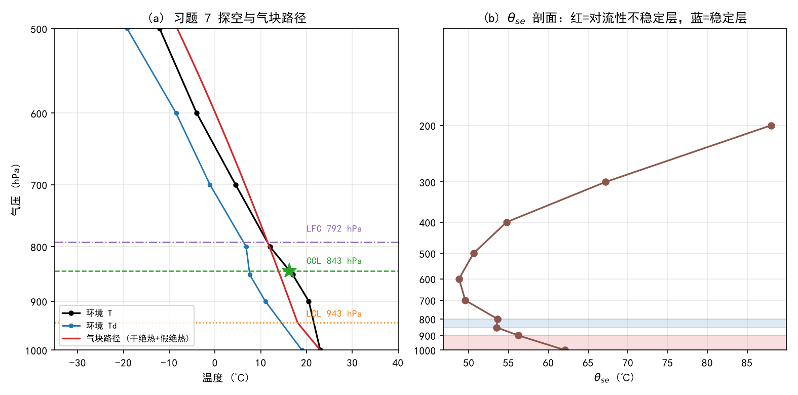
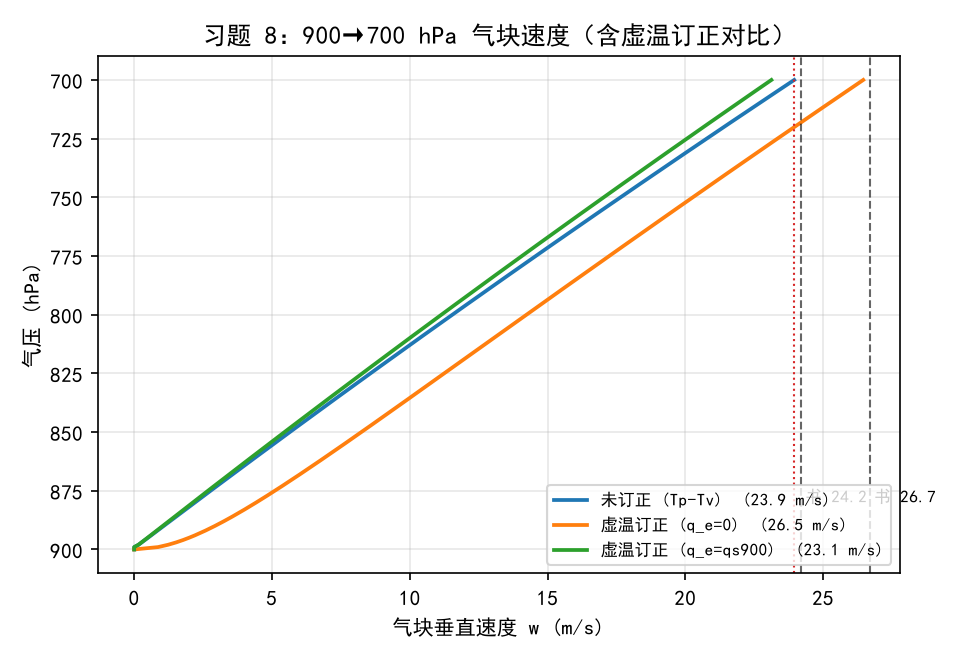
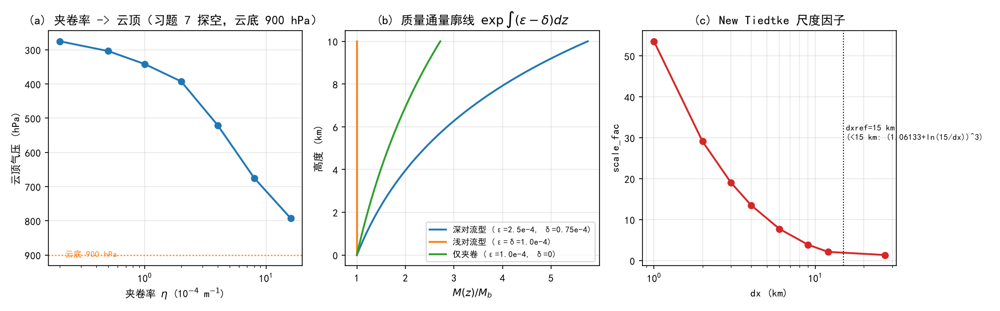

# 第 15 章 积云参数化族：从整层升降到 New Tiedtke 与 KF

> 第 14 章我们看完了“湍流怎么在边界层里垂直输运”。但水汽、热量和动量的垂直输送还有一条更暴烈的通道——**对流**：暖湿空气整层抬升、凝结放热、云塔直插对流层顶、下击暴流和阵风锋横扫地面。对模式来说，这条通道的第一个难题是尺度：一朵积云的直径只有几公里，而全球模式的网格是几十公里，区域模式的网格是 1–9 km——**云在网格里，但网格装不下一朵云**。于是就有了本章的主角：**积云参数化方案（cumulus parameterization scheme, CPS）**，WRF 里叫 `cu_physics`。
>
> 本章的物理基础是《大气物理学》6.9 节“整层气层升降时稳定度的变化”（印刷页 164–166）与 6.10 节“逆温层”（印刷页 167–168），外加 6.8.2 末尾的**夹卷作用**（印刷页 164 顶部）。6.9 回答了一个和第 14 章互补的问题：第 14 章问“气块被抬一下会怎样”（气块法判据），6.9 问“**一整层空气被大范围抬升或下沉会怎样**”——答案催生了两个关键概念：**下沉逆温**（辐散下沉的产物）与**对流性（位势）不稳定**（下湿上干的老实气层，被整层抬到一定高度以上就会“变脸”成不稳定层结）。这两件东西正是积云方案每天在代码里做的判决。
>
> WRF 侧我们精读一个方案、对照一个方案：**New Tiedtke**（`cu_physics=16`，Bechtold 等 2004/2008/2014，ECMWF 血统，本章主角）与 **KFeta**（`cu_physics=1`，Kain-Fritsch 家族，本书个例 d01 的基线）。两者正好代表积云参数化的两大流派：**“解析式 CAPE 闭合” vs “迭代移除 CAPE”**。浅对流（`shcu_physics`）与方案内浅对流分支一并处理。

---

## 15.0 本章地图

### 15.0.1 书小节结构与对应关系

| 书节 | 印刷页 | 本章节 | 内容 | 类型 |
|---|---|---|---|---|
| 6.8.2 夹卷（结尾） | 164（页顶） | 15.4.2 / 15.6.6 | 湍流/动力夹卷、图 6.25/6.26 | 承接（第 14 章已读大半） |
| 6.9.1 未饱和情况及下沉逆温 | 164–165 | 15.1 | 整层升降的 (6.9.1)–(6.9.4)、例题 6.2、图 6.27 | **精讲【考点】** |
| 6.9.2 对流性不稳定 | 166 | 15.2 | 图 6.28、判据 (6.9.5) | **精讲【考点】** |
| （6.9 末段全局结论） | 167 | 15.2.4 | 热带中低层 θse 负梯度区（含一处印刷符号勘误） | 精讲 + 勘误 |
| 6.10 逆温层 | 167–168 | 15.3 | 五类成因、图 6.29、阻塞层 | **精讲【考点】** |
| 思考题（第六章） | 168–169 | 15.9 | 第 6/7 题与本章直接相关 | 回看 |
| 习题（第六章） | 169 | 15.9 | 第 6/7/8 题 | 重解 + 对照 |
| 部分习题答案（第六章） | 546 | 15.8/15.9 | 习题 1/3–8 全部数值答案 | 对照表 |

> 目录核验：书目录（`book\page_0009.jpg`）实测 6.9 = 印刷页 164、6.10 = 印刷页 167…… 直读页实测 6.9 正文始于印刷页 164、跨到 166，6.10 起于 167、思考题在 168、习题在 169。写作时按“扫描页直读为准、目录为辅”的既定纪律执行。

### 15.0.2 考点清单（自拟版，待 PPT 校准）

> 第 6 章课件未到，以下按书 6.9/6.10 与课程大纲自拟；PPT 到货后补“考点透视”并校准。第 6 章的书内习题 7、8 就是“探空判不稳定 + 气块速度”两道大题，本章 15.9 节给出全解与答案页对照。

**名词解释（拟）**：整层气层升降；下沉逆温；对流性不稳定（位势不稳定）；假相当位温判据；辐射逆温；平流逆温；地形逆温；锋面逆温；阻塞层；对流凝结高度（CCL）；对流温度；自由对流高度（LFC）；真潜/假潜不稳定（第 14 章已立）；触发机制；（模式侧）质量通量；卷入/卷出；云底质量通量；闭合；对流时间尺度；尺度感知。

**简答（拟）**：
1. 为什么整层气层下沉伴随水平辐散会趋于稳定、甚至形成逆温？（用 (6.9.3) 与 $1-p_2A_2/(p_1A_1)$ 项解释）
2. 气层被整层抬升时，哪些条件下变稳定、哪些条件下变不稳定？为什么说这取决于**湿度层结**？
3. 对流性不稳定与条件性不稳定是什么关系？各需要什么触发机制？（第 14 章“真潜/假潜”在此收线）
4. 逆温层为什么被称为“阻塞层”？它对空气质量与污染物扩散意味着什么？
5. 五类逆温的形成机制各是什么？实际大气中它们常如何叠加？
6. 用 (6.9.5) 说明为什么“低层暖湿、高层干冷”的探空是对流天气的最佳温床（“喇叭口”）。

**计算（拟）**：例题 6.2（下沉逆温临界气压，(6.9.4)）；由探空计算 LCL/CCL/LFC 与对流温度（习题 7）；(6.8.16) 突变速度（习题 8）；由 $T$、$T_d$ 剖面算 $\theta_{se}$ 并判断对流性稳定度（习题 7 第 4 问）；(模式侧) 由 `cudt`、`dt` 算 `stepcu`；由 $dx$ 算 New Tiedtke 尺度因子。

### 15.0.3 源码锚点总表（本章全部实测核验）

| # | 锚点（文件 + 符号） | 用途 | 状态 |
|---|---|---|---|
| 1 | `dyn_em/module_first_rk_step_part1.F` → `cumulus_driver`（以及 `shallowcu_driver`） | 物理序列中的位置（辐射 → 地面 → PBL → **积云** → 浅对流；微物理在 `solve_em` 后段） | 已核验 |
| 2 | `phys/module_cumulus_driver.F`（`SUBROUTINE cumulus_driver`） | 17 个方案的 SELECT CASE 分发、调用节律、倾向并入、HALO | 已核验 |
| 3 | `phys/module_physics_init.F`（`cu_init` / `shcu_init`） | `STEPCU = max(nint(CUDT*60./DT),1)`、倾向清零与各方案 init 分发 | 已核验 |
| 4 | `Registry/Registry.EM_COMMON`（package 块 `cu_physics==…`） | 方案号表、`cu_diag`/`cu_used`/`shcu_physics` 包 | 已核验 |
| 5 | `run/README.namelist`（`cu_physics` 段、`physics_suite` 段） | 方案号官方说明、namelist 联动、CONUS/tropical 套件 | 已核验 |
| 6 | `phys/module_cu_ntiedtke.F`（`cu_ntiedtke_driver` / `ntiedtkeinit` / `cu_ntiedtke_pre_run` / `cu_ntiedtke_post_run`） | New Tiedtke 的 WRF 侧薄包装 | 已核验 |
| 7 | `phys/physics_mmm/cu_ntiedtke.F90`（`cu_ntiedtke_common` / `cu_ntiedtke_run` / `cumastrn` / `cuinin` / `cutypen` / `cuascn` / `cudlfsn` / `cuddrafn` / `cuflxn` / `cudtdqn` / `cududvn` / `cuadjtqn` / `cubasmcn` / `cuentrn`；函数 `foealfa` / `foeewm`） | New Tiedtke 物理实体（CCPP 风格） | 已核验 |
| 8 | `phys/module_cu_kfeta.F`（`KF_eta_CPS` / `KF_eta_PARA` / `TPMIX2` / `ENVIRTHT` 等） | KFeta：W0AVG 触发、90% CAPE 闭合、TIMEC | 已核验 |
| 9 | `phys/module_shallowcu_driver.F`（`scps_select`：`camuwshcu_driver` / `grims` / `shcu_nscv` / `deng_shcu_driver`） | 独立浅对流方案族 | 已核验 |
| 10 | `phys/module_cu_g3.F`（`g3drv` / `conv_grell_spread3d`）、`phys/module_cu_gd.F`（`grelldrv`）、`phys/module_cu_bmj.F`（`bmjdrv`）、`phys/module_cu_sas.F`（`cu_sas`）、`phys/module_cu_camzm_driver.F`（`camzm_driver`） | 其余方案入口（对照表用） | 已核验 |

### 15.0.4 与前后章的衔接

- **第 13 章 → 本章**：饱和调整（(6.7.4) 的联立解）在积云方案内部是同一个数学问题——New Tiedtke 用 `cuadjtqn` 做云内凝结/下沉蒸发两套调整，用 `foeewm` 算饱和比湿（Tetens 口径，与第 11 章呼应）。
- **第 14 章 → 本章**：14.8 节实验 E1 发现的“1000–900 hPa 层：气块判据说绝对稳定、θe 判据说条件性不稳定（$\partial\theta_e/\partial z=-7.11$ K/km）”，其物理根源正是 6.9.2 的**湿度层结**；本章 E2 用同一探空把 $\theta_{se}$ 剖面算全。
- **本章 → 第 16 章/第 19 章**：积云参数化是“热雷雨”个例（2025-07 兰州）能否报对的决定性环节；d01 用 KFeta（`cu_physics=1`），d02/d03 关闭积云——为什么 3 km 以下要关？本章 15.6.8 的尺度因子与 15.4.1 的灰色地带讨论给出答案。
- **本章 → 论文 2**：论文 2 的积云策略（d01 KF，d02/d03 关）与本章 15.10 的“尺度感知”一节直接对接。

---

## 15.1 未饱和气层的整层升降：下沉逆温的由来（书 6.9.1，印刷页 164–165）【考点】

### 15.1.1 问题设定与两条守恒

书 6.9 开门见山（印刷页 164）：大气中常出现**大范围**的整层上升或下沉运动——水平范围几百千米，持续时间几小时到几天，垂直升降速度约为每秒厘米的量级——它们由天气系统（气旋/反气旋、锋面、大地形）引起。为了把问题写成可以手算的形式，书上做了四条假定：

> 气层在升降过程中是**绝热的**，总质量保持不变，气层内部没有湍流混合作用，气层内各部分的相对位置不变。

四条假定里藏着两条守恒律，正是全节推导的骨架：

1. **质量守恒**：气层是一块“厚气块”，升降中形状可变（水平面积 $A$ 可因辐散辐合而变），但质量不变。设升降前后压强为 $p_1\to p_2$、厚度 $\Delta z_1\to\Delta z_2$、面积 $A_1\to A_2$、密度 $\rho_1\to\rho_2$（图 6.27，印刷页 165）：

$$\rho_1 A_1 \Delta z_1 = \rho_2 A_2 \Delta z_2$$

配合状态方程 $\rho=p/(R_d T_v)$，立刻得到厚度比：

$$\frac{\Delta z_1}{\Delta z_2}=\frac{\rho_2 A_2}{\rho_1 A_1}=\frac{p_2 A_2 T_{v1}}{p_1 A_1 T_{v2}} \tag{6.9.1}$$

2. **位温差守恒**：气层上、下界的位温分别为 $\theta_l$ 与 $\theta_l+\frac{\partial\theta}{\partial z}\Delta z$。绝热升降中每条“位温等值面”随气块走，上、下界的位温差不随升降改变（分层像一摞被编号的卡片，卡片间距可以伸缩，但编号差不变）：

$$\left(\frac{\partial\theta}{\partial z}\right)_1\Delta z_1=\left(\frac{\partial\theta}{\partial z}\right)_2\Delta z_2$$

把 (6.9.1) 的 $\Delta z_1=\Delta z_2\frac{p_2A_2T_{v1}}{p_1A_1T_{v2}}$ 代入，位温梯度随升降的变化也确定了：

$$\left(\frac{\partial\theta}{\partial z}\right)_2=\left(\frac{\partial\theta}{\partial z}\right)_1\frac{p_2A_2T_{v1}}{p_1A_1T_{v2}} \tag{6.9.2}$$

### 15.1.2 从位温到减温率：(6.9.3) 的推导链

书上的下一步是“换镜头”：气象上大家习惯看**减温率** $\Gamma$ 而不是位温梯度。两者由 (6.2.16) 一类的换算关系联结（复述一遍链条，方便考试直接默写）：

- 位温定义 $\theta=T(p_0/p)^{\kappa}$，对 $z$ 求导并代入静力方程与状态方程，可得

$$\frac{\partial\theta}{\partial z}=\frac{\theta}{T}\left(\gamma_d-\Gamma\right),\qquad \gamma_d=\frac{g}{c_p} \tag{15.1}$$

> **推导一瞥**：$\partial\theta/\partial z=(p_0/p)^{\kappa}\left(\partial T/\partial z+\frac{\kappa g}{R_d}\right)$，而 $\kappa g/R_d=g/c_p=\gamma_d$，再用 $(p_0/p)^{\kappa}=\theta/T$，即得 (15.1)。书 (6.2.16) 走的是同一条路。

把 (15.1) 代进 (6.9.2)、再对上 (6.9.1) 右侧的 $T_{v1}/T_{v2}$ 做整理，书上给出（印刷页 165）：

$$\boxed{\ \Gamma_{v2}=\gamma_d-(\gamma_d-\Gamma_{v1})\frac{p_2A_2}{p_1A_1}\ }\qquad\text{等价于}\qquad \Gamma_{v2}=\Gamma_{v1}+(\gamma_d-\Gamma_{v1})\left(1-\frac{p_2A_2}{p_1A_1}\right) \tag{6.9.3}$$

其中 $\Gamma_{v1}$ 是气层**初始**的（虚温）垂直减温率。

> **口径记录（本章实验 E1 核验）**：从 (6.9.2) 到 (6.9.3) 的代换里默认了“升降前后气层平均位温近似不变（$\theta_2\approx\theta_1$）”。本章 E1 用 60 层薄气块逐个守恒位温的**离散等熵模型**做了数值核验：这一近似对逆温临界气压的影响 < 0.5 hPa（0.1% 量级）——**可以放心用**，这不是勘误，只是要意识到它是小量近似。（顺带核销例题 6.2 的 1 hPa 差异来源：见 15.1.4。）

### 15.1.3 三种初始层结、两个方向的运动：谁变稳定？

(6.9.3) 一眼可读：**决定升降后减温率变化方向的，是 $1-\frac{p_2A_2}{p_1A_1}$ 这一项**（因为 $\gamma_d-\Gamma_{v1}>0$ 是常态）。把 $p_2/p_1$（压缩/膨胀项）与 $A_2/A_1$（辐散/辐合项）分别讨论：

| 初始层结 | 过程 | $p_2A_2$ 与 $p_1A_1$ 比较 | $\Gamma_{v2}$ vs $\Gamma_{v1}$ | 稳定度变化 |
|---|---|---|---|---|
| $\Gamma_{v1}<\gamma_d$（常态） | 下沉＋水平辐散 | $p_2A_2>p_1A_1$ | $\Gamma_{v2}<\Gamma_{v1}$ | **变稳定**，极端时 $\Gamma_{v2}<0$ → **逆温**（例题 6.2） |
| $\Gamma_{v1}<\gamma_d$ | 抬升＋水平辐合 | $p_2A_2<p_1A_1$ | $\Gamma_{v2}>\Gamma_{v1}$ | **稳定性减小**（趋向不稳定） |
| $\Gamma_{v1}<\gamma_d$ | 两效应相反 | 抵消 | 需具体分析 | — |
| $\Gamma_{v1}=\gamma_d$ | 任意 | — | $\Gamma_{v2}=\gamma_d$ | 干绝热减温率不变 |
| $\Gamma_{v1}>\gamma_d$ | 下沉＋辐散 | $p_2A_2>p_1A_1$ | $\Gamma_{v2}>\Gamma_{v1}$ | 结论与第一行相反（绝对不稳定层极罕见） |

> **模式视角预告**：第一行的“下沉＋辐散 → 逆温”与第二行的“抬升＋辐合 → 失稳”就是积云方案的两种命：**反气旋里的下沉逆温 = 对流被“盖子”压死**（15.3.3），**气旋锋面区的整层抬升 = 对流性不稳定的启动器**（15.2、15.4.3）。

书上的天气学对应（印刷页 166 前半段）：北半球气旋内环流逆时针旋转、气流向内向上辐合 → 随气层上升稳定性变小；反气旋内气流顺时针旋转、整层下沉产生压缩增温 → 甚至出现逆温层 → 大气稳定、天气晴朗——“反气旋控制下晴而稳”这句天气谚语，物理内核就是 (6.9.3)。

### 15.1.4 例题 6.2 全解与数值复算（实验 E1）

**题目**（印刷页 166）：设在 330–300 hPa 处有一未饱和气层，气层底部和顶部温度分别为 $-49\ ^\circ\mathrm{C}$ 和 $-51\ ^\circ\mathrm{C}$。若整层下沉，无辐散，问下沉到气压为何值才会出现逆温？若下沉且有辐散，面积比原来增加 20%，那么下沉到气压为何值才会出现逆温？

**第一步：先把初始减温率算出来。** 高空湿度小，不作虚温订正（用 $\Gamma$ 代替 $\Gamma_v$）。气层平均温度 $\bar T_1=-50\ ^\circ\mathrm{C}=223$ K，平均气压 $p_1=315$ hPa，上下温差 $\Delta T_1=-2$ K（顶到底的温差），气压差 $\Delta p_1=-30$ hPa。由静力学与状态方程：

$$\Gamma_1\approx-\frac{\Delta T_1}{\Delta z_1}=\frac{\Delta T_1\,p_1\,g}{\Delta p_1\,R_d\,\bar T_1}=\frac{2\times315\times10^2\times9.8}{30\times10^2\times287\times223}\approx0.0032\ \mathrm{K/m}$$

**第二步：逆温条件。** 逆温即 $\Gamma_2<0$。由 (6.9.3)：

$$\gamma_d-(\gamma_d-\Gamma_1)\frac{p_2A_2}{p_1A_1}<0\ \Longrightarrow\ p_2>\frac{\gamma_d}{\gamma_d-\Gamma_1}\cdot\frac{A_1}{A_2}\cdot p_1 \tag{6.9.4}$$

（书 (6.9.4)；注意 $\gamma_d=0.0098$ K/m。）

**第三步：代入两种情形。**

- **(1) 无辐散**（$A_2/A_1=1$）：$p_2>\frac{0.0098}{0.0098-0.0032}\times315=1.485\times315\approx467.7$ hPa。
  **判读**：气层从 315 hPa 一路下沉到 467 hPa 以下才出现逆温——下沉了 150 hPa、近 4 km。
- **(2) 辐散后面积增加 20%**（$A_2/A_1=1.2$）：$p_2>467.7/1.2\approx390$ hPa。
  **判读**：辐散帮了大忙——面积膨胀让气层“摊薄”，同样的下沉量下减温率下降更快，**逆温提前 78 hPa 出现**。

**实验 E1 的数值复算**（脚本 `workspace/scripts/ch15_experiment.py`，图 `figs/ch15_layer_subsidence.png`）：

| 口径 | 无辐散临界 | 辐散 20% 临界 |
|---|---|---|
| 书答案（$\Gamma_1$ 取 0.0032，两位有效数字） | 467.7 hPa | 390 hPa |
| 本章复算（$\Gamma_1=0.003214$ 精确值） | 468.5 → 469.5 hPa | 390.4 → 391.3 hPa |
| 离散等熵厚层模型（60 层，逐块守恒 $\theta$） | **469.3 hPa** | **391.1 hPa** |

> **口径结论**：复算与书答案的 ~1 hPa 差异几乎全部来自例题中间结果 $\Gamma_1$ 的取整（0.0032 只有两位有效数字）；而 (6.9.3) 里 $\theta_2\approx\theta_1$ 的近似贡献 < 0.5 hPa。**书答案 467.7/390 hPa 可以照抄答卷，若用全精度计算得 469/391 hPa 同样正确。** 图 `ch15_layer_subsidence.png` 左面板画出了 $\Gamma_2(p_2)$ 的两条直线与零点，右面板用 $10^{-6}$ K/m 量级展示了“精确 − 书公式”的差——一条几乎贴着零的线。

### 15.1.5 图 6.27 读图法：一句话记住整节

图 6.27（印刷页 165）画的是**未饱和气层的下降**：上宽下窄的“台体”表示气层，面积 $A_1$、$A_2$ 与厚度 $\Delta z_1$、$\Delta z_2$ 标注在两侧，右侧配 $\theta$-线示意上下界两条位温线“间距不变”。读图口诀：

> **面积胀、厚度薄的是下沉辐散（趋向逆温）；面积缩、厚度厚的是抬升辐合（趋向失稳）；位温线一族是“不变量”。**

---

## 15.2 对流性（位势）不稳定：整层抬升如何“引爆”气层（书 6.9.2，印刷页 166）【考点】

### 15.2.1 抬升实验：图 6.28 的两种情况

6.9.1 讨论的是未饱和气层在升降中**不跨过饱和线**的情形；6.9.2 立刻换到一个更有意思的场景：**气层被整层抬升，抬到一定高度会先后跨过饱和线，凝结潜热开始改写减温率**。书上的设定（印刷页 166 顶部）：假设气层上、下界气压差 $\Delta p$ 在抬升过程中不变（与 15.1 的“整层压缩机”模型互补），层内**水汽分布不均匀**，因此不同高度的空气**先后达到饱和**。图 6.28 给出两种对照：

- **图 6.28(a)：下湿上干**。整层先沿干绝热线上升；**下部比上部先达到饱和**，此后下部改沿假绝热线继续上升——于是温度层结曲线由原来的 $A_1B_1$ 变成 $A_2B_2$。饱和气层的垂直减温率将变得**大于 $\gamma_s$**，层结由稳定变为**不稳定**。
- **图 6.28(b)：上湿下干**。**上部先达到饱和**，气层的垂直减温率变小、甚至小于零（逆温出现），层结**更加稳定**。

物理读解：抬升本身对整层是“冷却”，但**冷却的节奏被湿度层结接管**——下部先饱和 → 下部先“领到”潜热 → 下层相对上层变暖 → 温差被拉大 → 减温率变大 → 失稳。这就是为什么 6.9.2 的判据里出现了 $\theta_{se}$：**它是把“温”与“湿”打包到一起的量，正好对应“潜热领没领到”这件事**。

### 15.2.2 判据 (6.9.5)：$\theta_{se}$ 剖面

大气中的水汽主要来源于地表，因此常态是**低层湿度大、高层干燥**，大范围整层抬升时下部先饱和——**符合图 6.28(a)，也就是“越抬越不稳”**。书上把这种由整层抬升而制造出来的不稳定命名为：

> **对流性不稳定（又称位势不稳定）**：原来稳定的未饱和气层，由于整层被抬升到一定高度以上而变成不稳定的气层。反之为**对流性稳定**气层。可见，气层是否为对流性不稳定，不但和温度层结有关，还取决于湿度条件，特别是低层的水汽状况。（印刷页 166）

由 6.3.2 的对流不稳定与 6.7.3 的假相当位温讨论（第 13 章 13.3/13.7 已精讲），书上给出定量判据——**假相当位温随高度的变化**：

$$\frac{\partial\theta_{se}}{\partial z}\ \begin{cases}>0, & \text{对流性稳定}\\[2pt] =0, & \text{中性}\\[2pt] <0, & \text{对流性不稳定}\end{cases} \tag{6.9.5}$$

（“假湿球位温 $\theta_{sw}$ 与假相当位温一样，也可以作为对流性不稳定的判据”——印刷页 167 首行。）

**为什么是 $\theta_{se}$？** 一部均质气层被抬升时的“潜在失稳”本质是：**两个不同高度气块的 $\theta_{se}$ 谁大**。承第 13 章 (6.3.8) 的定义 $\theta_{se}=\theta_d\exp\!\left(\frac{r_sL_v}{c_pT}\right)$：低层气块 $\theta_{se}$ 大、高层小（$\partial\theta_{se}/\partial z<0$）时，一旦整层抬升，低层先饱和先拿潜热，就会在抬升后的层结里“跑赢”高层气块——失稳。这一判据的物理内容与 6.3.2 的“对流不稳定”（气层中下部气块 $\theta_{se}$ 高于上部）完全同源。

> **与第 14 章的收线**：14.8 节 E1 曾在同一探空的 1000–900 hPa 层发现“气块判据（$\Gamma<\gamma_s$）说绝对稳定、$\theta_e$ 判据说条件性不稳定”。现在可以下结论了：那一层的 $\partial\theta_e/\partial z=-7.11$ K/km 正是 6.9.2 所说的**湿度层结贡献**——**两种判据并不打架，它们回答的是不同问题**：气块判据问“被抬一下会怎样”，对流性不稳定判据问“整层被抬到高处会怎样”。本章 E2 会把这层从 1000 到 900 hPa 的 $\theta_{se}$ 从 62.1 ℃ 算到 56.2 ℃（下降 5.9 K），与书答案“68 ℃→60 ℃”结论一致（绝对值差为公式/读图口径，见 15.8.2）。

### 15.2.3 “喇叭口”、潜在不稳定与两种触发机制

书上在 6.9.2 末段（印刷页 167）给了三段重要的定性判读，考试极爱出：

1. **云型差异**：对流性稳定的气层被整层抬升后可形成**层状云**；对流性不稳定的气层则形成**积状云（对流云）**，甚至产生对流性降水。
2. **强对流的最佳温床**：观测表明，最可能产生强对流的是**低层暖湿、高层干燥、具有条件性不稳定层结**的气层，其温度曲线和露点曲线呈现“**喇叭口**”形状（低层 $T$ 与 $T_d$ 靠得近、向上迅速拉开——低层湿、高层干）。
3. **两种不稳定、两种触发**：“潜在的不稳定”指的是气层本身稳定，需要外加抬升力作为**触发机制**才能转化成真实的不稳定：

| 潜在不稳定类型 | 触发机制 | 天气结果 |
|---|---|---|
| **对流性不稳定**（本章） | 要求**大范围**抬升——天气系统（如锋面）配合或大地形 | 对流性天气**强烈、范围大** |
| **条件性不稳定**（第 14 章 6.8.2） | 局地热对流或动力因子抬升即可（气块法一抬就爆） | 局地性雷雨 |

> **模式视角**：这两种触发在代码里对应两套“开关”——条件性不稳定对应**测试气块触发**（New Tiedtke `cutypen` 的测试气块、KF 的扰动气块，它问的是“这口气块现在能不能自己浮起来”）；对流性不稳定对应**大尺度强迫的量**（G3 与 New Tiedtke 在 `cumulus_driver` 里被显式喂进 `RTHFTEN`/`RQVFTEN`——温度与水汽的**大尺度平流+辐射+边界层倾向**，因为闭合和触发要用它算“环境正在把气层往哪推”）。这就是 15.5.1 要讲的那段“倾向并入”。

### 15.2.4 全局结论与一处印刷符号勘误

书上用图 6.2 的全球平均位温/相当位温垂直分布给出两条结论（印刷页 167）：

- **①** 对流层内全球平均位温随高度增加（$\partial\theta/\partial z>0$），故对干空气或未饱和湿空气而言，大气层结的平均状态是稳定的——但不排除某些地区出现局地不稳定而产生对流。
- **②** 在热带地区上空，对流层的中、低层（约 700 hPa 以下）存在**相当位温梯度的负值区**，说明此处大气经常处于条件性不稳定状态或者对流性不稳定状态；实际上这些地区的局地对流可能达到对流层顶。

> **勘误记录（本章新增）**：印刷页 167 结论 ② 中“相当位温梯度的负值区”后的括注，扫描页实测印为“（$\partial\theta_e/\partial z>0$）”——**与它自己的前半句“负值区”矛盾，也与 (6.9.5) 矛盾**（(6.9.5) 规定 $\partial\theta_{se}/\partial z<0$ 才是对流性不稳定，而结论 ② 要说的正是“这里经常不稳定”）。本章按“负值区”与判据自洽的读数处理，即该括注应为 $\partial\theta_e/\partial z<0$（负值区）。已用 2 倍放大复核过扫描原页（`workspace/tmp/ch15_p0181_bottom.png`），确认印刷如此。教学引用时以文字“负值区”为准，符号按 (6.9.5) 修正。

---

## 15.3 逆温层：大气的“盖子”与五类成因（书 6.10，印刷页 167–168）【考点】

### 15.3.1 定义与气候效应：为什么叫“阻塞层”

对流层大气的温度一般随高度降低，但在有些条件下，某些气层的温度会随高度而**增加**，即 $\Gamma<0$——这些气层称为**逆温层**。逆温层是**绝对稳定**的层结，对上下空气的对流起削弱抑制作用（印刷页 167）。

书上的现场描写（值得背一到两句）：特别低的逆温层“像一个盖子”，使悬浮在大气中的烟尘、杂质及有害气体都难以穿过它向上空扩散，使空气质量下降、能见度恶化，因此也称为**阻塞层**；世界上一些严重的大气污染事件（如洛杉矶光化学烟雾）多与逆温层的存在有关。在研究大气污染扩散问题时，**常需测定逆温层的高度、厚度以及出现和消失的时间**。

图 6.29（印刷页 168，引自 Eagleman 1985）画的是**晴天低层大气和土壤表层温度的廓线日变化**：白天，地表吸收太阳辐射迅速增温，低层大气温度升高；夜晚，地面长波辐射降温使近地层形成辐射逆温。要点：

- 逆温层厚度：几米到几百米；**凌晨日出前最强，日出后逐渐消失**；
- 最有利于形成逆温的是**晴朗无风的夜晚**——无云利于地面辐射向上发散，无风使上层空气的热量难以通过湍流作用向下传，这两个条件都使地面气温很快下降而形成逆温；
- 图中土壤温度的日变化幅度远大于大气（土壤热容量与传导的差异），可以看到大气对土温的“追随”与相位滞后。

### 15.3.2 五类逆温成因一览（书 6.10）

书上除前述辐射逆温外，列出四类（印刷页 168）：

| 类型 | 成因 | 典型场合 | 特征 |
|---|---|---|---|
| **1 辐射逆温** | 夜间地面辐射冷却，近地层降温 | 晴朗无风之夜（图 6.29） | 厚度几米–几百米，凌晨最强、日出后消失 |
| **2 下沉逆温** | 空气下沉增温（**6.9.1 的直接应用**） | 高气压区 | 范围广、厚度大、**常常不接地**（从空中某高度开始）；相当于近地层上空的盖子，极不利于污染物扩散 |
| **3 地形逆温** | 地形造成的特殊气流组织 | 盆地、谷地（夜间山坡空气辐射冷却沿坡下沉、暖空气被挤上升浮在冷空气上，参见书图 10.9）；山脉背风侧 | 与山谷风耦合，局地性强 |
| **4 平流逆温** | 较暖空气流经较冷的地面或水面 | 冬季沿海（海上暖空气流到大陆上）；城市与农村热力差异（参见书图 10.18） | 厚度不大、水平范围广；城市夜间的烟气层可被带到地面逆温层中 |
| **5 锋面逆温** | 锋面是倾斜的面，无论冷锋还是暖锋，暖空气总在冷空气上面 | 冷空气区观测到逆温 | 锋面移动时逆温随之移动；除移动缓慢的暖锋外，一般对空气污染影响不大 |

> 书上收尾一句务必记住：**实际大气中出现的逆温有的是几种原因共同造成的，比较复杂，需要具体分析**（印刷页 168）。

### 15.3.3 三处应用连线

- **与 15.1 的连线**：下沉逆温 = 例题 6.2 的天气学实现——副热带高压内部的下沉气流把 300–500 hPa 的气层按 (6.9.3) 压出逆温，罩在低层边界层上。
- **与第 16 章（陆面）的连线**：辐射逆温是陆面过程（夜间地表能量收支、土壤热传导）与 PBL 方案协作的产物——书图 6.29 里那条土壤温度曲线，第 16 章会在 `module_sf_noah` 的能量平衡方程里再见到它。
- **与教学个例（第 19 章）的连线**：论文 2 研究兰州河谷热浪期的城市热岛，**盆地的地形逆温 + 夜间辐射逆温**正是河谷城市夜间高温顽固、污染物累积的机制背景；个例诊断时用 `wrfout` 的温度剖面找 $\Gamma<0$ 层，就是在代码数据里实现“测定逆温层的高度、厚度与出现时间”这句书上的要求。

---

## 15.4 从物理判据到参数化：积云方案要解决的三个问题（模式视角）

### 15.4.1 为什么需要参数化：尺度分离与灰色地带

书 6.9/6.10 讲的是“气层”与“逆温”这类**网格尺度可分辨**的对象；对流云不是。一朵孤立积云的直径 1–10 km、寿命几十分钟，而数值模式的网格（全球 25 km、区域 9 km、对流可分辨 1–3 km）要么装不下它，要么刚好卡在它的尺度上：

- **$dx\gg$ 云尺度（≥10 km）**：网格内有大量对流单体，网格平均量平滑；参数化的任务是把“一批未分辨对流”的**统计效应**（热量、水汽、动量的再分配 + 降水）写成大尺度变量的函数。
- **$dx\sim$ 云尺度（1–10 km，“灰色地带”/gray zone）**：网格既不能完整分辨单体、参数化假设也动摇——这正是“尺度感知（scale-aware）”方案（如 New Tiedtke 的 `scale_fac`、G3、scale-aware SAS）要处理的问题。
- **$dx\ll$ 云尺度（≤1 km）**：对流被部分分辨，实践上**关闭积云参数化**（`cu_physics=0`），让微物理方案去处理降水——本书个例 d02（3 km）/d03（1 km）与论文 2 的选择即此。

> **一句话**：积云参数化是“灰色地带”的妥协产物；**它是本书唯一一个“越好用越该被关掉”的物理模块**。

### 15.4.2 参数化的三大件：触发、闭合、垂直廓线

所有基于**质量通量（mass flux）**的积云方案都可以拆成三个独立部件，读任何一种方案的源码都是在读这三件事（第 14 章 14.4.4 的“PBL 方案统一骨架”在积云这边的孪生兄弟）：

1. **触发（trigger）**：**这一列现在有没有对流？** 通常用测试气块（test parcel）或扰动判据。对应书 6.9.2 的“潜在不稳定 + 触发机制”的物理。
2. **闭合（closure）**：**如果有，对流有多强？** 即如何确定**云底质量通量** $M_b$（kg·m$^{-2}$·s$^{-1}$，或模式里等价的 Pa/s 量纲）。物理提问是“环境的不稳定（CAPE）应以多快的速度被消费掉”。
3. **垂直廓线（profile）**：**云内干什么、地面收什么？** 确定卷入（entrainment）$\varepsilon$、卷出（detrainment）$\delta$ 率，从而给出上冲/下沉气流的温度、水汽、液态水与动量廓线，以及降水与云底以下的蒸发。

质量通量的基本图像（与第 14 章薄层法、EDMF 同一思想家族）：

$$M(z)=\rho\,w\,\sigma,\qquad \frac{\partial M}{\partial z}=(\varepsilon-\delta)\,M$$

- **深对流**：$\varepsilon>\delta$，质量通量随高度增长，云顶处把残余质量“倾泻”给环境；
- **浅对流**：$\varepsilon\approx\delta$，质量通量近似守恒——**这是 Tiedtke 系浅对流的一个招牌特征**（本章 E4 会做出三条廓线对照）。

三个部件在书里的对应物：触发 ↔“潜在不稳定+触发机制”（6.9.2）；闭合 ↔“整层抬升把不稳定变现的速率”（6.9.1 的升降速率）；垂直廓线 ↔ 6.8.3 夹卷作用（湍流夹卷+动力夹卷）——**书里定性描述的夹卷，在代码里就是 $\varepsilon$、$\delta$ 两个系数表**。

### 15.4.3 与书 6.9 的对应关系一览

| 书概念 | 代码实现（New Tiedtke 为例） | 说明 |
|---|---|---|
| 对流性不稳定（$\partial\theta_{se}/\partial z<0$） | 深对流测试气块能浮起来 + CAPE 型浮力积分 > 0 | “可用能量”的离散化 |
| 触发机制（大范围抬升/锋面/地形） | `cutypen` 测试气块 + 环境垂直速度/倾向参与（KF 的 W0AVG；New Tiedtke 的 PBL 通量起动） | 从“大范围”到“网格尺度判据” |
| 整层升降改变稳定度 | 非平衡闭合里的 **PBL 生成项**（`zcape2`）：大尺度倾向正在制造多少 CAPE | New Tiedtke 把“升降”写成倾向 |
| 下沉逆温“盖子” | 测试气块的 $w_{\rm base}$、云厚阈值 `zdnoprc`；逆温层内测试气块动能耗尽直接判定无对流 | “盖子”= 抬升动能被吃光 |
| 夹卷（图 6.25/6.26） | `cuentrn`/`cuascn` 的 $\varepsilon$、$\delta$ 与 0.4 封顶；KF 的 `DILUTE BY ENTRAINMENT` | 定性 → 系数 |

---

## 15.5 WRF 对应（一）：调用链、分发与 namelist

### 15.5.1 调用链与节律（实测）

积云参数化的调用点在 `dyn_em/module_first_rk_step_part1.F`（主 RK 步的物理段）。实测的**物理先后顺序**：



顺序的物理含义：**辐射定天、地面供能、PBL 先做湍流垂直混合，然后积云方案拿“混合后的层结”判对流，最后微物理收网格尺度相变与降水**。这就是第 14 章 14.5.1 那张调用链图的“下游续集”。

进入 `phys/module_cumulus_driver.F` 的 `cumulus_driver` 之后，第一件事是**判断“这一时间步要不要跑”**（源码注释明确列了四条判据）：

1. `itimestep == 1`（第一步强制）
2. `cudt == 0` 或 `stepcu == 1`（要求每步调用——默认！）
3. 非自适应步长时 `MOD(itimestep, stepcu) == 0`
4. 自适应步长（`adapt_step_flag`）时 `curr_secs >= cudtacttime`（并把下次调用时刻写入 `cudtacttime`）

其中 `stepcu` 的来源在上游 `phys/module_physics_init.F` 的 `cu_init` 里（实测）：

```fortran
STEPCU = nint(CUDT*60./DT)
STEPCU = max(STEPCU,1)
```

即 namelist 变量 `cudt` 的单位是**分钟**：`cudt` 为默认 0 时 `stepcu=1`，**积云方案每个时间步都被调用**；若设 `cudt=15`、`dt=54 s`，则 `stepcu = nint(15×60/54) = 17`，即每 17 步调用一次（调用间隔约 15.3 分钟）。对照第 14 章：PBL 用 `bldt`、辐射用 `radt`，一套“物理模块各自有钟表”的设计（见第 8 章 `module_timing` 的那套闹钟体系）。

`cu_physics = 0` 时直接 `RETURN`——这就是“关积云”，d02/d03 用的就是它。

### 15.5.2 倾向并入：New Tiedtke 与 G3 的“加餐”

`cumulus_driver` 里有一段只有两个方案享受的特殊待遇（实测）：

```fortran
if (cu_physics == G3SCHEME .or. cu_physics == NTIEDTKESCHEME) then
   RTHFTEN = (RTHFTEN + RTHRATEN + RTHBLTEN) * pi
   RQVFTEN = RQVFTEN + RQVBLTEN
endif
```

即：**G3 与 New Tiedtke 看到的大尺度温度倾向，是“平流 + 辐射 + 边界层”三项之和**（温度倾向还要乘 Exner 函数从位温换算回温度）。为什么偏袒这两个方案？因为它们的触发与闭合**显式使用大尺度倾向**：

- New Tiedtke 的**非平衡闭合**要算“环境正在以多快的速度制造 CAPE”（`zcape2` 项，见 15.6.5）——这需要完整的温度/水汽倾向；
- G3 的**云底质量通量**要参考“格点上的上升运动趋势”。

其他方案（如 KF）只看瞬时状态量，就不需要这份加餐。**读源码时的经验：凡是方案接口里出现 `THFTEN`/`QVFTEN`（温度/水汽倾向）的，它的闭合一定带“大尺度强迫”的色彩。**

另外三处接口细节：

- **HALO**：G3、GFL、KFeta、MSKF 四个方案在调用前后要交换 halo（`HALO_CUP_G3_IN.inc` / `HALO_CUP_G3_OUT.inc`，G3 还有一步 `conv_grell_spread3d` 把产品摊回 3D）。原因：这些方案要用邻域信息（G3 的“集合成员”在相邻格点间共享；KF 的触发要对平流/湿度做邻域平均）。
- **W 场累积**：源码注释写得很直白——`DON'T JUDGE TIME STEP HERE, SINCE KF NEEDS ACCUMULATED W FIELD. DO IT INSIDE THE INDIVIDUAL CUMULUS SCHEME`。KF 家族的时间步管理在方案内部（因为它要维护 `W0AVG` 这个滑动平均，见 15.7.1）。
- **降水与诊断回传**：`RAINC`/`RAINCV`（累积/单步对流降水）、`PRATEC`（对流降水率）、`NCA`（KF 的云松弛计数器）、`HTOP`/`HBOT`（对流顶底高度）、`CU_ACT_FLAG`（该格点是否有对流被激活——微物理与辐射会用）。注意 `pratec` 在驱动里经由 `tmppratec` 中转：入口先把旧值拷进去，方案可能只更新 `raincv`，最后统一写回。

### 15.5.3 方案表：注册表、README 与两套“物理套件”

`Registry/Registry.EM_COMMON` 的 package 块给出方案号（本章按实测整理，与 `run/README.namelist` 逐一对照）：

| cu_physics | 方案 | 入口子程序（源码） | 备注 |
|---|---|---|---|
| 0 | 无 | — | d02/d03 用 |
| 1 | Kain-Fritsch (new Eta) | `module_cu_kfeta.F` → `KF_eta_CPS` | **本书个例 d01 基线**；状态量 `w0avg` |
| 2 | Betts-Miller-Janjic | `module_cu_bmj.F` → `BMJDRV` | 带 `qcconv`/`qiconv`/`convcld` 等状态 |
| 3 | Grell-Freitas | `module_cu_gfl.F` → `CU_GRELL_FREITAS_LI` | 需 `ishallow` 配合 |
| 4 | Scale-aware GFS SAS | `module_cu_scalesas.F` → `CU_SCALESAS` | 用 `DX2D`，尺度函数/SIGMU |
| 5 | Grell 3D ensemble | `module_cu_g3.F` → `G3DRV` | 集合式；`conv_grell_spread3d` 摊回 3D |
| 6 | Modified Tiedtke | `module_cu_tiedtke.F` → `CU_TIEDTKE` | **CONUS 套件的默认**（见下） |
| 7 | Zhang-McFarlane (CAM5) | `module_cu_camzm_driver.F` → `CAMZM_DRIVER` | 要求冰微物理（`f_qi`） |
| 10 | KF-CuP（PDF 触发） | `module_cu_kfcup.F` → `KF_CUP_CPS` | WRFCuP 参数化，配合 `cu_rad_feedback` |
| 11 | MSKF（多尺度 KF） | `module_cu_mskf.F` → `MSKF_CPS` | 可接气溶胶（`aercu_opt`） |
| 14 | KIM SAS (KSAS) | `module_cu_ksas.F` → `CU_KSAS` | 韩式 SAS；浅对流有专门分支 |
| **16** | **New Tiedtke** | `module_cu_ntiedtke.F` → `CU_NTIEDTKE_DRIVER` | **本章主角**；tropical 套件默认 |
| 93 | Grell-Devenyi | `module_cu_gd.F` → `GRELLDRV` | 老牌集合方案 |
| 94/95/96 | SAS 家族（HWRF/YSU） | `module_cu_sas.F` / `module_cu_osas.F` / `module_cu_nsas.F` | README 提醒“use with caution” |
| 99 | 旧 KF | `module_cu_kf.F` → `KFCPS` | 历史版本 |

`README.namelist` 还给出了两套**物理套件**（`physics_suite` 一行顶七行）：

- `physics_suite='CONUS'` ⇒ `mp=8, cu=6, ra_lw/sw=4, bl=2, sfclay=2, sf_surface=2`——即“WSM6 + Modified Tiedtke + RRTMG + MYJ”；
- `physics_suite='tropical'` ⇒ `mp=6, cu=16, ra_lw/sw=4, bl=1, sfclay=91, sf_surface=2`——即“WSM6 + **New Tiedtke** + RRTMG + YSU”。

嵌套域可以覆写（`-1` 表示沿用套件值、`0` 表示关）：`cu_physics = -1, -1, 0` 是论文 2 式配置的官方写法出处。

**独立浅对流** `shcu_physics`（与深对流解耦，见 `phys/module_shallowcu_driver.F` 的 `scps_select`）：

| shcu_physics | 方案 | 入口 | 约束 |
|---|---|---|---|
| 0 | 无 | — | 嵌套常用 |
| 1 | G3 浅对流 | 由 `ishallow` 占位（未实现独立开关） | 与 `cu_physics=93/5` 搭配 |
| 2 | Park & Bretherton (CAM5 UW) | `camuwshcu_driver` | 独立 |
| 3 | GRIMS (YSU) | `grims` | 需要 `wstar`（YSU PBL 提供） |
| 4 | NSCV | `shcu_nscv` | 与 KSAS 搭配 |
| 5 | Deng (WRF-Solar) | `deng_shcu_driver` | 仅 MYJ PBL；与 `icloud=3` 不兼容；MYNN 需 `bl_mynn_edmf=0` |

**方案内浅对流**是另一条路线：`cu_physics=3/5`（GFL/G3）用 `ishallow=1` 打开浅对流分支；New Tiedtke 则在方案内部用 `ktype=2` 处理浅对流（见 15.6.4）。

### 15.5.4 namelist 联动速查（与积云相关的全部条目）

| namelist | 默认 | 作用 | 关键约束（README 原文要点） |
|---|---|---|---|
| `cu_physics` | 视套件 | 方案选择（15.5.3 表） | 嵌套用 -1/0 覆写 |
| `cudt` | 0 | 调用间隔（分钟） | 0 = 每步 |
| `cu_rad_feedback` | .false. | 对流云对辐射光学厚度的反馈 | **只对 GF/G3/GD/KF 有效，且需 `cu_diag=1`** |
| `bmj_rad_feedback` | .false. | BMJ 的对流降水型次网格云辐射反馈 | 仅 BMJ |
| `cu_diag` | 0 | 输出时间平均的对流诊断量 | 对 3/5/10/93 有效 |
| `kf_eta_trigger` | 1 | KF 触发选项 1/2/3（见 15.7.1） | 仅 `cu_physics=1` |
| `cugd_avedx` | 1 | GD/G3 补偿下沉的水平平滑格点数 | DX<5 km 建议 3 |
| `ishallow` | 0 | GFL/G3 的浅对流开关 | `cu_physics=3/5` |
| `kf_edrates` | 0 | KF 系输出卷入/卷出率与对流时间尺度 | 仅 1/11/99 |
| `shcu_physics` | 0 | 独立浅对流方案选择 | 15.5.3 表 |

> **读源码小工具**：`cu_rad_feedback` 为什么对 New Tiedtke “无效”？因为它的实现依赖 `cu_diag` 产出的 `GD_CLOUD`/`GD_CLOUD2` 等 3D 云量场，而 New Tiedtke 的接口里根本没有这些输出（对比 `Registry` 里 `cu_physics==16` 的 package 行是空的——一个状态量都不注册）。**方案能“顺带”影响辐射的路径只剩 `qc`/`qi` 倾向 + `cldfra` 诊断**。

---

## 15.6 精读一：New Tiedtke（`cu_physics=16`）

### 15.6.1 双层结构与血统：为什么会有两个文件

WRF 4.8 的 New Tiedtke 由**两个文件**组成（与第 13 章 WSM6 的“双层结构”同构）：

| 层 | 文件 | 内容 | 风格 |
|---|---|---|---|
| WRF 接口层 | `phys/module_cu_ntiedtke.F` | `cu_ntiedtke_driver`（列打包/解包）、`ntiedtkeinit`、`cu_ntiedtke_pre_run`、`cu_ntiedtke_post_run` | WRF 传统 `*.F`，`USE module_state_description` 家族 |
| 物理核心层 | `phys/physics_mmm/cu_ntiedtke.F90` | `module cu_ntiedtke_common`（参数与常数）+ `module cu_ntiedtke`（`cu_ntiedtke_init`/`cu_ntiedtke_run` 与全部物理子程序） | CCPP 风格（`use ccpp_kind_types`，`errmsg/errflg` 错误码接口） |

核心层的头注释把血统与“新在哪里”写得很清楚（与第 13 章读 WSM6 时的做法相同，直接引用）：

- **血统**：Tiedtke (1989, *MWR* 117, 1779–1800)；经 ECMWF/ECHAM 与夏威夷大学（C. Zhang & Y. Wang, IPRC/IRAM）移植整理，与 REGCM4、ECMWF cy40r1 的 Tiedtke 方案同源。
- **相对旧 Tiedtke（`cu_physics=6`）的六项更新**：
  (a) 深、浅对流的新触发函数（Jakob & Siebesma 2003；Bechtold et al. 2004/2008/2014）；
  (b) 深对流闭合考虑**非平衡态**（Bechtold et al. 2014）；
  (c) 深对流闭合的**新对流时间尺度**（Bechtold et al. 2008）；
  (d) 所有对流类型的**新卷入卷出率**；
  (e) 云水→雨转换采用 Sundqvist (1978) 公式；
  (f) 云尺度气压梯度项的处理（Gregory et al. 1997；Wu & Yanai 1994）。
- 注释中的**使用建议**也因此有两套：“热带气旋气候模拟 @20 km：YSU + RRTMG + WSM6、`momtrans=2`、`pgcoef` 0.7–1.0、`nonequil=.false.`”；“陆上降水日循环模拟：`nonequil=.true.`，CAPE 向 PBL 值松弛”。

内部的子程序名是 ECHAM 式的 8 字符命名，读一遍这张表就能在源码里“看名识义”：

| 子程序 | 含义 | 子程序 | 含义 |
|---|---|---|---|
| `cumastrn` | 主控（cumulus mass flux） | `cuadjtqn` | 饱和调整（adjust t, q） |
| `cuinin` | 初值化（initialize） | `cubasmcn` | 中层对流云底质量通量 |
| `cutypen` | 云型判决（cloud type） | `cuentrn` | 卷入卷出率 |
| `cuascn` | 上升气流（ascent） | `cuflxn` | 通量整合（flux） |
| `cudlfsn` | 下沉气流起点（LFS） | `cudtdqn` / `cududvn` | T/q 与 u/v 倾向更新 |
| `cuddrafn` | 下沉气流（downdraft） | `foealfa` / `foeewm` | 液相分数 / 饱和水汽压 |



### 15.6.2 数据流：pre_run / run / post_run

**`cu_ntiedtke_pre_run`（打包）**——六件事：

1. `delt = dt*stepcu`：**方案内部按“整段间隔”积分**（注意 post_run 里倾向要除回这段 `delt`）。对每步调用的默认配置（`stepcu=1`），`delt=dt`；若 `cudt=15`，方案一次消化 15 分钟的量。
2. `slimsk = abs(xland-2)`：陆 = 1、海 = 0 的整型掩码（后续的降水阈值、时间尺度都分陆海）。
3. **垂直翻转**：WRF 的 k=1 在底，ECHAM 血统的代码 k=1 在顶——所有三维场（`t/q/u/v/qi/qc`、`p8w`、`dz`）统统倒序装进 `tf/qvf/uf/vf/...`。这是读这份源码最容易迷路的地方，先记住“**进了 `_f` 数组就全是顶在 1**”。
4. 高度：由 `dz` 累加出 `zi`（界面）与 `zl`（层中）。
5. 垂直速度：`ω = -0.5*g*rho*(w_k + w_k+1)`——由 WRF 的 w（m/s）换算成 ECHAM 代码用的**气压速度 ω**（Pa/s）。
6. 倾向：`thften/qvften` 直接来自驱动（见 15.5.2 的“加餐”）；`itimestep==1` 时清零（第一步没有“过去的倾向”可用）。

**`cu_ntiedtke_run`（主控）**——四件事：

1. **尺度因子**（15.6.8 详述），逐列算 `scale_fac/scale_fac2`；
2. 掩码 `lndj = slimsk`、地面通量 `evap/hfx` 装车；
3. 单位换算：比湿 $q \to$ 混合比（`pqv/(1+pqv)` 的反向——方案内部用**比湿**表示湿空气，`zqp1 = q/(1+q)` 是把 WRF 的水汽混合比换成比湿）；饱和比湿 `zqsat` 用 Tetens + $\varepsilon$ 修正（15.6.7）；
4. 调 `cumastrn` 主控；返回后把**云水/云冰的卷出增量**按液相分数写回 `pqc/pqi`（`fliq=foealfa(T)`），把 T/q 倾向乘 `delt` 更新 `pt/pqv`，给出 `zprecc = max(0, (prsfc+pssfc)*delt)`（对流雨 + 对流雪），最后（`lmfdudv`）更新动量。

**`cu_ntiedtke_post_run`（解包）**——三件事：

1. `raincv = rn/stepcu`（把一段降水平摊到每个子步）、`pratec = rn/(stepcu*dt)`；
2. 倾向 = (新 − 旧)/`delt`，其中温度倾向还要**除以 Exner 函数**（`(tf-t)/exner/delt`）——因为 WRF 的 `th_phy` 是位温，而方案全程工作在温度上；
3. 垂直翻转回去。

> **设计要点**：整个“打包—积分—解包”结构让物理核心层完全不认识 WRF 的网格与时间管理——这是 Wave 2 物理（CCPP 迁移）的共同建筑风格，与第 13 章 `physics_mmm` 下的 `mp_wsm6.F90`/`module_mp_thompson` 体例一致。

### 15.6.3 `cumastrn` 十步：一张“局部天气工厂”的装配线

主控的注释把流程编了号（实测与源码一一对应），直接抄给读者：

1. **常数**：`zcons=1/(g*dt)`、`zcons2=3/(g*dt)`——后者的含义是**“每步最多允许搬运该层三倍质量”的安全约束**（后文所有 `zmfmax` 都长这样：`(p_{k+1}-p_k)*zcons2`）。
2. `cuinin`：把环境场+倾向场摆成方案内部格式（含层中/界面插值）。
3. `cutypen`：**云底与云型**（触发），返回 `ktype`（1 深 / 2 浅 / 3 中层）、云底 `kcbot`、云顶 `kctop`、云底垂直速度 `wbase`、出发层 `kdpl`。
4. **首猜云底质量通量** `zmfub`（深：安全上限的 1/10；浅：PBL 湿静能收支——见 15.6.5）。
5. `cuascn`：**先不计下沉气流**地做卷入/卷出柱积分，得到上冲气流的 T/q/液态水/动能廓线；顺带按云厚与阈值 `zdnoprc`（=200 hPa）把“深↔浅”改判一次。
6. 下沉气流：`cudlfsn` 定 LFS（自由下沉高度）、`cuddrafn` 做湿下沉。
7. **闭合**：按方案类型重算云底质量通量（深：CAPE 型；浅：MSE 型；中层：ω 型），然后把**所有**上冲/下沉通量按比例缩放（这就是“闭合一次、全体缩放”的实现方式）。
8. `cuflxn`：最终通量整合，包括**云底以下的雨蒸发**（对流性阵雨的“入流冷却”）。
9. `cudtdqn`：T/q 倾向。
10. `cududvn`：u/v 倾向（动量输送），并把**动能耗散**转为加热加入温度倾向（`ztdis`，实测）。

### 15.6.4 触发：`cutypen` 里的两类测试气块

`cutypen`（“cloud type”）是全书到目前为止最“像物理实验”的一段代码：它真的抬了两个气块。

**(a) 浅对流测试气块——由地面通量“起动”**（Jakob & Siebesma 2003 的 subcloud 模型）：

- 从最低模式层出发，初始扰动**由地面感热/潜热通量决定**（实测公式）：
  $$w_*=1.2\left(0.001-p_1p_2\right)^{1/3},\quad \Delta T=\frac{1.5\,H}{\rho c_p w_*},\quad \Delta q=\frac{1.5\,E}{\rho\,w_*}$$
  其中 $H$、$E$ 是感热、水汽通量（`hfx`/`qfx`），$w_*$ 是自由对流速度；初始动能为 $\frac12 w_*^2$。
- 测试气块的**卷入率**取 $\varepsilon_{\rm test}=0.8/z+2\times10^{-4}$（m$^{-1}$）。
- 沿途做饱和调整（`cuadjtqn`，kcall=1）：**首次饱和处**即为云底（用 $dq_s/dT$ 与 $dp$ 线性插值把云底精确到半个模式层内）；
- 动能方程 $k_{u}(k)=\dfrac{(1-2c)k_u(k+1)+2\Delta z\,b}{(1+2c)}$（$c=\frac12\varepsilon\Delta z$，$b$ 为浮力）逐步积分，**$k_u<0$ 处即云顶**。
- **判定**：云厚 $> $ `zdnoprc`（200 hPa）时该浅测试气块**作废**（太大，不是浅云）；否则 `ktype=2`。

**(b) 深对流测试气块——逐层搜索“出发层”**：

- 对每一个可能出发层（从第二层到模式层中部的循环），构造一个测试气块：近地面时取 **60 hPa 混合层**平均；扰动固定为 $\Delta T=+0.2$ K、$\Delta q=+10^{-4}$ kg/kg，初始动能 $0.5$ m²/s²；**出发层离地不超过 350 hPa**。
- 测试气块卷入率换成**湿度依赖**公式（Bechtold et al. 2008）：
  $$\varepsilon_{\rm test}=1.75\times10^{-3}\cdot\min\!\left(1,\ \frac{q_s(z)}{q_s(z_{\rm base})}\right)^{3}$$
  （云内越往上 $q_s$ 越小，卷入越弱——“高层干空气的杀伤力随高度打折”的工程化表达。）
- 同样积分动能找云顶；**云厚 ≥ 200 hPa** 则触发深对流（`ktype=1`），记录出发层与云底/云顶。

> **触发判据的物理读法**：这两段是书 6.9.2“潜在不稳定需要触发”的**最直白实现**——测试气块的初始扰动来自“地面给了多少能量”（浅）或“一个固定的脉动”（深），卷入则代表“环境干空气进来咬掉多少浮力”。**能不能浮起来、能浮多高，全部由累积动能的符号决定**。
>
> 与第 14 章接口：`k_u<0` 判定云顶，与第 14 章 14.3 薄层法的“负面积区”是同一个账本；`zdnoprc = 200` hPa 是“降水云/非降水云”的经验分界（约 2 km 厚，对应淡积云与浓积云的界线）。

**中层对流（`ktype=3`）**则由 `cubasmcn` 在上升循环中逐层检查：未对流点且 $q>0.8q_s$、高度 0.5–10 km 者，设 `ktype=3`、云底质量通量取**大尺度上升质量通量**（下节）。

### 15.6.5 闭合：三种对流、三本账

`cumastrn` 的闭合分三段（实测）：

**(1) 深对流（`ktype=1`）：CAPE × 非平衡修正 / 时间尺度**

对每一列：

- **对流时间尺度**（Bechtold 2008）：
  $$\tau_c=\frac{z_{\rm top}-z_{\rm base}}{2+\min(15,\ w_{\rm up})}$$
  用云厚除以“上冲速度 + 2 m/s”，**钳位在 [360, 10800] s**；再乘尺度因子 `scale_fac`（15.6.8）得最终 $\tau$。
- **加热积分** `zheat`：把云内“干静能亏损”按质量通量加权积分（`heating`，理解为“把环境整层抬到该状态要多少功”）；
- **CAPE 型浮力积分** `zcape1`：$\sum\left[\frac{T_{v,\rm par}-T_{v,\rm env}}{T_{v,\rm env}}+0.608(q_{\rm par}-q_{\rm env})-q_l\right]\Delta p$——注意它把**水负载**（$-q_l$）与**虚温湿效应**都算进去了；
- **非平衡项**（`nonequil=.true.` 时启用，实测该开关为真）：`zcape2` = 边界层时间尺度（$\le300$ s）内**大尺度倾向正在制造的 CAPE**（倾向的加权积分）——这是 Bechtold 2014 的“非平衡闭合”：**对流不应消费还没有生成的 CAPE**，于是
  $$\text{CAPE}_{\rm eff}=\max\!\left(0,\ \min(\text{zcape1}-\text{zcape2},\ 5000)\right)$$
- **云底质量通量**：
  $$M_b=\frac{\text{CAPE}_{\rm eff}\cdot M_{\rm guess}}{\text{zheat}\cdot\tau}$$
  再钳位（≥0.001、≤安全上限）。物理读法：**不稳定越大、时间尺度越短 → 通量越大**；`nonequil` 让强强迫（正在造 CAPE）时对流不至于“抢跑”。

**(2) 浅对流（`ktype=2`）：PBL 湿静能收支**

$$M_b=\frac{\text{zdhpbl}}{\text{zdh}},\qquad \text{zdh}=g\left[c_p\Delta T+L_v\Delta q\right]_{\rm par-env},\qquad \text{zdhpbl}=\sum_{\rm PBL}\left(L_v\dot q+c_p\dot T\right)\Delta p$$

即“边界层通过地面通量获得的（湿）热焓，除以把一单位质量抬到云底所需的热焓”（第 14 章“薄层法/EDMF 由地面通量驱动”的近亲）。若 `zdhpbl<=0`（边界层正在失去能量——如夜间），**浅对流直接关闭**。最后除以 $\sqrt{\rm scale\_fac2}$（尺度感知）。

**(3) 中层对流（`ktype=3`）：ω 型**

云底质量通量 = 该层大尺度上升质量通量：$M_b=\max\left(\text{cmfcmin},\ -\omega/g\right)$，上限 `cmfcmax=1`——**中层对流不由 CAPE 控制，它只是把大尺度上升“接力”成云**（因为中层饱和层的大尺度抬升若不用云来接续，数值上会造出不真实的过饱和）。

三段闭合完成后，代码把**下沉气流质量通量按 $M_b^{\rm new}/M_b^{\rm old}$ 缩放、上冲气流同理**（“6.4/6.5 缩放”），然后行 15.6.3 的第 8–10 步收尾。

> **对照记忆**：KF 家族（下节）的闭合关键词是“**移除 90%**”（迭代）；New Tiedtke 的关键词是“**CAPE/(τ·功)**”（解析一次成型）+ “**非平衡项**”。两者都在回答“CAPE 以多快速度消费”，但一个靠牛顿式迭代、一个靠显式公式。

### 15.6.6 卷入/卷出率：干空气的“报价单”

（这一节是书 6.8.2 夹卷作用（印刷页 164）的代码对照。）实测三条规则：

1. **云底“组织化卷入”**（Bechtold 2008）：$\varepsilon_{\rm base}=1.75\times10^{-3}\left[1-\min(1,q/q_s)\right]\Delta z$——**环境相对湿度越低，云底惯性入流越强**；单层封顶 0.4·M。
2. **云内卷入**：$\varepsilon=1.75\times10^{-3}\left[0.3+\left(1-\min(1,q/q_s)\right)\right]\left(q_s(z)/q_s(z_{\rm base})\right)^3\Delta z$，单层封顶 0.4·M——干层强卷入、高层打折（与前文测试气块同宗）。
3. **卷出**：$\delta=0.75\times10^{-4}\left[1.6-\min(1,q/q_s)\right]\Delta z\cdot M$——环境越干、卷出越强（把云水吐回环境，对应“云体各部位都在持续减薄”）。
4. **浅对流特例**：$\varepsilon$ 加倍且 $\delta$ 与 $\varepsilon$ 同量级——为什么？Tiedtke (1989) 对浅积云的设计：**质量通量近守恒**（云像一根“低配喷管”，边进边出、总量不大变），使浅对流主要耦合边界层、不制造降水。

> **读源码经验**：在 `cuascn` 里会看到“`cuentrn` 返回的 `pdmfen` 随后被 `zoentr` 覆盖”这处细节——`cuentrn` 保留的是**框架**（该层需不需要算卷入），实际数值由 `zoentr`（组织化卷入）提供。这种“骨架接口 + 具体公式”的分工在 ECHAM 血统代码里很多，别把两处都当“有效公式”叠加。

### 15.6.7 上升气流、降水与饱和调整：微物理“预演”

**降水转换（Sundqvist 1978）**——`cuascn` 内部：

- 先设**降水启动阈值**：云水 $>0.5$ g/kg（陆）/ $>0.3$ g/kg（海）才允许自动转换（防止小云滴被“误判成雨”）；
- 转换处在**指数解**上闭合：设向上的转换率为 $z_{\rm prcon}=\dfrac{c_{\rm prcon}/g}{0.75\,w_u}$（$w_u=\min(15,\sqrt{2k_u})$ 为层内上冲速度，**越强越“来不及”转换**），并加 Bergeron-Findeisen 增幅 $z_{\rm cbf}=1+0.5\sqrt{\Delta T_{(-5\,^\circ\mathrm{C})}}$（温度低于 $-5\,^\circ\mathrm{C}$ 后冰相过程加速降水）；
- 单层解：$q_l^{\rm new}=q_l^{\rm old}e^{-z_d}+\dfrac{z_c}{z_d}(1-e^{-z_d})$，降水增量为水量守恒的余项；云水上限 `z_cldmax=5` g/kg（再多就存不住）；
- 雨滴落速用 $v_r=21.18\,r^{0.2}$（$r$ 为雨水含量），雪速取雨速的一半（`z_cwifrac=0.5`）——**AME 风格的经验幂律，与第 13 章微物理的落速族同源**。

**饱和调整（`cuadjtqn`）**——三个用途：环境（kcall=0，供插值用）、云内凝结（kcall=1）、下沉气流蒸发（kcall=2）。数学内核与第 13 章 (6.7.4) 的联立解完全同类，只是这里用 Tetens + Clausius-Clapeyron 的差分形式（`foeewm`、`foedem` 家族函数）。

**饱和比湿与液相分数**（与第 11/13 章对表）：

$$e_s(T)=\varepsilon\,c_1\left[\alpha\,e_w(T)+(1-\alpha)\,e_i(T)\right],\qquad
\alpha=\left[\frac{\min(273.16,\max(250.16,T))-250.16}{273.16-250.16}\right]^{2}$$

- 水面分支用 Tetens 系数 `c3les=17.2693882`、`c4les=35.86`（参考温度 273.16 K）——**与第 11 章书页上“冰面 Tetens 的 273.16”那处勘误所依据的同一族公式**；冰面分支 `c3ies=21.875`、`c4ies=7.66`。
- 液相分数 $\alpha$（`foealfa`）是 $-23\,^\circ\mathrm{C}$ 到 $0\,^\circ\mathrm{C}$ 之间的**二次斜坡**——与第 13 章 `calc_effectRad`/Thompson 的液相分数族一致（第 13 章 13.9.2 已做过三口径对照）。它决定卷出的云水/云冰如何分配（`rqccuten`/`rqicuten`）、以及潜热用 $L_v$ 还是 $L_s$（`foelhm`）。

### 15.6.8 尺度感知因子与动量输送

**(a) 尺度因子**（`cu_ntiedtke_run` 内、逐列实测）：

$$\text{scale\_fac}=\begin{cases}
\left(1.06133+\ln\dfrac{15000}{dx}\right)^{3}, & dx<15\ \mathrm{km}\\[8pt]
1+1.33\times10^{-5}\,dx, & dx\ge15\ \mathrm{km}
\end{cases}\qquad \text{scale\_fac2}=\sqrt{\text{scale\_fac}}\ (dx<15\ \mathrm{km})$$

用法：**深对流** $\tau\leftarrow\tau_c\times$ `scale_fac`（时间尺度被拉长 → 云底质量通量变小 → 对流被抑制）；**浅对流** $M_b\leftarrow M_b/\sqrt{\text{scale\_fac2}}$（也变小）。数字直观（本章 E4 实测）：$dx=27$ km 时 `scale_fac=1.36`；12 km → 2.12；9 km → 3.89；**3 km → 19.05**；1 km → 53.56。

> **为什么这样设计**：网格变细以后，对流会越来越多地被**网格解析**的环流承担，参数化必须“主动退场”——把闭合时间尺度拉长等价于“把不稳定消费得更慢”，让方案逐步交权给动力与微物理。这也解释了为什么 3 km 网格的教科式做法是**直接关掉**（`cu_physics=0`）：与其让 $\tau$ 被 `scale_fac` 拉大 19 倍变成“半瘫”状态，不如让微物理全权处理（论文 2 的 d02/d03 策略）。

**(b) 动量输送**（`momtrans=2`，实测默认）：上冲/下沉气流的动量方程含**云尺度气压梯度项**（`pgcoef=0.7`，Gregory et al. 1997 与 Wu & Yanai 1994 的形式）；伴随的**动能耗散**被算成加热加回温度倾向（`ztdis`）——“把被云弄碎的动能变成温度”，是质量通量方案常见的能量闭合修补。

### 15.6.9 参数与开关速查（`cu_ntiedtke_common` 实测）

| 参数 | 值 | 含义 |
|---|---|---|
| `zdnoprc` | 2.0e4 Pa（200 hPa） | 深/浅云厚的分界（降水云门槛） |
| `cprcon` | 1.4e-3 | 云水→雨转换系数（Sundqvist） |
| `cmfcmax` / `cmfcmin` | 1.0 / 1e-10 | 质量通量上下限（安全阀） |
| `cmfdeps` | 0.30 | LFS 处下沉气流质量通量比 |
| `entrdd` | 2e-4 m⁻¹ | 下沉气流卷入率 |
| `pgcoef` | 0.7 | 云尺度气压梯度系数 |
| `momtrans` | 2 | 动量输送开关（2=含气压梯度项） |
| `zdnoprc` 之外 | — | 云水上限 5 g/kg、卷入单层封顶 0.4、浅对流 ε 加倍 |
| `nonequil` | .true. | 非平衡闭合（源码默认开） |
| `lmfpen`/`lmfmid`/`lmfscv`/`lmfdd`/`lmfdudv` | 全部 .true. | 深/中/浅对流、下沉气流、动量输送总开关 |

---

## 15.7 精读二：KFeta（`cu_physics=1`）对照

### 15.7.1 W0AVG 与触发三选项

KFeta（`phys/module_cu_kfeta.F`，Kain-Fritsch “new Eta”版）与 New Tiedtke 的第一个显著差异：**它自己维护一个滑动平均的垂直速度场 `W0AVG`**（这就是 15.5.1 里“KF 需要累积 w 场”注释的出处）。实测：

$$W_0=\tfrac12(w_k+w_{k+1}),\qquad W0AVG \leftarrow \frac{W0AVG\cdot(TST-1)+W_0}{TST},\qquad TST=2\times \text{STEPCU}$$

即**两个积云调用间隔的滑动平均**（自适应步长下有另一套时间加权版本）。为什么 KF 这么依赖它？看触发判据（Fritsch-Chappell / Kain & Fritsch 1992；Kain 2004 修订，实测）：

1. 混合层气块抬到 LCL，判据是
   $$T_{\rm LCL}+DT_{\rm LCL}+DT_{\rm RH} \ge T_{\rm env,LCL}$$
2. `DTLCL` 是**温度扰动**：按 Kain (2004) 的经验公式 $DT_{\rm LCL}=4.64\,W_{\rm KL}^{0.33}$，其中 $W_{\rm KL}$ 是**插值到 LCL 的 W0AVG，按 $dx/25$ km 线性缩放**（公式的原始标定网格是 25 km），再减去一个随 LCL 高度的阈值（$z<2$ km 时 $0.02z/2$ km，否则 0.02 m/s）。直观：**网格尺度上升越强，给气块的“起动温度”加成越大**——大尺度强迫把气块“推”过 LCL 的自由浮升线。
3. **三个触发选项**（namelist `kfeta_trigger`）：
   - `=1`（默认）：上文的 $W$ 依赖扰动；
   - `=2`：$DT_{\rm LCL}$ 改用**湿度平流依赖**的扰动（Ma & Tan 2009）——先在 9 点邻域上算水汽倾向的极值，归一化后把“湿度平流的局地优势”换算成温度扰动（代码里在 `KF_eta_CPS` 入口用 `TPART_H`/`TPART_V` 预计算）；
   - `=3`：在 `=1` 基础上按 LCL 处相对湿度再加 $DT_{\rm RH}$（Narita & Ohmori 2007，等效于 JMA 的做法；RH>0.95 时改用 $DT=(1/RH-1)q_{\rm mix}/(dq_s/dT)$）。
4. 通过判据后，气块初始垂直速度 $w_{\rm LCL}=1+0.5\sqrt{2g\,DT_{\rm tot}\cdot500/T_{\rm ven}}$，上限 3 m/s。

> **对照读法**：KF 的触发是“**一条打包气块 + 一个环境扰动**”；New Tiedtke 是“**多条测试气块 + 通量起动**”。前者参数少、行为平滑（适合业务）；后者物理更细、对湿度层结更敏感。

### 15.7.2 闭合：在 TIMEC 内移除 90% 的 CAPE

KF 的闭合是**迭代式**的（实测）：

1. **对流时间尺度**：$\text{TIMEC}=DX/V_{\rm conv}$（`V_conv` 取 LCL 与中层风速平均），钳位 **[1800, 3600] s**（30–60 分钟），再取整为 `DT` 的整数倍；浅对流分支固定 2400 s。
2. 计算 `ABE`（available buoyant energy，含上冲/下沉气流耦合后的 CAPE 修订版）；
3. **迭代**：调整质量通量因子 `AINC`（最多 10 次），使 `ABE` 减少到原来的 ≥90%；收敛判据是剩余比例落在 $1.00\pm0.05$ 带上；
4. **反例保护**：若上冲/下沉耦合**反而增加** CAPE（`FABE>1`），**禁止对流**（“couplet increases CAPE; no convection allowed”）；
5. 另有两项订正：**降水效率** $PEF$ = 风切变的多项式（0.2–0.9），再乘**云底高度订正因子** $1/(1+R_{\rm CBH})$——云底越高，雨越难下到地面。

> **两家闭合并排**：
>
> | | KFeta | New Tiedtke |
> |---|---|---|
> | 口号 | “TIMEC 内移除 ≥90% CAPE” | “CAPE/(τ·功) 一次成型 + 非平衡项” |
> | 数学 | 牛顿式迭代（10 次上限） | 显式公式 |
> | 时间尺度 | 30–60 min（风速定） | 360–10800 s（云厚与 $w_{\rm up}$ 定）× `scale_fac` |
> | 尺度依赖 | 触发里 $dx/25$ km 的间接缩放 | `scale_fac` 显式 |
> | 降水 | 效率型（PEF × 云底订正） | 微物理型（Sundqvist 转换 + B-F） |
> | 浅对流 | 方案内 `ishallow` 分支 | 方案内 `ktype=2`，独立 `shcu_physics` 另计 |

### 15.7.3 KF 的沿途细节（选读）

- `TPMIX2`/`TPMIX2DD`：干湿绝热混合的温湿插值工具（对应第 13 章的湿绝热积分，LCL 以上的云内温度曲线）；
- `PROF5`：给定云底/云顶生成“上冲气流廓线”的经验函数；
- `CONDLOAD`：**凝结物负载**对浮力的扣减（对应 (6.8.16) 浮力积分里的 $-q_l$ 项）；
- `DTFRZNEW`：冻结过程的潜热释放；
- `kf_eta_init`：倾向清零与 `W0AVG` 初始化——与 `ntiedtkeinit` 平行。

**独立浅对流**：`shcu_physics` 走 `phys/module_shallowcu_driver.F` 的 `scps_select`（15.5.3 表）。设计意图是“浅对流未必与深对流同方案”——例如 Deng 浅对流专为 3–9 km 网格设计（README 明确“deep part isn't very active… could work well for grid sizes 3–9 km”），这正好卡在灰色地带的浅积云问题上（见 15.4.1）。

---

## 15.8 轻轨实验：从整层升降到质量通量（E1–E4）

> 脚本：`workspace/scripts/ch15_experiment.py`（可复现）；日志：`workspace/logs/ch15_experiment.log`；图 4 张存 `doc/figs/`。数据侧全部是本机 Python 轻轨计算（不依赖集群），书答案取自印刷页 546（`book\page_0560.jpg` 直读）。

### 15.8.1 E1：例题 6.2 复算与“等熵厚气层”精确对照

**方法**：三条线并算——(i) 书公式 (6.9.3)+书取整的 $\Gamma_1=0.0032$；(ii) 书公式+精确 $\Gamma_1=0.003214$；(iii) **60 层离散等熵模型**（每层薄块 $\theta$ 严格守恒、质量守恒 $\Delta p_2=\Delta p_1 A_1/A_2$、静力积分厚度）。

**结果**（临界气压，即逆温出现的门槛）：

| 口径 | 无辐散 | 辐散 20% |
|---|---|---|
| 书答案 | 467.7 hPa | 390 hPa |
| 书公式（精确 $\Gamma_1$） | 469.5 hPa | 391.3 hPa |
| 离散等熵模型 | **469.3 hPa** | **391.1 hPa** |

三点结论：① 复算与书答案的 ~1 hPa 差**全部来自 $\Gamma_1$ 的两位有效数字取整**；② (6.9.3) 里 $\theta_2\approx\theta_1$ 的近似影响 < 0.5 hPa（右图差值曲线全程贴在零线附近）；③ 辐散 20% 把临界气压拉低了近 80 hPa——**辐散是下沉逆温的“加速器”**。



> 图注：左：书 (6.9.3) 的两条 $\Gamma_2(p_2)$ 直线与两个零点（467.7/389.8 hPa）；右：离散等熵模型与书公式之差（$10^{-6}$ K/m 量级）。

### 15.8.2 E2：习题 7 探空全解（与答案页逐项对照）

**探空**（书印刷页 169）：$p=1000/900/850/800/700/600/500/400/300/200$ hPa，$t=23.0/20.5/17.0/12.0/4.5/-4.0/-12.1/-23.0/-32.5/-45.3$ ℃，$t_d=19.0/11.0/7.6/6.8/-1.1/-8.5/-19.2/-29.5/-45.0/-59.5$ ℃。

**(1) 900 hPa 三量**（Tetens 水面公式 + 比湿换算）：

$$\begin{aligned}
e&=e_s(11.0\ ^\circ\mathrm{C})=1311.8\ \mathrm{Pa}\\
q&=0.622\,e/(p-0.378\,e)=9.12\ \mathrm{g/kg}\quad(\text{书答案 }9\ \mathrm{g/kg})\\
q_s&=0.622\,e_s(20.5\ ^\circ\mathrm{C})/(p-0.378\,e_s)=16.83\ \mathrm{g/kg}\quad(\text{书答案 }17\ \mathrm{g/kg})\\
U_w&=e/e_s(20.5\ ^\circ\mathrm{C})=54.4\%\quad(\text{书答案 }53\%)
\end{aligned}$$

**(2) 气块路径与特殊高度**（地面气块 $T=23\ ^\circ\mathrm{C}$、$T_d=19\ ^\circ\mathrm{C}$，$\Rightarrow q_0=13.77$ g/kg）：

| 量 | 本章复算 | 书答案 | 差值来源 |
|---|---|---|---|
| LCL | **942.8 hPa**（$T_{\rm LCL}=18.1\ ^\circ\mathrm{C}$；近似式 $z\approx123(T-T_d)=492$ m） | 950 hPa | 埃玛图读图 vs 精确干绝热-饱和线交点 |
| CCL | **842.7 hPa**（等饱和比湿线 $q_0$ 与环境 $T$ 曲线的交点） | 850 hPa | 同左（读图取整到整层） |
| LFC | **807.5 hPa**（虚温判据；未订正时 792.5 hPa） | 800 hPa | 读图 + 虚温口径 |
| CAPE / CIN | **790 / −124 J/kg**（虚温订正；未订正 694 / −165） | ——（答案只定性“真潜不稳定”） | 与第 14 章 E2 的 815/−128 J/kg 一致（积分网格略异，±3%） |
| **真潜/假潜** | CAPE(790) > $\vert$CIN$\vert$(124) → **真潜不稳定** | 真潜不稳定 | ✓ 判据一致 |

**(3) 对流温度**（热雷雨门槛）：CCL 处 $T_{\rm env}=16.3\ ^\circ\mathrm{C}$，过 CCL 的干绝热线回到地面：

$$T_{\rm conv}=T_{\rm CCL}(p_0/p_{\rm CCL})^{\kappa}=30.8\ ^\circ\mathrm{C}\qquad(\text{书答案 }30.5\ ^\circ\mathrm{C})$$

即**当天最高气温须达 ~30.5–30.8 ℃ 才有热雷雨可能**——兰州 2025-07 的次日最高气温预报若给出 31 ℃ 以上，这个探空就要发强对流预警（第 19 章个例的判读手法）。

**(4) 对流性不稳定判据**（(6.9.5)，(6.3.8) 口径）：

| 层 | $\theta_{se}$ 上/下 | 判读 | 书答案 |
|---|---|---|---|
| 1000–900 hPa | 62.1 → 56.2 ℃（**随高度减小 5.9 K**） | **对流性不稳定** | 68 → 60 ℃，对流性不稳定（✓ 结论一致） |
| 850–800 hPa | 53.5 → 53.6 ℃（随高度略增 0.1 K） | **近中性、微偏稳定** | ——（答案未列，按数据判读） |
| 800–700 hPa | 53.6 → 49.5 ℃（再减 4.1 K） | 对流性不稳定 | —— |

> **口径记录**：本复算与答案页的 $\theta_{se}$ 绝对值差 2–6 K——属“(6.3.8) 公式 + 精确 LCL”与“埃玛图读图”的口径差（第 13 章 13.9.2 记录过同类差异）。**判据结论（符号）在两条口径下完全一致**，教学引用以“随高度减小 → 对流性不稳定”为准。另注意 850–800 hPa 层：比湿几乎不变（7.67→7.71 g/kg）而温度大降（17.0→12.0 ℃），两项贡献抵消成近中性——**这正是“温度层结与湿度层结共同决定对流性稳定度”（书 6.9.2 原话）的定量例证**。



**补一张气块-环境温差表**（同脚本输出，浮力判读用）：

| $p$ (hPa) | $T_{\rm env}$ (℃) | $T_{\rm par}$ (℃) | $\Delta T$ (K) | $\Delta T_v$ (K) | 判读 |
|---|---|---|---|---|---|
| 900 | 20.5 | 16.3 | −4.16 | −3.51 | 浮力−（强 CIN 区） |
| 850 | 17.0 | 14.2 | −2.81 | −2.08 | 浮力− |
| **800** | 12.0 | 11.9 | −0.13 | **+0.41** | **浮力转正（LFC）** |
| 700 | 4.5 | 6.6 | +2.08 | +2.71 | 浮力+ |
| 500 | −12.1 | −8.3 | +3.85 | +4.24 | 浮力+ |
| 300 | −32.5 | −36.4 | −3.94 | −3.89 | 浮力−（EL ≈ 345 hPa） |

注意 800 hPa 行：$\Delta T$ 仍微负而 $\Delta T_v$ 已转正——**LFC 是“虚温转正”而不是“温度转正”**，这是第 14 章“不看虚温的浮力积分等于没算”在本章的又一次实证。

### 15.8.3 E3：习题 8 气块速度全解

**题目**（印刷页 169）：环境垂直减温率是干绝热的，气块在 900 hPa 处温度 280 K 且已饱和。气块受扰动向上做绝热位移，并得正浮力连续上升。忽略空气动力学阻力及凝结水的作用，按未作虚温订正和作虚温订正两种情形分别计算气块在 700 hPa 处的速度。

**方法**：环境 $\theta\equiv 288.6$ K（干绝热线）；气块从（900 hPa，280 K，饱和）沿**假绝热线**（数值积分伪绝热方程 $(dp)$ 步长 100 Pa）上升；速度用 (6.8.16)：

$$\tfrac12 w^2=\int_{900\,\mathrm{hPa}}^{700\,\mathrm{hPa}} g\,\frac{T_{v,\rm par}-T_{v,\rm env}}{T_{v,\rm env}}\,\mathrm{d}z$$

**结果**：

| 口径 | 本章复算 | 书答案 |
|---|---|---|
| 未作虚温订正 | **23.9 m/s** | 24.2 m/s |
| 作虚温订正（环境按干空气处理） | **26.5 m/s** | 26.7 m/s |
| （参考）虚温订正、环境携带 6.9 g/kg 水汽 | 23.1 m/s | —— |

> **口径记录**：与书答案差 < 1.5%（假绝热线数值积分 vs 埃玛图图形积分）；虚温订正使速度增大 ~11%（24→26.5），与书答案的 10.5%（24.2→26.7）一致。第三行说明订正幅度对“环境水汽假设”敏感——**题目未给环境湿度时，书按“环境干空气”理解**（否则湿环境会吃掉一半订正）。**结论可直接引用：在干绝热环境中，饱和气块的虚温订正让 900→700 hPa 的上升速度提高约 10%。**



### 15.8.4 E4：质量通量概念数值（夹卷、廓线、尺度因子、闭合）

**(a) 夹卷“吃掉”云厚**：用习题 7 探空、云底取 900 hPa（饱和 + 1 K 扰动）的夹卷柱模型（$\partial h/\partial z=-\eta(h-h_e)$、$\partial q_w/\partial z=-\eta(q_w-q_e)$，可逆饱和调整用**牛顿迭代**——朴素不动点因 $L_v/c_p\cdot\partial q_s/\partial T\approx3>1$ 发散，这正是第 13 章讲过的教训）：

| 夹卷率 $\eta$（$10^{-4}$ m$^{-1}$） | 0.2 | 0.5 | 1.0 | 2.0 | 4.0 | 8.0 | 16 |
|---|---|---|---|---|---|---|---|
| 云顶（hPa） | 275 | 304 | 342 | 393 | 521 | 675 | 793 |
| 云厚（hPa） | 625 | 596 | 558 | 508 | 380 | 225 | 107 |

单单调减——**“夹卷率翻一番，云顶往下掉一个量级”**。对照源码：New Tiedtke 的云内卷入率 $1.75\times10^{-3}(q_s/q_{s,\rm base})^3$ 在云底附近的量级正落在 $10^{-3}$–$10^{-4}$ 区间（并随高度衰减）；KF 的 `DILUTE BY ENTRAINMENT` 与 `CONDLOAD` 是同一件事的另一种记账。

**(b) 质量通量廓线**（$M(z)=M_b\exp[\int(\varepsilon-\delta)dz]$）：

| 类型 | $(\varepsilon,\delta)$（$10^{-4}$ m$^{-1}$） | $M(10\ \mathrm{km})/M_b$ |
|---|---|---|
| 深对流型 | (2.5, 0.75) | **5.75** |
| 浅对流型 | (1.0, 1.0) | **1.00**（质量通量守恒——Tiedtke 浅云招牌） |
| 仅夹卷 | (1.0, 0) | 2.72 |

**(c) 尺度因子表**（源码公式逐点复算，`dxref=15` km）：

| dx (km) | 27 | 12 | 9 | 6 | 4 | 3 | 2 | 1 |
|---|---|---|---|---|---|---|---|---|
| `scale_fac` | 1.36 | 2.12 | 3.89 | 7.73 | 13.53 | **19.05** | 29.11 | 53.56 |
| $\tau_{\rm eff}=1429\times$`scale_fac` (s) | 1944 | 3030 | 5559 | 11047 | 19335 | **27223** | 41599 | 76539 |

读表：d01（9 km）的深对流时间尺度被拉长 3.9 倍；到 3 km 时已近 19 倍（7.6 小时）——**这就是“3 km 关积云”背后最直白的数量依据**（15.6.8 的机制解释）。

**(d) 浅对流闭合算例**（$H=150$ W/m²、$E=10^{-4}$ kg·m$^{-2}$·s$^{-1}$、PBL 1000 m）：

$$\text{zdhpbl}=3925,\quad \text{zdh}=53997\ (\Delta T=0.5\ \mathrm{K},\ \Delta q=2\ \mathrm{g/kg}),\quad M_b=0.0727\ (\text{模式单位})$$

再除 $\sqrt{\text{scale\_fac2}}$@3 km（4.36）后剩 0.0167——**浅对流在细网格上被“自动打折”**。上限 `zmfmax` 为 36.7（远未触顶，安全阀只在极端情形拉闸）。



### 15.8.5 实验数据与源码参数对照总表

| 实验量 | 数值 | 源码锚点（对应参数） |
|---|---|---|
| 深/浅分界云厚 200 hPa | 15.8.4(a) 云厚表 | `zdnoprc=2.0e4` Pa |
| 云水→雨阈值 0.5/0.3 g/kg（陆/海） | ——  | `cuascn` 内 `zdshrd` |
| 卷入单层封顶 0.4·M | 15.8.4(b) 廓线斜率上限 | `cuascn` 内 `zdmfen` 封顶 |
| 浅对流质量通量守恒 | 廓线 1.00 | ktype=2 的 $\delta=\varepsilon$ |
| 时间尺度钳位 [360, 10800] s | 表中 $\tau_c=1429$ s 落位 | `ztauc` 钳位 |
| 尺度因子 15 km 分界 | (c) 表 | `dxref=15000.` |
| 卷入率量级 $10^{-3}$–$10^{-4}$ m⁻¹ | (a) 表扫描区间 | `zoentr` 的 $1.75\times10^{-3}$ |

---

## 15.9 习题（含答案；书内题回看）

### 15.9.1 书内题回看

**习题 7（全解见 15.8.2）**：四问答案——(1) $q=9.12$、$q_s=16.83$ g/kg、$U_w=54.4\%$（书：9、17、53）；(2) LCL 942.8（书 950）、CCL 842.7（书 850）、LFC 807.5（书 800），属**真潜不稳定**；(3) 对流温度 **30.8 ℃**（书 30.5 ℃）；(4) 1000–900 hPa **对流性不稳定**（$\theta_{se}$ 62.1→56.2 ℃），850–800 hPa 近中性（书答案未列后层，数据判读为微稳定）。

**习题 8（全解见 15.8.3）**：未订正 **23.9 m/s**（书 24.2）、虚温订正 **26.5 m/s**（书 26.7）。

**习题 6（焚风 + 70% 降水）**：已在第 13 章 13.10 全解（假绝热往返的不对称性）；书答案（印刷页 546）：背风面 950 hPa 处 $T=20.5\ ^\circ\mathrm{C}$、$q=0.0057$、$\theta=25\ ^\circ\mathrm{C}$、$\theta_{se}=44\ ^\circ\mathrm{C}$（**不变**——守恒量核验）。

**思考题 6（云团绝热下沉）**：饱和云团下沉时持续蒸发吸热——$T$ 按湿绝热（近似）上升、$p$ 增、$q$ 随蒸发增大、$T_d$ 升、$RH$ 先升后降到饱和以下、$\theta$ 增、$\theta_{se}$ **近似守恒**（第 13 章已解）。本章附加模式视角：**下沉气流的蒸发冷却正是 KF/New Tiedtke 都要做“下沉气流”的原因**（阵风的冷池→触发新对流，第 19 章个例的阵风锋分析用得到）。

**思考题 7（云底高度的三种估算）**：**层状云/锋面抬升云**的云底用 **LCL**（受迫抬升、未到自由对流）；**对流云（积云）**的云底用 **CCL**（当日地面加热使气块沿等饱和比湿线抬升、与环境相交的高度——热力对流从 CCL 起跳）；**LFC（自由对流高度）**的物理意义：气块在此高度以上才获得正浮力、开始“自由”加速（第 14 章 CIN/CAPE 分界点）。本章 E2 中三者的数值：LCL 942.8 / CCL 842.7 / LFC 807.5 hPa——**顺序永远是 LCL > CCL > LFC（高度递增）**，可以当作“探空体检”的第一步。

### 15.9.2 自拟题（12 道，含 6 道模式视角题）

**1.** 用 (6.9.3) 说明：为什么“下沉 + 水平辐散”比“纯下沉”更容易造出逆温？
**答**：$\Gamma_{v2}=\Gamma_{v1}+(\gamma_d-\Gamma_{v1})\left(1-\frac{p_2A_2}{p_1A_1}\right)$。纯下沉只有压缩项（$p_2<p_1$ 使 $\frac{p_2A_2}{p_1A_1}<1$）；辐散让 $A_2>A_1$ 进一步压低比值，相同的下沉量下 $\Gamma_{v2}$ 下降更快。例题 6.2：20% 辐散把逆温临界从 467.7 拉到 390 hPa（提前 78 hPa）。

**2.** 若某气层 $\Gamma_{v1}>\gamma_d$（绝对不稳定），它整层下沉时稳定度如何变化？
**答**：$(\gamma_d-\Gamma_{v1})<0$，(6.9.3) 给出 $\Gamma_{v2}$ 随 $p_2A_2/(p_1A_1)$ 增大而**增大**——结论与常态相反，下沉反而更不稳定（书 6.9.1 情形(3)）。但绝对不稳定的整层在真实大气中几乎不存在（一旦出现立即被对流毁掉），故只作分类记忆。

**3.** 为什么“对流性不稳定”的判据用 $\theta_{se}$ 而不是 $\theta$ 或 $\theta_e$？（第 13/14 章的接口题）
**答**：$\theta$ 只在干绝热过程保守，不能携带“潜热何时被释放”的信息；$\theta_{se}$（(6.3.8)）把温与湿打包，且干/湿绝热都近似保守——它正是“下部先饱和后气块还剩多少能量”的积分标签。判据 (6.9.5)：$\partial\theta_{se}/\partial z<0$ 即“下层气块的潜热账本高于上层”→ 抬升后下层跑赢 → 失稳。（$\theta_e$ 是美式近亲，第 13 章 13.11 术语表已辨析。）

**4.** 五类逆温中，哪一类**范围最广、厚度最大、常常不接地**？它和哪个例题直接挂钩？
**答**：**下沉逆温**（高气压区；书印刷页 168 原话）。它正是例题 6.2 的天气学实现：反气旋内部大范围辐散下沉按 (6.9.3) 压出层结中部的逆温盖，罩在低层之上（罩住污染物——“阻塞层”）。

**5.** 计算：850–700 hPa 气层，底部 8 ℃、顶部 −4 ℃。求初始减温率 $\Gamma_1$；若整层无辐散下沉，逆温临界气压为多少？说明结果。
**答**：$\bar T=2\ ^\circ\mathrm{C}=275.15$ K，$p_1=775$ hPa；$\Delta z=\frac{R_d\bar T}{g}\ln\frac{850}{700}=1562$ m；$\Gamma_1=12/1562=7.68\times10^{-3}$ K/m。临界 $p_2>\frac{\gamma_d}{\gamma_d-\Gamma_1}p_1=\frac{9.766}{2.086}\times775\approx3628$ hPa——**远大于地面气压**，即该层不可能靠无辐散下沉造出逆温（它太接近干绝热，油水不多）。结论：**只有初始层结足够稳定（$\Gamma_1$ 明显小于 $\gamma_d$）且下沉深度足够，才能形成下沉逆温。**

**6.** 若习题 7 探空的低层（1000–900 hPa）比湿整体增大 20%，该层对流性稳定度怎么变？热雷雨门槛（对流温度）会降低还是升高？
**答**：低层 $\theta_{se}$ 增大 → $\partial\theta_{se}/\partial z$ 更负 → **更不稳定**（“喇叭口”特征更明显）。对流温度：低层增湿使等饱和比湿线抬高、CCL 上移，对流温度随之下降——**更容易触发**。（可把 15.8.2 的脚本中 $q$ 放大 20% 复算验证。）

**7.**【模式视角】`cudt=10`、`dt` 分别为 54 s（d01）与 18 s（d02），两域的 `stepcu` 各是多少？调用间隔一致吗？
**答**：`stepcu = max(nint(cudt*60/dt), 1)`：d01 = nint(600/54) = **11**（间隔 594 s = 9.9 min）；d02 = nint(600/18) = **33**（594 s）。**两域间隔几乎一致**——`cudt` 用“分钟”正是为了让不同 `dt` 的嵌套域共享同一个物理节拍。

**8.**【模式视角】`cu_ntiedtke_run` 里尺度因子怎么用？3 km 网格、深对流 $\tau_c$ 取中值 1429 s 时，有效时间尺度是多少？相对 9 km（`scale_fac`=3.89）被削弱几倍？
**答**：$\tau=\tau_c\times$`scale_fac`（深对流）；3 km 的 `scale_fac`=19.05 → $\tau_{\rm eff}=1429\times19.05\approx27223$ s（7.6 h）；$M_b\propto1/\tau$ → 被削弱 19.05/3.89 ≈ **4.9 倍**（相对 9 km）。这就是 3 km 网格“参数化形同虚设、不如直接关掉”的数量依据。

**9.**【模式视角】`cu_ntiedtke_pre_run` 对 `itimestep==1` 把 `qvftenz/thftenz` 清零——为什么？不清零会怎样？
**答**：第一步没有“上一步的倾向场”可用（平流项尚未计算/未存储）；若任其保留进入非平衡闭合 `zcape2` 的计算，会读入未初始化内存或历史脏值，造成重启/首步不一致。清零保证**冷启动的可重现性**（`ntiedtkeinit` 里对同批数组做同样的初始清零，双保险）。

**10.**【模式视角】`cu_rad_feedback=.true.` 对 `cu_physics=16` 为什么无效？在此配置下想把“对流云”传给辐射，还有哪些路径？
**答**：`cu_rad_feedback` 的实现依赖 `cu_diag=1` 产出的 3D 对流云量诊断场（`GD_CLOUD` 家族），而这套输出只挂在 GD/G3/GF/KF（及 KF-CuP）的接口上；`Registry` 里 `cu_physics==16` 的 package 行为空（不注册任何状态量），接口里根本没有这些数组。间接路径：① 卷出的云水/云冰（`rqccuten/rqicuten`）经微物理进入 `qc/qi`，再进辐射的云光学计算（若 `icloud` 开启）；② `cldfra` 诊断（由 qc/qi/RH 经验关系）；③ 对流降水改变地表湿度与 `qfx` 后续反馈。

**11.**【模式视角】用 (6.8.16) 估算 E2 中 CAPE=790 J/kg 对应的 LFC 以上最大上升速度；实际云内速度为何小得多？
**答**：$w_{\max}=\sqrt{2\cdot\mathrm{CAPE}}=\sqrt{1580}\approx39.7$ m/s。实际云内（含夹卷与含水负载）远小于此：New Tiedtke 的上升速度由动能方程逐步积分（云底 $w_{\rm base}$ 仅 1–3 m/s 量级、卷入持续抽血、云顶封顶到 15 m/s 以下）——**“未夹卷气块速度”是理论上限，不是云中实况**（书 6.8.2 图 6.26 的飞机观测也是这个意思）。

**12.**【模式视角】综合题：论文 2 的配置为什么是 d01 用 KFeta（`cu=1`）、d02/d03 关积云（`cu=0`）？从“尺度”和“闭合”两个角度各说一条理由。
**答**：**尺度**：d01（9 km）在对流云尺度之上、灰色地带之外，必须参数化（KF 触发对 $dx$ 的间接缩放已把 25 km 的经验标定折算到 9 km）；d02（3 km）/d03（1 km）接近对流可分辨，`scale_fac` 已把 New Tiedtke 类方案的时间尺度拉长 19–54 倍（或对 KF 而言，参数化与可分辨对流会**双重计数**降水与加热），实践上直接关掉、让 Thompson 微物理全权处理。**闭合**：KF 的“移除 90% CAPE/TIMEC”在 9 km 给出稳定的日循环降水与合理的子网格加热廓线（对热浪期边界层演变友好）；而 3 km 以下 CAPE 与网格尺度浮力“同床异梦”，任何 CAPE 型闭合都会被网格自身的对流抢戏。

---

## 15.10 延伸与衔接

### 15.10.1 书内延伸

- **书第十三章“积云动力学与云模式”**：6.8.2 结尾明确把“夹卷对对流云发展的详细讨论”指向第十三章（印刷页 164 原话：“这些过程的严谨讨论已有多种云雾数值模式（参见后面第十三章）”）。学有余力的读者可在那里找到积云单体动力学、卷入-卷出实验与云模式（一维/二维）——**本章的质量通量方案正是“云模式统计化的极简版”**。
- **书末参考文献**（印刷页 169，可直接引用）：Emanuel K A. *Atmospheric Convection*. Oxford Univ. Press, 1994；Iribarne J V & Godson W L. *Atmospheric Thermodynamics*. Reidel, 1981；Peixoto J P & Oort A H. *Physics of Climate*. AIP, 1992；Wallace J M & Hobbs P V. *Atmospheric Science*. Academic Press, 1977（王鹏飞等译《大气科学概观》）；姜达雍《气象上常用热力学图解》；齐瑛《中尺度山地气候动力学》。
- 本方案核心文献（源码注释原文引用）：Tiedtke (1989, MWR 117)；Jakob & Siebesma (2003, MWR 131)；Bechtold et al. (2004/2008/2014)；Sundqvist (1978)；Gregory et al. (1997)；Wu & Yanai (1994)；Kain & Fritsch (1992)；Kain (2004)；Ma & Tan (2009)；Narita & Ohmori (2007)；KIM/KSAS、NSAS、G3/GFL 的对应论文见 README.namelist 与源码注释。

### 15.10.2 与后续章节的接口

- **第 16 章（陆面/面层）**：辐射逆温与对流触发的地面侧（能量平衡、感热/潜热通量 `hfx/qfx`）——本章 `cutypen` 的浅对流起动完全吃这两个通量；陆面对流日循环（New Tiedtke 注释里的 `nonequil` 建议）也是一条线。
- **第 17 章（城市冠层）**：BEP/BEM 改变的是同一批地面通量 → 对流起动的“火柴”换了材质（城市热岛增强局地对流潜势是 UHI 研究的经典命题）。
- **第 19 章（个例）**：热雷雨个例诊断的完整链条——探空判不稳定（本章 E2 手法）→ 对流温度判触发（15.8.2(3)）→ `wrfout` 的 RAINC/RAINNC 分离对流降水与网格尺度降水 → 与观测对比。
- **论文 2 对接**：① d01 的积云基线选 KFeta（`cu=1`），热浪期模拟中“对流是否启动、对流降水是否污染热浪信号”要作为对照检查项；② d02/d03 关闭积云后的降水全部走 Thompson——写作时要明确“对流降水在 3 km 以下由微物理承担”的方法学口径；③ **预留集群对照实验（本章复核清单）**：d01 相同配置下 `cu_physics=1 vs 16` 各跑 24 h，对比地面降水分布与 500 hPa 加热率——这是把本章两个精读方案放到兰州真实地形上的第一次对话。

---

## 15.11 本章术语中英对照

| 中文 | 英文 | 备注 |
|---|---|---|
| 积云参数化（方案） | cumulus parameterization (scheme) | `cu_physics` |
| 质量通量 | mass flux | $M=\rho w\sigma$ |
| 卷入 / 卷出 | entrainment / detrainment | $\varepsilon$ / $\delta$ |
| 云底质量通量 | cloud-base mass flux | 闭合目标量 $M_b$ |
| 闭合 | closure | 深：CAPE 型；浅：MSE 型；中：ω 型 |
| 触发（函数） | trigger (function) | 测试气块/扰动判据 |
| 测试气块 | test parcel | `cutypen` 两类 |
| 非平衡闭合 | non-equilibrium closure | Bechtold 2014；`nonequil` |
| 对流时间尺度 | convective time scale | $\tau_c$；KF 的 TIMEC |
| 尺度感知 | scale-aware | `scale_fac` |
| 灰色地带 | gray zone | 1–10 km |
| 上冲气流 / 下沉气流 | updraft / downdraft | `cuascn` / `cuddrafn` |
| 自由下沉高度 | level of free sink (LFS) | `cudlfsn` |
| 对流有效位能 | CAPE | (6.8.17)；(2.11) 相关 |
| 对流抑制能量 | CIN | 第 14 章 |
| 对流性（位势）不稳定 | convective (potential) instability | (6.9.5) |
| 假相当位温 | pseudoequivalent potential temperature | (6.3.8) |
| 下沉逆温 | subsidence inversion | 6.9.1 / 例 6.2 |
| 辐射逆温 | radiation inversion | 图 6.29 |
| 平流逆温 | advection inversion | 6.10 |
| 地形逆温 | topographic inversion | 6.10 |
| 锋面逆温 | frontal inversion | 6.10 |
| 阻塞层 | blocking layer | 6.10 |
| 抬升凝结高度 | lifting condensation level (LCL) | (6.2.23) |
| 对流凝结高度 | convective condensation level (CCL) | 思考题 7 |
| 自由对流高度 | level of free convection (LFC) | 第 14 章 |
| 对流温度 | convective temperature | 习题 7(3) |
| 真潜 / 假潜不稳定 | true / false potential instability | 第 14 章 6.8.2 |
| 降水效率 | precipitation efficiency | KF 的 PEF |
| 再蒸发 | re-evaporation | `cuflxn` 云底以下 |

---

> **本章小结**：书 6.9 用“厚气块”模型回答了两个问题——整层下沉如何造出**逆温**（(6.9.3)/(6.9.4)，例题 6.2：辐散 20% 把临界气压从 467.7 拉到 390 hPa），整层抬升如何把**下湿上干**的老实气层变成对流性不稳定（(6.9.5)：$\partial\theta_{se}/\partial z<0$）；6.10 给出了逆温层的完整分类与“阻塞层”的气候含义。WRF 侧，积云方案族把这两件事翻译成代码：**触发**=测试气块问“现在能不能浮起来”（New Tiedtke 的 `cutypen`、KF 的扰动判据），**闭合**=回答“不稳定以多快速度被消费”（New Tiedtke 的 CAPE/(τ·功)+非平衡项 vs KF 的“TIMEC 内移除 90%”），**夹卷**=书 6.8.2 的定性描述被写成 $\varepsilon$、$\delta$ 两台系数表。四组实验（E1–E4）把例题、两道习题、夹卷与尺度因子全部数值到账，与书答案逐项闭环。

---

## 15.10 补充专栏【模块依赖树】：积云家族的文件树

> 积云族与 PBL 族组织方式相同：driver CASE 分派 + 方案文件两处布局。全部实测。

```text
【驱动器】phys/module_cu_driver.F（编译目标 cu_driver）
          CASE (cu_physics) 分派；shcu_physics 的浅对流独立分派（shcu_* 文件）
├─ 本书精读主线
│   ├─ phys/module_cu_ntiedtke.F          cu=16 New Tiedtke（physics_mmm/cu_ntiedtke.F90
│   │                                     为共享库源；4.6 入库。15.3 精读：
│   │                                     cutypen/cumastrn/zoentr/Sundqvist/scale_fac）
│   └─ phys/module_cu_kfeta.F             cu=1 KFeta（15.6 进阶：W0AVG/触发三选项/90% CAPE；
│                                           module_cu_kf/kfcup 为 KF 家族旁支）
├─ 其他深对流
│   ├─ phys/module_cu_mskf.F             cu=11 MSKF（多尺度 KF：4.2 加 CMT、气溶胶交互 aercu）
│   ├─ phys/module_cu_bmj.F              cu=2 BMJ（4.2 加云-辐射反馈 bmj_rad_feedback）
│   ├─ GF（Grell–Freitas cu=3；4.8 升级为 GFL 子模块，跨 WRF/MPAS/CCPP——ch02 §2.3.1 #10）
│   ├─ phys/module_cu_tiedtke.F          cu=6 老 Tiedtke（与 16 号 New Tiedtke 是两代）
│   ├─ phys/module_cu_{sas,nsas,ksas,osas,scalesas}.F   SAS 谱系（cu=14/16/96 谱系，4.0 重排）
│   └─ phys/module_cu_{gd,g3,camzm(+driver)}.F    集合/Grell-3/CAM-ZM
└─ 浅对流（shcu_physics）
    └─ deng(=5)/GRIMS/CAMUWSHCU/NSCV 等独立浅对流（15.7 表；文件在 phys/ 的 shcu 族）
```

（全部文件名实测；`module_cu_driver.F` 之外的分派细节以 `phys/Makefile` 的 .o 清单为准。）

**读树三则**：

1. **cu 与 shcu 是两套独立开关**（同一物理段可同时激活深+浅）——第 19 章兰州个例的 `cu_physics=1(9km)+0(3km)`、`shcu` 默认的组合即此机制；
2. **New Tiedtke 的“新”是相对 cu=6 老 Tiedtke 而言**（两文件并存至今）——引用文献时写“Tiedtke”必须注明 cu 号；
3. **积云-辐射/气溶胶的耦合开关都挂在方案内**（bmj_rad_feedback、aercu_opt）——不读 release notes 会漏掉这些“方案内隐藏选项”。

## 15.11 补充专栏【科研改造案例库】：积云层三案

### 案例一　MSKF 加对流动量输送 CMT（4.2）

- **课题**：飑线传播速度偏慢（对流云的动量垂直输送缺位）；
- **改造内容**（4.2 notes）：按 Zhang & McFarlane (1995) 给 MSKF 加 **CMT**（convective momentum transport），`cmt_opt_flag` 控制且默认开启——改善风暴与飑线传播及水平风场；
- **收录方式**：情况①·**已上游化**——改造代码已并入官方发布版，`source/` 下的 `phys/module_cu_mskf.F` 就是**改造后**的状态：文件头第 5 行署名 `!JTR = Jacob Radford, NCSU`，第 18 行特性清单列明“（7）Inclusion of Convective Momentum Transport (CMT): Zhang&McFarlane, JGR, 100, 1995”；`cmt_opt_flag` 是**硬编码逻辑量**（声明处注释 `!JTR: CMT on by default`，直接赋 `.TRUE.`，不进 namelist）；
- **“原本的代码块”去哪了**：只在 **4.1 及更早版本**（GitHub 历史 / 旧 release tarball）——对已上游化的案例，diff 的左半边要回 Git 史找，这是读官方源码树的通用姿势；
- **官方出处**：WRF 4.2 release notes（2020-04-23）原文：“Added Zhang and McFarlane (JGR, 100, 1995) convective momentum transport (CMT) to the MSKF scheme (improves speed of propagation of storms and squall lines and associated changes in horizontal winds components). The option is controlled by cmt_opt_flag inside module_cu_mskf.F, and turned on.”
- **教学点**：**积云方案的“动量”比“热量水汽”年轻得多**——翻旧文献的参数化对比时，动量项的有无比闭合形式差异更容易造成系统性风场差；另一面是**改造的生命周期**：1995 年的文献 → 2019 年 NCSU 的实现（源码注释日期 06/26/19）→ 2020 年 4.2 收编——今天的“案例”就是明天的“官方默认”。

### 案例二　New Tiedtke 尺度自适应（4.5）：给对流闭合装“格距表”

- **课题**：对流可分辨灰区（<15 km）里传统闭合过度活跃；
- **改造内容**（4.5 notes，基于 Wang 2022）：闭合时间尺度乘**尺度因子**（格距 <15 km 自动激活）——正是本书 15.5 精读的 `scale_fac` 表（3 km=19.05、1 km=53.56）与“关积云的数量依据”；
- **原代码 vs 修改后**：情况①·已上游化（`physics_mmm/cu_ntiedtke.F90` 的 dxref 分支——4.8.0 源码即改造后状态）；
- **教学点**：**官方改造 = 本书精读素材**；你在 15.5 学的公式就是 4.5 那次 PR 的产物——读版本史与读源码是同一件事的两面。

### 案例三　BMJ 云-辐射反馈（4.2）与 GFL（4.8）：两个“外围接口”方向

- **课题**：①BMJ 的次网格云场对短波的反馈（Koh & Fonseca 2016 QJRMS；`bmj_rad_feedback`，建议配 WDM 系微物理 + RRTMG）；②Grell–Freitas 积云的 GFL 升级（气溶胶-对流交互改进、冷池简化参数化、下沉扩展的尺度感知；跨三框架实现）；
- **收录方式**：均为情况①·已上游化（`bmj_rad_feedback` 开关自 4.2 起在源码内；GFL 于 4.8 并入官方，见其 PR——`bmj_rad_feedback` 的开关默认关闭，属“官方改造留下的接口”）；
- **教学点**：积云方案的改造前沿在**接口**（辐射反馈、气溶胶、动量、尺度感知）而不是“再造一个闭合”——立项时优先检查官方是否已有同名开关。