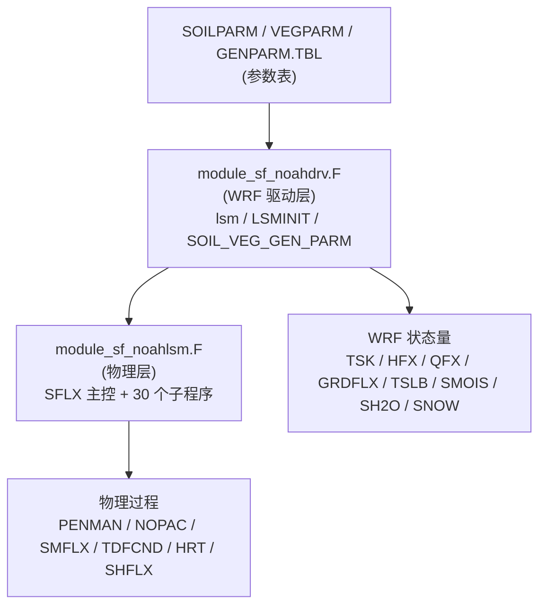
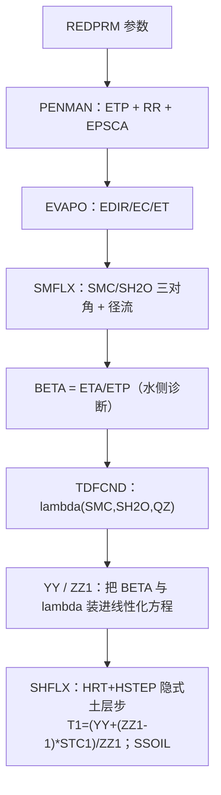
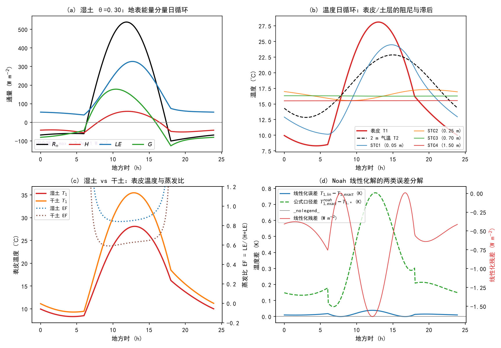
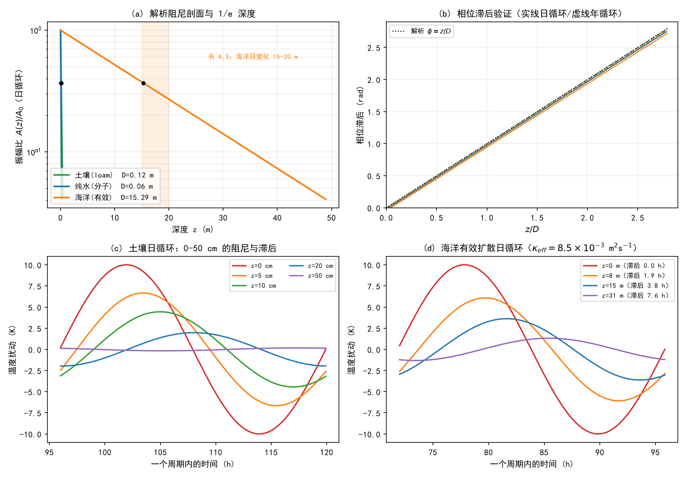
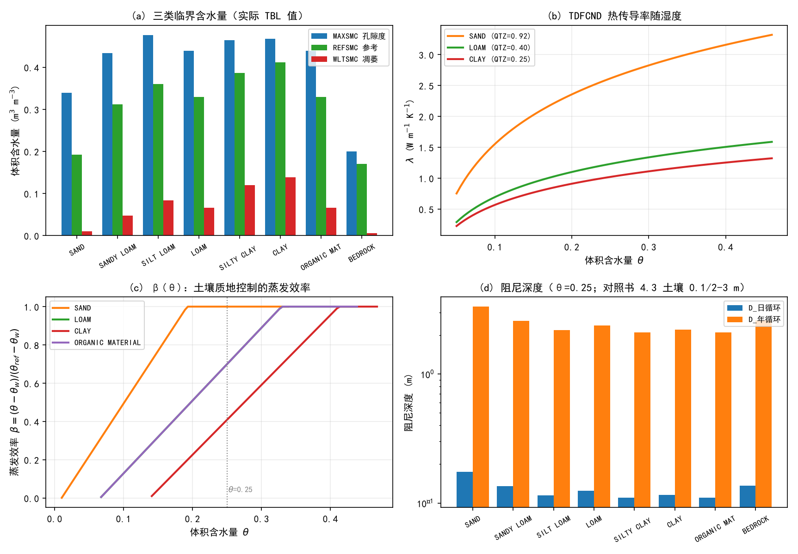

# 第 16 章 陆面过程族：海洋下边界、地表能量平衡与 Noah 的四层土壤

> 第 15 章我们处理完了大气“内部”最后一块拼图——对流。但把整个大气看成一台热机，还有一个角色始终没登场：**下边界**。辐射从上面来，积云把热量往上送，而真正决定“地表收到多少能量、又还给大气多少”的，是脚下这两片性质天差地别的表面：**海洋**（占地球表面 71%，热惯性是大气热容量的 3120 倍）与**陆地**（土壤、植被、雪盖、城市）。WRF 里管这件事的方案族叫**陆面方案（land surface model, LSM）**，namelist 开关是 `sf_surface_physics`；与之配对负责“地表与最低模式层之间怎么交换感热、潜热、动量”的另一族方案是**面层方案（surface layer scheme）**，开关是 `sf_sfclay_physics`。一个 `surface_driver` 里装两族方案，正是本章 16.4 节要拆的第一件事。
>
> 本章的物理基础来自《大气物理学》第四章的两节：**4.2 大气质量及其垂直分布**（印刷页 55–56）与 **4.3 大气的主要下边界——海洋**（印刷页 56–58）。4.2 给出“单位截面积气柱质量 $m_0=p_0/g$”这样一个简单而深刻的公式，它让我们一眼看懂“薄壳”比喻的定量含义；4.3 则把海洋这个最大热源的热惯性、垂直分层与能量收支讲透。第 4 章的第四节内容（地表能量平衡、土壤热传导）书里没有展开，本章按模式实现补上一个“物理框架”：**$R_n=H+LE+G$ 的地表收支**与**阻尼深度 $D=\sqrt{2\kappa/\omega}$**——这两个式子将是 16.8 节轻轨实验的骨架。
>
> WRF 侧我们精读 **Noah**（`sf_surface_physics=2`，1997 年 Chen 等统一开发、WRF 的长寿默认方案，`module_sf_noahdrv.F` + `module_sf_noahlsm.F`），对照 Slab、RUC、Noah-MP、CLM4、CTSM、PX、SSiB 七个替代方案（差异表），并把**三张参数表**（SOILPARM/VEGPARM/GENPARM）与 **geogrid→real→wrfinput 的静态场链路**一次讲清——“土壤类型从哪来、植被覆盖度从哪来、深层温度 TMN 从哪来”，这些答案都在这里。

---

## 16.0 本章地图

### 16.0.1 书小节结构与对应关系

| 书节 | 印刷页 | 本章节 | 内容 | 类型 |
|---|---|---|---|---|
| 4.2 大气质量及其垂直分布 | 55–56 | 16.1 | (4.2.1)–(4.2.3)、表 4.1、“薄壳” | **精讲【考点】** |
| 4.3 大气的主要下边界——海洋（引言） | 56 | 16.2.1 | 71% 面积、水汽来源、最大热源、气团源地、ENSO | **精讲【考点】** |
| 4.3.1 海洋的物理特性 | 56–58 | 16.2.2–16.2.4 | 热容量 3120×、三层结构、50% 能量、穿透深度 15–20 m / 200–300 m | **精讲【考点】** |
| 4.3.2 海流 | 57–58 | 16.2.5 | 风海流、暖冷流、图 4.8 等温线 | 精讲（简述） |
| （书未展开；模式实现补讲） | — | 16.3 | $R_n=H+LE+G$；$\partial T/\partial t=\kappa\partial^2T/\partial z^2$；阻尼深度；$\beta$ 蒸发效率 | **精讲【考点】** |
| 习题（第四章） | 59 | 16.9.1 | 第 3/4/5 题 | 全解 + 对照 |
| 部分习题答案（第四章） | 545 | 16.9.1 | 3.(1)–(3)、4、5 全部数值答案 | 对照表 |

> 目录核验：书目录（`book\page_0008.jpg`）实测——4.2 起于印刷页 55、4.3 起于 56、习题在 59、参考文献 60；答案页在印刷页 545（`book\page_0559.jpg`）。直读页实测 4.2 正文含 (4.2.1)–(4.2.3) 与表 4.1；4.3 引言与 4.3.1、4.3.2 齐全。

### 16.0.2 考点清单（自拟版，待 PPT 校准）

> 第 4 章课件未到，以下按书 4.2/4.3 与课程大纲自拟；PPT 到货后补“考点透视”并校准。第 4 章书内习题 3（温湿密度 + 等温层厚度 + 水汽柱）与习题 5（对流层质量占比）就是“柱质量”公式的三道应用题，本章 16.9 节给出全解与答案页对照。

**名词解释（拟）**：单位截面积气柱质量；标高（薄壳）；海洋热惯性；季节变化层（上混合层）；主（温）跃层；下均匀层；周日温度跃层；海流（风海流、暖洋流、冷洋流）；地表能量平衡；净辐射；感热通量；潜热通量；土壤热通量；土壤热传导率（TDFCND）；体积热容（HCPCT）；阻尼深度；相位滞后；蒸发效率 $\beta$；蒸发比 BETA=ETA/ETP；皮肤温度；交换系数 CH；（模式侧）陆面方案；面层方案；静态场；TMN；damping depth。

**简答（拟）**：
1. 由静力方程证明单位截面积空气柱质量 $m_0=p_0/g$（(4.2.1)），并说明为什么取 $g$ 为常数会低估实际值。
2. 用 (4.2.3) 解释表 4.1：为什么说“50 km 以下集中了几乎全部大气质量”？“地球一层薄壳”的定量依据是什么？
3. 比较大气、海洋与陆地土壤三者的热惯性，说明海水温度日变化不足 0.1 ℃ 而沙漠地面日较差可达 40 ℃ 以上的双重原因（热容量 × 混合深度）。
4. 海洋垂直三层（季节变化层/主跃层/下均匀层）各自的热力角色是什么？“周日温度跃层”怎么形成？
5. 写出地表能量平衡方程 $R_n=H+LE+G$ 各项的定义与常用符号约定，并说明夜间各项的典型符号（对照书 6.10 辐射逆温）。
6. 推导周期强迫下土壤温度的解 $T(z,t)=A_0e^{-z/D}\sin(\omega t-z/D)$，说明阻尼深度与相位滞后的物理含义。
7. 为什么说“海洋是大气最重要的热源”？海洋通过哪三条通道向大气输送能量？

**计算（拟）**：习题 3（温湿密度 + 等温层厚度 + 水汽柱质量，四种口径）；习题 5（对流层质量占比）；表 4.1 的柱质量复算；阻尼深度 $D=\sqrt{2\kappa/\omega}$（土壤/水/海洋三口径）；由 λ(θ) 与 HCPCT 算 $\kappa$；（模式侧）由 DZS 与 ZS 算 Noah 四层界面与层距；由 $KDT=REFKDT\cdot D_{ksat}/REFDK$ 算入渗参数。

### 16.0.3 源码锚点总表（本章全部实测核验）

| # | 锚点（文件 + 符号） | 用途 | 状态 |
|---|---|---|---|
| 1 | `dyn_em/module_first_rk_step_part1.F` → `surface_driver`（辐射之后、PBL 之前） | 物理序列中的位置 | 已核验 |
| 2 | `phys/module_surface_driver.F`（`SUBROUTINE surface_driver`：`sfclay_select` / `sfc_select` 两族 SELECT CASE） | 方案分发、DTBL 节拍、ZLVL、ICE/urban 分支 | 已核验 |
| 3 | `phys/module_sf_noahdrv.F`（`lsm` / `LSMINIT` / `lsm_mosaic` / `SOIL_VEG_GEN_PARM`；Q2SAT/DQSDT2 计算、Bolton 饱和式常数 A2=17.67/A3=273.15/A4=29.65） | WRF 驱动层：读表、字段装换、雪/冻土初始化 | 已核验 |
| 4 | `phys/module_sf_noahlsm.F`（`SFLX` / `PENMAN` / `NOPAC` / `SNOPAC` / `TDFCND` / `HRT` / `HSTEP` / `SHFLX` / `SMFLX` / `EVAPO` / `DEVAP` / `CANRES` / `REDPRM` / `CSNOW` / `TBND`） | Noah 物理层（本章主角） | 已核验 |
| 5 | `phys/module_sf_noahlsm_glacial_only.F`（`SFLX_GLACIAL`） | 冰川点分支（VEGTYP=ISICE 且 ICE=−1） | 已核验 |
| 6 | `phys/module_sf_slab.F`、`module_sf_ruclsm.F`、`module_sf_noahmpdrv.F`、`module_sf_clm.F`、`module_sf_ctsm.F`、`module_sf_pxlsm.F`、`module_sf_ssib.F` | 替代方案（差异表用） | 已核验 |
| 7 | `phys/module_sf_sfclay.F` / `module_sf_sfclayrev.F` / `module_sf_mynn.F` / `module_sf_pxsfclay.F` 等 | 面层方案族（对照） | 已核验 |
| 8 | `share/module_soil_pre.F`（`init_soil_depth_1/2/3/7/8`、`init_soil_2_real`） | WPS 土层→模式层的插值与 DZS 设定 | 已核验 |
| 9 | `run/SOILPARM.TBL` / `VEGPARM.TBL` / `GENPARM.TBL` / `LANDUSE.TBL` | 三张参数表（表值全部实读） | 已核验 |
| 10 | WPS `geogrid/GEOGRID.TBL`（LANDUSEF/SOILCTOP/SOILTEMP/GREENFRAC/LAI12M 条目） | 静态场链路（TBL→wrfinput 字段） | 已核验 |
| 11 | `Registry/Registry.EM_COMMON`（`sf_surface_physics` 与 `sf_sfclay_physics` package 块） | 方案号表 | 已核验 |
| 12 | `run/README.namelist`（`physics_suite`、Noah 段、`sf_surface_physics` 段） | namelist 官方说明 | 已核验 |

### 16.0.4 与前后章的衔接

- **第 10 章 → 本章**：第 10 章讲过大气质量垂直分布与静力平衡的坐标含义；本章 16.1 把它还原成书 4.2 的“柱质量”语言，16.1.3 用 (4.2.3) 把表 4.1 与“$\sigma$ 坐标下的地形追随”接上。
- **第 12 章 → 本章**：辐射方案的输出（`SWDOWN`/`GLW`/`COSZEN`）就是陆面方案的输入（16.4.1 的调用链：辐射 → 地面）；第 12 章未细讲的云对地表的增温效应，在本章的夜辐射冷却里会以 $R_n<0$ 的形式现身。
- **第 13/14/15 章 → 本章**：微物理给陆面降水（驱动土壤湿度与雪），PBL 决定地表通量被“吸收”的效率，积云影响降水落区——本章的 $H$、$LE$、$G$ 正是这三章的共同下游账本。
- **本章 → 第 17 章**：`sf_surface_physics` 之上还有一个城市开关 `sf_urban_physics`（1/2/3 = SLUCM/BEP/BEM）。本章 16.4.4 的城市接口、16.5.7 的 ISURBAN 覆盖（SHDFAC=0.05、SMCMAX=0.45、DF1=3.24）是第 17 章城市冠层方案的地基；`URBPARM*.TBL` 与 `LCZ_1…LCZ_11=51…61` 也在本章 16.6 立账。
- **本章 → 论文 2 / 个例**：精细下垫面（NLCD40）与 sst_update 是“下垫面定制”的两条主线（16.6.4）；16.10 给出接口清单。

---

## 16.1 大气质量及其垂直分布（书 4.2，印刷页 55–56）【考点】

### 16.1.1 问题的提法与 (4.2.1)

书 4.2 开门见山地问：**大气到底有多重**？最干净的量不是总质量，而是“单位截面积上的空气柱质量”：

$$m_0=\int_0^{\infty}\rho\,\mathrm{d}z \tag{4.2.1}$$

利用静力方程 $\mathrm{d}p=-\rho g\,\mathrm{d}z$ 以及大气上界 $p=0$ 的条件，两步就把经纬度、温度廓线全部消掉：

$$m_0=-\int_{p_0}^{0}\frac{\mathrm{d}p}{g}=\int_0^{p_0}\frac{\mathrm{d}p}{g}=\frac{p_0}{g}$$

取 $g\approx 9.8\ \mathrm{m\cdot s^{-2}}$ 为常数、全球平均地面气压 $p_0=985$ hPa，书上得到

$$m_0\approx \frac{98500}{9.8}=10044\ \mathrm{kg\cdot m^{-2}}$$

> **口径记录**：这里书特意提醒——$g$ 随高度会减小（第 10 章的地球重力讨论），所以取常数 $g$ 会把 $m_0$ **低估**。用“逐层 $g$”积分得 10331 kg·m⁻² 量级（1013.25 hPa、$g=9.80665$ 的口径），比 10044 大 2.9%。这个 2–3% 的分歧在本章会以“账面差”的形式反复出现（4.2 与 4.3 两处“大气总质量”数字不一致的根源），16.9 节当作一道“口径题”处理。

### 16.1.2 从柱质量到总质量：三个“数量级坐标系”

把 $m_0$ 乘地球表面积 $4\pi R_E^2$（$R_E=6.37\times10^8$ cm $=6370$ km）就得到大气总质量约 $5.12\times10^{15}$ t。书用这三个数字给读者建立“圈层质量坐标系”：

- **大气总质量** $\approx 5.12\times10^{15}$ t；
- **地球固体部分** $\approx 6.0\times10^{21}$ t——大气约为固体地球的 $10^{-6}$（书说“不及陆圈的 $1/10^5$”，是把“陆圈”理解为地壳+部分地幔的口径）；
- **海洋质量** $\approx 1.40\times10^{18}$ t——**气圈质量约为水圈的 $1/273$**。

顺带解释一处本章必须记住的“书内两口径”：4.3.1 节说“海水总质量约为大气的 **267 倍**”，而 4.2 的这行数字给出 **1/273**。两者都是“海洋/大气”质量比，差异全部来自大气总质量的两种估计（$p_0=985$ hPa、$g=9.8$ → 5.12×10¹⁵ t；与 $p_0=1013.25$ hPa、$g=9.80665$ → 5.27×10¹⁵ t，后者给出 $1.40\times10^{18}/5.27\times10^{15}=266\approx267$）。**判读**：引用哪个数字都行，但要带上“$p_0$、$g$ 口径”，这是书本留给读者的第一道“数值素养”题。

### 16.1.3 一层大气的质量占比：(4.2.2) 与 (4.2.3)

对**等压面 $p_1$ 与 $p_2$ 之间的气层**，柱质量为

$$m=\frac{p_1-p_2}{g}\qquad\text{（(4.2.2)）}\qquad \frac{m}{m_0}=\frac{p_1-p_2}{p_0}\qquad\text{（(4.2.3)）}$$

(4.2.3) 是“读气压表就能读质量”的公式：$\Delta p=100$ hPa $\Leftrightarrow$ 全气柱质量（$\sim$10³ kg·m⁻²）的 10%。表 4.1 就是拿标准大气的气压高度廓线代进 (4.2.3) 算出来的：

**表 4.1 不同高度以下大气质量占整个大气质量的百分比**

| 高度/km | 11 | 30 | 50 | 90 |
|---|---|---|---|---|
| 气压/hPa | 226.4 | 11.97 | 0.8 | $1.8\times10^{-5}$ |
| $m/m_0$/% | 77.6 | 98.8 | 99.92 | 99.999 |

读表要点：
1. **11 km 以下（对流层主体）已占 77.6%**——第 13–15 章的微物理、湍流、对流全部发生在这“不足 8 成质量”的薄层里；
2. **30 km 以下 98.8%、50 km 以下 99.92%、90 km 以下 99.999%**——包括平流层在内的 50 km 以下集中了“几乎全部”大气质量；
3. 对应书上那句比喻：大气“好像是地球的一层薄壳”——**这薄薄的一层是地球生命赖以生存的保障**。

> **模式视角**：表 4.1 的 11 km/77.6% 与 WRF 的垂直分层直接相关。WRF 的 $\eta$ 面在低层密、高层疏（第 10 章），正是为了“把网格点按质量分布投放”：底 2 km 放十几个点、11 km 以上只放廖廖几层，因为那里既没有水汽也没有大质量。第 9 章的 `eta_levels` 生成脚本 `workspace/scripts/gen_eta_levels.py` 就是用这套质量分布做的标定。

---

## 16.2 大气的下边界：海洋（书 4.3，印刷页 56–58）【考点】

### 16.2.1 海洋的三重身份（4.3 引言，印刷页 56）

书 4.3 的引言用四句话给海洋定了三重身份，值得逐句拆：

1. **“大气水汽的主要来源是海洋表面的蒸发，特别是副热带海洋的蒸发”**——第 11 章的水汽账（(2.2.6) 量级）在这里有了源头：副热带高压区的强蒸发把水汽送进信风，成为全球水循环的“银行”。
2. **“海洋还是最大的热源，也是气候变化的缓冲器和调节器”**——热惯性（16.2.2 的 3120 倍）决定它既是慢加热器也是慢冷却器；1–2 周尺度的天气过程中它近乎“恒温浴”。
3. **“海流是由低纬向高纬输送能量的重要工具”**——16.2.5 的海流一节展开。
4. **“广阔而均匀的洋面是气团形成的源地之一”**——海上的气团（热带海洋气团、极地海洋气团）正因下垫面均一而比陆气团“干净”。

接着两句是海气相互作用的总纲：“大气对海洋的影响，主要表现在海水的流动；而海洋对大气的影响，则主要表现在改变空气的温湿特性。”书用“厄尔尼诺南方涛动（ENSO）”作为大规模海气耦合最引人注目的例子——热带南太平洋这片面积 $3.6\times10^8$ km²（占地球表面积 71%、平均水深约 3800 m）的“恒温水槽”，与大气之间的低频振荡至今是全球季节预测的主心骨。

### 16.2.2 热惯性：3120 倍与“3 m = 整个大气”

4.3.1 节的核心数字链（印刷页 56）：

- 海水含氯、钠等 80 多种元素；**盐度平均约 3.47%**，盐分组成近乎常数，所以可把海水看成“纯水 + 盐”的混合物；**密度约 1.0255–1.0285 t·m⁻³，约为海面附近空气密度的 800 倍**；
- **海水总质量约为大气的 267 倍，比热容约为空气的 4 倍**；
- 乘积得结论：**海洋热容量是大气的 3120 倍**——“**海洋上层 3 m 厚海水的热容量就相当于整个大气的热容量**”。

两句直接后果：
1. **海水温度的日变化不到 0.1 ℃**（年变化也只有几度）——而第 12 章的辐射强迫在正午可给地表 800 W·m⁻² 的净输入，这些能量在海表被“摊”进几十米的混合层，温度计几乎不动；陆地上同样的能量却把沙漠表层顶起 40 ℃ 的日较差。这是“海陆风环流”的物理起点；
2. **沿海地区因此产生特殊气象过程**（海陆风、海雾、迎岸海风气流）——它们在本节只是结论，机制留到第 18 章群落方案外的时间随缘。

### 16.2.3 海洋的垂直三层与两处温度跃层（图 4.6）

**表 16.1 图 4.6 的三层结构（印刷页 56）**

| 层 | 厚度 | 特征 | 备注 |
|---|---|---|---|
| **季节变化层**（上混合层） | 约 100 m | 因风浪搅拌混合均匀 | 中纬度春、夏出现**季节性温度跃层**（图 4.6 的 B、D 线） |
| **主（温）跃层** | 1000–1500 m | 温/密/盐陡变的过渡层 | 大洋热力结构重要组成部分；强度沿经纬向变化 |
| **下均匀层** | 其下 | 温/密/盐垂直变化很小 | 均匀状态，深层海水几乎不受表面水温与季节/纬度影响 |

书接着给出两条量化深度的物理依据（这两句是 16.8.2 实验 E2 的“靶子”）：

1. **“太阳辐射能量的 90% 被海面约 10 m 的水层吸收”**——所以海表吸收的不是“一层皮”，而是十几米的水体；
2. **随太阳辐射的周日变化，季节变化层中会出现周日温度跃层**——白天表层受热、夜间对流混合，混合层本身有日循环。

温度随深度如何分布：低纬海区比高纬高（温差可达 30 ℃）；热带/温带主跃层中水温迅速下降——**1000 m 约 4–5 ℃、2000 m 约 2–3 ℃、3000 m 约 1–2 ℃**；**全球海洋平均温度约 3.5 ℃，75% 的海水温度在 0–6 ℃**。可见“暖”只是海面薄薄一层的事——主跃层以下占体积绝大多数的冷水，才是地球最大的“冷库”，也是气候系统长记忆（世纪尺度）的载体。

### 16.2.4 能量收支与穿透深度：15–20 m 与 200–300 m

书 4.3.1 末尾给出能量账（印刷页 57）：

- 大气能量来源是太阳辐射能；但**大气只吸收太阳短波辐射的 20%**；
- 经大气吸收、散射与地面反射后，**50% 的太阳辐射能到达地球表面**，**大部分被海洋吸收**；
- **（关键对比）海水透明度适中，太阳辐射能影响到相当深的水层：海洋温度日变化可达 15–20 m 深，年变化可达 200–300 m 深；而土壤只有约 0.1 m 与 2–3 m**；
- 结论：**海洋是巨大的太阳能储库**，通过红外辐射、湍流输送感热和水汽蒸发潜热向大气输送能量——“**大气的热源主要是地球表面（海洋和陆地），海洋是最重要的热源**”。

> **模式视角预告**：15–20 m / 200–300 m 这两个数字将在 16.8.2 的实验 E2 里被“反向工程”：把书值代入阻尼深度公式 $D=\sqrt{2\kappa/\omega}$ 反演，得到海洋的**有效热扩散率** $\kappa_{\rm eff}\approx1.1\times10^{-2}$ m²·s⁻¹（日循环）与 $6.2\times10^{-3}$ m²·s⁻¹（年循环）——比纯水的分子热扩散率（$1.4\times10^{-7}$ m²·s⁻¹）大 **4–5 个数量级**。也就是说：**书上的“穿透深度”不是分子传导的结果，而是风浪搅拌（湍流混合）的结果**；把海洋当“一盆静水”算，只会得到 6 cm 的日变化深度。这正是 WRF 里海温必须靠 `sst_update`/slab 的混合层参数化“喂”进去、而不能指望 1 m 深的水层自己扩散的原因（16.4.4 与 16.7）。

### 16.2.5 海流：能量的“传送带”（4.3.2，印刷页 57–58）

海流（洋流）是“海水以相对稳定速度沿一定途径的大规模流动”。书列出的影响因素有五个：**盛行风、海水密度不均匀、地转偏向力、海底地形、海岸线轮廓和岛屿**。核心事实链：

- **表层海流由风对海面的摩擦作用产生 → 风海流**；北半球副热带高压下形成明显的顺时针环流（南半球相反）；**海流速率比气流速率平均约小 2 个数量级**——海气相互作用中动能由大气向海洋输送；
- **低纬环流的经向支**：北半球大陆东岸由低纬流向中高纬的**暖洋流**（黑潮、墨西哥湾暖流），大陆西岸由中高纬流向低纬的**冷洋流**（加利福尼亚流、秘鲁海流）；
- **中高纬**：北半球逆时针（东岸冷流如堪察加冷流、西岸暖流如阿拉斯加暖流）；南半球西风盛行 → **南极环极流**；
- **热力角色**：**暖流区向大气提供热量、对大气有加热作用；冷流区从大气获得热量**（冷流上方的低层大气被冷却，形成逆温与海雾）；
- 两个经典例证：**墨西哥湾暖流**的分支（北大西洋漂流）使西北欧温和湿润、挪威沿海高纬且冬季不结冰；**黑潮**使日本气候温和湿润，太平洋东西两岸同纬度温差约 10 ℃；
- 全局结论（书上原句）：“**如果没有海流输送热量和调节作用，极地和赤道间的温差将更大，地球上的大气运动与天气现象将会更加剧烈。**”

**图 4.8（全球海平面平均气温分布）读图三要点**：① 等温线不与纬线平行——地形、海陆分布、地表性质都在“掰弯”它们，大陆边缘的等温线多与海岸平行；② 1 月北半球大陆寒冷、海洋温暖（西伯利亚东北部与格陵兰两个最冷中心），西欧/美洲西岸比同纬度亚洲东部/美洲东部温暖——暖流与盛行风的联合作业；③ 7 月大陆比海洋热得多，15–35°N 出现 >30 ℃ 的高温带（撒哈拉最热、接近 40 ℃）；南半球因辽阔海洋，等温线多与纬圈平行，1 月最暖中心在大陆；赤道附近年变化不显著。

---

## 16.3 从物理到下边界方程：地表能量平衡与土壤热传导（模式实现补讲）【考点】

书 4.3 把海洋这一“特殊下边界”讲透了，但 WRF 面对的每个格点还有一半是陆地。本节把模式里实际求解的下边界方程组写成一个“最小物理框架”——它是 16.5 节 Noah 精读与 16.8 节实验的公共骨架。

### 16.3.1 地表能量平衡：$R_n=H+LE+G$

陆面方案在每个时间步求解的核心方程是**地表（皮肤）能量平衡**：

$$R_n=H+LE+G \tag{16.1}$$

其中（本章统一采用“取用正值 = 由地表向上输送”的符号约定；$G$ 按 Noah 源码约定取“向下为正”，见下）：

| 项 | 名称 | 表达式 | 典型日变化 |
|---|---|---|---|
| $R_n$ | 净辐射 | $(1-\alpha)S_{\downarrow}+L_{\downarrow}-\varepsilon\sigma T_s^4$ | 白天 +500 量级，夜间 −70 量级 |
| $H$ | 感热通量 | $\rho c_pC_H(T_s-T_2)$ | 白天向上、夜间可向下（暖空气加热冷地面） |
| $LE$ | 潜热通量 | $L_v\rho C_H\beta\,[q_{\rm sat}(T_s)-q_2]$ | 白天强、夜间弱（可转凝结/露） |
| $G$ | 土壤热通量 | $\lambda\,(T_s-T_1)/(0.5\,\Delta z_1)$ | 白天入土、夜间出土 |

上表里的 $T_s$ 是**表皮（皮肤）温度**、$T_2$ 是 2 m 气温、$C_H$ 是交换系数（由面层方案用相似理论算出——这正是 `sf_sfclay_physics` 那一族方案的分工）、$\beta\in[0,1]$ 是**蒸发效率**（16.3.3）。四条通道的物理图像：**净辐射是“收入”，$H+L E$ 是“还给大气的两条通道”，$G$ 是“存进土壤的活期存款”**。夜间 $R_n<0$，而 $LE$ 通常仍为正（只要 $q_{\rm sat}(T_s)>q_2$），缺额由 $H<0$（向下感热）与 $G<0$（土壤放热）补上——这就是书 6.10 辐射逆温的陆面账本（16.8.1 实验 E1 将给出逐项数值）。

> **符号约定提醒**：Noah 源码写的是 $F_{\rm DOWN}-\varepsilon\sigma T^4-SSOIL$ 的形式（`PENMAN` 中 `FNET = FDOWN - EMISSI*SIGMA*T24 - SSOIL`），其中 `SSOIL` 为**向下**土壤热通量；把它移到等号另一侧就是 (16.1) 的 $G$。读书面教材（$G$ 常指向上）与读代码（`SSOIL` 向下）时务必先对符号。

### 16.3.2 土壤热传导与阻尼深度：$D=\sqrt{2\kappa/\omega}$

土壤内部的温度演化用一维热传导方程描述：

$$\frac{\partial T}{\partial t}=\kappa\,\frac{\partial^2T}{\partial z^2},\qquad \kappa=\frac{\lambda}{C} \tag{16.2}$$

其中 $\lambda$ 是**热传导率**（W·m⁻¹·K⁻¹，Noah 里由 `TDFCND` 给出，16.5.4），$C$ 是**体积热容**（J·m⁻³·K⁻¹，Noah 里由 `HRT` 的四组分公式给出，16.5.6）。给定表面温度按周期强迫 $T(0,t)=A_0\sin(\omega t)$、深部温度无扰动，方程 (16.2) 的稳态解是

$$T(z,t)=A_0\,e^{-z/D}\sin\!\left(\omega t-\frac{z}{D}\right),\qquad D=\sqrt{\frac{2\kappa}{\omega}} \tag{16.3}$$

(16.3) 里藏着两个“考试常客”：

1. **振幅衰减**：深度 $z$ 处的振幅是 $A_0e^{-z/D}$；深度 $z=D$ 处衰减到 $1/e\approx37\%$；
2. **相位滞后**：$z$ 处落后表面 $z/D$ 弧度，折合时间 $\Delta t=(z/D)\cdot T_{\rm 周期}/2\pi$；在 $z=D$ 处恰好滞后一个周期的 $1/2\pi$（日循环 3.82 h）。

书 4.3 那两个“穿透深度”数字（15–20 m / 200–300 m）与“土壤 0.1 m / 2–3 m”实际上是 (16.3) 的两次应用，区别只在 $\kappa$：以 loam（第 6 类土壤）为例，$\lambda\approx1.34$ W·m⁻¹·K⁻¹、$C\approx2.4\times10^6$ J·m⁻³·K⁻¹ → $\kappa\approx5.6\times10^{-7}$ m²·s⁻¹ → **$D_{\rm 日}=0.124$ m、$D_{\rm 年}=2.37$ m**——与书的“土壤 0.1 m / 2–3 m”两处吻合；而海洋需要 $\kappa_{\rm eff}\sim10^{-2}$ m²·s⁻¹ 才能给出 15–20 m / 200–300 m（16.2.4 的“反向工程”）。**一个方程、两种 κ、三套深度尺度**，这就是本节与实验 E2 的全部内容。

### 16.3.3 蒸发效率 $\beta$ 与“水分约束”

(16.1) 中 $LE$ 的大小不是由能量决定，而是**由水分决定**——土壤没水，净辐射再多也变不成潜热，只能推高 $H$ 与 $G$（16.8.1 的“干土”实验）。陆面模式用**蒸发效率**（蒸发比）刻画这件事：

$$\beta=\frac{E}{E_{\rm pot}},\qquad \beta=\mathrm{clip}\!\left(\frac{\theta-\theta_w}{\theta_{\rm ref}-\theta_w},\,0,\,1\right)\in[0,1] \tag{16.4}$$

其中 $\theta$ 是体积含水量、$\theta_w$ 是凋萎点、$\theta_{\rm ref}$ 是“蒸腾不受水分限制”的参考含水量（Noah 里就是 SOILPARM 表的 WLTSMC 与 REFSMC 两列，16.6.1）；Noah 源码里把“水侧诊断”的蒸发比记为 **BETA = ETA/ETP**（`module_sf_noahlsm.F` 的 `SFLX` 末尾：`IF (ETP <= 0.) BETA = 0. ... ELSE BETA = ETA/ETP`），含义与 (16.4) 一致：**实际蒸发 / 潜在蒸发**。

> **结构预告**：Noah 把 (16.1)–(16.4) 拆成“**先水分、后能量**”的松耦合：先由 `EVAPO`/`SMFLX` 按水量定出 ETA 与 BETA，再把 BETA 代进经过线性化的 (16.1) 解出皮肤温度 $T_s$ 与土壤热通量 `SSOIL`（16.5.3–16.5.5）。这套“顺序求解”是理解 Noah 行为的钥匙，也是它与 Noah-MP、CLM 等“耦合求解”方案的本质区别（16.7）。

---

## 16.4 WRF 对应（一）：surface_driver、两族方案与静态场链路

### 16.4.1 调用链与节律（实测）

`surface_driver` 在物理序列里的位置（承接第 12/14 章）：


顺序的物理含义：**辐射先“定天”，地面再“接账”（按辐射收入加上边界条件算出 $R_n$、$H$、$LE$、$G$），然后 PBL 用这套地表通量做湍流垂直混合**。四个实测要点：

1. **一个 driver 装两族方案**（`phys/module_surface_driver.F`，`SUBROUTINE surface_driver`）：
   - **面层族**：`sfclay_select: SELECT CASE(sf_sfclay_physics)`——1 SFCLAYREV、2 MYJSFC、3 GFSSFC、4 QNSESFC、5 MYNNSFC、7 PXSFC、10 TEMFSFC、89 IDEALSCMSFC、91 SFCLAY（旧 MM5）；0 = 无；
   - **陆面族**：`sfc_select: SELECT CASE(sf_surface_physics)`——1 SLAB、2 **LSM（Noah）**、3 RUC、4 Noah-MP、5 CLM4、6 CTSM、7 PX、8 SSiB；0 = 无。
   两族的组合是自由的（例如 Noah + MYNN 面层），但个别组合有硬约束（16.7）。
2. **时间步**：Noah 以 **DTBL**（即 `bldt` 节拍；默认 `bldt=0` 表示每步调用）推进，`surface_driver` 内 `CALL lsm` 的实参是 `dtbl`；slab 同样用 `dtbl`（`SFCEVP` 累加 `QFX*DTBL`）。
3. **强迫高度**：`ZLVL = 0.5*DZ8W(i,1,j)`——**取最低模式层的层中高度**作为“近地面强迫参考高度”。第 14 章的 PBL 与本章的面层 $\to H$、$LE$ 都在这个高度上定义（真实陆面上的 2 m/10 m 诊断值由面层方案外推）。
4. **两个特殊分支**：`ICE == -1`（冰川点）走 `SFLX_GLACIAL`（`module_sf_noahlsm_glacial_only.F`）；城市点（`sf_urban_physics=1/2/3`）在 `module_physics_init.F` 的 LSMSCHEME 分支里额外调 `urban_param_init` + `urban_var_init`，并在 NLCD40 输入时把 IVGTYP 23/25 归并为 24（城市类合并，16.6.4）。

### 16.4.2 方案号表：注册表与 README 的双重口径

**表 16.2 `sf_surface_physics` 与 `sf_sfclay_physics` 方案号（实测）**

| `sf_surface_physics` | 方案 | 文件 | 土壤层数 | 备注 |
|---|---|---|---|---|
| 0 | 无 | — | — | 无地表温度预报（湖海点仍走面层水点分支） |
| 1 | SLAB 热扩散 | `module_sf_slab.F` | 5（0.01 倍增） | 仅温度扩散、湿度固定；教学/对照用 |
| 2 | **Noah LSM** | `module_sf_noahdrv.F` → `module_sf_noahlsm.F` | **4** | 本章主角；1997 统一版 |
| 3 | RUC | `module_sf_ruclsm.F` | 6 或 9 | 多层 + 次网格；雪多层 |
| 4 | Noah-MP | `module_sf_noahmpdrv.F` | 4（可配） | 多物理选项（`&noah_mp`） |
| 5 | CLM4 | `module_sf_clm.F` | ~10 | 来自 CAM |
| 6 | CTSM | `module_sf_ctsm.F` | ~ | 见 `doc/README.CTSM` |
| 7 | PX | `module_sf_pxlsm.F` | 2（0.01/0.99 m） | 需配 PX 面层 |
| 8 | SSiB | `module_sf_ssib.F` | 2（0.05/1.00 m） | 需配 Dudhia/RRTM/CAM/RRTMG 辐射 |

| `sf_sfclay_physics` | 方案 | 文件 |
|---|---|---|
| 1 | SFCLAYREV（修订 MM5） | `module_sf_sfclayrev.F` |
| 2 | MYJ | `module_sf_myj.F` 系 |
| 3 | GFS | `module_sf_gfs.F` 系 |
| 4 | QNSE | `module_sf_qnse.F` |
| 5 | MYNN | `module_sf_mynn.F` |
| 7 | PX | `module_sf_pxsfclay.F` |
| 10 | TEMF | `module_sf_temfsfclay.F` |
| 89 | IDEAL（理想实验） | `module_sf_idealscmsfclay.F` |
| 91 | SFCLAY（旧 MM5 原版） | `module_sf_sfclay.F` |

> **纪律**：方案号以 `Registry/Registry.EM_COMMON` 的 package 块与 `run/README.namelist` 为准；本表是逐一打开源码文件核对后的结果。四点提醒：① `sf_surface_physics` 与 `sf_sfclay_physics` 是**两个独立开关**，物理套件（`physics_suite`）给的是推荐组合；② slab 的 5 层、RUC 的 6/9 层、PX 的 2 层、SSiB 的 2 层全部由 `share/module_soil_pre.F` 的 `init_soil_depth_*` 家族设定，Noah/Noah-MP 共用的 `init_soil_depth_2` 若收到非 4 层参数会直接报致命错误（“The Noah and NoahMP LSMs use 4 layers”）；③ 城市开关 `sf_urban_physics=1/2/3`（SLUCM/BEP/BEM）只在 Noah/Noah-MP 等特定陆面方案下有定义，且 BEP/BEM 官方仅与 YSU/MYJ/BouLac 三个 PBL 兼容（第 14 章 14.7 与第 17 章）；④ 下表 16.2 的“备注”列涉及的组合约束以 `README.namelist` 原文为准。

### 16.4.3 静态场链路：geogrid → real → wrfinput → Noah

Noah 每个格点“是什么地面”完全是静态输入决定的。链路三站：

**第一站 WPS geogrid**（`geogrid/GEOGRID.TBL` 条目实测）：
- `LANDUSEF`（land_cat 分类）→ 主成分类 = `LU_INDEX`（Noah 的 `IVGTYP` 植被/土地利用类型）；
- `SOILCTOP`（soil_cat 分类）→ 主成分 = `SCT_DOM`（Noah 的 `ISLTYP`，**顶层**土壤类型）；`SOILCBOT` → `SCB_DOM`（底层）；
- `SOILTEMP`（连续场，掩膜 water、缺测填 0）→ `TMN`（**年均深层土壤温度**——就是 16.5.6 里土层底部边界 `TBOT` 的来源）；
- `GREENFRAC`（连续场）→ `VEGFRA`（植被覆盖度）；`LAI12M`（连续场）→ 月 LAI（`rdlai2d=.true.` 时启用）。

**第二站 `real.exe`**（`share/module_soil_pre.F`）：把 WPS 的土壤分层（两层 SOILCTOP/SOILCBOT + 4 层 SOILHGT 系）插值到 Noah 的 4 层（DZS = 0.1/0.3/0.6/1.0 m，`init_soil_depth_2`），并按地温初猜构造 `TSLB`/`SMOIS`；`wrfinput` 里携带 `ZS`/`DZS`（Registry state，流 Z）。

**第三站 Noah**（`LSMINIT`，`module_sf_noahdrv.F`）：把 wrfinput 的字段变成模式内部量——`SNOALB = MAXALB(IVGTYP)*0.01`（未启用 rdmaxalb 时）；`SH2O` 初始化按 `TSLB<273.149 K` 走 Koren 等 1999 的冻土首猜并用 `FRH2O` 迭代求液态水含量；`ISLTYP<1` 直接报致命错误；雪深/雪高初始化。

**表 16.3 静态场字段对照速查**

| 需求 | wrfinput 字段 | 来源（geogrid 条目） | Noah 内部变量 |
|---|---|---|---|
| 植被/土地利用类型 | `LU_INDEX`/`IVGTYP` | LANDUSEF 主成分 | IVGTYP（查 VEGPARM） |
| 土壤类型（顶层/底层） | `ISLTYP`、`SCT_DOM`/`SCB_DOM` | SOILCTOP/SOILCBOT 主成分 | ISLTYP（查 SOILPARM） |
| 深层土壤温度 | `TMN` | SOILTEMP | TBOT（底部边界） |
| 植被覆盖度 | `VEGFRA` | GREENFRAC | SHDFAC | 
| 月 LAI（可选） | 月 LAI 场 | LAI12M | XLAI（rdlai2d） |
| 海表温度（可选） | `SST` / wrflowinp | sst_update（auxinput4） | 水点 TSK |

### 16.4.4 namelist 联动速查（与陆面相关的全部条目）

**表 16.4 陆面/面层相关 namelist（实测 README 与源码口径）**

| 条目 | 默认/常用 | 作用 | 口径提醒 |
|---|---|---|---|
| `sf_surface_physics` | 2（Noah 常用） | 陆面方案号 | 与 `sf_sfclay_physics` 独立 |
| `sf_sfclay_physics` | 1（SFCLAYREV） | 面层方案号 | 决定 $C_H$、$C_D$ |
| `num_soil_layers` | README 默认 5 | 模式土壤层数 | **Noah 必须设 4**（否则致命错误） |
| `surface_input_source` | 1（默认）/3 | 静态场来源口径 | 3 = 用 geogrid 的 TBL 插值（推荐） |
| `num_land_cat` | 21（USGS）/24（MODIS） | 地表分类数 | 必须与所用 TBL 一致（NLCD40 时 40+） |
| `default_soiltype` | 8（SILTY CLAY LOAM） | 海陆不明处的缺省土壤 | 填“数据空洞”用 |
| `sst_update` / `auxinput4` | 0 / 关闭 | 时变 SST（wrflowinp） | 与 `usemonalb` 联用效果好 |
| `usemonalb` | .false. | 用月反照率 | 需配 sst_update 的年循环输入 |
| `rdmaxalb` | .true. | 雪反照率来自 geogrid | 与 LSMINIT 的 SNOALB 逻辑互斥 |
| `rdlai2d` | .false. | 用 2D 月 LAI | 需 geogrid 的 LAI12M |
| `ifsnow` | 1 | 雪方案 | 对温度预报影响显著 |
| `sf_surface_mosaic` / `mosaic_cat` | 0 / 3 | 次网格镶嵌 | 马赛克地表用 |
| `sst_skin` | 0 | 皮温诊断 | 与 sst_update 配合 |
| `lagday` | 150 | TMN 更新窗口（天） | TMN 由 150 天皮肤温度平均更新 |
| `sf_surf_irr_scheme` | 0 | 灌溉（仅 Noah） | 1 渠道 / 2 滴灌 |
| `opt_thcnd` | 1 | 土壤热传导选项 | 1 Johansen/Peters-Lidard；2 对 silt/sandy loam 用 McCumber-Pielke |
| `num_urban_*`（ndm/ng/nwr/nz/ngb/nf/nbui） | 各 1 | 城市网格参数 | 激活时 2/10/10/18/10/10/15（第 17 章） |

上表口径小结：**`num_soil_layers` 与 `num_land_cat` 是“表-模式一致性”的守门员**；`sst_update` 与 `usemonalb`/`rdmaxalb`/`rdlai2d` 是“静态场升级包”；`opt_thcnd` 与 `sf_surf_irr_scheme` 是 Noah 的两个物理开关。更细的读表逻辑与字段含义在 16.6 节。

---

## 16.5 精读：Noah（`sf_surface_physics=2`）

### 16.5.1 三层文件结构：驱动、物理、参数表

Noah 在 WRF 里的“躯体”分三层，职责分明：



- `module_sf_noahdrv.F`（驱动层）：把 WRF 场翻译成 SFLX 的实参——计算 **Q2SAT 与 DQSDT2**（饱和比湿及其对温度的导数；用 Bolton 1980 形式：$e_s=611.2\exp[17.67(T-273.15)/(T-29.65)]$，$\mathrm{d}q_{\rm sat}/\mathrm{d}T=q_{\rm sat}\cdot4302.65/(T-29.65)^2$，其中 $4302.65=A_2(A_3-A_4)$、$A_2=17.67$、$A_3=273.15$、$A_4=29.65$，全部实测；雪面时改用冰面关系 $6174/T^2$，$6174=L_s/R_v$ 的量级）、组装植被/土壤参数、处理雪与冰盖分支；`LSMINIT` 在初始化阶段调用；`SOIL_VEG_GEN_PARM` 负责读三张表。
- `module_sf_noahlsm.F`（物理层）：`SFLX` 主控 + `PENMAN`/`NOPAC`/`SNOPAC`/`TDFCND`/`HRT`/`HSTEP`/`SHFLX`/`SMFLX`/`EVAPO`/`DEVAP`/`CANRES`/`REDPRM`/`CSNOW`/`TBND` 等约 30 个子程序——**本章精读的全部公式都在这里**。
- 表文件见 16.6。

> **口径提醒**：WRF 里**有两套饱和水汽压公式并存**——本章这条（driver 侧）是 $611.2\exp[17.67(T-273.15)/(T-29.65)]$（Bolton 1980，正是书第四章参考文献里的 Bolton）；而第 13 章的 Thompson/WSM6 微物理走的是另一族系数（$\exp[17.2693882(T-273.16)/(T-35.86)]$ 系）。物理上差千分位以内，但**对照“模式里的数字”时必须按所在模块的公式**。本章实验 E1 采用 driver 侧口径，与书 4.2 参考文献体系一致。

### 16.5.2 `SFLX` 主控流程：一条线看懂 Noah 的一天

`SFLX` 的实测推进顺序（括号内为调用的子程序）：

**① 参数组装**（`REDPRM`）→ **② 雪状态更新**（`SNOW_NEW` 累积新雪；`CSNOW` 稻雪热传导；`SNFRAC` 雪盖分数）→ **③ 反照率与发射率**（`ALCALC`）→ **④ 土壤热传导率**（`TDFCND`）→ **⑤ 雪面粗糙度**（`SNOWZ0`）→ **⑥ 潜在蒸发**（`PENMAN` 算 ETP 以及线性化系数 RR/EPSCA）→ **⑦ 分叉**：

- **无雪** `NOPAC`（本章主战场）：`EVAPO`（水分分配：EDIR 裸土直接蒸发 / EC 冠层蒸发 / ET1 逐层蒸腾）→ `SMFLX`（土壤湿度与径流）→ **诊断 BETA=ETA/ETP** → `TDFCND` → **线性化解皮肤温度**（YY/ZZ1）→ `SHFLX`（`HRT`+`HSTEP` 更新土层温度、再算 `SSOIL`）；
- **有雪** `SNOPAC`（雪层包：雪面能量平衡 + 融雪）。

**⑧ 相变热通量收尾**：`FLX1`（雨水热通量）、`FLX2`（冻雨）、`FLX3`（雪面）→ **⑨ 输出** ETA/BETA/SHEAT/SSOIL/FLX 等到 WRF 状态量。

时间轴上的“水分先行、能量后解”：



**这张图的顺序就是 Noah 的“性格”**：水（ETA）先由土壤湿度定案，能量（T1、SSOIL、SHEAT）后解——而不是两者联立迭代。对比见 16.7。

### 16.5.3 水分先行：`EVAPO` → `SMFLX` → BETA

**`EVAPO`（蒸发分配）**：把潜在蒸发 ETP 拆成三份——**裸土直接蒸发 `EDIR`**（`DEVAP` 里用 $E_{\rm DIR}=F_X(1-{\rm SHDFAC}){\rm ETP}$，$F_X$ 是含水量与指数 $F_XEXP=2.0$ 的函数）、**冠层蒸发 `EC`**（冠层储水 `CMC` 供水）、**逐层蒸腾 `ET1`**（根系层 `NROOT` 加权，权重用土壤湿度与 `SMCREF`/`SMCWLT` 的相对位置——`CANRES` 里那个 $\mathrm{GX}=(SMC-SMCWLT)/(SMCREF-SMCWLT)$ 就是它）。`CANRES` 还把冠层阻力折算成**植物系数 PC**（PC × 线性化 Penman 势蒸发 = 含 $R_C$ 的 Penman-Monteith 实际蒸发）。

**`SMFLX`（土壤湿度与径流）**：实测要点——
- 冠层水账：`RHSCT = SHDFAC*PRCP1 - EC`；超出冠层容量 `CMCMAX`（0.5 mm）的部分降为 `DRIP`；
- 到达地面的水：`PCPDRP = (1-SHDFAC)*PRCP1 + DRIP/DT`；
- 冻土变量 `SICE = SMC - SH2O`（总含水量 = 液态 + 固态）；
- 土壤湿度用 **`SRT`/`SSTEP` 三对角隐式**推进（Richards 方程的线性化版；文献注释指名 Kalnay & Kanamitsu 1988 的 “time scheme F”，**同一时间步内两次调用**以抑制 $2\Delta T$ 振荡）；
- 径流三兄弟：**`RUNOFF1` 超渗**（降水强度超过入渗能力，入渗能力由 `KDT` 缩放）、**`RUNOFF2` 基流**（`SLOPE` 线性水库）、**`RUNOFF3` 深层**（最底层以上溢出）；入渗参数

$$KDT=\mathrm{REFKDT}\cdot\frac{D_{ksat}}{\mathrm{REFDK}},\qquad \mathrm{REFKDT}=3.0,\ \mathrm{REFDK}=2.0\times10^{-6}\ {\rm m\cdot s^{-1}} \tag{16.5}$$

即“基准入渗 3 倍 × 该类土壤的饱和导水率相对值”（E3 会给出沙/黏土差 48 倍）。

**BETA 的收口**（`SFLX` 内实测）：

$$\text{ETP}\le0:\quad \mathrm{BETA}=0\ (\text{且 ETP}<0\ \text{时 BETA}=1);\qquad \text{ETP}>0:\quad \mathrm{BETA}=\mathrm{ETA}/\mathrm{ETP} \tag{16.6}$$

这个 BETA 就是 16.3.3 的 $\beta$ 在 Noah 里的实现（“水侧”诊断），下一步被直接代入能量方程。

### 16.5.4 土壤热传导 `TDFCND`：从石英含量到 $\lambda$

`TDFCND` 给出 (16.2) 里的 $\lambda$，方法出自 **Peters-Lidard 等 1998（改自 Johansen 1975）**，实测公式链（未冻结或混合口径）：

$$ \lambda_{\rm s}=\lambda_{\rm qz}^{Q_z}\lambda_{\rm o}^{1-Q_z}\quad (\lambda_{\rm qz}=7.7,\ \lambda_{\rm o}=2.0,\ \lambda_{\rm w}=0.57,\ \lambda_{\rm ice}=2.2) \tag{16.7}$$

先算“固体骨架”传导率 $\lambda_{\rm s}$（石英 $7.7$、其他矿物 $2.0$ 的几何平均，$Q_z$ 为石英含量），再算饱和值：

$$\lambda_{\rm sat}=\lambda_{\rm s}^{1-\theta_{\rm sat}}\lambda_{\rm ice}^{\theta_{\rm sat}-X_u}\lambda_{\rm w}^{X_u},\qquad X_u=X_{\rm unfroz}\cdot\theta_{\rm sat},\quad X_{\rm unfroz}=\frac{{\rm SH2O}}{{\rm SMC}} \tag{16.8}$$

干土传导率用干密度 $\rho_d=(1-\theta_{\rm sat})\cdot2700$ kg·m⁻³：

$$\lambda_{\rm dry}=\frac{0.135\rho_d+64.7}{2700-0.947\rho_d} \tag{16.9}$$

最后用 **Kersten 数**（冻结分支取饱和度、未冻结分支取 $K_e=\log_{10}(\theta/\theta_{\rm sat})+1$，且饱和度 $>0.1$ 才启用）做加权：

$$\lambda=A_{ke}\,(\lambda_{\rm sat}-\lambda_{\rm dry})+\lambda_{\rm dry},\qquad A_{ke}=\frac{({\rm SMC}-{\rm SH2O})\cdot\frac{\rm SMC}{\theta_{\rm sat}}+{\rm SH2O}\cdot K_e}{\rm SMC} \tag{16.10}$$

三个工程事实：① **$\lambda$ 随湿度单调增**（E3 的图 3b：沙土因 $Q_z=0.92$ 高居 2–3.4 W·m⁻¹·K⁻¹，黏土 0.4–1.3）；② **`OPT_THCND=2`** 时对 silt loam(4)、sandy loam(3) 改用 McCumber & Pielke 式（$\Psi_f=\Psi_{\rm sat}\cdot100\cdot(\theta_{\rm sat}/\theta)^{B}$，$pF=\log_{10}|\Psi_f|$，$\lambda=420e^{-(pF+2.7)}$，$pF\le5.1$，否则 0.1744）；③ **城市特例 $\lambda=3.24$**（`NOPAC` 里 `IF (VEGTYP == ISURBAN) DF1=3.24`）；植被则用 $\lambda \leftarrow \lambda\,e^{{\rm SBETA}\cdot{\rm SHDFAC}}$（SBETA=−2.0）做“冠层对下伏土热通量的削减”。

### 16.5.5 皮肤温度的线性化解：PENMAN 与 YY/ZZ1

Noah 不迭代求解 (16.1)，而是**在气温 $T_A$ 处把长波辐射线性化**（注意：**线性化参考温度是气温、不是皮肤温度**——`PENMAN` 里 `T24 = SFCTMP*SFCTMP*SFCTMP*SFCTMP`，实测），得到 (16.1) 的闭式解。`PENMAN` 的关键量（全部实测）：

$$RR=1+\frac{\varepsilon\,T_A^4\cdot6.48\times10^{-8}}{p\,C_H}+\frac{c_{\rm w}P_{\rm prcp}}{\rho c_pC_H},\qquad 6.48\times10^{-8}=\frac{4\sigma R_d}{c_p} \tag{16.11}$$

$$F_{\rm NET}=F_{\rm DOWN}-\varepsilon\sigma T_A^4-{\rm SSOIL},\qquad {\rm RAD}=\frac{F_{\rm NET}}{\rho c_pC_H}+TH_2-T_A \tag{16.12}$$

$$A=\frac{L_v}{c_p}\,(q_{\rm sat}(T_A)-q_2),\qquad \Delta=\frac{L_v}{c_p}\,\frac{\mathrm{d}q_{\rm sat}}{\mathrm{d}T}\Big|_{T_A},\qquad {\rm EPSCA}=\frac{A\,RR+{\rm RAD}\,\Delta}{\Delta+RR} \tag{16.13}$$

$$\mathrm{ETP}={\rm EPSCA}\cdot\frac{\rho c_pC_H}{L_v} \tag{16.14}$$

> **读法**：(16.11) 的 $RR$ 是“辐射线性化阻尼 + 1”，把 $RR$ 乘 $\rho c_p C_H$ 就得到 $4\varepsilon\sigma T_A^3+\rho c_pC_H$——即**长波线性化系数与湍流交换系数之和**（可自行展开验证）。(16.13) 就是 Penman 公式的“辐射项 + 空气动力学项”配平，其中 $\Delta$ 是饱和比湿曲线的斜率。

有了 EPSCA，皮肤温度由三行代码给出（`NOPAC` 实测）：

$${\rm YYNUM}=F_{\rm DOWN}-\varepsilon\sigma T_A^4 \tag{16.15}$$
$$YY=T_A+\frac{{\rm YYNUM}/(\rho c_pC_H)+TH_2-T_A-\mathrm{BETA}\cdot{\rm EPSCA}}{RR} \tag{16.16}$$
$$ZZ1=1+\frac{\lambda_1}{0.5\,\Delta z_1\,(\rho c_pC_H)\,RR} \tag{16.17}$$
$$T_1=\frac{YY+(ZZ1-1)\,{\rm STC}(1)}{ZZ1},\qquad {\rm SSOIL}=\frac{\lambda_1\,[{\rm STC}(1)-T_1]}{0.5\,\Delta z_1} \tag{16.18}$$

物理解读：**$YY$ 是“若土壤通量为零时皮肤温度会是多少”**（被 $RR$ 阻尼的开环解），**$ZZ1>1$ 是土壤耦合带来的“下拉因子”**：$ZZ1$ 越大（$\lambda_1$ 大、土层薄、交换强），$T_1$ 越被拉向 ${\rm STC}(1)$；无极土壤耦合时 $ZZ1\to1$、$T_1\to YY$。(16.18) 第二式的 `SSOIL` 就是 16.3.1 的 $G$（向下为正）。

**本章实验 E1 对这套线性化做了现场体检**（16.8.1）：把 (16.15)–(16.18) 的线性化解与“同公式口径下的精确解”对比，湿土（θ=0.30）时**温度误差 ≤0.039 K、能量残差 ≤1.6 W·m⁻²**；干土（θ=0.15）时放大到 **≤0.26 K、≤9.0 W·m⁻²**——**线性化在正常湿度的偏差可以忽略，在干旱半边天（表皮热、$\Delta$ 大）才开始显形**。这就是“手册公式”与“全隐式求解”的代价差，量级可放心。

### 16.5.6 土层隐式步与底部边界：`HRT` / `HSTEP` / `TBND`

**热容**（`HRT` 实测，体积热容 J·m⁻³·K⁻¹）：

$$C={\rm SH2O}\cdot4.2\times10^6+(1-\theta_{\rm sat})\cdot{\rm CSOIL}+(\theta_{\rm sat}-{\rm SMC})\cdot1004+({\rm SMC}-{\rm SH2O})\cdot2.106\times10^6 \tag{16.19}$$

四项依次是**液态水 + 干土基质 + 孔隙空气 + 冰**（CSOIL=2.0×10⁶，城市点 3.0×10⁶；冰的 2.106×10⁶ J·m⁻³·K⁻¹ 与空气的 1004 J·m⁻³·K⁻¹ 相差三个量级——所以冻土的热容由冰项主导）。

**方程与离散**：对 (16.2) 做隐式（后向欧拉）离散热传导方程，层间界面传导率取相邻层平均；`HRT` 组装右端 `RHSTS` 与三对角系数 `AI/BI/CI`，`HSTEP` 用追赶法解出新的 `STCF` 并回写 `STC`。**底边界**：最底层通过传导与 **TBOT@ZBOT**（ZBOT=−8 m 的深层）交换：

$$F_{\rm bot}=\lambda_4\frac{{\rm STC}(4)-{\rm TBOT}}{D_{\rm bot}},\qquad D_{\rm bot}=0.5\,(Z_{\rm SOIL}(3)+Z_{\rm SOIL}(4))-{\rm ZBOT}=6.5\ {\rm m} \tag{16.20}$$

TBOT 的语义按源码注释是“**局地年均地表气温**”（来自 wrfinput 的 **TMN**，16.4.3）——**这就是 geogrid 的 SOILTEMP 静态场进入 Noah 的最后一站**。

**表 16.5 Noah 四层几何（实测三数组）**

| 数组 | 含义 | 值 |
|---|---|---|
| `DZS` | 各层厚度 | 0.1 / 0.3 / 0.6 / 1.0 m（总深 2.0 m） |
| `ZSOIL` | 各层**底界面**深度（源码内为负） | −0.1 / −0.4 / −1.0 / −2.0 m |
| `ZS` | 各层**层中**深度 | 0.05 / 0.25 / 0.70 / 1.50 m |

顶层 0.1 m 的选择与 16.3.2 的土壤日穿透深度（E2 实测 0.124 m）同量级——**模式层的取法跟着物理穿透深度走**；而 2.0 m 总深＋TBOT 底边界的组合，保证年循环（$D_{\rm 年}=2.37$ m，E2）只影响最底下半层，不会在短期积分里“漏”出边界。

### 16.5.7 初始化与参数体系：`LSMINIT` 与 `REDPRM`

**`LSMINIT`（初始化，实测）**：`SNOALB = MAXALB(IVGTYP)*0.01`（未启用 rdmaxalb 时雪反照率来自 VEGPARM 的 MAXALB 列）；**冻土液态水初始化**——当 `TSLB < 273.149 K` 时用 Koren 等 1999 的显式首猜加 `FRH2O` 迭代求出液态水含量 `SH2O`（否则 `SH2O = SMOIS`）；`ISLTYP < 1` 报致命错误；雪深/雪高的初始化。

**`REDPRM`（参数组装，实测）**：从三张表把植被/土壤/全局参数搬进来并派生——`KDT`（(16.5)）、`FRZFACT = (SMCMAX/SMCREF)*(0.412/0.468)`（冻土修正因子）、`SLOPE`（按 SLOPETYP 查 `SLOPE_DATA`：1=0–8%、2=8–30%、3=>30%、4=0–30%、5=0–8 & >30%、6=8–30 & >30%、7=全、9=冰川、空=海）、`TOPT=298 K`、`CMCMAX=0.5e-3 m`、`RSMAX=5000 s·m⁻¹`、`BARE=19`/`NATURAL=5`/`CROP=3`（USGS 类号）。

**城市覆盖（SFLX 内实测）**：`REDPRM` 之后如果 `VEGTYP == ISURBAN`，直接改写：`SHDFAC=0.05、RSMIN=400、SMCMAX=0.45、SMCREF=0.42、SMCWLT=0.40、SMCDRY=0.40`——配合 $\lambda=3.24$ 与 `CSOIL=3.0e6`，这就是 Noah 眼里的“城市”（第 17 章的城市冠层方案在此之上叠加 SLUCM/BEP/BEM 的几何与人为热）。

### 16.5.8 雪与冻土分支

- **`SNOPAC`（有雪包）**：雪面温度独立求解，雪层通过 `CSNOW`（雪热传导率随雪密度指数变化，Dyachkova 1960 式）与土层耦合；`SNFRAC` 由雪深与 `SALP=2.6` 的分布函数给出雪盖分数；融雪用能量收支法。
- **相变热通量三兄弟**（`NOPAC` 实测）：`FLX1=CPH2O*PRCP*(T1-SFCTMP)`（雨水降到皮肤温度的显热项）；`FLX2=-LSUBF*PRCP`（冻雨结冰释热，LSUBF=3.335×10⁵ J·kg⁻¹）；`FLX3` 雪面融化项。
- **冰川点**：`ICE == -1` 时走 `SFLX_GLACIAL`（`module_sf_noahlsm_glacial_only.F`）——只做冰面能量平衡与消融，不做土壤水分。

---

## 16.6 参数表体系：SOILPARM / VEGPARM / GENPARM 与读表逻辑

### 16.6.1 `SOILPARM.TBL`：土壤物理参数（19 类，10 字段）

表内两节：**`STAS`（Noah 用）与 `STAS-RUC`（RUC 用）**；Noah 按行读 10 个字段：`BB`（Clapp-Hornberger 指数）、`DRYSMC`、`F11`、`MAXSMC`（孔隙度）、`REFSMC`（参考含水量）、`SATPSI`（饱和水势）、`SATDK`（饱和导水率）、`SATDW`（饱和扩散率）、`WLTSMC`（凋萎点）、`QTZ`（石英含量），另加 BEP/Noah-MP 扩展 7 列（BVIC/AXAJ/BXAJ/XXAJ/BDVIC/BBVIC/GDVIC）。**表值实读三行**：

**表 16.6 代表土壤的行值（STAS 节）**

| 类 | 名称 | BB | MAXSMC | REFSMC | SATPSI | SATDK | SATDW | WLTSMC | QTZ |
|---|---|---|---|---|---|---|---|---|---|
| 1 | SAND | 2.79 | 0.339 | 0.192 | 0.069 | 4.66e-5 | 2.65e-5 | 0.010 | 0.92 |
| 6 | LOAM | 5.25 | 0.439 | 0.329 | 0.355 | 3.38e-6 | 1.43e-5 | 0.066 | 0.40 |
| 12 | CLAY | 11.55 | 0.468 | 0.412 | 0.468 | 9.74e-7 | 1.12e-5 | 0.138 | 0.25 |

**四条派生式**（源码注释给出；E3 拿它做全表互核，常规类吻合到舍入误差）：

$$\log_{10}({\rm F11})=\log_{10}{\rm SATPSI}+{\rm BB}\cdot\log_{10}{\rm MAXSMC}+2 \tag{16.21}$$
$${\rm SATDW}={\rm BB}\cdot{\rm SATDK}\cdot\frac{{\rm SATPSI}}{\rm MAXSMC} \tag{16.22}$$
$${\rm REFSMC}={\rm REFSMC}_1+\frac{1}{3}(\theta_{\rm sat}-{\rm REFSMC}_1),\quad {\rm REFSMC}_1=\theta_{\rm sat}\left(\frac{5.79\times10^{-9}}{{\rm SATDK}}\right)^{1/(2{\rm BB}+3)} \tag{16.23}$$
$${\rm WLTSMC}=0.5\cdot{\rm WLTSMC}_1,\qquad {\rm WLTSMC}_1=\theta_{\rm sat}\left(\frac{200}{{\rm SATPSI}}\right)^{-1/{\rm BB}} \tag{16.24}$$

> **口径记录**：$5.79\times10^{-9}$ m·s⁻¹ = 0.5 mm·d⁻¹——(16.23) 是“把 0.5 mm/d 输运作为参考通量”定出的参考含水量；WLTSMC 的两步关系（${\rm WLTSMC}=0.5\,{\rm WLTSMC}_1$）抄的是 Wetzel & Chang 的旧定义。**四条公式在 WRF 4.8.0 里全部是注释**（计算链直接用表值；见 E3 互核），但它们就是这张表的“设计图纸”（注释原文明说 SATDW = BB·SATDK·(SATPSI/MAXSMC) 等）。

### 16.6.2 `GENPARM.TBL`：全局参数（Slope/BETA/CSOIL/REFDK…）

实测常数清单（Noah 用 `GENPARM` 全表）：

| 参数 | 值 | 作用 |
|---|---|---|
| `SLOPE_DATA` | 9 类数组 | 基流系数（按 SLOPETYP，见 16.5.7） |
| `SBETA` | −2.0 | 植被削减土壤热通量的指数（16.5.4） |
| `FXEXP` | 2.0 | 裸土蒸发含水量指数（DEVAP） |
| `CSOIL` | 2.0×10⁶ J·m⁻³·K⁻¹ | 干土基质热容（urban 3.0×10⁶） |
| `SALP` | 2.6 | 雪盖分数分布形状参数 |
| `REFDK` / `REFKDT` | 2.0×10⁻⁶ m·s⁻¹ / 3.0 | 入渗基准（16.5.3 的 (16.5)） |
| `FRZK` | 0.15 | 冻土参数 |
| `ZBOT` | −8.0 m | 深部边界深度（16.5.6） |
| `CZIL` | 0.1 | 热粗糙度 $z_{0h}/z_{0m}$ 常数 |
| `SMLOW` / `SMHIGH` | 0.5 / 3.0 | 冻土导水缩放两端的含水量 |
| `LVCOEF` | 0.5 | 叶面积-覆盖率转换系数 |

### 16.6.3 `VEGPARM.TBL`：植被参数（USGS 27 类；MODIS/NLCD40 另有节）

字段（17 个）：`SHDFAC`（覆盖度）、`NROOT`（根层数）、`RS`（最小气孔阻力）、`RGL`、`HS`、`SNUP`、`MAXALB`（最大雪反照率，×0.01）、`LAIMIN/LAIMAX`、`EMISSMIN/MAX`、`ALBEDOMIN/MAX`、`Z0MIN/MAX`（粗糙度）、`ZTOPV/ZBOTV` 等。代表行实读：

| 类 | 名称 | 关键值 | 备注 |
|---|---|---|---|
| 1 | Urban | SHDFAC=0.10、NROOT=1、RS=200、MAXALB=46、Z0=0.50 | 城市裸参数（ch17 接管） |
| 7 | Grassland | SHDFAC=0.80、RS=40、Z0=0.10–0.12 | 草地 |
| 16 | Water | SHDFAC=0、NROOT=0、RS=100、MAXALB=70、ALBEDO=0.08、Z0=0.0001 | **水点**（配合 ISLTYP=14） |
| 19 | Barren | RS=999、ALBEDO=0.38、MAXALB=75 | 裸地 |
| 24 | Snow/Ice | NROOT=1、RS=999、MAXALB=82、ALBEDO=0.55–0.70、Z0=0.001 | 雪冰面 |

表底部数据块：`TOPT_DATA=298.0`、`CMCMAX_DATA=0.5e-3`、`CFACTR_DATA=0.5`、`RSMAX_DATA=5000.0`、`BARE=19`、`NATURAL=5`、`CROP=3`、**`LCZ_1…LCZ_11 = 51…61`**（WUDAPT **局地气候区**类号——第 17 章城市方案按 LCZ 定制参数时的入口）。

### 16.6.4 读表逻辑与三类“守门”一致性

**读表逻辑（`SOIL_VEG_GEN_PARM` 实测）**：头两行规定分类名 `MMINSL`（如 `STAS`）；第 3 行给 `SLCATS,IINDEX`（类别数与索引纲量）；随后逐类读固定字段；**分类名与期望不符直接报致命错误**；读完再由 `wrf_dm_bcast` 广播到各进程（每进程一份，避免运行期 IO）。植被表按 `LANDUSEC`（USGS/MODIS/**NLCD40**）选择对应节——**低密度居住区、高密度居住区与工业类必须存在**（NLCD40 新表要求；用旧表配 NLCD40 会报错）。

**三类守门一致性**（背下来能省很多调试时间）：
1. **层数守门**：Noah/Noah-MP 必须 `num_soil_layers=4`（否则 `init_soil_depth_2` 直接致命错误）；
2. **类别数守门**：`num_land_cat` 必须与所用 VEGPARM 节一致（USGS=24 类实际用到 21、MODIS=21、NLCD40=40+）；`IVGTYP` 超界会致命；
3. **土壤类守门**：`ISLTYP` 必须 ≥1 且 ≤19（STAS 节列数），且**水点必须走 ISLTYP=14**（WATER 行：MAXSMC=1.0、SATPSI=0、SATDK=0——TDFCND/导水链对水点没有定义，E3 已核验其被排除在派生式互核之外）；NLCD40 输入时 geogrid 侧把 IVGTYP 23/25 归并为 24（城市类合并）。

---

## 16.7 差异表与接口：`sf_surface_physics` 0–8 与城市开关

**表 16.7 陆面方案差异表（实测）**

| # | 方案 | 土壤层 | 湿度过程 | 雪 | 备注 |
|---|---|---|---|---|---|
| 0 | 无 | — | 无 | — | 无地表温度预报 |
| 1 | SLAB 热扩散 | 5（0.01 倍增） | 无（固定湿度） | 简单 | 仅温度扩散；对照用 |
| 2 | **Noah** | **4** | 有（SMC/SH2O；冻土 FRH2O） | 显式雪层（SNOPAC） | 本章主角；三张 TBL |
| 3 | RUC | 6 或 9 | 有（多层）+ 次网格 | 多层雪 | 需 `flag_sm_adj` 等 |
| 4 | Noah-MP | 4（可配） | 多物理选项（含地下水、动态植被） | 多层 | `&noah_mp` 段 |
| 5 | CLM4 | ~10 | 完整陆面过程 | 多层 | 来自 CAM |
| 6 | CTSM | ~ | 完整 | 多层 | 见 `doc/README.CTSM` |
| 7 | PX | 2（0.01/0.99 m） | 有 + 间接 nudging | 简单 | **需配 PX 面层** |
| 8 | SSiB | 2（0.05/1.00 m） | 有 | 简单 | 需配 Dudhia/RRTM/CAM/RRTMG 辐射 |

**组合约束三条**（README 原文口径）：① PX 陆面配 PX 面层；② SSiB 的辐射选项受限于四个允许方案；③ 城市开关 `sf_urban_physics=1/2/3`（SLUCM/BEP/BEM）**仅与 YSU/MYJ/BouLac 三个 PBL 兼容**（第 14 章 14.7 已立此账；MYNN 不在官方组合清单里），且 SLUCM/BEM 还需要 `num_urban_*` 参数组与 URBPARM 表族。

**城市接口速览**（第 17 章展开）：`module_sf_urban.F`（SLUCM，单层冠层）、`module_sf_bep.F` / `module_sf_bep_bem.F`（多层冠层/建筑能量模型）；参数表 `URBPARM.TBL`、`URBPARM_LCZ.TBL`（局地气候区版）、`URBPARM_UZE.TBL`；参数初始化在 `module_physics_init.F` 的 LSMSCHEME 分支（`urban_param_init` + `urban_var_init`）。本章在 Noah 里看到的“城市”（${\rm SHDFAC}=0.05$、$\lambda=3.24$、SMCMAX=0.45）是**把城市当一种特殊土壤/植被**；第 17 章的城市方案则在此之上加“屋顶-墙面-路面”的三维能量账。

---

## 16.8 轻轨实验：能量平衡、阻尼深度与 SOILPARM（E1–E4）

> 脚本：`workspace/scripts/ch16_experiment.py`（本机 Python 轻轨，可复现）；日志：`workspace/logs/ch16_experiment.log`；图 3 张存 `doc/figs/`。物理口径均按本章源码实测公式实现（Bolton 饱和式、TDFCND、HCPCT、PENMAN/YY/ZZ1、SOILPARM 实表），**不依赖集群**。

### 16.8.1 E1：地表能量平衡日循环与闭合法核验

**实验配置**：单柱（无平流）、定压 1000 hPa；理想化太阳角日循环 $S_\downarrow=880\sin[\pi(h-6)/12]$ W·m⁻²（6–18 h），向下长波 $L_\downarrow=285$ W·m⁻²（晴空），2 m 气温 $T_2=291+5\cos[2\pi(h-15)/24]$ K、RH=50%；$C_H=0.008$、$\varepsilon=0.97$、$\alpha=0.20$；loam（表 16.6 第 6 行）四层土层全显式步（$\Delta t=300$ s，顶通量 = SSOIL、底通量 = TBOT@ZBOT），表皮温度用 `brentq` **精确**求解 (16.1)（本轮不动土壤水分，$\beta$ 由初值 θ 冻结给定——水分预报是 SMFLX 的职责，16.5.3）；spin-up 3 天 + 记录 1 天。

**核心数字（实测）**：

| 量 | 湿土 θ=0.30（β≈0.89） | 干土 θ=0.15（β≈0.32） |
|---|---|---|
| 白天均 Rn / H / LE / G (W·m⁻²) | 316.4 / 20.6 / 214.6 / 81.1 | 284.6 / 71.2 / 132.8 / 80.5 |
| 夜间均 Rn / H / LE / G (W·m⁻²) | −72.5 / −46.8 / +54.3 / −80.0 | −79.3 / −34.1 / +25.5 / −70.6 |
| 白天蒸发份额 LE/(H+LE) | **0.911** | **0.650** |
| 表皮 T1 最高 / 最低 | 28.1 ℃ / 8.3 ℃ | 35.5 ℃ / 9.3 ℃ |
| 夜间逆温最强 T2−T1 | 5.80 K | 4.84 K |
| 瞬时闭合残差 max\|Rn−H−LE−G\| | **2.0×10⁻¹¹ W·m⁻²** | 1.2×10⁻¹¹ W·m⁻² |
| 日累计 ∫Rn/∫H/∫LE/∫G (MJ·m⁻²) | 10.44 / −1.14 / 11.55 / 0.03 | 8.78 / 1.58 / 6.80 / 0.40 |
| 柱收支 Δ(ΣC·dz·T) vs Σ(G−Fbot)dt | 差 4×10⁻⁹ % | 差 2×10⁻¹⁰ % |

**四条结论**：
1. **闭合是“算出来的”**：瞬时残差 10⁻¹¹ W·m⁻² 量级（brentq 求解精度），日累计失配 3.6×10⁻¹⁴ MJ·m⁻²；柱能量收支在显式步下 telescoping 精确（残差 <10⁻⁸ 相对），——**“$R_n=H+LE+G$” 在本实验里不是心情，是可核验的恒等式**；
2. **干湿对比就是 (16.4) 的功效展示**：θ 从 0.30 降到 0.15，β 从 0.89 降到 0.32，白天蒸发份额从 0.91 降到 0.65，**表皮升温 7.4 K**（35.5 vs 28.1 ℃）——“同样辐射、不同水分、不同体温”，这正是陆面温度对土壤湿度的敏感性（E3 将从参数侧给出 $\beta(\theta)$ 曲线）；
3. **夜间四通道的符号结构**：$R_n<0$（辐射亏损 72–79 W·m⁻²），$H<0$（暖空气向下供能），$LE>0$（蒸发仍在继续——只在 $q_{\rm sat}(T_s)>q_2$ 的（半）湿润表面成立），$G<0$（土壤放热）——**$T_1<T_2$，皮肤温度低于气温 4.8–5.8 K，正是书 6.10 辐射逆温的陆面源头**；
4. **Noah 线性化的“体检报告”**：与同公式口径的精确解相比，湿土 $|\Delta T_1|\le0.039$ K、残差 $\le1.6$ W·m⁻²；干土放大到 0.26 K / 9.0 W·m⁻²。另有一项“公式口径差”（Noah 的 $LE=\mathrm{BETA}\cdot{\rm EPSCA}\rho c_pC_H$ 形式 vs 精确 $q_{\rm sat}(T_1)$ 形式）：湿土 ≤0.77 K、干土 ≤3.09 K（正午）——**这就是 16.7 所说“顺序求解”的结构性偏差，方向是“干天下皮温偏高”**。



### 16.8.2 E2：土壤-海洋阻尼深度与书 4.3 对照

**实验设计**：一维热扩散 (16.2) 的隐式（后向欧拉+追赶法）数值解，表面正弦强迫 $A_0=10$ K、初始场取解析稳态（消除瞬态），末周期做单频最小二乘拟合提取振幅与相位；六组算例覆盖（土壤/纯水/海洋有效）×（日循环/年循环）。

**核心数字（实测）**：

| 介质 | κ (m²·s⁻¹) | D 日 (m) | D 年 (m) | 数值验证偏差 |
|---|---|---|---|---|
| 土壤（loam, θ=0.30；λ=1.337、C=2.382×10⁶） | 5.61×10⁻⁷ | 0.124 | 2.37 | −0.54% / −0.06% |
| 纯水（分子热扩散） | 1.40×10⁻⁷ | 0.062 | 1.19 | −0.55% / −0.10% |
| 海洋（有效/风浪混合） | 8.5×10⁻³ | 15.29 | 292.1 | −1.07% / −0.22% |

相位验证：数值相位斜率与解析 $1/D$ 逐例吻合（如土壤日循环 8.004 vs 8.049 m⁻¹；海洋年循环 0.00342 vs 0.00342 m⁻¹）。

**与书 4.3 的对账三行**：
1. **土壤**：$\kappa_{\rm soil}$ 由本章的 TDFCND+HCPCT 公式自身算出（1.337 W·m⁻¹·K⁻¹ / 2.382×10⁶ J·m⁻³·K⁻¹），得 $D_{\rm 日}=0.124$ m、$D_{\rm 年}=2.37$ m——**与书“0.1 m / 2–3 m”两处都对上**；
2. **海洋**：由书值（15–20 m、200–300 m）**反演** $\kappa_{\rm eff}\approx1.1\times10^{-2}$（日）与 $6.2\times10^{-3}$ m²·s⁻¹（年）——取 $8.5\times10^{-3}$ m²·s⁻¹ 同时落在两组范围（15.3 m、292 m）；
3. **纯水**：分子扩散只有 0.062 m / 1.19 m（6 cm / 1.2 m）——**海洋 15–20 m 的穿透深度不是“水自己传热”，而是风浪搅拌把有效热扩散放大 ~5×10⁴ 倍**。这正是模式侧“海温必须被给定或参数化”（sst_update/slab）的物理根据。

相位滞后结论：海洋日循环在 $z=15$ m 处滞后 **3.75 h**、30 m 处 **7.49 h**（1/e 深度处恰好 $T_{\rm 周期}/2\pi=3.82$ h）——**“深海记忆”的定量起点**。



### 16.8.3 E3：SOILPARM 表敏感性与全表互核

**实验设计**：直接解析 `run/SOILPARM.TBL` 的 STAS 节，① 用四条派生式 (16.21)–(16.24) 对全表逐类互核；② 对 θ=0.25 的未冻土计算 β、TDFCND λ、HCPCT、κ、$D_{\rm 日/年}$、KDT。

**互核结果（实测）**：常规类（1–16）最大偏差 F11=0.60（SILT 5：表值 0.162 vs 式算 0.764，**疑与 SILT LOAM 行混同**）、REFSMC=0.062（BEDROCK 15：表值 0.17 vs 式算 0.108）、WLTSMC=5×10⁻⁴（舍入）；SATDW 相对偏差 ≤0.44%（舍入）。**人工特殊类 17–19**（PLAYA/LAVA/WHITE SAND）最大偏差 F11=8.33、REFSMC=0.062、WLTSMC=0.108——**源码注释明言这三类按“导热似沙、导水似黏土”人工设定，不满足派生式**。→ **判读**：四条派生式是“设计图纸”，常规类吻合到舍入；三处例外 + 三类特设是**表本身的历史痕迹**，读表时应该“信表不疑式”，但知道式才能理解表值为何是这些数。

**类间对照（θ=0.25，未冻土；实测）**：

| 土壤 | BB | MAXSMC | REFSMC | WLTSMC | β(0.25) | λ (W·m⁻¹·K⁻¹) | κ (m²·s⁻¹) | D日 (m) | D年 (m) | KDT |
|---|---|---|---|---|---|---|---|---|---|---|
| SAND | 2.79 | 0.339 | 0.192 | 0.010 | **1.000** | 2.614 | 1.10e-6 | 0.174 | 3.33 | 69.9 |
| SANDY LOAM | 4.74 | 0.434 | 0.312 | 0.047 | 0.766 | 1.446 | 6.63e-7 | 0.135 | 2.58 | 7.85 |
| SILT LOAM | 5.33 | 0.476 | 0.360 | 0.084 | 0.601 | 0.998 | 4.76e-7 | 0.114 | 2.19 | 4.22 |
| LOAM | 5.25 | 0.439 | 0.329 | 0.066 | 0.700 | 1.230 | 5.66e-7 | 0.125 | 2.38 | 5.07 |
| SILTY CLAY LOAM | 8.72 | 0.464 | 0.387 | 0.120 | 0.487 | 0.931 | 4.39e-7 | 0.110 | 2.10 | 3.05 |
| CLAY | 11.55 | 0.468 | 0.412 | 0.138 | 0.409 | 1.020 | 4.83e-7 | 0.115 | 2.20 | 1.46 |
| ORGANIC | 5.25 | 0.439 | 0.329 | 0.066 | 0.700 | 0.956 | 4.40e-7 | 0.110 | 2.10 | 5.07 |
| BEDROCK | 2.79 | 0.200 | 0.170 | 0.006 | 1.000 | 1.788 | 6.75e-7 | 0.136 | 2.60 | 211.5 |

**三条结论**：
1. **β 的质地排序**：同样 θ=0.25，SAND 已饱和（β=1），CLAY 只有 0.41——**“沙土锁不住水但放得开、黏土攥得紧但蒸不出”**，这是 16.5.3 里“$\mathrm{GX}$-权重蒸腾”与 β 的直觉基础；
2. **λ 的石英排序**：SAND (2.6) > LOAM (1.2) > CLAY (1.0)——**高石英含量（QTZ=0.92）把沙土的热传导率顶到黏土的 2.5 倍**，直接决定 $D_{\rm 日}$ 相差 1.6 倍（0.174 vs 0.115 m）；
3. **KDT 的入渗排序**：SAND 69.9 vs CLAY 1.46（**差 48 倍**）——(16.5) 的“超渗产流”因此高度偏袒黏土区（RUNOFF1 活跃），沙土区则更容易“喝下去”。这为论文 2 的“下垫面定制”（土壤类型替换 → 入渗与蒸发的双通道响应）提供了量级定位。

可行性水量（0–0.1 m，MAXSMC−WLTSMC 折 mm）：SAND 32.9、SANDY LOAM 38.7、SILT LOAM 39.2、LOAM 37.3、SILTY CLAY LOAM 34.4、CLAY 33.0、ORGANIC 37.3、BEDROCK 19.4。



### 16.8.4 E4：书第四章习题 3/5 数值复算（与答案页对账）

| 题项 | 本章复算 | 书答案（p545） | 口径 |
|---|---|---|---|
| 3(1) e(td=5℃) → q | 872.1 Pa → 5.44 g·kg⁻¹ | 5.4 g·kg⁻¹ | Bolton 式 |
| 3(1) Tv | 284.09 K | 284.08 K | $T(1+0.61q)$ |
| 3(1) ρ | 1.2263 kg·m⁻³ | 1.23 kg·m⁻³ | $p/(R_dT_v)$ |
| 3(2) 850 hPa 等温层厚度 | **1351.4 gpm** | 1351.4 gpm | $g=9.80665$（用 9.78 → 1355.1） |
| 3(3) 水汽柱质量 / 水深 | 8.32 kg·m⁻² / 0.832 cm | 8.3 kg·m⁻² / 0.83 cm | $q\Delta p/g$ |
| 5 对流层柱质量 / 占比 | 8180 kg·m⁻² / 79.0% | 8179 kg·m⁻² / ~80% | $g=9.78$（书用值） |

**判读**：练习题 3(2) 的“等温层厚度”必须用 $T_v$（不是 $T$）且 $g$ 取 9.80665 才逐位对上台 1351.4；习题 5 用 $g=9.78$ 得 8180（书 8179，取整差 1）；79.0% 对“~80%”。**这几行数字把 16.1 的 (4.2.2)/(4.2.3) 完整闭环。**

**实验-源码参数对照总表**（把“实验里的数”与“源码里的名”钉在一起）：

| 实验量 | 数值 | 源码锚点 |
|---|---|---|
| β=(θ−WLTSMC)/(REFSMC−WLTSMC) | 0.89 / 0.32（θ=0.30/0.15） | SOILPARM REFSMC/WLTSMC；`SMFLX`/`CANRES` 的 GX |
| BETA=ETA/ETP | 同上（水侧诊断） | `SFLX`：`BETA = ETA/ETP` |
| λ=1.337（θ=0.30） | λ(θ) 曲线 | `TDFCND` (16.7)–(16.10) |
| C=2.382×10⁶（θ=0.30） | 四组分公式 | `HRT` 的 HCPCT (16.19) |
| SSOIL=λ(STC1−T1)/(0.5·ZSOIL(1)) | E1 顶通量 | `SHFLX` (16.18) |
| T1=(YY+(ZZ1−1)STC1)/ZZ1 | 线性化解对照 | `SHFLX`/`NOPAC` (16.15)–(16.17) |
| DZS=0.1/0.3/0.6/1.0；ZSOIL=−0.1/−0.4/−1.0/−2.0 | 四层几何 | `init_soil_depth_2`；`HRT` |
| KDT=3·SATDK/2e-6 | 69.9（沙）vs 1.46（黏土） | `REDPRM` (16.5) |
| TBOT@ZBOT=−8 m | 柱底边界 | `HRT`/`TBND` (16.20) |

---

## 16.9 习题（含答案；书内题回看）

### 16.9.1 书内题回看（第四章）

**习题 3（全解）**：已知地面 $p=1000$ hPa、$t=10$ ℃、$t_d=5$ ℃。

**(1) 求 q、Tv、ρ**。由 $t_d$ 查饱和：$e=872.1$ Pa（Bolton 式；用 Tetens 系数会差千分位）。比湿

$$q=\frac{0.622\,e}{p-0.378\,e}=\frac{0.622\times872.1}{100000-329.7}=5.44\ \mathrm{g\cdot kg^{-1}}$$

虚温 $T_v=T(1+0.61q)=283.15\times(1+0.61\times0.00544)=284.09$ K；密度 $\rho=p/(R_dT_v)=1.226$ kg·m⁻³。**（书：5.4 g/kg、284.08 K、1.23 kg/m³）**

**(2) 温度、比湿不随高度变化，求 850 hPa 离地高度**。等温层用 $p=p_0e^{-gz/(R_dT_v)}$：$z=(R_dT_v/g)\ln(p_0/p)=287.04\times284.09/9.80665\times0.16252=\mathbf{1351.4}$ gpm。**（书：1351.4 gpm）**——注意必须用 $T_v$；用 $T$ 得 1348 m（差 3 m），$g$ 取 9.78 得 1355 m。

**(3) 850–1000 hPa 层比湿不变，求 1 m² 气柱水汽质量与全部凝结的水层厚度**。层内空气质量 $m=\Delta p/g=15000/9.80665=1529.6$ kg·m⁻²；水汽

$$m_w=q\,m=0.00544\times1529.6=8.32\ \mathrm{kg\cdot m^{-2}}$$

折液态水 $=m_w/\rho_w=8.32/1000$ m $=0.832$ cm。**（书：8.3 kg/m²、0.83 cm）**

**习题 4（提要）**：大气中氘平均浓度 18 ppmv，求总质量——答案 $6.66\times10^{10}$ t（用 4.2 的总质量 ×18×10⁻⁶ 口径）。
**习题 5（提要）**：地面 1000 hPa、对流层顶 200 hPa，$g=9.78$：柱质量 $=8180$ kg·m⁻²（书 8179），占全大气约 **79%**（“对流层集中约 3/4 质量”的定量版，与表 4.1 的 77.6%@11 km 自洽）。

### 16.9.2 自拟题（12 道，含 6 道模式视角题）

**（一）书内物理（6 道）**

1.（计算）用 (4.2.1) 计算 $p_0=1000$ hPa、$g=9.8$ 的 $m_0$；若用逐层 $g$（地表 9.80665、11 km 约 9.79）积分，误差量级多大？
   **答**：$m_0=10204$ kg·m⁻²；多层积分 ≈10331 kg·m⁻²，**约低 1.2%**（取常数 g 低估）。
2.（计算）由表 4.1 的气压值（226.4 hPa）用 (4.2.3) 复算 11 km 以下质量占比。
   **答**：$1-226.4/985=77.0$%（书 77.6%，差异来自 $p_0$ 口径 985 vs 1013；若用 1013.25 则 77.66% ≈77.6%✓——**同一张表的两个“应该自洽的数”其实混用了两个 p₀**，这是第二处“口径题”）。
3.（计算）验证“海洋上层 3 m 热容量 = 整个大气”：$C_{\rm ocean}=\rho_wc_w\times3$ vs $C_{\rm atm}=c_pm_0$。
   **答**：$4.183\times10^6\times3=1.255\times10^7$ vs $1004.5\times10331=1.038\times10^7$ J·m⁻²·K⁻¹，比 1.21——**量级口号成立，精确值约 3.6 m**（书是“约 3 m”的口径）。
4.（计算）由 λ=1.34 W·m⁻¹·K⁻¹、C=2.38×10⁶ J·m⁻³·K⁻¹ 求 $\kappa$、$D_{\rm 日}$、$D_{\rm 年}$；再求 0.5 m 深处日循环的振幅比与相位滞后。
   **答**：$\kappa=5.6\times10^{-7}$；$D_{\rm 日}=0.124$ m、$D_{\rm 年}=2.37$ m；$z=0.5$ m：振幅比 $e^{-4.03}=1.8\%$，滞后 $4.03/2\pi\times24=15.4$ h。
5.（简答）用“热容量 × 混合深度”解释海水日变化 <0.1 ℃ 而沙漠地面日较差可达 40 ℃。
   **答**：海水表层有效热容 $\rho c$ 是空气的 3000+ 倍且混合深度 15–20 m（E2），同样入射能量造成的温升被摊薄 10⁴ 量级；沙土热容小、热扩散深度仅 0.17 m，白天能量集中在表层薄层 → 升温快；夜间辐射冷却同样集中在薄层 → 降温快。
6.（简答）用 E1 数字说明夜间的 $R_n<0$ 如何由 $H$、$LE$、$G$ 三项“补账”，并联系辐射逆温。
   **答**：湿土夜间 $R_n=-72.5$，$H=-46.8$（向下感热）、$LE=+54.3$、$G=-80.0$（土壤放热），三者和 = −72.5 ✓；皮肤温度因此比 2 m 气温低 5.8 K → 近地层辐射逆温（书 6.10）。

**（二）模式视角（6 道）**

7.（读表）写出 SAND/LOAM/CLAY 的 WLTSMC/REFSMC/MAXSMC，计算 θ=0.25 的 β；解释为什么同一湿度下三者的 β 差 2.4 倍。
   **答**：见表 16.6；β=1.00 / 0.70 / 0.41；**凋萎点与参考点的间距（$\theta_{\rm ref}-\theta_w$）不同**——黏土“可蒸区间”窄且参考点高（0.412），沙土 θ=0.25 早已超过参考点。
8.（模式）解释 Noah “先水分、后能量”顺序求解的利与弊；举一项你说的“弊”的数值证据。
   **答**：利——每步只有一次水分三对角 + 一次能量线性化，快且稳定（业务首选）；弊——ETA 不随当步 $T_s$ 反馈（无“温度-蒸发”联立），干天结构偏差由 E1 的“公式口径差”给量：湿土 ≤0.77 K、干土 ≤3.09 K（皮温偏高）。
9.（模式）由 DZS=(0.1,0.3,0.6,1.0) 推 ZSOIL 与 ZS；说明顶层 0.1 m 与土壤日穿透深度（E2 的 0.124 m）的关系。
   **答**：ZSOIL=−0.1/−0.4/−1.0/−2.0；ZS=0.05/0.25/0.70/1.50；顶层厚度与物理穿透深度同量级——**层厚跟着“日循环能到多深”设计**，保证白天热波主要“住”在第一层，第二层起做缓冲。
10.（模式）由 KDT 公式算 SAND 与 CLAY 的 KDT 比值；说明这如何影响 RUNOFF1（超渗产流）的空间分布。
    **答**：${\rm KDT}=3\cdot{\rm SATDK}/2\times10^{-6}$：沙 69.9、黏土 1.46，比 **48 倍**；强降水事件中黏土区入渗能力先被超（RUNOFF1 活跃），沙区更多入渗下渗——土壤类型直接改写水文响应。
11.（模式）为什么 Noah 必须 `num_soil_layers=4`？若照 README 默认设 5 会发生什么？
    **答**：`share/module_soil_pre.F` 的 `init_soil_depth_2` 是 Noah/Noah-MP 专用 4 层设定（DZS=0.1/0.3/0.6/1.0、总深 2.0 m），收到非 4 层直接报致命错误“The Noah and NoahMP LSMs use 4 layers”并在 real 阶段退出。
12.（模式）对比“slab 预设海温”与“sst_update（auxinput4）”两条海温路径的差异与适用场景。
    **答**：slab——`sf_surface_physics=1` 时海温是预报量（简单热扩散，需 `tmn`/`tdiff` 等预设），仅适合短时理想试验；sst_update——用 wrflowinp 提供**时变 SST** 且配 `usemonalb` 可给月反照率，适合 1 周以上的真实个例（论文 2 口径）；此外 `sst_skin=1` 可开皮温诊断。**共同底线**：海洋热穿透深度的“真值”来自混合层参数化/外部数据，不是 (16.2) 的分子扩散（E2 的判读）。

---

## 16.10 延伸与衔接

### 16.10.1 书内延伸

- 书 4.2 的“柱质量”方法在第 10 章（静力平衡）、第 11 章（成分与气柱量）重复出现——**$m=\Delta p/g$ 是全书出现频率最高的隐式公式**；
- 书 4.3 的海洋物理与 6.10 的辐射逆温、沿海环流（海陆风）互为上下游——海陆风的“驱动源”（海陆热惯性差）正是 16.2.2 的 3120 倍 + E2 的穿透深度差；
- 第四章参考文献中，本章直接引用的两篇：**Bolton 1980**（饱和水汽压公式——它真的在 WRF 的 Noah driver 里）与 **Peixoto & Oort 1992**（大气水循环与能量收支的教科书级统计——书 4.2/4.3 数字体系的后台）。
- 本章未展开但书内可查：4.1 大气分层（第 10 章已讲）、第四章习题 1/2（成分与外逸层，第 11 章接口）。

### 16.10.2 与后续章节 / 论文接口

| 接口 | 本章立账 | 后续展开 |
|---|---|---|
| 城市冠层（SLUCM/BEP/BEM） | 16.4.4 城市接口、16.5.7 ISURBAN 覆盖、LCZ 类号 51–61 | **第 17 章** |
| 海温与海气（SST、sst_update） | 16.2.4 穿透深度判读、16.4.4 路径表 | 第 18 章（群落/时间随缘）、论文个例 |
| 精细下垫面（NLCD40） | 16.6.4 读表与合并规则（23/25→24） | 论文 2 下垫面定制 |
| 土壤水分-降水耦合 | 16.5.3 SMFLX/RUNOFF1-3 | 第 15 章对流（降水落区）+ 第 12 章辐射（蒸发需求） |
| 陆面-边界层界面 | 16.4.1 ZLVL/DTBL | 第 14 章 PBL（$C_H$ 的另一半由面层方案给） |

**三条实验复现入口**：`workspace/scripts/ch16_experiment.py`（本章 E1–E4）；日志 `workspace/logs/ch16_experiment.log`；图 `doc/figs/ch16_energy_balance.png`、`ch16_soil_diffusion.png`、`ch16_soilparam.png`。

---

## 16.11 本章术语中英对照

| 中文 | 英文（缩写） | 备注 |
|---|---|---|
| 陆面方案 / 陆面模式 | land surface model (LSM) | `sf_surface_physics` |
| 面层方案 | surface layer scheme | `sf_sfclay_physics` |
| 单位截面积气柱质量 | column mass per unit area | $m_0=p_0/g$（(4.2.1)） |
| 季节变化层（上混合层） | seasonal thermocline / mixed layer | 约 100 m |
| 主（温）跃层 | main thermocline | 1000–1500 m |
| 下均匀层 | deep homogeneous layer | 其下 |
| 地表能量平衡 | surface energy balance | $R_n=H+LE+G$ |
| 净辐射 | net radiation | $R_n$ |
| 感热通量 | sensible heat flux | $H$（SHEAT） |
| 潜热通量 | latent heat flux | $LE$（QFX×$L_v$） |
| 土壤热通量 | ground/soil heat flux | $G$（SSOIL，向下为正） |
| 皮肤（表皮）温度 | skin temperature | $T_1$（TSK） |
| 热传导率 | thermal conductivity | $\lambda$（TDFCND） |
| 体积热容 | volumetric heat capacity | $C$（HCPCT） |
| 热扩散率 | thermal diffusivity | $\kappa=\lambda/C$ |
| 阻尼深度 | damping depth | $D=\sqrt{2\kappa/\omega}$ |
| 相位滞后 | phase lag | $z/D$（rad） |
| 蒸发效率 / 蒸发比 | evaporation efficiency / ratio | $\beta$；BETA=ETA/ETP |
| 凋萎点 / 参考含水量 | wilting point / reference SM | WLTSMC / REFSMC |
| 孔隙度 | porosity | MAXSMC |
| 石英含量 | quartz content | QTZ |
| 饱和导水率 | saturated hydraulic conductivity | SATDK（DKSAT） |
| 入渗参数 | infiltration parameter | KDT |
| 超渗产流 / 基流 | infiltration-excess runoff / baseflow | RUNOFF1 / RUNOFF2 |
| 交换系数 | exchange coefficient | $C_H$（面层方案） |
| 潜在（势）蒸发 | potential evaporation | ETP（PENMAN） |
| 植被覆盖度 | vegetation fraction | SHDFAC（VEGFRA） |
| 深层土壤温度 | bottom soil temperature | TBOT（TMN） |
| 静态场 | static fields | geogrid→wrfinput |
| 局地气候区 | local climate zone (LCZ) | 类号 51–61 |
| 城市冠层（单层/多层） | urban canopy (SLUCM/BEP/BEM) | `sf_urban_physics`（第 17 章） |

---

## 16.10 补充专栏【模块依赖树】：陆面家族的文件树

> 陆面 = 表面驱动器（分派）+ 各 LSM + 面层/海洋/湖泊侧件。`phys/` 下 `module_sf_*.F` 共 39 个（实测）。Noah 三件套的**函数级**拆解见本章 16.3–16.5（SFLX 九步 / PENMAN / TDFCND）。

```text
【驱动器】phys/module_surface_driver.F     两族 SELECT CASE（ch16 §16.2）：
          sf_surface_physics → CALL lsm / lsm_mosaic（差 ! fasdas 注释，ch20 事故②）
├─ Noah 谱系（=2，本书精读主线）
│   ├─ phys/module_sf_noahdrv.F            壳：lsm 子程序（ch20 L3 传参链的一环）
│   ├─ phys/module_sf_noahlsm.F           本体：SFLX 九步 / PENMAN / TDFCND / HRT / HSTEP
│   ├─ phys/module_sf_noah_seaice.F(+drv) 海冰分支
│   └─ phys/module_sf_noahlsm_glacial_only.F   冰面专用路径
├─ NoahMP（=4，子模块 v5.1.2）
│   ├─ phys/noahmp/src/NoahmpMainMod.F90 等（主控 + VarType + 各过程 Mod）
│   └─ phys/noahmp/drivers/wrf/NoahmpUrbanDriverMainMod.F90（城市旁路，ch20 事故④）
├─ 其他 LSM
│   ├─ phys/module_sf_ruclsm.F（=3 RUC）、module_sf_pxlsm.F(+data)（=7 Pleim-Xiu）
│   ├─ phys/module_sf_clm.F（=5，禁配城市 4.4.2）/ module_sf_ctsm.F（CTSM，4.x 新）
│   ├─ phys/module_sf_ssib.F（SSiB）等
├─ 简化/旁路
│   ├─ phys/module_sf_slab.F（=1 热板；教材对照件）
│   ├─ phys/module_sf_tmnupdate.F          深层温度缓变
│   └─ phys/module_sf_lake.F（湖泊 FLake 族）
├─ 面层（PBL 的下边界，PBL 章共用）
│   ├─ phys/module_sf_sfclay.F / _sfclayrev.F（=1/91 修订 MM5）
│   ├─ phys/module_sf_myjsfc.F（=2）、MYNN-SFC 子模块（=5，4.8 拆 land/water/ice）
│   └─ phys/module_sf_pxsfclay.F / temfsfclay / qnsesfc / gfdl…
└─ 海洋/水体
    ├─ phys/module_sf_ocean_driver.F + module_sf_oml.F（=5 海洋混合层）
    ├─ phys/module_sf_3dpwp.F（PWP 剖面）与 module_sf_sstskin.F / scmskintemp
    └─ module_sf_sfcdiags.F(+_ruclsm)       诊断加餐（时间序列等）
```

**读树三则**：

1. **Noah 的“壳-体”分工是 ch20 传参链的骨架**：ALBROF_2D 走 `surface_driver → noahdrv(lsm) → BEP_BEM`——壳层（drv）只管哑元转发，物理全在 noahlsm/BEP_BEM 本体（ch20 §20.4.2 五处补丁的树位置）；
2. **“城市不是独立 LSM”**：SLUCM/BEP/BEM 挂在 Noah/NoahMP 的城市格点旁路（==1 CALL urban / ==2,3 CALL BEP_BEM，ch17 实测）——这就是 4.4.2“CLM 禁配城市”检查的意义（两套城市旁路会打架）；
3. **面层与 LSM 是两套方案号**（sf_sfclay_physics / sf_surface_physics）：ch19 的兼容链（YSU 需 sfclay∈{1,91}）在这棵树的“面层”分支上。

## 16.11 补充专栏【科研改造案例库】：陆面层四案

### 案例一　Noah 灌溉三选项（4.2）与 NoahMP 动态灌溉（4.3）：农业气象两条路

- **课题**：灌溉对区域气候的反馈（印度/华北的“灌溉降温”类研究）；
- **改造内容**：4.2 给 **Noah** 加三选项（Valmassoi et al. 2020 GMD：Channel/Drip/Sprinkler——水分别从地表/冠层/最低模式层蒸发）；4.3 给 **NoahMP** 加**动态灌溉**（估算需水量 + 三种施水法，`&noahmp` namelist 选择）——“静态开关 → 动态闭环”的版本演进；
- **原代码 vs 修改后**：情况①·已上游化（源码内；Noah 的在 `module_sf_noahlsm.F` 的蒸发分支旁，NoahMP 的在其 irrigation Mod）；
- **教学点**：同一科学问题在“旧 LSM 补丁”与“新 LSM 子系统”两种成熟度上的不同落法——**选 LSM 就是选改造面**。

### 案例二　Noah-MP v5.1.2（4.8）：重构版子模块

- **课题**：NCAR/NOAA 联合的 NoahMP 重构（CCPP 化、选项裁剪、bug 清账）；
- **改造内容**（4.8 notes）：从 v4.7（4.7.1 内）升到 v5.1.2，“a few new options and improvements”——**子模块制（4.4 起）让 LSM 升级不再随 WRF 发版走**；
- **与本书的关系**：ch16 的 Noah 精读（=2）不受影响，但 NoahMP 用户必须记录子模块版本号——**“WRF 4.8.0 + NoahMP v5.1.2”才是完整版本口径**；
- **教学点**：子模块化后，“读哪个版本的 LSM”成为实验可复现性声明的一部分（对照 4.5 起 release notes 反复强调“别下 Source Code 包”）。

### 案例三　土壤成分与 Pedotransfer（4.0）：把土壤学表换成物理函数

- **课题**：土壤水力学参数随成分连续变化（替代 12 类查表）；
- **改造内容**（4.0 notes）：NoahMP 读土壤成分数据（sand/silt/clay 分数），用 PT 函数（`opt_soil`/`opt_pedo`，系数在 MPTABLE）导出持水/导水参数；WPS 侧配套 GEOGRID.TBL 条目与数据集；
- **与本书的关系**：ch16 §16.6 的 SOILPARM“四式全表互核”（表-式不符三处）正是“查表 vs 函数”两种范式的现场——PT 路线是那三处不一致的“釜底抽薪”方案；
- **教学点**：**参数表对不上时，改造方向往往是“把表换成生成它的公式”**。

### 案例四　RUC/PX 的持续小修（4.5–4.7）：LSM 维护的真实节奏

- **课题**：杂项科学修正（RUC 雪密度经验式、雪“马赛克”温度阈值、PX 的 MODIS 时变植被/LAI 与 LCZ 兼容、湿地蒸发项）；
- **改造内容**：4.0/4.1/4.6/4.7 各 release notes 的 LSM 小节——每个都是“改一个经验式/加一个数据源”级别；
- **教学点**：LSM 家族的改造大多**小而频**（面广、单位制复杂、观测约束强）——适合“查表→改式→单点 sanity”的轻量闭环（ch16 E1 的能量闭合 2e-11 W/m² 就是这类改动的验收工具）。