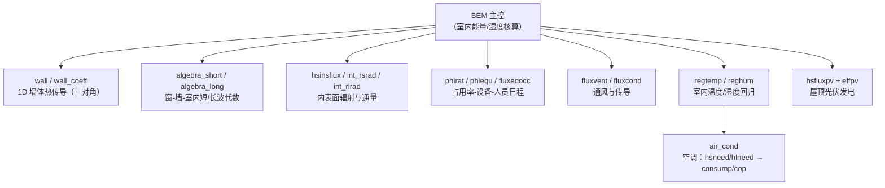
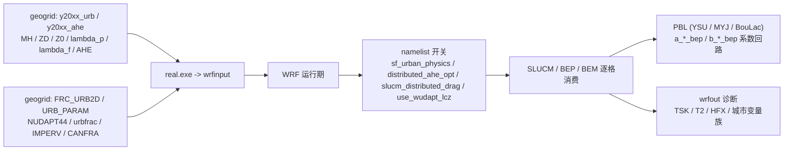
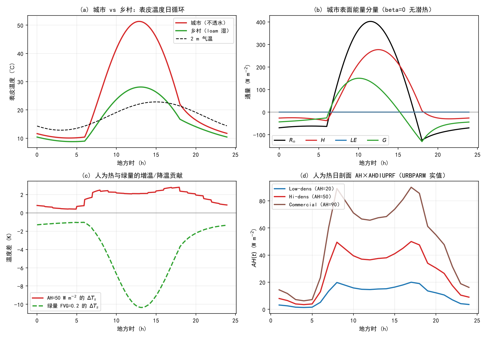
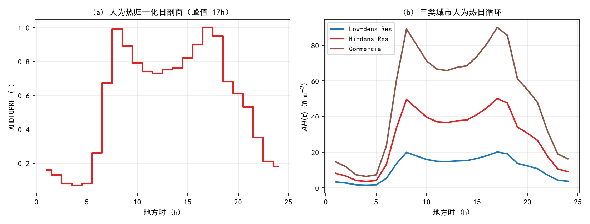

# 第 17 章 城市冠层专章：SLUCM → BEP/BEM（对接论文 2）

> 第 16 章我们把下边界分成了海洋与陆地两类。但真实个例（尤其本项目的主战场兰州）里还有**第三种表面**：城市。它既不是土壤也不是水面，而是**屋顶、墙面、路面三种表面 + 街谷几何 + 人为热 + 建筑储热**的复合体——一平方公里城市给大气的“账单”（能量、动量、水汽）与同面积的草地可以完全相反。WRF 为它准备了三代方案：**SLUCM 单层冠层（`sf_urban_physics=1`）→ BEP 多层冠层（=2）→ BEM 建筑能量模型（=3）**，本章按这三代逐一精读，并落到两条实战线上：**城市数据链路**（landuse 城市类 → geogrid → wrfinput → 方案）与**论文 2 的改造地图**（BEM 标量参数的 2D 化——本项目 EXP-LIT 的技术地基）。
>
> **本章定位（与 v4 方案 R5 口径一致的唯一调整）**：书前 6 章没有城市考点（盛裴轩《大气物理学》第 2 版的城市下垫面内容在考核范围之外，仅第 10 章“非均匀下垫面”可作延伸引用），因此本章**不设“考点透视”节**，以 **17.7 论文 2 对接** 替代——它是第 III 部（WRF 物理族）的收官章，也是从“读代码”转向“改代码”（ch20）的跳板。

---

## 17.0 本章地图

### 17.0.1 与书的关系（延伸引用）

| 主题 | 书内出处（延伸） | 本章处理 |
|---|---|---|
| 城市下垫面的特殊性 | 第 10 章（非均匀下垫面，不考核） | 17.1 物理总论 |
| 辐射传输、视角因子 | 第 5 章（辐射，ch12 已讲） | 17.3.2 街谷辐射 |
| 湍流交换、稳定度 | 第 6 章 6.8（边界层，ch14 已讲） | 17.3.3 动量/热量耦合 |
| 地表能量平衡 | 第 4 章延伸（ch16 补讲） | 17.1.2 三表面收支 |
| 人为热、储热与热岛 | （书外；城市气候学内容） | 17.1.3 + 实验 E1–E3 |

### 17.0.2 源码锚点总表（本章全部实测核验）

| # | 锚点（文件 + 符号） | 用途 | 状态 |
|---|---|---|---|
| 1 | `phys/module_sf_urban.F`（`urban` / `urban_param_init` / `urban_var_init` / `read_param` / `multi_layer` / `force_restore` / `bisection` / `mos` / `SFCDIF_URB` / `kanda_kawai_svf` / `SHADOW_TREE` 等） | SLUCM（单层冠层）本体 | 已核验 |
| 2 | `phys/module_sf_bep_bem.F`（`BEP_BEM` / `BEP1D` / `param` / `modif_rad` / `surf_temp` / `roof_temp_veg` / `buildings` / `urban_meso` / `shadow_mas` / `long_rad` / `short_rad_dd` / `soil_moist` / `soil_temp`） | BEP 多层冠层 + 中尺度耦合 | 已核验 |
| 3 | `phys/module_sf_bem.F`（`BEM` / `wall` / `wall_coeff` / `algebra_short` / `algebra_long` / `regtemp` / `reghum` / `fluxvent` / `air_cond` / `hsfluxpv`） | BEM 建筑能量/室内环境/空调与光伏 | 已核验 |
| 4 | `phys/module_bep_bem_helper.F` | **仅 3 行**：`integer, save :: nurbm`（方案原文预期落空——几何/TKE 都在 module_sf_bep_bem.F） | 已核验（勘正） |
| 5 | `phys/module_sf_noahdrv.F`（`IF (SF_URBAN_PHYSICS == 1/2/3)` → `CALL urban` / 两处 `CALL BEP_BEM`） | 分发的真入口（在 Noah 驱动内） | 已核验 |
| 6 | `phys/module_physics_init.F`（`urban_param_init` + `urban_var_init`；LCZ 守卫 fatal） | 初始化与一致性守门 | 已核验 |
| 7 | `phys/module_bl_boulac.F`（`flag_bep` / `a_u_bep` 等）、`module_bl_keps.F`、`module_bl_shinhong.F` | PBL 侧消费 BEP 隐式系数（兼容矩阵源码实证） | 已核验 |
| 8 | `run/URBPARM.TBL` / `URBPARM_LCZ.TBL` / `URBPARM_UZE.TBL` | 城市参数表（表值全部实读） | 已核验 |
| 9 | WPS `geogrid/GEOGRID.TBL`（URB_PARAM/FRC_URB2D/IMPERV/CANFRA/MH_URB2D/ZD_URB2D/Z0_URB2D/BUILD_AREA_FRACTION/LF_URB2D_S/AHE） | 城市数据链路 | 已核验 |
| 10 | `Registry/Registry.EM_COMMON`（`MH_URB2D` i01r、`FRC_URB2D`、`UTYPE_URB2D`、`num_urban_*` 系） | 状态量与输入通道 | 已核验 |
| 11 | `run/README.namelist`（`sf_urban_physics` 段、`num_urban_*`、`use_wudapt_lcz`、`slucm_distributed_drag`、`distributed_ahe_opt`） | 官方口径 | 已核验 |

### 17.0.3 与前后章 / 论文 2 衔接

- **第 16 章 → 本章**：16.4.4 的城市接口表、16.5.7 的 ISURBAN 六件套（SHDFAC=0.05、SMCMAX=0.45、DF1=3.24）是“Noah 眼里的城市”；本章是“城市方案眼里的城市”——两者通过 `sf_urban_physics` 开关切换（1/2/3 激活后，城市格点由 UCM 接管，Noah 只算其“乡村部分”）。
- **第 14 章 → 本章**：BEP/BEM 的城市网格要向上与 PBL 交换动量/热量——通过 `a_*_bep`/`b_*_bep` 隐式系数实现，只有 YSU/MYJ/BouLac 三个 PBL 方案接了这条线（14.7 已立账，本章 17.3.3 给源码实证）。论文 2 选 **BouLac** 正是按这条兼容链走的。
- **本章 → 论文 2**：项目需要“BEM 参数 2D 化（STEEL_FRAC/ROOF_αε λρcd）→ 改善热浪期 UHI”；本章 17.4.3 给改造地图，17.7 给对接清单。
- **本章 → ch19/ch20**：ch19 的真实个例将做 `sf_urban_physics=0 vs 3` 双跑（本章 17.6 先给出动因与预期）；ch20 第③级改造实战直接引用 17.4.3 的地图。

---

## 17.1 城市冠层物理：从“三种表面”到街谷能量账

### 17.1.1 为什么城市不能用“一块粗糙的土”代替

把城市格点当作一种特殊的土壤/植被（ch16 的 ISURBAN 做法）只解决“温度与蒸发”两种量，丢掉了城市最本质的四件事：

1. **三次表面**：屋顶、墙面、路面各自受太阳照射与天空视角不同——水泥屋顶正午可达 60 ℃ 以上、墙面与路面受街谷遮蔽，**同一位置上三种表面的温差可以有 20 K**；
2. **街谷辐射**：城市像一排排“微型峡谷”，墙与墙、墙与地之间互相反射长波/短波（**视角因子**），路面收到的辐射比平地多、失向天空的长波被“挡回”一部分——夜间尤其关键（**街谷保温**）；
3. **人为热（AH）**：交通、工业、空调把化石燃料/电能直接释放为感热与潜热——与太阳辐射无关，**夜里也放**；
4. **建筑储热**：混凝土的体热容约为干土的 0.6 倍、热传导率约为沙土的 1/4——白天吸进去、夜里慢慢放，与“土壤阻尼深度”完全不同的时间常数（建筑墙厚 20 cm、多层热传导）。

### 17.1.2 三表面能量平衡与街谷耦合（SLUCM 口径）

SLUCM 为三种表面各写一套地表能量平衡（本章 (16.1) 的城市版），并以街谷几何做辐射分配：

$$R_{n,i}+AH_i = H_i + LE_i + G_i,\qquad i\in\{\text{屋顶 R},\ \text{墙面 B},\ \text{路面 G}\} \tag{17.1}$$

- 各表面的 $R_{n,i}$ 不独立：路面与墙面通过**视角因子**互相反射（SLUCM 用解析视角因子式，BEP 用矩阵 $f_{ww}/f_{wg}/f_{gw}/f_{sw}/f_{ws}/f_{sg}$，17.3.2）；
- 各表面的 $G_i$ 用多层热传导求解（SLUCM：`multi_layer`，4 层 DDZR/DDZB/DDZG=0.05 m 起；或 `force_restore` 力-恢复法，由 `TS_SCHEME` 选择）；
- 街道按 “roof/road/wall” 面积比例 $\lambda_p$（building plan area fraction）与建筑高度 $H$ 加权成格点通量；**格点尺度还有第 4 个分量**：城市植被地面（FVG）与（新版）绿屋顶/树木。

> **与 Noah 的接力**：城市格点被 UCM 接管后，Noah 只算“非城市部分”（次网格镶嵌或按 `FRC_URB2D` 权重混合——`lsm_mosaic` 与 mosaic_cat 的口径，16.4.4），最终格点通量 = (1−FRC_URB)·乡村 + FRC_URB·城市。

### 17.1.3 城市热岛的两条时间表：表皮“昼强夜弱”、气温“夜强昼弱”

城市热岛（UHI）有两个常见口径，时间结构相反，本章实验把它钉死（17.6）：

- **表皮温度差（本章 E1）**：白天城市无蒸发、低热传导 → 表面冲高，**昼强夜弱**（本实验：白天 +15.5 K、夜间 +1.8 K——微风 CH=0.008 口径）；
- **2 m 气温差（教科书 UHI）**：夜间更强——白天边界层混合强、城乡热量被搅匀；夜间稳定边界层抑制通风、城市储热 + AH + 街谷保温把热量“扣”在近地面（本章实验的简化柱**不含稳定度反馈**，故不能复现夜强；真实口径由 ch19 集群双跑给出）。

两条时间表的物理分工：**表皮温差是辐射-表面过程**（白天主导），**气温差是边界层-混合过程**（夜间主导）——这正是“城市方案必须与 PBL 方案耦合”（17.3.3）的气候学理由。

---

## 17.2 SLUCM 精读：单层冠层（`sf_urban_physics=1`）

### 17.2.1 血统与文件结构

`module_sf_urban.F` 的头注给出完整血统：**Kusaka 1999（筑波 LCM 起步）→ 2001（WRF 移植）→ 2003（CRIEPI/NCAR）→ 2005 F. Chen & M. Tewari → 2014 Jiachuan Yang → 2024/2025 Yuqi Huang & Chenghao Wang（urban-NbS：城市树木 + 绿屋顶 + 植被地面）**；三篇底层文献：Kusaka et al. (2001, BLM)、Kusaka & Kimura (2004, JAM)、Kusaka & Kimura (2004, JMSJ)。文件内部用 **CGS 单位制**（CP=0.24 cal·g⁻¹·K⁻¹、EL=583 cal·g⁻¹、σ=8.17×10⁻¹¹ cal·cm⁻²·min⁻¹·K⁻⁴），与外部 SI 通过 SIG_SI 等常数转换——读这段代码时“单位警觉”要拉满。

主 `SUBROUTINE urban` 一次接收 60+ 个实参，向外输出格点聚合通量（SH/LH/G/RN/TS、10 m 风、2 m 温湿）与诊断量（mh_urb/stdh_urb/lf_urb/lp_urb/hgt_urb/frc_urb=平均建筑高度/标准差/前沿面积比/平面面积比/建筑高度/城市分数——供 ch19 的图件用）。内部核心变量的命名约定：**R/B/G 后缀 = 屋顶/墙/路面**（TR/TB/TG 皮温；TRL/TBL/TGL 多层温度廓线；XXXR/B/G = M-O 尺度；CMCR/TGR/TGRL/SMR = 路面下方热/水状态——它挂在本文件内嵌的 Noah 土壤链上：`TDFCND`/`HRT`/`HSTEP`/`SHFLX`/`SMFLX`/`SRT`/`SSTEP`/`WDFCND`/`ROSR12` 一整套都在这个文件里被复用）。

### 17.2.2 能量收支与求解：`bisection` + 两种温度方案

- **街谷交换系数**：`CH_SCHEME`（URBPARM）——1 = M-O 相似理论（`mos`）；**2 = Narita et al. 1997 经验式（表默认，推荐）**；
- **表面温度求解**：`bisection`（二分法）对每个表面的收支方程求皮温——输入 `(TSP, PS, S, EPS, RX, SIG, RHO, CP, CH, UA, QA, TA, EL, BET, AKS, TSL, DZ, TS)`，即“辐射 + 湍流 + 热传导”三项配平；
- **次表层温度**：`TS_SCHEME`（默认 1=**4 层热传导** `multi_layer`；2=力-恢复 `force_restore`）；层厚 DDZR/DDZB=0.05 m×4、DDZG=0.05/0.25/0.50/0.75 m；底边界 BOUNDR/B/G=1（零通量）或 2（常数温度），深部初值/背景 293 K（TRLEND/TBLEND/TGLEND）；
- **表面物性**（URBPARM，三类城市同值）：ALBR/B/G=0.20、EPSR/B=0.90、EPSG=0.95、CAPR/B=1.0×10⁶、CAPG=1.4×10⁶ J·m⁻³·K⁻¹、AKSR/B=0.67、AKSG=0.4004 W·m⁻¹·K⁻¹、Z0R/G=0.01、Z0B=1×10⁻⁴ m。**AKSG 只有沙土（2.6）的 1/6**——路面是“热的不良导体”，白天热量堆在表层（实验 E1 的 51 ℃ 皮温就是这么来的）。
- 面层交换还带 **Kanda 修正**（`SFCDIF_URB` 的 AKANDA_URBAN=1.29）——城市面层粗糙度与热量交换的专门修正。

### 17.2.3 人为热的两条通道：AH 与 ALH

URBPARM 给出**感热人为热 AH** 与**潜热人为热 ALH**（“空调排水、蒸发冷却”通道）两套参数与日/季循环：

| 项 | 表值（Low/Hi/Commercial） | 日循环 | 开关 |
|---|---|---|---|
| AH | 20 / 50 / 90 W·m⁻² | `AHDIUPRF`（24 小时值，**01h 起**）：0.16 0.13 0.08 0.07 0.08 0.26 0.67 0.99 0.89 0.79 0.74 0.73 0.75 0.76 0.82 0.90 **1.00(17h)** 0.95 0.68 0.61 0.53 0.35 0.21 0.18（日均 0.555，谷 0.07@04h） | `AHOPTION`（0 默认；1=加入感热项） |
| ALH | 20 / 25 / 40 W·m⁻² | 季节系数 `ALHSEASON`（春/夏/秋/冬=0.43/1.00/0.54/0.40）+ `ALHDIUPRF`（48 个半小时值，00:30 起） | `ALHOPTION`（0 默认） |

**判读三条**：① AH 的日循环有两个峰（7 时 0.99 的早高峰与 17 时 1.00 的晚高峰）——“通勤双峰”，与太阳辐射的单峰（正午）错开，这是 AH 能改变**夜间**温度的机制；② 默认开关全关（AHOPTION=ALHOPTION=0）——真实城市研究**必须显式打开**，否则人为热为 0；③ 数据侧还有第三条通道：`distributed_ahe_opt`（README）=0/1/2（0 不用输入数据；1 加给**第一层温度倾向**；2 加给**地表感热**）——配套 GEOGRID 的 `AHE` 数据集（17.5.2），“表值口径”与“数据口径”二选一或叠加。

### 17.2.4 城市的水、绿量与 NbS 扩展

城市不是永远干的：URBPARM 为不透水面留了三条水通道——`IMP_SCHEME`（1=大降水事件下的蒸发假设；2=Yang et al. 2014 蓄水层式）、`PORIMP`（铺装孔隙率 0.45）、`DENGIMP`（最大持水深 0.001/0.0002/0.001 m：屋顶/墙/路面）；植被侧有 `OASIS`（绿洲效应：城市植被的潜在蒸腾放大系数，>1 激活）、`IRI_SCHEME`（夏季 21 时灌溉）、`FVG=0.2`（街谷植被地面比）与 `GROPTION`/`FGR`/`DZGR`（绿屋顶 4 层土壤结构）。**2024/2025 的 urban-NbS 扩展**加入城市树木（`TREEOPTION`；`kanda_kawai_svf` 天空视角、`SHADOW_TREE` 树影、`STOMATAL`/`LELEAF` 叶片气孔与潜热、`ROOT_UPTAKE` 根系吸水）——“用绿化降温”在代码里是一条完整的植被-土壤-辐射链。

### 17.2.5 URBPARM.TBL 逐字段速查（USGS 三类）

**表 17.1 城市参数表核心字段（实测）**

| 字段 | 含义 | Low / Hi / Commercial | 消费点 |
|---|---|---|---|
| `ZR` | 建筑高度（屋顶高度）m | 5.0 / 7.5 / 10.0 | 街谷几何、面层 |
| `SIGMA_ZED` | 高度标准差 m | 1.0 / 3.0 / 4.0 | 面层/粗糙度 |
| `ROOF_WIDTH`/`ROAD_WIDTH` | 屋顶宽/街宽 m | 8.3 / 9.4 / 10.0（两者同值） | 街谷比例 |
| `AH`/`ALH` | 人为热（感/潜）W·m⁻² | 20/50/90；20/25/40 | 收支 (17.1) |
| `AKANDA_URBAN` | Kanda 交换系数修正 | 1.29（三类同） | `SFCDIF_URB` |
| `DDZR`/`DDZB`/`DDZG` | 屋顶/墙/路面层厚 m | 0.05×4；0.05×4；0.05/0.25/0.50/0.75 | `multi_layer` |
| `BOUNDR/B/G` | 底边界（1 零通量/2 定温） | 1（三类） | 次表层 |
| `CH_SCHEME`/`TS_SCHEME` | 交换/温度方案 | 2（Narita）/1（4 层） | 17.2.2 |
| `ALBR/B/G`、`EPSR/B/G` | 反照率/发射率 | 0.20/0.20/0.20；0.90/0.90/0.95 | 辐射 |
| `CAPR/B/G`、`AKSR/B/G` | 体积热容 / 热传导率（=ρc 与 λ） | 1.0e6/1.0e6/1.4e6；0.67/0.67/0.4004 | `multi_layer` |
| `Z0R/Z0B/Z0G` | 动量粗糙度 m | 0.01 / 0.0001 / 0.01 | 面层 |
| `TRLEND/TBLEND/TGLEND` | 深部背景温度 K | 293（三类） | 次表层 |
| `FVG` | 街谷植被地面比 | 0.2（三类） | 17.2.4 |
| `AHDIUPRF`/`ALHSEASON`/`ALHDIUPRF` | 日/季循环 | 见 17.2.3 | 人为热 |
| `for BEP` 系列 | 街谷方向/宽度/高度分箱 | 见 17.3.1 | BEP/BEM |
| `for TREE/绿屋顶` 系列 | RTREE/HTREE/LAI_TREE/DZGR… | 默认关闭 | NbS |

> **表头警告（原文口径）**：“The default values are probably not appropriate for any given city. Users should adapt these values based on the city they are working with.”——**每个城市都得自己标定参数**，这正是论文 2 的出发点（深度学习分割 + 观测标定参数场）。

---

## 17.3 BEP 多层冠层（`sf_urban_physics=2`）

### 17.3.1 街谷几何与城市网格

BEP（Martilli 等 2002 血统，`module_sf_bep_bem.F`）把“单层”升级为**多层**：

- **街谷方向**：`NUMDIR`（每类城市的街道方向数，URBPARM “for BEP” 字段）+ `STREET_DIRECTION` + `STREET_WIDTH`/`BUILDING_WIDTH`（每方向一组）+ `HEIGHT_BIN`/`HPERCENT_BIN`（建筑高度分箱与占比）——BEP 对**两个及以上街道方向**做加权（`num_urban_ndm=2` 即“最大 2 个街谷方向”）；
- **城市垂直网格**：`nz_um=18`（最大层数，`num_urban_nz=18`）；实际层数 `nz_u` 由最高建筑与层间距自适应；`z_u(nz_um)` 为城市网格层高；
- **屋顶面积分数**（实测表达式）：`roof_frac = FRC_URB2D·bs/(bs+ws)`（bs=建筑宽、ws=街宽）——格点内“屋顶面”占比；
- 建筑类型数上限 `nbui_max=15`（`num_urban_nbui`），约束 `nbui_max ≤ nz_um`；BEP_BEM 入口对 `urban_map_*`（urban_map_zwd/zd/bd/wd/gbd/fbd…）的**尺寸做显式校验**并在不足时报出所需下限（实测 fatal 文本给出 `nbui_max*nz_um*ndm*max(nwr_u,ng_u)` 等公式）——改 num_urban_* 时按这条公式配。

### 17.3.2 街谷辐射：视角因子矩阵与遮蔽

BEP 的辐射模块是它的灵魂：

- **视角因子**（BLM 2002 附录 A）：`fww(z1,z2)`（墙-墙，矩阵）、`fwg`（墙→地）、`fgw`（地→墙）、`fsw`（天→墙）、`fws`（墙→天）、`fsg`（天→地）——把（17.1）里“三种表面互相看得见多少”写成了几何矩阵；
- 求解链：`modif_rad`（按街谷方向修正入射辐射）→ `shadow_mas`/`shade_wall`（阴影长度：墙影、树影）→ `long_rad`（长波交换，用 fww 矩阵 + 逐层温度解线性方程组）→ `short_rad_dd`（直射/散射在墙/地/屋顶的分配）；
- 数值：`gaussj`（高斯消元）解辐射线性系统；`surf_temp`/`roof_temp_veg` 求地面/绿屋顶温度（二分）；`soil_temp`/`soil_moist`/`soil_temp_veg` 管地面与植被的次表层。

### 17.3.3 动量与热量：向 PBL 提供的隐式系数（兼容矩阵的源码实证）

BEP 算出的通量不是“一次加给大气”，而是以**隐式-显式分解**的形式交给 PBL：

$$F_X = a_X\cdot X + b_X \tag{17.2}$$

`BEP_BEM` 输出 `a_u/a_v/a_t/a_e`（隐式部分）与 `b_u/b_v/b_t/b_ac/b_e/b_q`（显式部分）、`dl_u/dlg`（卷入/摩擦长度）等——PBL 方案在解湍流扩散方程时把它们作为边界条件逐层吸收。**这就是兼容矩阵的技术根**：

- 消费方（源码实证）：`module_bl_boulac.F`（`flag_bep` + `a_u_bep` 实参，BouLac 内 `if(flag_bep)` 分支把 a/b 塞进三对角）、`module_bl_keps.F`（QNSE 系）、`module_bl_shinhong.F`（S-H 系）等；
- README 官方口径：**`sf_urban_physics=2/3` “works only with YSU, MYJ and BouLac PBL”**（第 14 章 14.7 已立；论文 2 选 BouLac 即按此）；
- 细节：`b_q_bep` 只在 `sf_urban_physics==3` 时参与（noahdrv 内实测——=2 时预置为 0）——BEP 不通过 b_q 通道给水汽，BEM 才给。

### 17.3.4 `BEP_BEM` 入口与两条调用路径

`module_sf_noahdrv.F` 里有两个 `IF` 分支（实测）：`SF_URBAN_PHYSICS == 2` 的 `CALL BEP_BEM` 只传 BEP 数组（trb/tw1/tw2/tgb、sfw/sfr/sfg、a/b 系数）；`== 3` 的 `CALL BEP_BEM` 追加 BEM 数组（tlev/qlev 室内、tw1lev/tw2lev 内墙、tglev 建筑下地面、tflev 楼板、sf_ac/lf_ac/cm_ac 空调三通量、ep_pv/t_pv 光伏、sfvent/lfvent 通风、sfwin1/2 窗、绿屋顶 sfrv/lfrv/dgr 等）。进入 `BEP_BEM` 后逐格循环：屋顶分数加权、`BEP1D` 单柱计算、`urban_meso` 聚合回中尺度格网。

---

## 17.4 BEM 建筑能量模型（`sf_urban_physics=3`）与论文 2 改造地图

### 17.4.1 室内与建筑结构：从“热能账”到“能耗账”

BEM 在 BEP 的街谷之上再叠一层**建筑内部**：楼板分层（`nflo`，`num_urban_nf=10`）、建筑下地面（`ngb`，`num_urban_ngb=10`）、墙体多层（`nwal`，`num_urban_nwr=10`）、窗户（`thickwin`）。子程序职责图：

- **空调与能耗**：`air_cond(hsneed, hlneed, dt, hsout, hlout, consump, cop)`——把“需要多少显/潜热”换成“耗多少电”（`consump`，`cop` 为能效比）——**这就是建筑能耗模式的计量出口**；
- **室内温湿**：`regtemp`/`reghum` 以回归式推进室内温度/湿度（受空调 `temp_rat=0.001 K/s`、`hum_rat=1×10⁻⁶ (kg/kg)/s` 的调温/调湿速率约束）；
- **日程**：`phirat`（24 小时占用率）、`hsesf`/`hsequip`（人员/设备显热）、`perflo`（楼层人数）——办公室与住宅的人工热时间谱；
- **光伏**：`hsfluxpv` + `effpv=0.19`——屋顶 PV 的发电与遮阳效应（论文 2 的“屋顶功能”扩展点）。

### 17.4.2 模块级标量参数清单（改造起点）

**表 17.2 `module_sf_bem.F` 模块级常数（实测）**

| 参数 | 值 | 含义 | 论文 2 视角 |
|---|---|---|---|
| `emins` | 0.9 | 内墙发射率 | 固定即可 |
| `albins` | 0.3 | 内墙反照率 | 固定 |
| `thickwin` | 0.006 m | 窗厚 | 单/双层窗改造点 |
| `cswin` | 2.268×10⁶ J·m⁻³·K⁻¹ | 窗（玻璃）热容 | 材料改造点 |
| `temp_rat` | 0.001 K/s | 空调调温速率 | 空调容量改造点 |
| `hum_rat` | 1×10⁻⁶ (kg/kg)/s | 调湿速率 | 空调除湿改造点 |
| `effpv` | 0.19 | 光伏效率（典型 0.10–0.15） | 屋顶 PV 改造点 |

### 17.4.3 论文 2 改造地图（BEM 标量 → 2D 场）

论文 2 的技术核心是“**逐格参数场**”：用深度学习屋顶分割 + 观测标定，把下面这些**目前“来源为表值/标量”或“逐类常数”的参数**，变成 d03 格点上的 2D 场（STEEL_FRAC/ROOF_α/ε/λ/ρ/c/d），经 `auxinput` 机制读入（ch09 的输入通道），供 BEM 逐格消费。

**表 17.3 BEM 参数改造地图（源码锚点 = 文件 + 符号；落地链 = 17.5 数据链路）**

| 物理量 | BEM 内符号（实参） | 现形态（默认来源） | 目标形态（论文 2） | 消费链 |
|---|---|---|---|---|
| 屋顶/墙/路面反照率 | `albrof` / `albwal` / `albg` | URBPARM 表值（ALBR/ALBB=0.20） | 2D 场（α 标定） | BEM.arg → wall/roof 辐射项 |
| 屋顶/墙发射率 | `emrof` / `emwal` | URBPARM 表值（0.90） | 2D 场（ε 标定） | `int_rlrad`/`algebra_long` |
| 屋顶/墙热传导率 | `krof` / `kwal` | URBPARM（AKSR/AKSB=0.67） | 2D 场（λ 标定；钢材 λ≫） | `wall_coeff` 三对角 |
| 屋顶/墙/楼板/地面热容 | `csrof` / `cswal` / `csflo` / `csgrd` | URBPARM（CAPR/B=1.0e6） | 2D 场（ρ·c 标定） | `wall`/`regtemp` |
| 各层厚度 | `dzrof` / `dzwal` / `dzflo` / `dzgrd` | URBPARM（DDZR/B/G） | 2D 场（d 标定；由建筑物理反演） | 层网格 |
| 窗占比 | `pwin` | URBPARM（BEP/BEM 字段） | 2D 场（可扩） | `algebra_short/long` |
| 空调能效比/设定 | `cop` / `beta` / `sw_cond` | URBPARM | 标定或情景 | `air_cond` |
| 空调日程 | `timeon` / `timeoff` / `targtemp` / `gaptemp` / `targhum` / `gaphum` | URBPARM（恒温器口径） | 情景/标定 | `regtemp`/`reghum` |
| 楼层人数 | `perflo` | URBPARM | 情景 | `phirat`/`hseuqip` |
| 屋顶功能占比 | `gr_frac_roof` / `pv_frac_roof` | 0 默认 | 2D 场（绿化/光伏屋顶） | `roof_temp_veg`/`hsfluxpv` |
| 光伏效率 | `effpv` | 模块级标量 0.19 | 可 2D 化 | `hsfluxpv` |
| 城市形态（不作为 BEM 实参，走 SLUCM 侧） | `MH_URB2D`/`Z0_URB2D`/`LF_URB2D_S` 等 | 表值/geogrid 数据 | 2D 场（y2050/自产） | 17.5.2 |

> **改造的工程序（ch20 第③级会逐步实操）**：① 在 `URBPARM` 消费点或 BEP_BEM 实参处找到上表符号；② 把“读表值→单标量”改为“读 wrfinput/auxinput→2D 数组→逐格取值”；③ Registry 增状态 + io 流（ch04/ch09 技能）；④ 单点（W238 格网）sanity：对比两种参数化下的 `trof/twal/tlev` 日循环；⑤ patch 管理（diff 附录）。

---

## 17.5 城市数据链路：landuse → geogrid → wrfinput → 城市方案

### 17.5.1 landuse 城市类别的四套体系

| 体系 | 城市类号 | 备注 |
|---|---|---|
| USGS（24/33 类） | 1（Urban）或 31/32/33（Low/Hi/Commercial） | URBPARM.TBL 首段三类即按 31/32/33 |
| MODIS（21 类，含湖） | **13（Urban and Built-Up）** | 本项目个例 `num_land_cat=21` 口径 |
| NLCD40 | 城市类合并（23/25→24，ch16 16.6.4） | 需 NLCD40 版 VEGPARM |
| WUDAPT **LCZ** | 51–61（=VEGPARM 尾部的 `LCZ_1…LCZ_11`） | `use_wudapt_lcz=1`；数据制备见 wudapt.org |

**守门**：WRF 侧由 `urban_var_init`（`module_sf_urban.F`）把 `IVGTYP` 映射到 `UTYPE_URB2D`（LCZ 分支对 LCZ_1…LCZ_11 逐一判等）；`module_physics_init.F` 对“用 LCZ 表配旧 3 类”直接 fatal（“USING URBPARM_LCZ.TBL WITH OLD 3 URBAN CLASSES. SET USE_WUDAPT_LCZ=0”）。

### 17.5.2 `GEOGRID.TBL` 城市条目全家（实测）

**表 17.4 城市静态场与数据源**

| 条目名 | 含义 | 数据源（priority 链） | wrfinput/消费 |
|---|---|---|---|
| `URB_PARAM` | 城市形态参数族（`num_urb_params=132` 维） | NUDAPT44_1km / gloucp2020_30s | 供多种城市方案 |
| `FRC_URB2D` | 城市分数 | urbfrac_nlcd2011 / urbfrac_gaia2020_30s | `FRC_URB2D` → UCM 面积权重 |
| `IMPERV` | 不透水比例 | nlcd2011_imp / impfrac_gaia2020 | 城市水文/蒸发 |
| `CANFRA` | 冠层比例 | nlcd2011_can | 植被 |
| `MH_URB2D` | 平均建筑高度 H_avg | **y2010_urb / y2050_urb**（`slucm/urban_params/20XX/H_avg/`） | `MH_URB2D`（i01r） |
| `ZD_URB2D` | 建筑宽度 d | y20XX_urb（…/d/） | 同上 |
| `Z0_URB2D` | 城市动量粗糙度 z0 | y20XX_urb（…/z_0/） | 同上 |
| `BUILD_AREA_FRACTION` | 平面面积比 λp | y20XX_urb（…/lambda_p/） | 同上 |
| `LF_URB2D_S` | 前沿面积比 λf | y20XX_urb（…/lambda_f/） | 同上 |
| `AHE` | 人为热排放 | **y2010_ahe / y2050_ahe**（`slucm/AHE_2010s/2_bytes/`） | `distributed_ahe_opt` 消费 |

**判读**：`y2050_urb`/`y2050_ahe` 是**城市扩展情景数据集**（2050 年建成区 + 人为热），就是参考个例（`liuyl17/haidian2024`）`geog_data_res` 里用的那两个关键字——对 BEP/BEM 章与论文 2 都是“现成的城市形态/人为热输入链”。`slucm_distributed_drag=.true.` 时这三个 2D 形态场（零平面位移、粗糙度、λf）直接进面层——**只对 `sf_urban_physics=1`**（README 原文）。

### 17.5.3 namelist 联动速查

**表 17.5 城市相关 namelist（README 实测）**

| 条目 | 默认 | 说明 |
|---|---|---|
| `sf_urban_physics` | 0 | 0 关 / 1 SLUCM / 2 BEP / 3 BEM（**仅 Noah 与 Noah-MP**；=2/3 仅 YSU/MYJ/BouLac） |
| `num_urban_ndm` | 1 | BEP/BEM 用 2 |
| `num_urban_ng` / `num_urban_nwr` | 1 | BEP/BEM 用 10 / 10 |
| `num_urban_nz` | 1 | BEP/BEM 用 18 |
| `num_urban_ngb` / `num_urban_nf` / `num_urban_nbui` | 1 | BEM 用 10 / 10 / 15 |
| `use_wudapt_lcz` | 0 | 1=LCZ（31–33 由 LCZ 51–61 替换；与旧表互斥） |
| `slucm_distributed_drag` | .false. | 仅 =1；需 wrfinput 三个形态场 |
| `distributed_ahe_opt` | 0 | 0/1/2：AHE 数据加给第一层温度倾向或地表感热 |

### 17.5.4 三类守门一致性（改配置前先看这三条）

1. **类别守门**：城市类别数（USGS 3 / MODIS 1 / LCZ 11）必须与使用的 URBPARM 表节一致，且 `use_wudapt_lcz` 与数据一致（否则 init fatal）；
2. **尺寸守门**：`num_urban_*` 必须 ≥ BEP_BEM 内校验公式的下限（`nbui_max·nz_um·ndm·max(nwr_u,ng_u)` 等），否则 fatal 并给出所需值；
3. **PBL 守门**：=2/3 时 `bl_pbl_physics ∈ {1(YSU), 2(MYJ), 8(BouLac)}`（README；源码上 a/b 系数的消费者只在少数 PBL 里）。

---

## 17.6 轻轨实验：城市 vs 乡村、人为热与绿量（E1–E3）

> 脚本：`workspace/scripts/ch17_experiment.py`（本机）；日志：`workspace/logs/ch17_experiment.log`；图 `doc/figs/ch17_urban_energy.png`、`ch17_ah_profile.png`。**简化口径**：把 SLUCM 的三表面压缩为“城市等效表面”单柱（ALBG=0.20、EPSG=0.95、AKSG=0.4004、CAPG=1.4×10⁶、4 层 0.05/0.25/0.50/0.75 m、零通量底），β=0（不透水），AH(t)=AH₀×AHDIUPRF（AHOPTION=1 口径）；乡村为 loam 湿土（ch16 口径，β=0.89）；同强迫、同 CH=0.008（微风）。**不含**街谷辐射、稳定度反馈与 2 m 诊断——这些由集群双跑承担。

**E1 城市 vs 乡村（表皮温度与通量）**

| 量 | 城市（不透水） | 乡村（loam 湿土） |
|---|---|---|
| 白天均 Rn/H/LE/G (W·m⁻²) | 227.7 / 168.6 / **0.0** / 59.1 | 315.8 / 21.6 / 216.4 / 77.9 |
| 夜间均 (W·m⁻²) | −76.3 / −25.6 / 0.0 / −50.6 | −74.7 / −42.6 / +59.4 / −91.5 |
| T_s 最高 / 最低 | **51.3 ℃** / 10.1 ℃ | 28.1 ℃ / 8.8 ℃ |
| 城市−乡村 T_s 差 | 白天 **+15.5 K**、夜间 +1.8 K（最大 +23.2 K @12.8h） | — |
| 夜间 G 差 | +40.9 W·m⁻²（城市储热放热） | — |

**结论**：① 城市的“能量分账”极其简单粗暴——**LE≡0，全部进 H 与储热**（H 是乡村的 8 倍）；② 表皮温差**昼强夜弱**（见 17.1.3 的两条时间表）；③ 通风敏感性：CH 加倍（0.008→0.016）后城市 T_s 峰值降 9.6 ℃（51.3→41.8 ℃）——**微风口径放大了本实验的城市表皮温度**，真实模式的 CH 由面层方案+稳定度共同决定。

**E2 人为热与绿量（AHOPTION=1 / FVG 口径）**

| 情形 | ΔT_s 白天均 | ΔT_s 夜间均 | ΔT_s 日均 |
|---|---|---|---|
| AH=20（Low-dens，日均 11.1 W·m⁻²） | +0.91 K | +0.45 K | +0.68 K |
| AH=50（Hi-dens，日均 27.8） | +2.27 K | +1.11 K | +1.69 K |
| AH=90（Commercial，日均 50.0） | +4.08 K | +2.00 K | +3.03 K |
| 绿量（FVG=0.2 → β_eff=0.18）相对纯不透水 | **−6.67 K** | −1.61 K | — |

**结论**：① 人为热的温度效应约 **ΔT ≈ AH(t)/有效导纳**（本柱导纳 ~28 W·m⁻²·K⁻¹，含湍流+长波+土壤耦合三项），商业区日均 +3 K 量级；② 绿量在白天把表面温度拉低 6.7 K——**城市植被是白天最有效的“冷却剂”**（夜里作用小，与 E1 的昼强夜弱同构）；③ 本柱无稳定边界层封盖，夜间 ΔT 偏小（真实 UHI 夜强昼弱的机理在边界层一侧，ch19 检验）。

**E3 URBPARM.TBL 实读（USGS 三类）**：ZR=5.0/7.5/10.0 m；AH=20/50/90 W·m⁻²；ALH=20/25/40；AHDIUPRF 峰 1.00@17h、谷 0.07@04h（日均 0.555）；AHOPTION/ALHOPTION **默认全关**（做城市模拟必须显式打开）；表面物性三类同值（见 17.2.2）。**AH 日剖面**（图 2）展示了早/晚双峰与正午太阳峰的解耦——这是 AH 改变夜间温度的机制画像。

**（预留）集群双跑**：兰州个例 d02 `sf_urban_physics=0 vs 1`，24 h 同配置 A/B，城市格点 T2/HFX/TSK 日循环对比（为 ch19 的 `=0 vs 3` 双跑铺垫）——列入复核清单第 12 条。

---

## 17.7 论文 2 对接（替代考点节）

### 17.7.1 论文 2 与本章的接口一览

| 论文 2 要素 | 口径 | 本章对应 |
|---|---|---|
| 城市方案 | `sf_urban_physics=3`（BEP+BEM） | 17.3/17.4 |
| 边界层 | **BouLac（首选）/MYJ** | 17.3.3 兼容矩阵（源码实证） |
| 域 | d01 9 km ~90²、d02 3 km ~112²、d03 1 km ~112² | ch07 域设计（同口径） |
| 时段 | 2026-07-16~27（主）；07-29~08-02（对照） | ch19（教材个例；同为热浪研究） |
| 实验矩阵 | CTRL / EXP-LIT / CAL-STEEL 20 组 / EXP-CAL / SEN-AREA/SEN-ALB | 17.4.3 的 2D 参数场是 CAL/SEN 的前置 |
| 参数管线 | mask+Overture → d03 逐格 FRC_URB2D/STEEL_FRAC/ROOF_*2D | 17.4.3 + 17.5.2（三通道：URBPARM 表/geogrid 静态/auxinput 自定义） |
| BEM 改造 | `module_sf_bem.F` 标量→2D 场；单点 sanity；patch | 17.4.3 改造地图（表 17.3） |
| 标定目标 | W238 TG 0.4 / W240 室内 0.3 / 日较差 0.3 加权 RMSE | BEM 出口量：`trof/twal/tgrd`（TG）、`tlev`（室内） |
| 验证 | TG、室内、CMA 站、MODIS/LST、49 点网 | ch19 的 T2/HFX/TSK 诊断链 |

### 17.7.2 教材已立的技术账（本章收口）

1. **兼容链**：BEP/BEM↔PBL（ch14 立、本章源码实证）→ 论文 2 的 BouLac 选择合法；
2. **静态场链**：geogrid（y2050_urb/ahe）→ wrfinput（MH/ZD/Z0/λp/λf/AHE）→ 开关（slucm_distributed_drag/distributed_ahe_opt）；论文 2 的“自产 2D 场”可完全按同一通道接入（auxinput 自定义字段，ch09 三写法）；
3. **参数改造链**：URBPARM 表值 →（改造）2D 场 → BEM 实参逐格消费（表 17.3 地图）；
4. **个例协同**：教材个例（ch19，兰州热浪）与论文 2 的域设计/时段/物理配置同族——教材双跑（=0 vs 3）就是论文 2 的“mini 版 CTRL vs EXP-LIT”。

### 17.7.3 风险与待办（教材视角）

- **BEM 2D 化的最小可用路径**：先只改“屋顶三参数（α/ε/λ）+ STEEL_FRAC 加权”，把 20 组 CAL 降维到 2–3 个标定量验证链路，再扩全（避免首次就把 6 参数 2D 化）；
- **AHE 与 AH 表值的双计**：`distributed_ahe_opt` 打开时勿同时开 `AHOPTION=1`（口径二选一，否则人为热双计）——写论文 2 配置时注意；
- **LCZ 与旧 3 类互斥**：用 LCZ 数据必须 `use_wudapt_lcz=1` 且表换 `URBPARM_LCZ.TBL`（守卫会拦）；
- **num_urban_* 尺寸**：BEM 全开时按 17.5.3 表配齐（ndm=2/ng=10/nwr=10/nz=18/ngb=10/nf=10/nbui=15），否则 BEP_BEM 入口 fatal。

---

## 17.8 延伸与术语

### 17.8.1 模式视角问答（8 题速练，含答案要点）

1. 为什么 `sf_urban_physics=2/3` 只能配 YSU/MYJ/BouLac？（答：BEP 输出 a/b 隐式系数的消费者只有少数 PBL 方案接——`module_bl_boulac.F` 的 `flag_bep` 分支等；README 清单一致。）
2. AHOPTION=1 的 AH 进入哪个通量？（答：感热项——(17.1) 的 H；量级 ΔT≈AH/导纳，实验 E2。）
3. `distributed_ahe_opt=1` 与 `=2` 差在哪？（答：AHE 数据加给第一层温度倾向（=1）还是地表感热（=2）；README。）
4. 城市格点的通量怎么与 Noah 的乡村部分混合？（答：次网格镶嵌/mosaic_cat 或 FRC_URB 权重；16.4.4 + 17.1.2。）
5. URBPARM.TBL 为什么警告“默认值对任何城市都不合适”？（答：城市形态因城而异——论文 2 的标定动机。）
6. BEM 的 `consump` 是什么量？（答：空调电耗——`air_cond` 的出口，建筑能耗模式的计量。）
7. `slucm_distributed_drag` 需要哪三个额外输入？（答：零平面位移/动量粗糙度/λf 的 2D 场；仅 =1。）
8. 表皮温差昼强夜弱、气温差夜强昼弱——各自的主控过程？（答：辐射-表面 vs 边界层-混合；17.1.3。）

### 17.8.2 本章术语中英对照

| 中文 | 英文（缩写） | 备注 |
|---|---|---|
| 城市冠层（单层） | Single-Layer Urban Canopy Model (SLUCM) | `sf_urban_physics=1` |
| 建筑环境参数化 / 模型 | Building Environment Parameterization / Model (BEP/BEM) | =2 / =3 |
| 街谷 | street canyon | 视角因子几何 |
| 人为热（感/潜） | anthropogenic heat (AH) / anthropogenic latent heat (ALH) | URBPARM + AHDIUPRF |
| 屋顶/墙/路面 | roof / wall / road | R/B/G 后缀 |
| 城市分数 | urban fraction | FRC_URB2D |
| 平面面积比 / 前沿面积比 | plan area fraction (λp) / frontal area fraction (λf) | BUILD_AREA_FRACTION / LF_URB2D_S |
| 平均建筑高度 / 建筑宽度 | mean building height / building width | MH_URB2D / ZD_URB2D |
| 视角因子 | view factor | fww/fwg/fsw… |
| 局地气候区 | Local Climate Zone (LCZ) | WUDAPT；类号 51–61 |
| 不透水面 | impervious surface | IMPERV/PORIMP/DENGIMP |
| 绿屋顶 / 城市树木 | green roof / urban trees | GROPTION / TREEOPTION（NbS） |
| 空调能耗 | air-conditioning consumption | `consump`/`cop`（BEM） |
| 占用率日程 | occupancy schedule | `phirat`/`perflo` |
| 隐式-显式通量系数 | implicit/explicit flux coefficients | a_*_bep / b_*_bep |

**本章实验复现入口**：`workspace/scripts/ch17_experiment.py`；日志 `workspace/logs/ch17_experiment.log`；图 `doc/figs/ch17_urban_energy.png`、`ch17_ah_profile.png`。