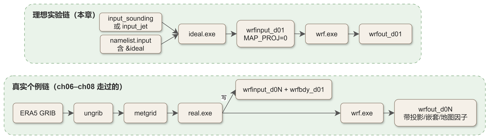
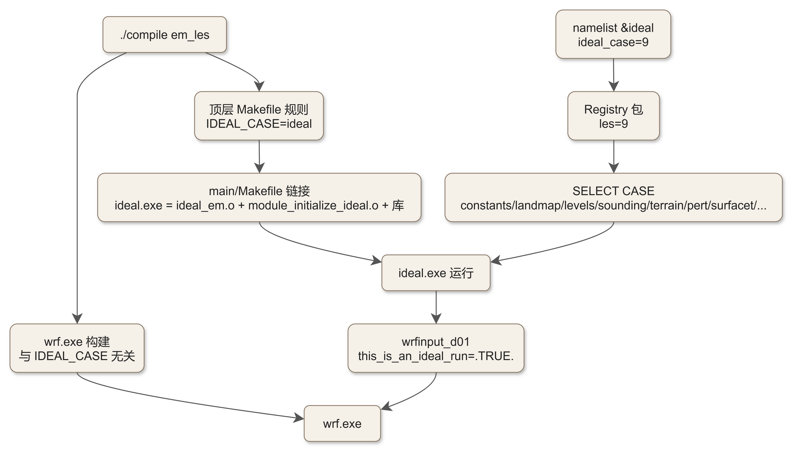
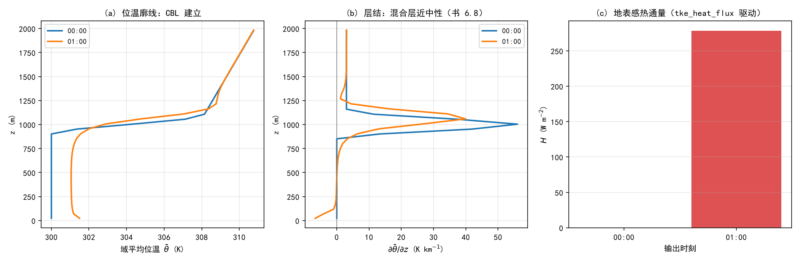
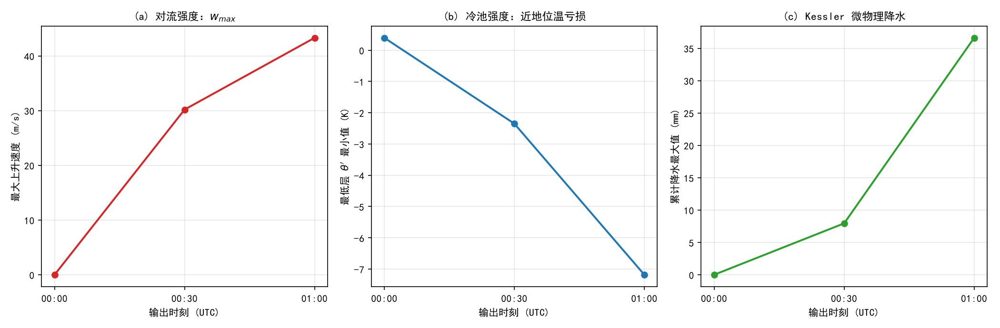
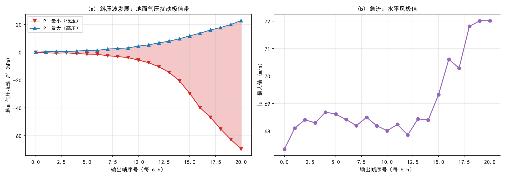

# 第 18 章 理想实验入门：test/em 算例族与实跑实录

> **定位**：第 IV 部（实验与改造）开篇。第 II 部我们靠兰州真实个例跑通了 WPS → real → wrf 全链；从本章起换一条更轻的轨道——**不依赖任何外部数据**的理想实验链。它既是学习 WRF 物理与动力行为的可控实验台，也是今后改代码（ch20）时最重要的回归检验工具。
>
> **前置**：ch05（编译体系与增量重编译，本书已给出 test/em 全表的第一版）；ch09（IO，理解 `wrfinput` 的读写路径）。**后续**：ch19 回到真实个例做全流程与对照实验；ch20 的每一次改造，都要在本章的算例上做回归。
>
> **验收口径**（方案 §3.2）：本章精选的每个实操算例必须在集群上**真实跑通**，`SUCCESS` 日志原文入文。
>
> **本章所用源码**：WRF 4.8.0（`source\WRFv4.8.0\WRFV4.8.0\`）；书页引用按《大气物理学》第 2 版印刷页码。

---

## 18.0 本章地图

### 18.0.1 结构一览

| 节 | 内容 | 产出 |
|---|---|---|
| 18.1 | 为什么需要理想实验：用途哲学与两链对照 | 两链对比表 + 流程图 |
| 18.2 | `test/em` 算例族全表：15 个目录、9 类场景逐一展开 | 全表（场景/初值/物理/检验点） |
| 18.3 | 选择机制：编译期的 `IDEAL_CASE` 与运行期的 `ideal_case` | 双钥匙机制图 + 二进制共用实证 |
| 18.4 | 源码走读：`module_initialize_ideal.F` 从 sounding 到 `wrfinput` | 初始化全链源码剖析 |
| 18.5 | 集群实操：编译实录 + `em_les`/`em_quarter_ss`/`em_b_wave` 三算例实跑 + 诊断出图 | 三个 SUCCESS 日志、3 张诊断图、机时账 |
| 18.6 | 常见错误与速查 | 速查表（并入附录 C 素材） |
| 18.7 | 延伸阅读 | —— |

### 18.0.2 两条链



<!-- Mermaid 源码 → workspace/mermaid/ch18_ideal_cases_01.mmd -->

一句话概括两链差别：**真实链的初值是“数据”，理想链的初值是“代码 + 一个文本剖面”**。

### 18.0.3 学习目标

1. 能说清 `ideal.exe` 与 `real.exe` 在初始化职责上的分工与共同点（第 3 节，源码级）；
2. 拿到 `test/` 里任意一个 `em_*` 目录，知道它属于哪类场景、要什么输入文件、该看什么检验点（18.2）；
3. 理解“同一个 namelist 整数如何在运行期切换算例”——这是 Registry 机制（ch04）的一次实战回放（18.3）；
4. 能在集群上完成“编译一个理想算例 → 顺序跑多个算例 → 诊断出图”的完整闭环（18.5，全部有实录）。

---

## 18.1 为什么需要理想实验

### 18.1.1 真实个例的“不可控”

第 II 部的兰州 2025-07 个例教会我们整个工程链，但它作为**学习与检验**工具时有三重不可控：

1. **初值不可控**：初值来自 ERA5 分析场，误差结构复杂；模式跑出的偏差里，分不清哪部分是物理方案的问题、哪部分是初值的问题。
2. **边界不可控**：真实个例必须有侧边界（`specified` 边界），外部场持续注入信息，内部物理过程与边界的相互作用难以隔离。
3. **成本不可控**：一次 5 天两域模拟是几十核时量级（ch08 实测 52 核时）；做一组参数对照要以“天”计。

理想实验用“造出来的天气”消掉这三重不可控：初值由解析式或一个理想化探空给定（**可精确复述**）、边界常用周期/对称（**可隔离**）、域小步长稳（**可分钟级复跑**）。书里的物理图像——边界层湍流（6.8.2，印刷页 154–163）、深对流与层结不稳定（6.9，印刷页 164–166）、海陆热力差异与陆面能量收支（4.2–4.3，印刷页 55–58）——在理想算例里都有对应场景，且能“指哪打哪”地单独打开或关闭。

### 18.1.2 理想实验的四类用途

| 用途 | 说明 | 本章对应算例 |
|---|---|---|
| **机理隔离** | 打开/关闭一个物理过程，看流场差异 | `em_les`（只有面通量 + 3D 湍流闭合，无其他物理） |
| **基准（benchmark）** | 与解析解、已发表基准比较，检验格式与实现 | `em_grav2d_x`（Straka 1993 密度流基准）、`em_b_wave`（斜压波）、`em_hill2d_x`（Schär 山波） |
| **过程原型** | 重现某类天气过程的“原型”，对照理论图像 | `em_quarter_ss`（超级单体）、`em_seabreeze2d_x`（海风环流）、`em_tropical_cyclone`（理想台风）、`em_convrad`（辐射—对流平衡） |
| **快速回归** | 改一行代码后，分钟级验证“没改坏” | 任意小算例，本书约定用 `em_les` 做冒烟（ch05 已埋下伏笔） |

### 18.1.3 两链对照表

| 维度 | 真实个例链（ch06–ch08） | 理想实验链（本章） |
|---|---|---|
| 初值来源 | ERA5 GRIB → ungrib → metgrid → real | `input_sounding`（文本探空）/ `input_jet`（b_wave 二进制急流） |
| 初始化程序 | `real.exe` | `ideal.exe` |
| 需要 WPS | 需要 | **完全不需要** |
| 输出初值文件 | `wrfinput_d01/02` + `wrfbdy_d01` | 仅 `wrfinput_d01`（周期/对称边界时无 `wrfbdy`；`specified` 时才有） |
| 地图投影 | Lambert 等（`MAP_PROJ=1/2/3`） | **`MAP_PROJ=0`**（无投影，由初始化代码硬写，18.4.5） |
| 地形 | 由 geog 数据集插值 | 解析式（如 hill2d_x 的 `hm/(1+(x/xa)²)`）或零 |
| 侧边界 | `specified`（真实驱动） | `periodic_x/y` 或 `symmetric`（多数）；少数用 `open` |
| 单次成本 | 数十核时 | 单核分钟级（本章实测见 18.5） |
| 角色 | 工程链条与业务化能力 | 物理/动力行为检验与代码回归 |

---

## 18.2 test/em 算例族全表（场景展开）

### 18.2.1 总览

`test/` 下与 EM 动力核心相关的目录共 **15 个**（编译期 `./compile em_*` 对应 `main/wrf.exe` 与 `main/ideal.exe` 两个产物，见 ch05 表 5.x）。其中 14 个是可直接运行的算例，`em_esmf_exp` 是耦合实验包（不是单机算例）。下表是展开版：**场景/初值机制/关键物理/建议检验点**；每个算例的具体网格、时步、时长参数沿用 ch05 表（同源核验，不重复）。

| 算例目录 | 场景 | 初值机制（源码锚点均为 `dyn_em/module_initialize_ideal.F`，另有标注除外） | 关键物理开关 | 建议检验点 |
|---|---|---|---|---|
| `em_b_wave` | 斜压波（周期通道，天气尺度） | `input_jet`（二进制急流剖面，`read_input_jet`；中列作基态） | 物理全关（纯动力） | 地面低压加深过程、波的结构；5 天积分看斜压不稳定发展 |
| `em_convrad` | 辐射—对流平衡（热带原型） | `input_sounding`（SST=300 K、u=5 m/s、随机低层扰动） | WSM6（mp=6）+ RRTMG×2（ra=4）+ slab（sf_surface=1）+ YSU（bl=1）；长积分收支用 bucket | 域平均温度廓线向平衡态收敛；对流与辐射的日变化节奏 |
| `em_fire` | 火灾蔓延 + 网格细化 | `input_sounding` + 火模型参数（`&fire`）；多场景变体 | 火蔓延模型（`fire_sfire`） | 火线位置与蔓延速率（`README.txt` 与 `namelist.fire*`） |
| `em_grav2d_x` | **二维密度流**（x–z，Straka 1993 基准） | 探空 + **−15 ℃ 冷泡**（x 半径 4 km、垂直中心 3 km、半径 2 km） | 物理全关；固定粘性 `khdif=kvdif=75 m²/s` | 密度流头部传播速度、涡结构、温/速极值（有已发表基准解） |
| `em_heldsuarez` | Held–Suarez 全球环流基准 | 解析强迫与耗散（`module_initialize_heldsuarez.F`） | 干动力 + `ra_lw_physics=31`（HS94 强迫） | 对流层顶急流、斜压波破碎的统计特征（对照 HS94 论文） |
| `em_hill2d_x` | 二维山波（x–z） | 解析地形 `hm/(1+(x/xa)²)`（`hm=100 m`），均匀层结 + 来流 | 物理全关 | 重力波破碎高度与拖曳（对照 Schär 类基准） |
| `em_les` | 对流边界层大涡模拟（CBL） | `input_sounding`（θ=300 K 混合层 + 300 K/305 K 逆温盖；`tke_heat_flux=0.24 K·m/s` 驱动） + **最低 4 层随机扰动**（`0.1·rand`，`ideal_pert`） | 仅 `sf_sfclay=1`；`diff_opt=2, km_opt=2`（Deardorff 3D TKE 闭合）；周期边界 | 湍流建立后**总热通量廓线随高度线性递减**（官方判据，`README.les`） |
| `em_quarter_ss` | 四分之一圆切变超级单体 | `input_sounding`（Weisman–Klemp 1982 探空，`u/v` 构成四分之一圆风矢端曲线） + **+3 K 暖泡**（半径 10 km/1.5 km） | Kessler 微物理；`pert_coriolis` 可选；默认无辐射/边界层 | 上升气流最大速度、地面冷池、降水（Kessler 口径） |
| `em_real` | 真实个例模板 | 由 WPS 提供（`module_initialize_real.F`） | 预设物理套装 | ——（第 II 部全程使用） |
| `em_scm_xy` | 单柱模式（SCM） | `input_sounding` + `input_soil`（`module_initialize_scm_xy.F`）；强迫经 `auxinput3`（`force_ideal.nc`）注入 | 单柱 + 上游松弛强迫（`module_scm_force.F`） | 与 LES/观测的单柱对比（GABLS-II 类） |
| `em_seabreeze2d_x` | 二维海风环流 | `input_sounding`（探空无风）+ 地表类型场（海/陆各半，`lm=25`） + 8 个示踪物 | slab/Noah/RUC 陆面均可；含辐射日变化（lat/lon 有实际设置） | 海风锋位置与日循环强度；陆地宽度敏感性（改 `lm`） |
| `em_squall2d_x` | 二维飑线（x–z） | `input_sounding` + 线状扰动 | Lin 微物理；其余全关 | 冷池—切变平衡（Rotunno–Klemp 图像）、飑线维持性 |
| `em_squall2d_y` | 同上（y–z 旋转 90°） | 同上 | 同上 | 检验 y 方向通量格式（与 x 版对照） |
| `em_tropical_cyclone` | 理想台风（轴对称涡旋） | `input_sounding`（Jordan 1958 飓风平均探空） + Rotunno–Emanuel 1987 解析涡旋；SST=28 ℃，f=5×10⁻⁵ | Kessler + YSU + Monin–Obukhov；`isftcflx=1`；`rad_nudge=1` | 地面气压最低值演变、眼墙结构、最大风速半径 |
| `em_esmf_exp` | （非单机算例）ESMF 海温耦合实验包 | 内含 `WRF_CPL_SST.tar.gz` 与两个 namelist 模板 | —— | 无（耦合框架实验） |

> **说明**：表中的“关键物理开关”是该算例 `namelist.input` 的**出厂默认**；理想算例的物理配置可以在 namelist 里自由替换——这正是它们的实验价值（例如把 `em_les` 的 `sf_surface_physics` 从 0 改 2 就得到带 Noah 陆面的 LES，可复现 ch16 的能量平衡问题）。
>
> **理论联系**：`em_les` 检验的“通量线性廓线”是边界层混合长理论（书 6.8.2，印刷页 154–163）的数值体现；`em_quarter_ss` 的暖泡触发直面上书 6.9 的层结不稳定判据（印刷页 164–166）；`em_seabreeze2d_x` 是书第 4 章海陆热力差异（印刷页 55–58）的理想化重演。

### 18.2.2 口径勘正四则（以源码为准）

本书从第 5 章起就强调“以源码为唯一事实”。本章展开 `test/em` 表后，有四处流行说法需要与 4.8.0 源码对齐：

**勘正一：`em_grav2d_x` 是密度流，不是重力波。** ch05 表内的旧口径（“重力波（x-z 二维）”）以本节为准。证据链：`README.grav2d_x` 明确引用 Straka et al. (1993, *IJNMF*) 的“nonlinear density-current benchmark”；`module_initialize_ideal.F` 的 `ideal_pert` 分支（`CASE (grav2d_x)`）注入的是**−15 ℃ 冷泡**并注释“from straka et al, IJNMF, vol 17, 1993 pp 1-22”，且固定粘性 `khdif=kvdif=75`。真正的“重力波”基准在该目录族中由 `em_hill2d_x`（地形激发）承担。

**勘正二：`em_bubbling` 不存在。** 坊间教程常提“对流泡算例 em_bubbling”；在本版 `test/` 的 15 个目录中**没有**这个名字。最接近的“单一对流泡”检验是 `em_quarter_ss` 的暖泡扰动（`ideal_pert` 的 `CASE (quarter_ss)`：`+3 K`、水平半径 10 km、垂直中心 1.5 km、半径 1.5 km 的椭球），或按 `README.fire` 的指引从其它算例复制改造出自己的泡。

**勘正三：`em_b_wave` 是“x 周期 + y 对称”，不是“双向周期”。** 其 `namelist.input` 的 `&bdy_control` 里 `periodic_x = .true.` 而 `periodic_y = .false.`，y 方向用的是 `symmetric_ys/symmetric_ye = .true.`。这是中纬度“通道（channel）模型”的标准设置：纬向（x）周期、经向（y）对称，从而在有限域内模拟一条绕地球的中纬度环带。ch05 表内旧口径（“x/y 双向周期边界”）以此为准。

**勘正四：`em_esmf_exp` 不是可直接运行的算例。** 它提供 `WRF_CPL_SST.tar.gz` 与两个耦合模板 namelist（`namelist.input.jan00.ESMFSST` / `.NETCDFSST`），用于 ESMF 海温耦合框架实验；`./compile em_esmf_exp` 只有在 `ESMF_COUPLING` 打开时才有意义（顶层 `Makefile` 的注释原文如此）。本章全表把它单列为“实验包”，不计入 14 个算例。

**附带口径：二维算例的构建约定。** `em_grav2d_x`、`em_hill2d_x`、`em_squall2d_x/y`、`em_seabreeze2d_x` 这五个算例的域在最窄方向只有 3 个格点（`e_sn=3` 或 `e_we=3`），官方教程口径要求它们用 **serial（无 MPI）且无嵌套** 的配置构建运行；这与 dmpar 域分解的物理限制一致（窄向无法再分解）。本章实操选的三个算例（`em_les`、`em_quarter_ss`、`em_b_wave`）都是三维域，用同一份 **dmpar** 构建，不受此约束——这也是选例时的一个重要考量。

---

## 18.3 选择机制：编译期与运行期的两把钥匙

理想要跑起来，必须先回答一个问题：`./compile em_les` 与 `./compile em_quarter_ss` 到底编出了什么差别？既然源码只有一个 `module_initialize_ideal.F`，九个算例（`hill2d_x/quarter_ss/convrad/squall2d_x/squall2d_y/grav2d_x/b_wave/seabreeze2d_x/les`）怎么各取所需？

答案是**两把钥匙**：编译期的 `IDEAL_CASE` 决定“链接谁”，运行期的 `ideal_case` 决定“执行哪一支”。

### 18.3.1 编译期：顶层 Makefile 的 `IDEAL_CASE`

顶层 `Makefile` 为每个算例写了一条构建规则，其核心是向 `main/` 传入一个 `IDEAL_CASE` 变量。核验结果（顶层 `Makefile`）：

| 算例目录 | 传入的 `IDEAL_CASE` | 使用的初始化模块 |
|---|---|---|
| `em_hill2d_x`、`em_quarter_ss`、`em_convrad`、`em_squall2d_x`、`em_squall2d_y`、`em_grav2d_x`、`em_b_wave`、`em_seabreeze2d_x`、`em_les` | `ideal` | `dyn_em/module_initialize_ideal.F` |
| `em_fire` | `fire` | `dyn_em/module_initialize_fire.F` |
| `em_heldsuarez` | `heldsuarez` | `dyn_em/module_initialize_heldsuarez.F` |
| `em_scm_xy` | `scm_xy` | `dyn_em/module_initialize_scm_xy.F` |
| `em_tropical_cyclone` | `tropical_cyclone` | `dyn_em/module_initialize_tropical_cyclone.F` |
| `em_real`（含 `ndown.exe`/`tc.exe`） | `real` | `dyn_em/module_initialize_real.F` |

而 `main/Makefile` 的链接行把它兑现成一行命令（原样引用）：

```text
$(SOLVER)_ideal : module_initialize ideal_$(SOLVER).o
	$(LD) -o ideal.exe $(LDFLAGS) ideal_$(SOLVER).o ../dyn_$(SOLVER)/module_initialize_$(IDEAL_CASE).o $(LIBWRFLIB) $(LIB)
```

即：`ideal.exe` = `ideal_em.o` + `module_initialize_$(IDEAL_CASE).o` + 模型库。`$(SOLVER)_real` 目标（供 `real.exe`/`ndown.exe`/`tc.exe`）也复用同一个 `IDEAL_CASE`——所以 `em_real` 构建才需要 `module_initialize_real.o`。

**关键推论**：`wrf.exe` 本身**不链接**任何 `module_initialize_*.o`（它由 `wrf` 目标产出，与 `IDEAL_CASE` 无关）。因此：

- 九个 `IDEAL_CASE=ideal` 的算例共享**同一份 `ideal.exe` 与 `wrf.exe`**；
- 官方“每个算例都要重新 `./compile em_xx`”的说法，在 4.8.0 里的真实含义退化为“**重新装配运行目录**”（在 `test/em_xx/` 建可执行链接、并把对应 `namelist.input`/`input_*` 拷到 `run/`），而不是重新生成不同的二进制。

这一点本章在集群上做了实证（18.5.6：跨算例复用二进制实跑）。

> 考证注记：`compile` 脚本仍会为名字含 `2d` 的算例与 `em_scm_xy` 设置环境变量 `A2DCASE`/`A1DCASE`，但在 4.8.0 全树（排除 `var/`）中检索不到任何消费者——疑为历史遗留。以源码为准，不据此推断行为。

### 18.3.2 运行期：`&ideal` 段与 Registry 包

运行时选择藏在 namelist 的一个小段里：

```text
 &ideal
 ideal_case = 9
 /
```

`ideal_case` 在 `Registry.EM_COMMON` 里声明为运行时配置项：

```text
rconfig   integer     ideal_case          namelist,ideal        1              0       rh       "ideal_case"                 ""      ""
```

默认值 `0`（= “非理想算例”）。紧挨着它的是一组 package 行：

```text
package   realcase       ideal_case==0               -            -
package   hill2d_x       ideal_case==1               -            -
package   quarter_ss     ideal_case==2               -            -
package   convrad        ideal_case==3               -            -
package   squall2d_x     ideal_case==4               -            -
package   squall2d_y     ideal_case==5               -            -
package   grav2d_x       ideal_case==6               -            -
package   b_wave         ideal_case==7               -            -
package   seabreeze2d_x  ideal_case==8               -            -
package   les            ideal_case==9               -            -
```

registry 程序把它们翻译成生成文件 `frame/module_state_description.F` 中的整数常量（已核验，节选）：

```text
INTEGER, PARAMETER :: realcase = 0
INTEGER, PARAMETER :: hill2d_x = 1
...
INTEGER, PARAMETER :: les = 9
```

于是 `module_initialize_ideal.F` 里的 `SELECT CASE (model_config_rec%ideal_case)` 就能用人类可读的名字分派——**namelist 里写 `1` 就等价于写 `hill2d_x`，写 `9` 就等价于写 `les`**。这是 ch04 讲过的 Registry“声明式中枢”的鲜活一例：一个 namelist 整数、十来个分发点，全部由声明生成。

### 18.3.3 双钥匙机制总图



<!-- Mermaid 源码 → workspace/mermaid/ch18_ideal_cases_02.mmd -->

**给使用者的三条结论**：

1. 九个 `IDEAL_CASE=ideal` 算例之间切换，只需要换 `namelist.input` 与输入文件（`input_sounding`/`input_jet`/`input_soil`），无需重新编译；
2. `em_fire`/`em_heldsuarez`/`em_scm_xy`/`em_tropical_cyclone` 各有独立初始化模块，切换到它们（或从它们切回）才需要重新编译；
3. `ideal_case` 忘记设置（默认 0）或写成非法值时，`ideal.exe` 会在 `CASE DEFAULT` 分支报 `Need to choose valid non-zero ideal_case`——见 18.6 速查表。

---

## 18.4 源码走读：`module_initialize_ideal.F`

现在打开唯一的初始化模块 `dyn_em/module_initialize_ideal.F`（约 2200 行）。它的入口是 `init_domain`（薄封装）→ `init_domain_rk`（全部逻辑），文件尾部另有四个子程序：`init_module_initialize`（框架挂钩，空壳）、`get_sounding`、`get_sounding_b_wave`、`read_input_jet`。

### 18.4.1 `init_domain_rk` 骨架：一次初始化里的 10 个分发点

`init_domain_rk` 从头到尾就是一个“**公共流水线 + 按算例分叉**”的结构。所有按算例分叉的地方都用 `SELECT CASE (model_config_rec%ideal_case)`，按出现顺序有：

| # | 分发点（源码注释名） | 作用 |
|---|---|---|
| 1 | `ideal_constants` | 每算例常数：`stretch_grid`、扰动强度 `delt`、拉伸参数 `z_scale=8000/ztop`、中心点 `nxc/nyc/icm`、陆地半宽 `lm` 等 |
| 2 | `ideal_landmap` | 地图与陆面定常量：`map_proj=0`、`msf*≡1`、`sina/cosa/e`、Coriolis `f`、陆面类别（见 18.4.5） |
| 3 | `ideal_levels` | 垂直层分布：指数拉伸 / namelist `eta_levels` / 均匀三层策略（见下） |
| 4 | （公共）差分权重 | `dnw/rdnw/znu/dn/fnp/fnm/cf1..cf3/cfn/cfn1`，与 ch10 的 η 坐标差分一致 |
| 5 | `ideal_sounding` | 读探空：默认读 `input_sounding`（`get_sounding`），b_wave 读 `input_jet` |
| 6 | （公共）`p_top` 与混合坐标系数 | `p_top=interp(p_in, ztop)`；生成 `c3/c4/c1/c2`（`hybrid_opt=0/1/2/3` 分支，见 ch10） |
| 7 | `ideal_terrain` | 地形：hill2d_x 解析山，其余为 0；LES 预置 `MTN/EW_RIDGE/NS_RIDGE` 三块可选地形 |
| 8 | （公共）基态构造 | 每列 `MUB → pb → t_init → alb → phb`（静力积分，见 18.4.3） |
| 9 | （公共）全态构造 | 湿探空二次插值 → `MU_1/MU_2/MU0`、`p`（顶向下积分）、`al/alt`、`ph_1` |
| 10 | `ideal_pert` | 初始扰动：暖泡/冷泡/随机（见 18.4.4） |
| 11 | `ideal_surfacet` | 表皮温度 `tsk/tmn` 的三种口径 |
| 12 | `trajectories` / `tracers` | 轨迹（quarter_ss 模板）与示踪物（`tracer_opt`）初始化 |

**垂直层分布（分发点 3）的三种策略**（源码实证）：

- **指数拉伸**（`stretch_grid=.true.`，hill2d/quarter_ss/squall/grav2d/b_wave）：`znw(k) = [exp(−(k−1)/(kde−1)/z_scale) − exp(−1/z_scale)] / [1 − exp(−1/z_scale)]`，`z_scale=8000/ztop`——低层密、高层疏，与真实个例的 eta 层设计目标一致（“nearly constant dz”注释）；
- **读取 namelist `eta_levels`**（convrad、seabreeze；LES 给了 `eta_levels` 时也走此支）：仅校验三条——首层必须 1.0、末层必须 0.0、整体单调递减，否则 `wrf_error_fatal`；
- **均匀**（`stretch_grid=.false.`，`em_les` 默认）：`znw(k)=1−(k−1)/(kde−1)`。`em_les` 取 `ztop=2000 m`、`e_vert=40`，于是**各层等厚 ≈ 51 m**——恰是 `README.les` 里“dz=50 m”的来历。

### 18.4.2 读探空：`input_sounding` 的格式与“干、湿两遍”

**`input_sounding` 格式**（`read_sounding`，ASCII，空格分隔）：

```text
1000.00     305.00      14.00                 ← 第 1 行：地面气压(mb) θ(K) qv(g/kg)
   25.00     300.00      10.00  0.00  0.00    ← 第 2 行起：z(m) θ(K) qv(g/kg) u(m/s) v(m/s)
   75.00     300.00      10.00  0.00  0.00
   ...
```

行数不限（上限 `nl_max=1000`）。以 `em_les` 默认探空为例：地面 1000 mb / 305 K / 14 g·kg⁻¹；25–975 m 是 θ=300 K、q=10 g·kg⁻¹ 的“混合层”，1025 m 以上跳变为 θ≈305.6 K、q=4 g·kg⁻¹ 的盖顶逆温——这就是书 6.8 里最标准的“对流边界层 + 逆温盖”模型（印刷页 154–163）：**近中性混合层、其上强稳定层**。初始的随机扰动（最低 4 层 ±0.05 K）负责“点火”，此后由地表感热通量维持湍流。

`get_sounding` 的数值流程是本模块最值得精读的一段：

1. **单位换算**：`qv: g/kg → g/g`；`p_surf: mb → Pa`；
2. **地面密度**：`ρ_surf = 1 / [(R_d/1000mb)·θ_surf·(1+0.608·qv)·(p_surf/1000mb)^(−R/cp)]`——理想气体方程加虚温订正；
3. **湿探空积分（自下而上）**：每层用 10 次迭代解隐式静力方程
   `pm(k) = pm(k−1) − ½·Δz·(ρ(k)+ρ(k−1))·g·qvf1`（`qvf1` 为湿因子，`ρ` 由 θ 反算），迭代收敛后得到**含湿气的完整气压**；
4. **干探空积分（自上而下）**：以湿探空顶部的气压为起点回积
   `p(k) = p(k+1) + ½·Δz·(ρ(k)+ρ(k+1))·g`——不含湿因子，得到**干气压**剖面。

为什么需要两遍？因为 WRF 的质量坐标 μ 定义在**干空气**上（`MUB=pd_surf−p_top`），而状态量计算（`al/alt`）需要**含湿**的密度结构。这条“干湿两套”线索从理想初始化一直贯穿到物理过程（ch13 的饱和调整、ch16 的 VAT 订正都是同一物理逻辑的延伸）。

初始化期间 `debug=.true.`，所以 `ideal.exe` 日志里会打印全部层的气压/θ/ρ/u/v/qv（18.5 的实跑日志中可见），是检查探空是否被正确读入的最快途径。

**`em_b_wave` 的二进制急流**：`b_wave` 不用文本探空，而是 `read_input_jet` 读二进制文件 `input_jet`（Fortran unformatted）：头部两个整数 `ny_in, nz_in`（须与声明 `nz_jet=64, ny_jet=80` 一致），随后依次是 `u`、`θ`（得名 `t`）、`ρ` 三个 `ny×nz` 场；高度按 `zk = 125 + 250·(k−1)` 生成（0.25 km 间隔、从 0.125 km 起）。`get_sounding_b_wave` 以**中列（j = ny/2）**为基态，并按每列 j 分别重构——这才是“急流”在 y 方向的形态（低层 40 m/s 急流 + 风切变），也是斜压波发展的能源。

### 18.4.3 从探空到三维场：基态与全态

`sounding` 读出后，模块进入公共的“填充三维场”阶段。顺序与 ch10 的坐标理论一一对应：

**（1）模式顶气压**：`p_top = interp_0(p_in, zk, ztop)`——用干探空剖面把 namelist 的几何顶高 `ztop` 换算成气压。例如 `em_les` 的 `ztop=2000 m` 对应约 780 hPa 量级（探空反演，18.5 实跑日志可核）。

**（2）混合坐标系数**：`c3f/c4f/c3h/c4h` 由 `znw/znu` 与 `hybrid_opt` 分支生成；`c1=d(B)/d(η)`、`c2=(1−c1)(p00−p_top)`。三个算例用的 `hybrid_opt=0`（等价 σ 坐标：`c3=η`、`c4=0`、`c1=1`、`c2=0`）；`hybrid_opt≥1` 的平滑过渡公式也已在代码中备好（ch10 讲过其动机：高层接近等压面）。

**（3）地形与基态**（每列循环）：

```text
p_surf = interp_0(p_in, zk, phb(i,1,j)/g)      ← 该列地形高度处的气压
MUB(i,j) = p_surf − p_top                       ← 基态干空气柱质量
pb(i,k,j) = c3h(k)·(p_surf−p_top) + c4h(k) + p_top      ← 基态气压
t_init  = interp_0(theta, p_in, p_level) − t0           ← 基态位温扰动
alb     = (Rd/p00)·(t_init+t0)·(pb/p00)^(cvpm)          ← 基态比容倒数
phb 由 dnw/c1h/c2h/alb 逐层静力积分                   ← 保证"exact hydrostatic"
```

源码注释把最后一步的目的讲得很直白：“*assures that the base state is in exact hydrostatic balance with respect to the model eqns*”——基态不是插出来的，是**重新积分出来的**。

**（4）全态**（每列循环）：用湿探空再插一遍 θ 与 qv 到模式层上；由干气压剖面得 `pd_surf`，从而

```text
MU_1 = pd_surf − p_top − MUB      MU_2 = MU_1      MU0 = MUB + MU_1
```

扰动气压 `p(i,k,j)` 从**模式顶向下**逐层积分（系数含 `qvf1/qvf2` 湿因子）：

```text
p(kk) = p(kk+1) − [(c1f(kk+1)·MU_1) + qvf1·(c1f(kk+1)·MUB + c2f(kk+1))] / qvf2 / rdn(kk+1)
```

随后 `alt/al`（全态比容倒数与扰动量）、以及 `ph_1` 的静力积分。源码注释同样点题：“*this is the hydrostatic equation used in the model after the small timesteps*”——**初始化用的静力方程与模式小步长后的静力诊断同形**，保证初始场落在模式自己的“静力吸引子”上。

> 对照 ch10：这里出现的 `MUB/MU_1/MU0` 即 η 坐标干空气质量变量 μ；`al/alb` 即比容倒数 α 的扰动与基态；`phb/ph_1` 即位势基态与扰动。**理想初始化的本质 = 用探空解析地给出这四个量的三维分布**，而 `real.exe` 走的是“插值 + 同样这套分解”（`module_initialize_real.F`）。

### 18.4.4 地形、扰动与表面温度

**地形（`ideal_terrain`）**：`hill2d_x` 用解析廓线 `ht = hm/(1+((i−icm)/xa)²)`（`hm=100 m`、`xa=5`，单位与 dx 配套）；其余算例 `ht=0`（`phb=g·ht`）。`em_les` 特殊：默认平地下，源码预留了三块编译期开关地形（`MTN` 孤立山、`EW_RIDGE` 东西向脊、`NS_RIDGE` 南北向脊，中心 7×7 点、高 500 m）——打开它们即可把平地 LES 变成“地形扰动 LES”。

**扰动（`ideal_pert`）**——三种“点火”方式，全部遵循同一模式：**加扰动 → 立刻重算密度 → 静力重平衡**（`rebalance hydrostatically` 注释）：

| 算例 | 扰动形式 | 表达式 | 尺寸 |
|---|---|---|---|
| `quarter_ss` | 暖泡（正位温） | `θ' = 3 K · cos²(½π·RAD)` | 椭球：水平半径 10 km，垂直中心 1.5 km、半径 1.5 km |
| `grav2d_x` | 冷泡（负位温） | 温度扰动 `−15 ℃` 换算为位温、帽函数 `(cos(π·RAD)+1)/2` | 水平半径 4 km，垂直中心 3 km、半径 2 km |
| `squall2d_x/y` | 线状暖扰动（余弦帽） | 同 quarter_ss 形式、沿线分布 | 见源码分支 |
| `les` | 随机小扰动 | `θ' = 0.1 K · (rand−0.5)`，最低 4 层、逐列逐层独立 | 全场（周期边界） |
| `convrad` | 随机小扰动 | 同上机制（低层） | 全场 |

**表面温度（`ideal_surfacet`）** 有三种口径：

1. `hill2d_x/quarter_ss/squall/grav2d_x/b_wave`：由最低三层温度外推 `tsk = cf1·T(1)+cf2·T(2)+cf3·T(3)`，`tmn = tsk − 0.5`（无独立陆面的“干”算例，tsk 只作为侧界/诊断量）；
2. `convrad`（以及 seabreeze 的部分分支）：`tsk = θ_surf·(p_surf/1000mb)^κ`——直接把探空首行给的**地面位温**当作 SST 型边界；
3. `em_les`：同口径 2（首行 305 K 即“海温式”固定表皮温度），`tmn = tsk − 0.5`。

`em_les` 湍流的热源来自 namelist 的 `tke_heat_flux = 0.24 K·m/s`——注意单位：它是**运动学感热通量** w′θ′（K·m/s），换算成 W/m² 要乘 `ρ·cp`；0.24 K·m/s 对应约 290 W/m² 量级，正是强对流午后的典型值（与 ch16 的陆面能量收支口径呼应）。

### 18.4.5 `map_proj=0` 与常量场：理想算例的“无投影”世界

`ideal_landmap` 段里，每个算例分支都会调用框架接口**强制**设定地图参数：

```text
CALL nl_set_map_proj(1,0)     ← 无投影（cartesian）
```

同时把所有地图/旋转因子写成常量：`msftx/msfty/msfux/msfuy/msfvx/msfvy/msfvx_inv ≡ 1`（无地图放大）、`sina ≡ 0`、`cosa ≡ 1`（无旋转）、`e ≡ 0`。这就是“理想实验链不需要 WPS”的机制性答案——**没有投影，就没有地球到格点坐标的变换，也就没有 geogrid 的用武之地**。`wrfinput` 里带上 `MAP_PROJ=0`，`wrf.exe` 便以笛卡尔坐标演化（dx、dy 即真实的米）。

Coriolis 参数 `f` 的设定因算例而异（源码实证）：

| 算例 | `f` (s⁻¹) | 备注（源码同段设置） |
|---|---|---|
| `hill2d_x`、`quarter_ss`、`squall2d_x/y`、`grav2d_x` | 0 | 短时小域，忽略科氏力 |
| `b_wave` | 1×10⁻⁴ | 斜压波必须有科氏力；`cen_lat=40°` |
| `les` | 1×10⁻⁴ | `README.les`：“f = 10⁻⁴/s”（含入科氏力，但周期域内不产生净效应） |
| `convrad` | 2.5×10⁻⁵ | `xlat=10°`（热带）；全场设为**海洋**：`xland=2, lu_index=16`（USGS 水体） |
| `seabreeze2d_x` | 0 | `xlat=30°`；海陆硬布线：中部 50 格点为陆地 |

（`convrad` 分支还顺带设置了 `mminlu='USGS'`、`iswater=16`，并在随后段落为 Noah LSM 预填土壤参数——“把陆面变量全部初始化好”是 seabreeze 与 convrad 的设计目标之一，见各自 README。）

### 18.4.6 写出 `wrfinput`：`ideal_em.F` 的最后两步

初始化的产物写出不在 `module_initialize_ideal.F` 里，而在主程序 `main/ideal_em.F`（`PROGRAM ideal`）：

1. 读取 namelist、装配域（`alloc_and_configure_domain`）、设置时钟（历史遗留的假时钟）；
2. `grid%this_is_an_ideal_run = .TRUE.`；
3. 调 `med_initialdata_output`：内部先 `init_domain(grid)`（就是我们精读的初始化），再 `construct_filename1(inpname,'wrfinput',1,2)` → `open_w_dataset(output_input)` → `output_input()` 写盘；
4. **仅当 `config_flags%specified` 为真**（真实个例型侧边界）才写 `wrfbdy_d01`——周期/开放边界的理想算例没有侧边界文件，这也解释了为什么它们不需要任何“驱动数据”；
5. 打印 `SUCCESS COMPLETE IDEAL INIT` 后退出。

至此，从“一个文本探空”到“一个可直接被 `wrf.exe` 消费的 `wrfinput_d01`”的全链闭环完成。对照 ch09（IO 体系）：这里走的正是 `output_input` 这条输出通道，与 `real.exe` 输出 `wrfinput` 共用同一套 IO 接口。

---

## 18.5 集群实操：从编译到三个算例的实跑实录

> 本节全部数据来自本书写作时的集群实测（2026-10-11，兰州大学超算 202.201.1.198 的 `cpu` 分区，singularity 容器内 oneAPI 2026 `ifx`）。作业脚本与日志保存在 `ch18_exp/`。

### 18.5.1 实验设计：为什么选这三个算例

在 14 个算例中，本章的实操选择兼顾三条标准——**（a）覆盖三类机制**：干动力基准 / 边界层湍流 / 深对流微物理；**（b）共享同一份 dmpar 二进制**（18.3 的机制结论，一次编译三个都跑）；**（c）单次成本分钟级**：

| 算例 | 类别 | `ideal_case` | 机理看点 |
|---|---|---|---|
| `em_b_wave` | 干动力基准 | 7 | 斜压不稳定、5 天天气尺度演化 |
| `em_les` | 边界层湍流 | 9 | 对流边界层发展、通量廓线 |
| `em_quarter_ss` | 深对流 | 2 | 超级单体、冷池、Kessler 微物理 |

（`em_grav2d_x` 密度流基准因 2D 需 serial 构建，本章不实跑，留作练习。）

### 18.5.2 准备：沙箱拷贝与容器编译

**第一步：沙箱。** 本章不直接在主构建树里动手（那是 ch06–ch08 兰州个例的家，也是后续 ch19 要用的），而是整树复制一份到实验目录：

```text
cp -a build/WRF  ch18_exp/WRF-ideal
```

实测：**8432 个文件、1.3 GB，耗时约 17 分钟**。慢的原因不在数据量（1.3 GB 对 IB 存储微不足道），而在**小文件数量**——`external/`、`inc/`、`chem/`、`var/` 等目录里有大量几 KB 的源文件与生成物，NFS 的每文件元数据开销成了瓶颈（实测速率约 8 个文件/秒）。这条经验对任何“复制 WRF 树”的操作都适用：**先 `tar` 再传，别裸拷目录树**。

**第二步：编译。** 容器内执行：

```text
tcsh ./compile em_les -j 64
```

这里踩到第一个坑：4.8.0 的 `compile` 脚本对 `-j` 只接受 **2–20** 的整数，超限时打印

```text
badly formed -j option for parallel make: -j 64
or you set the number of processors above 20
setting parallel make -j 2
```

并静默回退为 `-j 2`（源码证据：`compile` 脚本里用字符串比较 `second_word >= “2” && second_word <= “20”` 做判定）。读者不必为此纠结——本章这次编译实际只用了几十秒：

| 项 | 实测值 |
|---|---|
| `compile em_les` 退出码 / 耗时 | rc=0 / **69 s** |
| 新链接产物 | `main/wrf.exe`（82,647,976 B，03:27）、`main/ideal.exe`（51,135,208 B，03:27） |
| 未变动的产物 | `real.exe` / `ndown.exe` / `tc.exe`（时间戳仍是原树的 10-10 15:27） |

**为什么这么快？** 因为源树里**已经留着上一次构建的全部 `.o` 对象文件**（这次的 `test/em_les` 与 `em_real` 同属 `IDEAL_CASE=ideal` 家族，共享绝大多数对象与 `libwrf.a`），所以 `./compile em_les` 做的其实只是“**重链接 + 装配运行目录**”，而非从零编译。真正从零编译一整棵树的时间量级请回看 ch05 §5.3 的增量计时实验与配套手册；本章的关键结论是：**同一 `IDEAL_CASE` 家族的算例之间切换，编译成本近乎为零**。

本节末尾给出一条实用判据（也是 ch05 §5.6 速查表新增的两条）：想确认这次 `./compile` 到底干了多少活，不要看耗时猜，直接数：

```text
find . -name '*.o' -newer <时间戳> | grep -v '^\./var/' | wc -l
```

（本节这次的值很小——只有与 `ideal_em.o` 相关的一小批对象被重建，其余全部复用。）

### 18.5.3 实跑一：`em_b_wave`（斜压波）

**配置要点**（`test/em_b_wave/namelist.input`，出厂默认）：

```text
&time_control
 run_days = 5,                       ← 模拟 5 天（斜压波要 2–3 天才长出来，5 天充分发展）
 history_interval = 360,             ← 每 360 分钟（6 h）输出一帧
&domains
 time_step = 600,                    ← 600 s（100 km 粗网格）
 e_we = 41, e_sn = 81, e_vert = 65,
 dx = 100000, dy = 100000, ztop = 16000,
&physics
 （mp / ra_lw / ra_sw / sf_sfclay / sf_surface / bl_pbl / cu 全部为 0——物理全关）
&dynamics
 diff_opt = 1, km_opt = 1,           ← 常系数扩散（配合 khdif = kvdif = 0）
 hybrid_opt = 0,
&bdy_control
 periodic_x = .true.,                                   ← 纬向周期
 symmetric_ys = .true., symmetric_ye = .true.,          ← 经向对称（中纬"通道"）
&ideal
 ideal_case = 7,
```

两个要点：

1. **这是唯一的“纯动力 + 天气尺度”算例。** 物理全关意味着所有演变都来自：初始急流 + 科氏力（`f=1e-4`）+ 干大气的斜压不稳定。它是检查动力核心与数值格式最干净的测试床。
2. **初值不是文本探空。** `ideal_sounding` 走 `read_input_jet`，读的是二进制 `input_jet`（62 KB，含 u/θ/ρ 三个 `80×64` 场，见 §18.4.2）。这个文件用 `ny×nz` 的急流剖面把“一条中纬度急流”喂给模式，因此 y 方向是有结构的（这也是为什么它用 y 对称而不是 y 周期）。

**运行与结果**：

| 项 | 值 |
|---|---|
| 命令 | `mpirun -np 4 ./wrf.exe` |
| 退出码 | 0 |
| `ideal` + `wrf` 合计墙钟 | **86 s** |
| 完成标志 | `d01 0001-01-06_00:00:00 wrf: SUCCESS COMPLETE WRF` |
| 单步耗时（末段） | 0.0506 s（720 步 × 600 s = 5 天） |
| 输出 | `wrfout_d01_0001-01-01_00:00:00`（**83.6 MB**，21 帧同文件） |

**5 天积分只用 86 秒**，这是三个算例里“物理时间/墙钟”比最高的——粗网格（100 km）× 大时步（600 s）的威力。反过来说，做敏感性实验时它也是最省机时的：改一个动力选项、跑 5 天，一分钟半出结果。

### 18.5.4 实跑二：`em_les`（对流边界层大涡模拟）

**配置要点**（`test/em_les/namelist.input`，出厂默认）：

```text
&time_control
 run_hours = 1,                      ← 模拟 1 小时（LES 至少要 30 min 完成湍流建立）
 history_interval_m = 60,            ← 每 60 MINUTE 输出一帧（4.x 的 _m 族语法）
 restart_interval_m = 60,
&domains
 time_step = 1,                      ← 1 s
 e_we = 40, e_sn = 40, e_vert = 40,
 dx = 100, dy = 100, ztop = 2000,
&physics
 mp_physics = 0, ra_lw_physics = 0, ra_sw_physics = 0,
 sf_sfclay_physics = 1, sf_surface_physics = 0, bl_pbl_physics = 0, cu_physics = 0,
 isfflx = 2,
&dynamics
 diff_opt = 2, km_opt = 2,           ← 3D TKE 闭合（Deardorff）
 tke_heat_flux = 0.24,               ← 运动学感热通量（K m/s），湍流的唯一能源
&bdy_control
 periodic_x = .true., periodic_y = .true.,
&ideal
 ideal_case = 9,
```

读懂这张表，本章 18.4 的源码走读就都对应上了：`e_vert=40` + `ztop=2000` + 均匀层 → 每层约 51 m（§18.4.1）；`sf_sfclay_physics=1` 且 `bl_pbl_physics=0` → 只有面层方案，湍流全靠 3D TKE；`tke_heat_flux=0.24` 就是 `ideal_pert` 随机扰动点着的那把火之后的持续热源；两个 `periodic_*` 就是“无需侧边界的答案”。

**运行**（dmpar 构建，4 个进程）：

```text
mpirun -np 4 ./wrf.exe
```

**实测结果**：

| 项 | 值 |
|---|---|
| 退出码 | 0 |
| `ideal.exe` + `wrf.exe` 合计墙钟（np=4） | **113 s** |
| 完成标志 | `d01 0001-01-01_01:00:00 wrf: SUCCESS COMPLETE WRF` |
| 单步耗时（末段，np=4） | 0.0183 s |
| 输出 | `wrfout_d01_0001-01-01_00:00:00`（2.45 MB）、`wrfout_d01_0001-01-01_01:00:00`、末帧重启文件 |

**关于并行扩展性的一次小实验**（同一二进制、同一 namelist 与输入，只改进程数）：

| 进程数 | `ideal` + `wrf` 合计墙钟 |
|---|---|
| 1 | 192 s |
| 2 | 129 s |
| 4 | 113 s |

从 1 核到 4 核只提速约 1.7 倍，远非线性。原因很直观：域只有 40×40，按 y 方向分解到 4 个进程后每个子域约 40×10，**通信与 I/O 的占比迅速上升**；而 LES 每步计算量本身很小（0.018 s），启动与写盘就成了不可忽略的固定成本。这正是 ch08 里“小任务≤8 核”这条集群规则背后的物理原因——不是越多核越快。

**为什么只跑 1 小时也值得跑**：`README.les` 给出的成功判据是“**湍流建立后，总（可分辨 + 次网格）热通量廓线在 CBL 内随高度线性递减**”。1 小时足够走完 30 分钟建立期并留下检验窗口（诊断见 18.5.7）。若想做出论文级的 CBL 统计，需要按 README 把网格加密到 `dx=dy=50 m, dz=20 m` 并延长积分——那是另一个量级的成本，本章的定位是“跑通 + 看懂机制”。

### 18.5.5 实跑三：`em_quarter_ss`（超级单体）

**配置要点**（`test/em_quarter_ss/namelist.input`，出厂默认）：

```text
&time_control
 run_minutes = 60,                   ← 模拟 60 分钟
 history_interval = 30,              ← 每 30 分钟输出（这里用的是老语法，单位分钟）
 end_minute = 120,                   ← 注意：这一行会被 run_minutes 覆盖（见下）
&domains
 time_step = 12,                     ← 12 s
 e_we = 42, e_sn = 42, e_vert = 41,
 dx = 2000, dy = 2000, ztop = 20000,
&physics
 mp_physics = 1,                     ← Kessler（只含液水）
 ra_lw_physics = 0, ra_sw_physics = 0, sf_sfclay_physics = 0, sf_surface_physics = 0,
 bl_pbl_physics = 0, cu_physics = 0,
&dynamics
 diff_opt = 2, km_opt = 2,           ← 3D TKE 闭合（README 说明：改 diff_opt=1/km_opt=1 即回到常系数粘性）
 damp_opt = 2,                       ← 上层 Rayleigh 阻尼
 khdif = 500, kvdif = 500,           ← 仅当 km_opt=1 时生效的常系数
&bdy_control
 open_xs = .true., open_xe = .true., open_ys = .true., open_ye = .true.,   ← 四边开放，非周期
&ideal
 ideal_case = 2,
```

三个值得标注的点：

1. **边界是“开放”而非周期。** `em_les`、`em_b_wave` 用周期边界，`em_quarter_ss` 用四边 `open`——因为超级单体要让风暴“长出来、走出去”，周期边界会把出流再送回来污染环境。
2. **`run_minutes` 优先于 `end_minute`。** 这份 namelist 里 `run_minutes = 60` 与 `end_minute = 120` 并存且互相矛盾，实际模拟了 60 分钟（SUCCESS 行的时标是 `01:00:00`）。机制见 `share/set_timekeeping.F`：只要 `run_days/hours/minutes/seconds` 中有任一非零，就按 `run_*` 构造积分长度，忽略 `end_*`。这是**读官方 namelist 时必须复核的一类陷阱**。
3. **暖泡是唯一的触发机制。** `mp_physics=1`（Kessler）只有液水，所以“降水”就是雨；`ideal_pert` 的 `+3 K` 椭球暖泡（§18.4.4）在层结不稳定环境中上升、形成超级单体，之后的一切都靠模式自己演变。

**运行与结果**：

| 项 | 值 |
|---|---|
| 命令 | `mpirun -np 4 ./wrf.exe` |
| 退出码 | 0 |
| `ideal` + `wrf` 合计墙钟 | **51 s** |
| 完成标志 | `d01 0001-01-01_01:00:00 wrf: SUCCESS COMPLETE WRF` |
| 单步耗时（末段） | 0.0194 s（300 步 × 12 s = 60 min） |
| 输出 | `wrfout_d01_0001-01-01_00:00:00`（3.8 MB）等 |

51 秒跑完一个超级单体——这就是理想实验作为“快速回归测试床”的威力：改一行微物理代码（ch20 第二级要做的），用一分钟就能看到风暴有没有被你改坏。

### 18.5.6 机制实证：跨算例复用同一份二进制

§18.3.1 的结论——“九个 `IDEAL_CASE=ideal` 算例共享同一份 `ideal.exe` 与 `wrf.exe`，官方'每算例要 compile'的实质是**装配运行目录**”——在本章的集群实操中被四次独立证实，逐条列证如下。

**证据一（md5 逐位相同）。** 本次 `./compile em_les` 之后的 `main/wrf.exe` 的 md5 为 `e81b501625f9587635de53dfc0470a0e`。把它与第 II 部 ch05 增量重编译实验留下的**基线 md5 记录**对比：

```text
ch05_exp/E_md5_exe_baseline.txt : e81b501625f9587635de53dfc0470a0e  main/wrf.exe
ch18_exp 实测（compile em_les 后）: e81b501625f9587635de53dfc0470a0e  main/wrf.exe
```

那个基线是 `em_real` 构建（第 II 部跑兰州个例用的那棵树）产出的。**`em_real` 与 `em_les` 的 `wrf.exe` 是同一个二进制**——逐位相同，不是“相似”，不是“大小相同”，而是 md5 完全一致。同一份记录里的 `real.exe`（`189edc68…`）、`ndown.exe`、`tc.exe` 也与本次树里的对应文件一致（因为 `compile em_les` 根本不碰它们）。

**证据二（失败日志本身就给出了机制）。** 第一轮作业里，`em_quarter_ss` 与 `em_b_wave` 都以 rc=127 立即失败：

```text
[proxy:0:0@cpu104] HYD_spawn: execvp error on file ./ideal.exe (No such file or directory)
./ch18_inner.sh: line 56: ./ideal.exe: No such file or directory
```

原因不是二进制有问题，而是**这两个目录里根本没有可执行文件**：`./compile em_les` 只在 `test/em_les/` 下建了链接。这条失败恰恰从反面说明了“compile 的作用是装配目录”。

**证据三（补链接后即可跑）。** 手工在两个目录里补上链接：

```text
cd test/em_quarter_ss && ln -sf ../../main/wrf.exe wrf.exe && ln -sf ../../main/ideal.exe ideal.exe
cd test/em_b_wave     && ln -sf ../../main/wrf.exe wrf.exe && ln -sf ../../main/ideal.exe ideal.exe
```

补完之后，两个算例在同一份二进制上直接跑通（见 18.5.3 / 18.5.5 的实跑记录）。

**证据四（一次作业内三算例连续成功）。** 最终，`em_les`、`em_quarter_ss`、`em_b_wave` 三个算例**在同一次作业、同一份 `main/wrf.exe` 与 `main/ideal.exe` 下**依次运行成功。三个算例的 `namelist.input` 里 `&ideal` 分别是 `ideal_case = 9 / 2 / 7`——正是 §18.3.2 里 Registry 包声明的编号，运行时由 `SELECT CASE` 分派，二进制不变。

**一条附带观察（诚实记录）。** 第一轮 `em_les`（np=4）运行时曾出现一次**段错误**（四个 rank 在起步阶段同时 SIGSEGV，rc=255），而第二轮用完全相同的二进制、相同 np=4、相同输入重跑则一次通过（113 s，SUCCESS）。同一现象在第 II 部 ch08 也记录过一次（np=64 间歇段错误）。两次都表现为“重跑即好”、无稳定复现路径，故本书按**间歇性/环境性故障**归档，不作机理定论；处理办法就是重跑并留档。

### 18.5.7 诊断与出图（轻轨）

三个算例的输出取回本地（轻轨 WRFlearn 环境），用 `netCDF4` + `matplotlib` 出图。脚本与日志：`workspace/scripts/ch18_diagnose.py`、`workspace/logs/ch18_diagnose.log`。

**先记一个实操中真实踩到的坑（很有教学价值）。** 第一次读 `em_quarter_ss` 的输出时，`PSFC` 与 `T2` 全域全时次**恒为 0**（`PSFC.min()=PSFC.max()=0`）。原因不是文件坏了，而是这个算例**物理全关**（`sf_sfclay_physics=0`、`sf_surface_physics=0`）——`PSFC`/`T2` 这类量是由面层/陆面方案计算并填写的诊断量，物理不调用，它们就保持缺省初值 0。`em_b_wave` 完全相同（同样全关）。

**结论（本章的一条实用规则）**：**诊断“物理全关”的理想算例时，只能用动力学量与微物理量**（`W`、`T`、`U`、`P`/`PB`、`QVAPOR`、`RAINNC` …），不要碰 `PSFC`/`T2`/`HFX`/`TSK` 这类需要物理方案的量。反过来，如果某个算例确实要看这些量（如 ch19 的 T2 热岛），就必须把 `sf_sfclay_physics`/`sf_surface_physics` 打开。

**（1）`em_les`：对流边界层的发展**



- (a) 域平均位温廓线：t=0 时是初始的“混合层 + 逆温盖”（近地 300.00 K，1050 m 以上陡增）；t=1 h 后混合层增温到 301.50 K、**夹卷层抬升**，CBL 顶（最大层结处）从约 1004 m 升到 1059 m。
- (b) 层结廓线：CBL 内 `∂θ/∂z ≈ 0`（近中性混合层），其上是强稳定的逆温盖——正是书 6.8（印刷页 154–163）描述的标准对流边界层结构，也是 Deardorff 3D TKE 闭合把它“算出来”的样子。
- (c) 域平均地表感热通量：t=0 帧为 0（初始状态，面层方案尚未调用），t=1 h 为 **278.6 W/m²**。与 namelist 里 `tke_heat_flux = 0.24 K·m/s` 的量纲换算值（`ρ·cp·0.24 ≈ 289 W/m²`，§18.4.4）同量级——两者的细微差别来自“运动学通量常数”与“面层相似理论诊断所得通量”两种口径的不同，这本身就是值得对照的一课。

> 关于 `README.les` 的“成功判据”（总热通量廓线在 CBL 内线性递减）：要完整验证它需要导出次网格通量项并做时间平均，超出本章“跑通 + 看懂”的范围，作为练习留给读者（提示：`W`–`T` 的协方差给出可分辨通量，TKE 闭合方案里有次网格通量项）。

**（2）`em_quarter_ss`：超级单体的发展**



- (a) 最大上升速度：0 → 30.18 m/s（30 min）→ **43.29 m/s**（60 min）。40+ m/s 的强上升气流正是超级单体的标志（对照书 6.9 的层结不稳定与抬升条件，印刷页 164–166）。
- (b) 近地位温亏损（冷池）：0.40 K → −2.35 K → **−7.18 K**。冷池由降水蒸发/融化冷却驱动，随风暴成熟而增强——这正是“冷池—切变”相互作用（RKW 图像）的物质基础。
- (c) 累计降水（Kessler）：0 → 7.94 mm → **36.61 mm**。Kessler 只有液水，所以这里的降水纯粹是雨，量级也偏小（没有冰相过程）。

**（3）`em_b_wave`：斜压波的发展**



- (a) 地面气压扰动 `P'` 的极值带：从 ±0.1 hPa（t=0，仅初值小扰动）一路增长到 **−69.7 / +22.8 hPa**（第 5 天）。这条“指数增长曲线”就是**斜压不稳定**的直接证据（增长阶段近似 e 折时间约 1 天）；低压侧深于高压侧（−69.7 vs +22.8）暗示已进入非线性、气旋式发展占优的阶段。
- (b) 水平风极值：从 67.3 m/s 缓升到 72.0 m/s——急流随波发展而略有增强（能量从基本气流转换到扰动）。

**这三张图合起来说明了本章的核心论点**：同一份二进制、同一套 namelist 语法，改一个 `ideal_case` 整数，就从“边界层湍流”切到“超级单体”再切到“天气尺度斜压波”——理想实验链的可控性正在于此。

### 18.5.8 机时账

本章全部实操的墙钟记录（单节点 `cpu` 分区，singularity 容器，oneAPI 2026 `ifx`，dmpar 构建）：

| 步骤 | 配置 | 墙钟 | 备注 |
|---|---|---|---|
| 沙箱拷贝（1.3 GB / 8432 文件） | 单进程 `cp -a` | ≈ 17 min | 瓶颈是小文件元数据（约 8 文件/秒），非带宽 |
| `tcsh ./compile em_les` | 已有全部 `.o`，实为增量重链接 | **69 s** | `-j 64` 被拒，回退 `-j 2` 仍够快 |
| `em_b_wave`（5 天，41×81×65） | np=4 | **86 s** | 720 步；0.0506 s/步 |
| `em_les`（1 小时，40×40×40） | np=4 | **113 s** | 3600 步；0.0183 s/步 |
| `em_les`（同上） | np=2 | 129 s | 并行加速远低于线性 |
| `em_les`（同上） | np=1 | 192 s | —— |
| `em_quarter_ss`（1 小时，42×42×41） | np=4 | **51 s** | 300 步；0.0194 s/步 |
| 合计（本轮全部实操） | 1 节点 × 8 核 × 约 25 min | ≈ **3 核时** | 含拷贝与编译 |

作为对照，ch08 的兰州 5 天双域真实个例是 **52 核时**——理想实验链把“检验一次想法”的成本压低了约一个半量级。这就是 ch20 改造实战会反复使用它的原因。

---

## 18.6 常见错误与速查

| 症状 | 原因 | 对策 |
|---|---|---|
| `Need to choose valid non-zero ideal_case` | namelist 缺 `&ideal` 段，或 `ideal_case=0`/非法值（默认 0 = 非理想算例） | 补 `&ideal ideal_case=N`；编号见 18.3.2 表 |
| `ideal.exe` 启动即报找不到 `input_sounding` | 运行目录里没有探空文件（如 `test/em_les` 未生成链接或从别处启动） | 在算例目录内运行；或 `ln -s` 对应探空 |
| `error in input jet dimensions` | `input_jet` 的头部维度与代码内 `nz_jet/ny_jet` 不符 | 用官方 `input_jet`，或按同样的 `ny,nz` 头重建二进制 |
| `Integrated pressure has gone negative - too cold for chosen height` | 探空温度过低/层结过冷，静力积分把气压积成负数 | 检查探空文件（首行地面气压与各层 θ 的搭配） |
| `the first specified eta_level is not 1.0`（或末层、单调性报错） | `eta_levels` 不满足“首 1.0、末 0.0、单调递减”三条校验 | 修正 `eta_levels`（convrad/seabreeze 默认即带全套） |
| 二维算例（`*2d*`）在 dmpar 构建下行为异常 | 官方口径要求 2D 算例用 **serial + 无嵌套** 构建；窄向仅 3 格点无法域分解 | 按 18.2.2 附注构建专用 serial 版本 |
| 算例中途结束、`rsl.error` 报数值发散 | `ztop` 超出探空顶层导致 `p_top` 外插；或 CFL 条件超标 | 降低 `ztop`，或**减小** `time_step` 使之满足稳定性；先看 `rsl.error.0000` 的报错行 |
| `wrfout` 只有一帧（明明想多要） | `history_interval_m` 单位是**分钟**（4.x 新增 `_d/_h/_m/_s` 族，`_m`=minute）；`em_les` 默认 60 | 按需改小，如 `history_interval_m=10` |
| 跑了 21 个输出时刻，却只有一个 `wrfout` 文件 | `frames_per_outfile = 1000`（默认）让**多帧写进同一个文件**，文件名取该文件的**首帧**时刻 | 属正常；用 `Time` 维度索引取帧（`Times` 变量给出每帧时刻）。本章 `em_les` 一个文件 2 帧、`em_quarter_ss` 3 帧、`em_b_wave` 21 帧 |
| `PSFC` / `T2` / `HFX` / `TSK` 全域全时次恒为 0 | 该算例**物理全关**（`sf_sfclay_physics=0`、`sf_surface_physics=0`），这些诊断量没有方案去填 | 改用动力学量（`W`/`T`/`U`/`P`+`PB`/`QVAPOR`）与微物理量（`RAINC`/`RAINNC`）；或按需打开面层/陆面方案 |
| 判断运行成功 | —— | `grep “SUCCESS COMPLETE” rsl.out.0000`（wrf）与 `ideal.log` 里的 `SUCCESS COMPLETE IDEAL INIT`（同 ch08 口径） |
| dmpar 构建下 `ideal.exe` 直接运行报 MPI 初始化错 | 需以 MPI 单进程启动 | `mpirun -np 1 ./ideal.exe` |
| `test/em_xx/` 里没有 `ideal.exe`/`wrf.exe`，报 “No such file or directory” | `./compile em_yy` 只装配了 `em_yy` 目录（§18.3.1、§18.5.6） | 手动 `ln -sf ../../main/{ideal,wrf}.exe .` 即可——二进制是共用的，不必为此重新编译 |

> 速查表同时是附录 C（常见错误速查）的素材来源。

---

## 18.7 延伸阅读

- **源码**：`dyn_em/module_initialize_ideal.F`（本章精读）、`main/ideal_em.F`、顶层 `Makefile` 各 `em_*` 规则、`Registry/Registry.EM_COMMON` 的 `ideal_case` 包段；
- **官方文档**：`test/*/README.*`（九份算例说明，18.2 表的主要依据）；Skamarock et al., *A Description of the Advanced Research WRF Model Version 4*（技术手册中的理想初始化章节）；
- **论文**（对应各算例）：Straka et al. 1993（密度流基准，`em_grav2d_x`）；Weisman & Klemp 1982（超级单体探空，`em_quarter_ss`）；Rotunno & Emanuel 1987 与 Jordan 1958（理想台风，`em_tropical_cyclone`）；Held & Suarez 1994（全球环流基准，`em_heldsuarez`）；
- **书**：第 6.8 节（边界层与稳定度，印刷页 154–163）对照 `em_les`；第 6.9 节（整层升降与不稳定判据，印刷页 164–166）对照 `em_quarter_ss`；第 4 章（海陆热力差异，印刷页 55–58）对照 `em_seabreeze2d_x`；第 7 章动力学内容将在 ch21 与 `em_b_wave`/`em_hill2d_x` 汇合；
- **本书**：ch05（test/em 全表第一版与编译机制）、ch10（η 坐标与基态分解，本章 18.4.3 的前提）、ch16（陆面能量收支，与 LES 面通量口径呼应）、ch19（把理想实验与真实个例的对照方法带回个例）。

---

## 18.8 补充专栏【科研改造案例库】：理想算例层两案

### 案例一　LES 灰区的“细胞扰动法”（Muñoz-Esparza 系）：理想算例如何孵化新物理

- **课题**：LES-中尺度灰区（网格 ~ 数百米）里边界层湍流的“欠激发”问题；
- **改造内容**（情况③，已上游化）：Muñoz-Esparza et al.（2014 JAS / 2015 MWR）提出**细胞扰动法**（cell perturbation，在近地层按尺度相关尺寸划分“扰动细胞”施加随机温度扰动），随 em_les 算例进入 WRF——**先在理想算例上立项、验证，再推广到真实个例**的完整路径；`em_les` 的 namelist 中的扰动选项即其遗产（本书 18.5 的 les 实跑是其验收环境）；
- **教学点**：**“新物理先在理想算例上养”**——em_les 之于 PBL 改造，正如 em_quarter_ss 之于微物理（Weisman & Klemp 探空），ch20 的三级实战也可以先搬进理想环境做冒烟；
- **与本书流程的关系**：ch20 若把 L2（delt_thv）先在 em_les 上跑一轮 30 分钟对照，就能提前一天锁定日循环响应方向——这是理想算例作为“改造试验田”的通用价值。

### 案例二　SCM 单柱路线（em_scm_xy）：把 PBL/云方案放进“试管”

- **课题**：单列模式（Single Column Model）验证——用强迫场驱动一根气柱，隔离平流，纯测物理；
- **改造内容**（情况③）：`test/em_scm_xy` + SCM 相关驱动（读强迫/再分析的单点时序）——很多 PBL/浅对流论文的对照实验表（如 Shin-Hong、MYNN 系列技术报告）都含 SCM 段；
- **教学点**：**改造验证的三级跳**：单柱（试管）→ 理想算例（烧杯）→ 真实个例（池塘）——ch18 的双钥匙机制让三级跳共用同一套二进制，切换成本只在 namelist 与输入装配。

## 18.9 补充专栏【模块依赖树】：理想算例初始化链

```text
./compile em_<case>                    顶层 Makefile：IDEAL_CASE=<case> 宏（9 个算例共用 =ideal）
├─ main/ideal_em.F                     PROGRAM ideal（串行）→ 写 wrfinput/（specified 时）wrfbdy
├─ dyn_em/module_initialize_ideal.F    12 处 SELECT CASE(realcase) 分发（ch18 §18.4）：
│   ├─ levels 三策略（指数拉伸/eta_levels/均匀）
│   ├─ nl_set_map_proj(1,0) + msf≡1    无 WPS 之谜的机制答案
│   ├─ get_sounding（干/湿两遍）/ read_input_jet（二进制探空）
│   └─ 暖泡/冷泡/随机扰动注入
├─ share/set_timekeeping.F             run_* 优先于 end_*（18.5 的 namelist 陷阱）
├─ Registry：ideal_case 包 → module_state_description.F 常量 realcase=0…les=9
│   （同一二进制多算例的"运行期开关"——双钥匙的运行侧）
└─ test/<case>/namelist.input          每算例的真正差异所在（装配运行目录）
```