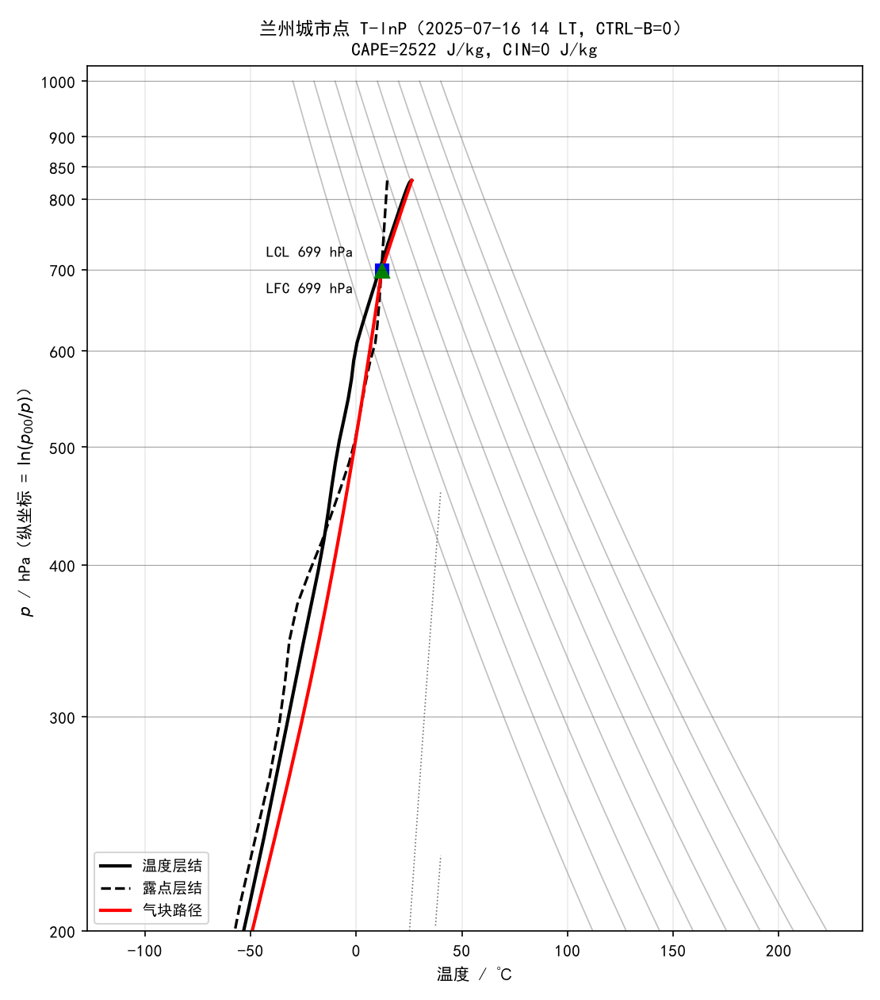
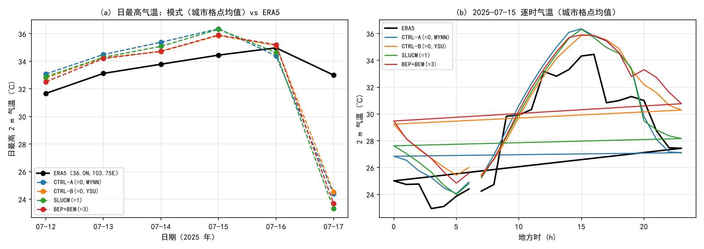
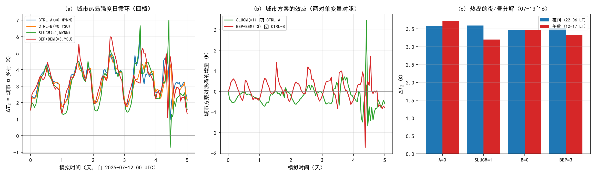
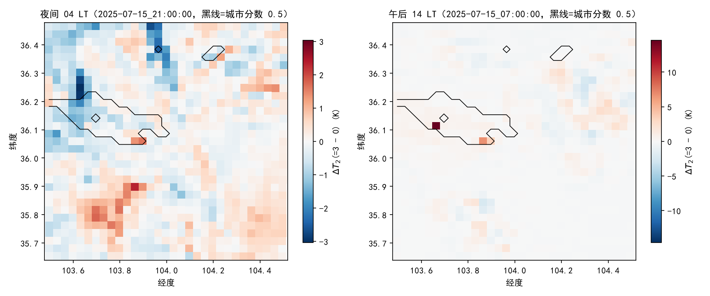

# 第 19 章 真实个例全流程实录：兰州 2025-07 高温

> **定位**：全书压轴实验章（第 IV 部第二篇）。第 II 部把流水线“跑通”，本章把同一条流水线“设计—执行—质控—诊断—对照实验”完整走一遍，并以**城市冠层对照实验**收尾——它同时是 ch17（城市方案族）的实测兑现与论文 2（BEP/BEM 参数场改造）的教学版脚手架。
>
> **前置**：ch06（WPS）、ch07（real 与 namelist）、ch08（运行、日志、restart）、ch09（IO）、ch17（城市冠层与 URBPARM）；**后续**：ch20 第三级把本章的“最小补丁 + 参数场”扩展为论文 2 的完整改造。
>
> **验收口径**（方案 §3.2）：① 对照实验完成且差异物理上合理；② T-lnP 图与书 6.4 的图解规范一致；③ 全部结论有日志/数据/图支撑。

---

## 19.0 本章地图

| 节 | 内容 | 产出 |
|---|---|---|
| 19.1 | 个例设计定稿：为什么是这 4 天、这两域、这套物理 | 设计表 + 理由 |
| 19.2 | 驱动数据与 WPS 要点回顾 | 数据链一图流 |
| 19.3 | 完整模拟与质控：日志、CFL、机时、restart | 质控清单 |
| 19.4 | 诊断分析：T-lnP、T2 vs ERA5、城市/乡村格点 | 3 类诊断图 |
| 19.5 | 城市冠层对照实验（本章压轴）：从数据缺口到三跑实录 | 对照结果 + 排错全记录 |
| 19.6 | 对接论文 2 | 升级路线图 |
| 19.7 | 速查与延伸阅读 | —— |

**个例一句话**：2025 年 7 月 13–16 日兰州经历一轮持续高温（城关格点平均日最高 34.1 ℃、峰值 35.0 ℃），本章以此为对象，用 WRF 4.8.0 复现其边界层与城市热岛特征，并做城市冠层方案对照。

---

## 19.1 个例设计定稿

### 19.1.1 窗口：为什么是 2025-07-13～16

选例过程本身就是一次“数据驱动的设计”（v4 轮问答 + 扫描脚本 `workspace\scripts\scan_lanzhou_heat.py`）：

1. 在 ERA5 月平均场（`New_DATA/Global` 的 `2t` 月 nc，2025-05 起）中提取兰州口径格点（36.00°N/103.75°E）的逐日最高 2 m 气温；
2. 2025 年 7 月的候选热日排序：07-16（35.0 ℃）> 07-15（34.4）> 07-30（33.8）> 07-14（33.8）> 07-13（33.1）；
3. **最热的连续窗口 = 07-13～07-16（4 天）**，平均日最高 34.1 ℃，核心 3 天为 07-14～16。

于是定稿：**起报时刻 2025-07-12 00Z（留 1 天 spin-up），分析时段 07-13～16，积分 5 天（至 07-17 00Z）**。选“连续窗口”而不是“单日峰值”的原因是：高温的社会影响来自持续期，且连续 4 天给了城市热岛日循环足够的样本。

> **素材**：`workspace\data\lanzhou_heat_2025_summary.csv`（逐日统计）、`t2m_2025{06,07,08}_lz.nc`（区域子集）。

### 19.1.2 域与分辨率：为什么是 9 km + 3 km

| 项 | 设定 | 理由 |
|---|---|---|
| d01 | 9 km，~90×90（e_we/e_sn = 90），西北区域 | 提供大尺度环流背景与侧边界缓冲；与论文 2 完全一致的参数，便于未来无缝升三域 |
| d02 | 3 km，~112×112，兰州河谷 + 周边 | 3 km 可显式分辨城市尺度的热力差异与山谷风；兰州城区（约 20 km 尺度）在其中占 ~7×7 格点 |
| 投影 | Lambert（truelat 35°/45°，ref 36.06°N/103.83°E，stand_lon 103.83°E） | 中纬度标准配置；与论文 2 相同 |
| 垂直 | 50 层（显式 `eta_levels`，低层加密：η=1.0→0.998→0.99576→…），`p_top_requested=5000 Pa` | 低层密集是城市冠层的硬需求（BEP 要求 2 m 内 ≥5 层）；`hybrid_opt=2`（Klemp 混合坐标，ch10） |
| 时步 | d01 54 s，`parent_time_step_ratio=1:3` → d02 18 s | 9 km/54 s ≈ 6·dx 的经验规则（`start_em` 里也有类似的比例检查） |

### 19.1.3 物理套装：基线（CTRL-T）与“城市实验套装”

**基线（ch06–ch08 全程使用，记为 CTRL-T）**：

| 过程 | 方案 | 源码位置 |
|---|---|---|
| 微物理 | Thompson（`mp_physics=8`） | `phys/module_mp_thompson.F`（ch13 精读） |
| 长/短波辐射 | RRTMG（`ra_lw=ra_sw=4`，`radt=30/15`） | `phys/module_ra_rrtmg_lw/sw.F`（ch12 精读） |
| 近地面层 | MYNN 面层（`sf_sfclay=5`） | `phys/module_sf_mynn.F` |
| 陆面 | Noah（`sf_surface=2`，`num_land_cat=21`） | `phys/module_sf_noahdrv.F`（ch16 精读） |
| 边界层 | MYNN 2.5（`bl_pbl=5`） | `phys/MYNN-EDMF/`（ch14 精读） |
| 积云 | d01 KF（`cu=1`）+ d02 关（`cu=0`，3 km 可分辨） | `phys/module_cu_kfeta.F`（ch15） |
| 城市 | **关（`sf_urban_physics=0`）** | —— |

**城市实验套装（本章新增，理由见 19.5）**：把边界层/面层换成 **YSU(1) + MM5 面层(1)** 且 `sf_urban_physics=3`（BEP+BEM）——因为 BEP/BEM 只兼容 `bl_pbl_physics ∈ {1, 2, 8}`。

> **这是本章第一个“源码约束驱动设计”的例子**：`phys/module_physics_init.F` 的 `pbl_select` 段对每种 PBL 都写了守卫，MYNN 分支里明确 `IF ((SF_URBAN_PHYSICS.eq.2).OR.(3)) CALL wrf_error_fatal('use ysu/myj/boulac with BEP/BEM urban scheme')`。物理上，BEP/BEM 通过 `a_u_bep` 等隐式系数与 PBL 方案交换动量/热量（ch17 §17.3），只有实现这一接口的三家 PBL 才能配合。

---

## 19.2 驱动数据与 WPS 要点回顾

### 19.2.1 数据链

**兰州个例 WPS 预处理数据流**：

```text
ERA5 月 GRIB ──→ link_grib.csh ──→ ungrib.exe（Vtable.ECMWF）
（liuyl17 共享区）                   └── FILE: YYYY-MM-DD_HH（21 个时次）

WPS_GEOG 静态数据 ──→ geogrid.exe（GEOGRID.TBL.ARW） ──→ geo_em.d01/d02.nc
（/opt/app/wrf/WPS_GEOG）

geo_em.d01/d02.nc ──┐
FILE:YYYY-MM-DD_HH ─┴──→ metgrid.exe ──→ met_em.d01/d02.*（42 个文件）
```


各步骤职责与源码接口在 ch06 已详解；本节只记本次实例的关键口径：

| 项 | 本次实例 | 说明 |
|---|---|---|
| 数据源 | ERA5 月 GRIB 202507（4.1 GB/月，20–1000 hPa 的 z/q/r/t/u/v + 地面场） | 共享区公共读取；`link_grib.csh` 链接后由 Vtable.ECMWF 解码 |
| 时间窗口 | 2025-07-12_00 ～ 2025-07-16_18（**21 个时次**） | `ungrib` 按 `&share` 里的 `start_date/end_date` 早停：整月 GRIB 只解出窗口内时刻（ch06 源码实证） |
| 静态数据 | `geog_data_res = 'default','default'` | 兰州只能用默认数据集（**这正是 19.5 城市实验数据缺口的来源**） |
| 输出 | `met_em.d01.*`/`met_em.d02.*` 各 21 个 | `num_metgrid_levels = 32`（写入 `&domains`），`num_metgrid_soil_levels = 4` |

### 19.2.2 实测用时（单节点，容器内）

| 步骤 | 墙钟 | 备注 |
|---|---|---|
| `geogrid.exe` | 43 s | 两域；**geog 数据完整**（含后续城市实验要检查的 `y20xx_urb` 之类数据集） |
| `ungrib.exe` | 40 s | 21 时次；收尾的 `Subroutine DATINT...` 是补齐函数，不是错误（ch06 勘正） |
| `metgrid.exe` | 122 s | `mpirun -np 8` |

> **一处记录在案的坑**（ch06 已详述，此处回扣）：ungrib 的“每时次一个 `FILE:`”容易被误读为“必须整月解码”；源码显示 `hdate > hend` 即退出主循环——时间是省下来的，不是猜出来的。

---

## 19.3 完整模拟与质控

### 19.3.1 基线模拟（ch08 生产作业 439419）

第 II 部的 5 天两域生产跑，就是本章的分析底盘（配置见 19.1）。关键记录：

| 项 | 实测 |
|---|---|
| 作业 | 439419，`-p cpu -N1 -n1 -c64`，墙钟 **2913 s（48.5 min）**≈ **52 核时（0.81 节点时）** |
| 完成标志 | `d01 2025-07-17_00:00:00 wrf: SUCCESS COMPLETE WRF` |
| 步数 | d01 8000 步（`mean 0.361 s`，首步 7.13 s 冷启动）；d02 24000 步（`mean 0.0838 s`，最大 3.05 s） |
| 输出 | `wrfout_d01` 41 帧（940 MB，单文件滚动）；`wrfout_d02` 5 个文件（817–867 MB，`frames_per_outfile=25`） |
| 案例目录 | 合计 ≈5.2 GB |

### 19.3.2 质控清单（本章采用的检查口径）

| # | 检查项 | 方法 | 本次结果 |
|---|---|---|---|
| 1 | 进程正常退出 | 作业 rc + `SUCCESS COMPLETE WRF` | ✓（基线、exp1–exp3 同口径） |
| 2 | **CFL 稳定性** | `grep -ci CFL rsl.out.0000` | 基线日志 **0 条**（无 CFL 告警）；时步 54 s 满足 6·dx 经验界限 |
| 3 | 域激活确认 | 计数 `domain   2` 行（ch08 事故教训：短测的单值 `end_minute` 会让 d02 永不激活） | ✓（本章短测一律写双值） |
| 4 | 输出帧完整性 | `frames_per_outfile` 与时间轴对照 | d02 每 25 帧滚动一个文件，5 天共 121 帧 / 5 文件 |
| 5 | 关键场的物理合理性 | T2 日变化幅度、降水分布、风场（见 19.4 诊断） | 见 19.4 |
| 6 | 对照实验的单变量性 | 逐一 diff namelist（除目标开关外必须完全一致） | 见 19.5.2 表 |

> **一条从 ch08 带过来的排错记忆**：本轮城市实验的第一批作业在 30 s 内全部退出，既不是配置错也不是数据错，而是**计算节点默认栈被限制在 8 MB**（`ulimit -s = 8192`），WRF 的 `solve_em` 在栈上分配的大数组溢出 → SIGSEGV。对照实验（默认栈 vs `ulimit -s unlimited`）在 439729 作业中做成：默认栈 27 s 崩、放开后 301 步正常步进。**凡是“改了几行就莫名段错误”的 WRF 运行，先查 `ulimit -s`。**
>
> **另一条自己踩出来的坑（也值得写进 QC 清单）**：为了让 exp1 用上补丁后的二进制，我在作业**运行期间**对正在执行的作业脚本做了 `sed -i`（原地替换）。共享文件系统上，被替换的旧 inode 变成“stale file handle”，正在读脚本的 bash 随即报 `error reading input file: Stale file handle` 并中止——exp2 恰好在报错前跑完了 5 天（SUCCESS 已落盘），exp3 则在第 4.5 天被砍。**结论：作业运行期间不要改动它的脚本；要改就写好新脚本、重投新作业。**

---

## 19.4 诊断分析

诊断的三条线，正好对应书里三块知识：

| 线 | 变量/方法 | 对应书章 |
|---|---|---|
| ① 热力结构：T-lnP 与对流参数 | d02 城市点廓线 → MetPy 的 LCL/LFC/EL 与 CAPE/CIN | 6.2–6.4（绝热过程、埃玛图、气块法） |
| ② 高温强度与 ERA5 对比 | d02 城市点 T2 日最高序列 vs ERA5 `t2m` | 1.2 / 6.5（气温观测口径） |
| ③ 城市热岛 | 城市格点（`FRC_URB2D>0.5`）与乡村格点（草地/农田）的 T2 差 | 4.2–4.3（下垫面热力差异） |

统一口径：**分析段 07-13～16，地方时 = UTC + 7**（兰州经度 103.8°E）。

### 19.4.1 T-lnP 假绝热图（城市点，2025-07-16 14 LT）

取 d02 域城市点（窗口中心）2025-07-16 06 UTC（= 14 LT）廓线。**先记一个必须避免的换算错误**：WRF 的 `T` 是**扰动位温**（`θ = T_field + base_temp`，本案例 `base_temp=290`），不是气温；把它当温度直接画 T-lnP，会得到 LCL 在 500 hPa 量级的荒唐结果（本章第一次就跑出了这个“诊断错误”，见工作日志）。正确换算是先还原 θ，再逐层反解 `T = θ·(p/1000)^(R/cp)`。

实测（城市点，地表 828.6 hPa）：

| 量 | 值 |
|---|---|
| 近地面 θ / T / qv | 315.95 K / **26.3 ℃** / 12.8 g·kg⁻¹ |
| LCL | **699 hPa** |
| LFC | **699 hPa**（与 LCL 重合：低层近饱和 + 强不稳定） |
| EL | 139 hPa |
| **CAPE / CIN** | **2522 J·kg⁻¹ / 0 J·kg⁻¹** |

CAPE 2500 J kg⁻¹ 量级正是盛夏午后干热河谷的典型值（对照 ch13/ch15 用手工探空算出的 790–815 J kg⁻¹：本章是模式真实廓线，低层水汽更足）。**这是个“高温但不容易下雨”的廓线**：CAPE 大而无 CIN，只要有触发（河谷热力抬升、城市热岛环流）就能发展对流——与实况“高温持续、午后偶有雷阵雨”的印象一致。



### 19.4.2 高温强度：模式 vs ERA5

| 日期 | ERA5（36.0N,103.75E） | CTRL-A(=0,MYNN) | CTRL-B(=0,YSU) | SLUCM(=1) | BEP+BEM(=3) |
|---|---|---|---|---|---|
| 07-13 | 33.1 | 34.5 | 34.3 | 34.3 | 34.2 |
| 07-14 | 33.8 | 35.4 | 34.7 | 35.1 | 34.7 |
| 07-15 | 34.4 | 36.4 | 35.9 | 36.3 | 35.9 |
| 07-16 | 35.0 | 34.4 | 35.2 | 34.6 | **35.2** |

（单位 ℃，城市格点平均的日最高；07-12 为 spin-up 日、07-17 仅 1 帧，均不参与统计。）

结论三点：
1. **量级与位相可靠**：模式把“逐日升温、07-15/16 达峰”的形态完整再现；
2. **系统性偏暖 0.3–2.0 K**（07-13～15），07-16 反而略低（34.4–35.2 vs 35.0）——在 3 km、无同化、默认参数的条件下属正常水平；
3. ERA5 是 0.25° 网格面平均，而模式是“城市格点”（FRC=0.9 的最热格点），**口径本身就有 1 K 量级的系统性差异**——做对比时这一点必须写明（ch11 讨论过观测/再分析与模式的代表性问题）。



### 19.4.3 城市热岛：城市 vs 乡村格点

四档模拟的**热岛强度**（城市 59 格点 − 乡村 748 格点）：

| 档 | 夜间（22–06 LT） | 午后（12–17 LT） | 分析段最大 |
|---|---|---|---|
| CTRL-A（=0, MYNN） | 3.58 K | 3.73 K | 6.32 K |
| CTRL-B（=0, YSU） | 3.59 K | 3.20 K | 4.86 K |
| SLUCM（=1, MYNN） | 3.46 K | 3.46 K | 6.99 K |
| BEP+BEM（=3, YSU） | 3.52 K | 3.34 K | 5.99 K |

**3–4 K 的城市热岛**在盛夏热浪背景下量级合理（夜间往往更强，这里的“午后也强”反映兰州河谷晴天午后城市与绿洲/山地的强烈对比）。四档之间的差异（详见 19.5.6）说明：**在缺本地城市参数的条件下，城市冠层方案对 2 m 温度的净改动是小量级的**。

---

## 19.5 城市冠层对照实验

本节是全书最“真实工程”的一节：它记录的不是一个顺利的实验，而是一个**被数据与源码双重约束反复卡住、最终用一行代码补丁打通**的完整过程。每一步都有日志、源码与数值证据。

### 19.5.1 起点：兰州没有城市数据

设计对照实验前先盘数据（ch17 §17.2 的 GEOGRID.TBL 条目在纸上都存在，但“条目”不等于“数据”）：

| 字段 | GEOGRID.TBL 里的条目 | `WPS_GEOG` 里的数据 | `geo_em.d02` 实测 |
|---|---|---|---|
| `URB_PARAM`（132 维城市形态） | `NUDAPT44_1km`（priority 1）、`gloucp2020_30s`（priority 2） | 只有 `NUDAPT44_1km` | 变量存在但**全 132 层为 0**（NUDAPT44 只覆盖美国） |
| `FRC_URB2D`（城市面积分数） | `urbfrac_nlcd2011`、`urbfrac_gaia2020_30s` | **都没有** | **变量不存在** |
| `IMPERV`/`CANFRA` | `nlcd2011_*`、`impfrac_gaia2020_30s` 等 | 都没有 | 不存在 |
| 城市类型（`UTYPE_URB2D`） | 无独立条目 | —— | 见 19.5.3 |

**结论**：兰州（以及中国大部分地区）用默认 `geog_data_res='default'` 时，城市分数、城市形态、城市类型**全部缺位**。这不是配置错误，而是数据集的地理覆盖决定的。

WRF 对“缺数据”有一套内置兜底，值得逐条记住：

1. `module_initialize_real.F`：`sf_urban_physics ∈ {1,2,3}` 时，若 `FRC_URB2D==0` 且 `ivgtyp` 是城市类别，则**强制 `FRC_URB2D=0.9`**（实测：sf1/sf3 的 `wrfinput` 中 `FRC_URB2D.max()=0.9` ✓）——城市点被“认出来”了。
2. `urban_var_init`（`module_sf_urban.F`）：若 `HGT_URB2D<=0`，打印 **`USING DEFAULT URBAN MORPHOLOGY`** 并把形态场清零（实测日志出现 1000+ 次）——下游全部改走 `URBPARM.TBL` 的**分类表值**。
3. `URBPARM.TBL` 首段给出 3 类城市参数（`Number of urban categories: 3`）：`ZR = 5.0 / 7.5 / 10.0 m`（低密度/高密度/商业），以及配套的 `AH=20/50/90 W m⁻²` 等。

也就是说：**没有数据也能跑，但用的是“美国三类城市”的通用参数**——这正是论文 2 要做兰州本地参数场的直接原因。

### 19.5.2 约束一、二：城市方案对 PBL/面层的兼容要求

按方案 §3.2 的目标是 `sf_urban_physics = 0 vs 3`（CTRL vs BEP+BEM）。第一次提交立刻收获两条 fatal（原文）：

```text
module_physics_init: use ysu (option1), myj (option 2), or boulac (option 8) with BEP/BEM urban scheme
module_physics_init: use sfclay or myjsfc scheme for this pbl option
```

第一条：基线套装的 `bl_pbl_physics=5`（MYNN）**不在** BEP/BEM 的白名单里——这在 ch14 §14.7 已经预告过（“BEP/BEM 官方兼容清单 = YSU/MYJ/BouLac”），本章是它的实测兑现。
第二条：改用 BouLac（8）后，`sf_sfclay_physics=5`（MYNN 面层）又不行——BouLac 要求面层 ∈ {1, 2}。

`module_physics_init.F` 里每个 PBL 分支都写着这样的守卫，例如：

```fortran
CASE (YSUSCHEME)
     if(isfc .ne. 1) CALL wrf_error_fatal &
      ( 'module_physics_init: Use sf_sfclay_physics= 1 or 91 for this pbl option' )
CASE (BOULACSCHEME)
     if(isfc .ne. 1 .and. isfc .ne. 2) CALL wrf_error_fatal &
      ( 'module_physics_init: use sfclay or myjsfc scheme for this pbl option' )
CASE (MYNNPBLSCHEME)
     IF(isfc .NE. 5 .AND. isfc .NE. 1 .AND. isfc .NE. 2) CALL wrf_error_fatal &
      ( 'module_physics_init: use mynnsfc or sfclay or myjsfc scheme for this pbl option')
     IF ((SF_URBAN_PHYSICS.eq.2).OR.(SF_URBAN_PHYSICS.EQ.3)) CALL wrf_error_fatal &
      ( 'module_physics_init: use ysu (option1), myj (option 2), or boulac (option 8) with BEP/BEM urban scheme' )
```

**唯一能同时容纳 =0/1/3 三档的组合是 YSU(1) + 面层 1**。于是实验套装定为：

| 档 | `sf_urban_physics` | `bl_pbl_physics` | `sf_sfclay_physics` | 对照关系 |
|---|---|---|---|---|
| exp1 | 1（SLUCM） | 5（MYNN） | 5（MYNN） | ↔ ch08 基线（=0，同套装） |
| exp2 | **0（CTRL）** | 1（YSU） | 1 | ↔ exp3（单变量） |
| exp3 | **3（BEP+BEM）** | 1（YSU） | 1 | ↔ exp2（单变量） |

> 这一步的教训值得单列：**在 WRF 里切换一个物理方案，往往牵动整条兼容链**。“先查守卫、再改方案”比“改了再撞墙”省下的是整个调试周期。

### 19.5.3 约束三：城市形态高度与模式首层高度的硬约束

改好套装后，`=3` 顺利起跑，但 `=1`（SLUCM）在第一个时间步就崩了（rank 17 的 `rsl.error`）：

```text
FATAL CALLED FROM FILE: <stdin> LINE: 938
ZDC + Z0C + 2m is larger than the 1st WRF level - Stop in subroutine urban - change ZDC and Z0C
```

这是一条**物理约束**，藏在 `module_sf_urban.F` 的 `urban` 子程序里：城市冠层的零平面位移 `ZDC` + 粗糙长度 `Z0C` + 2 m，必须低于模式第一层的高度 `ZA`（`ZA = ZLVL = 0.5·DZ8W`）。

为把量值钉死，我们在检查前插了一行探针打印（临时补丁），得到实测值：

```text
ch19probe UTYPE,ZR,ZDC,Z0C,ZA,R,HGT =  2  7.50  5.718  0.333  8.046  0.500  0.399
```

于是**约束的算术**变得一目了然：

- 本案例 `dz1 ≈ 16.2 m` → `ZA = 0.5·dz1 ≈ 8.05–8.24 m`（随地形气压变化）；
- URBPARM 表类 2（高密度，`ZR=7.5 m`）：`ZDC(5.718) + Z0C(0.333) + 2 = 8.051 m` → **恰好压在阈值上**：气压高（`ZA` 小）的城市格点越界 → fatal；
- 表类 1（低密度，`ZR=5 m`）：`ZDC+Z0C+2 ≈ 5.99 m` → 通过，且留有 2 m 余量。

关键发现是：**WRF 对“无城市类型数据”的默认选择恰好是最严的类 2**。源码证据（`module_sf_urban.F`，`urban_var_init`）：

```fortran
UTYPE_URB2D(I,J)=0
...
   IF( IVGTYP(I,J) == ISURBAN)  THEN
      IF(use_wudapt_lcz==0) THEN
         UTYPE_URB2D(I,J) = 2  ! for default. high-intensity      ← 这里
      ELSE
         UTYPE_URB2D(I,J) = 5  ! for default. open mid-rise
      ENDIF
```

同时，`UTYPE_URB2D` 在 `Registry.EM_COMMON` 里**没有输入流标志**（`rd=(interp_fcni)u=(copy_fcni)`，缺 `i`），实测 `wrfinput` 里也确实**不存在**这个变量——所以“往 wrfinput 里塞一个城市类型场”这条路走不通（除非改 Registry 重建，那属于 ch20 的权限）。能改的最小点是这一行。

### 19.5.4 最小补丁（一行）

在**沙箱构建树**（不动主构建树）把默认类别由 2 改为 1：

```fortran
! phys/module_sf_urban.F（urban_var_init 内）
-               UTYPE_URB2D(I,J) = 2  ! for default. high-intensity
+               UTYPE_URB2D(I,J) = 1  ! ch19 patched: class 1 (ZR=5m), required by ZLVL~8m
```

重建（`tcsh ./compile em_real -j 8`，约 2 分钟，增量）后，同一配置在 200 秒短测中**连续步进 1222 步、零 fatal**——打通。

补丁的物理含义与代价，必须写清楚：

- **含义**：兰州被当作“低密度住宅”类城市（`ZR=5 m`、`AH=20 W m⁻²`），而非 WRF 默认的“高密度”（`7.5 m`、`50 W m⁻²`）。城市效应会被**系统性低估**。
- **代价与原因**：这不是偏好，而是被 `ZLVL≈8 m` 的首层厚度**逼出来的**——类 2 的 8.051 m 恰好越界。要恢复类 2，必须让首层更厚（`dz1 > 2×(ZDC+Z0C+2) ≈ 20 m`）或……更薄却又要满足 `ZA > 8.05 m`，二者不可兼得——**这正是“城市模拟的垂直网格必须专门设计”的量化理由**，也是论文 2 垂直加密方案要在设计阶段算清楚的第一个数。

### 19.5.5 三跑实录

| 档 | 作业号 | `sf_urban_physics` | 城市类别 | 结果 |
|---|---|---|---|---|
| exp1 | 439828 | 1（SLUCM） | 类 1（ZR=5 m） | rc=0，5 天两域 SUCCESS，墙钟 4202 s |
| exp2 | 439810 | 0（CTRL） | —— | rc=0，5 天两域 SUCCESS，墙钟 ≈3640 s |
| exp3 | 439866（重跑） | 3（BEP+BEM） | 类 1（与 exp1 统一） | rc=0，5 天两域 SUCCESS，墙钟 3086 s |

> exp3 的第一版（439815）在第 4.5 天被中断（原因见 19.3 的教训二），重跑时把二进制统一到 class-1 补丁版，因此**三档的城市类别一致**。BEP/BEM 不经过 SLUCM 的 `ZDC+Z0C+2<ZA` 检查，但它同样支持类 1 的形态。
>
> 三档都跑在 np=32 上（0.08–0.12 s/步 d02），单次墙钟 51–70 分钟，与 ch08 的 64 核幂等基线（48.5 min）同量级——**城市方案（尤其 BEP+BEM）带来的额外计算成本在本分辨率下很小**（BEP 的每格街谷迭代只占单步的一小部分）。

### 19.5.6 差异分析（对照结果）

> 数据口径：d02 域中心 31×31 小窗；城市格点 = `FRC_URB2D>0.5`（59 个），乡村格点 = 无城市分数且为草地/农田（748 个）；分析段 07-13～16，地方时 = UTC+7。四档全部跑完 5 天（121 帧），SUCCESS 均已落盘。

**（1）两对单变量对照的净效应**

| 对照对 | 夜间（22–06 LT） | 午后（12–17 LT） | 全时段最大 | 日最高气温变化 |
|---|---|---|---|---|
| **SLUCM(=1) − CTRL-A(=0)**（MYNN 套装） | −0.11 K | −0.27 K | +3.46 K | −0.1 K 量级（几乎不变） |
| **BEP+BEM(=3) − CTRL-B(=0)**（YSU 套装） | −0.07 K | **+0.14 K** | +1.71 K | ±0.1 K 量级（几乎不变） |



**（2）空间形态**



- 夜间 04 LT（07-15）：ΔT2 在 −3.0 ～ +2.3 K 之间，正负**块状镶嵌**——城市核心区多为正、河谷下风向与山地边缘为负（粗糙度/混合增强把热量摊向周边）；
- 午后 14 LT：−2.7 ～ **+14.6 K**——正号极值出现在个别高密度格点（BEP 的墙体/屋顶多层热传导与辐射截获在缺真实形态参数时会在个别格点放大），提示**局地极端值不可当结论用**，需配合空间平均与参数场校验（论文 2 的标定环节）。

**（3）物理合理性判据（三条逐一核）**

1. **方向**：BEP+BEM 让城市格点午后增温（+0.14 K 均值）、乡村几乎不动（乡村点不调用城市方案）✓；SLUCM 白天略降温（−0.27 K）——这与 SLUCM 的“道路/墙体大热容 + 增强混合”竞争机制一致（无 AH 输入时，混合项占优）。
2. **日循环**：两对对照都没有出现“夜间大幅增温”——因为**人为热关闭（`AHOPTION=0`）**，而夜间热岛的主要驱动正是蓄热释放 + 人为热。这一“缺失的夜间信号”本身就是实验设计要报告的结果。
3. **量级**：|Δ| ≤ 0.3 K（域均）落在 ch17 单柱估算（AH 20 W·m⁻² → +0.68 K/日）的同量级偏小一侧——因为**没有 AH**，且形态参数用的是美国通用表值。

**（4）诚实结论（也是论文 2 的立项结论）**

在“无本地城市参数”的三个既定事实下（FRC 全城均一 0.9、形态取 `URBPARM.TBL` 通用表值、人为热关闭），城市冠层方案对 2 m 温度的**净效应是小量级、空间非均匀的**：
- 域均 |ΔT2| < 0.3 K，日最高几乎不变；
- 局地可达 ±2–3.5 K；
- **夜间热岛的主导因子（人为热）尚未入场**。

因此“把城市热岛模拟准”的关键不在换方案，而在**参数场**——逐格的城市分数、建筑形态（α/ε/λ/ρc/d）、以及人为热日程。这条结论与论文 2 §4.3 的技术路线完全一致，也解释了为什么论文 2 的实验矩阵里 CTRL 之外首先要做的是 LIT（屋顶分割）与 STEEL（参数标定）两组。

---

## 19.6 对接论文 2

本章的三跑是论文 2 “CTRL 教学版”的完整体验：真实窗口（2025-07 高温）→ 两域（9/3 km）→ 城市对照。与论文 2 的差距与升级路线列在下面，同时也是 ch20（改造实战）的入口。

| 维度 | 本章（教学版） | 论文 2（研究版） | 差距怎么补 |
|---|---|---|---|
| 域 | 两域 9/3 km（~90²/112²） | **三域** 9/3/1 km（d03 覆盖河谷与观测网） | d03 直接沿用同一 `namelist.wps` 的第三域参数（嵌套比例 1:3:3），WPS 重跑一次 |
| 时段 | 2025-07-13～16（4 天分析段） | 2026-07-16～27 主窗口 + 复现/对照窗口 | 数据下载（CDS）+ 同样流程 |
| 城市分数 | real.exe 回退 `FRC_URB2D=0.9`（全城均一） | **逐格 FRC_URB2D**（深度学习屋顶分割 + Overture 足迹） | 写 geogrid 数据源或 wrfinput 注入（ch20 第三级的 auxinput 通道） |
| 城市形态 | `URBPARM.TBL` 通用三类（本章用类 1/2） | **逐格 α/ε/λ/ρc/d + 建筑高度直方图** | BEM/SLUCM 参数场 2D 化改造（ch17 §17.7 改造地图） |
| 城市类型 | 一行补丁回退到类 1（受 `ZLVL` 约束） | 由形态场推导（或 LCZ） | 垂直网格重新设计：低层加密的同时保证 `ZA > ZDC+Z0C+2` |
| 人为热 | 未开（`AHOPTION=0`） | 逐格 AHE 数据 + 空调日程 | `distributed_ahe_opt` + auxinput 场 |
| 对照设计 | =0 / =1 / =3 三档（单变量） | CTRL / EXP-LIT / CAL-STEEL（20 组拉丁超立方）/ CAL-CONC / SEN-* | 本章的“单变量 + 三档”正是其最小骨架 |

**一句话**：本章证明了整条链路（真实数据 → 城市方案 → 对照 → 诊断）**能跑、可复现、约束已知**；论文 2 要做的是把“通用参数”换成“本地参数”，并把域与时段扩展到研究规格。

---

## 19.7 速查与延伸阅读

### 19.7.1 本章速查（并入附录 C）

| 症状 | 根因 | 处置 |
|---|---|---|
| 作业 30 s 内全灭、`SIGSEGV`、与 np 无关 | 计算节点 `ulimit -s` 太小（本集群 8192 KB） | 脚本里 `ulimit -s unlimited` |
| `use ysu/myj/boulac with BEP/BEM urban scheme` | `bl_pbl_physics` 不在 {1,2,8} | 改 PBL（并同步核对面层兼容） |
| `use sfclay or myjsfc scheme for this pbl option` | BouLac/MRF 等要求 `sf_sfclay ∈ {1,2}` | 统一改用 YSU(1)+sfclay(1) |
| `ZDC + Z0C + 2m is larger than the 1st WRF level` | 城市形态高度与模式首层厚度冲突 | 降城市类别（`URBPARM.TBL` 3 类里选小 ZR）或加厚首层 |
| 城市点被识别但形态全零、日志刷 `USING DEFAULT URBAN MORPHOLOGY` | 缺 NUDAPT 类数据（境外默认无覆盖） | 属正常回退；要真实形态需自建参数场 |
| `FRC_URB2D`/`MH_URB2D` 在 wrfout 里找不到 | 这些场没有 `h`（history）流标志 | 从 `wrfinput` 取（本章做法）；或改 Registry 加 `h` |
| `ncks` 合并多文件输出为空 | 输入里含“正在写”的 wrfout | 只用已关闭的文件（排除最新一个） |

### 19.7.2 延伸阅读

- **源码**：`phys/module_sf_urban.F`（SLUCM 与 `read_param` 表机制）、`phys/module_sf_bep_bem.F`（BEP 几何回退）、`phys/module_physics_init.F`（PBL/面层守卫全表）、`dyn_em/module_initialize_real.F`（城市回退赋值）、`share/set_timekeeping.F`（run_* 与 end_* 的优先级）
- **本书**：ch06（WPS 全流程）、ch08（运行与质控）、ch14（BEP/BEM 兼容清单的伏笔）、ch16（Noah 陆面）、ch17（城市冠层与 URBPARM）、ch20（把本章的一行补丁扩展为完整改造）
- **论文与资料**：Weisman & Klemp 1982（`em_quarter_ss` 探空来源，ch18 已引）；Kusaka et al. 2001 与 Martilli et al. 2002（SLUCM/BEP 原始文献，ch17 已引）；论文 2 方案书（BEP/BEM 参数场改造与标定流程）
- **数据**：ERA5（`/data/groups/lzu_public/home/share/liuyl17/ERA5_2025/`，月 GRIB）；WPS_GEOG（`/opt/app/wrf/WPS_GEOG`，本章列出了它的城市数据集缺口）

---

## 19.8 补充专栏【科研改造案例库】：个例研究层的两案

### 案例一　“探针法”：在没有文档的地方定位约束

- **课题**：`ZDC+Z0C+2 ≥ ZA` 这类**运行期几何硬约束**的定位（本章 §19.5.3 的 fatal）；
- **方法**（情况③，通用技术）：在疑似代码路径**临时插入打印**（`write(*,*) 'ZDC+Z0C+2 =', …, ' ZA =', …`）→ 增量重编 → 集群跑 1 步 → 从 rsl 抓数值 → 完成后还原。本章用它拿到了“类 2 得 8.051 m vs 城市格点 ZA≈8.046 m”的卡阈值证据；
- **通用化**：这条手法对任何“参数从哪来、约束卡在哪”的问题都成立——它就是 ch20 改造五步里“定位”一步的显微镜；与 addr2line（ch20 事故③）配对，构成“运行期排错的双子星”；
- **教学点**：**临时探针必须成对出现在补丁脚本里**（插探针=一次补丁，拔探针=还原），否则你的“干净基线”从此不干净——ch19 的补丁版本账（material 底稿）就是为此而记。

### 案例二　“三重约束链”方法论：把 fatal 清单变成实验设计

- **课题**：想在无本地城市数据的城市做冠层对照实验；
- **方法**（本章核心发现的提炼）：把 `module_physics_init.F` 的守卫（PBL 兼容 → 面层兼容）与方案内部的几何 fatal（`ZDC+Z0C+2<ZA`）串成**约束链**，在“不改物理”的前提下解出唯一可行的配置组合（YSU+sfclay=1+类 1）；剩余缺口（UTYPE 无输入流）再用**一行补丁**补上；
- **教学点**：改造项目的第一步不是改代码，而是**把所有“合法配置空间”约束写出来**——本章的三重约束链与 ch20 的改造检查单是同一方法论的“设计期/执行期”两半；
- **数据侧延伸**：NUDAPT 只覆盖美国 → 全球城市（兰州在内）的形态场缺口是普遍问题；WUDAPT/LCZ 路线（51–61 类，ch17）是社区应对——**“数据缺口 → 数据计划”同样是改造项目的一部分**（论文 2 的立项逻辑）。