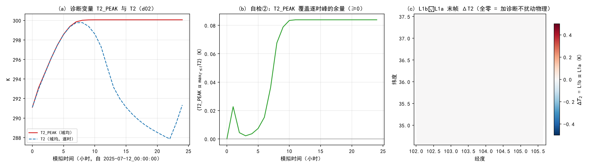
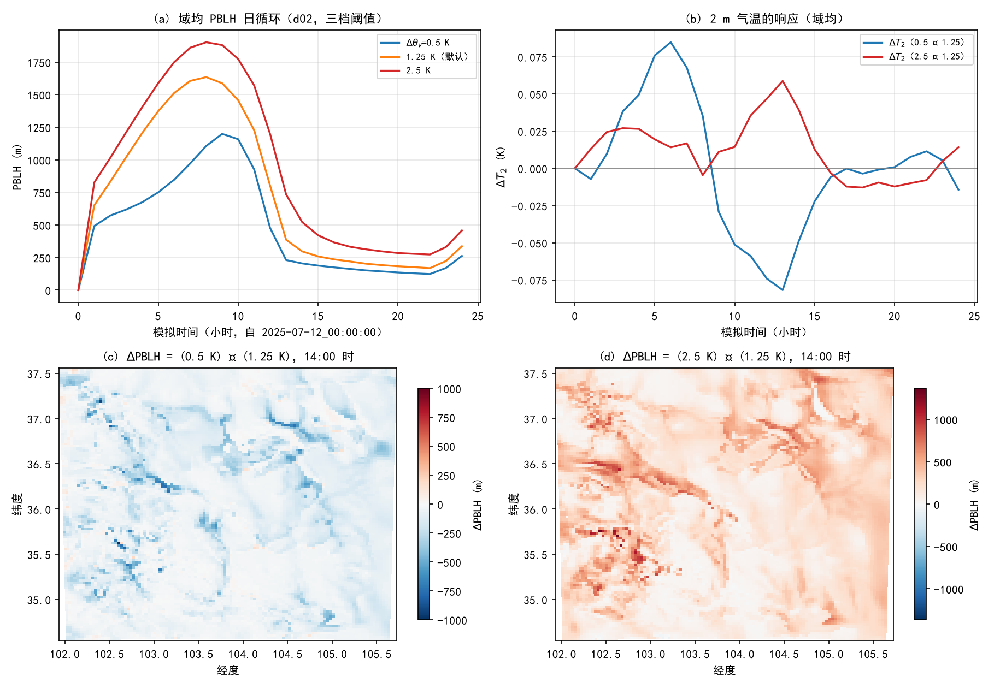
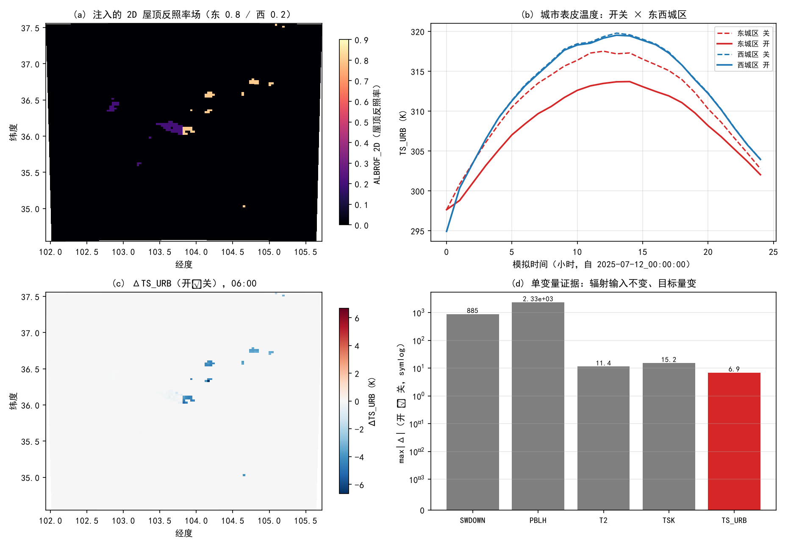

# 第 20 章 改造 WRF 三级实战：从诊断变量到逐格参数场

> 本章是全书第一个“动手改源码”的章节。前三部把“读”做到位，这里开始“写”：给 WRF 加一个诊断变量、改一行物理判据、把城市方案的标量参数升级成逐格参数场。三个级别改动面依次扩大，代价、风险与验证手段也依次升级；每一级都配一套集群实跑的对照实验，用来证明“改动真的生效、且只生效在预期的地方”。
> 口径提醒：本书所有源码引用只给**文件 + 符号**（不给行号），所有实验均在教材集群的同一套编译环境（Intel oneAPI + singularity 容器）内实测。

---

## 20.0 本章地图

**三级递进**：

| 级别 | 内容 | 改动面 | 编译代价 | 单一变量验证 |
|---|---|---|---|---|
| **L1** | 新增诊断变量 `T2_PEAK`（初始化以来 2 m 气温最大值） | Registry 1 行 + 2 个 Fortran 文件（清零/更新点） | **十几分钟级**（Registry 触发全链重编） | 加诊断的二进制 vs 干净基线：**应当零扰动** |
| **L2** | MYNN PBLH 的 θv 阈值 `delt_thv`：1.25 K → 0.5 / 2.5 K | **1 行**（`GET_PBLH` 的 LAND 分支） | **分钟级**（单文件重编 + 链接） | 三档阈值单变量对照 |
| **L3** | BEM 屋顶反照率：标量 → 2D 逐格场 + namelist 开关 + 输入流 | Registry 3 处 + 4 个 Fortran 文件 + 输入场 | 十几分钟级（Registry + 物理多文件） | 同一二进制、开关开/关 |

**五步闭环**（本章每一级都走一遍）：

```text
定位（读源码找到唯一锚点）
  → 图纸（写清"改什么、为什么、预期什么"）
  → 补丁（脚本化、断言锚点唯一、保留 .orig 备份）
  → 自检（编译后先查生成物：变量真的进了 inc/ 吗）
  → 重编（判清改动面：碰 Registry = 全链；叶节点 = 增量）
  → 实跑验证（单变量对照 + 位级/统计级核验）
```

**与全书的接口**：

- L1 的图纸来自 [ch04 Registry 机制](ch04_registry_mechanism.md) §4.5；本章落地时要补上 ch04 纸上设计没有的两条工程细节（Registry 触发门、干净重建）。
- L2 的物理判据来自第六章 6.8 节（静力稳定度与 PBLH 判据），第 III 部的 [ch14 边界层方案族](ch14_pbl_family.md) 已给出“PBLH 三型判据（Ri / θv 阈值 / TKE 阈值）”的总图，本章改的就是其中一种。
- L3 的改造地图来自 [ch17 城市冠层专章](ch17_urban_canopy.md) §17.4.3，是论文 2（`EXP-LIT`）的技术验证版：把“屋顶反照率”这一个标量换成逐格场，先把**参数场化的技术链路**走通。

---

## 20.1 改造方法论：从“读懂”到“改对”

### 20.1.1 三条纪律

1. **锚点唯一性断言**：补丁脚本一律对“待替换片段”做计数断言（`assert count == 1`），命中数不是 1 就立刻失败。WRF 源码里大量重复语句，靠肉眼找“第几处”迟早出错（本章 §20.5 事故②就是“两处调用结尾长得一样”）。
2. **先备份再改**：改动前 `cp -p 原文件 原文件.orig_<标签>`；补丁脚本可重放（幂等），回滚只需还原备份。本章全部补丁都留有 `.orig_ch20` / `.orig_ch20L3` 备份。
3. **产物带指纹**：每个二进制、每个关键生成物都记 md5 与时间戳。改造实验里最危险的失败不是“编不过”，而是“编过了但用的是旧文件”（§20.2.5）。

### 20.1.2 判改动面：三种代价档

按 ch05 §5.5 的时间预算直觉，改造分三档：

| 档 | 触发条件 | 实测代价 | 本章对应 |
|---|---|---|---|
| 叶节点改动 | 只改某个物理模块的 Fortran | 1~2 分钟 | L2 |
| 物理段多文件改动 | 改到 `first_rk_step_part1` / 驱动层，不动 Registry | 几分钟 | L3 的多数改动 |
| **碰 Registry** | 新增/修改 `state`、`rconfig` 记录 | **十几分钟（全链）** | L1、L3 |

第三档的“全链”不是猜测：`Registry.EM_COMMON` 里多一行 `state`，`tools/registry` 重新生成的 `inc/` 生成物（域类型字段、分配/释放、状态表、IO 位掩码、通信、嵌套插值）就全部换新，依赖它们的对象文件随之重编。**另有一条只在干净树上才暴露的机关**：Registry 程序本身是否重新运行，取决于构建脚本的时间戳比较（§20.5 事故⑥）。

---

## 20.2 第一级：Registry 级改造——诊断变量 `T2_PEAK`

### 20.2.1 设计：把一个“热浪监测量”写进域状态

**要什么**：2 m 气温 `T2` 是模式每步都算的诊断量，但 wrfout 里只有瞬时值或输出区间的极值。高温研究里常用的量是“自初始化以来的最高气温”——它单调不减、不受输出间隔影响。WRF 官方的近亲是 CLWRF 诊断族（`output_diagnostics` 打开后由 `phys/module_diagnostics_driver.F` 的 `clwrf_output_calc` 产出的 `T2MAX/T2MIN`，走 `auxhist3` 流），但那是**每输出区间重置**的极值；我们要的是“全程不重置”版。

**物理 ↔ 语句（一级对照）**：

| 大气物理学 | WRF 源码落点 |
|---|---|
| 2 m 气温 = 最低模式层温度按近地层相似理论插值到 2 m 的诊断量 | `state real T2 ij misc ... “TEMP at 2 M”`（`Registry.EM_COMMON`，由陆面/面层方案产出） |
| “日最高气温”“过程最高气温”这类统计诊断量 | 需要在域状态里**新增一个存储位**：`state real T2_PEAK ij misc 1 - rhd “T2_PEAK” ...` |
| 初值 = 初始时刻的 T2（冷启动才做，重启必须续接） | `dyn_em/start_em.F`：`.NOT. config_flags%restart` 块首逐点赋值 |
| 每步维护“取大”统计 | `dyn_em/solve_em.F`：物理段之后 `grid%t2_peak = MAX( grid%t2_peak, grid%t2 )` |

**为什么更新点选在物理段之后**：`T2` 的当前步值由物理段产出（`first_rk_step_part1` → `surface_driver` → 陆面/面层方案写回 `grid%t2`）。在 `first_rk_step_part1` 调用之后立刻取大，就能保证“每步一次、且拿到的是本步最终值”。这与 ch04 §4.5 的图纸一致。

**IO 字母串 `rhd` 的含义**（ch04 §4.3 已给完整语法）：`h` = 进历史流（wrfout 能看到）、`r` = 进重启流（`wrfrst` 里保存、重启后不丢）、`d` = 参与嵌套反馈的“脏”标记位；**没有** `i` 位 = 不从输入流读——所以老案例的 `wrfinput` 里没有这个变量也能跑。

### 20.2.2 三处补丁

补丁脚本 `ch20_patch_L1.py`（推送至集群实验根目录），三处改动：

**(A) 注册**——`Registry/Registry.EM_COMMON`，紧邻 `T2` 声明之后：

```text
# ch20-L1: 诊断变量——初始化以来 2m 气温的逐格最大值（单调不减）
state    real   T2_PEAK          ij     misc        1         -     rhd      "T2_PEAK"              "2 M TEMPERATURE MAXIMUM SINCE INITIALIZATION"  "K"
```

**(B) 清零点**——`dyn_em/start_em.F`，冷启动分支块首（`start_domain` 的 EM 实体；`share/start_domain.F` 只是分发器）：

```fortran
   IF ( .NOT. config_flags%restart ) THEN
! ch20-L1: T2_PEAK 清零点（仅冷启动，初值 = 输入场 T2）
      DO j = jts,min(jte,jde-1)
      DO i = its, min(ite,ide-1)
         grid%t2_peak(i,j) = grid%t2(i,j)
      END DO
      END DO
```

> 时序依据：`share/mediation_wrfmain.F` 的 `med_initialdata_input` **先读 wrfinput（`T2` 经输入流载入）再调用 `start_domain`**，所以清零点处 `grid%t2` 已是输入场的有效值；而重启分支由 `.NOT. restart` 守卫，`T2_PEAK` 会从 `wrfrst` 读回、不会被清零。

**(C) 更新点**——`dyn_em/solve_em.F`，紧随 `CALL first_rk_step_part1(...)` 之后（`rk_step == 1`，每步一次），标准 tile 循环：

```fortran
! ch20-L1: T2_PEAK 更新点——物理段之后逐点取大（单调不减）
     !$OMP PARALLEL DO   &
     !$OMP PRIVATE ( ij )
     DO ij = 1 , grid%num_tiles
        DO j = grid%j_start(ij), grid%j_end(ij)
           DO i = grid%i_start(ij), grid%i_end(ij)
              grid%t2_peak(i,j) = MAX( grid%t2_peak(i,j), grid%t2(i,j) )
           END DO
        END DO
     END DO
     !$OMP END PARALLEL DO
```

### 20.2.3 编译与生成物自检（ch04 §4.5.3 的承诺兑现）

改动碰 Registry → 走全链。**但在编译之前必须先过“触发门”**（§20.5 事故⑥），否则 make 会安静地什么都不做。规范动作（ch05 §5.5.4 三选一）：

```bash
touch Registry/Registry.EM      # 让构建脚本重拼 Registry/Registry（本章 v3 采用的写法）
# 或 touch Registry/Registry    # 直接让下游规则看到"更新的 Registry"
```

编译（本教材口径）：

```bash
tcsh ./compile em_real -j 12
```

生成物自检——**不看 make 的返回码，看文件**（六点对照，实测结果见 §20.5 事故⑥的反面教材）：

| # | 检查点 | 判据 |
|---|---|---|
| 1 | `inc/state_struct.inc` | 出现 `real ,DIMENSION(:,:) ,POINTER :: t2_peak`（域类型多了字段） |
| 2 | `inc/allocs_1.F` | 出现 `in_use_for_config(id,'t2_peak')` 与 `ALLOCATE(grid%t2_peak(...))` |
| 3 | `inc/deallocs_*.F` | 出现对应释放语句 |
| 4 | `inc/actual_new_args.inc` | md5 **不变**（`T2_PEAK` 不带 nest 位，不参与嵌套实参） |
| 5 | `inc/nl_config.inc` | md5 **不变**（不是 `rconfig`，不进 namelist） |
| 6 | `frame/module_state_description.F` | md5 **不变**（不在任何 package 里） |

**实测（干净重建序列，与 ch04 §4.5.3 的清单逐条对照）**：

- 构建：`clean` → 基线全建 **720 s** → L1 全建 **697 s**；二进制 md5：基线 `9693677383da45cb95d1a4b06810665d`、L1 `4cf82c53ec89f732c454d86630df852c`。
- 自检 ①：`inc/state_struct.inc` 出现 `real ,DIMENSION(:,:) ,POINTER :: t2_peak`；
- 自检 ②：`inc/allocs_1.F` 出现 `IF(okay_to_alloc.AND.in_use_for_config(id,'t2_peak'))THEN`；
- 自检 ④⑤⑥：`inc/actual_new_args.inc`、`inc/nl_config.inc`、`frame/module_state_description.F` 的 md5 分别为 `b1f2b385cdfe045311b650026d5cf28f`、`0e97a9147c74015afc036039cca7dff3`、`9edf5f593504bb2a05c1965ae2ce967c`——**与构建前的基线构建逐位相同**，且与第一轮（未干净重建的）实验独立构建所得完全一致，说明生成物可复现、影响面被精确限定在这三件之外。

> 反面对照：如果“改完 Registry 编译成功、但自检 ① 查不到 `t2_peak`”，说明 `tools/registry` 根本没重跑（§20.5 事故⑥）——那时无论 make 返回码多漂亮，二进制都不会包含新变量。

### 20.2.4 实跑验证：加一个诊断变量会不会扰动结果？

**实验设计**（单变量：只差诊断变量）：

| 跑 | 二进制 | 说明 |
|---|---|---|
| L1a | 干净重建的基线（`wrf_base_cl20.exe`） | 与 L1 同一棵树、同一轮构建序列，消除“构建血统”差异 |
| L1b | 加 `T2_PEAK` 的 `wrf_t2peak.exe` | 与 L1a 只差三处补丁 |

物理设置沿用第 19 章兰州高温个例的输入（`ch19_exp/sf0`：24 h，MYNN PBL 套装，双域 9/3 km，`np=64`）。四跑共用同一套输入文件（指纹：`wrfinput_d01` = `73e20895eac94ddba8ddffbc3dfce50d`、`wrfinput_d02` = `179a22754f97427471d0b0d5d9c08fba`、`wrfbdy_d01` = `fd0714be375b95247381a3862efe2154`）——**同一组内输入逐位相同**，是单变量对照成立的前提。

**判据一：非扰动性**。诊断变量只读不写物理，`T2/T2_PEAK` 之外的场应当**逐位一致**。实测（d02 全域 308 025 个格点×时次逐变量比对）：**12 个变量（T2/PBLH/TSK/PSFC/HFX/LH/QFX/SWDOWN/RAINC/RAINNC/U10/V10）的 max|Δ| 全部 = 0、非零元 0/308025**——`wrf_base_cl20.exe` 与 `wrf_t2peak.exe` 的输出逐位相同，“加诊断不扰动物理”拿到位级铁证。

**判据二：统计量语义**。`T2_PEAK` 必须满足两条自明性质：

- **单调不减**：逐格点逐步差值不小于 0——实测最小差值 0.000000 K，**负步数 0 / 295 704**；
- **覆盖逐时峰**：`T2_PEAK(t) ≥ max_{t'≤t} T2(t')`——实测 gap 最小 0.0000 K、最大 **4.5949 K**（域均 0.0599 K），违例 **0 / 308 025**。正的余量正是设计目标：输出间隔内的次小时峰值被 `T2_PEAK` 抓住、被逐时输出错过（正午前后升温段余量最大）。



### 20.2.5 事故复盘：陈旧对象——“编过了”不等于“编对了”

本章第一轮实现（作业 439915）里，L1 编译只用了 695 s 就“成功”，六点自检全部命中；但产出的二进制一运行就在 `set_scalar_indices_from_config` 处段错误。根因不是新代码，而是**旧对象**：Registry 改动改变了域类型的内存布局，而增量构建只覆盖了一部分单元——914 个 `.o` 里有 688 个早于改动时刻（含 `main/wrf.o`、`module_wrf_top.o`），旧单元按旧偏移访问 `grid%`，必然崩。

**处置（本章采用的规范动作）**：

```bash
tcsh ./clean           # 全清 .o/.mod/生成物；保留 configure.wrf
tcsh ./compile em_real -j 12
```

**推论**：凡是碰 Registry 的改动，默认走“干净重建”，不要对增量构建抱有侥幸；判断旧对象的实用命令：

```bash
find . -name "*.o" -newermt "2026-10-11 12:00" | wc -l   # 与改动时刻比对
```

---

## 20.3 第二级：物理内核一行改造——MYNN PBLH 的 θv 阈值

### 20.3.1 公式 ↔ 语句：第六章 6.8 的判据在这里变成一行

**大气物理学（书 6.8 节）**：混合层顶（PBLH）的 θv 阈值判据——从近地层起，找到虚位温首次超过“近地层最小值 + Δθv”的高度。Δθv 是“夹卷层厚度/稳定度”的经验参数，取大 → 判据更高 → PBLH 更深。

**WRF 源码落点**：`phys/MYNN-EDMF/module_bl_mynnedmf.F90` 的子程序 `GET_PBLH`（MYNN 方案编译实体；`bl_pbl_physics = 5` 时经 `mynnedmf_driver` 调用）。它的实现分四步，恰好把书上的物理链条逐句兑现：

**(1) 虚位温的定义式**——驱动在打包 1D 列时计算 θv：

```fortran
          thv1(k)=th1(k)*(one+p608*sqv1(k) - (sqc1(k)+sqi1(k)))
```

其中 `p608 = R_v/R_d - 1 ≈ 0.608`（`module_model_constants`），`sqv1/sqc1/sqi1` 是**比湿**——驱动先用 `sqv(k) = qv(k)/(one+qv(k))` 把 WRF 状态里的混合比换算成比湿。这就是教科书式 θv = θ(1 + 0.608 q_v − q_c − q_i) 的逐句实现。

**(2) 近地层最小 θv（最低 200 m AGL）**：

```fortran
!> - FIND MIN THETAV IN THE LOWEST 200 M AGL
k = kts+1
kthv = 1
minthv = 9.E9_kind_phys
do while (zw1(k) .le. 200.)
   if (minthv > thv1(k)) then
      minthv = thv1(k)
      kthv = k
```

**(3) 阈值判据 + 线性插值（本级的改造点）**：

```fortran
if ((landsea-1.5) .ge. zero) then
   ! WATER
   delt_thv = 0.75_kind_phys
else
   ! LAND
   delt_thv = 1.25_kind_phys        <-- L2 只改这一行
endif

pblh=zero
k = kthv+1
do k=kts+1,kte-1
   if (thv1(k) .ge. (minthv + delt_thv)) then
      pblh = zw1(k) - dz1(k-1)* &
      & min((thv1(k)-(minthv + delt_thv))/ &
      & max(thv1(k)-thv1(k-1),1E-6_kind_phys),one)
   endif
   ...
   if (pblh .gt. zero) exit
enddo
```

**读懂这条语句**：循环找“首个 θv ≥ minthv + delt_thv 的层”，再用**跨阈层的线性插值**把 PBLH 定位到阈值精确穿过的几何高度（`zw1(k) - dz1(k-1) * 分数`）——这就是把层平均的离散判据做成“连续高度”的标准手法。

**(4) 稳定层订正与平滑混合（改 Δ 会连带影响的第二处）**：θv 判据在夜间（稳定边界层）不可靠，MYNN 用两条备选定义补上，再与 θv 判据按 tanh 权重混合：

```fortran
! 稳定层：Koracin and Berkowicz (1988) —— pblh_stable = ust × (400~700)
   wt          = p5*TANH((pblh - hundred)/hundred) + p5
   cpblh       = 400._kind_phys*(one-wt) + 700._kind_phys*wt
   pblh_stable = max(ust*cpblh, ten)
! 与 θv 判据的混合（sbl_lim=200 m，sbl_damp=170 m）
wt=p5*TANH((pblh - sbl_lim)/sbl_damp) + p5
pblh=pblh_stable*(one-wt) + pblh*wt
```

（另有 `stable_method = 0` 的 TKE 阈值备选路径，以及 ±200 m / ±350 m 的相互约束项——ch14 的“PBLH 三型判据”在这里是同一段代码的三种模式。）

**因此“改一行”的真实含义**：LAND 分支的 `delt_thv` 同时进入（i）白天 θv 判据的高度、（ii）稳定层备选的相互约束（`pblh_stable` 围绕 θv 判据上下限界）。实验上要预期：PBLH 随 Δ 单调增，白天信号最清楚，夜间因混合权重小而弱化。

### 20.3.2 补丁与编译代价

```python
old = "   ! LAND\n   delt_thv = 1.25_kind_phys\n"
new = "   ! LAND\n   delt_thv = %s_kind_phys   ! ch20-L2: PBLH theta-v threshold (orig 1.25)\n" % v
assert src.count(old) == 1
```

一行替换、两个变体（0.5 / 2.5 K），不碰 Registry → 只重编 `phys/module_bl_mynnedmf.o` 并重新链接。实测（同一轮干净重建序列内）：**L2 两个变体分别 67 s / 58 s**，对照同轮的 Registry 级改动（干净重建基线 **720 s**、L1 **697 s**）——一个数量级的差距，正是 ch05 §5.5 时间预算的现场复核。更细的可复现性证据：两个变体的 `module_bl_mynnedmf.o` md5 分别为 `cd8cd514509cb6afbb83685d2d63cab6` / `b60c70a2cab5b9f713c8a8072b3ed8b5`，与更早一轮独立实验（未干净重建时）所得**逐位相同**；而最终 `wrf.exe` 的 md5 因链接进了不同来源的其余对象而不同——**“同一编译单元 = 同一 md5，整个二进制 ≠ 同一 md5”**，这正是判断“哪些对象真的重编了”的实用技巧。四个二进制指纹：基线 `9693677383da45cb95d1a4b06810665d`、L1 `4cf82c53ec89f732c454d86630df852c`、L2a `b967eb5c60ddbbc7c52627bdce5695c4`、L2b `74da264f9a47c16b0f5ae0076ab84744`。

### 20.3.3 实跑验证：三档阈值对照

**实验设计**（单变量：只差 `delt_thv` 一行）：L1b（1.25 K，默认）× L2a（0.5 K）× L2b（2.5 K），24 h、同输入、同 `np=64`。L1b 同时充当“默认档”，三跑共享除这一行外的全部代码。

**核验一：判据方向**。`GET_PBLH` 的算法对 Δ 单调——**域均完全单调**（见核验二）；但逐点全局单调**不成立**：`PBLH(2.5)−PBLH(1.25)` 有 2551/308025（0.83%）个格点×时次为负（最小 −2527.6 m），`PBLH(1.25)−PBLH(0.5)` 有 9564/308025（3.10%）为负（最小 −1592.1 m）。这些负值全部来自 §20.3.1 第 (4) 步的**稳定层混合**：夜间 PBLH 由 `ust×(400~700)` 的稳定层定义主导并按 tanh 权重与 θv 判据混合，而混合权重与相互约束（±200/±350 m）依赖 θv 判据的值——Δ 变化经由约束项非线性地传到夜间值。**这正是“改一行参数要读全它进入的所有公式”的实证**（ch20 §20.3.1 的预判被数据证实）。

**核验二：日循环量级**。域均 PBLH：日最大 **0.5→1199.4 m、1.25→1635.1 m、2.5→1902.4 m**（完全单调）；时均 **474.9 / 711.9 / 904.0 m**（同样单调）。空间分布（图 c/d，2025-07-12 14 时）：小 Δ（0.5）使 PBLH 域内最低降 1001 m（混合层变浅），大 Δ（2.5）使其最高升 1368 m。

**核验三：二阶响应**。PBLH 变化 → 混合层内热量再分配 → 2 m 气温小幅变化：ΔT2 域均在 −0.082~+0.085 K（0.5 档）、−0.013~+0.059 K（2.5 档），时均分别 −0.000/+0.012 K——**响应存在但量级只有 ±0.1 K**：PBLH 是“次网格混合的几何参数”，其对 2 m 温度的影响经由通量分配间接传导，本来就不该剧烈。这也提醒读者：**“改对了”与“改变显著”是两回事**，参数敏感性实验的意义在方向与机制，不在戏剧性。



---

## 20.4 第三级：跨模块参数场化——BEM 屋顶反照率标量 → 2D 场

### 20.4.1 设计：论文 2 `EXP-LIT` 的技术验证版

**要什么**。ch17 的改造地图指出：BEP/BEM 城市方案里，屋顶反照率 α 等参数是**按城市类型取的标量**（`URBPARM.TBL` 的 `ALBR` 一行、一类型一值），无法表达“同一个城市里不同小区屋顶反射率不同”。论文 2 的目标是把这类参数升级为**逐格 2D 参数场**（由 LCZ/遥感数据集驱动）。本级先做一个**最小技术验证**：只改一个参数（屋顶反照率 α），只验证“参数场能从输入文件一路走到 BEM 的辐射计算”，物理结论留待论文 2 的正式数据集。

**物理 ↔ 语句（三级对照）**：

| 大气物理学 | WRF 源码落点 |
|---|---|
| 地表净辐射 R_n = (1−α)·R_s↓ + ε·R_l↓ − ε·σ·T_s⁴（第四章 4.2 节） | `phys/module_sf_bem.F` 的 `radfluxs`：`radflux=(1.-alb)*rs+em*rl-em*sigma*twal**4`（BEP 自己的屋顶通量式同形，另含 PV 面板项） |
| 屋顶反照率 α 是逐面属性、空间可变 | 原始实现：表值 → `ALBR_TBL` → `albr_u(iurb)`——**按城市类型**取标量；改造后：`albrof_pt`——**按格点**取 `ALBROF_2D(ix,iy)` |
| 城市参数的表驱动来源 | `URBPARM.TBL` 的 `ALBR`（三类城市均为 **0.20**）→ `module_sf_urban.F` 的 `urban_param_init` 读入 `ALBR_TBL` → `module_sf_bep_bem.F` 的 `albr_u=ALBR_TBL` |
| 城市参数的输入通道（论文 2 的数据接口） | 新增 Registry `state ... i0rh`（输入流 + 历史 + 重启）→ 由 `wrfinput` 供给 |

**改造点（传递链上的唯一消费点）**：BEP1D 调用处把标量实参换成变量实参：

```fortran
         albrof_pt = albr_u(iurb)                                            ! ch20-L3
         IF ( use_2d_albedo ) THEN
            IF ( PRESENT(ALBROF_2D) ) THEN
               IF ( ALBROF_2D(ix,iy) .GT. 0. ) albrof_pt = ALBROF_2D(ix,iy)
            END IF
         END IF
         call BEP1D(itimestep,ix,iy,iurb,...,                       &
                   albg_u(iurb),albw_u(iurb),albrof_pt,          &   ! 原来是 albr_u(iurb)
                   ...)
```

语义细节：`ALBROF_2D ≤ 0` 视为“无覆盖”，退回该格所属城市类型的默认标量——这样**同一份代码既能跑老案例，也能跑参数场案例**。

### 20.4.2 五处补丁：一条“诊断场 → 物理段 → 陆面 → 城市”的传递链

Registry 声明与开关（`Registry/Registry.EM_COMMON`）：

```text
state    real   ALBROF_2D        ij     misc        1         -     i0rh     "ALBROF_2D"           "2D ROOF ALBEDO FROM INPUT"  "dimensionless"
rconfig   logical use_bem_2d_albedo  namelist,physics      1          .false.    rh      "use_bem_2d_albedo"                ""      ""
```

`i0` = 走输入流 0（`wrfinput`）；`r` = 重启；`h` = 输出到 wrfout（诊断核对用）；`rconfig ... namelist,physics` = 生成一个物理模块可读的 namelist 开关（默认关，保证老案例行为不变）。

传递链（四层调用，改动顺着“谁调谁”走）：

| # | 文件 | 改动 |
|---|---|---|
| 1 | `Registry/Registry.EM_COMMON` | 新增 `ALBROF_2D`（i0 输入流）+ `use_bem_2d_albedo` 开关；并给 `TS_URB2D` 加 `h` 位（城市表皮温度进 wrfout，供核对） |
| 2 | `dyn_em/module_first_rk_step_part1.F` | `surface_driver` 调用增关键字实参 `ALBROF_2D=grid%albrof_2d` |
| 3 | `phys/module_surface_driver.F` | 哑元 + 声明 + 转传给 `lsm` |
| 4 | `phys/module_sf_noahdrv.F` | `lsm` 哑元 + 声明 + 转传给 `BEP_BEM` |
| 5 | `phys/module_sf_bep_bem.F` | `BEP_BEM` 哑元 + 读开关 + 在 BEP1D 调用点覆盖实参 |

**开关的官方式样**：物理模块读 namelist 开关的规范写法是 `USE module_configure, ONLY : model_config_rec` 后取 `model_config_rec%use_bem_2d_albedo`（WRF 自带的近邻例子是 `module_sf_urban.F` 里的 `slucm_distributed_drag`）。本章沿用同式。

**实测（干净重建序列内）**：L3 全建 **706 s**（与 L1 的 Registry 级改动同量级，因为 `ALBROF_2D` 与开关都碰了 Registry）；二进制 `wrf_bem2d.exe` md5 = `4fe7e09e34822bde5e0495ddab71e603`。生成物抽查：`inc/state_struct.inc` 出现 `albrof_2d` 字段、`inc/nl_config.inc` 中 `use_bem_2d_albedo` 出现 **8 处**（rconfig 的 namelist 访问器链生成成功）——这两条 grep 就是 L3 的“编译期验收”。

### 20.4.3 事故复盘：加哑元前先数调用点——Noah-MP 也是调用方

L3 第一版补丁给 `BEP_BEM` 加了**非可选**哑元 `ALBROF_2D`，链接随即失败（`undefined reference to 'bep_ndm_' ...`）。原因：`BEP_BEM` 有两个调用方——`module_sf_noahdrv.F` 的 `lsm`（Noah）**和** `phys/noahmp/drivers/wrf/NoahmpUrbanDriverMainMod`（Noah-MP）。只改了前者，后者编译失败 → 整个 `phys` 库不完整 → 链接缺符号。更隐蔽的是 make 的 `-i`（忽略错误）把这些失败标成 `(ignored)`，最终只报一句“Problems building executables”。

**处置（两条）**：

```fortran
   REAL, OPTIONAL, DIMENSION( ims:ime , jms:jme ), INTENT(IN )::   ALBROF_2D   ! ch20-L3
   ...
         IF ( use_2d_albedo ) THEN
            IF ( PRESENT(ALBROF_2D) ) THEN
```

1. 哑元改 `OPTIONAL`，并用 `PRESENT()` 守卫——Noah-MP 的调用点不动也不报错；
2. **嵌套 IF** 顺带解决另一件事：不能对“未传入的可选实参”求值（`ALBROF_2D(ix,iy)` 放在 `PRESENT` 之外会越界/错值）。

**通用教训**：给 WRF 内部子程序加形参之前，先 `grep` 全部调用点；不确定就 `OPTIONAL + PRESENT`。另外，定位这类链接错误要**同时**看三样：`grep -n “error #\|undefined reference” compile.log`、被 `(ignored)` 掩盖的编译失败、以及“库是否完整”（缺一个 `.o` 会让链接错误出现在毫不相干的符号上）。

### 20.4.4 输入场注入：把参数场写进 `wrfinput`

参数场实验的“单变量”是**开关**（同一二进制），参数场本身由输入文件提供。注入脚本 `ch20_inject_albrof.py` 对第 19 章兰州个例的 `wrfinput_d02` 做一件事：

- 找出城市格点（`FRC_URB2D > 0.5` 且 `LU_INDEX = 13`），共 **104 格**；
- 按经度分成两组：**东侧 44 格注入 0.8（高反照率“改造”屋顶）**，**西侧 60 格注入 0.2（低反照率对照）**；
- `d01` 全部填 0（本实验只考察 d02 城市内部差异）。

实测核对：`ALBROF_2D` 取值集合 `{0, 0.2, 0.8}`，东组 44 格（平均经度 104.34°E）、西组 60 格（103.44°E），两组之和 = 全部城市格点数，`d01` 最大值为 0。

**为什么这样设计**：同一域内“东高 / 西低”构成**域内对照**，一次运行同时给出处理组与对照组；两组的差异只来自注入的 α，不需要第二套输入文件。更巧的是，表值本身就是 **0.20**（`URBPARM.TBL` 的 `ALBR` 三类城市同值）——于是**西组 = 表值的严格对照**（开关开与关都取 0.20，理论上零变化），**东组 = 唯一的处理**。这一“对照组用表值、处理组用新值”的搭法，是参数场实验最干净的排布。

### 20.4.5 实跑验证：开关 × 城区分组

**实验设计**（单变量：只差 namelist 开关）：

| 跑 | 二进制 | 开关 | 说明 |
|---|---|---|---|
| L3off | `wrf_bem2d.exe` | `.false.` | 全部格点用类型默认标量 α（等价于原始行为） |
| L3on | `wrf_bem2d.exe` | `.true.` | 城市格点用注入的 2D α |

物理设置：BEP+BEM 兼容套装（`sf_urban_physics = 3`、YSU PBL、MM5 面层，见 ch17 兼容矩阵），12 h 短测（覆盖白天加热段），`np=64`。两跑共用同一套**注入版输入**（指纹：`wrfinput_d01` = `1bd0b65ba096416640dd88090ede8057`、`wrfinput_d02` = `046bdcb50830fefa5a39c11d3ab612dd`——本地生成与集群副本逐位一致——`wrfbdy_d01` = `27c2f9602227a47d72438fe8ebdfdcc4`）。

**判据一：目标量响应**。屋顶 α 从 0.2 提到 0.8 → 白天吸收短波减少 → 屋顶/城市表皮偏冷。实测城市表皮温度 `TS_URB`（开−关）：**东组（处理）时均 −2.85 K、单点峰值 −4.11 K**；正午帧（13 LT）域内最小 **−6.67 K**——量级与“屋顶反照率四倍化”的辐射学预期自洽；**西组（对照，注入值=表值 0.20）时均仅 −0.089 K**——直接效应为零，余量是东组冷却经局地环流的远场反馈。四线对照见图 (b)，空间差见图 (c)（正午帧东负西零的格局清晰）。

**判据二：单变量证据——三种“应当不变”的检验**。开关只改 BEM 内部的地表能量分配，实测三级证据：

1. **注入场位级不变**：`ALBROF_2D` 在两跑的 wrfout 中 max|Δ| = 0（同一输入文件）；
2. **对照组直接效应为零**：西组注入值 = 表值 0.20（`URBPARM.TBL` 的 ALBR），开与关取同一参数——时均 −0.089 K ≈ 0 是“开关本身无副作用”的实测；
3. **d02 的 `RAINC` 位级不变**（该域无积云方案，恒为 0）。

而 `SWDOWN`（max|Δ| 885 W/m²）、`RAINNC`（19.7 mm）、`T2`（11.4 K）、`TSK`（15.2 K）的大差**不是实验失败，是云-降水-环流的非线性反馈**：城市能量平衡剧变 → 边界层结构变化 → 云量重排 → 辐射输入改变。对照表见图 (d)——注意其纵轴语义是“响应谱”而非“污染检查”：**应当位级不变的量（证据 1–3）已单独核验**。



---

## 20.5 事故链复盘：七条教训

本章从“纸上设计”走到“实跑验证”，全程踩了七个真实工程坑。它们不是花边新闻，而是**改造 WRF 的必修课**——以此汇成一份检查单。

| # | 现象 | 根因 | 处置 | 教训 |
|---|---|---|---|---|
| ① | 运行作业 1 秒退出，`chdir FAIL`，`mkdir/ls/tar` 报 `GLIBC_2.34 not found` | 为 `ncks` 准备的 `export LD_LIBRARY_PATH=<含旧 libc 的目录>` 污染了整脚本环境 | 只给单条命令加 `env LD_LIBRARY_PATH=... cmd` | **环境变量要最小作用域**；脚本顶部不做全局 export |
| ② | 补丁脚本断言失败：锚点命中 2 处 | `lsm` 与 `lsm_mosaic` 的调用结尾逐字相同（只差一句注释） | 锚点升级为“两行”（带 `! fasdas` 注释的那一行） | 重复语句靠**多行锚点**区分；断言命中数=1 |
| ③ | 新二进制启动即段错误（`set_scalar_indices_from_config`） | Registry 改动 + 增量编译 → **688/914 个 `.o` 是旧的**，按旧布局访问 `grid%` | `tcsh ./clean` 后干净重建 | 碰 Registry → **默认干净重建**；用 `find -newermt` 查旧对象 |
| ④ | 链接失败：`undefined reference to 'bep_ndm_'` | 给 `BEP_BEM` 加**非可选**哑元，Noah-MP 调用点未同步 | 哑元改 `OPTIONAL` + `PRESENT()` 守卫 | 加形参前 `grep` 全部调用点 |
| ⑤ | 干净重建后没有 `wrf.exe`；`module_io.f90` 一连串语法错 | 容器内**无 `m4`**：`md_calls.inc` 规则失败并留下 **0 字节**文件 → `module_io.F` 的 `#include` 失去“CONTAINS 声明 + 40 个 `wrf_get/put` 子程序” | 用官方无 m4 回退：`cp arch/md_calls.inc frame/md_calls.inc`（并保持其时间戳新于 `md_calls.m4`） | **clean 之后要清点外部工具**（`m4`、`tcsh`）；构建日志里 `Error 127 (ignored)` 是真错误 |
| ⑥ | L1 补丁编译“成功”（43 s、rc=0），但 `inc/` 里没有新变量，二进制白编 | 只改了 `Registry/Registry.EM_COMMON`：构建脚本拼装的 `Registry/Registry` 没更新 → `tools/registry` 根本没重跑 | `touch Registry/Registry.EM`（或 `touch Registry/Registry`）后再编译 | ch05 §5.5.4 已经预警；**改 Registry 后要验证 `inc/` 真被刷新，不能只看返回码** |
| ⑦ | 运行作业里 6 跑 × 2 域的 `ncks` 抽取**全部 FAIL**（每次尝试约 1 s 返回，重定向把错误吞了）；而 wrfout 正常写出（558 MB + 817 MB） | 容器内的 `ncks`（宿主二进制）运行环境异常——未能完全归因；**同一命令在登录节点 rc=0**（甚至不设 `LD_LIBRARY_PATH` 也能跑） | 抽取改到“**无 singularity 包裹**”的独立作业（与 ch19 成功先例同环境），并把 stderr 写进 `extract2_errors.log` | **数据后处理别把 stderr 丢进 `/dev/null`**；优先复用“已经成功过的运行环境” |

**改造检查单（可贴在工作台旁）**：

1. 定位改动点：`grep` 全树数调用点，锚点取多行、断言唯一；
2. 备份原文件（`.orig_<标签>`），补丁写成可重放脚本；
3. 判代价档：碰 Registry？是 → `touch` + 干净重建（十几分钟）；否 → 增量（分钟级）；
4. `clean` 之后清点环境（`m4`、`tcsh` 是否存在；`arch/md_calls.inc` 是否就位）；
5. 编译后先查**生成物**（`inc/` 里有没有新符号），再查 `main/wrf.exe` 的 md5 与时间戳；
6. 实跑做单变量对照，并给“应当不变”的量做位级核验（本章的 `SWDOWN`、`T2` 系列）；
7. 产物（二进制、输入场、日志、图）一律带 md5/时间戳入档，防止旧文件冒名顶替；
8. 数据后处理（抽取、打包）**把 stderr 落盘**，并优先复用“已经成功过的运行环境”（事故①/⑦同族：环境差异导致的静默失败）。

---

## 20.6 三级小结与论文 2 的升级路线

**三级对照**：

| 维度 | L1 诊断变量 | L2 物理一行 | L3 参数场化 |
|---|---|---|---|
| 改动文件数 | 3（Registry + 2） | 1 | 5 + 输入场 |
| 生成物影响 | 全链（域类型/分配/IO 位） | 无 | 全链 + 输入流新增字段 |
| 编译代价 | 十几分钟 | 1 分钟 | 十几分钟 |
| 单变量对照 | 基线 vs 加变量（**非扰动**） | 1.25 / 0.5 / 2.5 K | 开关开/关 |
| 关键验证 | 逐位一致（12 变量 max\|Δ\|=0）+ 单调性 | 域均单调 + 少量格点稳定层混合（0.8–3.1%） | 注入场/对照组位级检验 + 物理量级自洽 |
| 风险类型 | 旧对象（布局漂移） | 低（局部数值） | 调用点遗漏、可选实参求值 |

**从本章 L3 到论文 2 的正式版**（差距清单）：

1. **数据端**：把手工注入换成真实数据集（LCZ / 遥感反照率、Goddard 城市参数），按 LCZ 区域自动填充；
2. **参数端**：从“一个 α”扩到 α、ε、λ、ρc、d 及空调日程/占用率等多参数场（ch17 表 17.3 的字段表）；
3. **通道端**：本章用“新增 state + 输入流”的单通道；正式版建议统一到 auxinput 流（如 `auxinput15`），并给数据集打上时间戳属性；
4. **验证端**：从“东/西分组 + 开关”升级为“多组参数化实验 + 观测对比”（§19.6 的七维差距表）；
5. **工程端**：把补丁脚本升级为可维护的“参数化补丁栈”（每步带断言与回滚），并保留本章的干净重建与自检清单。

---

## 20.7.1 补充专栏【科研改造案例库总索引】

> 全书按 ch01 §1.6.2 体例散布在各章的改造案例，此处汇成一张总索引——立项查重与找样板的第一站。

| 层 | 案例（课题 → 改造对象） | 收录情况 | 详见 |
|---|---|---|---|
| 驱动 | WRFPLUS：4DVar/敏感性 → 整套驱动层切线性/伴随复制 | 情况③ | ch03 §3.9 |
| 驱动 | WRF-Hydro：陆水文耦合 → 新顶层目录 + 最小切口 | 情况③ | ch03 §3.9 |
| 驱动 | 本书 L1：高温监测 → solve_em/start_em/Registry 三处 | **情况①·未上游化（本书全链原创）** | ch20 §20.2 |
| Registry | CLWRF：区域气候诊断 → EM_COMMON 24 state + module_diag_cl | 情况①·已上游化 | ch04 §4.8 |
| Registry | CORDEX-WRF：降尺度标准输出 → &cordex（output_cordex）+ auxhist18/19/23 | 情况①·已上游化 | ch04 §4.8 |
| Registry | registry.noahmp：变量分治 → 独立 include 子文件 | 情况③ | ch04 §4.8 |
| 构建 | MMM 共享物理库：跨模式复用 → phys/physics_mmm 五件套 | 情况①·已上游化 | ch05 §5.8 |
| 构建 | CMake 路线 / 物理子模块工作流（MYNN-EDMF 样板） | 情况③ | ch05 §5.8 |
| WPS | 城市数据集接入 GEOGRID.TBL（NUDAPT/y2050/ahe） | 配置级 | ch06 §6.10 |
| WPS | WPS #281：4.8 地形拖曳的 var2 场 | 情况③ | ch06 §6.10 |
| real | use_sh_qv：水汽直用开关（RH 往返 → 双路径） | 情况①·已上游化 | ch07 §7.9 |
| real | ERA5 地形平滑 fatal 化（静默失败 → 显式报错） | 情况③ | ch07 §7.9 |
| 运行 | DFI 平行节拍（wrf_dfi_* / jcdfi_*） | 情况③ | ch08 §8.9 |
| 运行 | 4.8 两 critical fix（restart 挂起 / auxinput 崩溃） | bug 档案 | ch08 §8.9 |
| IO | netCDF4 并行压缩写（4.4） | 情况③+实测 | ch09 §9.10 |
| IO | 本书 L3：参数场走输入流 0（ALBROF_2D=i0rh） | **情况①·未上游化（本书全链原创）** | ch20 §20.4 |
| 坐标 | hybrid_opt 默认化 / use_theta_m 默认化 | 情况③+源码 | ch10 §10.13 |
| 成分 | Thompson 气溶胶感知（qnwfa/qnifa）/ aercu / SSP 档案 | 情况①·已上游化 | ch11 §11.11 |
| 辐射 | cldovrlp=5 / Goddard 接入 / 时变温室气体 | 情况①·已上游化 / ③ | ch12 §12.11 |
| 微物理 | Thompson mp38 / NSSL 三矩 / RCON+TEMPO / WDM6 bug | 情况①·已上游化 | ch13 §13.11 |
| PBL | 本书 L2：delt_thv 一行改 | **情况①·未上游化（本书全链原创）** | ch20 §20.3 |
| PBL | Shin-Hong 并 YSU / MYNN 气溶胶混合（已上游化）；EEPS k-ε-θ²（未上游化） | 情况①·已上游化 / ③ | ch14 §14.11 |
| 积云 | MSKF CMT / NTiedtke 尺度自适应 / BMJ 反馈 / GFL | 情况①·已上游化 / ③ | ch15 §15.11 |
| 陆面 | 灌溉两代 / NoahMP v5.1.2 / Pedotransfer / RUC-PX 小修 | 情况①·已上游化 / ③ | ch16 §16.11 |
| 城市 | BEP+BEM+YSU / 分布式参数 / PVP+屋顶辐射修复 / NbS 树木 | 情况①·已上游化 | ch17 §17.9 |
| 个例 | 探针法 / 三重约束链方法论 | 方法论 | ch19 §19.8 |
| 理想 | 细胞扰动法（LES 灰区）/ SCM 三级跳 | 情况③ | ch18 §18.8 |

**用法建议**：① 立项前按“你的课题落在哪一层”查表找**官方同构改造**（最强样板）；② 三个**情况①·未上游化（本书全链原创）**案例（L1/L2/L3）是亲手跑通的完整闭环，复现路径＝ch19 输入 + ch20 脚本；③ 引用任何案例前回查其所在章的“实测证据”列。**标注约定**：`已上游化`＝改造已并入官方发布版（“原本的代码块”须去 GitHub 历史或旧版本找，判别标志见 ch01 §1.6.2）；`未上游化`＝外部补丁或本书原创，需按所在章步骤自行实施。

---

## 20.7 速查与延伸阅读

**本章速查**（并入附录 C）：

1. 改 `Registry.EM_COMMON` 后**必做**：`touch Registry/Registry.EM`（或 `touch Registry/Registry`）→ 干净重建；并用 `grep` 验证 `inc/state_struct.inc` 里出现新字段。
2. 诊断变量三件套：Registry 声明（`rhd`）＋冷启动清零（`start_em.F` 的 `.NOT. restart`）＋每步更新（`solve_em.F` 物理段之后）。
3. 物理模块读 namelist 开关：`USE module_configure, ONLY : model_config_rec` → `model_config_rec%<开关名>`。
4. 给内部子程序加形参：先数调用点；默认 `OPTIONAL + PRESENT`。
5. PBLH 的 θv 阈值判据在 `GET_PBLH`；比湿换算在驱动（`sqv = qv/(1+qv)`）；θv 语句即 `θv = θ(1+0.608q_v − q_c − q_i)`。
6. BEM 地表净辐射语句：`radflux=(1.-alb)*rs+em*rl-em*sigma*twal**4`——把 `alb` 变成逐格变量，就完成了“参数场化”的最小闭环。
7. 单变量验证的两种“铁证”：**应当不变的量位级不变**（`SWDOWN`、`T2` 系列）＋**应当变的量方向正确**。
8. clean 之后清点工具（`m4`/`tcsh`）；`make -i` 的 `(ignored)` 与 `Error 127` 不可忽视。

**延伸阅读**：

- ch04 §4.3（IO 字母串语法）与 §4.5（加诊断变量的纸上设计）；
- ch05 §5.5.4（Registry 触发门与时间预算实测）；
- ch14 §14.x（PBLH 三型判据、MYNN `GET_PBLH` 精读）；
- ch17 §17.4（BEP/BEM 结构与改造地图）、ch19（兰州个例输入与质控口径）；
- 论文 2（`EXP-LIT`）：本章 L3 即其技术验证版。