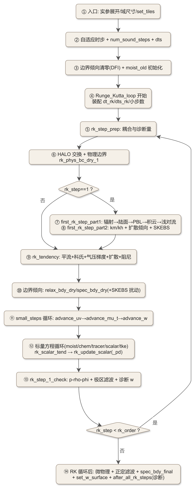
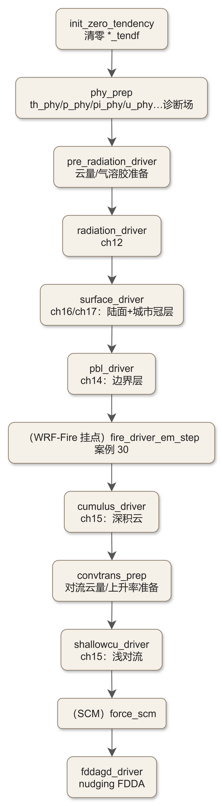
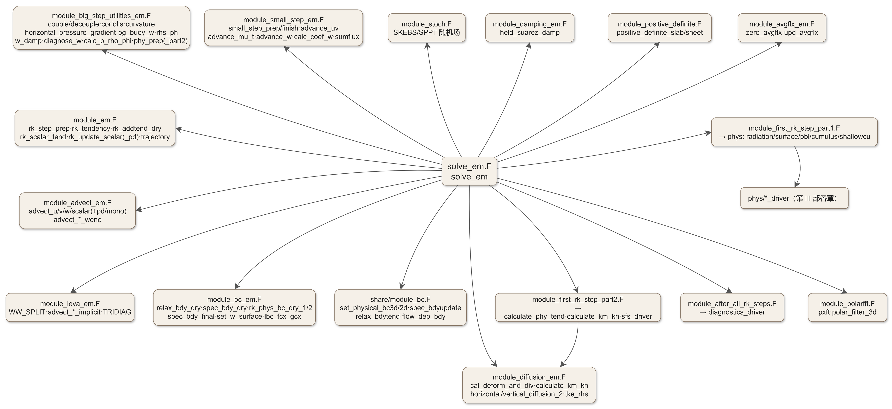

# 第 21 章　solve_em.F 全流程：动力内核的每一次心跳

> **第 V 部　动力内核入门**。前二十章里，我们站在驱动层、物理层与实验层看过 WRF 的全部“上层建筑”；本章沉到最底层，逐段走完 `dyn_em/solve_em.F`——ARW 内核真正“推时间”的那段代码。全部结论在 WRF 4.8.0 本地源码上逐段核验（写作当次会话 Read 原文）；源码引用一律“文件 + 子程序名”。

---

## 21.0　本章地图

### 21.0.1　定位与阅读方式

第 III 部讲物理参数化时，每一章都从某个物理驱动（如 `phys/module_radiation_driver.F`）向上追溯到它在 `first_rk_step_part1` 里的调用点；第 IV 部做改造时，我们在 tile 循环里加过诊断变量（ch20 第一级）。但“调用点之上是什么”“一个时间步在物理之间怎样被切分”，这些问题的答案一直悬在 `dyn_em/solve_em.F` 里。本章回答三个问题：

1. **一个时间步内代码的执行顺序是什么**（21.2 的“十四站”走读）；
2. **物理过程在 Runge–Kutta 循环中何时、以什么频率被调用**（验收要求：精确到子程序，答案在 21.2.7–21.2.8 与 21.2.14）；
3. **方程组与语句的对应关系**：ARW 的动量、连续、热力学、w 方程分别落在哪些子程序的哪些计算块上（21.3）。

**关于书第 7 章的使用方式**：按全书约定，本章“按需引用”《大气物理学》第 7 章的动力学概念（动量方程、科氏力、地转平衡），不做整章推导。一个诚实的说明：书第 7 章以概念与图像为主，ARW 内核真正实现的方程是**通量形式的半隐式非静力方程组**，其权威描述是技术注记《A Description of the Advanced Research WRF Model》（Skamarock 等，NCAR/TN-475+STR，下文称 **ADT**）。因此本章的“公式↔语句”对照以 **ADT 式号 ↔ 源码注释** 为准绳（源码注释中大量出现“ADT eqn 44/45/47”字样，可直接对上），书第 7 章只承担“为什么要有这些项”的物理直觉。

### 21.0.2　源码锚点总表

| 主题 | 文件 | 关键子程序/符号 |
|---|---|---|
| 主求解器 | `dyn_em/solve_em.F`（5197 行） | `solve_em` |
| RK 步准备/倾向装配 | `dyn_em/module_em.F` | `rk_step_prep`、`rk_tendency`、`rk_addtend_dry`、`rk_scalar_tend`、`rk_update_scalar(_pd)` |
| 声波小步长 | `dyn_em/module_small_step_em.F` | `small_step_prep`、`advance_uv`、`advance_mu_t`、`advance_w`、`small_step_finish` |
| 通量与热力学量 | `dyn_em/module_big_step_utilities_em.F` | `couple`/`decouple`、`calc_p_rho_phi`、`coriolis`、`curvature`、`horizontal_pressure_gradient`、`pg_buoy_w`、`rhs_ph`、`diagnose_w`、`w_damp`、`phy_prep` |
| 平流 | `dyn_em/module_advect_em.F` | `advect_u/v/w/scalar`、`advect_scalar_weno(_pd)`、`advect_scalar_mono` |
| 隐式垂直平流 | `dyn_em/module_ieva_em.F` | `WW_SPLIT`、`advect_u/v/w/s_implicit` |
| 扩散与湍流系数 | `dyn_em/module_diffusion_em.F` | `cal_deform_and_div`、`calculate_km_kh`、`horizontal/vertical_diffusion_2`、`tke_rhs` |
| 边界条件 | `dyn_em/module_bc_em.F` + `share/module_bc.F` | `relax_bdy_dry`、`spec_bdy_dry`、`rk_phys_bc_dry_1/2`、`spec_bdy_final`、`set_physical_bc3d` |
| 物理挂接 | `dyn_em/module_first_rk_step_part1/2.F` | 见 21.2.7/21.2.8 |
| 步末收尾 | `dyn_em/module_after_all_rk_steps.F` | `after_all_rk_steps` → `diagnostics_driver` |
| 阻尼 | `dyn_em/module_damping_em.F` | `held_suarez_damp` |
| 极区滤波 | `dyn_em/module_polarfft.F` | `pxft`、`polar_filter_3d` |
| 随机扰动 | `dyn_em/module_stoch.F` | SKEBS/SPPT（案例 28） |
| 正定修正 | `dyn_em/module_positive_definite.F` | `positive_definite_slab/sheet` |

### 21.0.3　本章在调用链中的位置

**从 `main` 到 `solve_em` 的调用链**（详见 ch21 §21.1-21.2 走读）：

```text
main/wrf.F :: wrf_run
 └─ share/mediation_integrate.F :: integrate
     └─ frame/module_integrate.F :: integrate（递归所有嵌套域）
         └─ share/solve_interface.F :: solve_interface（actual_new_args.inc 展开实参）
             └─ dyn_em/solve_em.F :: solve_em  ◀── 本章主角
                 ├─ dyn_em/module_first_rk_step_part1.F  —— 辐射/陆面/PBL/积云
                 ├─ dyn_em/module_small_step_em.F        —— 声波小步长
                 ├─ phys/module_microphysics_driver.F    —— 微物理（RK 循环后）
                 └─ dyn_em/module_after_all_rk_steps.F   —— 诊断输出
```


衔接提示：`wrf.F → integrate → solve_interface` 这条上层链已在 [ch03](ch03_architecture_overview.md) §3.8 讲过；`solve_em` 的 tile 循环骨架与 OpenMP 结构在 ch20 §20.2.2 的第一级改造里已实跑过；垂直坐标 c1–c4 混合系数在 ch10 §10.12；real.exe 基态 `mub/pb/t_init` 在 ch07。

---

## 21.1　机制与原理精讲

### 21.1.1　ARW 方程组：通量形式与 μ 坐标

ARW 求解的是**非静力、可压缩、完全弹性的欧拉方程组**，写在地形追随的**静力气压坐标** η 上（ch10 §10.1 已引入 η 与混合坐标 c1–c4）。与教科书最不同的两点：

1. **垂直动量方程不解静力平衡**：w 与位势 φ 由完整的垂直动量方程预报，静力平衡只作为**参考态**（`mub`、`pb`、`t_init`，由 real.exe 构造，见 ch07）进入扰动量分解；
2. **水平动量写在耦合（coupled）形式**：方程组以 μ（干空气质量柱）为“质量权重”，预报变量是 `ru = μ·u` 这类通量形式变量——这就是为什么 `solve_em` 里到处是 `couple`/`decouple` 调用。

ADT 给出的通量形式方程组（联立垂直动量、w 连续性、静力气压倾向、位势、水平动量、扰动位温、水物质）在源码里的“户口”如下，这张表是本章 21.3 的索引：

| ADT 式（内容） | 源码落点（文件 + 子程序） |
|---|---|
| 水平动量 x 方向（式 44 的气压梯度项） | `module_small_step_em.F: advance_uv`（注释 “x pressure gradient: ADT eqn 44”） |
| 水平动量 y 方向（式 45 的气压梯度项） | `module_small_step_em.F: advance_uv`（注释 “y pressure gradient: ADT eqn 45”） |
| 水平动量的平流/科氏/曲率（RK 步） | `module_em.F: rk_tendency` → `module_big_step_utilities_em.F: coriolis`、`curvature` |
| 连续方程/质量守恒（式 47） | `module_small_step_em.F: advance_mu_t`（注释 “ADT eqn 47”） |
| 扰动位温方程 | `module_small_step_em.F: advance_mu_t` |
| 垂直动量 + 位势（隐式声波） | `module_small_step_em.F: advance_w` + `calc_coef_w` |
| φ 诊断（位势倾向） | `module_big_step_utilities_em.F: rhs_ph`、`diagnose_w` |
| 状态方程 p(ρ,θ) | `module_small_step_em.F: calc_p_rho`、`module_big_step_utilities_em.F: calc_p_rho_phi` |

### 21.1.2　时间分裂：RK3 + 声波小步长

ARW 的时间积分是两层结构（`solve_em.F` 头部 `<DESCRIPTION>` 注释原文概括）：

- **外层 Runge–Kutta 循环**（`Runge_Kutta_loop: DO rk_step = 1, rk_order`）：预报—校正式积分，处理平流与大部分动力项，`rk_ord` 默认 3（Registry `rconfig rk_ord`，`&dynamics` 组）；
- **内层声波小步长循环**（`small_steps: DO iteration = 1, number_of_small_timesteps`）：显式处理高频声波/重力外波，每个 RK 步内跑若干小步。

RK3 三个 stage 的步长装配在 `solve_em` 循环开头（`rk_ord` 分支）：

| rk_step | dt_rk（大步贡献） | dts_rk（声波小步长） | 小步数 |
|---|---|---|---|
| 1 | $\Delta t/3$ | $\Delta t/3$ | 1 |
| 2 | $\Delta t/2$ | $\Delta t/n_s$ | $n_s/2$ |
| 3 | $\Delta t$ | $\Delta t/n_s$ | $n_s$ |

小步数 $n_s$ 的来源是 `&dynamics` 的 `time_step_sound`：默认 0 时由 `solve_em` 配置段自动计算

$$n_s=\max\Big(2\big(\lfloor 300\,\Delta t/\Delta x-0.01\rfloor+1\big),\;4\Big)$$

（注释自述：“This function will give 4 for 6·dx and 6 for 10·dx and returns even numbers only”——即把水平平流 CFL 控制在 ~0.33/小步）。若用户手动设了 `time_step_sound` 则直接采用。`dts = dt/float(num_sound_steps)`。

为什么这样分？物理图像：平流与适应过程的时间尺度是分钟级，声波是秒级；把慢项交给大步长高阶 RK，快项交给小步长低阶格式，比整体用小步长省一个量级的计算量。这就是“时间分裂”（time splitting）。RK3 本身的选择依据见 Wicker & Skamarock（2002）：三阶 RK 允许更大的稳定时间步且对平流相位误差更友好。

**一个时间步内的 Runge-Kutta 与声波小步长编排**（`rk_ord=3`，`dt=54s`）：

| RK 步 | dt_rk | 执行内容 | 声波小步长 |
|---|---|---|---|
| `rk_step=1` | 18 s | 物理 part1+part2 + 动力 | 1 × 18 s |
| `rk_step=2` | 27 s | 动力 | 2 × 13.5 s |
| `rk_step=3` | 54 s | 动力 | 4 × 13.5 s |

> 微物理 `microphysics_driver` 在 RK 循环**全部结束后**、每时间步执行一次。


### 21.1.3　状态变量家族与耦合约定

读懂 `solve_em` 实参表的前提是认清变量命名体系（全部由 Registry 生成，见 ch04）：

- **时间层**：`u_1/u_2`、`t_1/t_2`、`mu_1/mu_2` 等。约定（源码注释原文）：“Time level t is in the `*_2` variable in the first part of the step, and in the `*_1` variable after the predictor”——即 RK 循环内两套数组来回搬运，`*_save`（`u_save/t_save/ph_save/mu_save`）保存步初值供小步长阶段与 RK 校正使用；
- **通量形式**：`ru/rv/rw` 是 μ 耦合后的水平/垂直动量通量，`ww` 是 μ 耦合后的 η 面垂直质量通量（≠ 垂直速度 w！）；
- **基态/扰动分解**：`mu = mub + mu_1`、`p = pb + p`、`al = alb + al`（`al` 为 1/ρ 扰动）；`alt = alb + al` 全量；
- **混合坐标系数**：`c1h/c2h/c1f/c2f`（半层/整层）与 `c3h/c4h/c3f/c4f`（hybrid_opt=2 的 Klemp 混合坐标权重，ch10 §10.12）；
- **地图因子**：`msftx/msfty`（质量点）与 `msfux/msfuy/msfvx/msfvy`（速度点）；Lambert 投影下 $m=\mathrm{sec}^2\varphi$ 型缩放（书第 7 章的地图投影尺度因子概念）。耦合变量的定义：`couple` 把物理量乘以 μ 与地图因子（如 `t` → `μ·m·θ`），`decouple` 反向；`module_big_step_utilities_em.F: couple/decouple/couple_momentum` 是两座桥；
- **use_theta_m**：4.8.0 中 `&dynamics` 的 `use_theta_m` **默认 1**（Registry 记录原文 “theta_m = theta (1 + 1.61 Qv); 0-no, 1=yes”）——即默认以**湿位温**为预报变量，水汽贡献直接进热力学变量；`module_big_step_utilities_em.F` 的 `rk_step_prep`/`phy_prep`/`moist_physics_prep_em` 内多处 `use_theta_m` 分支与 `module_bc_em.F: theta_and_thetam_lbc_only` 都为此服务（案例 32）。

### 21.1.4　一次心跳的总时序

把 `solve_em` 从入口到出口压成一张图（细节逐站在 21.2 展开）：



<!-- Mermaid 源码 → workspace/mermaid/ch21_solve_em_dynamics_03.mmd -->

---

## 21.2　源码走读：solve_em 的十四站

> 走读顺序即代码顺序。每站给出：做什么、源码引用、与 namelist/Registry 的关联。为控制篇幅，长实参表一律省略为 `…`。

### 21.2.1　第一站：入口与实参

`dyn_em/solve_em.F` 的子程序头只有三样东西：

```fortran
SUBROUTINE solve_em ( grid , config_flags  &
! Arguments generated from Registry
#include "dummy_new_args.inc"
!
                    )
   ...
!  Definitions of dummy arguments to this routine (generated from Registry).
#include "dummy_new_decl.inc"
```

- **实参由 Registry 生成**：`dummy_new_args.inc`/`dummy_new_decl.inc` 是 ch03 §3.2.5 讲过的 `share/solve_interface.F` 实参展开机制的下游——你在 Registry 里加一个状态变量，这两个文件与 `solve_em` 的实参表会同步长出新名字（ch20 第一级加 `T2_PEAK` 时亲眼所见）。
- **唯一逻辑实参**只有 `grid`（TYPE(domain)，一切状态变量与中间量的载体）与 `config_flags`（namelist 快照）。
- USE 清单本身就是内核的“软件物料表”：`module_small_step_em`、`module_em`、`module_big_step_utilities_em`、`module_bc`、`module_bc_em`、`module_diffusion_em`、`module_polarfft`、`module_first_rk_step_part1/2`、`module_after_all_rk_steps`、`module_stoch`（经 `module_physics_addtendc` 间接）、`module_avgflx_em`、`module_cpl`（耦合器）等——21.8.2 的依赖树以此为根。

### 21.2.2　第二站：域尺寸、tile 与自适应时步

```fortran
CALL get_ijk_from_grid (  grid , ... )        ! 域/内存/patch 尺寸
CALL set_tiles ( ZONE_SOLVE_EM, grid , ... )  ! OpenMP tile 划分（ch20 §20.2.2 实改过这里生成的循环）
...
IF (config_flags%use_adaptive_time_step) CALL adapt_timestep(grid, config_flags)
```

`set_tiles` 来自 `frame/module_tiles.F`；`ZONE_SOLVE_EM` 是 tile 分区代号。自适应时步调用 `dyn_em/adapt_timestep_em.F: adapt_timestep`（`&domains` 的 `use_adaptive_time_step`，默认 `.false.`），按水平/垂直 CFL 与声波条件动态调 `time_step`。

### 21.2.3　第三站：声波小步数与 dts

```fortran
rk_order = config_flags%rk_ord

IF ( grid%time_step_sound == 0 ) THEN
! This function will give 4 for 6*dx and 6 for 10*dx and returns even numbers only
   spacing = min(grid%dx, grid%dy)
   ...
   num_sound_steps = max ( 2 * ( INT (300. * grid%dt /  spacing - 0.01 ) + 1 ), 4 )
ELSE
   num_sound_steps = grid%time_step_sound
ENDIF

dts = grid%dt/float(num_sound_steps)
```

这一小段就是 21.1.2 公式的源码本体。注意 `spacing` 取 $\min(\Delta x,\Delta y)$，且自适应时步路径会把地图因子极大值 `max_msft` 卷进分母（高纬格点实际格距变小）。

### 21.2.4　第四站：步前清理（DFI 与 use_theta_m）

- `specified` 且 `constant_bc`（数字滤波 DFI 场景）时 `module_bc_em.F: zero_bdytend` 清空边界倾向缓冲 `*_btxs/...`；
- `use_theta_m=1` 时调用 `module_big_step_utilities_em.F: initialize_moist_old` 给 `moist_old(P_Qv)` 一个初值——注释解释得很清楚：湿位温的“旧值”要到 RK 循环后段平流完才存在，第一步需要合理种子。

### 21.2.5　第五站：Runge–Kutta 循环与步长装配

```fortran
Runge_Kutta_loop:  DO rk_step = 1, rk_order
   dtm = grid%dt
   IF ( rk_order == 1 ) THEN
     write(wrf_err_message,*)' leapfrog removed, error exit for dynamics_option = ',...
     CALL wrf_error_fatal( wrf_err_message )   ! 跳蛙格式已在 4.x 移除
   ELSE IF ( rk_order == 2 ) THEN
     IF ( rk_step == 1) THEN
       dt_rk  = 0.5*grid%dt ;  dts_rk = dts ;  number_of_small_timesteps = num_sound_steps/2
     ELSE
       dt_rk = grid%dt      ;  dts_rk = dts ;  number_of_small_timesteps = num_sound_steps
     ENDIF
   ELSE IF ( rk_order == 3 ) THEN
     IF     ( rk_step == 1) THEN
       dt_rk = grid%dt/3. ;  dts_rk = dt_rk ;  number_of_small_timesteps = 1
     ELSE IF (rk_step == 2) THEN
       dt_rk  = 0.5*grid%dt ; dts_rk = dts   ;  number_of_small_timesteps = num_sound_steps/2
     ELSE
       dt_rk = grid%dt      ;  dts_rk = dts   ;  number_of_small_timesteps = num_sound_steps
     ENDIF
   END IF
```

`rk_order==1` 的报错信息值得记住：旧版 ARW 的 `rk_opt` 允许 leapfrog，4.x 已删——若 namelist 把 `rk_ord` 设错值，你会在这里得到一句直白的 fatal。

### 21.2.6　第六站：rk_step_prep——把状态量变成可微分的形态

每个 RK 步先跑 `dyn_em/module_em.F: rk_step_prep`，其内部调用序列（本次实测）：

```text
calculate_full     : mu/mub → mut 等全量组装
calc_mu_uv         : 速度点干空气质量 muu/muv（半点平均）
couple_momentum    : u_2,v_2 → ru,rv（μ·m 耦合）
calc_ww_cp         : 由 u,v 算 ww（η 面质量通量诊断）
calc_cq            : 水物质耦合系数 cqu/cqv/cqw（湿贡献）
calc_alt           : alt = alb + al
calc_php           : php（扰动位势半层量）
```

`use_theta_m=1` 的分支就藏在 `calc_cq`/`calc_ww_cp` 一带（`module_big_step_utilities_em.F` 中多处 `IF ( use_theta_m .EQ. 1 )`）。

### 21.2.7　第七站：物理被调用的时刻（part1）

**这是全书第 III 部所有物理章的“总开关”。** 源码用 `rk_step_is_one : IF (rk_step == 1)` 把整个物理块包住——

> **结论（验收答案）**：非时间分裂物理（辐射、陆面、PBL、积云、浅对流、FDDA）**每个时间步只在 rk_step==1 被调用一次**，其倾向存入 `ru_tendf/rv_tendf/rw_tendf/ph_tendf/t_tendf/mu_tend/tke_tend`，在随后的每个 RK 步中被 `rk_tendency` 加入（见 21.2.9）；微物理更是整个 RK 循环结束后才跑（21.2.14）。

`dyn_em/module_first_rk_step_part1.F` 的精确调用序（当次实测）：



<!-- Mermaid 源码 → workspace/mermaid/ch21_solve_em_dynamics_04.mmd -->

对，顺序就是 ch14/ch15 源码走读时反复引用的那条链——本章把它钉死在 `module_first_rk_step_part1.F` 上。若你想给某个物理方案“降频”（比如辐射隔步调用），改的正是这个文件里的调用节律（`phys/module_radiation_driver.F` 内部另有 `radt` 节拍控制，ch12 §12.5）。

### 21.2.8　第八站：物理倾向的深加工（part2）

`dyn_em/module_first_rk_step_part2.F` 紧跟 part1，同样只在 rk_step==1 执行。它的职责是“把物理/湍流的原料变成动力倾向”，实测调用序：

```text
RAND_PERT_UPDATE × n        : 随机扰动方案（SKEBS/SPP 的场更新，module_stoch.F）
calculate_phy_tend          : 把物理倾向与动力倾向合并（module_em.F）
compute_diff_metrics        : 扩散度量 rdz/rdzw/zx/zy（module_diffusion_em.F）
cal_deform_and_div          : 形变与散度（SFS 用）
cal_helicity                : 螺旋度诊断
nonlocal_flux / free_atmos_length / meso_length_scale : MYNN 长度尺度（ch14 §14.6）
calculate_km_kh             : 湍流扩散系数（smag/tke/isotropic，ch14 §14.5）
phy_bc                      : 扩散量物理边界
sfs_driver                  : SFS 应力重建（LES 用，module_sfs_driver.F）
update_phy_ten              : 倾向最终汇总
update_stoch_ten            : SKEBS 随机倾向注入
damptop                     : 模式顶阻尼
tke_rhs                     : TKE 预报方程右端（bl_mynn 等 1.5 阶闭合的 TKE 由动力侧预报）
fddaobs_driver              : 观测 FDDA
conv_t_tendf_to_moist       : use_theta_m=1 时把温度倾向折算到湿位温
vertical_diffusion_implicit : 垂直扩散隐式版本（module_diffusion_em.F）
vertical_diffusion_2        : 垂直扩散显式版本（u/v/w/t）
horizontal_diffusion_2      : 水平扩散（u/v/w/t）
```

`update_stoch_ten` 与 `RAND_PERT_UPDATE` 就是 SKEBS/SPPT 进入内核的两扇门（案例 28）。

### 21.2.9　第九站：rk_tendency——大步长动力项总装

`dyn_em/module_em.F: rk_tendency` 是内核的“总装车间”，每个 RK 步执行一次。它先把十个倾向数组清零，然后按固定顺序装配（当次实测顺序）：

| 序 | 计算块 | 落点子程序 | 物理含义 |
|---|---|---|---|
| 1 | `WW_SPLIT` | `module_ieva_em.F: WW_SPLIT` | 把 ww 拆成显式/隐式两部分（IEVA 垂直平流） |
| 2 | `calculate_full/calc_mut_new/calc_mu_uv_1` | 同文件 | 更新 μ 家族与通量 |
| 3 | 平流 | `module_advect_em.F: advect_weno_u/advect_u/advect_u_implicit`（u 同 v/w/t） | 水平平流（5 阶迎风或 WENO 或隐式） |
| 4 | `set_tend(RTHFTEN, t_tend, msfty)` | `module_em.F` | 把温度倾向存为解耦诊断量（cumulus 非平衡闭合要用，ch15） |
| 5 | `rhs_ph` | `module_big_step_utilities_em.F: rhs_ph` | 位势倾向 φ 方程 |
| 6 | `horizontal_pressure_gradient` + `pg_buoy_w` | 同文件 | 水平气压梯度 + w 方程浮力/气压项（非静力核心） |
| 7 | `w_damp` | 同文件 | 上层 w 阻尼（`damp_opt=3` + `w_damping`） |
| 8 | `perturbation_coriolis`/`coriolis`/`curvature` | 同文件 | 科氏力与曲率项（地图投影几何，书第 7 章 f 与曲率项概念） |
| 9 | `held_suarez_damp` | `module_damping_em.F` | Held–Suarez 理想实验阻尼 |
| 10 | `horizontal_diffusion('u'/'v'/'w'/'m')` | `module_big_step_utilities_em.F` | 二阶水平扩散（khdif） |
| 11 | `vertical_diffusion_u/v/'w'/'m'` | 同文件 | 二阶垂直扩散（kvdif） |
| 12 | `sixth_order_diffusion` ×4 | `module_big_step_utilities_em.F` | 六阶数值平滑（`diff_6th_opt/factor`） |
| 13 | `rk_rayleigh_damp` | 同文件 | 模式顶 Rayleigh 阻尼（`zdamp/dampcoef`） |
| 14 | `theta_relaxation` | 同文件 | 向基态位温松弛（理想实验用） |

注意倾向两套符号：`*_tend`（动力大步部分，RK 校正用）与 `*_tendf`（物理/扩散部分，每步都加）。二者最终由 `module_em.F: rk_addtend_dry` 合流。

### 21.2.10　第十站：大步长边界倾向

平流与扩散算完后，侧边界“吃进”边界条件的倾向：

- `module_bc_em.F: relax_bdy_dry`：**张弛区（relax zone）Davies 方案**——把边界倾向往“边界值时间倾向 + 向 wrfbdy 内插值松弛”的方向拉（`&bdy_control` 的 `spec_bdy_width=5/spec_zone=1/relax_zone=4`，Registry 默认实测）；系数 `fcx/gcx` 由 `module_bc_em.F: lbc_fcx_gcx` 生成；
- `module_bc_em.F: spec_bdy_dry`：**指定区（spec zone）硬替换**——最外 spec_zone 圈直接用 wrfbdy 的值；
- `spec_bdy_dry_perturb`（两处调用）：SKEBS 随机扰动也作用于边界（源码注释署名 “KRS 9/12/2012”）；
- `module_em.F: rk_addtend_dry`：把大步倾向加回 `*_2` 场，完成该 RK 步的“动力半步”。

### 21.2.11　第十一站：声波小步长循环

```fortran
small_steps : DO iteration = 1 , number_of_small_timesteps
   ! (1) advance_uv  : 水平动量
   ! (2) pxft        : 极区滤波（u,v）
   ! (3) spec_bdyupdate
   ! (4) advance_mu_t: μ 与 θ
   ! (5) pxft        ; spec_bdyupdate
   ! (6) advance_w   : w 与 φ
   ! (7) sumflux     : 通量守恒修正
   ! (8) spec_bdyupdate_ph / zero_grad_bdy / calc_p_rho
END DO small_steps
```

每个小步四件事：水平动量 → 质量与位温 → 垂直动量与位势 → 状态方程回代。随后 `module_em.F`/`module_small_step_em.F` 的 `calc_mu_uv_1` + `small_step_finish` 解耦变量、做 RK 三步的加权平均（`*_m` 平均场，RK 校正需要）。这是全章技术密度最高的一段，逐子程序精讲在 **21.3**。

### 21.2.12　第十二站：标量方程循环

水物质/化学/示踪/标量/TKE 的平流与更新在四个平行块里（`moist_variable_loop`/`chem_variable_loop`/`tracer_variable_loop`/`scalar_variable_loop` + tke 块），每个变量 im 的处理链：

```text
rk_update_scalar_pd     : 正定平流更新（RAINC 型？不——正定方案用于水物质等，见 21.4.2）
rk_scalar_tend          : 平流倾向 + 扩散（module_em.F）
q_diabatic_add/subtr    : use_q_diabatic 的诊断性非绝热项进出（正定修正前后守恒）
relax_bdy_scalar        : 张弛区边界
spec_bdy_scalar         : 指定区边界
rk_update_scalar        : 常规（非正定）更新
flow_dep_bdy            : 流入/流出依赖的边界（流出才允许外边界值随流变化）
bound_tke/bound_qna     : TKE/数浓度上下限
```

`chem_adv_opt/tracer_adv_opt/tke_adv_opt` 若选了 WENO，更新被推迟到 `rk_step==rk_order` 的最后一步做（源码多个 `IF ((.../= ORIGINAL .and. .../= WENO_SCALAR) .and. (rk_step == rk_order))` 判断即此意）。

### 21.2.13　第十三站：RK 步间收尾

`rk_step_1_check : IF ( rk_step < rk_order )` 块——**不是最后一步才做**的事（名字有点误导，逻辑是“除最后一步外都要做”）：

- `module_big_step_utilities_em.F: calc_p_rho_phi`：由 θ、μ 重新诊断 p/ρ/al（状态方程）；
- 极区滤波 `module_polarfft.F: couple_scalars_for_filter → pxft → uncouple_scalars_for_filter`（对 moist/chem/tracer/scalar 各跑一遍）；
- `module_bc_em.F: rk_phys_bc_dry_2`、`diagnose_w`（由 φ 倾向诊断 w，供下步用）。

### 21.2.14　第十四站：RK 循环之后——微物理与收尾

RK 循环结束后（`END DO Runge_Kutta_loop`），solve_em 继续跑完一个时间步的剩余部分，顺序实测：

1. `trajectory`（`module_em.F`）：气块轨迹（`&dynamics trajectory_opt`）；
2. `zero_avgflx/upd_avgflx`（`dyn_em/module_avgflx_em.F`）：FER 输出的时均通量累积；
3. `phys/module_physics_addtendc.F: advance_ppt`：KF/KFeta 积云的**时间滞后更新推进器**（KF 把积云响应摊在 NCA 个时间步上，见 ch15 §15.7）；
4. `module_big_step_utilities_em.F: phy_prep_part2`：为微物理再算一遍诊断场；
5. `cloud_tracer_nudge`（`madwrf_opt==2` 时，案例 31）；
6. `moist_physics_prep_em` → `bulk_dust_emis`（Thompson 气溶胶感知 + dust_emis=1）→ **`microphysics_driver`**（ch13 的主入口！）→ `microphysics_zero_outa/b` + `moist_physics_finish_em`：**微物理整个时间步只在这里执行一次**；
7. 第二轮极区滤波与 `calc_p_rho_phi`；
8. `module_bc_em.F: set_phys_bc_dry_2` → `share/module_bc.F: spec_bdy_final`（u/v/w/t/ph/mu 及四类标量全部做最终边界替换）；
9. `module_bc_em.F: set_w_surface`：贴地 w 一致性重置；
10. `dyn_em/module_after_all_rk_steps.F: after_all_rk_steps` → `share/module_diagnostics_driver.F: diagnostics_driver`：max 风速、反射率、helicity 等诊断（wrfout 里的 `UP_HELI_*`、`REFL_10CM` 从这来）；
11. 末段挂点：`firebrand_spotting_em_driver`（火种漂移）、`wrf_cmaq_option` 分支的 `aqprep`/`CMAQ_DRIVER`/`FEEDBACK_READ`（案例 29）、`module_cpl` 耦合器的 `cpl_settime/cpl_store_input`。

最后由驱动层（`mediation_integrate.F` 的 `med_hist_out`，ch09）把 wrfout 写盘——写盘不在 `solve_em` 内。

---

## 21.3　声波小步长精讲：方程如何落到语句

### 21.3.1　advance_uv：水平动量的显式小步

`dyn_em/module_small_step_em.F: advance_uv` 对 `u_2/v_2` 做前向欧拉小步积分，右端来自大步倾向 `ru_tend/rv_tend`（已含平流/科氏/气压梯度/扩散）与**小步长专属的气压梯度项**——源码注释明确写着：

```text
!     x pressure gradient: ADT eqn 44, penultimate term on RHS
!     y pressure gradient: ADT eqn 45, penultimate term on RHS
```

即小步阶段把**扰动气压梯度**（耦合形式 $-\mu\,m\,\partial_x p'/\rho$ 的差分）显式加入——声波正是靠这一项传播的。边界上 `spec_bdyupdate` 每小步做一次指定区替换。

### 21.3.2　advance_mu_t：质量与位温（ADT eqn 47）

`module_small_step_em.F: advance_mu_t` 的 `<DESCRIPTION>` 自述：“advances the explicit perturbation theta equation and the mass conservation equation. In addition, the small timestep omega is updated”。质量方程即 ADT 式 47：

$$\frac{\partial \mu}{\partial t} = -m_x m_y\Big[\frac{\partial ( \mu u/m_y)}{\partial x} + \frac{\partial(\mu v/m_x)}{\partial y}\Big] - \frac{\partial(\mu \dot\eta/m_x m_y)}{\partial \eta}\;,$$

源码注释 “ADT eqn 47: partial drho/dt = ...”（把 ρ 换成 μ 的等价写法）与语句逐一对应：水平散度用 `advance_uv` 刚算出的新速度，`ww`（μ 耦合的 η 通量）由连续性回推——注释还特别强调 “mu is not coupled with the map scale factor. ww (omega) IS coupled”。位温方程同样显式：θ 的新值 = θ + dts·(θ 倾向 + ft（物理温度倾向）)。该子程序同时更新 `muave/t_ave`（小步平均，供 RK3 校正加权）。

### 21.3.3　advance_w 与 calc_coef_w：垂直方向的半隐式

垂直动量 + 位势方程是唯一“隐式”的部分：`module_small_step_em.F: calc_coef_w` 先算三层系数 `a/alpha/gamma`（依赖 cqw、c2a、dts_rk、g、epssm），然后 `advance_w` 用这些系数做**逐柱的隐式三点递推**——这是稳定性允许大时间步的关键（垂直声波若全显式，$\Delta t$ 会被压到秒级）。`top_lid`（刚性顶）在系数里体现。水平散度项用**步前保存的 `u_save/v_save`**（小步内不更新），这是 ARW “split-explicit” 的标准设计；`sumflux` 对通量做守恒性修正。

### 21.3.4　calc_p_rho 与 small_step_prep/finish

- `module_small_step_em.F: calc_p_rho`：状态方程 $p=p_0\eta^\alpha\,\exp(\cdots)$ 的差分实现（由 al、t_2、mu 回代扰动气压与 1/ρ），每个小步末尾执行一次；
- `small_step_prep`：把全量场拆成扰动量并做 μ 耦合（含 `mudf` 分解因子）；`small_step_finish` 反向解耦，并完成 RK3 校正所需的加权平均（`ru_m/rv_m/ww_m/mut/muts`）。

> **教学注**：把 21.3 四小节连起来读一遍，你会发现 ARW 的“小步长”其实就是一个教科书级的声波投影法（projection method）：动量→质量/热力→垂直隐式→状态回代。书第 7 章的“适应过程 vs 平流过程”尺度分离论证，就是这段代码存在的理由。

---

## 21.4　平流、扩散、阻尼与滤波

### 21.4.1　平流选项族

`dyn_em/module_advect_em.F`（13046 行，内核最大文件）提供一族平流算子（当次实测清单）：

| 子程序 | 格式 | 供谁用 |
|---|---|---|
| `advect_u/v/w` | 水平 5 阶迎风（`h_mom_adv_order`≤5）+ 垂直 3 阶 | 动量默认 |
| `advect_scalar` | 同上，标量版（`h_sca_adv_order`） | θ/水物质默认 |
| `advect_scalar_pd` | 正定限定的标量平流 | 水物质（`moist_adv_opt`） |
| `advect_scalar_mono` | 单调化版 | `scalar_adv_opt`=mono |
| `advect_weno_u/v/w`、`advect_scalar_weno(_pd)` | 5 阶 WENO | `*_adv_opt=WENO` |
| `advect_u/v/w/s_implicit`、`advect_ph_implicit` | 隐式垂直平流（IEVA） | `momentum_adv_opt`/IEVA 选项 |

WENO 的血统写在源码头注里（`advect_scalar_weno` 头注原文）：“5th-order WENO scheme adapted from COMMAS. See Jiang and Shu, 1996, J. Comp. Phys. v.126, 202-223; Shu 2003; Also used by Bryan 2005, Mon. Wea. Rev.”——案例 33。

### 21.4.2　正定修正

高阶平流不保正：湿度/数浓度可能出现负值。两道保险：

1. `dyn_em/module_em.F: rk_update_scalar_pd`：平流前存 `moist_old`，更新后调用正定修正；
2. `dyn_em/module_positive_definite.F: positive_definite_slab`：**逐条 x 向 slab 守恒重分配**——若某行总和为负全置零，否则“减去负谷底、按比例回补”使每点非负且总质量守恒（该算法逐行读过，如上描述）。`flow_dep_bdy`（`share/module_bc.F`）保证边界处只在流出时外推。

### 21.4.3　阻尼与滤波总表

| 机制 | namelist | 源码落点 |
|---|---|---|
| w 上层阻尼 | `damp_opt`(默认 3)、`dampcoef`、`w_damping`(默认 0) | `module_big_step_utilities_em.F: w_damp` |
| 模式顶 Rayleigh | `zdamp/rad_nudge` | `module_big_step_utilities_em.F: rk_rayleigh_damp` |
| 六阶平滑 | `diff_6th_opt/factor` | `module_big_step_utilities_em.F: sixth_order_diffusion` |
| 小步长平滑 | `epssm`（默认 0.1） | `calc_coef_w`/`advance_w` 内 |
| 极区 FFT 滤波 | `polar/fft_filter_lat/polar_opt` | `module_polarfft.F: pxft/polar_filter_3d` |
| Held–Suarez | （IDEAL_CASE 编译期） | `module_damping_em.F: held_suarez_damp` |

### 21.4.4　扩散与 km/kh

ch14 §14.5 讲过 `module_diffusion_em.F: calculate_km_kh` 的三个家族（smagorinsky/tke/isotropic）。在时间步里的位置：part2 算 km/kh（rk_step==1 一次）→ `rk_tendency` 的 `horizontal/vertical_diffusion` 消费它们。注意**物理 PBL 方案的垂直混合不走这套**——PBL 方案直接给倾向（part1），`kvdif` 的二阶扩散只兜底自由大气（这就是“diff_opt=0 时 PBL 内仍能混合、自由大气几乎无扩散”的机制解释）。

---

## 21.5　边界条件族速查

| 类型 | namelist | 大步处理 | 小步处理 | 收尾 |
|---|---|---|---|---|
| 指定/张弛（specified） | `specified=.true.` + `spec_bdy_width/spec_zone/relax_zone` | `relax_bdy_dry` + `spec_bdy_dry` | `spec_bdyupdate(_ph)` | `spec_bdy_final` |
| 嵌套（nested） | `nested=.true.` | 同上（倾向来自父域插值） | 同上 | 同上 |
| 周期（periodic） | `periodic_x/y` | `PERIOD_BDY_EM_*.inc` 交换 | 同 | 同 |
| 开边界（open） | `open_xs…` | `set_physical_bc3d` 外推 | 同 | 同 |
| 极区（polar） | `polar=.true.` | `pole_point_bc` + `zero_pole` | `pxft` FFT | — |

张弛区的解析形式（Davies 型）：倾向加上 $-\gamma\,(\phi_b - \phi)$ 型松弛，`fcx/gcx` 数组由 `lbc_fcx_gcx` 按 spec/relax 宽度生成。嵌套域的父—子插值在 `dyn_em/nest_init_utils.F` 与 `share/mediation_wrfmain.F`（时间插值 wrfbdy，ch07/ch08 已讲）。

---

## 21.6　动手实操：时间步进账本（轻轨）

**目的**：把 21.2.3 的公式与 21.2.5 的表变成可复算的账本，并与 ch08 的生产运行（作业 439419）实测交叉验证。

**脚本**：`workspace/scripts/ch21_timestep_audit.py`（读取 `workspace/cases/lanzhou2025/namelist.input` 的 `&domains`，重演 `num_sound_steps` 公式与 RK3 步长装配，对照 439419 实测）。

**实测输出**（`workspace/logs/ch21_timestep_audit.log`）：

```text
== ch21 时间步进账本（重演 solve_em.F 配置段公式） ==
time_step(d01) = 54 s, parent_time_step_ratio = 3
dx d01 = 9000 m, dx d02 = 3000 m

--- d01: dt=54 s, dx=9000 m ---
num_sound_steps = max(2*(int(300*dt/dx-0.01)+1),4) = 4
dts = dt/num_sound_steps = 13.5 s
RK3 各 stage（rk_ord=3）:
  rk_step=1: dt_rk= 18.0000 s, dts_rk= 18.0000 s, small_steps=1
  rk_step=2: dt_rk= 27.0000 s, dts_rk= 13.5000 s, small_steps=2
  rk_step=3: dt_rk= 54.0000 s, dts_rk= 13.5000 s, small_steps=4
每时间步声波小步总数 = 1 + 2 + 4 = 7

--- d02: dt=18 s, dx=3000 m ---
num_sound_steps = 4 ; dts = 4.5 s
每时间步声波小步总数 = 7

== 与 ch08 生产运行 439419 实测交叉验证 ==
432000 s / dt_d01(54) = 8000 步  (439419 实测 d01 = 8000 步)
432000 s / dt_d02(18) = 24000 步  (439419 实测 d02 = 24000 步)
d01 每步小步数 7 → 5 天累计 56000 个声波小步
```

**三步交叉验证全部咬合**：(1) 由 432000 s 与实测步数反推的 dt 恰为 54/18 s；(2) 公式给出的 $n_s=4$ 使 d01 每步 7 个小步；(3) 乘以步数得 d01 五天 56000、d02 168000 个声波小步——结合 ch08 实测步均耗时（d01 0.361 s、d02 0.0838 s），可粗估“一个声波小步”在 64 核上的分摊成本约 0.045 s（d01，含全部四件事）。这类“账本思维”在优化 namelist 时步、估算机时（ch08 §8.6 的经验公式）时非常有用。

---

## 21.7　常见错误与速查（内核段）

| 症状 | 根因（源码位置） | 处置 |
|---|---|---|
| `leapfrog removed, error exit` | `rk_ord` 设为 1（`solve_em` 装配分支） | 改回 3 |
| CFL/声波崩溃：NaN 或数步内爆掉 | `dt` 过大；`time_step_sound` 手动值过小 | 让 `time_step_sound=0` 自动算；`w_damping=1` + `dampcoef` 适度；或开 `use_adaptive_time_step` |
| 间歇 SIGSEGV（栈溢出） | 计算节点 `ulimit -s` 8 MB 时 `solve_em` 栈数组爆栈（ch19 实测：默认栈 27 s 崩、unlimited 后 301 步正常） | 作业脚本 `ulimit -s unlimited` |
| 湿度出现负值/数浓度异常 | 正定修正只在 `rk_update_scalar_pd` 路径；`moist_adv_opt` 选错 | 用正定平流选项；检查 `positive_definite_slab` 触发日志 |
| 高纬/极区出现棋盘噪声 | 极区 FFT 滤波未开 | `polar=.true.` + `fft_filter_lat`（`module_polarfft.F`） |
| `dampcoef` 拉满后低层也被阻尼 | `zdamp` 深度过大 | `zdamp` 一般 ≤ 5000 m |
| 边界“反弹”或反射波 | `spec_bdy_width` 太窄/`relax_zone` 太窄 | 默认 5/1/4 已平衡；加大 `spec_bdy_width` |
| 微物理物理量在“物理全关”算例恒为 0 | PSFC/T2/HFX 等由面层方案填写（ch18 实测） | 诊断改用动力学量 |

更系统的运行期排查表见附录 [app_c](app_c_troubleshooting.md)；编译期问题见编译手册与 ch05。

---

## 21.8　三类专栏

### 21.8.1　科研改造案例库（案 28–35，接续 ch20 §20.7.1 的 27 案）

> 体例约定见 ch01 §1.6.2：小改动在原码旁注释；大改动①公开代码②伪代码③思路。

**案 28｜集合预报模式不确定性：SKEBS/SPPT 随机扰动**
- 课题：集合预报的模式误差表示（随机动能反散射 SKEBS + 随机物理扰动 SPPT）。
- 改动文件：官方上游化——`dyn_em/module_stoch.F`（作者头注：Judith Berner, NCAR, Apr 2014）+ 挂点三处：`dyn_em/module_first_rk_step_part2.F` 的 `RAND_PERT_UPDATE`（场扰动）与 `update_stoch_ten`（倾向注入）、`dyn_em/solve_em.F` 的 `spec_bdy_dry_perturb`（边界扰动，注释署名 KRS 9/12/2012）。
- 关键 namelist：`stoch_force_opt/skebs_vertstruc/tot_backscat_psi/tot_backscat_t/ztau_psi/ztau_t/rexponent_psi/gridpt_stddev_sppt/lengthscale_sppt/timescale_sppt`（`module_stoch.F` 头注全列）。
- 文献（源码头注原文转录）：Berner, J., S.-Y. Ha, J. P. Hacker, A. Fournier, C. Snyder, 2011: Model uncertainty in a mesoscale ensemble prediction system: Stochastic versus multi-physics representations. *Mon. Wea. Rev.*, **139**, 1972–1995。
- 与正文对应：21.2.8/21.2.10 的三个挂点。

**案 29｜WRF-CMAQ 双向耦合（空气质量—气象反馈）**
- 课题：把 CMAQ 化学传输模式嵌入 WRF，实现气溶胶—辐射/云反馈的双向在线耦合。
- 公开代码情况：①官方随包分发（编译宏 `WRF_CMAQ==1`）。改动完全暴露在 `dyn_em/solve_em.F` 末段：`aqprep` → `CMAQ_DRIVER`（模型日期/步长传入）→ `FEEDBACK_READ`；另 `cpl_store_input`（耦合器输入缓存）与 `module_cpl` 通用耦合通道。
- 结构要点：CMAQ 作为**子程序**运行在 `solve_em` 返回前（每时间步或按 `wrf_cmaq_freq` 隔步），化学影响通过辐射/微物理字段反馈回气象——这是“第三方模式挂进内核主循环”的最完整范例。
- 文献：Wong, D., J. Pleim, R. Mathur, et al., 2012: WRF-CMAQ two-way coupled system with aerosol feedback: software development and preliminary results. *Geosci. Model Dev.*, **5**（网络检索证实条目；页码未核）。
- 与正文对应：21.2.14 第 11 条挂点。

**案 30｜WRF-Fire：野火—大气耦合**
- 课题：火线传播与大气边界层互反馈。
- 改动文件：`dyn_em/module_first_rk_step_part1.F`（挂点）——pbl_driver 之后调用 `fire_driver_em_step`，其前用 `Interp_horizontal` 把 `t2/q2/psfc/u10/v10/降雨` 等插到火模型网格（CFBM），火模型再经 `Provide_atm_feedback` 反馈感热/潜热；`dyn_em/solve_em.F` 的 USE 清单与 `HALO_FIREBRAND_SPOTTING`（火种漂移 driver）。
- 编译钥匙：`WRF_FIRE` 理想算例家族（ch18 §18.2 的 `IDEAL_CASE` 表）。
- 文献（线索，未逐字核验）：Mandel, J., J. D. Beezley, A. K. Kochanski, 2011: Coupled atmosphere-wildland fire modeling with WRF 3.3 and SFIRE。
- 与正文对应：21.2.7 的挂点图。

**案 31｜MAD-WRF：气溶胶—云—对流的云示踪**
- 课题：区分“哪些云水来自气溶胶活化”，支撑 ACI（气溶胶—云相互作用）研究。
- 公开代码情况：①随包分发。`phys/module_madwrf.F`（作者头注：Pedro A. Jimenez，NCAR；云顶亮温→云顶高度反演 `Calc_cldtopz_from_brtemp` 等初始化件）；Registry 三条：包 `madwrf_mp`（`mp_physics==96`，专用微物理）、包 `madwrf`（`madwrf_opt==2` → `tracer: tr_qc/tr_qi/tr_qs`）、`cldinit`（`madwrf_cldinit==1`）。
- 内核侧改动：`dyn_em/solve_em.F` 的 `cloud_tracer_nudge` 调用（`madwrf_opt==2` 时把 tr_qc/tr_qi/tr_qs 向 `moist` 的 qc/qi/qs 松弛，参数 `madwrf_dt_relax/madwrf_dt_nudge`，Registry 记录原文 “MAD-WRF model”）；`dyn_em/module_initialize_real.F`、`share/module_check_a_mundo.F`、`phys/module_physics_init.F` 的配套初始化。
- 文献线索：NCAR RAL 的 MAD-WRF 项目页（本次未核验论文条目，使用前请自行检索）。
- 与正文对应：21.2.14 第 5 条。

**案 32｜use_theta_m：以湿位温为热力学预报量**
- 课题：湿大气的热力学一致性（温度—水汽—气压演化自洽），涉及湿位温 θ_m = θ(1+1.61q_v)。
- 改动形态：官方上游化的“开关式算法替换”——`Registry.EM_COMMON` 的 `rconfig use_theta_m`（4.8.0 默认 **1**）+ `dyn_em/module_big_step_utilities_em.F` 内多处 `IF ( use_theta_m .EQ. 1 )` 分支（`rk_step_prep/calc_cq/calc_ww_cp/phy_prep/moist_physics_prep_em/moist_physics_finish_em` 等约 9 处，实测计数）+ `dyn_em/module_bc_em.F: theta_and_thetam_lbc_only`（边界两种口径）+ `solve_em` 的 `initialize_moist_old` 种子逻辑。
- 教学价值：这是“**给内核加一个热力学口径开关**”的标准做法——变量在 Registry 层二态、代码层多点分支，改造时必须全链路摸清（否则边界与内部口径不一致）。
- 与正文对应：21.1.3、21.2.4、21.2.6。

**案 33｜WENO 平流：内核数值格式替换**
- 课题：强梯度/化学传输场景下的无振荡高阶平流。
- 公开代码：①`dyn_em/module_advect_em.F: advect_scalar_weno/advect_scalar_wenopd/advect_weno_u/v/w`（约 4000 行）。
- 血统（头注原文）：“adapted from COMMAS. See Jiang and Shu, 1996, J. Comp. Phys. v.126, 202-223; Shu 2003; Also used by Bryan 2005, Mon. Wea. Rev.”
- 接口设计：不改 `rk_tendency` 主干，只加 `chem_adv_opt/tracer_adv_opt/tke_adv_opt` 分支（`Registry.EM_COMMON` rconfig；且 WENO 的标量更新被推迟到最后一个 RK 步——21.2.12）。
- 与正文对应：21.4.1。

**案 34｜极区滤波：Polar WRF 路线**
- 课题：极射赤面/兰勃特高纬格点的收敛经线网格噪声控制。
- 改动文件：`dyn_em/module_polarfft.F`（`pxft` 快速傅里叶滤波、`polar_filter_3d`、`filter_tracer(_old)`）+ `solve_em` 内十几处 `pxft` 调用点（大步动力后、小步每小步后、标量滤波段）+ `pole_point_bc/zero_pole`。
- namelist：`polar/fft_filter_lat/polar_opt`（`&dynamics`）。
- 文献线索：Bromwich 等的 Polar WRF 系列工作（本次未逐字核验，使用前检索）。
- 与正文对应：21.2.11/21.2.13。

**案 35｜IEVA：隐式—显式垂直平流**
- 课题：垂直平流的稳定性增强（弱平流不稳定场景、大垂直速度）。
- 改动文件：`dyn_em/module_ieva_em.F`——`WW_SPLIT`（把 ww 拆显式/隐式两支）+ `advect_u/v/w/s_implicit` + `advect_ph_implicit` + 隐式递推 `TRIDIAG/TRIDIAG2D/CALC_MUT_NEW`；挂点 `dyn_em/module_em.F: rk_tendency`（平流分支调用 `advect_*_implicit`）。
- 形态：官方上游化；经 `momentum_adv_opt` 等选项选择。
- 与正文对应：21.2.9 第 1、3 行。

### 21.8.2　模块依赖树（动力内核）

以 `solve_em.F` 为根的 `dyn_em` 内核文件级依赖（mermaid；节点括号内是该文件的**代表函数**，全清单见各章已讲的精读）：



<!-- Mermaid 源码 → workspace/mermaid/ch21_solve_em_dynamics_05.mmd -->

读法提示：`module_em.F` 是“总装”（RK 主逻辑），`module_big_step_utilities_em.F` 是“零件库”（42 个子程序，本次实测清单），`module_small_step_em.F` 是独立小步长机器。三者只被 `solve_em` 单向调用，互不回头——这就是内核扩展时“加新倾向项”通常改 `module_em`/`module_big_step_utilities`、加新物理走 `part1/2` 的分工依据。

### 21.8.3　“公式 ↔ 语句”对照总表（内核篇）

| 公式/机制（ADT 或 ARW 文献） | 文件.子程序 | 语句要点 |
|---|---|---|
| 水平动量小步 + 扰动气压梯度（ADT 44/45） | `module_small_step_em.F: advance_uv` | 注释逐字引用 ADT 式号 |
| 质量连续（ADT 47） | `module_small_step_em.F: advance_mu_t` | ww 由散度回推；注释 “mu is not coupled... ww IS coupled” |
| 位温方程小步 | `advance_mu_t` | θ_new = θ + dts·(倾向+ft) |
| 垂直动量/位势半隐式 | `advance_w` + `calc_coef_w` | 逐柱三点隐式递推（a/alpha/gamma） |
| 状态方程回代 | `calc_p_rho` / `module_big_step_utilities_em.F: calc_p_rho_phi` | p/ρ/al 由 θ,μ 重诊断 |
| 科氏力 | `module_big_step_utilities_em.F: coriolis`（+`curvature`、`perturbation_coriolis`） | 地图投影 f、e、sina/cosa |
| w 浮力项 | `module_big_step_utilities_em.F: pg_buoy_w` | 非静力项（cqw 权重） |
| φ 方程 | `module_big_step_utilities_em.F: rhs_ph` | φ 倾向 = ww 型通量散度 |
| RK3 时间分裂 | `solve_em`（Runge_Kutta_loop + 步长装配） | 表见 21.1.2 |
| 5 阶迎风平流 | `module_advect_em.F: advect_u/scalar` | h_*_adv_order=5 |
| WENO | `module_advect_em.F: advect_scalar_weno` | Jiang & Shu 1996（头注） |
| 正定守恒修正 | `module_positive_definite.F: positive_definite_slab` | 行内重分配算法 |
| Davies 张弛边界 | `module_bc_em.F: relax_bdy_dry` + `lbc_fcx_gcx` | fcx/gcx 系数 |
| 贴地 w 重置 | `module_bc_em.F: set_w_surface` | 地形追随一致性 |

---

## 21.9　延伸阅读

- Skamarock, W. C., J. B. Klemp, J. Dudhia, et al., 2008/2019: *A Description of the Advanced Research WRF Model*（NCAR/TN-475+STR）——本章 “ADT” 的正主，式 44/45/47 就在里面。
- Skamarock, W. C., J. B. Klemp, 2008: A time-split nonhydrostatic atmospheric model for weather research and forecasting applications. *J. Comput. Phys.*, **227**, 3465–3485——split-explicit + RK3 的设计论文。
- Wicker, L. J., W. C. Skamarock, 2002: Time-splitting methods for elastic models using forward time schemes. *Mon. Wea. Rev.*, **130**, 2088–2097——RK3 选型依据。
- Klemp, J. B., W. C. Skamarock, J. Dudhia, 2007: Conservative split-explicit time integration... *Mon. Wea. Rev.*, **135**, 2897——小步长通量形式的守恒设计。
- Klemp, J. B., 2011: A terrain-following coordinate with hybrid generalized terrain-following transformations. *Mon. Wea. Rev.*, **139**, 1008——hybrid c1–c4（ch10 已引）。
- Jiang, G.-S., C.-W. Shu, 1996: Efficient implementation of weighted ENO schemes. *J. Comput. Phys.*, **126**, 202–223——WENO（按 `advect_scalar_weno` 头注）。
- Berner et al. 2011（案 28）、Wong et al. 2012（案 29）。
- 《大气物理学》第 7 章动力学概念部分（地转平衡、尺度分析——理解“为什么平流与声波可以分开”）。
- 教材内：[ch03](ch03_architecture_overview.md) §3.8（驱动层）、[ch10](ch10_vertical_coords_hydrostatics.md)（η/hybrid 坐标）、[ch14](ch14_pbl_family.md)/[ch15](ch15_cumulus_family.md)（物理调用侧）、[ch20](ch20_modifying_wrf.md)（tile 实改）。

## 21.10　术语速查

| 中文 | 英文 | 首现 |
|---|---|---|
| 时间分裂 | time splitting | 21.1.2 |
| 声波小步长 | acoustic (sound) substep | 21.1.2 |
| 通量形式 | flux form | 21.1.1 |
| 耦合/解耦 | couple/decouple | 21.1.3 |
| 地图尺度因子 | map scale factor | 21.1.3 |
| 湿位温 | moist potential temperature (θ_m) | 21.1.3 |
| 预报—校正 | predictor–corrector | 21.1.2 |
| 指定/张弛区 | specified/relaxation zone | 21.2.10 |
| 正定平流 | positive definite advection | 21.4.2 |
| 加权基本无振荡格式 | WENO (weighted essentially non-oscillatory) | 21.4.1 |
| 半隐式 | semi-implicit | 21.3.3 |
| Rayleigh 阻尼 | Rayleigh damping | 21.4.3 |
| 极区滤波 | polar filter | 21.4.3 |

---

**全书至此收束**。从 ch01 的行星大气，到本章 `solve_em` 的每一次心跳——《大气物理学》给了我们“天空为什么这样运动”，WRF 源码给了我们“怎样把这个运动写进计算机”。愿你合上这份讲义后，打开的是 `dyn_em/solve_em.F`，而不是另一份教程。
