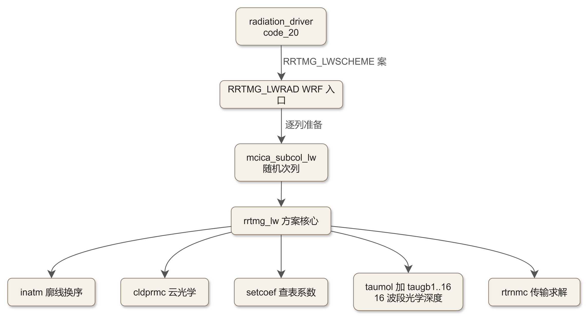
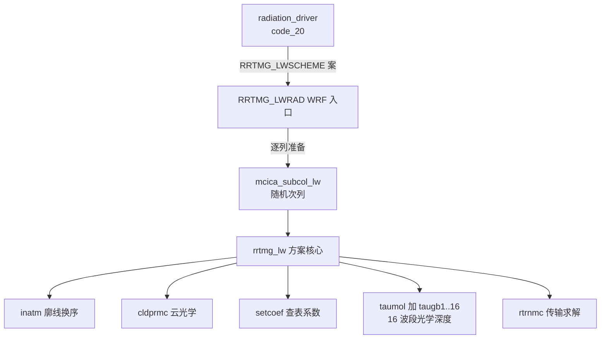

# code_05 — RRTMG 长波辐射方案（module_ra_rrtmg_lw.F：McICA 随机云与 k 分布气体吸收）

## 一、版本指纹

| 源文件 | 行数 | md5（整文件，按字节） |
|---|---|---|
| phys/module_ra_rrtmg_lw.F | 14633 | d778343f8e829c3880d4aa2b11c089a4 |

- 抽取工具：workspace/scripts/code_extract.py v1.2（v1.3 起扫描器支持 CONTAINS 嵌套，taumol 内的 taugb1..16 才能配对），2026-10-12；块首指纹注释自带 range_md5。
- 收录分级（B）：主链五件（RRTMG_LWRAD 选段 2 段、rrtmg_lw 全文、cldprmc 全文、taumol 头段、taugb1 全文）+ rtrnmc 头段 + 文件头两模块；未录 60 余单元给分组总表（§九）。教材锚点：[ch12_radiation_family.md](../ch12_radiation_family.md)（波段结构/文献/ghg 与 o3input 已精读，本篇给完整源码上下文）。

## 二、定位

一句话：**AER 的 RRTMG 长波方案**——RRTM 的 GCM 快速版：16 波段 k 分布（k-distribution）+ g 点从 256 缩减到 140 + **McICA（Monte-Carlo Independent Column Approximation，Pincus et al. 2003）随机次格云**；WRF 侧入口 RRTMG_LWRAD 做单位换算与逐列准备，核心 rrtmg_lw 按 inatm→cldprmc→setcoef→taumol→rtrnmc 五步流水。

**谁在调它**：radiation_driver 的 CASE (RRTMG_LWSCHEME)（[code_20_module_radiation_driver.md](code_20_module_radiation_driver.md) §六）。**模块级依赖方向**：module_ra_rrtmg_sw.F 的 parrrsw 首行就是 `use parkind`——**SW 文件不自带 parkind，从本文件导入**（SW 必须晚于 LW 编译，plan §三「sw 依赖 lw」的落实处）。

**85 单元分组总表**（扫描器输出）：

| 组 | 单元 | 行段 | 说明 |
|---|---|---|---|
| 主链 | rrtmg_lw / inatm | L10694–L11522 | 方案核心 / 廓线换序换算 |
| WRF 入口 | RRTMG_LWRAD / INIRAD / rrtmg_lwinit / rrtmg_lwlookuptable | L11570–L13075 | 逐列准备与调核心 |
| MCICA 群 | mixbits/twist/nextState/temper/initialize_scalar/…/getRandomNumber_2D | L1743–L2022 | KISSVEC 随机数流（Pincus） |
| MCICA 群 | mcica_subcol_lw / generate_stochastic_clouds / kissvec | L2091–L2729 | 随机次列生成 |
| 云光学 | cldprmc | L2764–L3025 | McICA 云光学深度 |
| 传输 | rtrnmc | L3085–L3522 | 两向传输+扩散角积分 |
| 廓线准备 | setcoef / lwatmref / lwavplank | L3556–L4790 | 查表系数/参考大气/普朗克 |
| 气体吸收 | taumol（含 taugb1..taugb16） | L4824–L7942 | 16 波段光学深度与普朗克分数 |
| 初始化 | rrtmg_lw_ini / lwdatinit / lwcmbdat / O3DATA | L7976–L12978 | k 系数装填与 g 点缩减 |
| g 点缩减 | cmbgb1..cmbgb16 | L8320–L9971 | 256→140 逐波段重排 |
| 非 McICA 云 | lwcldpr | L9974–L10612 | **休眠**（imca=1 固定走 cldprmc） |
| k 系数 | lw_kgb01..lw_kgb16 | L13094–L14539 | 逐波段 k 分布系数（纯数据） |
| 工具 | relcalc / reicalc | L14542–L14630 | 有效半径查表 |



<details><summary>原始 Mermaid 源码（可点击展开）</summary>

<!--

-->

</details>

## 三、文件头：parkind 与 parrrtm

<!-- code_extract code_extract.py v1.2
source: phys/module_ra_rrtmg_lw.F
ranges: L1-L157
file_lines: 14633
file_md5: d778343f8e829c3880d4aa2b11c089a4
display: line-numbered (strip L-prefix and !file: line to restore)
range_md5: b98e8338648a85704ad0c49f3142dc9b
seg_lines: 157
-->

```fortran
!file: phys/module_ra_rrtmg_lw.F    L1-L157
L00001  !MODULE module_ra_rrtmg_lw
L00002  
L00003        module parkind
L00004  !     implicit none
L00005        save
L00006  
L00007  !------------------------------------------------------------------
L00008  ! rrtmg kinds
L00009  ! Define integer and real kinds for various types.
L00010  !
L00011  ! Initial version: MJIacono, AER, jun2006
L00012  ! Revised: MJIacono, AER, aug2008
L00013  !------------------------------------------------------------------
L00014  
L00015  !
L00016  !     integer kinds
L00017  !     -------------
L00018  !
L00019  !     integer, parameter :: kind_ib = selected_int_kind(13)  ! 8 byte integer
L00020  !     integer, parameter :: kind_im = selected_int_kind(6)   ! 4 byte integer
L00021        integer, parameter :: kind_ib = kind(1)            
L00022        integer, parameter :: kind_im = kind(1)            
L00023        integer, parameter :: kind_in = kind(1)                ! native integer
L00024  
L00025  !
L00026  !     real kinds
L00027  !     ----------
L00028  !
L00029  !      integer, parameter :: kind_rb = selected_real_kind(12) ! 8 byte real
L00030  !      integer, parameter :: kind_rm = selected_real_kind(6)  ! 4 byte real
L00031  !      integer, parameter :: kind_rn = kind(1.0)              ! native real
L00032  
L00033  #if 0
L00034  ! Modified for WRF:
L00035  #ifdef DOUBLE_PRECISION
L00036        integer, parameter :: kind_rb = selected_real_kind(12) ! 8 byte real
L00037  #endif
L00038  #ifndef DOUBLE_PRECISION
L00039        integer, parameter :: kind_rb = selected_real_kind(6)  ! 4 byte real
L00040  #endif
L00041  #else
L00042         integer, parameter :: kind_rb = kind(1.0)              ! native real
L00043  #endif
L00044  
L00045        end module parkind
L00046  
L00047        module parrrtm
L00048  
L00049        use parkind ,only : im => kind_im
L00050  
L00051  !     implicit none
L00052        save
L00053  
L00054  !------------------------------------------------------------------
L00055  ! rrtmg_lw main parameters
L00056  !
L00057  ! Initial version:  JJMorcrette, ECMWF, Jul 1998
L00058  ! Revised: MJIacono, AER, Jun 2006
L00059  ! Revised: MJIacono, AER, Aug 2007
L00060  ! Revised: MJIacono, AER, Aug 2008
L00061  !------------------------------------------------------------------
L00062  
L00063  !  name     type     purpose
L00064  ! -----  :  ----   : ----------------------------------------------
L00065  ! mxlay  :  integer: maximum number of layers
L00066  ! mg     :  integer: number of original g-intervals per spectral band
L00067  ! nbndlw :  integer: number of spectral bands
L00068  ! maxxsec:  integer: maximum number of cross-section molecules
L00069  !                    (e.g. cfcs)
L00070  ! maxinpx:  integer: 
L00071  ! ngptlw :  integer: total number of reduced g-intervals for rrtmg_lw
L00072  ! ngNN   :  integer: number of reduced g-intervals per spectral band
L00073  ! ngsNN  :  integer: cumulative number of g-intervals per band
L00074  !------------------------------------------------------------------
L00075  
L00076        integer(kind=im), parameter :: mxlay  = 203
L00077        integer(kind=im), parameter :: mg     = 16
L00078        integer(kind=im), parameter :: nbndlw = 16
L00079        integer(kind=im), parameter :: maxxsec= 4
L00080        integer(kind=im), parameter :: mxmol  = 38
L00081        integer(kind=im), parameter :: maxinpx= 38
L00082        integer(kind=im), parameter :: nmol   = 7
L00083  ! Use for 140 g-point model 
L00084        integer(kind=im), parameter :: ngptlw = 140
L00085  ! Use for 256 g-point model 
L00086  !      integer(kind=im), parameter :: ngptlw = 256
L00087  
L00088  ! Use for 140 g-point model
L00089        integer(kind=im), parameter :: ng1  = 10
L00090        integer(kind=im), parameter :: ng2  = 12
L00091        integer(kind=im), parameter :: ng3  = 16
L00092        integer(kind=im), parameter :: ng4  = 14
L00093        integer(kind=im), parameter :: ng5  = 16
L00094        integer(kind=im), parameter :: ng6  = 8
L00095        integer(kind=im), parameter :: ng7  = 12
L00096        integer(kind=im), parameter :: ng8  = 8
L00097        integer(kind=im), parameter :: ng9  = 12
L00098        integer(kind=im), parameter :: ng10 = 6
L00099        integer(kind=im), parameter :: ng11 = 8
L00100        integer(kind=im), parameter :: ng12 = 8
L00101        integer(kind=im), parameter :: ng13 = 4
L00102        integer(kind=im), parameter :: ng14 = 2
L00103        integer(kind=im), parameter :: ng15 = 2
L00104        integer(kind=im), parameter :: ng16 = 2
L00105  
L00106        integer(kind=im), parameter :: ngs1  = 10
L00107        integer(kind=im), parameter :: ngs2  = 22
L00108        integer(kind=im), parameter :: ngs3  = 38
L00109        integer(kind=im), parameter :: ngs4  = 52
L00110        integer(kind=im), parameter :: ngs5  = 68
L00111        integer(kind=im), parameter :: ngs6  = 76
L00112        integer(kind=im), parameter :: ngs7  = 88
L00113        integer(kind=im), parameter :: ngs8  = 96
L00114        integer(kind=im), parameter :: ngs9  = 108
L00115        integer(kind=im), parameter :: ngs10 = 114
L00116        integer(kind=im), parameter :: ngs11 = 122
L00117        integer(kind=im), parameter :: ngs12 = 130
L00118        integer(kind=im), parameter :: ngs13 = 134
L00119        integer(kind=im), parameter :: ngs14 = 136
L00120        integer(kind=im), parameter :: ngs15 = 138
L00121  
L00122  ! Use for 256 g-point model
L00123  !      integer(kind=im), parameter :: ng1  = 16
L00124  !      integer(kind=im), parameter :: ng2  = 16
L00125  !      integer(kind=im), parameter :: ng3  = 16
L00126  !      integer(kind=im), parameter :: ng4  = 16
L00127  !      integer(kind=im), parameter :: ng5  = 16
L00128  !      integer(kind=im), parameter :: ng6  = 16
L00129  !      integer(kind=im), parameter :: ng7  = 16
L00130  !      integer(kind=im), parameter :: ng8  = 16
L00131  !      integer(kind=im), parameter :: ng9  = 16
L00132  !      integer(kind=im), parameter :: ng10 = 16
L00133  !      integer(kind=im), parameter :: ng11 = 16
L00134  !      integer(kind=im), parameter :: ng12 = 16
L00135  !      integer(kind=im), parameter :: ng13 = 16
L00136  !      integer(kind=im), parameter :: ng14 = 16
L00137  !      integer(kind=im), parameter :: ng15 = 16
L00138  !      integer(kind=im), parameter :: ng16 = 16
L00139  
L00140  !      integer(kind=im), parameter :: ngs1  = 16
L00141  !      integer(kind=im), parameter :: ngs2  = 32
L00142  !      integer(kind=im), parameter :: ngs3  = 48
L00143  !      integer(kind=im), parameter :: ngs4  = 64
L00144  !      integer(kind=im), parameter :: ngs5  = 80
L00145  !      integer(kind=im), parameter :: ngs6  = 96
L00146  !      integer(kind=im), parameter :: ngs7  = 112
L00147  !      integer(kind=im), parameter :: ngs8  = 128
L00148  !      integer(kind=im), parameter :: ngs9  = 144
L00149  !      integer(kind=im), parameter :: ngs10 = 160
L00150  !      integer(kind=im), parameter :: ngs11 = 176
L00151  !      integer(kind=im), parameter :: ngs12 = 192
L00152  !      integer(kind=im), parameter :: ngs13 = 208
L00153  !      integer(kind=im), parameter :: ngs14 = 224
L00154  !      integer(kind=im), parameter :: ngs15 = 240
L00155  !      integer(kind=im), parameter :: ngs16 = 256
L00156  
L00157        end module parrrtm
```

> 讲解：①**parkind** 模块：kind_ib/im/in 全取 kind(1) 原生整型；kind_rb 被改成 kind(1.0) **原生单精度**——原版 selected_real_kind(12) 双精度开关被 WRF 用 `#if 0` 关掉（性能换精度的全局决定，改回双精度要动这里且 sw 文件共用同一模块）；②**parrrtm**：mxlay=203 层上限、nbndlw=16 波段、mg=16（每波段原 g 点数）、**ngptlw=140**（缩减后 g 点总数，256 的备选注释保留）、ng1..ng16 每波段缩减后 g 点数（10/12/16/14/16/8/12/8/12/6/8/8/4/2/2/2，合计 140）、ngs1..ngs15 累积表——k 分布的「谱-统计」结构全部在这张参数表上。

## 四、WRF 入口 RRTMG_LWRAD

<!-- code_extract code_extract.py v1.2
source: phys/module_ra_rrtmg_lw.F
ranges: L11570-L11901
file_lines: 14633
file_md5: d778343f8e829c3880d4aa2b11c089a4
display: line-numbered (strip L-prefix and !file: line to restore)
range_md5: bc28e4f833bc2f88cd4c4778873fa776
seg_lines: 332
-->

```fortran
!file: phys/module_ra_rrtmg_lw.F    L11570-L11901
L11570     SUBROUTINE RRTMG_LWRAD(                                        &
L11571                         rthratenlw,                                &
L11572                         rthratenlwc,                               &
L11573                         lwupt, lwuptc, lwuptcln, lwdnt, lwdntc, lwdntcln, &
L11574                         lwupb, lwupbc, lwupbcln, lwdnb, lwdnbc, lwdnbcln, &
L11575  !                      lwupflx, lwupflxc, lwdnflx, lwdnflxc,      &
L11576                         glw, olr, lwcf, emiss,                     &
L11577                         p8w, p3d, pi3d,                            &
L11578                         dz8w, tsk, t3d, t8w, rho3d, r, g,          &
L11579                         icloud, warm_rain, cldfra3d,               &
L11580                         cldovrlp,idcor,xlat,                       & 
L11581                         lradius,iradius,                           & 
L11582                         is_cammgmp_used,                           & 
L11583                         f_ice_phy, f_rain_phy,                     &
L11584                         xland, xice, snow,                         &
L11585                         qv3d, qc3d, qr3d,                          &
L11586                         qi3d, qs3d, qg3d,                          &
L11587                         o3input, o33d,                             &
L11588                         f_qv, f_qc, f_qr, f_qi, f_qs, f_qg,        &
L11589                         re_cloud, re_ice, re_snow,                 &  ! G. Thompson
L11590                         has_reqc, has_reqi, has_reqs,              &  ! G. Thompson
L11591                         tauaerlw1,tauaerlw2,tauaerlw3,tauaerlw4,   & ! czhao 
L11592                         tauaerlw5,tauaerlw6,tauaerlw7,tauaerlw8,   & ! czhao 
L11593                         tauaerlw9,tauaerlw10,tauaerlw11,tauaerlw12,   & ! czhao 
L11594                         tauaerlw13,tauaerlw14,tauaerlw15,tauaerlw16,   & ! czhao 
L11595                         aer_ra_feedback,                           & !czhao
L11596  !jdfcz                 progn,prescribe,                           & !czhao
L11597                         progn,calc_clean_atm_diag,                 & !czhao
L11598                         qndrop3d,f_qndrop,                         & !czhao
L11599  !ccc added for time varying gases.
L11600                         yr,julian,ghg_input,                       &
L11601  !ccc
L11602                         mp_physics,                                &
L11603                         ids,ide, jds,jde, kds,kde,                 & 
L11604                         ims,ime, jms,jme, kms,kme,                 &
L11605                         its,ite, jts,jte, kts,kte,                 &
L11606                         lwupflx, lwupflxc, lwdnflx, lwdnflxc       &
L11607                                                                    )
L11608  !------------------------------------------------------------------
L11609  !ccc To use clWRF time varying trace gases
L11610     USE MODULE_RA_CLWRF_SUPPORT, ONLY : read_CAMgases
L11611  
L11612     IMPLICIT NONE
L11613  !------------------------------------------------------------------
L11614     LOGICAL, INTENT(IN )      ::        warm_rain
L11615     LOGICAL, INTENT(IN )      ::   is_CAMMGMP_used ! Added for CAM5 RRTMG<->CAMMGMP
L11616  !
L11617     INTEGER, INTENT(IN )      ::        ids,ide, jds,jde, kds,kde, &
L11618                                         ims,ime, jms,jme, kms,kme, &
L11619                                         its,ite, jts,jte, kts,kte
L11620  
L11621     INTEGER, INTENT(IN )      ::        ICLOUD, GHG_INPUT
L11622     INTEGER, INTENT(IN )      ::        MP_PHYSICS
L11623  !
L11624     REAL, DIMENSION( ims:ime, kms:kme, jms:jme )                 , &
L11625           INTENT(IN   ) ::                                   dz8w, &
L11626                                                               t3d, &
L11627                                                               t8w, &
L11628                                                               p8w, &
L11629                                                               p3d, &
L11630                                                              pi3d, &
L11631                                                             rho3d
L11632  
L11633     REAL, DIMENSION( ims:ime, kms:kme, jms:jme )                 , &
L11634           INTENT(INOUT)  ::                            RTHRATENLW, &
L11635                                                        RTHRATENLWC
L11636  
L11637     REAL, DIMENSION( ims:ime, jms:jme )                          , &
L11638           INTENT(INOUT)  ::                                   GLW, &
L11639                                                               OLR, &
L11640                                                              LWCF
L11641  
L11642     REAL, DIMENSION( ims:ime, jms:jme )                          , &
L11643           INTENT(IN   )  ::                                 EMISS, &
L11644                                                               TSK
L11645  
L11646     REAL, INTENT(IN  )   ::                                   R,G
L11647  
L11648     REAL, DIMENSION( ims:ime, jms:jme )                          , &
L11649           INTENT(IN   )  ::                                 XLAND, &
L11650                                                              XICE, &
L11651                                                              SNOW
L11652  ! Added for time-varying trace gases.
L11653     INTEGER, INTENT(IN    ) ::                                 yr
L11654     REAL, INTENT(IN    ) ::                                julian
L11655  
L11656  !
L11657  ! Optional
L11658  !
L11659     REAL, DIMENSION( ims:ime, kms:kme, jms:jme )                 , &
L11660           OPTIONAL                                               , &
L11661           INTENT(IN   ) ::                                         &
L11662                                                          CLDFRA3D, &
L11663                                                           LRADIUS, &
L11664                                                           IRADIUS, &
L11665  
L11666                                                              QV3D, &
L11667                                                              QC3D, &
L11668                                                              QR3D, &
L11669                                                              QI3D, &
L11670                                                              QS3D, &
L11671                                                              QG3D, &
L11672                                                          QNDROP3D
L11673  
L11674  !..Added by G. Thompson to couple cloud physics effective radii.
L11675     REAL, DIMENSION(ims:ime,kms:kme,jms:jme), INTENT(IN)::         &
L11676                                                          re_cloud, &
L11677                                                            re_ice, &
L11678                                                           re_snow
L11679     INTEGER, INTENT(IN):: has_reqc, has_reqi, has_reqs
L11680  
L11681     real pi,third,relconst,lwpmin,rhoh2o
L11682  
L11683     REAL, DIMENSION( ims:ime, kms:kme, jms:jme )                 , &
L11684           OPTIONAL                                               , &
L11685           INTENT(IN   ) ::                                         &
L11686                                                         F_ICE_PHY, &
L11687                                                        F_RAIN_PHY
L11688  
L11689     LOGICAL, OPTIONAL, INTENT(IN)   ::                             &
L11690                                     F_QV,F_QC,F_QR,F_QI,F_QS,F_QG,F_QNDROP
L11691  ! Optional
L11692     REAL, DIMENSION( ims:ime, kms:kme, jms:jme ), OPTIONAL ,       &
L11693           INTENT(IN    ) :: tauaerlw1,tauaerlw2,tauaerlw3,tauaerlw4, & ! czhao 
L11694                             tauaerlw5,tauaerlw6,tauaerlw7,tauaerlw8, & ! czhao 
L11695                             tauaerlw9,tauaerlw10,tauaerlw11,tauaerlw12, & ! czhao 
L11696                             tauaerlw13,tauaerlw14,tauaerlw15,tauaerlw16
L11697  
L11698     INTEGER,    INTENT(IN  ), OPTIONAL   ::       aer_ra_feedback
L11699  !jdfcz   INTEGER,    INTENT(IN  ), OPTIONAL   ::       progn,prescribe
L11700     INTEGER,    INTENT(IN  ), OPTIONAL   ::       progn
L11701     INTEGER,    INTENT(IN  )             ::       calc_clean_atm_diag
L11702  
L11703  !  Ozone
L11704     REAL, DIMENSION( ims:ime, kms:kme, jms:jme )                 , &
L11705           INTENT(INOUT) :: O33D
L11706     INTEGER, INTENT(IN ) :: o3input
L11707  
L11708        real, parameter :: thresh=1.e-9
L11709        real slope
L11710        character(len=200) :: msg
L11711  
L11712  
L11713  ! Top of atmosphere and surface longwave fluxes (W m-2)
L11714     REAL, DIMENSION( ims:ime, jms:jme ),                           &
L11715           OPTIONAL, INTENT(INOUT) ::                               &
L11716                        LWUPT,LWUPTC,LWUPTCLN,LWDNT,LWDNTC,LWDNTCLN,&
L11717                        LWUPB,LWUPBC,LWUPBCLN,LWDNB,LWDNBC,LWDNBCLN 
L11718  
L11719  ! Layer longwave fluxes (including extra layer above model top)
L11720  ! Vertical ordering is from bottom to top (W m-2)
L11721     REAL, DIMENSION( ims:ime, kms:kme+2, jms:jme ),                &
L11722           OPTIONAL, INTENT(OUT) ::                                 &
L11723                                 LWUPFLX,LWUPFLXC,LWDNFLX,LWDNFLXC
L11724  
L11725  !  LOCAL VARS
L11726   
L11727     REAL, DIMENSION( kts:kte+1 ) ::                          Pw1D, &
L11728                                                              Tw1D
L11729  
L11730     REAL, DIMENSION( kts:kte ) ::                          TTEN1D, &
L11731                                                          CLDFRA1D, &
L11732                                                              DZ1D, &
L11733                                                               P1D, &
L11734                                                               T1D, &
L11735                                                              QV1D, &
L11736                                                              QC1D, &
L11737                                                              QR1D, &
L11738                                                              QI1D, &
L11739                                                             RHO1D, &
L11740                                                              QS1D, &
L11741                                                              QG1D, &
L11742                                                              O31D, &
L11743                                                            qndrop1d 
L11744  !BSF: From eq. (5) on p. 2434 in McFarquhar & Heymsfield (1996)
L11745         real, parameter :: re_50C=1250.0/9.917, re_40C=1250.0/9.337, &
L11746                            re_30C=1250.0/9.208, re_20C=1250.0/9.387
L11747  
L11748  
L11749  ! Added local arrays for RRTMG
L11750      integer ::                                              ncol, &
L11751                                                              nlay, &
L11752                                                              icld, &
L11753                                                          cldovrlp, &
L11754                                                             idcor, &
L11755                                                            juldat, &
L11756                                                           inflglw, &
L11757                                                          iceflglw, &
L11758                                                          liqflglw
L11759  ! Latitude 
L11760      real, dimension( ims:ime,jms:jme ), intent(in) ::       xlat     ! (latitude for cldovrlp=4 or 5)
L11761      real                                           ::        lat
L11762  
L11763  ! Dimension with extra layer from model top to TOA
L11764      real, dimension( 1, kts:nlayers+1 )  ::                 plev, &
L11765                                                              tlev
L11766      real, dimension( 1, kts:nlayers )  ::                   play, &
L11767                                                              tlay, &
L11768                                                            h2ovmr, &
L11769                                                             o3vmr, &
L11770                                                            co2vmr, &
L11771                                                             o2vmr, &
L11772                                                            ch4vmr, &
L11773                                                            n2ovmr, &
L11774                                                          cfc11vmr, &
L11775                                                          cfc12vmr, &
L11776                                                          cfc22vmr, &
L11777                                                           ccl4vmr
L11778      real, dimension( kts:nlayers )  ::                     o3mmr
L11779  ! Add height of each layer for exponential-random cloud overlap
L11780  ! This will be derived below from the dz in each layer
L11781      real, dimension( 1, kts:nlayers )  ::                   hgt
L11782      real ::                                               dzsum
L11783  ! For old cloud property specification for rrtm_lw
L11784      real, dimension( kts:kte )  ::                          clwp, &
L11785                                                              ciwp, &
L11786                                                              cswp, &
L11787                                                              plwp, &
L11788                                                              piwp
L11789  ! Surface emissivity (for 16 LW spectral bands)
L11790      real, dimension( 1, nbndlw )  ::                        emis
L11791  ! Dimension with extra layer from model top to TOA, 
L11792  ! though no clouds are allowed in extra layer
L11793      real, dimension( 1, kts:nlayers )  ::                 clwpth, &
L11794                                                            ciwpth, &
L11795                                                            cswpth, &
L11796                                                               rel, &
L11797                                                               rei, &
L11798                                                               res, &
L11799                                                           cldfrac, &
L11800                                                           relqmcl, &
L11801                                                           reicmcl, &
L11802                                                           resnmcl
L11803      real, dimension( nbndlw, 1, kts:nlayers )  ::        taucld
L11804      real, dimension( ngptlw, 1, kts:nlayers )  ::        cldfmcl, &
L11805                                                           clwpmcl, &
L11806                                                           ciwpmcl, &
L11807                                                           cswpmcl, &
L11808                                                           taucmcl
L11809      real, dimension( 1, kts:nlayers, nbndlw )  ::           tauaer
L11810  
L11811  ! Output arrays contain extra layer from model top to TOA
L11812      real, dimension( 1, kts:nlayers+1 )  ::                 uflx, &
L11813                                                              dflx, &
L11814                                                             uflxc, &
L11815                                                             dflxc, &
L11816                                                           uflxcln, &
L11817                                                           dflxcln
L11818                                                             
L11819      real, dimension( 1, kts:nlayers )  ::                    hr, &
L11820                                                               hrc
L11821  
L11822      real, dimension ( 1 ) ::                                tsfc, &
L11823                                                                ps
L11824      real ::                                                   ro, &
L11825                                                                dz
L11826      real:: snow_mass_factor
L11827  
L11828  !..We can use message interface regardless of what options are running,
L11829  !.. so let us ask for it here.
L11830        CHARACTER(LEN=256)                           :: message
L11831        LOGICAL, EXTERNAL                            :: wrf_dm_on_monitor
L11832  
L11833  !ccc To add time-varying trace gases (CO2, N2O and CH4). Read the conc.  from file
L11834  ! then interpolate to date of run.
L11835        REAL(8)                                      :: co2, n2o, ch4, cfc11, cfc12
L11836  
L11837  ! Set trace gas volume mixing ratios, 2005 values, IPCC (2007)
L11838  ! cfc-22 (169 ppt)
L11839      real :: cfc22
L11840      data cfc22 / 0.169e-9 / 
L11841  ! ccl4 (93 ppt)
L11842      real :: ccl4
L11843      data ccl4 / 0.093e-9 / 
L11844  ! Set oxygen volume mixing ratio (for o2mmr=0.23143)
L11845      real :: o2
L11846      data o2 / 0.209488 /
L11847  
L11848      integer :: iplon, irng, permuteseed
L11849      integer :: nb
L11850  
L11851  ! For old cloud property specification for rrtm_lw
L11852  ! Cloud and precipitation absorption coefficients
L11853      real :: abcw,abice,abrn,absn
L11854      data abcw /0.144/
L11855      data abice /0.0735/
L11856      data abrn /0.330e-3/
L11857      data absn /2.34e-3/
L11858  
L11859  ! Molecular weights and ratios for converting mmr to vmr units
L11860  !    real :: amd       ! Effective molecular weight of dry air (g/mol)  
L11861  !    real :: amw       ! Molecular weight of water vapor (g/mol)        
L11862  !    real :: amo       ! Molecular weight of ozone (g/mol)              
L11863  !    real :: amo2      ! Molecular weight of oxygen (g/mol)              
L11864  ! Atomic weights for conversion from mass to volume mixing ratios                
L11865  !    data amd   /  28.9660   /                                                  
L11866  !    data amw   /  18.0160   /                                                  
L11867  !    data amo   /  47.9998   /                                                  
L11868  !    data amo2  /  31.9999   /
L11869                                                                                   
L11870      real :: amdw     ! Molecular weight of dry air / water vapor  
L11871      real :: amdo     ! Molecular weight of dry air / ozone
L11872      real :: amdo2    ! Molecular weight of dry air / oxygen
L11873      data amdw /  1.607793 /                                                    
L11874      data amdo /  0.603461 /
L11875      data amdo2 / 0.905190 /
L11876      
L11877  !!
L11878      real, dimension( 1, 1:kte-kts+1 )  :: pdel         ! Layer pressure thickness (mb)
L11879  
L11880      real, dimension(1, 1:kte-kts+1) ::   cicewp, &     ! in-cloud cloud ice water path
L11881                                           cliqwp, &     ! in-cloud cloud liquid water path
L11882                                           csnowp, &     ! in-cloud snow water path
L11883                                            reliq, &     ! effective drop radius (microns)
L11884                                            reice        ! effective ice crystal size (microns)
L11885      real, dimension(1, 1:kte-kts+1):: recloud1d, &
L11886                                          reice1d, &
L11887                                         resnow1d
L11888  
L11889      real :: gliqwp, gicewp, gsnowp, gravmks
L11890  
L11891  !
L11892  !    REAL   ::  TSFC,GLW0,OLR0,EMISS0,FP
L11893  
L11894      real, dimension (1) :: landfrac, landm, snowh, icefrac
L11895  
L11896      integer :: pcols, pver
L11897  
L11898  !
L11899      INTEGER :: i,j,K, idx_rei
L11900      REAL :: corr
L11901      LOGICAL :: predicate
```

> 讲解：①签名即功能清单：RTHRATENLW/C 晴空倾向、LWUPT/LWDNT/LWUPB/LWDNB 及其 C/CLN 三套通量诊断、LWUPFLX 系逐层通量（kte+2 维——模型顶外垫一层到 TOA）、tauaerlw1..16 十六个独立数组（WRF_CHEM 气溶胶反馈的逐波段 AOD）、ghg_input 时变气体、o3input/O33D、re_cloud/ice/snow 微物理直供有效半径、cldovrlp/idcor 云重叠选项；②关键局部常数：**时变气体 2005 年 IPCC 默认值**（cfc22=0.169e-9、ccl4=0.093e-9、o2=0.209488；CO2/CH4/N2O 由 read_CAMgases 读文件）、mmr→vmr 分子量比（amdw=1.607793 等）；③老 rrtm 云吸收系数 abcw=0.144/abice=0.0735/abrn=0.330e-3/absn=2.34e-3（INFLAG 老口径备胎）；④**McFarquhar–Heymsfield (1996) 式 (5) 的冰有效半径对照点** re_50C=1250/9.917 等——温度分层查 rei 表的锚点。

<!-- code_extract code_extract.py v1.2
source: phys/module_ra_rrtmg_lw.F
ranges: L12598-L12834
file_lines: 14633
file_md5: d778343f8e829c3880d4aa2b11c089a4
display: line-numbered (strip L-prefix and !file: line to restore)
range_md5: 471d4cd1d79c4076b026bccfe003d4b8
seg_lines: 237
-->

```fortran
!file: phys/module_ra_rrtmg_lw.F    L12598-L12834
L12598  ! Limit upper bound of reice for Fu ice parameterization and convert
L12599  ! from effective radius to generalized effective size (*1.0315; Fu, 1996)
L12600              if (iceflglw .eq. 3) then
L12601                 do k = kts, kte
L12602                    reice(ncol,k) = reice(ncol,k) * 1.0315
L12603                    reice(ncol,k) = min(140.0,reice(ncol,k))
L12604                 end do
L12605              endif
L12606  !if CAMMGMP is used, use output from CAMMGMP
L12607              if(is_CAMMGMP_used) then
L12608                 do k = kts, kte
L12609                    if ( qi1d(k) .gt. 1.e-20 .or. qs1d(k) .gt. 1.e-20) then
L12610                       reice(ncol,k) = iradius(i,k,j)
L12611                    else
L12612                       reice(ncol,k) = 25.
L12613                    end if
L12614                    reice(ncol,k) = max(5., min(140.0,reice(ncol,k)))
L12615                    if ( qc1d(k) .gt. 1.e-20) then
L12616                       reliq(ncol,k) = lradius(i,k,j)
L12617                    else
L12618                       reliq(ncol,k) = 10.
L12619                    end if
L12620                    reliq(ncol,k) = max(2.5, min(60.0,reliq(ncol,k)))
L12621                 enddo
L12622              endif
L12623  
L12624  
L12625  ! Set cloud physical property arrays
L12626              do k = kts, kte
L12627                 clwpth(ncol,k) = cliqwp(ncol,k)
L12628                 ciwpth(ncol,k) = cicewp(ncol,k)
L12629                 rel(ncol,k) = reliq(ncol,k)
L12630                 rei(ncol,k) = reice(ncol,k)
L12631              enddo
L12632  
L12633  !Mukul
L12634              if (inflglw .eq. 5) then
L12635                 do k = kts, kte
L12636                    cswpth(ncol,k) = csnowp(ncol,k)
L12637                    res(ncol,k) = resnow1d(ncol,k)
L12638                 end do
L12639              else
L12640                 do k = kts, kte
L12641                    cswpth(ncol,k) = 0.
L12642                    res(ncol,k) = 10.
L12643                 end do
L12644              endif
L12645  
L12646  ! Zero out cloud optical properties here; not used when passing physical properties
L12647  ! to radiation and taucld is calculated in radiation 
L12648              do k = kts, kte
L12649                 do nb = 1, nbndlw
L12650                    taucld(nb,ncol,k) = 0.0
L12651                 enddo
L12652              enddo
L12653           endif
L12654  
L12655  ! No clouds are allowed in the extra layer from model top to TOA
L12656           ! Steven Cavallo: Edited out for buffer adjustment below
L12657           if ( 1 == 0 ) then
L12658  
L12659  
L12660           clwpth(ncol,kte+1) = 0.
L12661           ciwpth(ncol,kte+1) = 0.
L12662           cswpth(ncol,kte+1) = 0.
L12663           rel(ncol,kte+1) = 10.
L12664           rei(ncol,kte+1) = 10.
L12665           res(ncol,kte+1) = 10.
L12666           cldfrac(ncol,kte+1) = 0.
L12667           do nb = 1, nbndlw
L12668              taucld(nb,ncol,kte+1) = 0.
L12669           enddo
L12670  
L12671           endif
L12672  
L12673           ! Buffer adjustment. Steven Cavallo December 2010
L12674           do k=kte+1,nlayers
L12675              clwpth(ncol,k) = 0.
L12676              ciwpth(ncol,k) = 0.
L12677              cswpth(ncol,k) = 0.
L12678              rel(ncol,k) = 10.
L12679              rei(ncol,k) = 10.
L12680              res(ncol,k) = 10.
L12681              cldfrac(ncol,k) = 0.
L12682              do nb = 1,nbndlw
L12683                 taucld(nb,ncol,k) = 0.
L12684              enddo
L12685           enddo   
L12686  
L12687           iplon = 1
L12688           irng = 0
L12689           permuteseed = 150
L12690  
L12691  ! Sub-column generator for McICA
L12692           lat=xlat(i,j) !retrieve scalar latitude for column calculation
L12693           call mcica_subcol_lw(iplon, ncol, nlay, icld, permuteseed, irng, play, &
L12694                         cldfrac, ciwpth, clwpth, cswpth, rei, rel, res, taucld, &
L12695                         hgt, idcor, juldat, lat, &
L12696                         cldfmcl, ciwpmcl, clwpmcl, cswpmcl, reicmcl, relqmcl, resnmcl, taucmcl)
L12697  
L12698  !--------------------------------------------------------------------------
L12699  ! Aerosol optical depth, single scattering albedo and asymmetry parameter -czhao 03/2010
L12700  !--------------------------------------------------------------------------
L12701  ! Aerosol optical depth by layer for each RRTMG longwave band
L12702  ! No aerosols in layer above model top (kte+1)
L12703  ! Steven Cavallo: Upper bound of loop changed to nlayers from kte+1
L12704  !        do nb = 1, nbndlw
L12705  !           do k = kts, kte+1
L12706  !              tauaer(ncol,k,nb) = 0.
L12707  !           enddo
L12708  !        enddo
L12709  
L12710  ! ... Aerosol effects. Added aerosol feedbacks from Chem , 03/2010 -czhao
L12711  !
L12712        do nb = 1, nbndlw
L12713        do k = kts,nlayers
L12714           tauaer(ncol,k,nb) = 0.
L12715        end do
L12716        end do
L12717  
L12718  #if ( WRF_CHEM == 1 )
L12719     IF ( AER_RA_FEEDBACK == 1) then
L12720  !     do nb = 1, nbndlw 
L12721        do k = kts,kte      !wig
L12722          if(tauaerlw1(i,k,j).gt.thresh .and. tauaerlw16(i,k,j).gt.thresh) then
L12723            tauaer(ncol,k,1)=tauaerlw1(i,k,j)
L12724            tauaer(ncol,k,2)=tauaerlw2(i,k,j)
L12725            tauaer(ncol,k,3)=tauaerlw3(i,k,j)
L12726            tauaer(ncol,k,4)=tauaerlw4(i,k,j)
L12727            tauaer(ncol,k,5)=tauaerlw5(i,k,j)
L12728            tauaer(ncol,k,6)=tauaerlw6(i,k,j)
L12729            tauaer(ncol,k,7)=tauaerlw7(i,k,j)
L12730            tauaer(ncol,k,8)=tauaerlw8(i,k,j)
L12731            tauaer(ncol,k,9)=tauaerlw9(i,k,j)
L12732            tauaer(ncol,k,10)=tauaerlw10(i,k,j)
L12733            tauaer(ncol,k,11)=tauaerlw11(i,k,j)
L12734            tauaer(ncol,k,12)=tauaerlw12(i,k,j)
L12735            tauaer(ncol,k,13)=tauaerlw13(i,k,j)
L12736            tauaer(ncol,k,14)=tauaerlw14(i,k,j)
L12737            tauaer(ncol,k,15)=tauaerlw15(i,k,j)
L12738            tauaer(ncol,k,16)=tauaerlw16(i,k,j)
L12739          endif
L12740        enddo ! k
L12741  !     end do ! nb
L12742  
L12743  !wig beg
L12744        do nb = 1, nbndlw
L12745           slope = 0.  !use slope as a sum holder
L12746           do k = kts,kte
L12747              slope = slope + tauaer(ncol,k,nb)
L12748           end do
L12749           if( slope < 0. ) then
L12750              write(msg,'("ERROR: Negative total lw optical depth of ",f8.2," at point i,j,nb=",3i5)') slope,i,j,nb
L12751              call wrf_error_fatal(msg)
L12752           else if( slope > 5. ) then
L12753              call wrf_message("-------------------------")
L12754              write(msg,'("WARNING: Large total lw optical depth of ",f8.2," at point i,j,nb=",3i5)') slope,i,j,nb
L12755              call wrf_message(msg)
L12756  
L12757              call wrf_message("Diagnostics 1: k, tauaerlw1, tauaerlw16")
L12758              do k=kts,kte
L12759                 write(msg,'(i4,2f8.2)') k, tauaerlw1(i,k,j), tauaerlw16(i,k,j)
L12760                 call wrf_message(msg)
L12761              end do
L12762              call wrf_message("-------------------------")
L12763           endif
L12764        enddo  ! nb
L12765        endif  ! aer_ra_feedback
L12766  #endif
L12767  
L12768  ! Call RRTMG longwave radiation model
L12769           call rrtmg_lw &
L12770              (ncol    ,nlay    ,icld    , &
L12771               play    ,plev    ,tlay    ,tlev    ,tsfc    , & 
L12772               h2ovmr  ,o3vmr   ,co2vmr  ,ch4vmr  ,n2ovmr  ,o2vmr , &
L12773               cfc11vmr,cfc12vmr,cfc22vmr,ccl4vmr ,emis    , &
L12774               inflglw ,iceflglw,liqflglw,cldfmcl , &
L12775               taucmcl ,ciwpmcl ,clwpmcl ,cswpmcl, reicmcl ,relqmcl ,resnmcl , &
L12776               tauaer  , &
L12777               uflx    ,dflx    ,hr      ,uflxc   ,dflxc,  hrc, &
L12778               uflxcln ,dflxcln, calc_clean_atm_diag )
L12779  
L12780  ! Output downard surface flux, and outgoing longwave flux and cloud forcing 
L12781  ! at the top of atmosphere (W/m2)
L12782           glw(i,j) = dflx(1,1)
L12783  !         olr(i,j) = uflx(1,kte+2)
L12784  !         lwcf(i,j) = uflxc(1,kte+2) - uflx(1,kte+2)
L12785  ! Steven Cavallo: Changed OLR to be valid at the top of atmosphere instead 
L12786  ! of top of model.  Dec 2010.
L12787           olr(i,j) = uflx(1,nlayers+1)
L12788           lwcf(i,j) = uflxc(1,nlayers+1) - uflx(1,nlayers+1)
L12789  
L12790           if (present(lwupt)) then 
L12791  ! Output up and down toa fluxes for total and clear sky
L12792  ! nlayers+1 represents value at 0 mb
L12793              lwupt(i,j)     = uflx(1,nlayers+1)
L12794              lwuptc(i,j)    = uflxc(1,nlayers+1)
L12795              lwdnt(i,j)     = dflx(1,nlayers+1)
L12796              lwdntc(i,j)    = dflxc(1,nlayers+1)
L12797  ! Output up and down surface fluxes for total and clear sky
L12798              lwupb(i,j)     = uflx(1,1)
L12799              lwupbc(i,j)    = uflxc(1,1)
L12800              lwdnb(i,j)     = dflx(1,1)
L12801              lwdnbc(i,j)    = dflxc(1,1)
L12802  			if(calc_clean_atm_diag .gt. 0)then
L12803  ! Output up and down toa fluxes for clean sky
L12804              	lwuptcln(i,j)  = uflxcln(1,nlayers+1)
L12805              	lwdntcln(i,j)  = dflxcln(1,nlayers+1)
L12806  ! Output up and down surface fluxes for clean sky
L12807              	lwupbcln(i,j)  = uflxcln(1,1)
L12808              	lwdnbcln(i,j)  = dflxcln(1,1)
L12809  			end if
L12810           endif
L12811  
L12812  ! Output up and down layer fluxes for total and clear sky.
L12813  ! Vertical ordering is from bottom to top in units of W m-2. 
L12814           if ( present (lwupflx) ) then
L12815           do k=kts,kte+2
L12816              lwupflx(i,k,j)  = uflx(1,k)
L12817              lwupflxc(i,k,j) = uflxc(1,k)
L12818              lwdnflx(i,k,j)  = dflx(1,k)
L12819              lwdnflxc(i,k,j) = dflxc(1,k)
L12820           enddo
L12821           endif
L12822  
L12823  ! Output heating rate tendency; convert heating rate from K/d to K/s
L12824  ! Heating rate arrays are ordered vertically from bottom to top here. 
L12825           do k=kts,kte
L12826              tten1d(k) = hr(ncol,k)/86400.
L12827              rthratenlw(i,k,j) = tten1d(k)/pi3d(i,k,j)
L12828              tten1d(k) = hrc(ncol,k)/86400.
L12829              rthratenlwc(i,k,j) = tten1d(k)/pi3d(i,k,j)
L12830           enddo
L12831  
L12832  !
L12833        end do i_loop
L12834     end do j_loop                                           
```

> 讲解：主入口尾段五件事：①**Fu (1996) 口径换算**——iceflglw=3 时冰有效半径乘 1.0315 变广义有效尺寸 dge 并钳位 [5,140] μm；CAMMGMP 在场时直接取 iradius/lradius（无冰/水时 25/10 μm 兜底）；②inflglw=5 的雪路径（cswpth/res）只有新版开、否则清零；③**模型顶外垫层不允许有云**（Steven Cavallo 2010-12 的 buffer adjustment——kte+1 到 nlayers 全清，云/降水只进模式层）；④**mcica_subcol_lw 调用**：iplon=1（WRF 逐列单列调）、permuteseed=150、irng=0（KISSVEC 随机数）——McICA 的次列展开在这里完成后才调 rrtmg_lw；⑤WRF_CHEM 的 tauaerlw1..16 装载（负总光学深度 FATAL、超 5 警告打印诊断）；⑥**rrtmg_lw 调用与回写**：GLW=dflx(1,1)（地面下行长波）、**OLR 取 uflx(1,nlayers+1)——TOA 而非模型顶**（Cavallo 修正，注释保留老口径）；加热率换算 hr/86400 转 K/s、再除 pi3d 转位温倾向——radiation_driver 的 RTHRATENLW=RTHRATEN 语义在此成形。

## 五、方案核心 rrtmg_lw（全文）

<!-- code_extract code_extract.py v1.2
source: phys/module_ra_rrtmg_lw.F
ranges: L10694-L11183
file_lines: 14633
file_md5: d778343f8e829c3880d4aa2b11c089a4
display: line-numbered (strip L-prefix and !file: line to restore)
range_md5: 08650045c27cf79d9c0247a300c618ba
seg_lines: 490
label: subroutine rrtmg_lw
-->

```fortran
!file: phys/module_ra_rrtmg_lw.F    L10694-L11183    (subroutine rrtmg_lw)
L10694        subroutine rrtmg_lw &
L10695              (ncol    ,nlay    ,icld    , &
L10696               play    ,plev    ,tlay    ,tlev    ,tsfc    , & 
L10697               h2ovmr  ,o3vmr   ,co2vmr  ,ch4vmr  ,n2ovmr  ,o2vmr , &
L10698               cfc11vmr,cfc12vmr,cfc22vmr,ccl4vmr ,emis    , &
L10699               inflglw ,iceflglw,liqflglw,cldfmcl , &
L10700               taucmcl ,ciwpmcl ,clwpmcl , cswpmcl ,reicmcl ,relqmcl , resnmcl , &
L10701               tauaer  , &
L10702               uflx    ,dflx    ,hr      ,uflxc   ,dflxc,  hrc, &
L10703               uflxcln ,dflxcln, calc_clean_atm_diag )
L10704  
L10705  ! -------- Description --------
L10706  
L10707  ! This program is the driver subroutine for RRTMG_LW, the AER LW radiation 
L10708  ! model for application to GCMs, that has been adapted from RRTM_LW for
L10709  ! improved efficiency.
L10710  !
L10711  ! NOTE: The call to RRTMG_LW_INI should be moved to the GCM initialization
L10712  !  area, since this has to be called only once. 
L10713  !
L10714  ! This routine:
L10715  !    a) calls INATM to read in the atmospheric profile from GCM;
L10716  !       all layering in RRTMG is ordered from surface to toa. 
L10717  !    b) calls CLDPRMC to set cloud optical depth for McICA based 
L10718  !       on input cloud properties 
L10719  !    c) calls SETCOEF to calculate various quantities needed for 
L10720  !       the radiative transfer algorithm
L10721  !    d) calls TAUMOL to calculate gaseous optical depths for each 
L10722  !       of the 16 spectral bands
L10723  !    e) calls RTRNMC (for both clear and cloudy profiles) to perform the
L10724  !       radiative transfer calculation using McICA, the Monte-Carlo 
L10725  !       Independent Column Approximation, to represent sub-grid scale 
L10726  !       cloud variability
L10727  !    f) passes the necessary fluxes and cooling rates back to GCM
L10728  !
L10729  ! Two modes of operation are possible:
L10730  !     The mode is chosen by using either rrtmg_lw.nomcica.f90 (to not use
L10731  !     McICA) or rrtmg_lw.f90 (to use McICA) to interface with a GCM. 
L10732  !
L10733  !    1) Standard, single forward model calculation (imca = 0)
L10734  !    2) Monte Carlo Independent Column Approximation (McICA, Pincus et al., 
L10735  !       JC, 2003) method is applied to the forward model calculation (imca = 1)
L10736  !
L10737  ! This call to RRTMG_LW must be preceeded by a call to the module
L10738  !     mcica_subcol_gen_lw.f90 to run the McICA sub-column cloud generator,
L10739  !     which will provide the cloud physical or cloud optical properties
L10740  !     on the RRTMG quadrature point (ngpt) dimension.
L10741  !     Two random number generators are available for use when imca = 1.
L10742  !     This is chosen by setting flag irnd on input to mcica_subcol_gen_lw.
L10743  !     1) KISSVEC (irnd = 0)
L10744  !     2) Mersenne-Twister (irnd = 1)
L10745  !
L10746  ! Two methods of cloud property input are possible:
L10747  !     Cloud properties can be input in one of two ways (controlled by input 
L10748  !     flags inflglw, iceflglw, and liqflglw; see text file rrtmg_lw_instructions
L10749  !     and subroutine rrtmg_lw_cldprop.f90 for further details):
L10750  !
L10751  !    1) Input cloud fraction and cloud optical depth directly (inflglw = 0)
L10752  !    2) Input cloud fraction and cloud physical properties (inflglw = 1 or 2);  
L10753  !       cloud optical properties are calculated by cldprop or cldprmc based
L10754  !       on input settings of iceflglw and liqflglw.  Ice particle size provided
L10755  !       must be appropriately defined for the ice parameterization selected. 
L10756  !
L10757  ! One method of aerosol property input is possible:
L10758  !     Aerosol properties can be input in only one way (controlled by input 
L10759  !     flag iaer; see text file rrtmg_lw_instructions for further details):
L10760  !
L10761  !    1) Input aerosol optical depth directly by layer and spectral band (iaer=10);
L10762  !       band average optical depth at the mid-point of each spectral band.
L10763  !       RRTMG_LW currently treats only aerosol absorption;
L10764  !       scattering capability is not presently available.
L10765  !
L10766  !
L10767  ! ------- Modifications -------
L10768  !
L10769  ! This version of RRTMG_LW has been modified from RRTM_LW to use a reduced 
L10770  ! set of g-points for application to GCMs.  
L10771  !
L10772  !-- Original version (derived from RRTM_LW), reduction of g-points, other
L10773  !   revisions for use with GCMs.  
L10774  !     1999: M. J. Iacono, AER, Inc.
L10775  !-- Adapted for use with NCAR/CAM.
L10776  !     May 2004: M. J. Iacono, AER, Inc.
L10777  !-- Revised to add McICA capability. 
L10778  !     Nov 2005: M. J. Iacono, AER, Inc.
L10779  !-- Conversion to F90 formatting for consistency with rrtmg_sw.
L10780  !     Feb 2007: M. J. Iacono, AER, Inc.
L10781  !-- Modifications to formatting to use assumed-shape arrays.
L10782  !     Aug 2007: M. J. Iacono, AER, Inc.
L10783  !-- Modified to add longwave aerosol absorption.
L10784  !     Apr 2008: M. J. Iacono, AER, Inc.
L10785  
L10786  ! --------- Modules ----------
L10787  
L10788        use parrrtm, only : nbndlw, ngptlw, maxxsec, mxmol
L10789        use rrlw_con, only: fluxfac, heatfac, oneminus, pi
L10790        use rrlw_wvn, only: ng, ngb, nspa, nspb, wavenum1, wavenum2, delwave
L10791  
L10792  ! ------- Declarations -------
L10793  
L10794  ! ----- Input -----
L10795        integer(kind=im), intent(in) :: ncol            ! Number of horizontal columns
L10796        integer(kind=im), intent(in) :: nlay            ! Number of model layers
L10797        integer(kind=im), intent(inout) :: icld         ! Cloud overlap method
L10798                                                        !    0: Clear only
L10799                                                        !    1: Random
L10800                                                        !    2: Maximum/random
L10801                                                        !    3: Maximum
L10802                                                        !    4: Exponential
L10803                                                        !    5: Exponential/random
L10804        real(kind=rb), intent(in) :: play(:,:)          ! Layer pressures (hPa, mb)
L10805                                                        !    Dimensions: (ncol,nlay)
L10806        real(kind=rb), intent(in) :: plev(:,:)          ! Interface pressures (hPa, mb)
L10807                                                        !    Dimensions: (ncol,nlay+1)
L10808        real(kind=rb), intent(in) :: tlay(:,:)          ! Layer temperatures (K)
L10809                                                        !    Dimensions: (ncol,nlay)
L10810        real(kind=rb), intent(in) :: tlev(:,:)          ! Interface temperatures (K)
L10811                                                        !    Dimensions: (ncol,nlay+1)
L10812        real(kind=rb), intent(in) :: tsfc(:)            ! Surface temperature (K)
L10813                                                        !    Dimensions: (ncol)
L10814        real(kind=rb), intent(in) :: h2ovmr(:,:)        ! H2O volume mixing ratio
L10815                                                        !    Dimensions: (ncol,nlay)
L10816        real(kind=rb), intent(in) :: o3vmr(:,:)         ! O3 volume mixing ratio
L10817                                                        !    Dimensions: (ncol,nlay)
L10818        real(kind=rb), intent(in) :: co2vmr(:,:)        ! CO2 volume mixing ratio
L10819                                                        !    Dimensions: (ncol,nlay)
L10820        real(kind=rb), intent(in) :: ch4vmr(:,:)        ! Methane volume mixing ratio
L10821                                                        !    Dimensions: (ncol,nlay)
L10822        real(kind=rb), intent(in) :: n2ovmr(:,:)        ! Nitrous oxide volume mixing ratio
L10823                                                        !    Dimensions: (ncol,nlay)
L10824        real(kind=rb), intent(in) :: o2vmr(:,:)         ! Oxygen volume mixing ratio
L10825                                                        !    Dimensions: (ncol,nlay)
L10826        real(kind=rb), intent(in) :: cfc11vmr(:,:)      ! CFC11 volume mixing ratio
L10827                                                        !    Dimensions: (ncol,nlay)
L10828        real(kind=rb), intent(in) :: cfc12vmr(:,:)      ! CFC12 volume mixing ratio
L10829                                                        !    Dimensions: (ncol,nlay)
L10830        real(kind=rb), intent(in) :: cfc22vmr(:,:)      ! CFC22 volume mixing ratio
L10831                                                        !    Dimensions: (ncol,nlay)
L10832        real(kind=rb), intent(in) :: ccl4vmr(:,:)       ! CCL4 volume mixing ratio
L10833                                                        !    Dimensions: (ncol,nlay)
L10834        real(kind=rb), intent(in) :: emis(:,:)          ! Surface emissivity
L10835                                                        !    Dimensions: (ncol,nbndlw)
L10836  
L10837        integer(kind=im), intent(in) :: inflglw         ! Flag for cloud optical properties
L10838        integer(kind=im), intent(in) :: iceflglw        ! Flag for ice particle specification
L10839        integer(kind=im), intent(in) :: liqflglw        ! Flag for liquid droplet specification
L10840  
L10841        real(kind=rb), intent(in) :: cldfmcl(:,:,:)     ! Cloud fraction
L10842                                                        !    Dimensions: (ngptlw,ncol,nlay)
L10843        real(kind=rb), intent(in) :: ciwpmcl(:,:,:)     ! In-cloud ice water path (g/m2)
L10844                                                        !    Dimensions: (ngptlw,ncol,nlay)
L10845        real(kind=rb), intent(in) :: clwpmcl(:,:,:)     ! In-cloud liquid water path (g/m2)
L10846                                                        !    Dimensions: (ngptlw,ncol,nlay)
L10847        real(kind=rb), intent(in) :: cswpmcl(:,:,:)     ! In-cloud snow water path (g/m2)
L10848                                                        !    Dimensions: (ngptlw,ncol,nlay)
L10849        real(kind=rb), intent(in) :: reicmcl(:,:)       ! Cloud ice particle effective size (microns)
L10850                                                        !    Dimensions: (ncol,nlay)
L10851                                                        ! specific definition of reicmcl depends on setting of iceflglw:
L10852                                                        ! iceflglw = 0: ice effective radius, r_ec, (Ebert and Curry, 1992),
L10853                                                        !               r_ec must be >= 10.0 microns
L10854                                                        ! iceflglw = 1: ice effective radius, r_ec, (Ebert and Curry, 1992),
L10855                                                        !               r_ec range is limited to 13.0 to 130.0 microns
L10856                                                        ! iceflglw = 2: ice effective radius, r_k, (Key, Streamer Ref. Manual, 1996)
L10857                                                        !               r_k range is limited to 5.0 to 131.0 microns
L10858                                                        ! iceflglw = 3: generalized effective size, dge, (Fu, 1996),
L10859                                                        !               dge range is limited to 5.0 to 140.0 microns
L10860                                                        !               [dge = 1.0315 * r_ec]
L10861        real(kind=rb), intent(in) :: relqmcl(:,:)       ! Cloud water drop effective radius (microns)
L10862                                                        !    Dimensions: (ncol,nlay)
L10863        real(kind=rb), intent(in) :: resnmcl(:,:)       ! Snow effective radius (microns)
L10864                                                        !    Dimensions: (ncol,nlay)
L10865        real(kind=rb), intent(in) :: taucmcl(:,:,:)     ! In-cloud optical depth
L10866                                                        !    Dimensions: (ngptlw,ncol,nlay)
L10867  !      real(kind=rb), intent(in) :: ssacmcl(:,:,:)    ! In-cloud single scattering albedo
L10868                                                        !    Dimensions: (ngptlw,ncol,nlay)
L10869                                                        !   for future expansion
L10870                                                        !   lw scattering not yet available
L10871  !      real(kind=rb), intent(in) :: asmcmcl(:,:,:)    ! In-cloud asymmetry parameter
L10872                                                        !    Dimensions: (ngptlw,ncol,nlay)
L10873                                                        !   for future expansion
L10874                                                        !   lw scattering not yet available
L10875        real(kind=rb), intent(in) :: tauaer(:,:,:)      ! aerosol optical depth
L10876                                                        !   at mid-point of LW spectral bands
L10877                                                        !    Dimensions: (ncol,nlay,nbndlw)
L10878  !      real(kind=rb), intent(in) :: ssaaer(:,:,:)     ! aerosol single scattering albedo
L10879                                                        !    Dimensions: (ncol,nlay,nbndlw)
L10880                                                        !   for future expansion 
L10881                                                        !   (lw aerosols/scattering not yet available)
L10882  !      real(kind=rb), intent(in) :: asmaer(:,:,:)     ! aerosol asymmetry parameter
L10883                                                        !    Dimensions: (ncol,nlay,nbndlw)
L10884                                                        !   for future expansion 
L10885                                                        !   (lw aerosols/scattering not yet available)
L10886        integer, intent(in) :: calc_clean_atm_diag      ! Control for clean air diagnositic calls for WRF-Chem
L10887  
L10888  ! ----- Output -----
L10889  
L10890        real(kind=rb), intent(out) :: uflx(:,:)         ! Total sky longwave upward flux (W/m2)
L10891                                                        !    Dimensions: (ncol,nlay+1)
L10892        real(kind=rb), intent(out) :: dflx(:,:)         ! Total sky longwave downward flux (W/m2)
L10893                                                        !    Dimensions: (ncol,nlay+1)
L10894        real(kind=rb), intent(out) :: hr(:,:)           ! Total sky longwave radiative heating rate (K/d)
L10895                                                        !    Dimensions: (ncol,nlay)
L10896        real(kind=rb), intent(out) :: uflxc(:,:)        ! Clear sky longwave upward flux (W/m2)
L10897                                                        !    Dimensions: (ncol,nlay+1)
L10898        real(kind=rb), intent(out) :: dflxc(:,:)        ! Clear sky longwave downward flux (W/m2)
L10899                                                        !    Dimensions: (ncol,nlay+1)
L10900        real(kind=rb), intent(out) :: hrc(:,:)          ! Clear sky longwave radiative heating rate (K/d)
L10901                                                        !    Dimensions: (ncol,nlay)
L10902        real(kind=rb), intent(out) :: uflxcln(:,:)      ! Clean sky longwave upward flux (W/m2)
L10903                                                        !    Dimensions: (ncol,nlay+1)
L10904        real(kind=rb), intent(out) :: dflxcln(:,:)      ! Clean sky longwave downward flux (W/m2)
L10905                                                        !    Dimensions: (ncol,nlay+1)
L10906  
L10907  ! ----- Local -----
L10908  
L10909  ! Control
L10910        integer(kind=im) :: nlayers             ! total number of layers
L10911        integer(kind=im) :: istart              ! beginning band of calculation
L10912        integer(kind=im) :: iend                ! ending band of calculation
L10913        integer(kind=im) :: iout                ! output option flag (inactive)
L10914        integer(kind=im) :: iaer                ! aerosol option flag
L10915        integer(kind=im) :: iplon               ! column loop index
L10916        integer(kind=im) :: imca                ! flag for mcica [0=off, 1=on]
L10917        integer(kind=im) :: ims                 ! value for changing mcica permute seed
L10918        integer(kind=im) :: k                   ! layer loop index
L10919        integer(kind=im) :: ig                  ! g-point loop index
L10920  
L10921  ! Atmosphere
L10922        real(kind=rb) :: pavel(nlay+1)          ! layer pressures (mb) 
L10923        real(kind=rb) :: tavel(nlay+1)          ! layer temperatures (K)
L10924        real(kind=rb) :: pz(0:nlay+1)           ! level (interface) pressures (hPa, mb)
L10925        real(kind=rb) :: tz(0:nlay+1)           ! level (interface) temperatures (K)
L10926        real(kind=rb) :: tbound                 ! surface temperature (K)
L10927        real(kind=rb) :: coldry(nlay+1)         ! dry air column density (mol/cm2)
L10928        real(kind=rb) :: wbrodl(nlay+1)         ! broadening gas column density (mol/cm2)
L10929        real(kind=rb) :: wkl(mxmol,nlay+1)      ! molecular amounts (mol/cm-2)
L10930        real(kind=rb) :: wx(maxxsec,nlay+1)     ! cross-section amounts (mol/cm-2)
L10931        real(kind=rb) :: pwvcm                  ! precipitable water vapor (cm)
L10932        real(kind=rb) :: semiss(nbndlw)         ! lw surface emissivity
L10933        real(kind=rb) :: fracs(nlay+1,ngptlw)   ! 
L10934        real(kind=rb) :: taug(nlay+1,ngptlw)    ! gaseous optical depths
L10935        real(kind=rb) :: taut(nlay+1,ngptlw)    ! gaseous + aerosol optical depths
L10936  
L10937        real(kind=rb) :: taua(nlay+1,nbndlw)    ! aerosol optical depth
L10938  !      real(kind=rb) :: ssaa(nlay+1,nbndlw)   ! aerosol single scattering albedo
L10939                                                !   for future expansion 
L10940                                                !   (lw aerosols/scattering not yet available)
L10941  !      real(kind=rb) :: asma(nlay+1,nbndlw)   ! aerosol asymmetry parameter
L10942                                                !   for future expansion 
L10943                                                !   (lw aerosols/scattering not yet available)
L10944  
L10945  ! Atmosphere - setcoef
L10946        integer(kind=im) :: laytrop             ! tropopause layer index
L10947        integer(kind=im) :: jp(nlay+1)          ! lookup table index 
L10948        integer(kind=im) :: jt(nlay+1)          ! lookup table index 
L10949        integer(kind=im) :: jt1(nlay+1)         ! lookup table index 
L10950        real(kind=rb) :: planklay(nlay+1,nbndlw)! 
L10951        real(kind=rb) :: planklev(0:nlay+1,nbndlw)! 
L10952        real(kind=rb) :: plankbnd(nbndlw)       ! 
L10953  
L10954        real(kind=rb) :: colh2o(nlay+1)         ! column amount (h2o)
L10955        real(kind=rb) :: colco2(nlay+1)         ! column amount (co2)
L10956        real(kind=rb) :: colo3(nlay+1)          ! column amount (o3)
L10957        real(kind=rb) :: coln2o(nlay+1)         ! column amount (n2o)
L10958        real(kind=rb) :: colco(nlay+1)          ! column amount (co)
L10959        real(kind=rb) :: colch4(nlay+1)         ! column amount (ch4)
L10960        real(kind=rb) :: colo2(nlay+1)          ! column amount (o2)
L10961        real(kind=rb) :: colbrd(nlay+1)         ! column amount (broadening gases)
L10962  
L10963        integer(kind=im) :: indself(nlay+1)
L10964        integer(kind=im) :: indfor(nlay+1)
L10965        real(kind=rb) :: selffac(nlay+1)
L10966        real(kind=rb) :: selffrac(nlay+1)
L10967        real(kind=rb) :: forfac(nlay+1)
L10968        real(kind=rb) :: forfrac(nlay+1)
L10969  
L10970        integer(kind=im) :: indminor(nlay+1)
L10971        real(kind=rb) :: minorfrac(nlay+1)
L10972        real(kind=rb) :: scaleminor(nlay+1)
L10973        real(kind=rb) :: scaleminorn2(nlay+1)
L10974  
L10975        real(kind=rb) :: &                      !
L10976                           fac00(nlay+1), fac01(nlay+1), &
L10977                           fac10(nlay+1), fac11(nlay+1) 
L10978        real(kind=rb) :: &                      !
L10979                           rat_h2oco2(nlay+1),rat_h2oco2_1(nlay+1), &
L10980                           rat_h2oo3(nlay+1),rat_h2oo3_1(nlay+1), &
L10981                           rat_h2on2o(nlay+1),rat_h2on2o_1(nlay+1), &
L10982                           rat_h2och4(nlay+1),rat_h2och4_1(nlay+1), &
L10983                           rat_n2oco2(nlay+1),rat_n2oco2_1(nlay+1), &
L10984                           rat_o3co2(nlay+1),rat_o3co2_1(nlay+1)
L10985  
L10986  ! Atmosphere/clouds - cldprop
L10987        integer(kind=im) :: ncbands             ! number of cloud spectral bands
L10988        integer(kind=im) :: inflag              ! flag for cloud property method
L10989        integer(kind=im) :: iceflag             ! flag for ice cloud properties
L10990        integer(kind=im) :: liqflag             ! flag for liquid cloud properties
L10991  
L10992  ! Atmosphere/clouds - cldprmc [mcica]
L10993        real(kind=rb) :: cldfmc(ngptlw,nlay+1)  ! cloud fraction [mcica]
L10994        real(kind=rb) :: ciwpmc(ngptlw,nlay+1)  ! in-cloud ice water path [mcica]
L10995        real(kind=rb) :: clwpmc(ngptlw,nlay+1)  ! in-cloud liquid water path [mcica]
L10996        real(kind=rb) :: cswpmc(ngptlw,nlay+1)  ! in-cloud snow path [mcica]
L10997        real(kind=rb) :: relqmc(nlay+1)         ! liquid particle effective radius (microns)
L10998        real(kind=rb) :: reicmc(nlay+1)         ! ice particle effective size (microns)
L10999        real(kind=rb) :: resnmc(nlay+1)         ! snow particle effective size (microns)
L11000        real(kind=rb) :: taucmc(ngptlw,nlay+1)  ! in-cloud optical depth [mcica]
L11001  !      real(kind=rb) :: ssacmc(ngptlw,nlay+1) ! in-cloud single scattering albedo [mcica]
L11002                                                !   for future expansion 
L11003                                                !   (lw scattering not yet available)
L11004  !      real(kind=rb) :: asmcmc(ngptlw,nlay+1) ! in-cloud asymmetry parameter [mcica]
L11005                                                !   for future expansion 
L11006                                                !   (lw scattering not yet available)
L11007  
L11008  ! Output
L11009        real(kind=rb) :: totuflux(0:nlay+1)     ! upward longwave flux (w/m2)
L11010        real(kind=rb) :: totdflux(0:nlay+1)     ! downward longwave flux (w/m2)
L11011        real(kind=rb) :: fnet(0:nlay+1)         ! net longwave flux (w/m2)
L11012        real(kind=rb) :: htr(0:nlay+1)          ! longwave heating rate (k/day)
L11013        real(kind=rb) :: totuclfl(0:nlay+1)     ! clear sky upward longwave flux (w/m2)
L11014        real(kind=rb) :: totdclfl(0:nlay+1)     ! clear sky downward longwave flux (w/m2)
L11015        real(kind=rb) :: fnetc(0:nlay+1)        ! clear sky net longwave flux (w/m2)
L11016        real(kind=rb) :: htrc(0:nlay+1)         ! clear sky longwave heating rate (k/day)
L11017        real(kind=rb) :: totuclnlfl(0:nlay+1)   ! clean sky upward longwave flux (w/m2)
L11018        real(kind=rb) :: totdclnlfl(0:nlay+1)   ! clean sky downward longwave flux (w/m2)
L11019        real(kind=rb) :: fnetcln(0:nlay+1)      ! clean sky net longwave flux (w/m2)
L11020        real(kind=rb) :: htrcln(0:nlay+1)       ! clean sky longwave heating rate (k/day)
L11021  
L11022  !
L11023  ! Initializations
L11024  
L11025  !jm not thread safe      oneminus = 1._rb - 1.e-6_rb
L11026  !jm not thread safe      pi = 2._rb * asin(1._rb)
L11027  !jm not thread safe      fluxfac = pi * 2.e4_rb                  ! orig:   fluxfac = pi * 2.d4  
L11028        istart = 1
L11029        iend = 16
L11030        iout = 0
L11031        ims = 1
L11032  
L11033  ! Set imca to select calculation type:
L11034  !  imca = 0, use standard forward model calculation
L11035  !  imca = 1, use McICA for Monte Carlo treatment of sub-grid cloud variability
L11036  
L11037  ! *** This version uses McICA (imca = 1) ***
L11038  
L11039  ! Set icld to select of clear or cloud calculation and cloud overlap method  
L11040  ! icld = 0, clear only
L11041  ! icld = 1, with clouds using random cloud overlap
L11042  ! icld = 2, with clouds using maximum/random cloud overlap
L11043  ! icld = 3, with clouds using maximum cloud overlap (McICA only)
L11044  ! icld = 4, with clouds using exponential cloud overlap (McICA only)
L11045  ! icld = 5, with clouds using exponential/random cloud overlap (McICA only)
L11046  
L11047  ! Set iaer to select aerosol option
L11048  ! iaer = 0, no aerosols
L11049  ! icld = 10, input total aerosol optical depth (tauaer) directly
L11050        iaer = 10
L11051  
L11052  ! Call model and data initialization, compute lookup tables, perform
L11053  ! reduction of g-points from 256 to 140 for input absorption coefficient 
L11054  ! data and other arrays.
L11055  !
L11056  ! In a GCM this call should be placed in the model initialization
L11057  ! area, since this has to be called only once.  
L11058  !      call rrtmg_lw_ini(cpdair)
L11059  
L11060  !  This is the main longitude/column loop within RRTMG.
L11061        do iplon = 1, ncol
L11062  
L11063  !  Prepare atmospheric profile from GCM for use in RRTMG, and define
L11064  !  other input parameters.  
L11065  
L11066           call inatm (iplon, nlay, icld, iaer, &
L11067                play, plev, tlay, tlev, tsfc, h2ovmr, &
L11068                o3vmr, co2vmr, ch4vmr, n2ovmr, o2vmr, cfc11vmr, cfc12vmr, &
L11069                cfc22vmr, ccl4vmr, emis, inflglw, iceflglw, liqflglw, &
L11070                cldfmcl, taucmcl, ciwpmcl, clwpmcl, cswpmcl, reicmcl, relqmcl, resnmcl, tauaer, &
L11071                nlayers, pavel, pz, tavel, tz, tbound, semiss, coldry, &
L11072                wkl, wbrodl, wx, pwvcm, inflag, iceflag, liqflag, &
L11073                cldfmc, taucmc, ciwpmc, clwpmc, cswpmc, reicmc, relqmc, resnmc, taua)
L11074  
L11075  !  For cloudy atmosphere, use cldprop to set cloud optical properties based on
L11076  !  input cloud physical properties.  Select method based on choices described
L11077  !  in cldprop.  Cloud fraction, water path, liquid droplet and ice particle
L11078  !  effective radius must be passed into cldprop.  Cloud fraction and cloud
L11079  !  optical depth are transferred to rrtmg_lw arrays in cldprop.  
L11080  
L11081           call cldprmc(nlayers, inflag, iceflag, liqflag, cldfmc, ciwpmc, &
L11082                        clwpmc, cswpmc, reicmc, relqmc, resnmc, ncbands, taucmc)
L11083  
L11084  ! Calculate information needed by the radiative transfer routine
L11085  ! that is specific to this atmosphere, especially some of the 
L11086  ! coefficients and indices needed to compute the optical depths
L11087  ! by interpolating data from stored reference atmospheres. 
L11088  
L11089           call setcoef(nlayers, istart, pavel, tavel, tz, tbound, semiss, &
L11090                        coldry, wkl, wbrodl, &
L11091                        laytrop, jp, jt, jt1, planklay, planklev, plankbnd, &
L11092                        colh2o, colco2, colo3, coln2o, colco, colch4, colo2, &
L11093                        colbrd, fac00, fac01, fac10, fac11, &
L11094                        rat_h2oco2, rat_h2oco2_1, rat_h2oo3, rat_h2oo3_1, &
L11095                        rat_h2on2o, rat_h2on2o_1, rat_h2och4, rat_h2och4_1, &
L11096                        rat_n2oco2, rat_n2oco2_1, rat_o3co2, rat_o3co2_1, &
L11097                        selffac, selffrac, indself, forfac, forfrac, indfor, &
L11098                        minorfrac, scaleminor, scaleminorn2, indminor)
L11099  
L11100  !  Calculate the gaseous optical depths and Planck fractions for 
L11101  !  each longwave spectral band.
L11102  
L11103           call taumol(nlayers, pavel, wx, coldry, &
L11104                       laytrop, jp, jt, jt1, planklay, planklev, plankbnd, &
L11105                       colh2o, colco2, colo3, coln2o, colco, colch4, colo2, &
L11106                       colbrd, fac00, fac01, fac10, fac11, &
L11107                       rat_h2oco2, rat_h2oco2_1, rat_h2oo3, rat_h2oo3_1, &
L11108                       rat_h2on2o, rat_h2on2o_1, rat_h2och4, rat_h2och4_1, &
L11109                       rat_n2oco2, rat_n2oco2_1, rat_o3co2, rat_o3co2_1, &
L11110                       selffac, selffrac, indself, forfac, forfrac, indfor, &
L11111                       minorfrac, scaleminor, scaleminorn2, indminor, &
L11112                       fracs, taug)
L11113  
L11114  
L11115  ! Combine gaseous and aerosol optical depths, if aerosol active
L11116           if (iaer .eq. 0) then
L11117              do k = 1, nlayers
L11118                 do ig = 1, ngptlw
L11119                    taut(k,ig) = taug(k,ig)
L11120                 enddo
L11121              enddo
L11122           elseif (iaer .eq. 10) then
L11123              do k = 1, nlayers
L11124                 do ig = 1, ngptlw
L11125                    taut(k,ig) = taug(k,ig) + taua(k,ngb(ig))
L11126                 enddo
L11127              enddo
L11128           endif
L11129  
L11130  ! Call the radiative transfer routine.
L11131  ! Either routine can be called to do clear sky calculation.  If clouds
L11132  ! are present, then select routine based on cloud overlap assumption
L11133  ! to be used.  Clear sky calculation is done simultaneously.
L11134  ! For McICA, RTRNMC is called for clear and cloudy calculations.
L11135  
L11136  #if (WRF_CHEM == 1)
L11137          ! Call the radiative transfer routine for "clean" sky first,
L11138          ! passing taug rather than taut so we have no aerosol influence.
L11139          ! We will keep totuclnlfl, totdclnlfl, fnetcln, and htrcln, 
L11140          ! and then overwrite the rest with the second call to rtrnmc.
L11141           if(calc_clean_atm_diag .gt. 0)then
L11142               call rtrnmc(nlayers, istart, iend, iout, pz, semiss, ncbands, &
L11143                       cldfmc, taucmc, planklay, planklev, plankbnd, &
L11144                       pwvcm, fracs, taug, &
L11145                       totuclnlfl, totdclnlfl, fnetcln, htrcln, &
L11146                       totuclfl, totdclfl, fnetc, htrc )
L11147           else
L11148              do k = 0, nlayers
L11149                  totuclnlfl(k) = 0.0
L11150                  totdclnlfl(k) = 0.0
L11151              end do
L11152           end if
L11153  #else
L11154           do k = 0, nlayers
L11155              totuclnlfl(k) = 0.0
L11156              totdclnlfl(k) = 0.0
L11157           end do
L11158  #endif
L11159           call rtrnmc(nlayers, istart, iend, iout, pz, semiss, ncbands, &
L11160                       cldfmc, taucmc, planklay, planklev, plankbnd, &
L11161                       pwvcm, fracs, taut, &
L11162                       totuflux, totdflux, fnet, htr, &
L11163                       totuclfl, totdclfl, fnetc, htrc )
L11164  
L11165  !  Transfer up and down fluxes and heating rate to output arrays.
L11166  !  Vertical indexing goes from bottom to top; reverse here for GCM if necessary.
L11167  
L11168           do k = 0, nlayers
L11169              uflx(iplon,k+1) = totuflux(k)
L11170              dflx(iplon,k+1) = totdflux(k)
L11171              uflxc(iplon,k+1) = totuclfl(k)
L11172              dflxc(iplon,k+1) = totdclfl(k)
L11173              uflxcln(iplon,k+1) = totuclnlfl(k)
L11174              dflxcln(iplon,k+1) = totdclnlfl(k)
L11175           enddo
L11176           do k = 0, nlayers-1
L11177              hr(iplon,k+1) = htr(k)
L11178              hrc(iplon,k+1) = htrc(k)
L11179           enddo
L11180  
L11181        enddo
L11182  
L11183        end subroutine rrtmg_lw
```

> 讲解：AER 原版核心的全景注释（L10705–L11021）本身就是文献：**icld 云重叠六选**（0 晴空/1 随机/2 最大随机/3 最大/4 指数/5 指数随机——McICA 下才有 3-5）、iceflglw 四选（0/1 Ebert-Curry 1992、2 Key STREAMER、3 Fu 1996 广义有效尺寸）、liqflglw（0 CCM3、1 Hu-Stamnes 1993）、LW 气溶胶**只吸收不散射**（ssaaer/asma 注释「for future expansion」）。代码体：imca=1 固定 McICA；iaer=10 固定直接输入逐波段 AOD；逐列循环五步——inatm（WRF 自上而下→RRTMG 自下而上换序、算 coldry/wkl 分子柱量）、cldprmc（物理属性→光学深度）、setcoef（laytrop 对流层顶判定 + jp/jt/jt1 查表索引 + fac00..11 双线性插值系数 + 水汽自/外连续谱自变量）、taumol（16 波段并行：taug 光学深度 + fracs 普朗克分数）、rtrnmc（**调两次**——WRF_CHEM 时先传 taug 无气溶胶算 clean 版、再传 taut=taug+taua 算 total 版）；输出回排 uflx/dflx/hr 三组×（total/clear/clean）。

## 六、McICA 云光学 cldprmc（全文）

<!-- code_extract code_extract.py v1.2
source: phys/module_ra_rrtmg_lw.F
ranges: L2764-L3025
file_lines: 14633
file_md5: d778343f8e829c3880d4aa2b11c089a4
display: line-numbered (strip L-prefix and !file: line to restore)
range_md5: 6ca1c97b3f1dc8937724d7c12b50141a
seg_lines: 262
label: subroutine cldprmc
-->

```fortran
!file: phys/module_ra_rrtmg_lw.F    L2764-L3025    (subroutine cldprmc)
L02764        subroutine cldprmc(nlayers, inflag, iceflag, liqflag, cldfmc, &
L02765                           ciwpmc, clwpmc, cswpmc, reicmc, relqmc, resnmc, ncbands, taucmc)
L02766  ! ------------------------------------------------------------------------------
L02767  
L02768  ! Purpose:  Compute the cloud optical depth(s) for each cloudy layer.
L02769  
L02770  ! ------- Input -------
L02771  
L02772        integer(kind=im), intent(in) :: nlayers         ! total number of layers
L02773        integer(kind=im), intent(in) :: inflag          ! see definitions
L02774        integer(kind=im), intent(in) :: iceflag         ! see definitions
L02775        integer(kind=im), intent(in) :: liqflag         ! see definitions
L02776  
L02777        real(kind=rb), intent(in) :: cldfmc(:,:)        ! cloud fraction [mcica]
L02778                                                        !    Dimensions: (ngptlw,nlayers)
L02779        real(kind=rb), intent(in) :: ciwpmc(:,:)        ! cloud ice water path [mcica]
L02780                                                        !    Dimensions: (ngptlw,nlayers)
L02781        real(kind=rb), intent(in) :: clwpmc(:,:)        ! cloud liquid water path [mcica]
L02782                                                        !    Dimensions: (ngptlw,nlayers)
L02783        real(kind=rb), intent(in) :: cswpmc(:,:)        ! cloud snow path [mcica]
L02784                                                        !    Dimensions: (ngptlw,nlayers)
L02785        real(kind=rb), intent(in) :: relqmc(:)          ! liquid particle effective radius (microns)
L02786                                                        !    Dimensions: (nlayers)
L02787        real(kind=rb), intent(in) :: reicmc(:)          ! ice particle effective radius (microns)
L02788                                                        !    Dimensions: (nlayers)
L02789        real(kind=rb), intent(in) :: resnmc(:)          ! snow particle effective radius (microns)
L02790                                                        !    Dimensions: (nlayers)
L02791                                                        ! specific definition of reicmc depends on setting of iceflag:
L02792                                                        ! iceflag = 0: ice effective radius, r_ec, (Ebert and Curry, 1992),
L02793                                                        !              r_ec must be >= 10.0 microns
L02794                                                        ! iceflag = 1: ice effective radius, r_ec, (Ebert and Curry, 1992),
L02795                                                        !              r_ec range is limited to 13.0 to 130.0 microns
L02796                                                        ! iceflag = 2: ice effective radius, r_k, (Key, Streamer Ref. Manual, 1996)
L02797                                                        !              r_k range is limited to 5.0 to 131.0 microns
L02798                                                        ! iceflag = 3: generalized effective size, dge, (Fu, 1996),
L02799                                                        !              dge range is limited to 5.0 to 140.0 microns
L02800                                                        !              [dge = 1.0315 * r_ec]
L02801  
L02802  ! ------- Output -------
L02803  
L02804        integer(kind=im), intent(out) :: ncbands        ! number of cloud spectral bands
L02805        real(kind=rb), intent(inout) :: taucmc(:,:)     ! cloud optical depth [mcica]
L02806                                                        !    Dimensions: (ngptlw,nlayers)
L02807  
L02808  ! ------- Local -------
L02809  
L02810        integer(kind=im) :: lay                         ! Layer index
L02811        integer(kind=im) :: ib                          ! spectral band index
L02812        integer(kind=im) :: ig                          ! g-point interval index
L02813        integer(kind=im) :: index 
L02814        integer(kind=im) :: icb(nbndlw)
L02815  
L02816        real(kind=rb) :: abscoice(ngptlw)               ! ice absorption coefficients
L02817        real(kind=rb) :: abscoliq(ngptlw)               ! liquid absorption coefficients
L02818        real(kind=rb) :: abscosno(ngptlw)               ! snow absorption coefficients
L02819        real(kind=rb) :: cwp                            ! cloud water path
L02820        real(kind=rb) :: radice                         ! cloud ice effective size (microns)
L02821        real(kind=rb) :: factor                         ! 
L02822        real(kind=rb) :: fint                           ! 
L02823        real(kind=rb) :: radliq                         ! cloud liquid droplet radius (microns)
L02824        real(kind=rb) :: radsno                         ! cloud snow effective size (microns)
L02825        real(kind=rb), parameter :: eps = 1.e-6_rb      ! epsilon
L02826        real(kind=rb), parameter :: cldmin = 1.e-20_rb  ! minimum value for cloud quantities
L02827        character*80 errmess
L02828  
L02829  ! ------- Definitions -------
L02830  
L02831  !     Explanation of the method for each value of INFLAG.  Values of
L02832  !     0 or 1 for INFLAG do not distingish being liquid and ice clouds.
L02833  !     INFLAG = 2 does distinguish between liquid and ice clouds, and
L02834  !     requires further user input to specify the method to be used to 
L02835  !     compute the aborption due to each.
L02836  !     INFLAG = 0:  For each cloudy layer, the cloud fraction and (gray)
L02837  !                  optical depth are input.  
L02838  !     INFLAG = 1:  For each cloudy layer, the cloud fraction and cloud
L02839  !                  water path (g/m2) are input.  The (gray) cloud optical 
L02840  !                  depth is computed as in CCM2.
L02841  !     INFLAG = 2:  For each cloudy layer, the cloud fraction, cloud 
L02842  !                  water path (g/m2), and cloud ice fraction are input.
L02843  !       ICEFLAG = 0:  The ice effective radius (microns) is input and the
L02844  !                     optical depths due to ice clouds are computed as in CCM3.
L02845  !       ICEFLAG = 1:  The ice effective radius (microns) is input and the
L02846  !                     optical depths due to ice clouds are computed as in 
L02847  !                     Ebert and Curry, JGR, 97, 3831-3836 (1992).  The 
L02848  !                     spectral regions in this work have been matched with
L02849  !                     the spectral bands in RRTM to as great an extent 
L02850  !                     as possible:  
L02851  !                     E&C 1      IB = 5      RRTM bands 9-16
L02852  !                     E&C 2      IB = 4      RRTM bands 6-8
L02853  !                     E&C 3      IB = 3      RRTM bands 3-5
L02854  !                     E&C 4      IB = 2      RRTM band 2
L02855  !                     E&C 5      IB = 1      RRTM band 1
L02856  !       ICEFLAG = 2:  The ice effective radius (microns) is input and the
L02857  !                     optical properties due to ice clouds are computed from
L02858  !                     the optical properties stored in the RT code,
L02859  !                     STREAMER v3.0 (Reference: Key. J., Streamer 
L02860  !                     User's Guide, Cooperative Institute for
L02861  !                     Meteorological Satellite Studies, 2001, 96 pp.).
L02862  !                     Valid range of values for re are between 5.0 and
L02863  !                     131.0 micron.
L02864  !       ICEFLAG = 3: The ice generalized effective size (dge) is input
L02865  !                    and the optical properties, are calculated as in
L02866  !                    Q. Fu, J. Climate, (1998). Q. Fu provided high resolution
L02867  !                    tables which were appropriately averaged for the
L02868  !                    bands in RRTM_LW.  Linear interpolation is used to
L02869  !                    get the coefficients from the stored tables.
L02870  !                    Valid range of values for dge are between 5.0 and
L02871  !                    140.0 micron.
L02872  !       LIQFLAG = 0:  The optical depths due to water clouds are computed as
L02873  !                     in CCM3.
L02874  !       LIQFLAG = 1:  The water droplet effective radius (microns) is input 
L02875  !                     and the optical depths due to water clouds are computed 
L02876  !                     as in Hu and Stamnes, J., Clim., 6, 728-742, (1993).
L02877  !                     The values for absorption coefficients appropriate for
L02878  !                     the spectral bands in RRTM have been obtained for a 
L02879  !                     range of effective radii by an averaging procedure 
L02880  !                     based on the work of J. Pinto (private communication).
L02881  !                     Linear interpolation is used to get the absorption 
L02882  !                     coefficients for the input effective radius.
L02883  
L02884        data icb /1,2,3,3,3,4,4,4,5, 5, 5, 5, 5, 5, 5, 5/
L02885  
L02886  !jm not thread safe      hvrclc = '$Revision: 1.8 $'
L02887  
L02888        ncbands = 1
L02889  
L02890  ! This initialization is done in rrtmg_lw_subcol.F90.
L02891  !      do lay = 1, nlayers
L02892  !         do ig = 1, ngptlw
L02893  !            taucmc(ig,lay) = 0.0_rb
L02894  !         enddo
L02895  !      enddo
L02896  
L02897  ! Main layer loop
L02898        do lay = 1, nlayers
L02899  
L02900          do ig = 1, ngptlw
L02901            cwp = ciwpmc(ig,lay) + clwpmc(ig,lay) + cswpmc(ig,lay)
L02902            if (cldfmc(ig,lay) .ge. cldmin .and. &
L02903               (cwp .ge. cldmin .or. taucmc(ig,lay) .ge. cldmin)) then
L02904  
L02905  ! Ice clouds and water clouds combined.
L02906              if (inflag .eq. 0) then
L02907  ! Cloud optical depth already defined in taucmc, return to main program
L02908                 return
L02909  
L02910              elseif(inflag .eq. 1) then 
L02911                  stop 'INFLAG = 1 OPTION NOT AVAILABLE WITH MCICA'
L02912  !               cwp = ciwpmc(ig,lay) + clwpmc(ig,lay)
L02913  !               taucmc(ig,lay) = abscld1 * cwp
L02914  
L02915  ! Separate treatement of ice clouds and water clouds.
L02916              elseif(inflag .ge. 2) then
L02917                 radice = reicmc(lay)
L02918  
L02919  ! Calculation of absorption coefficients due to ice clouds.
L02920                 if ((ciwpmc(ig,lay)+cswpmc(ig,lay)) .eq. 0.0_rb) then
L02921                    abscoice(ig) = 0.0_rb
L02922                    abscosno(ig) = 0.0_rb
L02923  
L02924                 elseif (iceflag .eq. 0) then
L02925                    if (radice .lt. 10.0_rb) stop 'ICE RADIUS TOO SMALL'
L02926                    abscoice(ig) = absice0(1) + absice0(2)/radice
L02927                    abscosno(ig) = 0.0_rb
L02928  
L02929                 elseif (iceflag .eq. 1) then
L02930                    if (radice .lt. 13.0_rb .or. radice .gt. 130._rb) stop &
L02931                        'ICE RADIUS OUT OF BOUNDS'
L02932                    ncbands = 5
L02933                    ib = icb(ngb(ig))
L02934                    abscoice(ig) = absice1(1,ib) + absice1(2,ib)/radice
L02935                    abscosno(ig) = 0.0_rb
L02936  
L02937  ! For iceflag=2 option, ice particle effective radius is limited to 5.0 to 131.0 microns
L02938  
L02939                 elseif (iceflag .eq. 2) then
L02940                    if (radice .lt. 5.0_rb .or. radice .gt. 131.0_rb) stop 'ICE RADIUS OUT OF BOUNDS'
L02941                       ncbands = 16
L02942                       factor = (radice - 2._rb)/3._rb
L02943                       index = int(factor)
L02944                       if (index .eq. 43) index = 42
L02945                       fint = factor - float(index)
L02946                       ib = ngb(ig)
L02947                       abscoice(ig) = &
L02948                           absice2(index,ib) + fint * &
L02949                           (absice2(index+1,ib) - (absice2(index,ib))) 
L02950                       abscosno(ig) = 0.0_rb
L02951                 
L02952  ! For iceflag=3 option, ice particle generalized effective size is limited to 5.0 to 140.0 microns
L02953  
L02954                 elseif (iceflag .ge. 3) then
L02955                    if (radice .lt. 5.0_rb .or. radice .gt. 140.0_rb) then
L02956                           write(errmess,'(A,i5,i5,f8.2,f8.2)' )         &
L02957                 'ERROR: ICE GENERALIZED EFFECTIVE SIZE OUT OF BOUNDS'   &
L02958                 ,ig, lay, ciwpmc(ig,lay), radice
L02959                           call wrf_error_fatal(errmess)
L02960                       end if
L02961                       ncbands = 16
L02962                       factor = (radice - 2._rb)/3._rb
L02963                       index = int(factor)
L02964                       if (index .eq. 46) index = 45
L02965                       fint = factor - float(index)
L02966                       ib = ngb(ig)
L02967                       abscoice(ig) = &
L02968                           absice3(index,ib) + fint * &
L02969                           (absice3(index+1,ib) - (absice3(index,ib)))
L02970                       abscosno(ig) = 0.0_rb
L02971     
L02972                 endif
L02973  
L02974  !..Incorporate additional effects due to snow.
L02975                 if (cswpmc(ig,lay).gt.0.0_rb .and. iceflag .eq. 5) then
L02976                    radsno = resnmc(lay)
L02977                    if (radsno .lt. 5.0_rb .or. radsno .gt. 140.0_rb) then
L02978                           write(errmess,'(A,i5,i5,f8.2,f8.2)' )         &
L02979                 'ERROR: SNOW GENERALIZED EFFECTIVE SIZE OUT OF BOUNDS'   &
L02980                 ,ig, lay, cswpmc(ig,lay), radsno
L02981                           call wrf_error_fatal(errmess)
L02982                       end if
L02983                       ncbands = 16
L02984                       factor = (radsno - 2._rb)/3._rb
L02985                       index = int(factor)
L02986                       if (index .eq. 46) index = 45
L02987                       fint = factor - float(index)
L02988                       ib = ngb(ig)
L02989                       abscosno(ig) = &
L02990                           absice3(index,ib) + fint * &
L02991                           (absice3(index+1,ib) - (absice3(index,ib)))
L02992                 endif
L02993  
L02994                    
L02995  ! Calculation of absorption coefficients due to water clouds.
L02996                 if (clwpmc(ig,lay) .eq. 0.0_rb) then
L02997                    abscoliq(ig) = 0.0_rb
L02998  
L02999                 elseif (liqflag .eq. 0) then
L03000                     abscoliq(ig) = absliq0
L03001  
L03002                 elseif (liqflag .eq. 1) then
L03003                    radliq = relqmc(lay)
L03004                    if (radliq .lt. 2.5_rb .or. radliq .gt. 60._rb) stop &
L03005                         'LIQUID EFFECTIVE RADIUS OUT OF BOUNDS'
L03006                    index = int(radliq - 1.5_rb)
L03007                    if (index .eq. 0) index = 1
L03008                    if (index .eq. 58) index = 57
L03009                    fint = radliq - 1.5_rb - float(index)
L03010                    ib = ngb(ig)
L03011                    abscoliq(ig) = &
L03012                          absliq1(index,ib) + fint * &
L03013                          (absliq1(index+1,ib) - (absliq1(index,ib)))
L03014                 endif
L03015  
L03016                 taucmc(ig,lay) = ciwpmc(ig,lay) * abscoice(ig) + &
L03017                                  clwpmc(ig,lay) * abscoliq(ig) + &
L03018                                  cswpmc(ig,lay) * abscosno(ig)
L03019  
L03020              endif
L03021           endif
L03022           enddo
L03023        enddo
L03024  
L03025        end subroutine cldprmc
```

> 讲解：云光学深度组装，ngptlw×nlayers 的 g 点维循环：①inflag=0 直接返回（光学深度外部给定——WRF 主线不走）；inflag=1 直接 stop（MCICA 不支持）；**inflag≥2 分冰/水/雪三源**：冰按 iceflag 四选——0 CCM3 单参数 absice0=(0.005,1.0)/re（≥10 μm）、1 Ebert-Curry 五谱段 icb 映射（ngb→E&C 谱区）、2 Key/STREAMER 43 档表插值（5–131 μm）、3 Fu 1998 高分辨率表 45 档插值（5–140 μm，越界 wrf_error_fatal）；雪附加项只在 iceflag=5（WRF 扩展口径）生效；水按 liqflag——0 常数 absliq0、1 Hu-Stamnes 58 档插值（2.5–60 μm）；②**taucmc=ciwp·abscoice+clwp·abscoliq+cswp·abscosno**——冰/水/雪各自水路×质量吸收系数线性叠加；③ncbands 记录实际用到几个波段（E&C=5、Key/Fu=16——rtrnmc 的云循环界）。stop 语句是老代码风格（越界直接停机），iceflag=3 分支被 WRF 改成 wrf_error_fatal。

## 七、气体吸收 taumol 与波段样本 taugb1

<!-- code_extract code_extract.py v1.2
source: phys/module_ra_rrtmg_lw.F
ranges: L4824-L5068
file_lines: 14633
file_md5: d778343f8e829c3880d4aa2b11c089a4
display: line-numbered (strip L-prefix and !file: line to restore)
range_md5: 3b3c4fc64e382fdb942bf482cb46d411
seg_lines: 245
-->

```fortran
!file: phys/module_ra_rrtmg_lw.F    L4824-L5068
L04824        subroutine taumol(nlayers, pavel, wx, coldry, &
L04825                          laytrop, jp, jt, jt1, planklay, planklev, plankbnd, &
L04826                          colh2o, colco2, colo3, coln2o, colco, colch4, colo2, &
L04827                          colbrd, fac00, fac01, fac10, fac11, &
L04828                          rat_h2oco2, rat_h2oco2_1, rat_h2oo3, rat_h2oo3_1, &
L04829                          rat_h2on2o, rat_h2on2o_1, rat_h2och4, rat_h2och4_1, &
L04830                          rat_n2oco2, rat_n2oco2_1, rat_o3co2, rat_o3co2_1, &
L04831                          selffac, selffrac, indself, forfac, forfrac, indfor, &
L04832                          minorfrac, scaleminor, scaleminorn2, indminor, &
L04833                          fracs, taug)
L04834  !----------------------------------------------------------------------------
L04835  
L04836  ! *******************************************************************************
L04837  ! *                                                                             *
L04838  ! *                  Optical depths developed for the                           *
L04839  ! *                                                                             *
L04840  ! *                RAPID RADIATIVE TRANSFER MODEL (RRTM)                        *
L04841  ! *                                                                             *
L04842  ! *                                                                             *
L04843  ! *            ATMOSPHERIC AND ENVIRONMENTAL RESEARCH, INC.                     *
L04844  ! *                        131 HARTWELL AVENUE                                  *
L04845  ! *                        LEXINGTON, MA 02421                                  *
L04846  ! *                                                                             *
L04847  ! *                                                                             *
L04848  ! *                           ELI J. MLAWER                                     * 
L04849  ! *                         JENNIFER DELAMERE                                   * 
L04850  ! *                         STEVEN J. TAUBMAN                                   *
L04851  ! *                         SHEPARD A. CLOUGH                                   *
L04852  ! *                                                                             *
L04853  ! *                                                                             *
L04854  ! *                                                                             *
L04855  ! *                                                                             *
L04856  ! *                       email:  mlawer@aer.com                                *
L04857  ! *                       email:  jdelamer@aer.com                              *
L04858  ! *                                                                             *
L04859  ! *        The authors wish to acknowledge the contributions of the             *
L04860  ! *        following people:  Karen Cady-Pereira, Patrick D. Brown,             *  
L04861  ! *        Michael J. Iacono, Ronald E. Farren, Luke Chen, Robert Bergstrom.    *
L04862  ! *                                                                             *
L04863  ! *******************************************************************************
L04864  ! *                                                                             *
L04865  ! *  Revision for g-point reduction: Michael J. Iacono, AER, Inc.               *
L04866  ! *                                                                             *
L04867  ! *******************************************************************************
L04868  ! *     TAUMOL                                                                  *
L04869  ! *                                                                             *
L04870  ! *     This file contains the subroutines TAUGBn (where n goes from            *
L04871  ! *     1 to 16).  TAUGBn calculates the optical depths and Planck fractions    *
L04872  ! *     per g-value and layer for band n.                                       *
L04873  ! *                                                                             *
L04874  ! *  Output:  optical depths (unitless)                                         *
L04875  ! *           fractions needed to compute Planck functions at every layer       *
L04876  ! *               and g-value                                                   *
L04877  ! *                                                                             *
L04878  ! *     COMMON /TAUGCOM/  TAUG(MXLAY,MG)                                        *
L04879  ! *     COMMON /PLANKG/   FRACS(MXLAY,MG)                                       *
L04880  ! *                                                                             *
L04881  ! *  Input                                                                      *
L04882  ! *                                                                             *
L04883  ! *     COMMON /FEATURES/ NG(NBANDS),NSPA(NBANDS),NSPB(NBANDS)                  *
L04884  ! *     COMMON /PRECISE/  ONEMINUS                                              *
L04885  ! *     COMMON /PROFILE/  NLAYERS,PAVEL(MXLAY),TAVEL(MXLAY),                    *
L04886  ! *     &                 PZ(0:MXLAY),TZ(0:MXLAY)                               *
L04887  ! *     COMMON /PROFDATA/ LAYTROP,                                              *
L04888  ! *    &                  COLH2O(MXLAY),COLCO2(MXLAY),COLO3(MXLAY),             *
L04889  ! *    &                  COLN2O(MXLAY),COLCO(MXLAY),COLCH4(MXLAY),             *
L04890  ! *    &                  COLO2(MXLAY)
L04891  ! *     COMMON /INTFAC/   FAC00(MXLAY),FAC01(MXLAY),                            *
L04892  ! *    &                  FAC10(MXLAY),FAC11(MXLAY)                             *
L04893  ! *     COMMON /INTIND/   JP(MXLAY),JT(MXLAY),JT1(MXLAY)                        *
L04894  ! *     COMMON /SELF/     SELFFAC(MXLAY), SELFFRAC(MXLAY), INDSELF(MXLAY)       *
L04895  ! *                                                                             *
L04896  ! *     Description:                                                            *
L04897  ! *     NG(IBAND) - number of g-values in band IBAND                            *
L04898  ! *     NSPA(IBAND) - for the lower atmosphere, the number of reference         *
L04899  ! *                   atmospheres that are stored for band IBAND per            *
L04900  ! *                   pressure level and temperature.  Each of these            *
L04901  ! *                   atmospheres has different relative amounts of the         *
L04902  ! *                   key species for the band (i.e. different binary           *
L04903  ! *                   species parameters).                                      *
L04904  ! *     NSPB(IBAND) - same for upper atmosphere                                 *
L04905  ! *     ONEMINUS - since problems are caused in some cases by interpolation     *
L04906  ! *                parameters equal to or greater than 1, for these cases       *
L04907  ! *                these parameters are set to this value, slightly < 1.        *
L04908  ! *     PAVEL - layer pressures (mb)                                            *
L04909  ! *     TAVEL - layer temperatures (degrees K)                                  *
L04910  ! *     PZ - level pressures (mb)                                               *
L04911  ! *     TZ - level temperatures (degrees K)                                     *
L04912  ! *     LAYTROP - layer at which switch is made from one combination of         *
L04913  ! *               key species to another                                        *
L04914  ! *     COLH2O, COLCO2, COLO3, COLN2O, COLCH4 - column amounts of water         *
L04915  ! *               vapor,carbon dioxide, ozone, nitrous ozide, methane,          *
L04916  ! *               respectively (molecules/cm**2)                                *
L04917  ! *     FACij(LAY) - for layer LAY, these are factors that are needed to        *
L04918  ! *                  compute the interpolation factors that multiply the        *
L04919  ! *                  appropriate reference k-values.  A value of 0 (1) for      *
L04920  ! *                  i,j indicates that the corresponding factor multiplies     *
L04921  ! *                  reference k-value for the lower (higher) of the two        *
L04922  ! *                  appropriate temperatures, and altitudes, respectively.     *
L04923  ! *     JP - the index of the lower (in altitude) of the two appropriate        *
L04924  ! *          reference pressure levels needed for interpolation                 *
L04925  ! *     JT, JT1 - the indices of the lower of the two appropriate reference     *
L04926  ! *               temperatures needed for interpolation (for pressure           *
L04927  ! *               levels JP and JP+1, respectively)                             *
L04928  ! *     SELFFAC - scale factor needed for water vapor self-continuum, equals    *
L04929  ! *               (water vapor density)/(atmospheric density at 296K and        *
L04930  ! *               1013 mb)                                                      *
L04931  ! *     SELFFRAC - factor needed for temperature interpolation of reference     *
L04932  ! *                water vapor self-continuum data                              *
L04933  ! *     INDSELF - index of the lower of the two appropriate reference           *
L04934  ! *               temperatures needed for the self-continuum interpolation      *
L04935  ! *     FORFAC  - scale factor needed for water vapor foreign-continuum.        *
L04936  ! *     FORFRAC - factor needed for temperature interpolation of reference      *
L04937  ! *                water vapor foreign-continuum data                           *
L04938  ! *     INDFOR  - index of the lower of the two appropriate reference           *
L04939  ! *               temperatures needed for the foreign-continuum interpolation   *
L04940  ! *                                                                             *
L04941  ! *  Data input                                                                 *
L04942  ! *     COMMON /Kn/ KA(NSPA(n),5,13,MG), KB(NSPB(n),5,13:59,MG), SELFREF(10,MG),*
L04943  ! *                 FORREF(4,MG), KA_M'MGAS', KB_M'MGAS'                        *
L04944  ! *        (note:  n is the band number,'MGAS' is the species name of the minor *
L04945  ! *         gas)                                                                *
L04946  ! *                                                                             *
L04947  ! *     Description:                                                            *
L04948  ! *     KA - k-values for low reference atmospheres (key-species only)          *
L04949  ! *          (units: cm**2/molecule)                                            *
L04950  ! *     KB - k-values for high reference atmospheres (key-species only)         *
L04951  ! *          (units: cm**2/molecule)                                            *
L04952  ! *     KA_M'MGAS' - k-values for low reference atmosphere minor species        *
L04953  ! *          (units: cm**2/molecule)                                            *
L04954  ! *     KB_M'MGAS' - k-values for high reference atmosphere minor species       *
L04955  ! *          (units: cm**2/molecule)                                            *
L04956  ! *     SELFREF - k-values for water vapor self-continuum for reference         *
L04957  ! *               atmospheres (used below LAYTROP)                              *
L04958  ! *               (units: cm**2/molecule)                                       *
L04959  ! *     FORREF  - k-values for water vapor foreign-continuum for reference      *
L04960  ! *               atmospheres (used below/above LAYTROP)                        *
L04961  ! *               (units: cm**2/molecule)                                       *
L04962  ! *                                                                             *
L04963  ! *     DIMENSION ABSA(65*NSPA(n),MG), ABSB(235*NSPB(n),MG)                     *
L04964  ! *     EQUIVALENCE (KA,ABSA),(KB,ABSB)                                         *
L04965  ! *                                                                             *
L04966  !*******************************************************************************
L04967  
L04968  ! ------- Declarations -------
L04969  
L04970  ! ----- Input -----
L04971        integer(kind=im), intent(in) :: nlayers         ! total number of layers
L04972        real(kind=rb), intent(in) :: pavel(:)           ! layer pressures (mb) 
L04973                                                        !    Dimensions: (nlayers)
L04974        real(kind=rb), intent(in) :: wx(:,:)            ! cross-section amounts (mol/cm2)
L04975                                                        !    Dimensions: (maxxsec,nlayers)
L04976        real(kind=rb), intent(in) :: coldry(:)          ! column amount (dry air)
L04977                                                        !    Dimensions: (nlayers)
L04978  
L04979        integer(kind=im), intent(in) :: laytrop         ! tropopause layer index
L04980        integer(kind=im), intent(in) :: jp(:)           ! 
L04981                                                        !    Dimensions: (nlayers)
L04982        integer(kind=im), intent(in) :: jt(:)           !
L04983                                                        !    Dimensions: (nlayers)
L04984        integer(kind=im), intent(in) :: jt1(:)          !
L04985                                                        !    Dimensions: (nlayers)
L04986        real(kind=rb), intent(in) :: planklay(:,:)      ! 
L04987                                                        !    Dimensions: (nlayers,nbndlw)
L04988        real(kind=rb), intent(in) :: planklev(0:,:)     ! 
L04989                                                        !    Dimensions: (nlayers,nbndlw)
L04990        real(kind=rb), intent(in) :: plankbnd(:)        ! 
L04991                                                        !    Dimensions: (nbndlw)
L04992  
L04993        real(kind=rb), intent(in) :: colh2o(:)          ! column amount (h2o)
L04994                                                        !    Dimensions: (nlayers)
L04995        real(kind=rb), intent(in) :: colco2(:)          ! column amount (co2)
L04996                                                        !    Dimensions: (nlayers)
L04997        real(kind=rb), intent(in) :: colo3(:)           ! column amount (o3)
L04998                                                        !    Dimensions: (nlayers)
L04999        real(kind=rb), intent(in) :: coln2o(:)          ! column amount (n2o)
L05000                                                        !    Dimensions: (nlayers)
L05001        real(kind=rb), intent(in) :: colco(:)           ! column amount (co)
L05002                                                        !    Dimensions: (nlayers)
L05003        real(kind=rb), intent(in) :: colch4(:)          ! column amount (ch4)
L05004                                                        !    Dimensions: (nlayers)
L05005        real(kind=rb), intent(in) :: colo2(:)           ! column amount (o2)
L05006                                                        !    Dimensions: (nlayers)
L05007        real(kind=rb), intent(in) :: colbrd(:)          ! column amount (broadening gases)
L05008                                                        !    Dimensions: (nlayers)
L05009  
L05010        integer(kind=im), intent(in) :: indself(:)
L05011                                                        !    Dimensions: (nlayers)
L05012        integer(kind=im), intent(in) :: indfor(:)
L05013                                                        !    Dimensions: (nlayers)
L05014        real(kind=rb), intent(in) :: selffac(:)
L05015                                                        !    Dimensions: (nlayers)
L05016        real(kind=rb), intent(in) :: selffrac(:)
L05017                                                        !    Dimensions: (nlayers)
L05018        real(kind=rb), intent(in) :: forfac(:)
L05019                                                        !    Dimensions: (nlayers)
L05020        real(kind=rb), intent(in) :: forfrac(:)
L05021                                                        !    Dimensions: (nlayers)
L05022  
L05023        integer(kind=im), intent(in) :: indminor(:)
L05024                                                        !    Dimensions: (nlayers)
L05025        real(kind=rb), intent(in) :: minorfrac(:)
L05026                                                        !    Dimensions: (nlayers)
L05027        real(kind=rb), intent(in) :: scaleminor(:)
L05028                                                        !    Dimensions: (nlayers)
L05029        real(kind=rb), intent(in) :: scaleminorn2(:)
L05030                                                        !    Dimensions: (nlayers)
L05031  
L05032        real(kind=rb), intent(in) :: &                  !
L05033                         fac00(:), fac01(:), &          !    Dimensions: (nlayers)
L05034                         fac10(:), fac11(:) 
L05035        real(kind=rb), intent(in) :: &                  !
L05036                         rat_h2oco2(:),rat_h2oco2_1(:), &
L05037                         rat_h2oo3(:),rat_h2oo3_1(:), & !    Dimensions: (nlayers)
L05038                         rat_h2on2o(:),rat_h2on2o_1(:), &
L05039                         rat_h2och4(:),rat_h2och4_1(:), &
L05040                         rat_n2oco2(:),rat_n2oco2_1(:), &
L05041                         rat_o3co2(:),rat_o3co2_1(:)
L05042  
L05043  ! ----- Output -----
L05044        real(kind=rb), intent(out) :: fracs(:,:)        ! planck fractions
L05045                                                        !    Dimensions: (nlayers,ngptlw)
L05046        real(kind=rb), intent(out) :: taug(:,:)         ! gaseous optical depth 
L05047                                                        !    Dimensions: (nlayers,ngptlw)
L05048  
L05049  !jm not thread safe      hvrtau = '$Revision: 1.7 $'
L05050  
L05051  ! Calculate gaseous optical depth and planck fractions for each spectral band.
L05052  
L05053        call taugb1
L05054        call taugb2
L05055        call taugb3
L05056        call taugb4
L05057        call taugb5
L05058        call taugb6
L05059        call taugb7
L05060        call taugb8
L05061        call taugb9
L05062        call taugb10
L05063        call taugb11
L05064        call taugb12
L05065        call taugb13
L05066        call taugb14
L05067        call taugb15
L05068        call taugb16
```

> 讲解：taumol 的巨型版权头（Mlawer/Delamere/Taubman/Clough，AER）把 k 分布方法的全部数据结构讲清楚了：①**KA/KB**——低/高层参考大气的 k 值表（cm²/molecule），维数 (NSPA(n),5,13,MG)——5 个温度档×13 压力比档×MG 个 g 点；**KA_M'GAS'**——次要气体（本波段主吸收体之外的）专用表；**SELFREF/FORREF**——水汽自/外连续谱参考表；②插值自变量：JP（参考压力层索引）、JT/JT1（温度索引）、FAC00..11（温度×压力四角双线性权重）；**LAYTROP 对流层顶分层**——上下大气用不同主要气体组合（低层 h2o+co2 等、高层 h2o+o3 等）；③**次要气体比率 rat_h2oco2 等 12 个**——binary species parameter（二参数法）插值键；④代码体只有 16 行：逐波段调 taugb1..16（CONTAINS 内部子程序，共享宿主作用域）。

<!-- code_extract code_extract.py v1.2
source: phys/module_ra_rrtmg_lw.F
ranges: L5073-L5166
file_lines: 14633
file_md5: d778343f8e829c3880d4aa2b11c089a4
display: line-numbered (strip L-prefix and !file: line to restore)
range_md5: e20f61cd42f310120dcfbf708ff62d0c
seg_lines: 94
label: subroutine taugb1
-->

```fortran
!file: phys/module_ra_rrtmg_lw.F    L5073-L5166    (subroutine taugb1)
L05073        subroutine taugb1
L05074  !----------------------------------------------------------------------------
L05075  
L05076  ! ------- Modifications -------
L05077  !  Written by Eli J. Mlawer, Atmospheric & Environmental Research.
L05078  !  Revised by Michael J. Iacono, Atmospheric & Environmental Research.
L05079  !
L05080  !     band 1:  10-350 cm-1 (low key - h2o; low minor - n2)
L05081  !                          (high key - h2o; high minor - n2)
L05082  !
L05083  !     note: previous versions of rrtm band 1: 
L05084  !           10-250 cm-1 (low - h2o; high - h2o)
L05085  !----------------------------------------------------------------------------
L05086  
L05087  ! ------- Modules -------
L05088  
L05089        use parrrtm, only : ng1
L05090        use rrlw_kg01, only : fracrefa, fracrefb, absa, ka, absb, kb, &
L05091                              ka_mn2, kb_mn2, selfref, forref
L05092  
L05093  ! ------- Declarations -------
L05094  
L05095  ! Local 
L05096        integer(kind=im) :: lay, ind0, ind1, inds, indf, indm, ig
L05097        real(kind=rb) :: pp, corradj, scalen2, tauself, taufor, taun2
L05098  
L05099  
L05100  ! Minor gas mapping levels:
L05101  !     lower - n2, p = 142.5490 mbar, t = 215.70 k
L05102  !     upper - n2, p = 142.5490 mbar, t = 215.70 k
L05103  
L05104  ! Compute the optical depth by interpolating in ln(pressure) and 
L05105  ! temperature.  Below laytrop, the water vapor self-continuum and
L05106  ! foreign continuum is interpolated (in temperature) separately.
L05107  
L05108  ! Lower atmosphere loop
L05109        do lay = 1, laytrop
L05110  
L05111           ind0 = ((jp(lay)-1)*5+(jt(lay)-1))*nspa(1) + 1
L05112           ind1 = (jp(lay)*5+(jt1(lay)-1))*nspa(1) + 1
L05113           inds = indself(lay)
L05114           indf = indfor(lay)
L05115           indm = indminor(lay)
L05116           pp = pavel(lay)
L05117           corradj =  1.
L05118           if (pp .lt. 250._rb) then
L05119              corradj = 1._rb - 0.15_rb * (250._rb-pp) / 154.4_rb
L05120           endif
L05121  
L05122           scalen2 = colbrd(lay) * scaleminorn2(lay)
L05123           do ig = 1, ng1
L05124              tauself = selffac(lay) * (selfref(inds,ig) + selffrac(lay) * &
L05125                   (selfref(inds+1,ig) - selfref(inds,ig)))
L05126              taufor =  forfac(lay) * (forref(indf,ig) + forfrac(lay) * &
L05127                   (forref(indf+1,ig) -  forref(indf,ig))) 
L05128              taun2 = scalen2*(ka_mn2(indm,ig) + & 
L05129                   minorfrac(lay) * (ka_mn2(indm+1,ig) - ka_mn2(indm,ig)))
L05130              taug(lay,ig) = corradj * (colh2o(lay) * &
L05131                  (fac00(lay) * absa(ind0,ig) + &
L05132                   fac10(lay) * absa(ind0+1,ig) + &
L05133                   fac01(lay) * absa(ind1,ig) + &
L05134                   fac11(lay) * absa(ind1+1,ig)) & 
L05135                   + tauself + taufor + taun2)
L05136               fracs(lay,ig) = fracrefa(ig)
L05137           enddo
L05138        enddo
L05139  
L05140  ! Upper atmosphere loop
L05141        do lay = laytrop+1, nlayers
L05142  
L05143           ind0 = ((jp(lay)-13)*5+(jt(lay)-1))*nspb(1) + 1
L05144           ind1 = ((jp(lay)-12)*5+(jt1(lay)-1))*nspb(1) + 1
L05145           indf = indfor(lay)
L05146           indm = indminor(lay)
L05147           pp = pavel(lay)
L05148           corradj =  1._rb - 0.15_rb * (pp / 95.6_rb)
L05149  
L05150           scalen2 = colbrd(lay) * scaleminorn2(lay)
L05151           do ig = 1, ng1
L05152              taufor = forfac(lay) * (forref(indf,ig) + &
L05153                   forfrac(lay) * (forref(indf+1,ig) - forref(indf,ig))) 
L05154              taun2 = scalen2*(kb_mn2(indm,ig) + & 
L05155                   minorfrac(lay) * (kb_mn2(indm+1,ig) - kb_mn2(indm,ig)))
L05156              taug(lay,ig) = corradj * (colh2o(lay) * &
L05157                  (fac00(lay) * absb(ind0,ig) + &
L05158                   fac10(lay) * absb(ind0+1,ig) + &
L05159                   fac01(lay) * absb(ind1,ig) + &
L05160                   fac11(lay) * absb(ind1+1,ig)) &  
L05161                   + taufor + taun2)
L05162              fracs(lay,ig) = fracrefb(ig)
L05163           enddo
L05164        enddo
L05165  
L05166        end subroutine taugb1
```

> 讲解：波段 1（10–350 cm⁻¹ 远红外转动带；旧版 10–250 cm⁻¹）样本，低/高大气两个循环：①低层 ind0=((jp−1)·5+(jt−1))·nspa(1)+1——**压力×温度→k 表展平索引**；四角插值 taug=colh2o·(fac00·absa(ind0)+fac10·absa(ind0+1)+fac01·absa(ind1)+fac11·absa(ind1+1))；②自/外连续谱：tauself=selffac·(selfref 温度插值)、taufor=forfac·(forref 插值)——selffac 是水汽密度比（自展宽随水汽² 增长）；③**次要气体 N₂**：taun2=scalen2·(ka_mn2 插值)，scalen2=colbrd·scaleminorn2（展宽气体柱量）；④**corradj 辐射修正**——250 hPa 以下线性衰减（低层）、上层 corradj=1−0.15·(p/95.6)（pp/95.6 线性）——band 1 的经验修正因子；⑤fracs=fracrefa（普朗克分数本波段是常数，复杂波段里才插值）。taugb2..16 与此同构、仅气体组合与表维不同——读一知十六。

## 八、传输求解 rtrnmc（头段）

<!-- code_extract code_extract.py v1.2
source: phys/module_ra_rrtmg_lw.F
ranges: L3085-L3200
file_lines: 14633
file_md5: d778343f8e829c3880d4aa2b11c089a4
display: line-numbered (strip L-prefix and !file: line to restore)
range_md5: fe2ddecda327ce34d3d9a3178becee4c
seg_lines: 116
-->

```fortran
!file: phys/module_ra_rrtmg_lw.F    L3085-L3200
L03085        subroutine rtrnmc(nlayers, istart, iend, iout, pz, semiss, ncbands, &
L03086                          cldfmc, taucmc, planklay, planklev, plankbnd, &
L03087                          pwvcm, fracs, taut, &
L03088                          totuflux, totdflux, fnet, htr, &
L03089                          totuclfl, totdclfl, fnetc, htrc ) 
L03090  !-----------------------------------------------------------------------------
L03091  !
L03092  !  Original version:   E. J. Mlawer, et al. RRTM_V3.0
L03093  !  Revision for GCMs:  Michael J. Iacono; October, 2002
L03094  !  Revision for F90:  Michael J. Iacono; June, 2006
L03095  !
L03096  !  This program calculates the upward fluxes, downward fluxes, and
L03097  !  heating rates for an arbitrary clear or cloudy atmosphere.  The input
L03098  !  to this program is the atmospheric profile, all Planck function
L03099  !  information, and the cloud fraction by layer.  A variable diffusivity 
L03100  !  angle (SECDIFF) is used for the angle integration.  Bands 2-3 and 5-9 
L03101  !  use a value for SECDIFF that varies from 1.50 to 1.80 as a function of 
L03102  !  the column water vapor, and other bands use a value of 1.66.  The Gaussian 
L03103  !  weight appropriate to this angle (WTDIFF=0.5) is applied here.  Note that 
L03104  !  use of the emissivity angle for the flux integration can cause errors of 
L03105  !  1 to 4 W/m2 within cloudy layers.  
L03106  !  Clouds are treated with the McICA stochastic approach and maximum-random
L03107  !  cloud overlap. 
L03108  !***************************************************************************
L03109  
L03110  ! ------- Declarations -------
L03111  
L03112  ! ----- Input -----
L03113        integer(kind=im), intent(in) :: nlayers         ! total number of layers
L03114        integer(kind=im), intent(in) :: istart          ! beginning band of calculation
L03115        integer(kind=im), intent(in) :: iend            ! ending band of calculation
L03116        integer(kind=im), intent(in) :: iout            ! output option flag
L03117  
L03118  ! Atmosphere
L03119        real(kind=rb), intent(in) :: pz(0:)             ! level (interface) pressures (hPa, mb)
L03120                                                        !    Dimensions: (0:nlayers)
L03121        real(kind=rb), intent(in) :: pwvcm              ! precipitable water vapor (cm)
L03122        real(kind=rb), intent(in) :: semiss(:)          ! lw surface emissivity
L03123                                                        !    Dimensions: (nbndlw)
L03124        real(kind=rb), intent(in) :: planklay(:,:)      ! 
L03125                                                        !    Dimensions: (nlayers,nbndlw)
L03126        real(kind=rb), intent(in) :: planklev(0:,:)     ! 
L03127                                                        !    Dimensions: (0:nlayers,nbndlw)
L03128        real(kind=rb), intent(in) :: plankbnd(:)        ! 
L03129                                                        !    Dimensions: (nbndlw)
L03130        real(kind=rb), intent(in) :: fracs(:,:)         ! 
L03131                                                        !    Dimensions: (nlayers,ngptw)
L03132        real(kind=rb), intent(in) :: taut(:,:)          ! gaseous + aerosol optical depths
L03133                                                        !    Dimensions: (nlayers,ngptlw)
L03134  
L03135  ! Clouds
L03136        integer(kind=im), intent(in) :: ncbands         ! number of cloud spectral bands
L03137        real(kind=rb), intent(in) :: cldfmc(:,:)        ! layer cloud fraction [mcica]
L03138                                                        !    Dimensions: (ngptlw,nlayers)
L03139        real(kind=rb), intent(in) :: taucmc(:,:)        ! layer cloud optical depth [mcica]
L03140                                                        !    Dimensions: (ngptlw,nlayers)
L03141  
L03142  ! ----- Output -----
L03143        real(kind=rb), intent(out) :: totuflux(0:)      ! upward longwave flux (w/m2)
L03144                                                        !    Dimensions: (0:nlayers)
L03145        real(kind=rb), intent(out) :: totdflux(0:)      ! downward longwave flux (w/m2)
L03146                                                        !    Dimensions: (0:nlayers)
L03147        real(kind=rb), intent(out) :: fnet(0:)          ! net longwave flux (w/m2)
L03148                                                        !    Dimensions: (0:nlayers)
L03149        real(kind=rb), intent(out) :: htr(0:)           ! longwave heating rate (k/day)
L03150                                                        !    Dimensions: (0:nlayers)
L03151        real(kind=rb), intent(out) :: totuclfl(0:)      ! clear sky upward longwave flux (w/m2)
L03152                                                        !    Dimensions: (0:nlayers)
L03153        real(kind=rb), intent(out) :: totdclfl(0:)      ! clear sky downward longwave flux (w/m2)
L03154                                                        !    Dimensions: (0:nlayers)
L03155        real(kind=rb), intent(out) :: fnetc(0:)         ! clear sky net longwave flux (w/m2)
L03156                                                        !    Dimensions: (0:nlayers)
L03157        real(kind=rb), intent(out) :: htrc(0:)          ! clear sky longwave heating rate (k/day)
L03158                                                        !    Dimensions: (0:nlayers)
L03159  
L03160  ! ----- Local -----
L03161  ! Declarations for radiative transfer
L03162        real(kind=rb) :: abscld(nlayers,ngptlw)
L03163        real(kind=rb) :: atot(nlayers)
L03164        real(kind=rb) :: atrans(nlayers)
L03165        real(kind=rb) :: bbugas(nlayers)
L03166        real(kind=rb) :: bbutot(nlayers)
L03167        real(kind=rb) :: clrurad(0:nlayers)
L03168        real(kind=rb) :: clrdrad(0:nlayers)
L03169        real(kind=rb) :: efclfrac(nlayers,ngptlw)
L03170        real(kind=rb) :: uflux(0:nlayers)
L03171        real(kind=rb) :: dflux(0:nlayers)
L03172        real(kind=rb) :: urad(0:nlayers)
L03173        real(kind=rb) :: drad(0:nlayers)
L03174        real(kind=rb) :: uclfl(0:nlayers)
L03175        real(kind=rb) :: dclfl(0:nlayers)
L03176        real(kind=rb) :: odcld(nlayers,ngptlw)
L03177  
L03178  
L03179        real(kind=rb) :: secdiff(nbndlw)                 ! secant of diffusivity angle
L03180        real(kind=rb) :: transcld, radld, radclrd, plfrac, blay, dplankup, dplankdn
L03181        real(kind=rb) :: odepth, odtot, odepth_rec, odtot_rec, gassrc
L03182        real(kind=rb) :: tblind, tfactot, bbd, bbdtot, tfacgas, transc, tausfac
L03183        real(kind=rb) :: rad0, reflect, radlu, radclru
L03184  
L03185        integer(kind=im) :: icldlyr(nlayers)                  ! flag for cloud in layer
L03186        integer(kind=im) :: ibnd, ib, iband, lay, lev, l, ig  ! loop indices
L03187        integer(kind=im) :: igc                               ! g-point interval counter
L03188        integer(kind=im) :: iclddn                            ! flag for cloud in down path
L03189        integer(kind=im) :: ittot, itgas, itr                 ! lookup table indices
L03190  
L03191  ! ------- Definitions -------
L03192  ! input
L03193  !    nlayers                      ! number of model layers
L03194  !    ngptlw                       ! total number of g-point subintervals
L03195  !    nbndlw                       ! number of longwave spectral bands
L03196  !    ncbands                      ! number of spectral bands for clouds
L03197  !    secdiff                      ! diffusivity angle
L03198  !    wtdiff                       ! weight for radiance to flux conversion
L03199  !    pavel                        ! layer pressures (mb)
L03200  !    pz                           ! level (interface) pressures (mb)
```

> 讲解：Mlawer 原版注释点出长波传输的全部要点：①**变扩散角**——波段 2-3 与 5-9 的 secdiff 随柱水汽量在 1.50–1.80 间变化（水汽多→有效辐射角度更垂直），其余波段 1.66；辐射率→通量转换权重 wtdiff=0.5；**注释自认误差 1–4 W/m²**（云层内用发射率角积分通量的近似代价）；②McICA 随机云 + 最大随机重叠——云的次格变化用随机抽样表达，单次调用只抽样一次（这是 LWUPT 等通量带随机噪声的根源，教材 ch12 的「随机噪声通量」即此）；③局部量清单：urad/drad 上/下行辐射率、uclfl/dclfl 晴空、clrurad/clrdrad、efclfrac 有效云分数、odcld 云光学深度。

## 九、休眠与未录单元注记

1. **lwcldpr（L9974–L10612）**：非 McICA 路径的云光学（icld 老式灰色光学深度）——本版本 imca=1 恒定，**从 rrtmg_lw 主链不可达**；其头部数据表（absice0/1/2/3、absliq0/1）倒是被 cldprmc 共享（module rrlw_cld）。
2. **inatm（L11186–L11522）**：WRF 廓线→RRTMG 廓线的换序（自上而下→自下而上）与单位换算（mmr→vmr 用 amdw/amdo 系、比湿→体积混合比、气压 Pa→hPa），并算 coldry（干空气柱密度 mol/cm²）与 wkl 分子柱量——k 分布的插值自变量全在这里备齐。
3. **setcoef（L3556–L3921）**：对流层顶判定（laytrop）、jp/jt/jt1 查表索引、fac 四角权重、普朗克函数（planklay/planklev/plankbnd）、水汽连续谱自变量、12 个次要气体比率——taumol 的全部插值自变量。
4. **lw_kgb01..16（纯系数数据）与 cmbgb1..16（g 点缩减重排）**：k 分布的两层数据底座；rrtmg_lw_ini/lwdatinit/lwcmbdat 在初始化时装填——改谱或加气体的入口在这三件+对应 kgb 表。
5. **O3DATA（L12868–L12978）**：o3input 的臭氧气候场读取；**relcalc/reicalc（L14542–L14630）**：云水/云冰有效半径查表（Ebert-Curry/Key/Fu 三口径的半径-温度表）。

## 十、改造入口

1. **温室气体**：ghg_input 分支 + read_CAMgases（clWRF 时变气体）——CO2/CH4/N2O 浓度敏感性实验入口；2005 默认值在 RRTMG_LWRAD data 段。
2. **冰云参数化**：iceflglw=0/1/2/3 四选（Ebert-Curry/Key/Fu）——云辐射敏感性标准实验；WRF namelist 无此开关，改 RRTMG_LWRAD 内的 iceflglw 赋值。
3. **McICA 随机种子**：permuteseed=150/irng=0——随机噪声通量的统计实验（多样本集合）入口。
4. **云重叠**：icld 0–5（namelist cldovrlp 传入）——指数重叠 4/5 是重叠敏感性研究的前线。
5. **气溶胶反馈**：tauaerlw1..16 装载段（WRF_CHEM）——负值/大值守卫是改造时的现成护栏。
6. **双精度恢复**：parkind 的 kind_rb（`#if 0` 段）——注意 SW 共用该模块。

## 十一、上下游链接

- 驱动层：[code_20_module_radiation_driver.md](code_20_module_radiation_driver.md)（CASE RRTMG_LWSCHEME、ghg/o3/气溶胶管线）
- 同族短波：[code_06_module_ra_rrtmg_sw.md](code_06_module_ra_rrtmg_sw.md)（共用本文件 parkind；parrrtsw/rrsw_kg16..29 结构平行）
- 气溶胶光学：[code_60_module_ra_aerosol.md](code_60_module_ra_aerosol.md)（SW 侧专用；LW 气溶胶只走 WRF_CHEM 通道）
- 教材正文：[ch12_radiation_family.md](../ch12_radiation_family.md)
