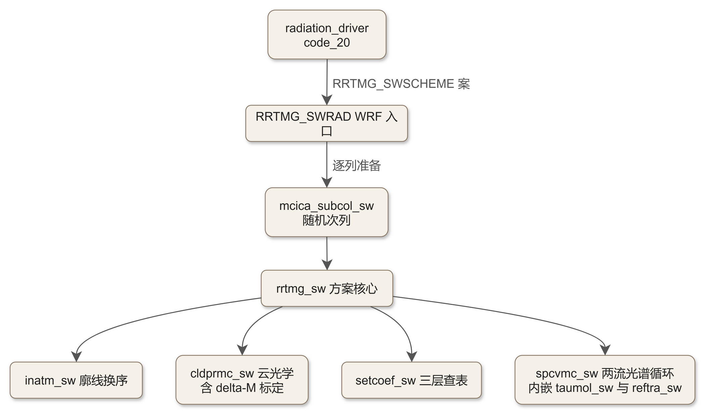
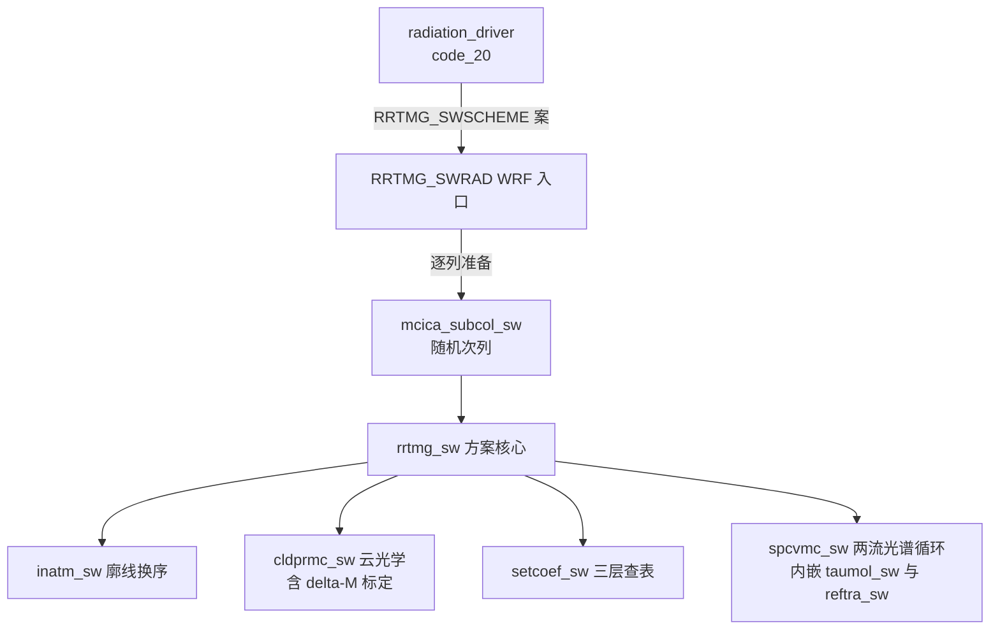

# code_06 — RRTMG 短波辐射方案（module_ra_rrtmg_sw.F：两流传输与 delta-Eddington 标定）

## 一、版本指纹

| 源文件 | 行数 | md5（整文件，按字节） |
|---|---|---|
| phys/module_ra_rrtmg_sw.F | 12786 | 2497d05912baf2e3a0e9c43bd874dd48 |

- 抽取工具：workspace/scripts/code_extract.py v1.2（扫描器支持 CONTAINS 嵌套），2026-10-12；块首指纹注释自带 range_md5。
- 收录分级（B）：主链五件（rrtmg_sw 全文、RRTMG_SWRAD 三段、cldprmc_sw 尾段、taumol_sw 头段+taumol16、spcvmc_sw 头段）+ swaerpr 全文；62 单元的分组总表见 §九。教材锚点：[ch12_radiation_family.md](../ch12_radiation_family.md)。

## 二、定位

一句话：**AER 的 RRTMG 短波方案**——与 code_05 长波同谱系：14 波段 k 分布 + g 点 224 缩减到 112 + McICA 随机次格云，但传输换成 **Barker 两流**（delta-Eddington 标定），且短波有散射——云与气溶胶都要给单次散射反照率与不对称因子。**模块级依赖：本文件不带 parkind，`use parkind` 从 module_ra_rrtmg_lw.F 导入**（LW 必须先编译）。

**谁在调它**：radiation_driver 的 CASE (RRTMG_SWSCHEME)（[code_20_module_radiation_driver.md](code_20_module_radiation_driver.md) §七），且先经 calc_aerosol_rrtmg_sw（[code_60_module_ra_aerosol.md](code_60_module_ra_aerosol.md)）备好 14 波段气溶胶光学。

**62 单元分组总表**（扫描器输出）：

| 组 | 单元 | 行段 | 说明 |
|---|---|---|---|
| 方案核心 | rrtmg_sw / inatm_sw | L8856–L10005 | 核心编排 / 廓线换序 |
| WRF 入口 | RRTMG_SWRAD / rrtmg_swinit / rrtmg_swlookuptable | L10034–L11694 | 逐列准备与调核心 |
| MCICA 群 | mcica_subcol_sw / generate_stochastic_clouds_sw / kissvec | L1395–L2040 | 随机次列（与 LW 同源） |
| 云光学 | cldprmc_sw | L2077–L2498 | 含散射三参数 + delta-M 标定 |
| 传输 | reftra_sw / spcvmc_sw / vrtqdr_sw | L2530–L2810, L8196–L8774, L8035–L8159 | 快速传输 / 两流光谱循环 / 垂直求积 |
| 廓线准备 | setcoef_sw / swatmref | L2843–L3156 | 三层结构（tropopause/switch/low） |
| 气溶胶 | swaerpr | L5032–L5132 | ECMWF 六类谱带光学 |
| 气体吸收 | taumol_sw（含 taumol16..taumol29） | L3190–L4653 | 14 波段光学深度 |
| 初始化 | rrtmg_sw_ini / swdatinit / swcmbdat | L4684–L5029 | k 系数装填与 g 点缩减 |
| 非 McICA 云 | swcldpr | L6181–L8004 | **休眠**（同 LW 的 lwcldpr） |
| g 点缩减 | cmbgb16s..cmbgb29 | L5135–L6178 | 224→112 逐波段重排 |
| k 系数 | sw_kgb16..sw_kgb29 | L11714–L12781 | 逐波段 k 分布系数（纯数据） |



<details><summary>原始 Mermaid 源码（可点击展开）</summary>

<!--

-->

</details>

## 三、文件头：parrrsw

<!-- code_extract code_extract.py v1.2
source: phys/module_ra_rrtmg_sw.F
ranges: L1-L117
file_lines: 12786
file_md5: 2497d05912baf2e3a0e9c43bd874dd48
display: line-numbered (strip L-prefix and !file: line to restore)
range_md5: aa32225117d9227d8797ca07d23ed50c
seg_lines: 117
-->

```fortran
!file: phys/module_ra_rrtmg_sw.F    L1-L117
L00001  !!MODULE module_ra_rrtmg_sw
L00002                  
L00003        module parrrsw
L00004  
L00005        use parkind ,only : im => kind_im, rb => kind_rb
L00006  
L00007  !     implicit none
L00008        save
L00009  
L00010  !------------------------------------------------------------------
L00011  ! rrtmg_sw main parameters
L00012  !
L00013  ! Initial version:  JJMorcrette, ECMWF, jul1998
L00014  ! Revised: MJIacono, AER, jun2006
L00015  ! Revised: MJIacono, AER, aug2008
L00016  !------------------------------------------------------------------
L00017  
L00018  !  name     type     purpose
L00019  ! -----  :  ----   : ----------------------------------------------
L00020  ! mxlay  :  integer: maximum number of layers
L00021  ! mg     :  integer: number of original g-intervals per spectral band
L00022  ! nbndsw :  integer: number of spectral bands
L00023  ! naerec :  integer: number of aerosols (iaer=6, ecmwf aerosol option)
L00024  ! ngptsw :  integer: total number of reduced g-intervals for rrtmg_lw
L00025  ! ngNN   :  integer: number of reduced g-intervals per spectral band
L00026  ! ngsNN  :  integer: cumulative number of g-intervals per band
L00027  !------------------------------------------------------------------
L00028  
L00029        integer(kind=im), parameter :: mxlay  = 203    !jplay, klev
L00030        integer(kind=im), parameter :: mg     = 16     !jpg
L00031        integer(kind=im), parameter :: nbndsw = 14     !jpsw, ksw
L00032        integer(kind=im), parameter :: naerec  = 6     !jpaer
L00033        integer(kind=im), parameter :: mxmol  = 38
L00034        integer(kind=im), parameter :: nstr   = 2
L00035        integer(kind=im), parameter :: nmol   = 7
L00036  ! Use for 112 g-point model   
L00037        integer(kind=im), parameter :: ngptsw = 112    !jpgpt
L00038  ! Use for 224 g-point model   
L00039  !      integer(kind=im), parameter :: ngptsw = 224   !jpgpt
L00040  
L00041  ! may need to rename these - from v2.6
L00042        integer(kind=im), parameter :: jpband   = 29
L00043        integer(kind=im), parameter :: jpb1     = 16   !istart
L00044        integer(kind=im), parameter :: jpb2     = 29   !iend
L00045  
L00046        integer(kind=im), parameter :: jmcmu    = 32
L00047        integer(kind=im), parameter :: jmumu    = 32
L00048        integer(kind=im), parameter :: jmphi    = 3
L00049        integer(kind=im), parameter :: jmxang   = 4
L00050        integer(kind=im), parameter :: jmxstr   = 16
L00051  
L00052  ! Use for 112 g-point model   
L00053        integer(kind=im), parameter :: ng16 = 6
L00054        integer(kind=im), parameter :: ng17 = 12
L00055        integer(kind=im), parameter :: ng18 = 8
L00056        integer(kind=im), parameter :: ng19 = 8
L00057        integer(kind=im), parameter :: ng20 = 10
L00058        integer(kind=im), parameter :: ng21 = 10
L00059        integer(kind=im), parameter :: ng22 = 2
L00060        integer(kind=im), parameter :: ng23 = 10
L00061        integer(kind=im), parameter :: ng24 = 8
L00062        integer(kind=im), parameter :: ng25 = 6
L00063        integer(kind=im), parameter :: ng26 = 6
L00064        integer(kind=im), parameter :: ng27 = 8
L00065        integer(kind=im), parameter :: ng28 = 6
L00066        integer(kind=im), parameter :: ng29 = 12
L00067  
L00068        integer(kind=im), parameter :: ngs16 = 6
L00069        integer(kind=im), parameter :: ngs17 = 18
L00070        integer(kind=im), parameter :: ngs18 = 26
L00071        integer(kind=im), parameter :: ngs19 = 34
L00072        integer(kind=im), parameter :: ngs20 = 44
L00073        integer(kind=im), parameter :: ngs21 = 54
L00074        integer(kind=im), parameter :: ngs22 = 56
L00075        integer(kind=im), parameter :: ngs23 = 66
L00076        integer(kind=im), parameter :: ngs24 = 74
L00077        integer(kind=im), parameter :: ngs25 = 80
L00078        integer(kind=im), parameter :: ngs26 = 86
L00079        integer(kind=im), parameter :: ngs27 = 94
L00080        integer(kind=im), parameter :: ngs28 = 100
L00081        integer(kind=im), parameter :: ngs29 = 112
L00082  
L00083  ! Use for 224 g-point model   
L00084  !      integer(kind=im), parameter :: ng16 = 16
L00085  !      integer(kind=im), parameter :: ng17 = 16
L00086  !      integer(kind=im), parameter :: ng18 = 16
L00087  !      integer(kind=im), parameter :: ng19 = 16
L00088  !      integer(kind=im), parameter :: ng20 = 16
L00089  !      integer(kind=im), parameter :: ng21 = 16
L00090  !      integer(kind=im), parameter :: ng22 = 16
L00091  !      integer(kind=im), parameter :: ng23 = 16
L00092  !      integer(kind=im), parameter :: ng24 = 16
L00093  !      integer(kind=im), parameter :: ng25 = 16
L00094  !      integer(kind=im), parameter :: ng26 = 16
L00095  !      integer(kind=im), parameter :: ng27 = 16
L00096  !      integer(kind=im), parameter :: ng28 = 16
L00097  !      integer(kind=im), parameter :: ng29 = 16
L00098  
L00099  !      integer(kind=im), parameter :: ngs16 = 16
L00100  !      integer(kind=im), parameter :: ngs17 = 32
L00101  !      integer(kind=im), parameter :: ngs18 = 48
L00102  !      integer(kind=im), parameter :: ngs19 = 64
L00103  !      integer(kind=im), parameter :: ngs20 = 80
L00104  !      integer(kind=im), parameter :: ngs21 = 96
L00105  !      integer(kind=im), parameter :: ngs22 = 112
L00106  !      integer(kind=im), parameter :: ngs23 = 128
L00107  !      integer(kind=im), parameter :: ngs24 = 144
L00108  !      integer(kind=im), parameter :: ngs25 = 160
L00109  !      integer(kind=im), parameter :: ngs26 = 176
L00110  !      integer(kind=im), parameter :: ngs27 = 192
L00111  !      integer(kind=im), parameter :: ngs28 = 208
L00112  !      integer(kind=im), parameter :: ngs29 = 224
L00113  
L00114  ! Source function solar constant
L00115        real(kind=rb), parameter :: rrsw_scon = 1.36822e+03     ! W/m2
L00116   
L00117        end module parrrsw
```

> 讲解：①**parrrsw 首行 use parkind**——本文件不定义 parkind，从 module_ra_rrtmg_lw.F 导入（编译顺序耦合）；②nbndsw=14 波段、波段编号 16–29（jpb1=16 起算——短波的「第 1 波段」全局编号是 16，k 系数表 sw_kgb16..29 与 taumol16..29 沿用全局号）、**ngptsw=112**（224 备选注释）、ng16..ng29 每波段 g 点数（合计 112）、ngs 累积表；③jmcmu/jmumu=32×32 角积分网格、jmphi=3（两流的离散角度参数，reftra 用）；④**rrsw_scon=1368.22 W/m²**——RRTMG 内置太阳常数（solvar 缩放的基准），而 radiation_driver 的 radconst 用 1370·ECCFAC——**两套太阳常数口径并存**（1368.22 vs 1370，教材 ch12 的 Qd 口径讨论在此落地）。

## 四、方案核心 rrtmg_sw（全文）

<!-- code_extract code_extract.py v1.2
source: phys/module_ra_rrtmg_sw.F
ranges: L8856-L9622
file_lines: 12786
file_md5: 2497d05912baf2e3a0e9c43bd874dd48
display: line-numbered (strip L-prefix and !file: line to restore)
range_md5: 021b93f6dbd54a041966d229e6456586
seg_lines: 767
label: subroutine rrtmg_sw
-->

```fortran
!file: phys/module_ra_rrtmg_sw.F    L8856-L9622    (subroutine rrtmg_sw)
L08856        subroutine rrtmg_sw &
L08857              (ncol    ,nlay    ,icld    , &
L08858               play    ,plev    ,tlay    ,tlev    ,tsfc   , &
L08859               h2ovmr , o3vmr   ,co2vmr  ,ch4vmr  ,n2ovmr ,o2vmr , &
L08860               asdir   ,asdif   ,aldir   ,aldif   , &
L08861               coszen  ,adjes   ,dyofyr  ,scon    , &
L08862               inflgsw ,iceflgsw,liqflgsw,cldfmcl , &
L08863               taucmcl ,ssacmcl ,asmcmcl ,fsfcmcl , &
L08864               ciwpmcl ,clwpmcl ,cswpmcl ,reicmcl ,relqmcl ,resnmcl, &
L08865               tauaer  ,ssaaer  ,asmaer  ,ecaer   , &
L08866               swuflx  ,swdflx  ,swhr    ,swuflxc ,swdflxc ,swhrc, swuflxcln ,swdflxcln , aer_opt,  &
L08867  ! --------- Add the following four compenants for ssib shortwave down radiation ---!
L08868  ! -------------------      by Zhenxin 2011-06-20      --------------------------------!
L08869               sibvisdir, sibvisdif, sibnirdir, sibnirdif,         &
L08870  ! ----------------------  End,  Zhenxin 2011-06-20    --------------------------------!
L08871               swdkdir,swdkdif,                               & ! jararias, 2013/08/10
L08872               swdkdirc,                                      & ! PAJ
L08873               calc_clean_atm_diag,                           &
L08874               sw_zbbcddir, sw_dirdflux, sw_difdflux          & ! WRF-CMAQ twoway coupled model
L08875                                                                  )
L08876  
L08877  
L08878  ! ------- Description -------
L08879  
L08880  ! This program is the driver for RRTMG_SW, the AER SW radiation model for 
L08881  !  application to GCMs, that has been adapted from RRTM_SW for improved
L08882  !  efficiency and to provide fractional cloudiness and cloud overlap
L08883  !  capability using McICA.
L08884  !
L08885  ! Note: The call to RRTMG_SW_INI should be moved to the GCM initialization 
L08886  !  area, since this has to be called only once. 
L08887  !
L08888  ! This routine
L08889  !    b) calls INATM_SW to read in the atmospheric profile;
L08890  !       all layering in RRTMG is ordered from surface to toa. 
L08891  !    c) calls CLDPRMC_SW to set cloud optical depth for McICA based
L08892  !       on input cloud properties
L08893  !    d) calls SETCOEF_SW to calculate various quantities needed for 
L08894  !       the radiative transfer algorithm
L08895  !    e) calls SPCVMC to call the two-stream model that in turn 
L08896  !       calls TAUMOL to calculate gaseous optical depths for each 
L08897  !       of the 16 spectral bands and to perform the radiative transfer
L08898  !       using McICA, the Monte-Carlo Independent Column Approximation,
L08899  !       to represent sub-grid scale cloud variability
L08900  !    f) passes the calculated fluxes and cooling rates back to GCM
L08901  !
L08902  ! Two modes of operation are possible:
L08903  !     The mode is chosen by using either rrtmg_sw.nomcica.f90 (to not use
L08904  !     McICA) or rrtmg_sw.f90 (to use McICA) to interface with a GCM.
L08905  !
L08906  !    1) Standard, single forward model calculation (imca = 0); this is 
L08907  !       valid only for clear sky or fully overcast clouds
L08908  !    2) Monte Carlo Independent Column Approximation (McICA, Pincus et al., 
L08909  !       JC, 2003) method is applied to the forward model calculation (imca = 1)
L08910  !       This method is valid for clear sky or partial cloud conditions.
L08911  !
L08912  ! This call to RRTMG_SW must be preceeded by a call to the module
L08913  !     mcica_subcol_gen_sw.f90 to run the McICA sub-column cloud generator,
L08914  !     which will provide the cloud physical or cloud optical properties
L08915  !     on the RRTMG quadrature point (ngptsw) dimension.
L08916  !
L08917  ! Two methods of cloud property input are possible:
L08918  !     Cloud properties can be input in one of two ways (controlled by input 
L08919  !     flags inflag, iceflag and liqflag; see text file rrtmg_sw_instructions
L08920  !     and subroutine rrtmg_sw_cldprop.f90 for further details):
L08921  !
L08922  !    1) Input cloud fraction, cloud optical depth, single scattering albedo 
L08923  !       and asymmetry parameter directly (inflgsw = 0)
L08924  !    2) Input cloud fraction and cloud physical properties: ice fracion,
L08925  !       ice and liquid particle sizes (inflgsw = 1 or 2);  
L08926  !       cloud optical properties are calculated by cldprop or cldprmc based
L08927  !       on input settings of iceflgsw and liqflgsw
L08928  !
L08929  ! Two methods of aerosol property input are possible:
L08930  !     Aerosol properties can be input in one of two ways (controlled by input 
L08931  !     flag iaer, see text file rrtmg_sw_instructions for further details):
L08932  !
L08933  !    1) Input aerosol optical depth, single scattering albedo and asymmetry
L08934  !       parameter directly by layer and spectral band (iaer=10)
L08935  !    2) Input aerosol optical depth and 0.55 micron directly by layer and use
L08936  !       one or more of six ECMWF aerosol types (iaer=6)
L08937  !
L08938  !
L08939  ! ------- Modifications -------
L08940  !
L08941  ! This version of RRTMG_SW has been modified from RRTM_SW to use a reduced
L08942  ! set of g-point intervals and a two-stream model for application to GCMs. 
L08943  !
L08944  !-- Original version (derived from RRTM_SW)
L08945  !     2002: AER. Inc.
L08946  !-- Conversion to F90 formatting; addition of 2-stream radiative transfer
L08947  !     Feb 2003: J.-J. Morcrette, ECMWF
L08948  !-- Additional modifications for GCM application
L08949  !     Aug 2003: M. J. Iacono, AER Inc.
L08950  !-- Total number of g-points reduced from 224 to 112.  Original
L08951  !   set of 224 can be restored by exchanging code in module parrrsw.f90 
L08952  !   and in file rrtmg_sw_init.f90.
L08953  !     Apr 2004: M. J. Iacono, AER, Inc.
L08954  !-- Modifications to include output for direct and diffuse 
L08955  !   downward fluxes.  There are output as "true" fluxes without
L08956  !   any delta scaling applied.  Code can be commented to exclude
L08957  !   this calculation in source file rrtmg_sw_spcvrt.f90.
L08958  !     Jan 2005: E. J. Mlawer, M. J. Iacono, AER, Inc.
L08959  !-- Revised to add McICA capability.
L08960  !     Nov 2005: M. J. Iacono, AER, Inc.
L08961  !-- Reformatted for consistency with rrtmg_lw.
L08962  !     Feb 2007: M. J. Iacono, AER, Inc.
L08963  !-- Modifications to formatting to use assumed-shape arrays. 
L08964  !     Aug 2007: M. J. Iacono, AER, Inc.
L08965  
L08966  ! --------- Modules ---------
L08967  
L08968        use parrrsw, only : nbndsw, ngptsw, naerec, nstr, nmol, mxmol, &
L08969                            jpband, jpb1, jpb2
L08970        use rrsw_aer, only : rsrtaua, rsrpiza, rsrasya
L08971        use rrsw_con, only : heatfac, oneminus, pi
L08972        use rrsw_wvn, only : wavenum1, wavenum2
L08973  
L08974  ! ------- Declarations
L08975  
L08976  ! ----- Input -----
L08977  
L08978        integer(kind=im), intent(in) :: ncol            ! Number of horizontal columns     
L08979        integer(kind=im), intent(in) :: nlay            ! Number of model layers
L08980        integer(kind=im), intent(inout) :: icld         ! Cloud overlap method
L08981                                                        !    0: Clear only
L08982                                                        !    1: Random
L08983                                                        !    2: Maximum/random
L08984                                                        !    3: Maximum
L08985                                                        !    4: Exponential
L08986                                                        !    5: Exponential/random
L08987        real(kind=rb), intent(in) :: play(:,:)          ! Layer pressures (hPa, mb)
L08988                                                        !    Dimensions: (ncol,nlay)
L08989        real(kind=rb), intent(in) :: plev(:,:)          ! Interface pressures (hPa, mb)
L08990                                                        !    Dimensions: (ncol,nlay+1)
L08991        real(kind=rb), intent(in) :: tlay(:,:)          ! Layer temperatures (K)
L08992                                                        !    Dimensions: (ncol,nlay)
L08993        real(kind=rb), intent(in) :: tlev(:,:)          ! Interface temperatures (K)
L08994                                                        !    Dimensions: (ncol,nlay+1)
L08995        real(kind=rb), intent(in) :: tsfc(:)            ! Surface temperature (K)
L08996                                                        !    Dimensions: (ncol)
L08997        real(kind=rb), intent(in) :: h2ovmr(:,:)        ! H2O volume mixing ratio
L08998                                                        !    Dimensions: (ncol,nlay)
L08999        real(kind=rb), intent(in) :: o3vmr(:,:)         ! O3 volume mixing ratio
L09000                                                        !    Dimensions: (ncol,nlay)
L09001        real(kind=rb), intent(in) :: co2vmr(:,:)        ! CO2 volume mixing ratio
L09002                                                        !    Dimensions: (ncol,nlay)
L09003        real(kind=rb), intent(in) :: ch4vmr(:,:)        ! Methane volume mixing ratio
L09004                                                        !    Dimensions: (ncol,nlay)
L09005        real(kind=rb), intent(in) :: n2ovmr(:,:)        ! Nitrous oxide volume mixing ratio
L09006                                                        !    Dimensions: (ncol,nlay)
L09007        real(kind=rb), intent(in) :: o2vmr(:,:)         ! Oxygen volume mixing ratio
L09008                                                        !    Dimensions: (ncol,nlay)
L09009        real(kind=rb), intent(in) :: asdir(:)           ! UV/vis surface albedo direct rad
L09010                                                        !    Dimensions: (ncol)
L09011        real(kind=rb), intent(in) :: aldir(:)           ! Near-IR surface albedo direct rad
L09012                                                        !    Dimensions: (ncol)
L09013        real(kind=rb), intent(in) :: asdif(:)           ! UV/vis surface albedo: diffuse rad
L09014                                                        !    Dimensions: (ncol)
L09015        real(kind=rb), intent(in) :: aldif(:)           ! Near-IR surface albedo: diffuse rad
L09016                                                        !    Dimensions: (ncol)
L09017  
L09018        integer(kind=im), intent(in) :: dyofyr          ! Day of the year (used to get Earth/Sun
L09019                                                        !  distance if adjflx not provided)
L09020        real(kind=rb), intent(in) :: adjes              ! Flux adjustment for Earth/Sun distance
L09021        real(kind=rb), intent(in) :: coszen(:)          ! Cosine of solar zenith angle
L09022                                                        !    Dimensions: (ncol)
L09023        real(kind=rb), intent(in) :: scon               ! Solar constant (W/m2)
L09024  
L09025        integer(kind=im), intent(in) :: inflgsw         ! Flag for cloud optical properties
L09026        integer(kind=im), intent(in) :: iceflgsw        ! Flag for ice particle specification
L09027        integer(kind=im), intent(in) :: liqflgsw        ! Flag for liquid droplet specification
L09028  
L09029        real(kind=rb), intent(in) :: cldfmcl(:,:,:)     ! Cloud fraction
L09030                                                        !    Dimensions: (ngptsw,ncol,nlay)
L09031        real(kind=rb), intent(in) :: taucmcl(:,:,:)     ! In-cloud optical depth
L09032                                                        !    Dimensions: (ngptsw,ncol,nlay)
L09033        real(kind=rb), intent(in) :: ssacmcl(:,:,:)     ! In-cloud single scattering albedo
L09034                                                        !    Dimensions: (ngptsw,ncol,nlay)
L09035        real(kind=rb), intent(in) :: asmcmcl(:,:,:)     ! In-cloud asymmetry parameter
L09036                                                        !    Dimensions: (ngptsw,ncol,nlay)
L09037        real(kind=rb), intent(in) :: fsfcmcl(:,:,:)     ! In-cloud forward scattering fraction
L09038                                                        !    Dimensions: (ngptsw,ncol,nlay)
L09039        real(kind=rb), intent(in) :: ciwpmcl(:,:,:)     ! In-cloud ice water path (g/m2)
L09040                                                        !    Dimensions: (ngptsw,ncol,nlay)
L09041        real(kind=rb), intent(in) :: clwpmcl(:,:,:)     ! In-cloud liquid water path (g/m2)
L09042                                                        !    Dimensions: (ngptsw,ncol,nlay)
L09043        real(kind=rb), intent(in) :: cswpmcl(:,:,:)     ! In-cloud snow water path (g/m2)
L09044                                                        !    Dimensions: (ngptsw,ncol,nlay)
L09045        real(kind=rb), intent(in) :: reicmcl(:,:)       ! Cloud ice effective radius (microns)
L09046                                                        !    Dimensions: (ncol,nlay)
L09047                                                        ! specific definition of reicmcl depends on setting of iceflglw:
L09048                                                        ! iceflglw = 0: ice effective radius, r_ec, (Ebert and Curry, 1992),
L09049                                                        !               r_ec must be >= 10.0 microns
L09050                                                        ! iceflglw = 1: ice effective radius, r_ec, (Ebert and Curry, 1992),
L09051                                                        !               r_ec range is limited to 13.0 to 130.0 microns
L09052                                                        ! iceflglw = 2: ice effective radius, r_k, (Key, Streamer Ref. Manual, 1996)
L09053                                                        !               r_k range is limited to 5.0 to 131.0 microns
L09054                                                        ! iceflglw = 3: generalized effective size, dge, (Fu, 1996),
L09055                                                        !               dge range is limited to 5.0 to 140.0 microns
L09056                                                        !               [dge = 1.0315 * r_ec]
L09057        real(kind=rb), intent(in) :: relqmcl(:,:)       ! Cloud water drop effective radius (microns)
L09058                                                        !    Dimensions: (ncol,nlay)
L09059        real(kind=rb), intent(in) :: resnmcl(:,:)       ! Cloud snow effective radius (microns)
L09060                                                        !    Dimensions: (ncol,nlay)
L09061        real(kind=rb), intent(in) :: tauaer(:,:,:)      ! Aerosol optical depth (iaer=10 only)
L09062                                                        !    Dimensions: (ncol,nlay,nbndsw)
L09063                                                        ! (non-delta scaled)      
L09064        real(kind=rb), intent(in) :: ssaaer(:,:,:)      ! Aerosol single scattering albedo (iaer=10 only)
L09065                                                        !    Dimensions: (ncol,nlay,nbndsw)
L09066                                                        ! (non-delta scaled)      
L09067        real(kind=rb), intent(in) :: asmaer(:,:,:)      ! Aerosol asymmetry parameter (iaer=10 only)
L09068                                                        !    Dimensions: (ncol,nlay,nbndsw)
L09069                                                        ! (non-delta scaled)      
L09070        real(kind=rb), intent(in) :: ecaer(:,:,:)       ! Aerosol optical depth at 0.55 micron (iaer=6 only)
L09071                                                        !    Dimensions: (ncol,nlay,naerec)
L09072                                                        ! (non-delta scaled)      
L09073        integer, intent(in)       :: calc_clean_atm_diag! Control for clean air diagnositic calls for WRF-Chem
L09074  
L09075  ! ----- Output -----
L09076  
L09077        real(kind=rb), intent(out) :: swuflx(:,:)       ! Total sky shortwave upward flux (W/m2)
L09078                                                        !    Dimensions: (ncol,nlay+1)
L09079        real(kind=rb), intent(out) :: swdflx(:,:)       ! Total sky shortwave downward flux (W/m2)
L09080                                                        !    Dimensions: (ncol,nlay+1)
L09081        real(kind=rb), intent(out) :: sibvisdir(:,:)    ! visible direct downward flux  (W/m2)
L09082                                                        !    Dimensions: (ncol,nlay+1) Zhenxin (2011/06/20)
L09083        real(kind=rb), intent(out) :: sibvisdif(:,:)    ! visible diffusion downward flux  (W/m2)
L09084                                                        !    Dimensions: (ncol,nlay+1) Zhenxin (2011/06/20)
L09085        real(kind=rb), intent(out) :: sibnirdir(:,:)    ! Near IR direct downward flux  (W/m2)
L09086                                                        !    Dimensions: (ncol,nlay+1)  Zhenxin (2011/06/20)
L09087        real(kind=rb), intent(out) :: sibnirdif(:,:)    ! Near IR diffusion downward flux  (W/m2)
L09088                                                        !    Dimensions: (ncol,nlay+1) Zhenxin (2011/06/20)
L09089        real(kind=rb), intent(out) :: swhr(:,:)         ! Total sky shortwave radiative heating rate (K/d)
L09090                                                        !    Dimensions: (ncol,nlay)
L09091        real(kind=rb), intent(out) :: swuflxc(:,:)      ! Clear sky shortwave upward flux (W/m2)
L09092                                                        !    Dimensions: (ncol,nlay+1)
L09093        real(kind=rb), intent(out) :: swdflxc(:,:)      ! Clear sky shortwave downward flux (W/m2)
L09094                                                        !    Dimensions: (ncol,nlay+1)
L09095        real(kind=rb), intent(out) :: swhrc(:,:)        ! Clear sky shortwave radiative heating rate (K/d)
L09096                                                        !    Dimensions: (ncol,nlay)
L09097        real(kind=rb), intent(out) :: swuflxcln(:,:)    ! Clean sky shortwave upward flux (W/m2)
L09098                                                        !    Dimensions: (ncol,nlay+1)
L09099        real(kind=rb), intent(out) :: swdflxcln(:,:)    ! Clean sky shortwave downward flux (W/m2)
L09100                                                        !    Dimensions: (ncol,nlay+1)
L09101  
L09102        integer, intent(in)        :: aer_opt
L09103        real(kind=rb), intent(out) :: &
L09104          swdkdir(:,:), & ! Total shortwave downward direct flux (W/m2),  Dimensions: (ncol,nlay) jararias, 2013/08/10
L09105          swdkdif(:,:), & ! Total shortwave downward diffuse flux (W/m2), Dimensions: (ncol,nlay) jararias, 2013/08/10
L09106          swdkdirc(:,:)   ! Total shortwave downward direct flux clear sky (W/m2),  Dimensions: (ncol,nlay)
L09107  
L09108        real, intent(out) :: sw_zbbcddir,   &  ! WRF-CMAQ twoway coupled model
L09109                             sw_dirdflux,   &  ! WRF-CMAQ twoway coupled model
L09110                             sw_difdflux       ! WRF-CMAQ twoway coupled model
L09111  
L09112  
L09113  
L09114  
L09115  
L09116  ! ----- Local -----
L09117  
L09118  ! Control
L09119        integer(kind=im) :: nlayers             ! total number of layers
L09120        integer(kind=im) :: istart              ! beginning band of calculation
L09121        integer(kind=im) :: iend                ! ending band of calculation
L09122        integer(kind=im) :: icpr                ! cldprop/cldprmc use flag
L09123        integer(kind=im) :: iout                ! output option flag (inactive)
L09124        integer(kind=im) :: iaer                ! aerosol option flag
L09125        integer(kind=im) :: idelm               ! delta-m scaling flag (inactive)
L09126        integer(kind=im) :: isccos              ! instrumental cosine response flag (inactive)
L09127        integer(kind=im) :: iplon               ! column loop index
L09128        integer(kind=im) :: i                   ! layer loop index                       ! jk
L09129        integer(kind=im) :: ib                  ! band loop index                        ! jsw
L09130        integer(kind=im) :: ia, ig              ! indices
L09131        integer(kind=im) :: k                   ! layer loop index
L09132        integer(kind=im) :: ims                 ! value for changing mcica permute seed
L09133        integer(kind=im) :: imca                ! flag for mcica [0=off, 1=on]
L09134  
L09135        real(kind=rb) :: zepsec, zepzen         ! epsilon
L09136        real(kind=rb) :: zdpgcp                 ! flux to heating conversion ratio
L09137  
L09138  ! Atmosphere
L09139        real(kind=rb) :: pavel(nlay+1)          ! layer pressures (mb) 
L09140        real(kind=rb) :: tavel(nlay+1)          ! layer temperatures (K)
L09141        real(kind=rb) :: pz(0:nlay+1)           ! level (interface) pressures (hPa, mb)
L09142        real(kind=rb) :: tz(0:nlay+1)           ! level (interface) temperatures (K)
L09143        real(kind=rb) :: tbound                 ! surface temperature (K)
L09144        real(kind=rb) :: pdp(nlay+1)            ! layer pressure thickness (hPa, mb)
L09145        real(kind=rb) :: coldry(nlay+1)         ! dry air column amount
L09146        real(kind=rb) :: wkl(mxmol,nlay+1)      ! molecular amounts (mol/cm-2)
L09147  
L09148  !      real(kind=rb) :: earth_sun             ! function for Earth/Sun distance factor
L09149        real(kind=rb) :: cossza                 ! Cosine of solar zenith angle
L09150        real(kind=rb) :: adjflux(jpband)        ! adjustment for current Earth/Sun distance
L09151        real(kind=rb) :: solvar(jpband)         ! solar constant scaling factor from rrtmg_sw
L09152                                                !  default value of 1368.22 Wm-2 at 1 AU
L09153        real(kind=rb) :: albdir(nbndsw)         ! surface albedo, direct          ! zalbp
L09154        real(kind=rb) :: albdif(nbndsw)         ! surface albedo, diffuse         ! zalbd
L09155  
L09156        real(kind=rb) :: taua(nlay+1,nbndsw)    ! Aerosol optical depth
L09157        real(kind=rb) :: ssaa(nlay+1,nbndsw)    ! Aerosol single scattering albedo
L09158        real(kind=rb) :: asma(nlay+1,nbndsw)    ! Aerosol asymmetry parameter
L09159  
L09160  ! Atmosphere - setcoef
L09161        integer(kind=im) :: laytrop             ! tropopause layer index
L09162        integer(kind=im) :: layswtch            ! tropopause layer index
L09163        integer(kind=im) :: laylow              ! tropopause layer index
L09164        integer(kind=im) :: jp(nlay+1)          ! 
L09165        integer(kind=im) :: jt(nlay+1)          !
L09166        integer(kind=im) :: jt1(nlay+1)         !
L09167  
L09168        real(kind=rb) :: colh2o(nlay+1)         ! column amount (h2o)
L09169        real(kind=rb) :: colco2(nlay+1)         ! column amount (co2)
L09170        real(kind=rb) :: colo3(nlay+1)          ! column amount (o3)
L09171        real(kind=rb) :: coln2o(nlay+1)         ! column amount (n2o)
L09172        real(kind=rb) :: colch4(nlay+1)         ! column amount (ch4)
L09173        real(kind=rb) :: colo2(nlay+1)          ! column amount (o2)
L09174        real(kind=rb) :: colmol(nlay+1)         ! column amount
L09175        real(kind=rb) :: co2mult(nlay+1)        ! column amount 
L09176  
L09177        integer(kind=im) :: indself(nlay+1)
L09178        integer(kind=im) :: indfor(nlay+1)
L09179        real(kind=rb) :: selffac(nlay+1)
L09180        real(kind=rb) :: selffrac(nlay+1)
L09181        real(kind=rb) :: forfac(nlay+1)
L09182        real(kind=rb) :: forfrac(nlay+1)
L09183  
L09184        real(kind=rb) :: &                      !
L09185                           fac00(nlay+1), fac01(nlay+1), &
L09186                           fac10(nlay+1), fac11(nlay+1) 
L09187  
L09188  ! Atmosphere/clouds - cldprop
L09189        integer(kind=im) :: ncbands             ! number of cloud spectral bands
L09190        integer(kind=im) :: inflag              ! flag for cloud property method
L09191        integer(kind=im) :: iceflag             ! flag for ice cloud properties
L09192        integer(kind=im) :: liqflag             ! flag for liquid cloud properties
L09193  
L09194  !      real(kind=rb) :: cldfrac(nlay+1)        ! layer cloud fraction
L09195  !      real(kind=rb) :: tauc(nlay+1)           ! in-cloud optical depth (non-delta scaled)
L09196  !      real(kind=rb) :: ssac(nlay+1)           ! in-cloud single scattering albedo (non-delta scaled)
L09197  !      real(kind=rb) :: asmc(nlay+1)           ! in-cloud asymmetry parameter (non-delta scaled)
L09198  !      real(kind=rb) :: fsfc(nlay+1)           ! in-cloud forward scattering fraction (non-delta scaled)
L09199  !      real(kind=rb) :: ciwp(nlay+1)           ! in-cloud ice water path
L09200  !      real(kind=rb) :: clwp(nlay+1)           ! in-cloud liquid water path
L09201  !      real(kind=rb) :: rei(nlay+1)            ! cloud ice particle size
L09202  !      real(kind=rb) :: rel(nlay+1)            ! cloud liquid particle size
L09203  
L09204  !      real(kind=rb) :: taucloud(nlay+1,jpband)  ! in-cloud optical depth
L09205  !      real(kind=rb) :: taucldorig(nlay+1,jpband)! in-cloud optical depth (non-delta scaled)
L09206  !      real(kind=rb) :: ssacloud(nlay+1,jpband)  ! in-cloud single scattering albedo
L09207  !      real(kind=rb) :: asmcloud(nlay+1,jpband)  ! in-cloud asymmetry parameter
L09208  
L09209  ! Atmosphere/clouds - cldprmc [mcica]
L09210        real(kind=rb) :: cldfmc(ngptsw,nlay+1)    ! cloud fraction [mcica]
L09211        real(kind=rb) :: ciwpmc(ngptsw,nlay+1)    ! in-cloud ice water path [mcica]
L09212        real(kind=rb) :: clwpmc(ngptsw,nlay+1)    ! in-cloud liquid water path [mcica]
L09213        real(kind=rb) :: cswpmc(ngptsw,nlay+1)    ! in-cloud snow water path [mcica]
L09214        real(kind=rb) :: relqmc(nlay+1)           ! liquid particle effective radius (microns)
L09215        real(kind=rb) :: reicmc(nlay+1)           ! ice particle effective size (microns)
L09216        real(kind=rb) :: resnmc(nlay+1)           ! snow particle effective size (microns)
L09217        real(kind=rb) :: taucmc(ngptsw,nlay+1)    ! in-cloud optical depth [mcica]
L09218        real(kind=rb) :: taormc(ngptsw,nlay+1)    ! unscaled in-cloud optical depth [mcica]
L09219        real(kind=rb) :: ssacmc(ngptsw,nlay+1)    ! in-cloud single scattering albedo [mcica]
L09220        real(kind=rb) :: asmcmc(ngptsw,nlay+1)    ! in-cloud asymmetry parameter [mcica]
L09221        real(kind=rb) :: fsfcmc(ngptsw,nlay+1)    ! in-cloud forward scattering fraction [mcica]
L09222  
L09223  ! Atmosphere/clouds/aerosol - spcvrt,spcvmc
L09224        real(kind=rb) :: ztauc(nlay+1,nbndsw)     ! cloud optical depth
L09225        real(kind=rb) :: ztaucorig(nlay+1,nbndsw) ! unscaled cloud optical depth
L09226        real(kind=rb) :: zasyc(nlay+1,nbndsw)     ! cloud asymmetry parameter 
L09227                                                  !  (first moment of phase function)
L09228        real(kind=rb) :: zomgc(nlay+1,nbndsw)     ! cloud single scattering albedo
L09229        real(kind=rb) :: ztaua(nlay+1,nbndsw)     ! total aerosol optical depth
L09230        real(kind=rb) :: ztauacln(nlay+1,nbndsw)  ! dummy total aerosol optical depth for clean case (=zero)
L09231        real(kind=rb) :: zasya(nlay+1,nbndsw)     ! total aerosol asymmetry parameter 
L09232        real(kind=rb) :: zomga(nlay+1,nbndsw)     ! total aerosol single scattering albedo
L09233  
L09234        real(kind=rb) :: zcldfmc(nlay+1,ngptsw)   ! cloud fraction [mcica]
L09235        real(kind=rb) :: ztaucmc(nlay+1,ngptsw)   ! cloud optical depth [mcica]
L09236        real(kind=rb) :: ztaormc(nlay+1,ngptsw)   ! unscaled cloud optical depth [mcica]
L09237        real(kind=rb) :: zasycmc(nlay+1,ngptsw)   ! cloud asymmetry parameter [mcica] 
L09238        real(kind=rb) :: zomgcmc(nlay+1,ngptsw)   ! cloud single scattering albedo [mcica]
L09239  
L09240        real(kind=rb) :: zbbfu(nlay+2)          ! temporary upward shortwave flux (w/m2)
L09241        real(kind=rb) :: zbbfd(nlay+2)          ! temporary downward shortwave flux (w/m2)
L09242        real(kind=rb) :: zbbcu(nlay+2)          ! temporary clear sky upward shortwave flux (w/m2)
L09243        real(kind=rb) :: zbbcd(nlay+2)          ! temporary clear sky downward shortwave flux (w/m2)
L09244        real(kind=rb) :: zbbfddir(nlay+2)       ! temporary downward direct shortwave flux (w/m2)
L09245        real(kind=rb) :: zbbcddir(nlay+2)       ! temporary clear sky downward direct shortwave flux (w/m2)
L09246        real(kind=rb) :: zuvfd(nlay+2)          ! temporary UV downward shortwave flux (w/m2)
L09247        real(kind=rb) :: zuvcd(nlay+2)          ! temporary clear sky UV downward shortwave flux (w/m2)
L09248        real(kind=rb) :: zuvfddir(nlay+2)       ! temporary UV downward direct shortwave flux (w/m2)
L09249        real(kind=rb) :: zuvcddir(nlay+2)       ! temporary clear sky UV downward direct shortwave flux (w/m2)
L09250        real(kind=rb) :: znifd(nlay+2)          ! temporary near-IR downward shortwave flux (w/m2)
L09251        real(kind=rb) :: znicd(nlay+2)          ! temporary clear sky near-IR downward shortwave flux (w/m2)
L09252        real(kind=rb) :: znifddir(nlay+2)       ! temporary near-IR downward direct shortwave flux (w/m2)
L09253        real(kind=rb) :: znicddir(nlay+2)       ! temporary clear sky near-IR downward direct shortwave flux (w/m2)
L09254        real(kind=rb) :: zbbclnu(nlay+2)        ! temporary clean sky upward shortwave flux (w/m2)
L09255        real(kind=rb) :: zbbclnd(nlay+2)        ! temporary clean sky downward shortwave flux (w/m2)
L09256        real(kind=rb) :: zbbclnddir(nlay+2)     ! temporary clean sky downward direct shortwave flux (w/m2)
L09257        real(kind=rb) :: zuvclnd(nlay+2)        ! temporary clean sky UV downward shortwave flux (w/m2)
L09258        real(kind=rb) :: zuvclnddir(nlay+2)     ! temporary clean sky UV downward direct shortwave flux (w/m2)
L09259        real(kind=rb) :: zniclnd(nlay+2)        ! temporary clean sky near-IR downward shortwave flux (w/m2)
L09260        real(kind=rb) :: zniclnddir(nlay+2)     ! temporary clean sky near-IR downward direct shortwave flux (w/m2)
L09261  
L09262  ! Optional output fields 
L09263        real(kind=rb) :: swnflx(nlay+2)         ! Total sky shortwave net flux (W/m2)
L09264        real(kind=rb) :: swnflxc(nlay+2)        ! Clear sky shortwave net flux (W/m2)
L09265        real(kind=rb) :: dirdflux(nlay+2)       ! Direct downward shortwave surface flux
L09266        real(kind=rb) :: difdflux(nlay+2)       ! Diffuse downward shortwave surface flux
L09267        real(kind=rb) :: uvdflx(nlay+2)         ! Total sky downward shortwave flux, UV/vis  
L09268        real(kind=rb) :: nidflx(nlay+2)         ! Total sky downward shortwave flux, near-IR 
L09269        real(kind=rb) :: dirdnuv(nlay+2)        ! Direct downward shortwave flux, UV/vis
L09270        real(kind=rb) :: difdnuv(nlay+2)        ! Diffuse downward shortwave flux, UV/vis
L09271        real(kind=rb) :: dirdnir(nlay+2)        ! Direct downward shortwave flux, near-IR
L09272        real(kind=rb) :: difdnir(nlay+2)        ! Diffuse downward shortwave flux, near-IR
L09273  
L09274  ! Output - inactive
L09275  !      real(kind=rb) :: zuvfu(nlay+2)         ! temporary upward UV shortwave flux (w/m2)
L09276  !      real(kind=rb) :: zuvfd(nlay+2)         ! temporary downward UV shortwave flux (w/m2)
L09277  !      real(kind=rb) :: zuvcu(nlay+2)         ! temporary clear sky upward UV shortwave flux (w/m2)
L09278  !      real(kind=rb) :: zuvcd(nlay+2)         ! temporary clear sky downward UV shortwave flux (w/m2)
L09279  !      real(kind=rb) :: zvsfu(nlay+2)         ! temporary upward visible shortwave flux (w/m2)
L09280  !      real(kind=rb) :: zvsfd(nlay+2)         ! temporary downward visible shortwave flux (w/m2)
L09281  !      real(kind=rb) :: zvscu(nlay+2)         ! temporary clear sky upward visible shortwave flux (w/m2)
L09282  !      real(kind=rb) :: zvscd(nlay+2)         ! temporary clear sky downward visible shortwave flux (w/m2)
L09283  !      real(kind=rb) :: znifu(nlay+2)         ! temporary upward near-IR shortwave flux (w/m2)
L09284  !      real(kind=rb) :: znifd(nlay+2)         ! temporary downward near-IR shortwave flux (w/m2)
L09285  !      real(kind=rb) :: znicu(nlay+2)         ! temporary clear sky upward near-IR shortwave flux (w/m2)
L09286  !      real(kind=rb) :: znicd(nlay+2)         ! temporary clear sky downward near-IR shortwave flux (w/m2)
L09287  
L09288  
L09289  ! Initializations
L09290  
L09291        iout = 0 !BSINGH(PNNL) initializing iout to zero(Might be wrong!) as this variable is never initialized but used in spcvmc_sw
L09292        zepsec = 1.e-06_rb
L09293        zepzen = 1.e-10_rb
L09294  !jm not thread safe      oneminus = 1.0_rb - zepsec
L09295  !jm not thread safe      pi = 2._rb * asin(1._rb)
L09296  
L09297        istart = jpb1
L09298        iend = jpb2
L09299        icpr = 0
L09300        ims = 2
L09301  
L09302  ! In a GCM with or without McICA, set nlon to the longitude dimension
L09303  !
L09304  ! Set imca to select calculation type:
L09305  !  imca = 0, use standard forward model calculation (clear and overcast only)
L09306  !  imca = 1, use McICA for Monte Carlo treatment of sub-grid cloud variability
L09307  !            (clear, overcast or partial cloud conditions)
L09308  
L09309  ! *** This version uses McICA (imca = 1) ***
L09310  
L09311  ! Set icld to select of clear or cloud calculation and cloud 
L09312  ! overlap method (read by subroutine readprof from input file INPUT_RRTM):  
L09313  ! icld = 0, clear only
L09314  ! icld = 1, with clouds using random cloud overlap (McICA only)
L09315  ! icld = 2, with clouds using maximum/random cloud overlap (McICA only)
L09316  ! icld = 3, with clouds using maximum cloud overlap (McICA only)
L09317  ! icld = 4, with clouds using exponential cloud overlap (McICA only)
L09318  ! icld = 5, with clouds using exponential/random cloud overlap (McICA only)
L09319  
L09320  ! Set iaer to select aerosol option
L09321  ! iaer = 0, no aerosols
L09322  ! iaer = 6, use six ECMWF aerosol types
L09323  !           input aerosol optical depth at 0.55 microns for each aerosol type (ecaer)
L09324  ! iaer = 10, input total aerosol optical depth, single scattering albedo 
L09325  !            and asymmetry parameter (tauaer, ssaaer, asmaer) directly
L09326        if ( aer_opt.eq.0 .or. aer_opt.eq.2 .or. aer_opt.eq.3) then
L09327        iaer = 10
L09328        else if ( aer_opt .eq. 1 ) then
L09329        iaer = 6
L09330        endif
L09331  
L09332  ! Call model and data initialization, compute lookup tables, perform
L09333  ! reduction of g-points from 224 to 112 for input absorption
L09334  ! coefficient data and other arrays.
L09335  !
L09336  ! In a GCM this call should be placed in the model initialization
L09337  ! area, since this has to be called only once.  
L09338  !      call rrtmg_sw_ini(cpdair)
L09339  
L09340  ! This is the main longitude/column loop in RRTMG.
L09341  ! Modify to loop over all columns (nlon) or over daylight columns
L09342  
L09343        do iplon = 1, ncol
L09344  
L09345  ! Prepare atmosphere profile from GCM for use in RRTMG, and define
L09346  ! other input parameters
L09347  
L09348           call inatm_sw (iplon, nlay, icld, iaer, &
L09349                play, plev, tlay, tlev, tsfc, h2ovmr, &
L09350                o3vmr, co2vmr, ch4vmr, n2ovmr, o2vmr, &
L09351                adjes, dyofyr, scon, inflgsw, iceflgsw, liqflgsw, &
L09352                cldfmcl, taucmcl, ssacmcl, asmcmcl, fsfcmcl, ciwpmcl, clwpmcl, cswpmcl, &
L09353                reicmcl, relqmcl, resnmcl, tauaer, ssaaer, asmaer, &
L09354                nlayers, pavel, pz, pdp, tavel, tz, tbound, coldry, wkl, &
L09355                adjflux, solvar, inflag, iceflag, liqflag, cldfmc, taucmc, &
L09356                ssacmc, asmcmc, fsfcmc, ciwpmc, clwpmc, cswpmc, reicmc, relqmc, resnmc, &
L09357                taua, ssaa, asma)
L09358  
L09359  !  For cloudy atmosphere, use cldprop to set cloud optical properties based on
L09360  !  input cloud physical properties.  Select method based on choices described
L09361  !  in cldprop.  Cloud fraction, water path, liquid droplet and ice particle
L09362  !  effective radius must be passed in cldprop.  Cloud fraction and cloud
L09363  !  optical properties are transferred to rrtmg_sw arrays in cldprop.  
L09364  
L09365           call cldprmc_sw(nlayers, inflag, iceflag, liqflag, cldfmc, &
L09366                           ciwpmc, clwpmc, cswpmc, reicmc, relqmc, resnmc, &
L09367                           taormc, taucmc, ssacmc, asmcmc, fsfcmc)
L09368           icpr = 1
L09369  
L09370  ! Calculate coefficients for the temperature and pressure dependence of the 
L09371  ! molecular absorption coefficients by interpolating data from stored
L09372  ! reference atmospheres.
L09373  
L09374           call setcoef_sw(nlayers, pavel, tavel, pz, tz, tbound, coldry, wkl, &
L09375                           laytrop, layswtch, laylow, jp, jt, jt1, &
L09376                           co2mult, colch4, colco2, colh2o, colmol, coln2o, &
L09377                           colo2, colo3, fac00, fac01, fac10, fac11, &
L09378                           selffac, selffrac, indself, forfac, forfrac, indfor)
L09379  
L09380  
L09381  ! Cosine of the solar zenith angle 
L09382  !  Prevent using value of zero; ideally, SW model is not called from host model when sun 
L09383  !  is below horizon
L09384  
L09385           cossza = coszen(iplon)
L09386           if (cossza .le. zepzen) cossza = zepzen
L09387  
L09388  ! Transfer albedo, cloud and aerosol properties into arrays for 2-stream radiative transfer 
L09389  
L09390  ! Surface albedo
L09391  !  Near-IR bands 16-24 and 29 (1-9 and 14), 820-16000 cm-1, 0.625-12.195 microns
L09392           do ib=1,9
L09393              albdir(ib) = aldir(iplon)
L09394              albdif(ib) = aldif(iplon)
L09395           enddo
L09396           albdir(nbndsw) = aldir(iplon)
L09397           albdif(nbndsw) = aldif(iplon)
L09398  !  UV/visible bands 25-28 (10-13), 16000-50000 cm-1, 0.200-0.625 micron
L09399           do ib=10,13
L09400              albdir(ib) = asdir(iplon)
L09401              albdif(ib) = asdif(iplon)
L09402           enddo
L09403  
L09404  
L09405  ! Clouds
L09406           if (icld.eq.0) then
L09407  
L09408              zcldfmc(:,:) = 0._rb
L09409              ztaucmc(:,:) = 0._rb
L09410              ztaormc(:,:) = 0._rb
L09411              zasycmc(:,:) = 0._rb
L09412              zomgcmc(:,:) = 1._rb
L09413  
L09414           elseif (icld.ge.1) then
L09415              do i=1,nlayers
L09416                 do ig=1,ngptsw
L09417                    zcldfmc(i,ig) = cldfmc(ig,i)
L09418                    ztaucmc(i,ig) = taucmc(ig,i)
L09419                    ztaormc(i,ig) = taormc(ig,i)
L09420                    zasycmc(i,ig) = asmcmc(ig,i)
L09421                    zomgcmc(i,ig) = ssacmc(ig,i)
L09422                 enddo
L09423              enddo
L09424  
L09425           endif   
L09426  
L09427  ! Aerosol
L09428  ! IAER = 0: no aerosols
L09429           if (iaer.eq.0) then
L09430  
L09431              ztaua(:,:) = 0._rb
L09432              zasya(:,:) = 0._rb
L09433              zomga(:,:) = 1._rb
L09434  
L09435  ! IAER = 6: Use ECMWF six aerosol types. See rrsw_aer.f90 for details.
L09436  ! Input aerosol optical thickness at 0.55 micron for each aerosol type (ecaer), 
L09437  ! or set manually here for each aerosol and layer.
L09438           elseif (iaer.eq.6) then
L09439  
L09440  !            do i = 1, nlayers
L09441  !               do ia = 1, naerec
L09442  !                  ecaer(iplon,i,ia) = 1.0e-15_rb
L09443  !               enddo
L09444  !            enddo
L09445  
L09446              do ib = 1, nbndsw
L09447                 do i = 1, nlayers
L09448                    ztaua(i,ib) = 0._rb
L09449                    zasya(i,ib) = 0._rb
L09450                    zomga(i,ib) = 0._rb
L09451                    do ia = 1, naerec
L09452                       ztaua(i,ib) = ztaua(i,ib) + rsrtaua(ib,ia) * ecaer(iplon,i,ia)
L09453                       zomga(i,ib) = zomga(i,ib) + rsrtaua(ib,ia) * ecaer(iplon,i,ia) * &
L09454                                     rsrpiza(ib,ia)
L09455                       zasya(i,ib) = zasya(i,ib) + rsrtaua(ib,ia) * ecaer(iplon,i,ia) * &
L09456                                     rsrpiza(ib,ia) * rsrasya(ib,ia)
L09457                    enddo
L09458                    if (zomga(i,ib) /= 0._rb) then
L09459                       zasya(i,ib) = zasya(i,ib) / zomga(i,ib)
L09460                    endif
L09461                    if (ztaua(i,ib) /= 0._rb) then
L09462                       zomga(i,ib) = zomga(i,ib) / ztaua(i,ib)
L09463                    endif
L09464                 enddo
L09465              enddo
L09466  
L09467  ! IAER=10: Direct specification of aerosol optical properties from GCM
L09468           elseif (iaer.eq.10) then
L09469  
L09470              do ib = 1 ,nbndsw
L09471                 do i = 1 ,nlayers
L09472                    ztaua(i,ib) = taua(i,ib)
L09473                    ztauacln(i,ib) = 0.0
L09474                    zasya(i,ib) = asma(i,ib)
L09475                    zomga(i,ib) = ssaa(i,ib)
L09476                 enddo
L09477              enddo
L09478  
L09479           endif
L09480  
L09481  
L09482  ! Call the 2-stream radiation transfer model
L09483  
L09484           do i=1,nlayers+1
L09485              zbbcu(i) = 0._rb
L09486              zbbcd(i) = 0._rb
L09487              zbbfu(i) = 0._rb
L09488              zbbfd(i) = 0._rb
L09489              zbbcddir(i) = 0._rb
L09490              zbbfddir(i) = 0._rb
L09491              zuvcd(i) = 0._rb
L09492              zuvfd(i) = 0._rb
L09493              zuvcddir(i) = 0._rb
L09494              zuvfddir(i) = 0._rb
L09495              znicd(i) = 0._rb
L09496              znifd(i) = 0._rb
L09497              znicddir(i) = 0._rb
L09498              znifddir(i) = 0._rb
L09499           enddo
L09500  
L09501           call spcvmc_sw &
L09502               (nlayers, istart, iend, icpr, iout, &
L09503                pavel, tavel, pz, tz, tbound, albdif, albdir, &
L09504                zcldfmc, ztaucmc, zasycmc, zomgcmc, ztaormc, &
L09505                ztaua, zasya, zomga, cossza, coldry, wkl, adjflux, &	 
L09506                laytrop, layswtch, laylow, jp, jt, jt1, &
L09507                co2mult, colch4, colco2, colh2o, colmol, coln2o, colo2, colo3, &
L09508                fac00, fac01, fac10, fac11, &
L09509                selffac, selffrac, indself, forfac, forfrac, indfor, &
L09510                zbbfd, zbbfu, zbbcd, zbbcu, zuvfd, zuvcd, znifd, znicd, &
L09511                zbbfddir, zbbcddir, zuvfddir, zuvcddir, znifddir, znicddir)
L09512  
L09513  ! Transfer up and down, clear and total sky fluxes to output arrays.
L09514  ! Vertical indexing goes from bottom to top; reverse here for GCM if necessary.
L09515  
L09516           do i = 1, nlayers+1
L09517              swuflxc(iplon,i) = zbbcu(i)
L09518              swdflxc(iplon,i) = zbbcd(i)
L09519              swuflx(iplon,i) = zbbfu(i)
L09520              swdflx(iplon,i) = zbbfd(i)
L09521              uvdflx(i) = zuvfd(i)
L09522              nidflx(i) = znifd(i)
L09523  
L09524  !  Direct/diffuse fluxes
L09525              dirdflux(i) = zbbfddir(i)
L09526              difdflux(i) = swdflx(iplon,i) - dirdflux(i)
L09527              swdkdir(iplon,i) = dirdflux(i) ! all-sky direct flux   jararias, 2013/08/10
L09528              swdkdif(iplon,i) = difdflux(i) ! all-sky diffuse flux  jararias, 2013/08/10
L09529              swdkdirc(iplon,i) = zbbcddir(i) ! PAJ: clear-sky direct flux
L09530  
L09531  !  UV/visible direct/diffuse fluxes
L09532              dirdnuv(i) = zuvfddir(i)
L09533              difdnuv(i) = zuvfd(i) - dirdnuv(i)
L09534  !  ------- Zhenxin add vis/uv downwards dir or dif here --!
L09535              sibvisdir(iplon,i) = dirdnuv(i)
L09536              sibvisdif(iplon,i) = difdnuv(i)
L09537  !  ----- End of Zhenxin addition  ------------!
L09538  !  Near-IR direct/diffuse fluxes
L09539              dirdnir(i) = znifddir(i)
L09540              difdnir(i) = znifd(i) - dirdnir(i)
L09541  !  ---------Zhenxin add nir downwards dir and dif here --!
L09542              sibnirdir(iplon,i) = dirdnir(i)
L09543              sibnirdif(iplon,i) = difdnir(i)
L09544  !  --------    End of Zhenxin addition 2011-05  ---------!
L09545           enddo
L09546  
L09547  !  Total and clear sky net fluxes
L09548           do i = 1, nlayers+1
L09549              swnflxc(i) = swdflxc(iplon,i) - swuflxc(iplon,i)
L09550              swnflx(i) = swdflx(iplon,i) - swuflx(iplon,i)
L09551           enddo
L09552  
L09553  !  Total and clear sky heating rates
L09554           do i = 1, nlayers
L09555              zdpgcp = heatfac / pdp(i)
L09556              swhrc(iplon,i) = (swnflxc(i+1) - swnflxc(i)) * zdpgcp
L09557              swhr(iplon,i) = (swnflx(i+1) - swnflx(i)) * zdpgcp
L09558           enddo
L09559           swhrc(iplon,nlayers) = 0._rb
L09560           swhr(iplon,nlayers) = 0._rb
L09561  
L09562  #if (WRF_CHEM == 1)
L09563           !  Repeat call to 2-stream radiation model using "clean sky" 
L09564           !  variables and aerosol tau set to 0
L09565           if(calc_clean_atm_diag .gt. 0)then
L09566              do i=1,nlayers+1
L09567                  zbbcu(i) = 0._rb
L09568                  zbbcd(i) = 0._rb
L09569                  zbbclnu(i) = 0._rb
L09570                  zbbclnd(i) = 0._rb
L09571                  zbbcddir(i) = 0._rb
L09572                  zbbclnddir(i) = 0._rb
L09573                  zuvcd(i) = 0._rb
L09574                  zuvclnd(i) = 0._rb
L09575                  zuvcddir(i) = 0._rb
L09576                  zuvclnddir(i) = 0._rb
L09577                  znicd(i) = 0._rb
L09578                  zniclnd(i) = 0._rb
L09579                  znicddir(i) = 0._rb
L09580                  zniclnddir(i) = 0._rb
L09581               enddo         
L09582  
L09583               call spcvmc_sw &
L09584                   (nlayers, istart, iend, icpr, iout, &
L09585                    pavel, tavel, pz, tz, tbound, albdif, albdir, &
L09586                    zcldfmc, ztaucmc, zasycmc, zomgcmc, ztaormc, &
L09587                    ztauacln, zasya, zomga, cossza, coldry, wkl, adjflux, &	 
L09588                    laytrop, layswtch, laylow, jp, jt, jt1, &
L09589                    co2mult, colch4, colco2, colh2o, colmol, coln2o, colo2, colo3, &
L09590                    fac00, fac01, fac10, fac11, &
L09591                    selffac, selffrac, indself, forfac, forfrac, indfor, &
L09592                    zbbclnd, zbbclnu, zbbcd, zbbcu, zuvclnd, zuvcd, zniclnd, znicd, &
L09593                    zbbclnddir, zbbcddir, zuvclnddir, zuvcddir, zniclnddir, znicddir)
L09594  
L09595              do i = 1, nlayers+1
L09596                 swuflxcln(iplon,i) = zbbclnu(i) 
L09597                 swdflxcln(iplon,i) = zbbclnd(i)
L09598              enddo
L09599           else
L09600              do i = 1, nlayers+1
L09601                 swuflxcln(iplon,i) = 0.0 
L09602                 swdflxcln(iplon,i) = 0.0
L09603              enddo
L09604           end if
L09605  
L09606  #else
L09607           do i = 1, nlayers+1
L09608              swuflxcln(iplon,i) = 0.0 
L09609              swdflxcln(iplon,i) = 0.0
L09610           enddo
L09611  
L09612  #endif
L09613  ! End longitude loop
L09614        enddo
L09615  
L09616  ! begin WRF-CMAQ twoway coupled model block
L09617        sw_zbbcddir = zbbcddir(1)
L09618        sw_dirdflux = dirdflux(1)
L09619        sw_difdflux = difdflux(1)
L09620  ! end WRF-CMAQ twoway coupled model block
L09621  
L09622        end subroutine rrtmg_sw
```

> 讲解：与 rrtmg_lw 平行但三处本质不同：①**散射三参数**——云给 taucmcl/ssacmcl/asmcmcl/fsfcmcl 四件（光学深度/SSA/不对称因子/前向散射分数）、气溶胶给 tauaer/ssaaer/asmaer + ecaer（iaer=6 的 ECMWF 六类 0.55 μm AOD）；②**两流传输**——调 spcvmc_sw 而非 rtrnmc（Barker 两流 + McICA，见 §八）；③**反照率谱分解**（L9390–9402）：近红外波段 1–9 与 14（即全局 16–24、29）用 aldir/aldif，UV/可见波段 10–13（全局 25–28）用 asdir/asdif——**四分量反照率输入的谱段归属在这里定死**（SSiB/太阳能应用的依据）。其余：imca=1 McICA；**iaer 由 aer_opt 映射**（0/2/3→10 直接输入三参数、1→6 ECMWF 六类）；iaer=6 分支的光学量加权混合公式 ztaua=Σrsrtaua·ecaer、zomga/zasya 归一化；加热率 zdpgcp=heatfac/pdp（气压厚度倒数）；WRF_CHEM 下**第二次 spcvmc_sw 调用**（ztauacln=0 的 clean 版）；直散分解 zbbfddir → swdkdir/swdkdif/swdkdirc 与 SSiB 四分量 sibvisdir/sibvisdif/sibnirdir/sibnirdif（Zhenxin 2011）。

## 五、WRF 入口 RRTMG_SWRAD（三段）

<!-- code_extract code_extract.py v1.2
source: phys/module_ra_rrtmg_sw.F
ranges: L10550-L10621
file_lines: 12786
file_md5: 2497d05912baf2e3a0e9c43bd874dd48
display: line-numbered (strip L-prefix and !file: line to restore)
range_md5: b297fcb3bffbf6b80e9a7df82470f59a
seg_lines: 72
-->

```fortran
!file: phys/module_ra_rrtmg_sw.F    L10550-L10621
L10550  !-----CALCULATE SHORT WAVE RADIATION
L10551  !                                                              
L10552  ! Read time-varying trace gases concentrations and interpolate them to run date
L10553     IF ( GHG_INPUT .EQ. 1 ) THEN
L10554        CALL read_CAMgases(yr,julian,.false.,"RRTMG",co2,n2o,ch4,cfc11,cfc12)
L10555        IF ( wrf_dm_on_monitor() ) THEN
L10556          WRITE(message,*)'RRTMG SW CLWRF interpolated GHG values year:',yr,' julian day:',julian
L10557          call wrf_debug( 1, message)
L10558          WRITE(message,*)'  co2vmr: ',co2,' n2ovmr:',n2o,' ch4vmr:',ch4,' cfc11vmr:',cfc11,' cfc12vmr:',cfc12
L10559          call wrf_debug( 1, message)
L10560        END IF
L10561     ELSE
L10562  ! Set trace gas volume mixing ratios, 2005 values, IPCC (2007)
L10563  ! Annual function for co2 in WRF v4.2
L10564        co2 = (280. + 90.*exp(0.02*(yr-2000)))*1.e-6
L10565  !     co2 = 379.e-6
L10566        ch4 = 1774.e-9
L10567        n2o = 319.e-9
L10568     END IF
L10569  
L10570  ! All fields are ordered vertically from bottom to top
L10571  ! Pressures are in mb
L10572  
L10573  ! latitude loop
L10574    j_loop: do j = jts,jte
L10575  
L10576  ! longitude loop
L10577       i_loop: do i = its,ite
L10578           rho1d(kts:kte)=rho3d(i,kts:kte,j) ! BUG FIX (SGT): this was uninitialized
L10579  !
L10580  ! Do shortwave by default, deactivate below if sun below horizon
L10581           dorrsw = .true.
L10582  
L10583  ! Cosine solar zenith angle for current time step
L10584  !
L10585            ! jararias, 14/08/2013
L10586            coszr(i,j)=xcoszen(i,j)
L10587            coszrs=xcoszen(i,j)
L10588  
L10589  ! Set flag to prevent shortwave calculation when sun below horizon
L10590           if (coszrs.le.0.0) dorrsw = .false.
L10591  ! Perform shortwave calculation if sun above horizon
L10592           if (dorrsw) then
L10593  
L10594           do k=kts,kte+1
L10595              Pw1D(K) = p8w(I,K,J)/100.
L10596              Tw1D(K) = t8w(I,K,J)
L10597           enddo
L10598  
L10599           DO K=kts,kte
L10600              QV1D(K)=0.
L10601              QC1D(K)=0.
L10602              QR1D(K)=0.
L10603              QI1D(K)=0.
L10604              QS1D(K)=0.
L10605              CLDFRA1D(k)=0.
L10606              QNDROP1D(k)=0.
L10607           ENDDO
L10608  
L10609           DO K=kts,kte
L10610              QV1D(K)=QV3D(I,K,J)
L10611              QV1D(K)=max(0.,QV1D(K))
L10612           ENDDO
L10613  
L10614           IF (o3input.eq.2) THEN
L10615              DO K=kts,kte
L10616                 O31D(K)=O33D(I,K,J)
L10617              ENDDO
L10618           ELSE
L10619              DO K=kts,kte
L10620                 O31D(K)=0.0
L10621              ENDDO
```

> 讲解：①**ghg_input 分支**：=1 时 read_CAMgases 读时变气体；否则 **CO2 年增长函数 co2=(280+90·exp(0.02·(yr−2000)))·1e-6 ppm**（WRF v4.2 加入——280 起点与 2%/年指数；ch4=1774 ppb、n2o=319 ppb 是 2005 值）——**SW 侧 CO2 有年变化、LW 侧是固定值**，两文件口径不对称（历史遗留，改气体实验要注意两侧同步）；②**昼夜门控 dorrsw**：coszrs=xcoszen（radiation_driver 传来的均时差修正天顶角），≤0 跳过短波（coszen 在核心内钳 zepzen=1e-10 防除零）；③O31D 只在 o3input=2 时吃外场、否则零——SW 臭氧默认零。

<!-- code_extract code_extract.py v1.2
source: phys/module_ra_rrtmg_sw.F
ranges: L11220-L11231
file_lines: 12786
file_md5: 2497d05912baf2e3a0e9c43bd874dd48
display: line-numbered (strip L-prefix and !file: line to restore)
range_md5: 818fc02f24a050fd3c997fc741109719
seg_lines: 12
-->

```fortran
!file: phys/module_ra_rrtmg_sw.F    L11220-L11231
L11220           iplon = 1
L11221           irng = 0
L11222           permuteseed = 1
L11223  
L11224  ! Sub-column generator for McICA
L11225           lat = XLAT(i,j) !retrieve scalar latitude for column calculation
L11226           call mcica_subcol_sw(iplon, ncol, nlay, icld, permuteseed, irng, play, &
L11227                         cldfrac, ciwpth, clwpth, cswpth, rei, rel, res, taucld, ssacld, asmcld, fsfcld, &
L11228                         hgt, idcor, juldat, lat, &
L11229                         cldfmcl, ciwpmcl, clwpmcl, cswpmcl, reicmcl, relqmcl, resnmcl, &
L11230                         taucmcl, ssacmcl, asmcmcl, fsfcmcl)
L11231  
```

> 讲解：**McICA 次列生成**：permuteseed=1（LW 是 150——两方案种子不同，随机噪声不可比）、irng=0（KISSVEC）；与 LW 版的差异是云光学带散射四件（taucld/ssacld/asmcld/fsfcld）一起进次列。

<!-- code_extract code_extract.py v1.2
source: phys/module_ra_rrtmg_sw.F
ranges: L11353-L11432
file_lines: 12786
file_md5: 2497d05912baf2e3a0e9c43bd874dd48
display: line-numbered (strip L-prefix and !file: line to restore)
range_md5: d4a9e11737cde372d01dc8570d658386
seg_lines: 80
-->

```fortran
!file: phys/module_ra_rrtmg_sw.F    L11353-L11432
L11353  #if ( WRF_CHEM == 1 )
L11354     IF ( AER_RA_FEEDBACK == 1) then
L11355        do nb = 1, nbndsw
L11356           wavemid(nb)=0.5*(wavemin(nb)+wavemax(nb))  ! um
L11357        do k = kts,kte      !wig
L11358  
L11359  ! convert optical properties at 300,400,600, and 999 to conform to the band wavelengths
L11360  ! tauaer - use angstrom exponent
L11361          if(tauaer300(i,k,j).gt.thresh .and. tauaer999(i,k,j).gt.thresh) then
L11362             ang=alog(tauaer300(i,k,j)/tauaer999(i,k,j))/alog(999./300.)
L11363             tauaer(ncol,k,nb)=tauaer400(i,k,j)*(0.4/wavemid(nb))**ang
L11364             !tauaer(ncol,k,nb)=tauaer600(i,k,j)*(0.6/wavemid(nb))**ang 
L11365             if (i==30.and.j==49.and.k==2.and.nb==12) then
L11366              write(0,*) 'TAU from 600 vs 400 in RRTMG',tauaer600(i,k,j),tauaer400(i,k,j)
L11367              print*, 'TAU from 600 vs 400 in RRTMG',tauaer600(i,k,j),tauaer400(i,k,j)
L11368              write(0,*) tauaer600(i,k,j)*(0.6/wavemid(nb))**ang,tauaer400(i,k,j)*(0.4/wavemid(nb))**ang
L11369              print*, tauaer600(i,k,j)*(0.6/wavemid(nb))**ang,tauaer400(i,k,j)*(0.4/wavemid(nb))**ang
L11370             endif
L11371  ! ssa - linear interpolation; extrapolation
L11372             slope=(waer600(i,k,j)-waer400(i,k,j))/.2
L11373             ssaaer(ncol,k,nb) = slope*(wavemid(nb)-.6)+waer600(i,k,j)
L11374             if(ssaaer(ncol,k,nb).lt.0.4) ssaaer(ncol,k,nb)=0.4
L11375             if(ssaaer(ncol,k,nb).ge.1.0) ssaaer(ncol,k,nb)=1.0
L11376  ! g - linear interpolation;extrapolation
L11377             slope=(gaer600(i,k,j)-gaer400(i,k,j))/.2
L11378             asmaer(ncol,k,nb) = slope*(wavemid(nb)-.6)+gaer600(i,k,j) ! notice reversed varaibles
L11379             if(asmaer(ncol,k,nb).lt.0.5) asmaer(ncol,k,nb)=0.5
L11380             if(asmaer(ncol,k,nb).ge.1.0) asmaer(ncol,k,nb)=1.0
L11381          endif
L11382        end do ! k
L11383        end do ! nb
L11384  
L11385  !wig beg
L11386        do nb = 1, nbndsw
L11387           slope = 0.  !use slope as a sum holder
L11388           do k = kts,kte
L11389              slope = slope + tauaer(ncol,k,nb)
L11390           end do
L11391           if( slope < 0. ) then
L11392              write(msg,'("ERROR: Negative total optical depth of ",f8.2," at point i,j,nb=",3i5)') slope,i,j,nb
L11393              call wrf_error_fatal(msg)
L11394           else if( slope > 6. ) then
L11395              call wrf_message("-------------------------")
L11396              write(msg,'("WARNING: Large total sw optical depth of ",f8.2," at point i,j,nb=",3i5)') slope,i,j,nb
L11397              call wrf_message(msg)
L11398  
L11399              call wrf_message("Diagnostics 1: k, tauaer300, tauaer400, tauaer600, tauaer999, tauaer")
L11400              do k=kts,kte
L11401                 write(msg,'(i4,5f8.2)') k, tauaer300(i,k,j), tauaer400(i,k,j), &
L11402                      tauaer600(i,k,j), tauaer999(i,k,j),tauaer(ncol,k,nb)
L11403                 call wrf_message(msg)
L11404                 !czhao set an up-limit here to avoid segmentation fault 
L11405                 !from extreme AOD
L11406                 tauaer(ncol,k,nb)=tauaer(ncol,k,nb)*6.0/slope 
L11407              end do
L11408  
L11409              call wrf_message("Diagnostics 2: k, gaer300, gaer400, gaer600, gaer999")
L11410              do k=kts,kte
L11411                 write(msg,'(i4,4f8.2)') k, gaer300(i,k,j), gaer400(i,k,j), &
L11412                      gaer600(i,k,j), gaer999(i,k,j)
L11413                 call wrf_message(msg)
L11414              end do
L11415  
L11416              call wrf_message("Diagnostics 3: k, waer300, waer400, waer600, waer999")
L11417              do k=kts,kte
L11418                 write(msg,'(i4,4f8.2)') k, waer300(i,k,j), waer400(i,k,j), &
L11419                      waer600(i,k,j), waer999(i,k,j)
L11420                 call wrf_message(msg)
L11421              end do
L11422  
L11423              call wrf_message("Diagnostics 4: k, ssaal, asyal, taual")
L11424              do k=kts-1,kte
L11425                 write(msg,'(i4,3f8.2)') k, ssaaer(i,k,nb), asmaer(i,k,nb), tauaer(i,k,nb)
L11426                 call wrf_message(msg)
L11427              end do
L11428              call wrf_message("-------------------------")
L11429           endif
L11430        enddo  ! nb
L11431        endif  ! aer_ra_feedback
L11432  #endif
```

> 讲解：**WRF_CHEM 气溶胶 4 波长→14 波段展开**：AOD 用 Angstrom 指数律 ang=ln(τ300/τ999)/ln(999/300)，各波段 τ(nb)=τ400·(0.4/λmid)^ang（λmid 为波段中点波长）；SSA 与不对称因子在 400–600 nm 线性内插/外推并钳位（SSA [0.4,1]、g [0.5,1]）；**守卫**：柱总 AOD<0 FATAL、>6 时打印全套诊断并**按比例钳到 6**（tauaer·6/slope——防极端 AOD 段错误）。非化学编译时 tauaer 清零（ssaaer=1、asmaer=0），走 aer_opt=1/2/3 的 tauaer3d_sw 通道（associated 检查——radiation_driver 分配后才非空）。

<!-- code_extract code_extract.py v1.2
source: phys/module_ra_rrtmg_sw.F
ranges: L11443-L11540
file_lines: 12786
file_md5: 2497d05912baf2e3a0e9c43bd874dd48
display: line-numbered (strip L-prefix and !file: line to restore)
range_md5: b0962ca56e26ac9bf652b745006b2ce7
seg_lines: 98
-->

```fortran
!file: phys/module_ra_rrtmg_sw.F    L11443-L11540
L11443        IF ( PRESENT( aerod ) ) THEN
L11444        if ( aer_opt .eq. 0 ) then
L11445           do na = 1, naerec
L11446              do k = kts, kte+1
L11447                 ecaer(ncol,k,na) = 0.
L11448              enddo
L11449           enddo
L11450        else if ( aer_opt .eq. 1 ) then
L11451           do na = 1, naerec
L11452              do k = kts, kte
L11453                 ecaer(ncol,k,na) = aerod(i,k,j,na)
L11454              enddo
L11455  ! assuming 0 or same value at the top?
L11456  !           ecaer(ncol,kte+1,na) = ecaer(ncol,kte,na)
L11457              ecaer(ncol,kte+1,na) = 0.
L11458           enddo
L11459        endif
L11460        ENDIF
L11461  
L11462  ! Call RRTMG shortwave radiation model
L11463  
L11464           call rrtmg_sw &
L11465              (ncol    ,nlay    ,icld    , &
L11466               play    ,plev    ,tlay    ,tlev    ,tsfc   , &
L11467               h2ovmr , o3vmr   ,co2vmr  ,ch4vmr  ,n2ovmr ,o2vmr , &
L11468               asdir   ,asdif   ,aldir   ,aldif   , &
L11469               coszen  ,adjes   ,dyofyr  ,scon    , &
L11470               inflgsw ,iceflgsw,liqflgsw,cldfmcl , &
L11471               taucmcl ,ssacmcl ,asmcmcl ,fsfcmcl , &
L11472               ciwpmcl ,clwpmcl ,cswpmcl, reicmcl ,relqmcl ,resnmcl, &
L11473               tauaer  ,ssaaer  ,asmaer  ,ecaer   , &
L11474               swuflx  ,swdflx  ,swhr    ,swuflxc ,swdflxc ,swhrc, swuflxcln, swdflxcln, aer_opt, &
L11475  ! -----      Zhenxin added for ssib coupiling 2011-06-20 --------!
L11476               sibvisdir, sibvisdif, sibnirdir, sibnirdif,         &
L11477  ! --------------------   End of addiation by Zhenxin 2011-06-20 ------!
L11478               swdkdir, swdkdif,                     &  ! jararias, 2012/08/10
L11479               swdkdirc                              &  ! PAJ
L11480               ,calc_clean_atm_diag                 &
L11481               ,loc_sw_zbbcddir                      &  ! WRF-CMAQ twoway coupled model
L11482               ,loc_sw_dirdflux                      &  ! WRF-CMAQ twoway coupled model
L11483               ,loc_sw_difdflux                      &  ! WRF-CMAQ twoway coupled model
L11484                                                     )
L11485  
L11486           ! WRF-CMAQ twoway coupled model
L11487           if (present(sw_zbbcddir)) then
L11488              sw_zbbcddir(i,j) = loc_sw_zbbcddir
L11489              sw_dirdflux(i,j) = loc_sw_dirdflux
L11490              sw_difdflux(i,j) = loc_sw_difdflux
L11491           end if
L11492  
L11493  ! Output net absorbed shortwave surface flux and shortwave cloud forcing
L11494  ! at the top of atmosphere (W/m2)
L11495           gsw(i,j) = swdflx(1,1) - swuflx(1,1)
L11496           swcf(i,j) = (swdflx(1,kte+2) - swuflx(1,kte+2)) - (swdflxc(1,kte+2) - swuflxc(1,kte+2))
L11497  
L11498           if (present(swupt)) then 
L11499  ! Output up and down toa fluxes for total and clear sky
L11500              swupt(i,j)     = swuflx(1,kte+2)
L11501              swuptc(i,j)    = swuflxc(1,kte+2)
L11502              swdnt(i,j)     = swdflx(1,kte+2)
L11503              swdntc(i,j)    = swdflxc(1,kte+2)
L11504  ! Output up and down surface fluxes for total and clear sky
L11505              swupb(i,j)     = swuflx(1,1)
L11506              swupbc(i,j)    = swuflxc(1,1)
L11507              swdnb(i,j)     = swdflx(1,1)
L11508  ! Added by Zhenxin for 4 compenants of swdown radiation
L11509              swvisdir(i,j)  = sibvisdir(1,1)
L11510              swvisdif(i,j)  = sibvisdif(1,1)
L11511              swnirdir(i,j)  = sibnirdir(1,1)
L11512              swnirdif(i,j)  = sibnirdif(1,1)
L11513  !  Ended, Zhenxin (2011/06/20)
L11514              swdnbc(i,j)    = swdflxc(1,1)
L11515              if(calc_clean_atm_diag .gt. 0)then
L11516              	swuptcln(i,j)  = swuflxcln(1,kte+2)
L11517              	swdntcln(i,j)  = swdflxcln(1,kte+2)
L11518              	swupbcln(i,j)  = swuflxcln(1,1)
L11519              	swdnbcln(i,j)  = swdflxcln(1,1)
L11520              end if
L11521           endif
L11522              swddir(i,j)    = swdkdir(1,1)          ! jararias 2013/08/10
L11523              swddni(i,j)    = swddir(i,j) / coszrs  ! jararias 2013/08/10
L11524              swddif(i,j)    = swdkdif(1,1)          ! jararias 2013/08/10
L11525              swdownc(i, j)  = swdflxc(1,1)          ! PAJ: clear-sky GHI
L11526              swddirc(i,j)   = swdkdirc(1,1)         ! PAJ: clear-sky direct normal irradiance
L11527              swddnic(i,j)   = swddirc(i,j) / coszrs ! PAJ: clear-sky direct normal irradiance
L11528  
L11529  ! Output up and down layer fluxes for total and clear sky.
L11530  ! Vertical ordering is from bottom to top in units of W m-2. 
L11531           if ( present (swupflx) ) then
L11532           do k=kts,kte+2
L11533              swupflx(i,k,j)  = swuflx(1,k)
L11534              swupflxc(i,k,j) = swuflxc(1,k)
L11535              swdnflx(i,k,j)  = swdflx(1,k)
L11536              swdnflxc(i,k,j) = swdflxc(1,k)
L11537           enddo
L11538           endif
L11539  
L11540  ! Output heating rate tendency; convert heating rate from K/d to K/s
```

> 讲解：①aer_opt=1（Tegen 气候场）把 aerod 六类 0.55 μm AOD 抄进 ecaer（顶层清零）；②**rrtmg_sw 调用与回写**：gsw=swdflx(1,1)−swuflx(1,1)——**地面净吸收短波**（即 GSW 口径：下行−上行）；SWCF（云辐射强迫）在 kte+2 界面取（模型顶外垫层），total−clear 差；四分量通量 swvisdir/dif、swnirdir/dif 直通 SSiB；**swddni=swddir/coszrs**——法向直射由水平直射除以 cos 天顶角（太阳能应用的 DNI 口径）；swdownc/swddirc/swddnic 是晴空版（PAJ）。

## 六、云光学 cldprmc_sw（尾段：delta-M 标定）

<!-- code_extract code_extract.py v1.2
source: phys/module_ra_rrtmg_sw.F
ranges: L2399-L2498
file_lines: 12786
file_md5: 2497d05912baf2e3a0e9c43bd874dd48
display: line-numbered (strip L-prefix and !file: line to restore)
range_md5: 9ef51db146a5e817b4a921ba88ea7d8a
seg_lines: 100
-->

```fortran
!file: phys/module_ra_rrtmg_sw.F    L2399-L2498
L02399                                     (ssaliq1(index+1,ib) - ssaliq1(index,ib))
L02400                       if (fint .lt. 0._rb .and. ssacoliq(ig) .gt. 1._rb) &
L02401                                      ssacoliq(ig) = ssaliq1(index,ib)
L02402                       gliq(ig) = asyliq1(index,ib) + fint * &
L02403                                 (asyliq1(index+1,ib) - asyliq1(index,ib))
L02404                       forwliq(ig) = gliq(ig)*gliq(ig)
L02405  ! Check to ensure all calculated quantities are within physical limits.
L02406                       if (extcoliq(ig) .lt. 0.0_rb) stop 'LIQUID EXTINCTION LESS THAN 0.0'
L02407                       if (ssacoliq(ig) .gt. 1.0_rb) stop 'LIQUID SSA GRTR THAN 1.0'
L02408                       if (ssacoliq(ig) .lt. 0.0_rb) stop 'LIQUID SSA LESS THAN 0.0'
L02409                       if (gliq(ig) .gt. 1.0_rb) stop 'LIQUID ASYM GRTR THAN 1.0'
L02410                       if (gliq(ig) .lt. 0.0_rb) stop 'LIQUID ASYM LESS THAN 0.0'
L02411                    endif
L02412     
L02413  
L02414                    if (iceflag .lt. 5) then
L02415                        tauliqorig = clwpmc(ig,lay) * extcoliq(ig)
L02416                        tauiceorig = ciwpmc(ig,lay) * extcoice(ig)
L02417                        taormc(ig,lay) = tauliqorig + tauiceorig
L02418    
L02419                        ssaliq = ssacoliq(ig) * (1._rb - forwliq(ig)) / &
L02420                                 (1._rb - forwliq(ig) * ssacoliq(ig))
L02421                        tauliq = (1._rb - forwliq(ig) * ssacoliq(ig)) * tauliqorig
L02422                        ssaice = ssacoice(ig) * (1._rb - forwice(ig)) / &
L02423                                 (1._rb - forwice(ig) * ssacoice(ig))
L02424                        tauice = (1._rb - forwice(ig) * ssacoice(ig)) * tauiceorig
L02425                        scatliq = ssaliq * tauliq
L02426                        scatice = ssaice * tauice
L02427                        scatsno = 0.0_rb 
L02428                        taucmc(ig,lay) = tauliq + tauice
L02429                    else
L02430                        tauliqorig = clwpmc(ig,lay) * extcoliq(ig)
L02431                        tauiceorig = ciwpmc(ig,lay) * extcoice(ig)
L02432                        tausnoorig = cswpmc(ig,lay) * extcosno(ig)
L02433                        taormc(ig,lay) = tauliqorig + tauiceorig + tausnoorig
L02434  
L02435                        ssaliq = ssacoliq(ig) * (1._rb - forwliq(ig)) / &
L02436                                 (1._rb - forwliq(ig) * ssacoliq(ig))
L02437                        tauliq = (1._rb - forwliq(ig) * ssacoliq(ig)) * tauliqorig
L02438                        ssaice = ssacoice(ig) * (1._rb - forwice(ig)) / &
L02439                                 (1._rb - forwice(ig) * ssacoice(ig))
L02440                        tauice = (1._rb - forwice(ig) * ssacoice(ig)) * tauiceorig
L02441                        ssasno = ssacosno(ig) * (1._rb - forwsno(ig)) / &
L02442                                 (1._rb - forwsno(ig) * ssacosno(ig))
L02443                        tausno = (1._rb - forwsno(ig) * ssacosno(ig)) * tausnoorig
L02444                        scatliq = ssaliq * tauliq
L02445                        scatice = ssaice * tauice
L02446                        scatsno = ssasno * tausno
L02447                        taucmc(ig,lay) = tauliq + tauice + tausno
L02448                    endif
L02449  
L02450  ! Ensure non-zero taucmc and scatice
L02451                    if(taucmc(ig,lay).eq.0.) taucmc(ig,lay) = cldmin
L02452                    if(scatice.eq.0.) scatice = cldmin
L02453                    if(scatsno.eq.0.) scatsno = cldmin
L02454  
L02455                    if (iceflag .lt. 5) then
L02456                        ssacmc(ig,lay) = (scatliq + scatice) / taucmc(ig,lay)
L02457                    else
L02458                        ssacmc(ig,lay) = (scatliq + scatice + scatsno) / taucmc(ig,lay)
L02459                    endif
L02460  
L02461                    if (iceflag .eq. 3 .or. iceflag.eq.4) then
L02462  ! In accordance with the 1996 Fu paper, equation A.3, 
L02463  ! the moments for ice were calculated depending on whether using spheres
L02464  ! or hexagonal ice crystals.
L02465  ! Set asymetry parameter to first moment (istr=1)
L02466                       istr = 1
L02467                       asmcmc(ig,lay) = (1.0_rb/(scatliq+scatice))* &
L02468                          (scatliq*(gliq(ig)**istr - forwliq(ig)) / &
L02469                          (1.0_rb - forwliq(ig)) + scatice * ((gice(ig)-forwice(ig))/ &
L02470                          (1.0_rb - forwice(ig)))**istr)
L02471                    elseif (iceflag .eq. 5) then
L02472                       istr = 1
L02473                       asmcmc(ig,lay) = (1.0_rb/(scatliq+scatice+scatsno))                               &
L02474                                      *  (scatliq*(gliq(ig)**istr - forwliq(ig))/(1.0_rb - forwliq(ig))  &
L02475                                      + scatice * ((gice(ig)-forwice(ig))/(1.0_rb - forwice(ig)))        &
L02476                                      + scatsno * ((gsno(ig)-forwsno(ig))/(1.0_rb - forwsno(ig)))**istr)
L02477  
L02478                    else 
L02479  ! This code is the standard method for delta-m scaling. 
L02480  ! Set asymetry parameter to first moment (istr=1)
L02481                       istr = 1
L02482                       asmcmc(ig,lay) = (scatliq *  &
L02483                          (gliq(ig)**istr - forwliq(ig)) / &
L02484                          (1.0_rb - forwliq(ig)) + scatice * (gice(ig)**istr - forwice(ig)) / &
L02485                          (1.0_rb - forwice(ig)))/(scatliq + scatice)
L02486                    endif 
L02487  
L02488                 endif
L02489  
L02490              endif
L02491  
L02492  ! End g-point interval loop
L02493           enddo
L02494  
L02495  ! End layer loop
L02496        enddo
L02497  
L02498        end subroutine cldprmc_sw
```

> 讲解：短波云光学与 LW（code_05 §六）的本质差异全在这段：①**delta-Eddington（delta-M）标定**——原光学量先按真参数组装 taormc=clwp·extliq+ciwp·extice[+cswp·extsno]（未标定版，spcvmc 用于直射通量），再用前向散射分数 forw=g² 折算：ssaliq=ω(1−g²)/(1−ωg²)、tauliq=(1−ωg²)·τ_orig——**前向峰从相函数里剥掉**，两流方程才近似成立；②标定后 taucmc=τliq+τice[+τsno]、**ssacmc=(散射份额和)/taucmc**、零值钳 cldmin 防病态；③**asmcmc 的三种矩混合**：iceflag=3/4 按 Fu 1996 式 (A.3)（球/六角形冰晶矩不同）、=5 加雪的三源混合、否则标准 delta-M 首矩法；④extcoice/extcoliq 等消光系数表与 LW 的 absice 表同源（rrsw_cld），越界 stop 同款老风格。头段（L2077–L2398，未录）是 inflag/iceflag/liqflag 的五选查表——与 LW cldprmc 的四选结构平行。

## 七、气体吸收 taumol_sw 与波段样本 taumol16

<!-- code_extract code_extract.py v1.2
source: phys/module_ra_rrtmg_sw.F
ranges: L3190-L3301
file_lines: 12786
file_md5: 2497d05912baf2e3a0e9c43bd874dd48
display: line-numbered (strip L-prefix and !file: line to restore)
range_md5: 8f6dd8a04aa2b978d2acedfbc5ca8553
seg_lines: 112
-->

```fortran
!file: phys/module_ra_rrtmg_sw.F    L3190-L3301
L03190        subroutine taumol_sw(nlayers, &
L03191                             colh2o, colco2, colch4, colo2, colo3, colmol, &
L03192                             laytrop, jp, jt, jt1, &
L03193                             fac00, fac01, fac10, fac11, &
L03194                             selffac, selffrac, indself, forfac, forfrac, indfor, &
L03195                             sfluxzen, taug, taur)
L03196  !----------------------------------------------------------------------------
L03197  
L03198  ! ******************************************************************************
L03199  ! *                                                                            *
L03200  ! *                 Optical depths developed for the                           *
L03201  ! *                                                                            *
L03202  ! *               RAPID RADIATIVE TRANSFER MODEL (RRTM)                        *
L03203  ! *                                                                            *
L03204  ! *                                                                            *
L03205  ! *           ATMOSPHERIC AND ENVIRONMENTAL RESEARCH, INC.                     *
L03206  ! *                       131 HARTWELL AVENUE                                  *
L03207  ! *                       LEXINGTON, MA 02421                                  *
L03208  ! *                                                                            *
L03209  ! *                                                                            *
L03210  ! *                          ELI J. MLAWER                                     *
L03211  ! *                        JENNIFER DELAMERE                                   *
L03212  ! *                        STEVEN J. TAUBMAN                                   *
L03213  ! *                        SHEPARD A. CLOUGH                                   *
L03214  ! *                                                                            *
L03215  ! *                                                                            *
L03216  ! *                                                                            *
L03217  ! *                                                                            *
L03218  ! *                      email:  mlawer@aer.com                                *
L03219  ! *                      email:  jdelamer@aer.com                              *
L03220  ! *                                                                            *
L03221  ! *       The authors wish to acknowledge the contributions of the             *
L03222  ! *       following people:  Patrick D. Brown, Michael J. Iacono,              *
L03223  ! *       Ronald E. Farren, Luke Chen, Robert Bergstrom.                       *
L03224  ! *                                                                            *
L03225  ! ******************************************************************************
L03226  ! *    TAUMOL                                                                  *
L03227  ! *                                                                            *
L03228  ! *    This file contains the subroutines TAUGBn (where n goes from            *
L03229  ! *    1 to 28).  TAUGBn calculates the optical depths and Planck fractions    *
L03230  ! *    per g-value and layer for band n.                                       *
L03231  ! *                                                                            *
L03232  ! * Output:  optical depths (unitless)                                         *
L03233  ! *          fractions needed to compute Planck functions at every layer       *
L03234  ! *              and g-value                                                   *
L03235  ! *                                                                            *
L03236  ! *    COMMON /TAUGCOM/  TAUG(MXLAY,MG)                                        *
L03237  ! *    COMMON /PLANKG/   FRACS(MXLAY,MG)                                       *
L03238  ! *                                                                            *
L03239  ! * Input                                                                      *
L03240  ! *                                                                            *
L03241  ! *    PARAMETER (MG=16, MXLAY=203, NBANDS=14)                                 *
L03242  ! *                                                                            *
L03243  ! *    COMMON /FEATURES/ NG(NBANDS),NSPA(NBANDS),NSPB(NBANDS)                  *
L03244  ! *    COMMON /PRECISE/  ONEMINUS                                              *
L03245  ! *    COMMON /PROFILE/  NLAYERS,PAVEL(MXLAY),TAVEL(MXLAY),                    *
L03246  ! *   &                  PZ(0:MXLAY),TZ(0:MXLAY),TBOUND                        *
L03247  ! *    COMMON /PROFDATA/ LAYTROP,LAYSWTCH,LAYLOW,                              *
L03248  ! *   &                  COLH2O(MXLAY),COLCO2(MXLAY),                          *
L03249  ! *   &                  COLO3(MXLAY),COLN2O(MXLAY),COLCH4(MXLAY),             *
L03250  ! *   &                  COLO2(MXLAY),CO2MULT(MXLAY)                           *
L03251  ! *    COMMON /INTFAC/   FAC00(MXLAY),FAC01(MXLAY),                            *
L03252  ! *   &                  FAC10(MXLAY),FAC11(MXLAY)                             *
L03253  ! *    COMMON /INTIND/   JP(MXLAY),JT(MXLAY),JT1(MXLAY)                        *
L03254  ! *    COMMON /SELF/     SELFFAC(MXLAY), SELFFRAC(MXLAY), INDSELF(MXLAY)       *
L03255  ! *                                                                            *
L03256  ! *    Description:                                                            *
L03257  ! *    NG(IBAND) - number of g-values in band IBAND                            *
L03258  ! *    NSPA(IBAND) - for the lower atmosphere, the number of reference         *
L03259  ! *                  atmospheres that are stored for band IBAND per            *
L03260  ! *                  pressure level and temperature.  Each of these            *
L03261  ! *                  atmospheres has different relative amounts of the         *
L03262  ! *                  key species for the band (i.e. different binary           *
L03263  ! *                  species parameters).                                      *
L03264  ! *    NSPB(IBAND) - same for upper atmosphere                                 *
L03265  ! *    ONEMINUS - since problems are caused in some cases by interpolation     *
L03266  ! *               parameters equal to or greater than 1, for these cases       *
L03267  ! *               these parameters are set to this value, slightly < 1.        *
L03268  ! *    PAVEL - layer pressures (mb)                                            *
L03269  ! *    TAVEL - layer temperatures (degrees K)                                  *
L03270  ! *    PZ - level pressures (mb)                                               *
L03271  ! *    TZ - level temperatures (degrees K)                                     *
L03272  ! *    LAYTROP - layer at which switch is made from one combination of         *
L03273  ! *              key species to another                                        *
L03274  ! *    COLH2O, COLCO2, COLO3, COLN2O, COLCH4 - column amounts of water         *
L03275  ! *              vapor,carbon dioxide, ozone, nitrous ozide, methane,          *
L03276  ! *              respectively (molecules/cm**2)                                *
L03277  ! *    CO2MULT - for bands in which carbon dioxide is implemented as a         *
L03278  ! *              trace species, this is the factor used to multiply the        *
L03279  ! *              band's average CO2 absorption coefficient to get the added    *
L03280  ! *              contribution to the optical depth relative to 355 ppm.        *
L03281  ! *    FACij(LAY) - for layer LAY, these are factors that are needed to        *
L03282  ! *                 compute the interpolation factors that multiply the        *
L03283  ! *                 appropriate reference k-values.  A value of 0 (1) for      *
L03284  ! *                 i,j indicates that the corresponding factor multiplies     *
L03285  ! *                 reference k-value for the lower (higher) of the two        *
L03286  ! *                 appropriate temperatures, and altitudes, respectively.     *
L03287  ! *    JP - the index of the lower (in altitude) of the two appropriate        *
L03288  ! *         reference pressure levels needed for interpolation                 *
L03289  ! *    JT, JT1 - the indices of the lower of the two appropriate reference     *
L03290  ! *              temperatures needed for interpolation (for pressure           *
L03291  ! *              levels JP and JP+1, respectively)                             *
L03292  ! *    SELFFAC - scale factor needed to water vapor self-continuum, equals     *
L03293  ! *              (water vapor density)/(atmospheric density at 296K and        *
L03294  ! *              1013 mb)                                                      *
L03295  ! *    SELFFRAC - factor needed for temperature interpolation of reference     *
L03296  ! *               water vapor self-continuum data                              *
L03297  ! *    INDSELF - index of the lower of the two appropriate reference           *
L03298  ! *              temperatures needed for the self-continuum interpolation      *
L03299  ! *                                                                            *
L03300  ! * Data input                                                                 *
L03301  ! *    COMMON /Kn/ KA(NSPA(n),5,13,MG), KB(NSPB(n),5,13:59,MG), SELFREF(10,MG) *
```

> 讲解：k 分布头与 LW 版平行，三点不同：①注释说 TAUGBn 1–28（历史口径）——实际短波实现为 taumol16..29（14 个内部子程序，全局波段号）；②**LAYSWTCH/LAYLOW 三层结构**——短波在平流层还要再分两层（低平流层与中间层的大气主吸收体组合不同，setcoef_sw 输出三个界标）；③**CO2MULT——CO2 作次要气体处理**：部分短波波段 CO2 不是主吸收体，用「相对 355 ppm 基准的增量系数」叠加（co2mult 在 setcoef_sw 里按 CO2 浓度比值算）——这就是 §五 CO2 年增长函数能进 SW 计算的机制。

<!-- code_extract code_extract.py v1.2
source: phys/module_ra_rrtmg_sw.F
ranges: L3406-L3498
file_lines: 12786
file_md5: 2497d05912baf2e3a0e9c43bd874dd48
display: line-numbered (strip L-prefix and !file: line to restore)
range_md5: 0dbd187b43f7dfb8b45c3eb9bdba48a8
seg_lines: 93
label: subroutine taumol16
-->

```fortran
!file: phys/module_ra_rrtmg_sw.F    L3406-L3498    (subroutine taumol16)
L03406        subroutine taumol16
L03407  !----------------------------------------------------------------------------
L03408  !
L03409  !     band 16:  2600-3250 cm-1 (low - h2o,ch4; high - ch4)
L03410  !
L03411  !----------------------------------------------------------------------------
L03412  
L03413  ! ------- Modules -------
L03414  
L03415        use parrrsw, only : ng16
L03416        use rrsw_kg16, only : absa, ka, absb, kb, forref, selfref, &
L03417                              sfluxref, rayl, layreffr, strrat1
L03418  
L03419  ! ------- Declarations -------
L03420  
L03421  ! Local
L03422  
L03423        integer(kind=im) :: ig, ind0, ind1, inds, indf, js, lay, laysolfr
L03424        real(kind=rb) :: fac000, fac001, fac010, fac011, fac100, fac101, &
L03425                         fac110, fac111, fs, speccomb, specmult, specparm, &
L03426                         tauray
L03427  
L03428  ! Compute the optical depth by interpolating in ln(pressure), 
L03429  ! temperature, and appropriate species.  Below LAYTROP, the water
L03430  ! vapor self-continuum is interpolated (in temperature) separately.  
L03431  
L03432  ! Lower atmosphere loop
L03433        do lay = 1, laytrop
L03434           speccomb = colh2o(lay) + strrat1*colch4(lay)
L03435           specparm = colh2o(lay)/speccomb 
L03436           if (specparm .ge. oneminus) specparm = oneminus
L03437           specmult = 8._rb*(specparm)
L03438           js = 1 + int(specmult)
L03439           fs = mod(specmult, 1._rb )
L03440           fac000 = (1._rb - fs) * fac00(lay)
L03441           fac010 = (1._rb - fs) * fac10(lay)
L03442           fac100 = fs * fac00(lay)
L03443           fac110 = fs * fac10(lay)
L03444           fac001 = (1._rb - fs) * fac01(lay)
L03445           fac011 = (1._rb - fs) * fac11(lay)
L03446           fac101 = fs * fac01(lay)
L03447           fac111 = fs * fac11(lay)
L03448           ind0 = ((jp(lay)-1)*5+(jt(lay)-1))*nspa(16) + js
L03449           ind1 = (jp(lay)*5+(jt1(lay)-1))*nspa(16) + js
L03450           inds = indself(lay)
L03451           indf = indfor(lay)
L03452           tauray = colmol(lay) * rayl
L03453  
L03454           do ig = 1, ng16
L03455              taug(lay,ig) = speccomb * &
L03456                  (fac000 * absa(ind0   ,ig) + &
L03457                   fac100 * absa(ind0 +1,ig) + &
L03458                   fac010 * absa(ind0 +9,ig) + &
L03459                   fac110 * absa(ind0+10,ig) + &
L03460                   fac001 * absa(ind1   ,ig) + &
L03461                   fac101 * absa(ind1 +1,ig) + &
L03462                   fac011 * absa(ind1 +9,ig) + &
L03463                   fac111 * absa(ind1+10,ig)) + &
L03464                   colh2o(lay) * &
L03465                   (selffac(lay) * (selfref(inds,ig) + &
L03466                   selffrac(lay) * &
L03467                   (selfref(inds+1,ig) - selfref(inds,ig))) + &
L03468                   forfac(lay) * (forref(indf,ig) + &
L03469                   forfrac(lay) * &
L03470                   (forref(indf+1,ig) - forref(indf,ig)))) 
L03471  !            ssa(lay,ig) = tauray/taug(lay,ig)
L03472              taur(lay,ig) = tauray
L03473           enddo
L03474        enddo
L03475  
L03476        laysolfr = nlayers
L03477  
L03478  ! Upper atmosphere loop
L03479        do lay = laytrop+1, nlayers
L03480           if (jp(lay-1) .lt. layreffr .and. jp(lay) .ge. layreffr) &
L03481              laysolfr = lay
L03482           ind0 = ((jp(lay)-13)*5+(jt(lay)-1))*nspb(16) + 1
L03483           ind1 = ((jp(lay)-12)*5+(jt1(lay)-1))*nspb(16) + 1
L03484           tauray = colmol(lay) * rayl
L03485  
L03486           do ig = 1, ng16
L03487              taug(lay,ig) = colch4(lay) * &
L03488                  (fac00(lay) * absb(ind0  ,ig) + &
L03489                   fac10(lay) * absb(ind0+1,ig) + &
L03490                   fac01(lay) * absb(ind1  ,ig) + &
L03491                   fac11(lay) * absb(ind1+1,ig)) 
L03492  !            ssa(lay,ig) = tauray/taug(lay,ig)
L03493              if (lay .eq. laysolfr) sfluxzen(ig) = sfluxref(ig) 
L03494              taur(lay,ig) = tauray  
L03495           enddo
L03496        enddo
L03497  
L03498        end subroutine taumol16
```

> 讲解：短波波段 16（全局号，820–2600 cm⁻¹ 近红外）样本：结构与 taugb1 同款四角插值，差异是**主吸收体 h2o+co2 双组合与 sfluxzen（普朗克分数的 SW 对应物=太阳源函数分数）**；短波 k 分布没有普朗克函数，fracs 换成 sfluxzen（各 g 点的入射太阳通量分配）。taumol17..29 同构——读一知十四。

## 八、两流传输 spcvmc_sw（头段）

<!-- code_extract code_extract.py v1.2
source: phys/module_ra_rrtmg_sw.F
ranges: L8196-L8236
file_lines: 12786
file_md5: 2497d05912baf2e3a0e9c43bd874dd48
display: line-numbered (strip L-prefix and !file: line to restore)
range_md5: 847ba80ea3a851c09a00b406601305bf
seg_lines: 41
-->

```fortran
!file: phys/module_ra_rrtmg_sw.F    L8196-L8236
L08196        subroutine spcvmc_sw &
L08197              (nlayers, istart, iend, icpr, iout, &
L08198               pavel, tavel, pz, tz, tbound, palbd, palbp, &
L08199               pcldfmc, ptaucmc, pasycmc, pomgcmc, ptaormc, &
L08200               ptaua, pasya, pomga, prmu0, coldry, wkl, adjflux, &
L08201               laytrop, layswtch, laylow, jp, jt, jt1, &
L08202               co2mult, colch4, colco2, colh2o, colmol, coln2o, colo2, colo3, &
L08203               fac00, fac01, fac10, fac11, &
L08204               selffac, selffrac, indself, forfac, forfrac, indfor, &
L08205               pbbfd, pbbfu, pbbcd, pbbcu, puvfd, puvcd, pnifd, pnicd, &
L08206               pbbfddir, pbbcddir, puvfddir, puvcddir, pnifddir, pnicddir)
L08207  ! ---------------------------------------------------------------------------
L08208  !
L08209  ! Purpose: Contains spectral loop to compute the shortwave radiative fluxes, 
L08210  !          using the two-stream method of H. Barker and McICA, the Monte-Carlo
L08211  !          Independent Column Approximation, for the representation of 
L08212  !          sub-grid cloud variability (i.e. cloud overlap).
L08213  !
L08214  ! Interface:  *spcvmc_sw* is called from *rrtmg_sw.F90* or rrtmg_sw.1col.F90*
L08215  !
L08216  ! Method:
L08217  !    Adapted from two-stream model of H. Barker;
L08218  !    Two-stream model options (selected with kmodts in rrtmg_sw_reftra.F90):
L08219  !        1: Eddington, 2: PIFM, Zdunkowski et al., 3: discret ordinates
L08220  !
L08221  ! Modifications:
L08222  !
L08223  ! Original: H. Barker
L08224  ! Revision: Merge with RRTMG_SW: J.-J.Morcrette, ECMWF, Feb 2003
L08225  ! Revision: Add adjustment for Earth/Sun distance : MJIacono, AER, Oct 2003
L08226  ! Revision: Bug fix for use of PALBP and PALBD: MJIacono, AER, Nov 2003
L08227  ! Revision: Bug fix to apply delta scaling to clear sky: AER, Dec 2004
L08228  ! Revision: Code modified so that delta scaling is not done in cloudy profiles
L08229  !           if routine cldprop is used; delta scaling can be applied by swithcing
L08230  !           code below if cldprop is not used to get cloud properties. 
L08231  !           AER, Jan 2005
L08232  ! Revision: Modified to use McICA: MJIacono, AER, Nov 2005
L08233  ! Revision: Uniform formatting for RRTMG: MJIacono, AER, Jul 2006 
L08234  ! Revision: Use exponential lookup table for transmittance: MJIacono, AER, 
L08235  !           Aug 2007 
L08236  !
```

> 讲解：**Barker 两流 + McICA** 的光谱循环总控（H. Barker 原作、Morcrette 并入 RRTMG）：①两流方案三选——kmodts 在 reftra_sw 里定（1 Eddington、2 PIFM/Zdunkowski、3 离散纵标）；②delta 标定的使用史注释链（2004-12 修晴空标定 bug、2005-01 cldprop/cldprmc 路径下云侧不再重复标定——即 §六尾段只存未标定 taormc 的原因）；③2007-08 起透射率用**指数查表**加速；④出参 12 组：总/晴空的上下通量 + UV/NIR 分解 + 各自直射版——rrtmg_sw 的四分量输出全部由此产生。vrtqdr_sw（L8035–L8159，未录）是垂直求积（通量的层界恢复）。

## 九、ECMWF 六类气溶胶 swaerpr（全文）

<!-- code_extract code_extract.py v1.2
source: phys/module_ra_rrtmg_sw.F
ranges: L5032-L5132
file_lines: 12786
file_md5: 2497d05912baf2e3a0e9c43bd874dd48
display: line-numbered (strip L-prefix and !file: line to restore)
range_md5: e750dab8125542103dd8e1eb2af57b76
seg_lines: 101
label: subroutine swaerpr
-->

```fortran
!file: phys/module_ra_rrtmg_sw.F    L5032-L5132    (subroutine swaerpr)
L05032        subroutine swaerpr
L05033  !***************************************************************************
L05034  
L05035  ! Purpose: Define spectral aerosol properties for six ECMWF aerosol types
L05036  ! as used in the ECMWF IFS model (see module rrsw_aer.F90 for details)
L05037  !
L05038  ! Original: Defined for rrtmg_sw 14 spectral bands, JJMorcrette, ECMWF Feb 2003
L05039  ! Revision: Reformatted for consistency with rrtmg_lw, MJIacono, AER, Jul 2006
L05040  
L05041        use rrsw_aer, only : rsrtaua, rsrpiza, rsrasya
L05042  
L05043        save
L05044  
L05045        rsrtaua( 1, :) = (/ &
L05046          0.10849_rb, 0.66699_rb, 0.65255_rb, 0.11600_rb, 0.06529_rb, 0.04468_rb/)
L05047        rsrtaua( 2, :) = (/ &
L05048          0.10849_rb, 0.66699_rb, 0.65255_rb, 0.11600_rb, 0.06529_rb, 0.04468_rb/)
L05049        rsrtaua( 3, :) = (/ &
L05050          0.20543_rb, 0.84642_rb, 0.84958_rb, 0.21673_rb, 0.28270_rb, 0.10915_rb/)
L05051        rsrtaua( 4, :) = (/ &
L05052          0.20543_rb, 0.84642_rb, 0.84958_rb, 0.21673_rb, 0.28270_rb, 0.10915_rb/)
L05053        rsrtaua( 5, :) = (/ &
L05054          0.20543_rb, 0.84642_rb, 0.84958_rb, 0.21673_rb, 0.28270_rb, 0.10915_rb/)
L05055        rsrtaua( 6, :) = (/ &
L05056          0.20543_rb, 0.84642_rb, 0.84958_rb, 0.21673_rb, 0.28270_rb, 0.10915_rb/)
L05057        rsrtaua( 7, :) = (/ &
L05058          0.20543_rb, 0.84642_rb, 0.84958_rb, 0.21673_rb, 0.28270_rb, 0.10915_rb/)
L05059        rsrtaua( 8, :) = (/ &
L05060          0.52838_rb, 0.93285_rb, 0.93449_rb, 0.53078_rb, 0.67148_rb, 0.46608_rb/)
L05061        rsrtaua( 9, :) = (/ &
L05062          0.52838_rb, 0.93285_rb, 0.93449_rb, 0.53078_rb, 0.67148_rb, 0.46608_rb/)
L05063        rsrtaua(10, :) = (/ &
L05064          1.69446_rb, 1.11855_rb, 1.09212_rb, 1.72145_rb, 1.03858_rb, 1.12044_rb/)
L05065        rsrtaua(11, :) = (/ &
L05066          1.69446_rb, 1.11855_rb, 1.09212_rb, 1.72145_rb, 1.03858_rb, 1.12044_rb/)
L05067        rsrtaua(12, :) = (/ &
L05068          1.69446_rb, 1.11855_rb, 1.09212_rb, 1.72145_rb, 1.03858_rb, 1.12044_rb/)
L05069        rsrtaua(13, :) = (/ &
L05070          1.69446_rb, 1.11855_rb, 1.09212_rb, 1.72145_rb, 1.03858_rb, 1.12044_rb/)
L05071        rsrtaua(14, :) = (/ &
L05072          0.10849_rb, 0.66699_rb, 0.65255_rb, 0.11600_rb, 0.06529_rb, 0.04468_rb/)
L05073   
L05074        rsrpiza( 1, :) = (/ &
L05075          .5230504_rb, .7868518_rb, .8531531_rb, .4048149_rb, .8748231_rb, .2355667_rb/)
L05076        rsrpiza( 2, :) = (/ &
L05077          .5230504_rb, .7868518_rb, .8531531_rb, .4048149_rb, .8748231_rb, .2355667_rb/)
L05078        rsrpiza( 3, :) = (/ &
L05079          .8287144_rb, .9949396_rb, .9279543_rb, .6765051_rb, .9467578_rb, .9955938_rb/)
L05080        rsrpiza( 4, :) = (/ &
L05081          .8287144_rb, .9949396_rb, .9279543_rb, .6765051_rb, .9467578_rb, .9955938_rb/)
L05082        rsrpiza( 5, :) = (/ &
L05083          .8287144_rb, .9949396_rb, .9279543_rb, .6765051_rb, .9467578_rb, .9955938_rb/)
L05084        rsrpiza( 6, :) = (/ &
L05085          .8287144_rb, .9949396_rb, .9279543_rb, .6765051_rb, .9467578_rb, .9955938_rb/)
L05086        rsrpiza( 7, :) = (/ &
L05087          .8287144_rb, .9949396_rb, .9279543_rb, .6765051_rb, .9467578_rb, .9955938_rb/)
L05088        rsrpiza( 8, :) = (/ &
L05089          .8970131_rb, .9984940_rb, .9245594_rb, .7768385_rb, .9532763_rb, .9999999_rb/)
L05090        rsrpiza( 9, :) = (/ &
L05091          .8970131_rb, .9984940_rb, .9245594_rb, .7768385_rb, .9532763_rb, .9999999_rb/)
L05092        rsrpiza(10, :) = (/ &
L05093          .9148907_rb, .9956173_rb, .7504584_rb, .8131335_rb, .9401905_rb, .9999999_rb/)
L05094        rsrpiza(11, :) = (/ &
L05095          .9148907_rb, .9956173_rb, .7504584_rb, .8131335_rb, .9401905_rb, .9999999_rb/)
L05096        rsrpiza(12, :) = (/ &
L05097          .9148907_rb, .9956173_rb, .7504584_rb, .8131335_rb, .9401905_rb, .9999999_rb/)
L05098        rsrpiza(13, :) = (/ &
L05099          .9148907_rb, .9956173_rb, .7504584_rb, .8131335_rb, .9401905_rb, .9999999_rb/)
L05100        rsrpiza(14, :) = (/ &
L05101          .5230504_rb, .7868518_rb, .8531531_rb, .4048149_rb, .8748231_rb, .2355667_rb/)
L05102  
L05103        rsrasya( 1, :) = (/ &
L05104          0.700610_rb, 0.818871_rb, 0.702399_rb, 0.689886_rb, .4629866_rb, .1907639_rb/)
L05105        rsrasya( 2, :) = (/ &
L05106          0.700610_rb, 0.818871_rb, 0.702399_rb, 0.689886_rb, .4629866_rb, .1907639_rb/)
L05107        rsrasya( 3, :) = (/ &
L05108          0.636342_rb, 0.802467_rb, 0.691305_rb, 0.627497_rb, .6105750_rb, .4760794_rb/)
L05109        rsrasya( 4, :) = (/ &
L05110          0.636342_rb, 0.802467_rb, 0.691305_rb, 0.627497_rb, .6105750_rb, .4760794_rb/)
L05111        rsrasya( 5, :) = (/ &
L05112          0.636342_rb, 0.802467_rb, 0.691305_rb, 0.627497_rb, .6105750_rb, .4760794_rb/)
L05113        rsrasya( 6, :) = (/ &
L05114          0.636342_rb, 0.802467_rb, 0.691305_rb, 0.627497_rb, .6105750_rb, .4760794_rb/)
L05115        rsrasya( 7, :) = (/ &
L05116          0.636342_rb, 0.802467_rb, 0.691305_rb, 0.627497_rb, .6105750_rb, .4760794_rb/)
L05117        rsrasya( 8, :) = (/ &
L05118          0.668431_rb, 0.788530_rb, 0.698682_rb, 0.657422_rb, .6735182_rb, .6519706_rb/)
L05119        rsrasya( 9, :) = (/ &
L05120          0.668431_rb, 0.788530_rb, 0.698682_rb, 0.657422_rb, .6735182_rb, .6519706_rb/)
L05121        rsrasya(10, :) = (/ &
L05122          0.729019_rb, 0.803129_rb, 0.784592_rb, 0.712208_rb, .7008249_rb, .7270548_rb/)
L05123        rsrasya(11, :) = (/ &
L05124          0.729019_rb, 0.803129_rb, 0.784592_rb, 0.712208_rb, .7008249_rb, .7270548_rb/)
L05125        rsrasya(12, :) = (/ &
L05126          0.729019_rb, 0.803129_rb, 0.784592_rb, 0.712208_rb, .7008249_rb, .7270548_rb/)
L05127        rsrasya(13, :) = (/ &
L05128          0.729019_rb, 0.803129_rb, 0.784592_rb, 0.712208_rb, .7008249_rb, .7270548_rb/)
L05129        rsrasya(14, :) = (/ &
L05130          0.700610_rb, 0.818871_rb, 0.702399_rb, 0.689886_rb, .4629866_rb, .1907639_rb/)
L05131  
L05132        end subroutine swaerpr
```

> 讲解：iaer=6（aer_opt=1，Tegen/ECMWF 路线）的数据底座：**rsrtaua/rsrpiza/rsrasya 三张 14 波段×6 类气溶胶表**（Morcrette 2003 定义）——输入只是六类各自的 0.55 μm AOD（ecaer），谱依赖全靠这三张表展开（rrtmg_sw 核心的 iaer=6 分支做加权混合）。六类是 ECMWF 标准划分（无能见度的海洋型/大陆型/城市型等），WRF 主线 aer_opt=1 用它；对照 aer_opt=2/3 的直接三参数输入（code_60）——**两条气溶胶路线的数据结构差异就在这两张表 vs 三维数组**。

## 十、改造入口

1. **CO2 年变化同步**：SW 侧年增长函数（§五①）与 LW 侧固定值的不对称——温室气体实验必查两侧。
2. **McICA 种子**：SW permuteseed=1 vs LW 150——集合试验想共享随机实现要改种子。
3. **云散射参数化**：iceflgsw/liqflgsw 四/二选 + delta-M 标定链（§六）——云光学敏感性实验入口。
4. **气溶胶路线**：aer_opt=1（六类表）/2（2D AOD 展开，code_60）/3（3D AOD）——swaerpr 表是 iaer=6 的数据底座。
5. **AOD 守卫**：>6 钳位（§五③）——沙尘暴模拟超阈值的隐式行为。
6. **两流方案**：kmodts 三选（reftra_sw 内）——两流格式敏感性实验。

## 十一、上下游链接

- 驱动层：[code_20_module_radiation_driver.md](code_20_module_radiation_driver.md)（CASE RRTMG_SWSCHEME、coszen 传入、swint 插值、FARMs）
- 同族长波：[code_05_module_ra_rrtmg_lw.md](code_05_module_ra_rrtmg_lw.md)（parkind 共享；k 分布/查表结构平行）
- 气溶胶光学：[code_60_module_ra_aerosol.md](code_60_module_ra_aerosol.md)
- 教材正文：[ch12_radiation_family.md](../ch12_radiation_family.md)
