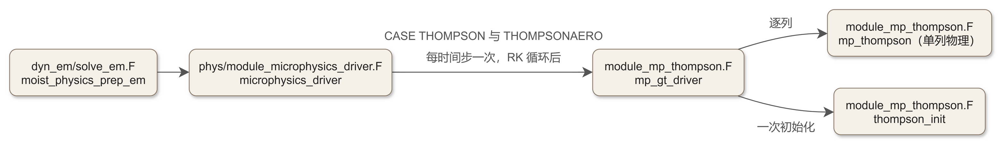
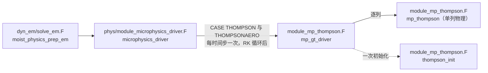

# 文库 code_07a：module_mp_thompson.F 上半——模块声明、初始化与列驱动

<!-- 本文件为骨架：CODE 占位符（形如 双花括号+CODE:+名称+双花括号）由 workspace/scripts/code_extract.py 注入保真块。
     组装命令（在 d:\Code\Learn\WRF 下运行）：
     D:\Code\miniforge3\envs\WRFlearn\python.exe workspace\scripts\code_extract.py assemble source\WRFv4.8.0\WRFV4.8.0\phys\module_mp_thompson.F workspace\code_library\skel_code_07a.md doc\code\code_07a_module_mp_thompson.md -->

## 07a.0 版本指纹与阅读说明

- **源文件**：`phys/module_mp_thompson.F`（WRF 4.8.0，与教材同版本）
- **文件规模**：6192 行；本篇覆盖 L1–L4082（模块声明、`thompson_init`、`mp_gt_driver`、主实体 `mp_thompson`）；L4091–L6192 的辅助子程序族（碰撞冻结建表、数学函数、冰核化物理函数、有效半径与反射率、热力学函数）见 code_07b。
- **保真承诺**：本篇所有代码块由 `code_extract.py` 按字节抽取，块前指纹注释给出源 md5 与行段 md5，可用 `verify` 子命令逐块复核；讲解与代码分离，代码一字未改。
- **符号口径**：大气物理符号以《大气物理学》（盛裴轩，第 2 版）为准；源码变量名（如 `qv`、`qvs`、`pii`）按 Fortran 原样出现，物理对应在讲解中给出。
- **教材锚点**：本篇与《WRF 源码导论》第 13 章配套——13.6（方案分发）、13.7（Thompson 精读：饱和调整 13.7.4、守恒约束 13.7.5、冰核化三来源 13.7.2、有效半径接口 13.7.6）。教材讲“为什么这样设计”，本篇讲“每一行在做什么”。书公式只给指针，不重复推导。

## 07a.1 一句话定位与调用链

**一句话**：`module_mp_thompson.F` 是 Thompson 批量微物理方案的完整实现——在一个模块里闭合“云滴/雨/冰晶/雪/霰（+雹感知霰）”五类水凝物的成核、增长、碰并、相变、沉降全链条，并给辐射方案供有效半径、给雷达模拟器供反射率。

**调用链（谁在调它）**：



<details><summary>原始 Mermaid 源码（可点击展开）</summary>

<!--

-->

</details>

- `thompson_init`：仅在模拟初始化阶段被 `module_microphysics_driver.F` 的 `MP_INIT_THOMPSON` 分支调用一次，负责查找表分配与预计算。
- `mp_gt_driver`：每时间步被 `microphysics_driver` 调用一次，是“三维场 ↔ 单列”的适配层。
- `mp_thompson`：被 `mp_gt_driver` 逐格点列调用，是全部微物理过程的本体（2570 行）。
- 教材侧：调用节拍与 `dt` 的传递见 ch13 §13.6.1；方案号 `mp_physics=8/28` 的 Registry 口径见 ch13 §13.6.4。

## 07a.2 文件头注释原文与精译

 Thompson 的文件头本身就是一份“用户改造指南”，NCAR 把哪些常数能改、哪些不能改全写在这里了。先读原文。

<!-- code_extract code_extract.py v1.1
source: phys/module_mp_thompson.F
ranges: L1-L45
file_lines: 6192
file_md5: f4ec64c511d6656277c4d1f9346813d1
display: line-numbered (strip L-prefix and !file: line to restore)
range_md5: febf0f4809208a9eea7d90f3e4363ebc
seg_lines: 45
-->

```fortran
!file: phys/module_mp_thompson.F    L1-L45
L00001  !+---+-----------------------------------------------------------------+
L00002  !.. This subroutine computes the moisture tendencies of water vapor,
L00003  !.. cloud droplets, rain, cloud ice (pristine), snow, and graupel.
L00004  !.. Prior to WRFv2.2 this code was based on Reisner et al (1998), but
L00005  !.. few of those pieces remain.  A complete description is now found in
L00006  !.. Thompson, G., P. R. Field, R. M. Rasmussen, and W. D. Hall, 2008:
L00007  !.. Explicit Forecasts of winter precipitation using an improved bulk
L00008  !.. microphysics scheme. Part II: Implementation of a new snow
L00009  !.. parameterization.  Mon. Wea. Rev., 136, 5095-5115.
L00010  !.. Prior to WRFv3.1, this code was single-moment rain prediction as
L00011  !.. described in the reference above, but in v3.1 and higher, the
L00012  !.. scheme is two-moment rain (predicted rain number concentration).
L00013  !..
L00014  !.. Beginning with WRFv3.6, this is also the "aerosol-aware" scheme as
L00015  !.. described in Thompson, G. and T. Eidhammer, 2014:  A study of
L00016  !.. aerosol impacts on clouds and precipitation development in a large
L00017  !.. winter cyclone.  J. Atmos. Sci., 71, 3636-3658.  Setting WRF
L00018  !.. namelist option mp_physics=8 utilizes the older one-moment cloud
L00019  !.. water with constant droplet concentration set as Nt_c (found below)
L00020  !.. while mp_physics=28 uses double-moment cloud droplet number
L00021  !.. concentration, which is not permitted to exceed Nt_c_max below.
L00022  !..
L00023  !.. Most importantly, users may wish to modify the prescribed number of
L00024  !.. cloud droplets (Nt_c; see guidelines mentioned below).  Otherwise,
L00025  !.. users may alter the rain and graupel size distribution parameters
L00026  !.. to use exponential (Marshal-Palmer) or generalized gamma shape.
L00027  !.. The snow field assumes a combination of two gamma functions (from
L00028  !.. Field et al. 2005) and would require significant modifications
L00029  !.. throughout the entire code to alter its shape as well as accretion
L00030  !.. rates.  Users may also alter the constants used for density of rain,
L00031  !.. graupel, ice, and snow, but the latter is not constant when using
L00032  !.. Paul Field's snow distribution and moments methods.  Other values
L00033  !.. users can modify include the constants for mass and/or velocity
L00034  !.. power law relations and assumed capacitances used in deposition/
L00035  !.. sublimation/evaporation/melting.
L00036  !.. Remaining values should probably be left alone.
L00037  !..
L00038  !..Author: Greg Thompson, NCAR-RAL, gthompsn@ucar.edu, 303-497-2805
L00039  !..Last modified: 24 Jan 2018   Aerosol additions to v3.5.1 code 9/2013
L00040  !..                 Cloud fraction additions 11/2014 part of pre-v3.7
L00041  !..                 3-moment graupel/hail additions Aug. 2018 (released in v4.4)
L00042  !+---+-----------------------------------------------------------------+
L00043  !wrft:model_layer:physics
L00044  !+---+-----------------------------------------------------------------+
L00045  !
```

> **逐句精译与解读**：
>
> - **血统**（L2–L12 原文行号以指纹注释为准，下同）：WRFv2.2 之前基于 Reisner et al. (1998)，但“其中很少部分保留至今”；现行描述文献是 Thompson, Field, Rasmussen & Hall (2008, MWR 136, 5095–5115)——即“Part II，新雪参数化”那篇。v3.1 起雨改为**双矩**（预报雨滴数浓度 `nr`），这是 Thompson 与早期 Reisner 系方案的本质分界。
> - **气溶胶感知**（v3.6 起）：`mp_physics=8` 是老版——云水单矩、云滴数取常数 `Nt_c`；`mp_physics=28` 是 aerosol-aware 版——云滴数双矩预报（上限 `Nt_c_max`）。文献 Thompson & Eidhammer (2014, JAS 71, 3636–3658)。气溶胶场 `nwfa`（水亲和性气溶胶数浓度）、`nifa`（冰核气溶胶数浓度）由 WRF-CHEM 或 `wif_input_opt` 供入——这条线在教材 ch11（气溶胶与水汽）与 ch13 §13.7.2 都有伏笔。
> - **用户可改清单**（原文 “users may wish to modify…” 一段）：①`Nt_c`——海运约 100 个/cm³、大陆约 300 个/cm³（这是全方案里最常被调的参数）；②雨、霰的谱形——可改用指数（Marshall–Palmer）或广义 gamma；③雪谱是 Field et al. (2005) **双伽马叠加**，“改它会牵动全代码的碰并率”，劝退；④雨/霰/冰/雪密度常数（雪的密度在用 Field 谱时不是常数）；⑤质量、落速幂律系数与凝华/蒸发/融化用到的**电容**常数。其余“should probably be left alone”。
> - **作者与版本史**：Greg Thompson（NCAR-RAL）；注释记录了 2013-09 气溶胶并入 v3.5.1、2014-11 云量（cloud fraction）接口、2018-08 三矩霰/雹（v4.4 发布，即 `is_hail_aware`/`ng`/`qb` 这条 3-moment graupel 线）。

## 07a.3 USE 依赖与模块级开关

<!-- code_extract code_extract.py v1.1
source: phys/module_mp_thompson.F
ranges: L48-L57
file_lines: 6192
file_md5: f4ec64c511d6656277c4d1f9346813d1
display: line-numbered (strip L-prefix and !file: line to restore)
range_md5: 06a29eab285a217cbcd9e9b927c3b278
seg_lines: 10
-->

```fortran
!file: phys/module_mp_thompson.F    L48-L57
L00048        MODULE module_mp_thompson
L00049  
L00050        USE module_wrf_error
L00051        USE module_mp_radar
L00052  #if ( defined( DM_PARALLEL ) && ( ! defined( STUBMPI ) ) )
L00053        USE module_dm, ONLY : wrf_dm_max_real
L00054  #endif
L00055        USE module_model_constants, only : RE_QC_BG, RE_QI_BG, RE_QS_BG
L00056  
L00057        IMPLICIT NONE
```

> **USE 逐项解读**（模块头 4 项；另有 2 项藏在子程序内部——`qr_acr_qg` 内 `USE module_timing`、`table_ccnAct` 内 `USE module_domain`（+`module_dm`），见 code_07b，普查表所记 6 项无误）：
>
> | USE | 拿来什么 | 用在哪 |
> |---|---|---|
> | `module_wrf_error` | `wrf_debug`、`wrf_err_message` | 全模块的分级日志（`wrft:model_layer:physics` 标签行 L43 即日志路由标记） |
> | `module_mp_radar` | `radar_init` 及 `xam_r/xbm_r/xmu_r/xam_s/…` 共享量 | `thompson_init` 末尾把本方案的谱参数拷给雷达模拟器模块，`calc_refl10cm`（code_07b）据此算 10 cm 反射率 |
> | `module_dm` | `wrf_dm_max_real`（仅 DM_PARALLEL 且非 STUBMPI） | `thompson_init` 检查气溶胶场是否全零时做**全局**归约——单进程裸 MAXVAL 会漏判“本 tile 恰好全零、别处有值”的假阴性 |
> | `module_model_constants` | `RE_QC_BG/RE_QI_BG/RE_QS_BG` | 有效半径背景值（`calc_effectRad` 的输出下限），常数定义在 share 层（文库 code_01），教材 ch13 §13.8.4 讲过这组闭合 |
> | `module_timing`（qr_acr_qg 内部） | `start_timing/end_timing` | 建表耗时统计（只在首次建表时走） |
> | `module_domain`+`module_dm`（table_ccnAct 内部） | `wrf_dm_on_monitor` 等 | 只在 monitor 进程读 CCN 活化表再广播 |
>
> **四个模块级开关**（L59–L63）：
>
> - `iiwarm = .false.`（PARAMETER）：暖云测试开关，编译期写死。置真时跳过全部冰相建表与冰相过程块——只用于开发调试，产品运行保持 false。
> - `is_aerosol_aware`：**运行时**变量，由 `thompson_init` 里 `PRESENT(nwfa/nifa/nbca)` 判定。它决定主实体里走哪套冰核化与云滴活化分支。
> - `dustyIce = .true.` / `homogIce = .true.`（PARAMETER）：冰核化物理的编译期选择——是否用尘埃依赖的 DeMott (2010) 冻结谱、是否允许 Koop (2001) 均质冻结。三来源冰核化的完整对照见教材 ch13 §13.7.2。
> - `is_hail_aware`：运行时变量，由 `PRESENT(ng)` 判定，控制三矩霰/雹分支（`ng` 霰数浓度、`qb` 霰**体积**混合比、`idx_bg` 密度档位）。

## 07a.4 模块级常数逐组解读

 Thompson 的模块声明段实质是一张“方案参数总表”——批量方案的全部谱假设、质量-尺寸-落速幂律、收集效率、数值下限都在这里一次性定义，主实体里只引用不再改。以下按物理作用分六组走读，代码块保真原文。

### 07a.4.1 密度、云滴数与气溶胶缺省剖面

<!-- code_extract code_extract.py v1.1
source: phys/module_mp_thompson.F
ranges: L59-L99
file_lines: 6192
file_md5: f4ec64c511d6656277c4d1f9346813d1
display: line-numbered (strip L-prefix and !file: line to restore)
range_md5: aaef5288d1c210771e3bf2477bc105cb
seg_lines: 41
-->

```fortran
!file: phys/module_mp_thompson.F    L59-L99
L00059        LOGICAL, PARAMETER, PRIVATE:: iiwarm = .false.
L00060        LOGICAL, PRIVATE:: is_aerosol_aware = .false.
L00061        LOGICAL, PARAMETER, PRIVATE:: dustyIce = .true.
L00062        LOGICAL, PARAMETER, PRIVATE:: homogIce = .true.
L00063        LOGICAL, PRIVATE:: is_hail_aware = .false.
L00064  
L00065        INTEGER, PARAMETER, PRIVATE:: IFDRY = 0
L00066        REAL, PARAMETER, PRIVATE:: T_0 = 273.15
L00067        REAL, PARAMETER, PRIVATE:: PI = 3.1415926536
L00068  
L00069  !..Densities of rain, snow, graupel, and cloud ice.
L00070        REAL, PARAMETER, PRIVATE:: rho_w = 1000.0
L00071        REAL, PRIVATE:: rho_s = 100.0
L00072        REAL, PARAMETER, PRIVATE:: rho_i = 890.0
L00073        INTEGER, PARAMETER, PRIVATE:: NRHG = 9
L00074        INTEGER, PARAMETER, PRIVATE:: NRHG1 = 1
L00075        INTEGER :: dimNRHG
L00076  
L00077        REAL, DIMENSION(NRHG), PARAMETER, PRIVATE:: &
L00078             rho_g = (/50., 100., 200., 300., 400., 500., 600., 700., 800./)
L00079        INTEGER, PARAMETER :: idx_bg1 = 5 ! index for rhog when mp=8 or 28
L00080  
L00081  !..Prescribed number of cloud droplets.  Set according to known data or
L00082  !.. roughly 100 per cc (100.E6 m^-3) for Maritime cases and
L00083  !.. 300 per cc (300.E6 m^-3) for Continental.  Gamma shape parameter,
L00084  !.. mu_c, calculated based on Nt_c is important in autoconversion
L00085  !.. scheme.  In 2-moment cloud water, Nt_c represents a maximum of
L00086  !.. droplet concentration and nu_c is also variable depending on local
L00087  !.. droplet number concentration.
L00088        REAL, PARAMETER, PRIVATE:: Nt_c = 100.E6
L00089        REAL, PARAMETER, PRIVATE:: Nt_c_max = 1999.E6
L00090  
L00091  !..Declaration of constants for assumed CCN/IN aerosols when none in
L00092  !.. the input data.  Look inside the init routine for modifications
L00093  !.. due to surface land-sea points or vegetation characteristics.
L00094        REAL, PARAMETER, PRIVATE:: naIN0 = 1.5E6
L00095        REAL, PARAMETER, PRIVATE:: naIN1 = 0.5E6
L00096        REAL, PARAMETER, PRIVATE:: naCCN0 = 300.0E6
L00097        REAL, PARAMETER, PRIVATE:: naCCN1 = 50.0E6
L00098        REAL, PARAMETER, PRIVATE:: naBC0 = 150.0E6
L00099        REAL, PARAMETER, PRIVATE:: naBC1 = 25.0E6
```

> - **密度组**：`rho_w=1000`（液水）、`rho_i=890`（冰晶）；**`rho_s=100` 声明为变量而非参数**——用 Field 谱时雪密度随含水量与温度变化（主实体 L2248 处 `rho_s = MAX(rho_g(1), MIN(0.13/xDs, rho_i-100.))` 动态更新，见 code_07a §07a.5 主实体“冰相准备”段讲解）。
> - **霰密度九档**：`rho_g = (50,100,200,…,800)` kg/m³，对应“飑线低密度霰 → 干雹”连续谱；`NRHG=9` 是档位数。`dimNRHG` 运行时为 9（hail-aware）或 1（老模式），控制查找表第三维大小——**同一张表，两种内存占用**。`idx_bg1=5` 即 500 kg/m³ 档，是 `mp=8/28`（无雹感知）时的固定档位。
> - **`Nt_c=100.E6`**：云滴数缺省 100 个/cm³（注意单位是 m⁻³，100.E6 m⁻³ = 100 cm⁻³）。文件头说的“海运 100/大陆 300”就是改这里；`Nt_c_max=1999.E6` 是双矩模式下云滴数的物理上限（防止活化计算爆表）。
> - **气溶胶缺省剖面常数**（L94–L99）：`naIN0/naIN1`（冰核：地面 1.5e6、高空本底 0.5e6 m⁻³）、`naCCN0/naCCN1`（CCN：300e6/50e6）、`naBC0/naBC1`（黑碳：150e6/25e6）。当输入场缺省时，`thompson_init` 用它们构造随高度指数衰减的剖面（见 §07a.5 init 第二段）。

### 07a.4.2 谱形参数：N(D) 的“形状”由谁定

<!-- code_extract code_extract.py v1.1
source: phys/module_mp_thompson.F
ranges: L101-L124
file_lines: 6192
file_md5: f4ec64c511d6656277c4d1f9346813d1
display: line-numbered (strip L-prefix and !file: line to restore)
range_md5: d6eb3317552a44463aa70f68514b1c2b
seg_lines: 24
-->

```fortran
!file: phys/module_mp_thompson.F    L101-L124
L00101  !..Generalized gamma distributions for rain, graupel and cloud ice.
L00102  !.. N(D) = N_0 * D**mu * exp(-lamda*D);  mu=0 is exponential.
L00103        REAL, PARAMETER, PRIVATE:: mu_r = 0.0
L00104        REAL, PARAMETER, PRIVATE:: mu_g = 0.0
L00105        REAL, PARAMETER, PRIVATE:: mu_i = 0.0
L00106        REAL, PRIVATE:: mu_c
L00107  
L00108  !..Sum of two gamma distrib for snow (Field et al. 2005).
L00109  !.. N(D) = M2**4/M3**3 * [Kap0*exp(-M2*Lam0*D/M3)
L00110  !..    + Kap1*(M2/M3)**mu_s * D**mu_s * exp(-M2*Lam1*D/M3)]
L00111  !.. M2 and M3 are the (bm_s)th and (bm_s+1)th moments respectively
L00112  !.. calculated as function of ice water content and temperature.
L00113        REAL, PARAMETER, PRIVATE:: mu_s = 0.6357
L00114        REAL, PARAMETER, PRIVATE:: Kap0 = 490.6
L00115        REAL, PARAMETER, PRIVATE:: Kap1 = 17.46
L00116        REAL, PARAMETER, PRIVATE:: Lam0 = 20.78
L00117        REAL, PARAMETER, PRIVATE:: Lam1 = 3.29
L00118  
L00119  !..Y-intercept parameter for graupel is not constant and depends on
L00120  !.. mixing ratio.  Also, when mu_g is non-zero, these become equiv
L00121  !.. y-intercept for an exponential distrib and proper values are
L00122  !.. computed based on same mixing ratio and total number concentration.
L00123        REAL, PARAMETER, PRIVATE:: gonv_min = 1.E2
L00124        REAL, PARAMETER, PRIVATE:: gonv_max = 1.E6
```

> 批量方案的核心假设是粒径谱形。Thompson 的五物种谱形选择一览：
>
> - **雨、霰、冰**：`N(D) = N_0 · D^mu · exp(-λD)`，`mu_r = mu_g = mu_i = 0` → 退化为 Marshall–Palmer 指数谱。双矩模式通过 `(N, q)` 两个预报量反解 `(N_0, λ)`，谱形其实由物理量闭环决定（见主实体“谱参数化”段）。
> - **云滴**：`mu_c` 是**变量**，按 Martin et al. (1994) 的离散度关系 `mu_c = MIN(15, 1000E6/Nt_c + 2)` 由云滴数定——海运洁净（N 小）谱窄单峰，大陆污染（N 大）谱宽。
> - **雪**：Field et al. (2005) **双伽马叠加** `N(D) = M2⁴/M3³ · [Kap0·exp(-M2·Lam0·D/M3) + Kap1·(M2/M3)^mu_s · D^mu_s · exp(-M2·Lam1·D/M3)]`，五个常数（`mu_s=0.6357, Kap0=490.6, Kap1=17.46, Lam0=20.78, Lam1=3.29`）是 Field 谱的拟合结果；`M2、M3` 是由冰水含量和温度决定的矩量（主实体用 `sa/sb` 十项多项式换算，见 §07a.6）。
> - **霰截距**：`gonv_min=1e2`、`gonv_max=1e6`——指数等效截距 `N_0` 的上下限（老模式由 qg 经 `zans1 = 3 + 2/7·(log10(qgρ)+8)` 经验式插值，见 driver 段讲解）。

### 07a.4.3 质量与落速幂律：把谱“接上”物理

<!-- code_extract code_extract.py v1.1
source: phys/module_mp_thompson.F
ranges: L126-L168
file_lines: 6192
file_md5: f4ec64c511d6656277c4d1f9346813d1
display: line-numbered (strip L-prefix and !file: line to restore)
range_md5: 0f67b4c3edf8ad52686c438aba2f80ff
seg_lines: 43
-->

```fortran
!file: phys/module_mp_thompson.F    L126-L168
L00126  !..Mass power law relations:  mass = am*D**bm
L00127  !.. Snow from Field et al. (2005), others assume spherical form.
L00128        REAL, PARAMETER, PRIVATE:: am_r = PI*rho_w/6.0
L00129        REAL, PARAMETER, PRIVATE:: bm_r = 3.0
L00130        REAL, PARAMETER, PRIVATE:: am_s = 0.069
L00131        REAL, PARAMETER, PRIVATE:: bm_s = 2.0
L00132        REAL, DIMENSION(NRHG), PARAMETER,PRIVATE:: am_g = (/              &
L00133       &            PI*rho_g(1)/6.0, PI*rho_g(2)/6.0, PI*rho_g(3)/6.0,    &
L00134       &            PI*rho_g(4)/6.0, PI*rho_g(5)/6.0, PI*rho_g(6)/6.0,    &
L00135       &            PI*rho_g(7)/6.0, PI*rho_g(8)/6.0, PI*rho_g(9)/6.0 /)
L00136        REAL, PARAMETER, PRIVATE:: bm_g = 3.0
L00137        REAL, PARAMETER, PRIVATE:: am_i = PI*rho_i/6.0
L00138        REAL, PARAMETER, PRIVATE:: bm_i = 3.0
L00139  
L00140  !..Fallspeed power laws relations:  v = (av*D**bv)*exp(-fv*D)
L00141  !.. Rain from Ferrier (1994), ice, snow, and graupel from
L00142  !.. Thompson et al (2008). Coefficient fv is zero for graupel/ice.
L00143        REAL, PARAMETER, PRIVATE:: av_r = 4854.0
L00144        REAL, PARAMETER, PRIVATE:: bv_r = 1.0
L00145        REAL, PARAMETER, PRIVATE:: fv_r = 195.0
L00146        REAL, PARAMETER, PRIVATE:: av_s = 40.0
L00147        REAL, PARAMETER, PRIVATE:: bv_s = 0.55
L00148        REAL, PARAMETER, PRIVATE:: fv_s = 100.0
L00149        REAL, PARAMETER, PRIVATE:: av_g_old = 442.0
L00150        REAL, PARAMETER, PRIVATE:: bv_g_old = 0.89
L00151        REAL, DIMENSION(NRHG), PRIVATE:: & ! Computed from A. Heymsfield: Best - Reynolds relation
L00152       &    av_g = (/ 45.9173813, 67.0867386, 98.0158463, 122.353378,     &
L00153       &              143.204224, 161.794724, 178.762115, 194.488785,     &
L00154       &              209.225876/)
L00155        REAL, DIMENSION(NRHG), PRIVATE:: & ! Computed from A. Heymsfield: Best - Reynolds relation
L00156       &    bv_g = (/0.640961647, 0.640961647, 0.640961647, 0.640961647,  &
L00157       &             0.640961647, 0.640961647, 0.640961647, 0.640961647,  &
L00158       &             0.640961647/)
L00159        REAL, PARAMETER, PRIVATE:: a_coeff = 0.47244157
L00160        REAL, PARAMETER, PRIVATE:: b_coeff = 0.54698726
L00161        REAL, PARAMETER, PRIVATE:: av_i = 1493.9
L00162        REAL, PARAMETER, PRIVATE:: bv_i = 1.0
L00163        REAL, PARAMETER, PRIVATE:: av_c = 0.316946E8
L00164        REAL, PARAMETER, PRIVATE:: bv_c = 2.0
L00165  
L00166  !..Capacitance of sphere and plates/aggregates: D**3, D**2
L00167        REAL, PARAMETER, PRIVATE:: C_cube = 0.5
L00168        REAL, PARAMETER, PRIVATE:: C_sqrd = 0.15
```

> - **质量幂律** `m = am·D^bm`：雨、冰、霰按球形 `am = π·ρ/6, bm = 3`（霰的 `am_g` 是随密度档变化的九元素数组）；雪用 Field 拟合 `am_s=0.069, bm_s=2.0`——**非球形**，这是雪谱与其它物种的本质区别，也解释了为什么雪的矩量要走多项式换算。
> - **落速幂律** `v = av·D^bv · exp(-fv·D)`：末速度不是简单的幂律，末尾的 `exp(-fv·D)` 把大粒子端压平（雨 `fv_r=195`、雪 `fv_s=100`，霰/冰 `fv=0`）。这使 `∫v(D)·m(D)·N(D)dD` 型积分出现 `Γ(n)·(λ+fv)^(-n)` 结构——主实体里到处可见的 `((lamr+fv_r)**(-cre(9)))` 就是它。雨落速系数取 Ferrier (1994)，雪取 Thompson et al. (2008)，霰九档系数由 Heymsfield 的 Best–Reynolds 关系预计算（`av_g/bv_g` 数组，`bv_g` 九档同值 0.64096…）。
> - **电容**：`C_cube=0.5`（球，D³ 律）、`C_sqrd=0.15`（板状/聚合体，D² 律）。凝华/融化率公式里雪的电容在两值间随温度插值（主实体 `C_snow` 一行），电容的物理来源（静电类比）见书 §6.3 与教材 ch13 §13.3 的指针。

### 07a.4.4 收集效率、数值下限与冰核化常数

<!-- code_extract code_extract.py v1.1
source: phys/module_mp_thompson.F
ranges: L170-L199
file_lines: 6192
file_md5: f4ec64c511d6656277c4d1f9346813d1
display: line-numbered (strip L-prefix and !file: line to restore)
range_md5: 9d2c438dd2f585d963a27847ae522d51
seg_lines: 30
-->

```fortran
!file: phys/module_mp_thompson.F    L170-L199
L00170  !..Collection efficiencies.  Rain/snow/graupel collection of cloud
L00171  !.. droplets use variables (Ef_rw, Ef_sw, Ef_gw respectively) and
L00172  !.. get computed elsewhere because they are dependent on stokes
L00173  !.. number.
L00174        REAL, PARAMETER, PRIVATE:: Ef_si = 0.05
L00175        REAL, PARAMETER, PRIVATE:: Ef_rs = 0.95
L00176        REAL, PARAMETER, PRIVATE:: Ef_rg = 0.75
L00177        REAL, PARAMETER, PRIVATE:: Ef_ri = 0.95
L00178  
L00179  !..Minimum microphys values
L00180  !.. R1 value, 1.E-12, cannot be set lower because of numerical
L00181  !.. problems with Paul Field's moments and should not be set larger
L00182  !.. because of truncation problems in snow/ice growth.
L00183        REAL, PARAMETER, PRIVATE:: R1 = 1.E-12
L00184        REAL, PARAMETER, PRIVATE:: R2 = 1.E-6
L00185        REAL, PARAMETER, PRIVATE:: eps = 1.E-15
L00186  
L00187  !..Constants in Cooper curve relation for cloud ice number.
L00188        REAL, PARAMETER, PRIVATE:: TNO = 5.0
L00189        REAL, PARAMETER, PRIVATE:: ATO = 0.304
L00190  
L00191  !..Rho_not used in fallspeed relations (rho_not/rho)**.5 adjustment.
L00192        REAL, PARAMETER, PRIVATE:: rho_not = 101325.0/(287.05*298.0)
L00193  
L00194  !..Schmidt number
L00195        REAL, PARAMETER, PRIVATE:: Sc = 0.632
L00196        REAL, PRIVATE:: Sc3
L00197  
L00198  !..Homogeneous freezing temperature
L00199        REAL, PARAMETER, PRIVATE:: HGFR = 235.16
```

> - **收集效率**：雨/雪/霰收集**云水**的效率 `Ef_rw/Ef_sw/Ef_gw` 依赖 Stokes 数，运行时查表（`t_Efrw/t_Efsw`，建表见 code_07b `table_Efrw/table_Efsw`）；而雪收集冰晶 `Ef_si=0.05`、雨收集雪 `Ef_rs=0.95`、雨收集霰 `Ef_rg=0.75`、雨收集冰晶 `Ef_ri=0.95` 是**常数**——冰-冰相碰并效率低（冰晶不易粘附）而液-固相碰并效率接近 1，这组数字本身就是微物理常识的编码。
> - **数值下限**：`R1=1e-12`（kg/kg）是**不许再小**的下限——注释明说 Field 矩量法在更小值处数值出问题、更大值又会让雪/冰增长被截断；`R2=1e-6` 是数浓度下限尺度，`eps=1e-15` 是判零容差。主实体所有“守恒/钳位”都以这三个量为标尺。
> - **Cooper 冰核曲线**：`TNO=5.0, ATO=0.304`——`N_IN = TNO·exp(ATO·(T_0−T))`（L⁻¹），气溶胶不可用时的冰核缺省谱（Cooper 1986），主实体 L2624 处现写 `MIN(250.E3, TNO*EXP(ATO*(T_0-temp(k))))`。
> - **`rho_not`**：标准密度（p=101325 Pa、T=298 K），落速的密度订正因子 `rhof = sqrt(rho_not/rho)` 用它——粒子在低密度高空落得更快。
> - **`Sc=0.632`**（Schmidt 数）、`HGFR=235.16 K`（均质冻结温度，−38 °C）。

### 07a.4.5 气体常数与潜热

<!-- code_extract code_extract.py v1.1
source: phys/module_mp_thompson.F
ranges: L201-L229
file_lines: 6192
file_md5: f4ec64c511d6656277c4d1f9346813d1
display: line-numbered (strip L-prefix and !file: line to restore)
range_md5: 08123318f9639d3d8ba8e2873a7a92ce
seg_lines: 29
-->

```fortran
!file: phys/module_mp_thompson.F    L201-L229
L00201  !..Water vapor and air gas constants at constant pressure
L00202        REAL, PARAMETER, PRIVATE:: Rv = 461.5
L00203        REAL, PARAMETER, PRIVATE:: oRv = 1./Rv
L00204        REAL, PARAMETER, PRIVATE:: R = 287.04
L00205        REAL, PARAMETER, PRIVATE:: Cp = 1004.0
L00206        REAL, PARAMETER, PRIVATE:: R_uni = 8.314                           ! J (mol K)-1
L00207  
L00208        DOUBLE PRECISION, PARAMETER, PRIVATE:: k_b = 1.38065E-23           ! Boltzmann constant [J/K]
L00209        DOUBLE PRECISION, PARAMETER, PRIVATE:: M_w = 18.01528E-3           ! molecular mass of water [kg/mol]
L00210        DOUBLE PRECISION, PARAMETER, PRIVATE:: M_a = 28.96E-3              ! molecular mass of air [kg/mol]
L00211        DOUBLE PRECISION, PARAMETER, PRIVATE:: N_avo = 6.022E23            ! Avogadro number [1/mol]
L00212        DOUBLE PRECISION, PARAMETER, PRIVATE:: ma_w = M_w / N_avo          ! mass of water molecule [kg]
L00213        REAL, PARAMETER, PRIVATE:: ar_volume = 4./3.*PI*(2.5e-6)**3        ! assume radius of 0.025 micrometer, 2.5e-6 cm
L00214  
L00215  !..Enthalpy of sublimation, vaporization, and fusion at 0C.
L00216        REAL, PARAMETER, PRIVATE:: lsub = 2.834E6
L00217        REAL, PARAMETER, PRIVATE:: lvap0 = 2.5E6
L00218        REAL, PARAMETER, PRIVATE:: lfus = lsub - lvap0
L00219        REAL, PARAMETER, PRIVATE:: olfus = 1./lfus
L00220  
L00221  !..Ice initiates with this mass (kg), corresponding diameter calc.
L00222  !..Min diameters and mass of cloud, rain, snow, and graupel (m, kg).
L00223        REAL, PARAMETER, PRIVATE:: xm0i = 1.E-12
L00224        REAL, PARAMETER, PRIVATE:: D0c = 1.E-6
L00225        REAL, PARAMETER, PRIVATE:: D0r = 50.E-6
L00226        REAL, PARAMETER, PRIVATE:: D0s = 300.E-6
L00227        REAL, PARAMETER, PRIVATE:: D0g = 350.E-6
L00228        REAL, PRIVATE:: D0i, xm0s, xm0g
L00229  
```

> - **气体常数组**：`Rv=461.5, R=287.04, Cp=1004`——注意这三者在模块内**自定义**而非引用 `module_model_constants`，方案自成体系；`R_uni/k_b/M_w/M_a/N_avo/ma_w` 是分子尺度常数（单位标注在行尾注释），只被 Koop 均质冻结函数（`iceKoop`，code_07b）使用。
> - **潜热**：`lsub=2.834e6`（0 °C 升华）、`lvap0=2.5e6`（0 °C 汽化）、`lfus = lsub − lvap0`（融化）。温度依赖的 `lvap(T) = lvap0 + (2106 − 4218)·Tc` 在主实体现场计算（2106 是水汽 Cp、4218 是液水 Cp，差值即克希霍夫律的斜率——书 (6.1.13) 对应的实践版）。三套 Lv(T) 口径的全书对照见教材 ch13 §13.9.2。
> - **初始冰质量**：`xm0i=1e-12` kg——每个新冰晶出生时的质量（直径约 20 μm）；四物种最小直径 `D0c/D0r/D0s/D0g` 是谱积分下限。

### 07a.4.6 查找表体系与预计算矩阵

<!-- code_extract code_extract.py v1.1
source: phys/module_mp_thompson.F
ranges: L230-L413
file_lines: 6192
file_md5: f4ec64c511d6656277c4d1f9346813d1
display: line-numbered (strip L-prefix and !file: line to restore)
range_md5: 533d9792f1e95852089fb54f80d4d63b
seg_lines: 184
-->

```fortran
!file: phys/module_mp_thompson.F    L230-L413
L00230  !..Lookup table dimensions
L00231        INTEGER, PARAMETER, PRIVATE:: nbins = 100
L00232        INTEGER, PARAMETER, PRIVATE:: nbc = nbins
L00233        INTEGER, PARAMETER, PRIVATE:: nbi = nbins
L00234        INTEGER, PARAMETER, PRIVATE:: nbr = nbins
L00235        INTEGER, PARAMETER, PRIVATE:: nbs = nbins
L00236        INTEGER, PARAMETER, PRIVATE:: nbg = nbins
L00237        INTEGER, PARAMETER, PRIVATE:: ntb_c = 37
L00238        INTEGER, PARAMETER, PRIVATE:: ntb_i = 64
L00239        INTEGER, PARAMETER, PRIVATE:: ntb_r = 37
L00240        INTEGER, PARAMETER, PRIVATE:: ntb_s = 37
L00241        INTEGER, PARAMETER, PRIVATE:: ntb_g = 37
L00242        INTEGER, PARAMETER, PRIVATE:: ntb_g1 = 37
L00243        INTEGER, PARAMETER, PRIVATE:: ntb_r1 = 37
L00244        INTEGER, PARAMETER, PRIVATE:: ntb_i1 = 55
L00245        INTEGER, PARAMETER, PRIVATE:: ntb_t = 9
L00246        INTEGER, PRIVATE:: nic1, nic2, nii2, nii3, nir2, nir3, nis2, nig2, nig3
L00247        INTEGER, PARAMETER, PRIVATE:: ntb_arc = 7
L00248        INTEGER, PARAMETER, PRIVATE:: ntb_arw = 9
L00249        INTEGER, PARAMETER, PRIVATE:: ntb_art = 7
L00250        INTEGER, PARAMETER, PRIVATE:: ntb_arr = 5
L00251        INTEGER, PARAMETER, PRIVATE:: ntb_ark = 4
L00252        INTEGER, PARAMETER, PRIVATE:: ntb_IN = 55
L00253        INTEGER, PRIVATE:: niIN2
L00254  
L00255        DOUBLE PRECISION, DIMENSION(nbins+1):: xDx
L00256        DOUBLE PRECISION, DIMENSION(nbc):: Dc, dtc
L00257        DOUBLE PRECISION, DIMENSION(nbi):: Di, dti
L00258        DOUBLE PRECISION, DIMENSION(nbr):: Dr, dtr
L00259        DOUBLE PRECISION, DIMENSION(nbs):: Ds, dts
L00260        DOUBLE PRECISION, DIMENSION(nbg):: Dg, dtg
L00261        DOUBLE PRECISION, DIMENSION(nbc):: t_Nc
L00262  
L00263  !..Lookup tables for cloud water content (kg/m**3).
L00264        REAL, DIMENSION(ntb_c), PARAMETER, PRIVATE:: &
L00265        r_c = (/1.e-6,2.e-6,3.e-6,4.e-6,5.e-6,6.e-6,7.e-6,8.e-6,9.e-6, &
L00266                1.e-5,2.e-5,3.e-5,4.e-5,5.e-5,6.e-5,7.e-5,8.e-5,9.e-5, &
L00267                1.e-4,2.e-4,3.e-4,4.e-4,5.e-4,6.e-4,7.e-4,8.e-4,9.e-4, &
L00268                1.e-3,2.e-3,3.e-3,4.e-3,5.e-3,6.e-3,7.e-3,8.e-3,9.e-3, &
L00269                1.e-2/)
L00270  
L00271  !..Lookup tables for cloud ice content (kg/m**3).
L00272        REAL, DIMENSION(ntb_i), PARAMETER, PRIVATE:: &
L00273        r_i = (/1.e-10,2.e-10,3.e-10,4.e-10, &
L00274                5.e-10,6.e-10,7.e-10,8.e-10,9.e-10, &
L00275                1.e-9,2.e-9,3.e-9,4.e-9,5.e-9,6.e-9,7.e-9,8.e-9,9.e-9, &
L00276                1.e-8,2.e-8,3.e-8,4.e-8,5.e-8,6.e-8,7.e-8,8.e-8,9.e-8, &
L00277                1.e-7,2.e-7,3.e-7,4.e-7,5.e-7,6.e-7,7.e-7,8.e-7,9.e-7, &
L00278                1.e-6,2.e-6,3.e-6,4.e-6,5.e-6,6.e-6,7.e-6,8.e-6,9.e-6, &
L00279                1.e-5,2.e-5,3.e-5,4.e-5,5.e-5,6.e-5,7.e-5,8.e-5,9.e-5, &
L00280                1.e-4,2.e-4,3.e-4,4.e-4,5.e-4,6.e-4,7.e-4,8.e-4,9.e-4, &
L00281                1.e-3/)
L00282  
L00283  !..Lookup tables for rain content (kg/m**3).
L00284        REAL, DIMENSION(ntb_r), PARAMETER, PRIVATE:: &
L00285        r_r = (/1.e-6,2.e-6,3.e-6,4.e-6,5.e-6,6.e-6,7.e-6,8.e-6,9.e-6, &
L00286                1.e-5,2.e-5,3.e-5,4.e-5,5.e-5,6.e-5,7.e-5,8.e-5,9.e-5, &
L00287                1.e-4,2.e-4,3.e-4,4.e-4,5.e-4,6.e-4,7.e-4,8.e-4,9.e-4, &
L00288                1.e-3,2.e-3,3.e-3,4.e-3,5.e-3,6.e-3,7.e-3,8.e-3,9.e-3, &
L00289                1.e-2/)
L00290  
L00291  !..Lookup tables for graupel content (kg/m**3).
L00292        REAL, DIMENSION(ntb_g), PARAMETER, PRIVATE:: &
L00293        r_g = (/1.e-6,2.e-6,3.e-6,4.e-6,5.e-6,6.e-6,7.e-6,8.e-6,9.e-6, &
L00294                1.e-5,2.e-5,3.e-5,4.e-5,5.e-5,6.e-5,7.e-5,8.e-5,9.e-5, &
L00295                1.e-4,2.e-4,3.e-4,4.e-4,5.e-4,6.e-4,7.e-4,8.e-4,9.e-4, &
L00296                1.e-3,2.e-3,3.e-3,4.e-3,5.e-3,6.e-3,7.e-3,8.e-3,9.e-3, &
L00297                1.e-2/)
L00298  
L00299  !..Lookup tables for snow content (kg/m**3).
L00300        REAL, DIMENSION(ntb_s), PARAMETER, PRIVATE:: &
L00301        r_s = (/1.e-6,2.e-6,3.e-6,4.e-6,5.e-6,6.e-6,7.e-6,8.e-6,9.e-6, &
L00302                1.e-5,2.e-5,3.e-5,4.e-5,5.e-5,6.e-5,7.e-5,8.e-5,9.e-5, &
L00303                1.e-4,2.e-4,3.e-4,4.e-4,5.e-4,6.e-4,7.e-4,8.e-4,9.e-4, &
L00304                1.e-3,2.e-3,3.e-3,4.e-3,5.e-3,6.e-3,7.e-3,8.e-3,9.e-3, &
L00305                1.e-2/)
L00306  
L00307  !..Lookup tables for rain y-intercept parameter (/m**4).
L00308        REAL, DIMENSION(ntb_r1), PARAMETER, PRIVATE:: &
L00309        N0r_exp = (/1.e6,2.e6,3.e6,4.e6,5.e6,6.e6,7.e6,8.e6,9.e6, &
L00310                    1.e7,2.e7,3.e7,4.e7,5.e7,6.e7,7.e7,8.e7,9.e7, &
L00311                    1.e8,2.e8,3.e8,4.e8,5.e8,6.e8,7.e8,8.e8,9.e8, &
L00312                    1.e9,2.e9,3.e9,4.e9,5.e9,6.e9,7.e9,8.e9,9.e9, &
L00313                    1.e10/)
L00314  
L00315  !..Lookup tables for graupel y-intercept parameter (/m**4).
L00316        REAL, DIMENSION(ntb_g1), PARAMETER, PRIVATE:: &
L00317        N0g_exp = (/1.e2,2.e2,3.e2,4.e2,5.e2,6.e2,7.e2,8.e2,9.e2, &
L00318                    1.e3,2.e3,3.e3,4.e3,5.e3,6.e3,7.e3,8.e3,9.e3, &
L00319                    1.e4,2.e4,3.e4,4.e4,5.e4,6.e4,7.e4,8.e4,9.e4, &
L00320                    1.e5,2.e5,3.e5,4.e5,5.e5,6.e5,7.e5,8.e5,9.e5, &
L00321                    1.e6/)
L00322  
L00323  !..Lookup tables for ice number concentration (/m**3).
L00324        REAL, DIMENSION(ntb_i1), PARAMETER, PRIVATE:: &
L00325        Nt_i = (/1.0,2.0,3.0,4.0,5.0,6.0,7.0,8.0,9.0, &
L00326                 1.e1,2.e1,3.e1,4.e1,5.e1,6.e1,7.e1,8.e1,9.e1, &
L00327                 1.e2,2.e2,3.e2,4.e2,5.e2,6.e2,7.e2,8.e2,9.e2, &
L00328                 1.e3,2.e3,3.e3,4.e3,5.e3,6.e3,7.e3,8.e3,9.e3, &
L00329                 1.e4,2.e4,3.e4,4.e4,5.e4,6.e4,7.e4,8.e4,9.e4, &
L00330                 1.e5,2.e5,3.e5,4.e5,5.e5,6.e5,7.e5,8.e5,9.e5, &
L00331                 1.e6/)
L00332  
L00333  !..Aerosol table parameter: Number of available aerosols, vertical
L00334  !.. velocity, temperature, aerosol mean radius, and hygroscopicity.
L00335        REAL, DIMENSION(ntb_arc), PARAMETER, PRIVATE:: &
L00336        ta_Na = (/10.0, 31.6, 100.0, 316.0, 1000.0, 3160.0, 10000.0/)
L00337        REAL, DIMENSION(ntb_arw), PARAMETER, PRIVATE:: &
L00338        ta_Ww = (/0.01, 0.0316, 0.1, 0.316, 1.0, 3.16, 10.0, 31.6, 100.0/)
L00339        REAL, DIMENSION(ntb_art), PARAMETER, PRIVATE:: &
L00340        ta_Tk = (/243.15, 253.15, 263.15, 273.15, 283.15, 293.15, 303.15/)
L00341        REAL, DIMENSION(ntb_arr), PARAMETER, PRIVATE:: &
L00342        ta_Ra = (/0.01, 0.02, 0.04, 0.08, 0.16/)
L00343        REAL, DIMENSION(ntb_ark), PARAMETER, PRIVATE:: &
L00344        ta_Ka = (/0.2, 0.4, 0.6, 0.8/)
L00345  
L00346  !..Lookup tables for IN concentration (/m**3) from 0.001 to 1000/Liter.
L00347        REAL, DIMENSION(ntb_IN), PARAMETER, PRIVATE:: &
L00348        Nt_IN = (/1.0,2.0,3.0,4.0,5.0,6.0,7.0,8.0,9.0, &
L00349                 1.e1,2.e1,3.e1,4.e1,5.e1,6.e1,7.e1,8.e1,9.e1, &
L00350                 1.e2,2.e2,3.e2,4.e2,5.e2,6.e2,7.e2,8.e2,9.e2, &
L00351                 1.e3,2.e3,3.e3,4.e3,5.e3,6.e3,7.e3,8.e3,9.e3, &
L00352                 1.e4,2.e4,3.e4,4.e4,5.e4,6.e4,7.e4,8.e4,9.e4, &
L00353                 1.e5,2.e5,3.e5,4.e5,5.e5,6.e5,7.e5,8.e5,9.e5, &
L00354                 1.e6/)
L00355  
L00356  !..For snow moments conversions (from Field et al. 2005)
L00357        REAL, DIMENSION(10), PARAMETER, PRIVATE:: &
L00358        sa = (/ 5.065339, -0.062659, -3.032362, 0.029469, -0.000285, &
L00359                0.31255,   0.000204,  0.003199, 0.0,      -0.015952/)
L00360        REAL, DIMENSION(10), PARAMETER, PRIVATE:: &
L00361        sb = (/ 0.476221, -0.015896,  0.165977, 0.007468, -0.000141, &
L00362                0.060366,  0.000079,  0.000594, 0.0,      -0.003577/)
L00363  
L00364  !..Temperatures (5 C interval 0 to -40) used in lookup tables.
L00365        REAL, DIMENSION(ntb_t), PARAMETER, PRIVATE:: &
L00366        Tc = (/-0.01, -5., -10., -15., -20., -25., -30., -35., -40./)
L00367  
L00368  !..Lookup tables for various accretion/collection terms.
L00369  !.. ntb_x refers to the number of elements for rain, snow, graupel,
L00370  !.. and temperature array indices.  Variables beginning with t-p/c/m/n
L00371  !.. represent lookup tables.  Save compile-time memory by making
L00372  !.. allocatable (2009Jun12, J. Michalakes).
L00373        INTEGER, PARAMETER, PRIVATE:: R8SIZE = 8
L00374        INTEGER, PARAMETER, PRIVATE:: R4SIZE = 4
L00375        REAL (KIND=R8SIZE), ALLOCATABLE, DIMENSION(:,:,:,:,:)::           &
L00376                  tcg_racg, tmr_racg, tcr_gacr,                           & ! tmg_gacr
L00377                  tnr_racg, tnr_gacr
L00378        REAL (KIND=R8SIZE), ALLOCATABLE, DIMENSION(:,:,:,:)::             &
L00379                  tcs_racs1, tmr_racs1, tcs_racs2, tmr_racs2,             &
L00380                  tcr_sacr1, tms_sacr1, tcr_sacr2, tms_sacr2,             &
L00381                  tnr_racs1, tnr_racs2, tnr_sacr1, tnr_sacr2
L00382        REAL (KIND=R8SIZE), ALLOCATABLE, DIMENSION(:,:,:,:)::             &
L00383                  tpi_qcfz, tni_qcfz
L00384        REAL (KIND=R8SIZE), ALLOCATABLE, DIMENSION(:,:,:,:)::             &
L00385                  tpi_qrfz, tpg_qrfz, tni_qrfz, tnr_qrfz
L00386        REAL (KIND=R8SIZE), ALLOCATABLE, DIMENSION(:,:)::                 &
L00387                  tps_iaus, tni_iaus, tpi_ide
L00388        REAL (KIND=R8SIZE), ALLOCATABLE, DIMENSION(:,:):: t_Efrw
L00389        REAL (KIND=R8SIZE), ALLOCATABLE, DIMENSION(:,:):: t_Efsw
L00390        REAL (KIND=R8SIZE), ALLOCATABLE, DIMENSION(:,:,:):: tnr_rev
L00391        REAL (KIND=R8SIZE), ALLOCATABLE, DIMENSION(:,:,:)::               &
L00392                  tpc_wev, tnc_wev
L00393        REAL (KIND=R4SIZE), ALLOCATABLE, DIMENSION(:,:,:,:,:):: tnccn_act
L00394  
L00395  !..Variables holding a bunch of exponents and gamma values (cloud water,
L00396  !.. cloud ice, rain, snow, then graupel).
L00397        REAL, DIMENSION(5,15), PRIVATE:: cce, ccg
L00398        REAL, DIMENSION(15), PRIVATE::  ocg1, ocg2
L00399        REAL, DIMENSION(7), PRIVATE:: cie, cig
L00400        REAL, PRIVATE:: oig1, oig2, obmi
L00401        REAL, DIMENSION(13), PRIVATE:: cre, crg
L00402        REAL, PRIVATE:: ore1, org1, org2, org3, obmr
L00403        REAL, DIMENSION(17), PRIVATE:: cse, csg
L00404        REAL, PRIVATE:: oams, obms, ocms
L00405        REAL, DIMENSION(12,NRHG), PRIVATE:: cge, cgg
L00406        REAL, PRIVATE:: oge1, ogg1, ogg2, ogg3, obmg
L00407        REAL, DIMENSION(NRHG), PRIVATE:: oamg, ocmg
L00408  
L00409  !..Declaration of precomputed constants in various rate eqns.
L00410        REAL:: t1_qr_qc, t1_qr_qi, t2_qr_qi, t1_qg_qc, t1_qs_qc, t1_qs_qi
L00411        REAL:: t1_qr_ev, t2_qr_ev
L00412        REAL:: t1_qs_sd, t2_qs_sd, t1_qg_sd, t2_qg_sd
L00413        REAL:: t1_qs_me, t2_qs_me, t1_qg_me, t2_qg_me
```

> Thompson 快的秘诀一半在这里：**凡是可以离线算的积分，绝不在线算**。
>
> - **bin 体系**（L231–L261）：六套 100 格粒径 bin（云、雨、雪、霰、冰、云滴数），bin 边界在 `thompson_init` 里按对数等距构建；`nic2…niIN2` 是各表的“10 的幂次”索引基准，用于把物理量直接折算成表内下标（主实体里 `idx = INT(q/10.**n) + 10*(n-nic2) - (n-nic2)` 一族）。
> - **内容表**（L264–L354）：含水量表 `r_c/r_i/r_r/r_g/r_s`（每表首元素 1e-6 kg/m³ 量级、对数等距）、截距表 `N0r_exp/N0g_exp`、冰晶数表 `Nt_i`、冰核表 `Nt_IN`；气溶胶活化表五维轴 `ta_Na/ta_Ww/ta_Tk/ta_Ra/ta_Ka`（气溶胶数、垂直速度、温度、气溶胶半径、吸湿性）。
> - **运行时大表**（L373–L393，ALLOCATABLE）：`tcg_racg` 等**雨-霰互相碰并表是五维**（霰截距×霰含量×霰密度档×雨截距×雨含量）——因为雨-霰碰撞-并合-破碎过程“不能像 Wisner (1972) 或 Mizuno (1990) 那样近似”（主实体原注释），只能显式二项展开后离线造表；`tnccn_act` 是气溶胶活化概率表；`t_Efrw/t_Efsw` 是碰并效率表。全部在 `thompson_init` 分配。
> - **预计算矩阵**（L395–L413）：`cce/ccg`（云）、`cie/cig`（冰）、`cre/crg`（雨）、`cse/csg`（雪 17 组）、`cge/cgg`（霰 12×9 档）存的是各谱矩积分需要的 `Γ` 函数值与指数——例如 `cce(2,n) = bm_r + n + 1`，`ccg(2,n) = WGAMMA(cce(2,n))`。主实体里 `crg(9)`、`cgg(6,idx)` 这些下标取值就是预积分的矩；`t1_qr_qc` 等 14 个标量（L410–L413）是把“π/4·av·Γ(·)”型的速率常数一次性折叠。这套记号初读晦涩，但一旦明白“**c**?e 是指数、**c**?g 是 Γ 值、o? 是其倒数”，全篇速率方程就都可读了。

## 07a.5 子程序总表

| # | 子程序/函数 | 行数 | 功能 | 教材 § |
|---|---|---|---|---|
| 1 | `thompson_init` | 641 | 方案初始化：气溶胶缺省剖面、查找表分配、常数预计算、全部建表调用 | 13.6.1 |
| 2 | `mp_gt_driver` | 431 | 三维场↔单列适配：提列、调主实体、降水/诊断回写 | 13.6.1 |
| 3 | `mp_thompson` | 2570 | 单列微物理本体：全部源汇项计算与沉降 | 13.7 全节 |
| 4 | `qr_acr_qg` / `qr_acr_qs` | 216/279 | 雨-霰 / 雨-雪碰撞并合查找表构建（含破碎） | — |
| 5 | `freezeH2O` | 192 | Bigg (1953) 过冷水滴冻结表（含尘埃订正） | 13.7.2 |
| 6 | `qi_aut_qs` | 44 | 冰晶自动转化雪表 | 13.7.3 |
| 7 | `table_Efrw/Efsw/dropEvap` | 57/37/89 | 雨/雪-云滴碰并效率表、雨蒸发表 | — |
| 8 | `Eff_aero` | 37 | 气溶胶清除效率 | 11 章指针 |
| 9 | `table_ccnAct` / `activ_ncloud` | 57/76 | CCN 活化表构建 / 查表活化 | 13.7.2 |
| 10 | `GCF/GSER/GAMMLN/GAMMP/WGAMMA` | 34/30/23/19/8 | 不完全 Γ 函数族（Numerical Recipes 系） | — |
| 11 | `RSLF/RSIF` | 31/27 | 液面/冰面饱和混合比（Flatau 1992 多项式） | 11 章指针 |
| 12 | `iceDeMott/iceKoop` | 68/26 | DeMott (2010) 尘埃冰核 / Koop (2001) 均质冻结 | 13.7.2 |
| 13 | `delta_p` | 30 | 雪分布矩量换算辅助 | — |
| 14 | `calc_effectRad` | 106 | 云/冰/雪有效半径 → 辐射接口 | 13.7.6 |
| 15 | `calc_refl10cm` | 319 | 10 cm 雷达反射率 | — |
| 16 | `theta_e/t_lcl/t_dew/theta_wetb/compT_fr_The` | 31/20/19/35/39 | Bolton (1980) 热力学函数族（湿球温度反演用） | 13.5.3 |

> 表中 4–16 号全部在 code_07b 逐段讲解；本篇（07a）只精讲前三个。

## 07a.6 `thompson_init` 逐段精讲

### 07a.6.1 签名与“PRESENT 判型”

<!-- code_extract code_extract.py v1.1
source: phys/module_mp_thompson.F
ranges: L424-L466
file_lines: 6192
file_md5: f4ec64c511d6656277c4d1f9346813d1
display: line-numbered (strip L-prefix and !file: line to restore)
range_md5: aba856b02dc5d5fd11abecaf74abf145
seg_lines: 43
-->

```fortran
!file: phys/module_mp_thompson.F    L424-L466
L00424        SUBROUTINE thompson_init(hgt, orho, nwfa2d, nbca2d, ng,           &
L00425                            nwfa, nifa, nbca, wif_input_opt, frc_urb2d,   &
L00426                            dx, dy, is_start,                             &
L00427                            ids, ide, jds, jde, kds, kde,                 &
L00428                            ims, ime, jms, jme, kms, kme,                 &
L00429                            its, ite, jts, jte, kts, kte)
L00430  
L00431        IMPLICIT NONE
L00432  
L00433        INTEGER, INTENT(IN):: ids,ide, jds,jde, kds,kde, &
L00434                              ims,ime, jms,jme, kms,kme, &
L00435                              its,ite, jts,jte, kts,kte
L00436        REAL, DIMENSION(ims:ime,kms:kme,jms:jme), INTENT(IN):: hgt
L00437  
L00438  !..OPTIONAL variables that control application of hail-aware scheme
L00439        REAL, DIMENSION(ims:ime,kms:kme,jms:jme), OPTIONAL, INTENT(INOUT) :: ng
L00440  
L00441  !..OPTIONAL variables that control application of aerosol-aware scheme
L00442  
L00443        REAL, DIMENSION(ims:ime,kms:kme,jms:jme), OPTIONAL, INTENT(INOUT) :: nwfa, nifa, nbca
L00444        REAL, DIMENSION(ims:ime,jms:jme), OPTIONAL, INTENT(INOUT) :: nwfa2d, nbca2d
L00445        REAL, DIMENSION(ims:ime,kms:kme,jms:jme), OPTIONAL, INTENT(IN) :: orho
L00446        REAL, DIMENSION(ims:ime,jms:jme), OPTIONAL, INTENT(IN) :: frc_urb2d
L00447        REAL, OPTIONAL, INTENT(IN) :: DX, DY
L00448        LOGICAL, OPTIONAL, INTENT(IN) :: is_start
L00449        INTEGER, OPTIONAL, INTENT(IN) :: wif_input_opt
L00450        CHARACTER*256:: mp_debug
L00451  
L00452  
L00453        INTEGER:: i, j, k, l, m, n
L00454        REAL:: h_01, niIN3, niCCN3, niBC3, max_test, z1
L00455        LOGICAL:: micro_init, has_CCN, has_IN
L00456  
L00457  !+---+
L00458  
L00459        if (PRESENT(ng)) then
L00460           is_hail_aware = .TRUE.
L00461           dimNRHG = NRHG
L00462        else
L00463           av_g(idx_bg1) = av_g_old
L00464           bv_g(idx_bg1) = bv_g_old
L00465           dimNRHG = NRHG1
L00466        endif
```

> - **参数即开关**：这个初始化子程序没有任何 namelist 输入——它的“配置”全靠 `OPTIONAL` 实参是否在场：传了 `ng` → hail-aware（三矩霰）；传了 `nwfa/nifa` → aerosol-aware。这与 `microphysics_driver` 从 Registry 包（`package thompsonaero`）取实参的方式相扣：**方案号 → Registry 包 → 实参在/不在 → 方案行为分叉**，一条完整的编译-运行期配置链（教材 ch13 §13.6.4 讲 Registry 包，ch04 讲机制）。
> - **`dimNRHG` 的妙用**：hail-aware 时查找表霰密度维开满 9 档；否则只用 1 档（第 5 档 500 kg/m³ 的参数副本 `av_g_old/bv_g_old` 写回 `idx_bg1` 位）——同一套代码跑两代方案，内存差 9 倍。
> - `hgt` 是地形高度，`orho` 是参考密度；`frc_urb2d` 是**城市覆盖比**——黑碳人为源在城市加权，见 init 第二段 `nbca2d` 一行。

### 07a.6.2 气溶胶缺省剖面

<!-- code_extract code_extract.py v1.1
source: phys/module_mp_thompson.F
ranges: L468-L602
file_lines: 6192
file_md5: f4ec64c511d6656277c4d1f9346813d1
display: line-numbered (strip L-prefix and !file: line to restore)
range_md5: f257912b720de563805b5c4f9bf1fa2b
seg_lines: 135
-->

```fortran
!file: phys/module_mp_thompson.F    L468-L602
L00468        is_aerosol_aware = .FALSE.
L00469        micro_init = .FALSE.
L00470        has_CCN    = .FALSE.
L00471        has_IN     = .FALSE.
L00472  
L00473        write(mp_debug,*) ' DEBUG  checking column of hgt ', its+1,jts+1
L00474        CALL wrf_debug(250, mp_debug)
L00475        do k = kts, kte
L00476           write(mp_debug,*) ' DEBUGT  k, hgt = ', k, hgt(its+1,k,jts+1)
L00477           CALL wrf_debug(250, mp_debug)
L00478        enddo
L00479  
L00480        if (PRESENT(nwfa2d) .AND. PRESENT(nwfa) .AND. PRESENT(nifa)) is_aerosol_aware = .TRUE.
L00481  
L00482        if (is_aerosol_aware) then
L00483  
L00484  !..Check for existing aerosol data, both CCN and IN aerosols.  If missing
L00485  !.. fill in just a basic vertical profile, somewhat boundary-layer following.
L00486  
L00487  #if ( defined( DM_PARALLEL ) && ( ! defined( STUBMPI ) ) )
L00488        max_test = wrf_dm_max_real ( MAXVAL(nwfa(its:ite-1,:,jts:jte-1)) )
L00489  #else
L00490        max_test = MAXVAL ( nwfa(its:ite-1,:,jts:jte-1) )
L00491  #endif
L00492  
L00493        if (max_test .lt. eps) then
L00494           write(mp_debug,*) ' Apparently there are no initial CCN aerosols.'
L00495           CALL wrf_debug(100, mp_debug)
L00496           write(mp_debug,*) '   checked column at point (i,j) = ', its,jts
L00497           CALL wrf_debug(100, mp_debug)
L00498           do j = jts, min(jde-1,jte)
L00499           do i = its, min(ide-1,ite)
L00500              if (hgt(i,1,j).le.1000.0) then
L00501                 h_01 = 0.8
L00502              elseif (hgt(i,1,j).ge.2500.0) then
L00503                 h_01 = 0.01
L00504              else
L00505                 h_01 = 0.8*cos(hgt(i,1,j)*0.001 - 1.0)
L00506              endif
L00507              niCCN3 = -1.0*ALOG(naCCN1/naCCN0)/h_01
L00508              nwfa(i,1,j) = naCCN1+naCCN0*exp(-((hgt(i,2,j)-hgt(i,1,j))/1000.)*niCCN3)
L00509              z1=hgt(i,2,j)-hgt(i,1,j)
L00510              nwfa2d(i,j) = nwfa(i,1,j) * 0.000196 * (50./z1)
L00511              do k = 2, kte
L00512                 nwfa(i,k,j) = naCCN1+naCCN0*exp(-((hgt(i,k,j)-hgt(i,1,j))/1000.)*niCCN3)
L00513              enddo
L00514           enddo
L00515           enddo
L00516        else
L00517           has_CCN    = .TRUE.
L00518           write(mp_debug,*) ' Apparently initial CCN aerosols are present.'
L00519           CALL wrf_debug(100, mp_debug)
L00520           write(mp_debug,*) '   column sum at point (i,j) = ', its,jts, SUM(nwfa(its,:,jts))
L00521           CALL wrf_debug(100, mp_debug)
L00522        endif
L00523  
L00524  
L00525  #if ( defined( DM_PARALLEL ) && ( ! defined( STUBMPI ) ) )
L00526        max_test = wrf_dm_max_real ( MAXVAL(nifa(its:ite-1,:,jts:jte-1)) )
L00527  #else
L00528        max_test = MAXVAL ( nifa(its:ite-1,:,jts:jte-1) )
L00529  #endif
L00530  
L00531        if (max_test .lt. eps) then
L00532           write(mp_debug,*) ' Apparently there are no initial IN aerosols.'
L00533           CALL wrf_debug(100, mp_debug)
L00534           write(mp_debug,*) '   checked column at point (i,j) = ', its,jts
L00535           CALL wrf_debug(100, mp_debug)
L00536           do j = jts, min(jde-1,jte)
L00537           do i = its, min(ide-1,ite)
L00538              if (hgt(i,1,j).le.1000.0) then
L00539                 h_01 = 0.8
L00540              elseif (hgt(i,1,j).ge.2500.0) then
L00541                 h_01 = 0.01
L00542              else
L00543                 h_01 = 0.8*cos(hgt(i,1,j)*0.001 - 1.0)
L00544              endif
L00545              niIN3 = -1.0*ALOG(naIN1/naIN0)/h_01
L00546              nifa(i,1,j) = naIN1+naIN0*exp(-((hgt(i,2,j)-hgt(i,1,j))/1000.)*niIN3)
L00547              do k = 2, kte
L00548                 nifa(i,k,j) = naIN1+naIN0*exp(-((hgt(i,k,j)-hgt(i,1,j))/1000.)*niIN3)
L00549              enddo
L00550           enddo
L00551           enddo
L00552        else
L00553           has_IN     = .TRUE.
L00554           write(mp_debug,*) ' Apparently initial IN aerosols are present.'
L00555           CALL wrf_debug(100, mp_debug)
L00556           write(mp_debug,*) '   column sum at point (i,j) = ', its,jts, SUM(nifa(its,:,jts))
L00557           CALL wrf_debug(100, mp_debug)
L00558        endif
L00559  
L00560  
L00561        if ( wif_input_opt .eq. 2 ) then
L00562  
L00563  #if ( defined( DM_PARALLEL ) && ( ! defined( STUBMPI ) ) )
L00564           max_test = wrf_dm_max_real ( MAXVAL(nbca(its:ite-1,:,jts:jte-1)) )
L00565  #else
L00566           max_test = MAXVAL ( nbca(its:ite-1,:,jts:jte-1) )
L00567  #endif
L00568  
L00569           if (max_test .lt. eps) then
L00570              write(mp_debug,*) ' Apparently there are no initial BC aerosols.'
L00571              CALL wrf_debug(100, mp_debug)
L00572              write(mp_debug,*) '   checked column at point (i,j) = ', its,jts
L00573              CALL wrf_debug(100, mp_debug)
L00574              do j = jts, min(jde-1,jte)
L00575              do i = its, min(ide-1,ite)
L00576                 if (hgt(i,1,j).le.1000.0) then
L00577                    h_01 = 0.8
L00578                 elseif (hgt(i,1,j).ge.2500.0) then
L00579                    h_01 = 0.01
L00580                 else
L00581                    h_01 = 0.8*cos(hgt(i,1,j)*0.001 - 1.0)
L00582                 endif
L00583                 niBC3 = -1.0*ALOG(naBC1/naBC0)/h_01
L00584                 nbca(i,1,j) = naBC1+naBC0*exp(-((hgt(i,2,j)-hgt(i,1,j))/1000.)*niBC3)
L00585                 z1=hgt(i,2,j)-hgt(i,1,j)
L00586                 nbca2d(i,j) = nbca(i,1,j) * 0.000098 * (50./z1) * (1. + frc_urb2d(i,j))
L00587                 do k = 2, kte
L00588                    nbca(i,k,j) = naBC1+naBC0*exp(-((hgt(i,k,j)-hgt(i,1,j))/1000.)*niBC3)
L00589                 enddo
L00590              enddo
L00591              enddo
L00592           else
L00593              write(mp_debug,*) ' Apparently initial BC aerosols are present.'
L00594              CALL wrf_debug(100, mp_debug)
L00595              write(mp_debug,*) '   column sum at point (i,j) = ', its,jts, SUM(nbca(its,:,jts))
L00596              CALL wrf_debug(100, mp_debug)
L00597           endif
L00598  
L00599        endif
L00600  
L00601        endif
L00602  
```

> 三段结构完全平行（CCN/IN/黑碳），以 CCN 段为例：
>
> - **全局判空**：`wrf_dm_max_real(MAXVAL(nwfa(its:ite-1,:,jts:jte-1)))`——并行归约取全场最大值，`< eps` 即认为输入没提供气溶胶（`wrfinput` 里 `nwfa` 全零）。注意下标 `its:ite-1`：最右侧/最上层一格是 staggered 冗余位，不计。
> - **缺省指数剖面**：`h_01` 是标高系数——海平面以下 0.8、2500 m 以上 0.01、中间余弦过渡（山地气溶胶少、边界层多）；`niCCN3 = -ln(naCCN1/naCCN0)/h_01` 是使剖面在标高处从 `naCCN0` 衰减到 `naCCN1` 的指数；随后 `nwfa(i,k,j) = naCCN1 + naCCN0·exp(-(z_k - z_1)/1000·niCCN3)` 逐层填充。物理上这就是“边界层富集、自由大气本底”的一维气候剖面。
> - **2D 通量场**：`nwfa2d = nwfa(i,1,j)·0.000196·(50/z1)`——底层气溶胶换算成“数/kg/s”的排放通量尺度（0.000196 是质量混合比换算系数，z1 是最低层厚度，50 m 归一）。这个 2D 场每步被 `mp_gt_driver` 当“伪排放”加回最底层（见 §07a.7 driver 第三段）。
> - **黑碳段的差别**：只在 `wif_input_opt=2` 时启用，且 `nbca2d` 乘 `(1 + frc_urb2d)`——城市格点黑碳排放加倍以上。
> - `wif_input_opt` 全称 water-ice-friendly input option：1=只有水亲和性气溶胶、2=再加黑碳（冰亲和）。它与 `aer_init_opt`（气溶胶初值来源：气候态/GEOS-5 逐级）共同构成 Thompson 4.8 的气溶胶配置面，Registry 关联见 ch13 §13.6.4。

### 07a.6.3 查找表分配与常数预计算

<!-- code_extract code_extract.py v1.1
source: phys/module_mp_thompson.F
ranges: L604-L779
file_lines: 6192
file_md5: f4ec64c511d6656277c4d1f9346813d1
display: line-numbered (strip L-prefix and !file: line to restore)
range_md5: 1d5c811f7ba45f651e736ba3c2df5bc8
seg_lines: 176
-->

```fortran
!file: phys/module_mp_thompson.F    L604-L779
L00604  !..Allocate space for lookup tables (J. Michalakes 2009Jun08).
L00605  
L00606        if (.NOT. ALLOCATED(tcg_racg) ) then
L00607           ALLOCATE(tcg_racg(ntb_g1,ntb_g,dimNRHG,ntb_r1,ntb_r))
L00608           micro_init = .TRUE.
L00609        endif
L00610  
L00611        if (.NOT. ALLOCATED(tmr_racg)) ALLOCATE(tmr_racg(ntb_g1,ntb_g,dimNRHG,ntb_r1,ntb_r))
L00612        if (.NOT. ALLOCATED(tcr_gacr)) ALLOCATE(tcr_gacr(ntb_g1,ntb_g,dimNRHG,ntb_r1,ntb_r))
L00613        ! if (.NOT. ALLOCATED(tmg_gacr)) ALLOCATE(tmg_gacr(ntb_g1,ntb_g,dimNRHG,ntb_r1,ntb_r))
L00614        if (.NOT. ALLOCATED(tnr_racg)) ALLOCATE(tnr_racg(ntb_g1,ntb_g,dimNRHG,ntb_r1,ntb_r))
L00615        if (.NOT. ALLOCATED(tnr_gacr)) ALLOCATE(tnr_gacr(ntb_g1,ntb_g,dimNRHG,ntb_r1,ntb_r))
L00616  
L00617        if (.NOT. ALLOCATED(tcs_racs1)) ALLOCATE(tcs_racs1(ntb_s,ntb_t,ntb_r1,ntb_r))
L00618        if (.NOT. ALLOCATED(tmr_racs1)) ALLOCATE(tmr_racs1(ntb_s,ntb_t,ntb_r1,ntb_r))
L00619        if (.NOT. ALLOCATED(tcs_racs2)) ALLOCATE(tcs_racs2(ntb_s,ntb_t,ntb_r1,ntb_r))
L00620        if (.NOT. ALLOCATED(tmr_racs2)) ALLOCATE(tmr_racs2(ntb_s,ntb_t,ntb_r1,ntb_r))
L00621        if (.NOT. ALLOCATED(tcr_sacr1)) ALLOCATE(tcr_sacr1(ntb_s,ntb_t,ntb_r1,ntb_r))
L00622        if (.NOT. ALLOCATED(tms_sacr1)) ALLOCATE(tms_sacr1(ntb_s,ntb_t,ntb_r1,ntb_r))
L00623        if (.NOT. ALLOCATED(tcr_sacr2)) ALLOCATE(tcr_sacr2(ntb_s,ntb_t,ntb_r1,ntb_r))
L00624        if (.NOT. ALLOCATED(tms_sacr2)) ALLOCATE(tms_sacr2(ntb_s,ntb_t,ntb_r1,ntb_r))
L00625        if (.NOT. ALLOCATED(tnr_racs1)) ALLOCATE(tnr_racs1(ntb_s,ntb_t,ntb_r1,ntb_r))
L00626        if (.NOT. ALLOCATED(tnr_racs2)) ALLOCATE(tnr_racs2(ntb_s,ntb_t,ntb_r1,ntb_r))
L00627        if (.NOT. ALLOCATED(tnr_sacr1)) ALLOCATE(tnr_sacr1(ntb_s,ntb_t,ntb_r1,ntb_r))
L00628        if (.NOT. ALLOCATED(tnr_sacr2)) ALLOCATE(tnr_sacr2(ntb_s,ntb_t,ntb_r1,ntb_r))
L00629  
L00630        if (.NOT. ALLOCATED(tpi_qcfz)) ALLOCATE(tpi_qcfz(ntb_c,nbc,45,ntb_IN))
L00631        if (.NOT. ALLOCATED(tni_qcfz)) ALLOCATE(tni_qcfz(ntb_c,nbc,45,ntb_IN))
L00632  
L00633        if (.NOT. ALLOCATED(tpi_qrfz)) ALLOCATE(tpi_qrfz(ntb_r,ntb_r1,45,ntb_IN))
L00634        if (.NOT. ALLOCATED(tpg_qrfz)) ALLOCATE(tpg_qrfz(ntb_r,ntb_r1,45,ntb_IN))
L00635        if (.NOT. ALLOCATED(tni_qrfz)) ALLOCATE(tni_qrfz(ntb_r,ntb_r1,45,ntb_IN))
L00636        if (.NOT. ALLOCATED(tnr_qrfz)) ALLOCATE(tnr_qrfz(ntb_r,ntb_r1,45,ntb_IN))
L00637  
L00638        if (.NOT. ALLOCATED(tps_iaus)) ALLOCATE(tps_iaus(ntb_i,ntb_i1))
L00639        if (.NOT. ALLOCATED(tni_iaus)) ALLOCATE(tni_iaus(ntb_i,ntb_i1))
L00640        if (.NOT. ALLOCATED(tpi_ide)) ALLOCATE(tpi_ide(ntb_i,ntb_i1))
L00641  
L00642        if (.NOT. ALLOCATED(t_Efrw)) ALLOCATE(t_Efrw(nbr,nbc))
L00643        if (.NOT. ALLOCATED(t_Efsw)) ALLOCATE(t_Efsw(nbs,nbc))
L00644  
L00645        if (.NOT. ALLOCATED(tnr_rev)) ALLOCATE(tnr_rev(nbr, ntb_r1, ntb_r))
L00646        if (.NOT. ALLOCATED(tpc_wev)) ALLOCATE(tpc_wev(nbc,ntb_c,nbc))
L00647        if (.NOT. ALLOCATED(tnc_wev)) ALLOCATE(tnc_wev(nbc,ntb_c,nbc))
L00648  
L00649        if (.NOT. ALLOCATED(tnccn_act))                                   &
L00650              ALLOCATE(tnccn_act(ntb_arc,ntb_arw,ntb_art,ntb_arr,ntb_ark))
L00651  
L00652        if (micro_init) then
L00653  
L00654  !..From Martin et al. (1994), assign gamma shape parameter mu for cloud
L00655  !.. drops according to general dispersion characteristics (disp=~0.25
L00656  !.. for Maritime and 0.45 for Continental).
L00657  !.. disp=SQRT((mu+2)/(mu+1) - 1) so mu varies from 15 for Maritime
L00658  !.. to 2 for really dirty air.  This not used in 2-moment cloud water
L00659  !.. scheme and nu_c used instead and varies from 2 to 15 (integer-only).
L00660        mu_c = MIN(15., (1000.E6/Nt_c + 2.))
L00661  
L00662  !..Schmidt number to one-third used numerous times.
L00663        Sc3 = Sc**(1./3.)
L00664  
L00665  !..Compute min ice diam from mass, min snow/graupel mass from diam.
L00666        D0i = (xm0i/am_i)**(1./bm_i)
L00667        xm0s = am_s * D0s**bm_s
L00668        xm0g = am_g(NRHG) * D0g**bm_g
L00669  
L00670  !..These constants various exponents and gamma() assoc with cloud,
L00671  !.. rain, snow, and graupel.
L00672        do n = 1, 15
L00673           cce(1,n) = n + 1.
L00674           cce(2,n) = bm_r + n + 1.
L00675           cce(3,n) = bm_r + n + 4.
L00676           cce(4,n) = n + bv_c + 1.
L00677           cce(5,n) = bm_r + n + bv_c + 1.
L00678           ccg(1,n) = WGAMMA(cce(1,n))
L00679           ccg(2,n) = WGAMMA(cce(2,n))
L00680           ccg(3,n) = WGAMMA(cce(3,n))
L00681           ccg(4,n) = WGAMMA(cce(4,n))
L00682           ccg(5,n) = WGAMMA(cce(5,n))
L00683           ocg1(n) = 1./ccg(1,n)
L00684           ocg2(n) = 1./ccg(2,n)
L00685        enddo
L00686  
L00687        cie(1) = mu_i + 1.
L00688        cie(2) = bm_i + mu_i + 1.
L00689        cie(3) = bm_i + mu_i + bv_i + 1.
L00690        cie(4) = mu_i + bv_i + 1.
L00691        cie(5) = mu_i + 2.
L00692        cie(6) = bm_i*0.5 + mu_i + bv_i + 1.
L00693        cie(7) = bm_i*0.5 + mu_i + 1.
L00694        cig(1) = WGAMMA(cie(1))
L00695        cig(2) = WGAMMA(cie(2))
L00696        cig(3) = WGAMMA(cie(3))
L00697        cig(4) = WGAMMA(cie(4))
L00698        cig(5) = WGAMMA(cie(5))
L00699        cig(6) = WGAMMA(cie(6))
L00700        cig(7) = WGAMMA(cie(7))
L00701        oig1 = 1./cig(1)
L00702        oig2 = 1./cig(2)
L00703        obmi = 1./bm_i
L00704  
L00705        cre(1) = bm_r + 1.
L00706        cre(2) = mu_r + 1.
L00707        cre(3) = bm_r + mu_r + 1.
L00708        cre(4) = bm_r*2. + mu_r + 1.
L00709        cre(5) = mu_r + bv_r + 1.
L00710        cre(6) = bm_r + mu_r + bv_r + 1.
L00711        cre(7) = bm_r*0.5 + mu_r + bv_r + 1.
L00712        cre(8) = bm_r + mu_r + bv_r + 3.
L00713        cre(9) = mu_r + bv_r + 3.
L00714        cre(10) = mu_r + 2.
L00715        cre(11) = 0.5*(bv_r + 5. + 2.*mu_r)
L00716        cre(12) = bm_r*0.5 + mu_r + 1.
L00717        cre(13) = bm_r*2. + mu_r + bv_r + 1.
L00718        do n = 1, 13
L00719           crg(n) = WGAMMA(cre(n))
L00720        enddo
L00721        obmr = 1./bm_r
L00722        ore1 = 1./cre(1)
L00723        org1 = 1./crg(1)
L00724        org2 = 1./crg(2)
L00725        org3 = 1./crg(3)
L00726  
L00727        cse(1) = bm_s + 1.
L00728        cse(2) = bm_s + 2.
L00729        cse(3) = bm_s*2.
L00730        cse(4) = bm_s + bv_s + 1.
L00731        cse(5) = bm_s*2. + bv_s + 1.
L00732        cse(6) = bm_s*2. + 1.
L00733        cse(7) = bm_s + mu_s + 1.
L00734        cse(8) = bm_s + mu_s + 2.
L00735        cse(9) = bm_s + mu_s + 3.
L00736        cse(10) = bm_s + mu_s + bv_s + 1.
L00737        cse(11) = bm_s*2. + mu_s + bv_s + 1.
L00738        cse(12) = bm_s*2. + mu_s + 1.
L00739        cse(13) = bv_s + 2.
L00740        cse(14) = bm_s + bv_s
L00741        cse(15) = mu_s + 1.
L00742        cse(16) = 1.0 + (1.0 + bv_s)/2.
L00743        cse(17) = bm_s + bv_s + 2.
L00744        do n = 1, 17
L00745           csg(n) = WGAMMA(cse(n))
L00746        enddo
L00747        oams = 1./am_s
L00748        obms = 1./bm_s
L00749        ocms = oams**obms
L00750  
L00751        cge(1,:) = bm_g + 1.
L00752        cge(2,:) = mu_g + 1.
L00753        cge(3,:) = bm_g + mu_g + 1.
L00754        cge(4,:) = bm_g*2. + mu_g + 1.
L00755        cge(10,:) = mu_g + 2.
L00756        cge(12,:) = bm_g*0.5 + mu_g + 1.
L00757        do m = 1, NRHG
L00758           cge(5,m) = bm_g*2. + mu_g + bv_g(m) + 1.
L00759           cge(6,m) = bm_g + mu_g + bv_g(m) + 1.
L00760           cge(7,m) = bm_g*0.5 + mu_g + bv_g(m) + 1.
L00761           cge(8,m) = mu_g + bv_g(m) + 1.                                  ! not used
L00762           cge(9,m) = mu_g + bv_g(m) + 3.
L00763           cge(11,m) = 0.5*(bv_g(m) + 5. + 2.*mu_g)
L00764        enddo
L00765        do m = 1, NRHG
L00766        do n = 1, 12
L00767           cgg(n,m) = WGAMMA(cge(n,m))
L00768        enddo
L00769        enddo
L00770        oamg = 1./am_g
L00771        obmg = 1./bm_g
L00772        do m = 1, NRHG
L00773           oamg(m) = 1./am_g(m)
L00774           ocmg(m) = oamg(m)**obmg
L00775        enddo
L00776        oge1 = 1./cge(1,1)
L00777        ogg1 = 1./cgg(1,1)
L00778        ogg2 = 1./cgg(2,1)
L00779        ogg3 = 1./cgg(3,1)
```

> - **分配纪律**：所有 `if (.NOT. ALLOCATED(...)) ALLOCATE(...)`——模块表是**进程级单例**，多域/多次调用不重复分配；`micro_init` 只在首轮置真，后面的建表与预计算整个跳过（嵌套运行、restart 都安全）。Michalakes 2009 的改造注释（模块声明段 L371）说明了把静态大表改 ALLOCATABLE 是为了省编译期内存。
> - **预计算四步**：①`mu_c`（Martin 1994 离散度→gamma 形参数）；②`Sc3`；③最小冰晶直径 `D0i = (xm0i/am_i)^(1/bm_i)`——由出生质量反解直径，还有雪/霰最小质量 `xm0s/xm0g`（由最小直径正解质量）；④五行 `cce/ccg` 循环——云滴谱所有积分矩的 Γ 值（`cce(2,n) = bm_r + n + 1` 等），随后是冰 7 个、雨 13 个、雪 17 个、霰 12×9 个。**这一段是全方案数值工作量的“一次性预付”**。
> - `ccg(1,n)·ocg1(n)` 这样的组合（Γ 值乘其倒数）在主实体反复出现，形态是 `Γ(x+1)/Γ(x) = x` 的推广——批量方案把所有 `∫D^n·N(D)dD` 归约为 `N_0·Γ(·)/λ^(·)` 后，就只剩这些预存系数。

### 07a.6.4 粒径 bin 与建表调用链

<!-- code_extract code_extract.py v1.1
source: phys/module_mp_thompson.F
ranges: L781-L1064
file_lines: 6192
file_md5: f4ec64c511d6656277c4d1f9346813d1
display: line-numbered (strip L-prefix and !file: line to restore)
range_md5: 41ae0c9dea46e1aca462c472572890d9
seg_lines: 284
-->

```fortran
!file: phys/module_mp_thompson.F    L781-L1064
L00781  !+---+-----------------------------------------------------------------+
L00782  !..Simplify various rate eqns the best we can now.
L00783  !+---+-----------------------------------------------------------------+
L00784  
L00785  !..Rain collecting cloud water and cloud ice
L00786        t1_qr_qc = PI*.25*av_r * crg(9)
L00787        t1_qr_qi = PI*.25*av_r * crg(9)
L00788        t2_qr_qi = PI*.25*am_r*av_r * crg(8)
L00789  
L00790  !..Graupel collecting cloud water
L00791  !     t1_qg_qc = PI*.25*av_g * cgg(9)
L00792  
L00793  !..Snow collecting cloud water
L00794        t1_qs_qc = PI*.25*av_s
L00795  
L00796  !..Snow collecting cloud ice
L00797        t1_qs_qi = PI*.25*av_s
L00798  
L00799  !..Evaporation of rain; ignore depositional growth of rain.
L00800        t1_qr_ev = 0.78 * crg(10)
L00801        t2_qr_ev = 0.308*Sc3*SQRT(av_r) * crg(11)
L00802  
L00803  !..Sublimation/depositional growth of snow
L00804        t1_qs_sd = 0.86
L00805        t2_qs_sd = 0.28*Sc3*SQRT(av_s)
L00806  
L00807  !..Melting of snow
L00808        t1_qs_me = PI*4.*C_sqrd*olfus * 0.86
L00809        t2_qs_me = PI*4.*C_sqrd*olfus * 0.28*Sc3*SQRT(av_s)
L00810  
L00811  !..Sublimation/depositional growth of graupel
L00812        t1_qg_sd = 0.86 * cgg(10,1)
L00813  !     t2_qg_sd = 0.28*Sc3*SQRT(av_g) * cgg(11)
L00814  
L00815  !..Melting of graupel
L00816        t1_qg_me = PI*4.*C_cube*olfus * 0.86 * cgg(10,1)
L00817  !     t2_qg_me = PI*4.*C_cube*olfus * 0.28*Sc3*SQRT(av_g) * cgg(11)
L00818  
L00819  !..Constants for helping find lookup table indexes.
L00820        nic2 = NINT(ALOG10(r_c(1)))
L00821        nii2 = NINT(ALOG10(r_i(1)))
L00822        nii3 = NINT(ALOG10(Nt_i(1)))
L00823        nir2 = NINT(ALOG10(r_r(1)))
L00824        nir3 = NINT(ALOG10(N0r_exp(1)))
L00825        nis2 = NINT(ALOG10(r_s(1)))
L00826        nig2 = NINT(ALOG10(r_g(1)))
L00827        nig3 = NINT(ALOG10(N0g_exp(1)))
L00828        niIN2 = NINT(ALOG10(Nt_IN(1)))
L00829  
L00830  !..Create bins of cloud water (from min diameter up to 100 microns).
L00831        Dc(1) = D0c*1.0d0
L00832        dtc(1) = D0c*1.0d0
L00833        do n = 2, nbc
L00834           Dc(n) = Dc(n-1) + 1.0D-6
L00835           dtc(n) = (Dc(n) - Dc(n-1))
L00836        enddo
L00837  
L00838  !..Create bins of cloud ice (from min diameter up to 5x min snow size).
L00839        xDx(1) = D0i*1.0d0
L00840        xDx(nbi+1) = 2.0d0*D0s
L00841        do n = 2, nbi
L00842           xDx(n) = DEXP(DFLOAT(n-1)/DFLOAT(nbi) &
L00843                    *DLOG(xDx(nbi+1)/xDx(1)) +DLOG(xDx(1)))
L00844        enddo
L00845        do n = 1, nbi
L00846           Di(n) = DSQRT(xDx(n)*xDx(n+1))
L00847           dti(n) = xDx(n+1) - xDx(n)
L00848        enddo
L00849  
L00850  !..Create bins of rain (from min diameter up to 5 mm).
L00851        xDx(1) = D0r*1.0d0
L00852        xDx(nbr+1) = 0.005d0
L00853        do n = 2, nbr
L00854           xDx(n) = DEXP(DFLOAT(n-1)/DFLOAT(nbr) &
L00855                    *DLOG(xDx(nbr+1)/xDx(1)) +DLOG(xDx(1)))
L00856        enddo
L00857        do n = 1, nbr
L00858           Dr(n) = DSQRT(xDx(n)*xDx(n+1))
L00859           dtr(n) = xDx(n+1) - xDx(n)
L00860        enddo
L00861  
L00862  !..Create bins of snow (from min diameter up to 2 cm).
L00863        xDx(1) = D0s*1.0d0
L00864        xDx(nbs+1) = 0.02d0
L00865        do n = 2, nbs
L00866           xDx(n) = DEXP(DFLOAT(n-1)/DFLOAT(nbs) &
L00867                    *DLOG(xDx(nbs+1)/xDx(1)) +DLOG(xDx(1)))
L00868        enddo
L00869        do n = 1, nbs
L00870           Ds(n) = DSQRT(xDx(n)*xDx(n+1))
L00871           dts(n) = xDx(n+1) - xDx(n)
L00872        enddo
L00873  
L00874  !..Create bins of graupel (from min diameter up to 5 cm).
L00875        xDx(1) = D0g*1.0d0
L00876        xDx(nbg+1) = 0.05d0
L00877        do n = 2, nbg
L00878           xDx(n) = DEXP(DFLOAT(n-1)/DFLOAT(nbg) &
L00879                    *DLOG(xDx(nbg+1)/xDx(1)) +DLOG(xDx(1)))
L00880        enddo
L00881        do n = 1, nbg
L00882           Dg(n) = DSQRT(xDx(n)*xDx(n+1))
L00883           dtg(n) = xDx(n+1) - xDx(n)
L00884        enddo
L00885  
L00886  !..Create bins of cloud droplet number concentration (1 to 3000 per cc).
L00887        xDx(1) = 1.0d0
L00888        xDx(nbc+1) = 3000.0d0
L00889        do n = 2, nbc
L00890           xDx(n) = DEXP(DFLOAT(n-1)/DFLOAT(nbc)                          &
L00891                    *DLOG(xDx(nbc+1)/xDx(1)) +DLOG(xDx(1)))
L00892        enddo
L00893        do n = 1, nbc
L00894           t_Nc(n) = DSQRT(xDx(n)*xDx(n+1)) * 1.D6
L00895        enddo
L00896        nic1 = DLOG(t_Nc(nbc)/t_Nc(1))
L00897  
L00898  !+---+-----------------------------------------------------------------+
L00899  !..Create lookup tables for most costly calculations.
L00900  !+---+-----------------------------------------------------------------+
L00901  
L00902        do m = 1, ntb_r
L00903           do k = 1, ntb_r1
L00904              do n = 1, dimNRHG
L00905              do j = 1, ntb_g
L00906                 do i = 1, ntb_g1
L00907                       tcg_racg(i,j,n,k,m) = 0.0d0
L00908                       tmr_racg(i,j,n,k,m) = 0.0d0
L00909                       tcr_gacr(i,j,n,k,m) = 0.0d0
L00910                       !tmg_gacr(i,j,n,k,m) = 0.0d0
L00911                       tnr_racg(i,j,n,k,m) = 0.0d0
L00912                       tnr_gacr(i,j,n,k,m) = 0.0d0
L00913                    enddo
L00914                 enddo
L00915              enddo
L00916           enddo
L00917        enddo
L00918  
L00919        do m = 1, ntb_r
L00920           do k = 1, ntb_r1
L00921              do j = 1, ntb_t
L00922                 do i = 1, ntb_s
L00923                    tcs_racs1(i,j,k,m) = 0.0d0
L00924                    tmr_racs1(i,j,k,m) = 0.0d0
L00925                    tcs_racs2(i,j,k,m) = 0.0d0
L00926                    tmr_racs2(i,j,k,m) = 0.0d0
L00927                    tcr_sacr1(i,j,k,m) = 0.0d0
L00928                    tms_sacr1(i,j,k,m) = 0.0d0
L00929                    tcr_sacr2(i,j,k,m) = 0.0d0
L00930                    tms_sacr2(i,j,k,m) = 0.0d0
L00931                    tnr_racs1(i,j,k,m) = 0.0d0
L00932                    tnr_racs2(i,j,k,m) = 0.0d0
L00933                    tnr_sacr1(i,j,k,m) = 0.0d0
L00934                    tnr_sacr2(i,j,k,m) = 0.0d0
L00935                 enddo
L00936              enddo
L00937           enddo
L00938        enddo
L00939  
L00940        do m = 1, ntb_IN
L00941           do k = 1, 45
L00942              do j = 1, ntb_r1
L00943                 do i = 1, ntb_r
L00944                    tpi_qrfz(i,j,k,m) = 0.0d0
L00945                    tni_qrfz(i,j,k,m) = 0.0d0
L00946                    tpg_qrfz(i,j,k,m) = 0.0d0
L00947                    tnr_qrfz(i,j,k,m) = 0.0d0
L00948                 enddo
L00949              enddo
L00950              do j = 1, nbc
L00951                 do i = 1, ntb_c
L00952                    tpi_qcfz(i,j,k,m) = 0.0d0
L00953                    tni_qcfz(i,j,k,m) = 0.0d0
L00954                 enddo
L00955              enddo
L00956           enddo
L00957        enddo
L00958  
L00959        do j = 1, ntb_i1
L00960           do i = 1, ntb_i
L00961              tps_iaus(i,j) = 0.0d0
L00962              tni_iaus(i,j) = 0.0d0
L00963              tpi_ide(i,j) = 0.0d0
L00964           enddo
L00965        enddo
L00966  
L00967        do j = 1, nbc
L00968           do i = 1, nbr
L00969              t_Efrw(i,j) = 0.0
L00970           enddo
L00971           do i = 1, nbs
L00972              t_Efsw(i,j) = 0.0
L00973           enddo
L00974        enddo
L00975  
L00976        do k = 1, ntb_r
L00977           do j = 1, ntb_r1
L00978              do i = 1, nbr
L00979                 tnr_rev(i,j,k) = 0.0d0
L00980              enddo
L00981           enddo
L00982        enddo
L00983  
L00984        do k = 1, nbc
L00985           do j = 1, ntb_c
L00986              do i = 1, nbc
L00987                 tpc_wev(i,j,k) = 0.0d0
L00988                 tnc_wev(i,j,k) = 0.0d0
L00989              enddo
L00990           enddo
L00991        enddo
L00992  
L00993        do m = 1, ntb_ark
L00994           do l = 1, ntb_arr
L00995              do k = 1, ntb_art
L00996                 do j = 1, ntb_arw
L00997                    do i = 1, ntb_arc
L00998                       tnccn_act(i,j,k,l,m) = 1.0
L00999                    enddo
L01000                 enddo
L01001              enddo
L01002           enddo
L01003        enddo
L01004  
L01005        CALL wrf_debug(150, 'CREATING MICROPHYSICS LOOKUP TABLES ... ')
L01006        WRITE (wrf_err_message, '(a, f5.2, a, f5.2, a, f5.2, a, f5.2)') &
L01007            ' using: mu_c=',mu_c,' mu_i=',mu_i,' mu_r=',mu_r,' mu_g=',mu_g
L01008        CALL wrf_debug(150, wrf_err_message)
L01009  
L01010  !..Read a static file containing CCN activation of aerosols. The
L01011  !.. data were created from a parcel model by Feingold & Heymsfield with
L01012  !.. further changes by Eidhammer and Kriedenweis.
L01013        if (is_aerosol_aware) then
L01014           CALL wrf_debug(200, '  calling table_ccnAct routine')
L01015           call table_ccnAct
L01016        endif
L01017  
L01018  !..Collision efficiency between rain/snow and cloud water.
L01019        CALL wrf_debug(200, '  creating qc collision eff tables')
L01020        call table_Efrw
L01021        call table_Efsw
L01022  
L01023  !..Drop evaporation.
L01024        CALL wrf_debug(200, '  creating rain evap table')
L01025        call table_dropEvap
L01026  
L01027  !..Initialize various constants for computing radar reflectivity.
L01028        xam_r = am_r
L01029        xbm_r = bm_r
L01030        xmu_r = mu_r
L01031        xam_s = am_s
L01032        xbm_s = bm_s
L01033        xmu_s = mu_s
L01034        xam_g = am_g(idx_bg1)
L01035        xbm_g = bm_g
L01036        xmu_g = mu_g
L01037        call radar_init
L01038  
L01039        if (.not. iiwarm) then
L01040  
L01041  !..Rain collecting graupel & graupel collecting rain.
L01042        CALL wrf_debug(200, '  creating rain collecting graupel table')
L01043  
L01044           call qr_acr_qg(dimNRHG)
L01045  
L01046  !..Rain collecting snow & snow collecting rain.
L01047        CALL wrf_debug(200, '  creating rain collecting snow table')
L01048        call qr_acr_qs
L01049  
L01050  !..Cloud water and rain freezing (Bigg, 1953).
L01051        CALL wrf_debug(200, '  creating freezing of water drops table')
L01052        call freezeH2O
L01053  
L01054  !..Conversion of some ice mass into snow category.
L01055        CALL wrf_debug(200, '  creating ice converting to snow table')
L01056        call qi_aut_qs
L01057  
L01058        endif
L01059  
L01060        CALL wrf_debug(150, ' ... DONE microphysical lookup tables')
L01061  
L01062        endif
L01063  
L01064        END SUBROUTINE thompson_init
```

> - **速率常数折叠**（L785–L818 原文）：`t1_qr_qc = π/4·av_r·crg(9)` 等 14 个标量——把“碰撞截面×速度差×谱矩”里的常数部分先乘好。注释里被 `!` 掉的 `t1_qg_qc` 说明霰的对应项因密度分档只能运行时现算（主实体里它每次按 `idx_bg` 重算，见 code_07a §07a.8.4）。
> - **bin 构建**（L831–L896）：云滴线性 1 μm 步进（1–100 μm）；冰/雨/雪/霰**对数等距**（统一用 `xDx` 中间变量：端点已知 → 对数内插 → `Di = sqrt(xDx(n)·xDx(n+1))` 取几何平均、`dti` 是 bin 宽）；`t_Nc` 是云滴数浓度 bin（1–3000 cm⁻³）。**几何平均是查表法的标准做法**——被插值量在对数坐标里线性变化时，bin 中心取几何平均误差最小。
> - **建表调用链**（L1005–L1058）：`table_ccnAct`（气溶胶活化，仅 aware 模式）→ `table_Efrw/table_Efsw`（Stokes 数碰并效率）→ `table_dropEvap`（雨蒸发）→ `radar_init`（把谱参数传给雷达模块）→ `qr_acr_qg(dimNRHG)`（雨-霰五维表）→ `qr_acr_qs`（雨-雪四维表）→ `freezeH2O`（Bigg 冻结，四维表含 `idx_IN` 尘埃维）→ `qi_aut_qs`（冰→雪自动转化表）。`iiwarm` 为真时跳过冰相五件。各建表子程序本体都在 code_07b。

## 07a.7 `mp_gt_driver` 逐段精讲

### 07a.7.1 签名与实参契约

<!-- code_extract code_extract.py v1.1
source: phys/module_mp_thompson.F
ranges: L1070-L1197
file_lines: 6192
file_md5: f4ec64c511d6656277c4d1f9346813d1
display: line-numbered (strip L-prefix and !file: line to restore)
range_md5: f00758ffabce1e289284e4360ad6d213
seg_lines: 128
-->

```fortran
!file: phys/module_mp_thompson.F    L1070-L1197
L01070        SUBROUTINE mp_gt_driver(qv, qc, qr, qi, qs, qg, qb, ni, nr, nc, ng,&
L01071                                nwfa, nifa, nbca, nwfa2d, nifa2d, nbca2d,  &
L01072                                aer_init_opt, wif_input_opt,               &
L01073                                th, pii, p, w, dz,                         &
L01074                                dt_in, itimestep,                          &
L01075                                RAINNC, RAINNCV, &
L01076                                SNOWNC, SNOWNCV, &
L01077                                GRAUPELNC, GRAUPELNCV, SR, &
L01078  #if ( WRF_CHEM == 1 )
L01079                                wetscav_on, rainprod, evapprod, &
L01080  #endif
L01081                                refl_10cm, diagflag, ke_diag, do_radar_ref,      &
L01082                                re_cloud, re_ice, re_snow,              &
L01083                                has_reqc, has_reqi, has_reqs,           &
L01084                                ids,ide, jds,jde, kds,kde, &             ! domain dims
L01085                                ims,ime, jms,jme, kms,kme, &             ! memory dims
L01086                                its,ite, jts,jte, kts,kte)               ! tile dims
L01087  
L01088        implicit none
L01089  
L01090  !..Subroutine arguments
L01091        INTEGER, INTENT(IN):: ids,ide, jds,jde, kds,kde, &
L01092                              ims,ime, jms,jme, kms,kme, &
L01093                              its,ite, jts,jte, kts,kte
L01094        REAL, DIMENSION(ims:ime, kms:kme, jms:jme), INTENT(INOUT):: &
L01095                            qv, qc, qr, qi, qs, qg, ni, nr, th
L01096        REAL, DIMENSION(ims:ime, kms:kme, jms:jme), OPTIONAL, INTENT(INOUT):: &
L01097                            nc, nwfa, nifa, nbca, qb, ng
L01098        REAL, DIMENSION(ims:ime, jms:jme), OPTIONAL, INTENT(IN):: nwfa2d, nifa2d, &
L01099                                                                  nbca2d
L01100        REAL, DIMENSION(ims:ime, kms:kme, jms:jme), INTENT(INOUT):: &
L01101                            re_cloud, re_ice, re_snow
L01102        INTEGER, INTENT(IN):: has_reqc, has_reqi, has_reqs
L01103  #if ( WRF_CHEM == 1 )
L01104        REAL, DIMENSION(ims:ime, kms:kme, jms:jme), INTENT(INOUT):: &
L01105                            rainprod, evapprod
L01106  #endif
L01107        REAL, DIMENSION(ims:ime, kms:kme, jms:jme), INTENT(IN):: &
L01108                            pii, p, w, dz
L01109        REAL, DIMENSION(ims:ime, jms:jme), INTENT(INOUT):: &
L01110                            RAINNC, RAINNCV, SR
L01111        REAL, DIMENSION(ims:ime, jms:jme), OPTIONAL, INTENT(INOUT)::      &
L01112                            SNOWNC, SNOWNCV, GRAUPELNC, GRAUPELNCV
L01113        REAL, DIMENSION(ims:ime, kms:kme, jms:jme), INTENT(INOUT)::       &
L01114                            refl_10cm
L01115        REAL, INTENT(IN):: dt_in
L01116        INTEGER, INTENT(IN):: itimestep
L01117        INTEGER, OPTIONAL, INTENT(IN):: aer_init_opt, wif_input_opt
L01118  #if ( WRF_CHEM == 1 )
L01119        LOGICAL, INTENT(in) :: wetscav_on
L01120  #endif
L01121  
L01122  !..Local variables
L01123        REAL, DIMENSION(kts:kte):: &
L01124                            qv1d, qc1d, qi1d, qr1d, qs1d, qg1d, qb1d,     &
L01125                            ni1d, nr1d, nc1d, ng1d, nwfa1d, nifa1d, nbca1d,&
L01126                            t1d, p1d, w1d, dz1d, rho, dBZ
L01127        REAL, DIMENSION(kts:kte):: re_qc1d, re_qi1d, re_qs1d
L01128  #if ( WRF_CHEM == 1 )
L01129        REAL, DIMENSION(kts:kte):: &
L01130                            rainprod1d, evapprod1d
L01131  #endif
L01132        REAL, DIMENSION(its:ite, jts:jte):: pcp_ra, pcp_sn, pcp_gr, pcp_ic
L01133        REAL:: dt, pptrain, pptsnow, pptgraul, pptice
L01134        REAL:: qc_max, qr_max, qs_max, qi_max, qg_max, ni_max, nr_max
L01135        REAL:: nwfa1
L01136        REAL:: ygra1, zans1
L01137        DOUBLE PRECISION:: lamg, lam_exp, lamr, N0_min, N0_exp
L01138        INTEGER:: i, j, k, k_0, k_inj
L01139        INTEGER:: imax_qc,imax_qr,imax_qi,imax_qs,imax_qg,imax_ni,imax_nr
L01140        INTEGER:: jmax_qc,jmax_qr,jmax_qi,jmax_qs,jmax_qg,jmax_ni,jmax_nr
L01141        INTEGER:: kmax_qc,kmax_qr,kmax_qi,kmax_qs,kmax_qg,kmax_ni,kmax_nr
L01142        INTEGER:: i_start, j_start, i_end, j_end
L01143        LOGICAL, OPTIONAL, INTENT(IN) :: diagflag
L01144        INTEGER, OPTIONAL, INTENT(IN) :: do_radar_ref, ke_diag
L01145        CHARACTER*256:: mp_debug
L01146        
L01147        integer :: kediagloc
L01148  
L01149  !+---+
L01150  
L01151        i_start = its
L01152        j_start = jts
L01153        i_end   = MIN(ite, ide-1)
L01154        j_end   = MIN(jte, jde-1)
L01155  
L01156  !..For idealized testing by developer.
L01157  !     if ( (ide-ids+1).gt.4 .and. (jde-jds+1).lt.4 .and.                &
L01158  !          ids.eq.its.and.ide.eq.ite.and.jds.eq.jts.and.jde.eq.jte) then
L01159  !        i_start = its + 2
L01160  !        i_end   = ite
L01161  !        j_start = jts
L01162  !        j_end   = jte
L01163  !     endif
L01164  
L01165        dt = dt_in
L01166     
L01167        qc_max = 0.
L01168        qr_max = 0.
L01169        qs_max = 0.
L01170        qi_max = 0.
L01171        qg_max = 0
L01172        ni_max = 0.
L01173        nr_max = 0.
L01174        imax_qc = 0
L01175        imax_qr = 0
L01176        imax_qi = 0
L01177        imax_qs = 0
L01178        imax_qg = 0
L01179        imax_ni = 0
L01180        imax_nr = 0
L01181        jmax_qc = 0
L01182        jmax_qr = 0
L01183        jmax_qi = 0
L01184        jmax_qs = 0
L01185        jmax_qg = 0
L01186        jmax_ni = 0
L01187        jmax_nr = 0
L01188        kmax_qc = 0
L01189        kmax_qr = 0
L01190        kmax_qi = 0
L01191        kmax_qs = 0
L01192        kmax_qg = 0
L01193        kmax_ni = 0
L01194        kmax_nr = 0
L01195        do i = 1, 256
L01196           mp_debug(i:i) = char(0)
L01197        enddo
```

> - **实参契约**（对照教材 ch13 §13.6.1 的调用链图）：`qv/qc/qr/qi/qs/qg/ni/nr` 八个 INOUT 水凝物场 + `th/pii/p/w/dz` 五个 IN 动力场 + 降水诊断（`RAINNC/RAINNCV/SNOWNC/…/SR`）+ 诊断接口（`refl_10cm`、`re_cloud/re_ice/re_snow` 与 `has_reqc/has_reqi/has_reqs` 标志）。**OPTIONAL 字段（nc/nwfa/nifa/nbca/qb/ng）在不在场 = 方案是 8 号还是 28 号**——与 init 同一把钥匙。
> - **局部变量骨架**：14 个 `*1d` 单列数组 + `rho`（现场算的干空气密度近似 `ρ = 0.622·p/(R·T·(qv+0.622))`——即 ρ = p/(R_d·T_v) 的展开式，书 (2.2.10) 对应的源码形态）。
> - `qc_max…nr_max` 与 `imax_qc…kmax_nr` 三组变量是“全场极值追踪器”：tile 循环结束后输出一条 debug 日志（L1485 起的 `MP-GT:` 行），定位最大含水量格点——排数值爆表时的第一入口。

### 07a.7.2 提列与霰参数反推

<!-- code_extract code_extract.py v1.1
source: phys/module_mp_thompson.F
ranges: L1199-L1283
file_lines: 6192
file_md5: f4ec64c511d6656277c4d1f9346813d1
display: line-numbered (strip L-prefix and !file: line to restore)
range_md5: 5bff52494343894efc49c7277af71c7f
seg_lines: 85
-->

```fortran
!file: phys/module_mp_thompson.F    L1199-L1283
L01199        if (.NOT. is_aerosol_aware .AND. PRESENT(nc) .AND. PRESENT(nwfa)  &
L01200                  .AND. PRESENT(nifa) .AND. PRESENT(nwfa2d)) then
L01201           write(mp_debug,*) 'WARNING, nc-nwfa-nifa-nwfa2d present but is_aerosol_aware is FALSE'
L01202           CALL wrf_debug(0, mp_debug)
L01203        endif
L01204  
L01205        j_loop:  do j = j_start, j_end
L01206        i_loop:  do i = i_start, i_end
L01207  
L01208           pptrain = 0.
L01209           pptsnow = 0.
L01210           pptgraul = 0.
L01211           pptice = 0.
L01212           RAINNCV(i,j) = 0.
L01213           IF ( PRESENT (snowncv) ) THEN
L01214              SNOWNCV(i,j) = 0.
L01215           ENDIF
L01216           IF ( PRESENT (graupelncv) ) THEN
L01217              GRAUPELNCV(i,j) = 0.
L01218           ENDIF
L01219           SR(i,j) = 0.
L01220  
L01221           do k = kts, kte
L01222              t1d(k) = th(i,k,j)*pii(i,k,j)
L01223              p1d(k) = p(i,k,j)
L01224              w1d(k) = w(i,k,j)
L01225              dz1d(k) = dz(i,k,j)
L01226              qv1d(k) = qv(i,k,j)
L01227              qc1d(k) = qc(i,k,j)
L01228              qi1d(k) = qi(i,k,j)
L01229              qr1d(k) = qr(i,k,j)
L01230              qs1d(k) = qs(i,k,j)
L01231              qg1d(k) = qg(i,k,j)
L01232              ni1d(k) = ni(i,k,j)
L01233              nr1d(k) = nr(i,k,j)
L01234              rho(k) = 0.622*p1d(k)/(R*t1d(k)*(qv1d(k)+0.622))
L01235           enddo
L01236           if (is_aerosol_aware) then
L01237              do k = kts, kte
L01238                 nc1d(k) = nc(i,k,j)
L01239                 nwfa1d(k) = nwfa(i,k,j)
L01240                 nifa1d(k) = nifa(i,k,j)
L01241                 if (wif_input_opt .eq. 2) then
L01242                    nbca1d(k) = nbca(i,k,j)
L01243                 else
L01244                    nbca1d(k) = 0.0
L01245                 endif
L01246              enddo
L01247              nwfa1 = nwfa2d(i,j)
L01248           else
L01249              do k = kts, kte
L01250                 nc1d(k) = Nt_c/rho(k)
L01251                 nwfa1d(k) = 11.1E6/rho(k)
L01252                 nifa1d(k) = naIN1*0.01/rho(k)
L01253                 nbca1d(k) = 5.55E6/rho(k)
L01254              enddo
L01255           endif
L01256  
L01257  !..If not the variable-density graupel-hail hybrid, then set the vol mixing
L01258  !.. ratio to mass mixing ratio divided by constant density (500kg/m3) value.
L01259  
L01260           if (is_hail_aware) then
L01261              do k = kts, kte
L01262                 ng1d(k) = ng(i,k,j)
L01263                 qb1d(k) = qb(i,k,j)
L01264              enddo
L01265           else
L01266  
L01267              do k = kte, kts, -1
L01268                 if (qg1d(k).gt.R1) then
L01269                    ygra1 = alog10(max(1.E-9, qg1d(k)*rho(k)))
L01270                    zans1 = 3.0 + 2./7.*(ygra1+8.)
L01271                    zans1 = MAX(2., MIN(zans1, 6.))
L01272                    N0_exp = 10.**(zans1)
L01273                    lam_exp = (N0_exp*am_g(idx_bg1)*cgg(1,1)/(rho(k)*qg1d(k)))**oge1
L01274                    lamg = lam_exp * (cgg(3,1)*ogg2*ogg1)**obmg
L01275                    ng1d(k) = cgg(2,1)*ogg3*rho(k)*qg1d(k)*lamg**bm_g / am_g(idx_bg1)
L01276                    ng1d(k) = MAX(R2, ng1d(k)/rho(k))
L01277                    qb1d(k) = qg1d(k)/rho_g(idx_bg1)
L01278                 else
L01279                    ng1d(k) = 0
L01280                    qb1d(k) = 0
L01281                 endif
L01282              enddo
L01283           endif
```

> - **提列**（L1221–L1235）：`t1d(k) = th(i,k,j)·pii(i,k,j)`——位温×Exner 函数=真实温度（书 (6.2.8) 与 Exner 函数定义见教材 ch10）。**WRF 模式层变量进出物理方案的标准换算**：动力内核存位温，物理过程用温度，`pii` 就是那座桥。
> - **缺省气溶胶**（非 aware 分支，L1249–L1254）：`nc1d = Nt_c/rho`——把数浓度 m⁻³ 换成数浓度混合比（个数/kg）——**WRF 的 moist/scalar 场一律存“每千克干空气”**，这是初学者最常见的单位坑（教材 ch11 §11.4 讲过 moisture 字段口径）。
> - **霰参数反推**（L1260–L1283，非 hail-aware 分支）：只有 `qg` 预报量时，霰数浓度从经验关系反推——`zans1 = 3 + 2/7·(log10(qg·ρ)+8)` 得指数谱等效截距 `N_0_exp`（clamp 在 `gonv_min~gonv_max` 即 1e2–1e6 m⁻⁴，正是模块常数段那对值）；再由 `lam_exp → lamg = lam_exp·(cgg(3,1)·ogg2·ogg1)^obmg` 换算 gamma 谱斜率；`ng = cgg(2,1)·ogg3·ρ·qg·λ^bm_g / am_g` 闭环。这 20 行是“单矩→双矩”的技术补偿：物理信息不够，经验关系来凑。
> - `qb1d = qg1d/rho_g(idx_bg1)`：霰的**体积**混合比 = 质量混合比/密度——三矩方案的第三矩的退化形态。

### 07a.7.3 主实体调用与降水回写

<!-- code_extract code_extract.py v1.1
source: phys/module_mp_thompson.F
ranges: L1285-L1347
file_lines: 6192
file_md5: f4ec64c511d6656277c4d1f9346813d1
display: line-numbered (strip L-prefix and !file: line to restore)
range_md5: b816be0078e51817510297f425479f70
seg_lines: 63
-->

```fortran
!file: phys/module_mp_thompson.F    L1285-L1347
L01285           call mp_thompson(aer_init_opt, wif_input_opt, &
L01286                            qv1d, qc1d, qi1d, qr1d, qs1d, qg1d, qb1d, ni1d,     &
L01287                            nr1d, nc1d, ng1d, nwfa1d, nifa1d, nbca1d, t1d, p1d, w1d, dz1d,  &
L01288                        pptrain, pptsnow, pptgraul, pptice, &
L01289  #if ( WRF_CHEM == 1 )
L01290                        wetscav_on, rainprod1d, evapprod1d, &
L01291  #endif
L01292                        kts, kte, dt, i, j)
L01293  
L01294           pcp_ra(i,j) = pptrain
L01295           pcp_sn(i,j) = pptsnow
L01296           pcp_gr(i,j) = pptgraul
L01297           pcp_ic(i,j) = pptice
L01298           RAINNCV(i,j) = pptrain + pptsnow + pptgraul + pptice
L01299           RAINNC(i,j) = RAINNC(i,j) + pptrain + pptsnow + pptgraul + pptice
L01300           IF ( PRESENT(snowncv) .AND. PRESENT(snownc) ) THEN
L01301              SNOWNCV(i,j) = pptsnow + pptice
L01302              SNOWNC(i,j) = SNOWNC(i,j) + pptsnow + pptice
L01303           ENDIF
L01304           IF ( PRESENT(graupelncv) .AND. PRESENT(graupelnc) ) THEN
L01305              GRAUPELNCV(i,j) = pptgraul
L01306              GRAUPELNC(i,j) = GRAUPELNC(i,j) + pptgraul
L01307           ENDIF
L01308           SR(i,j) = (pptsnow + pptgraul + pptice)/(RAINNCV(i,j)+1.e-12)
L01309  
L01310  
L01311  !..
L01312  !..BEGIN AEROSOL EMISSIONS
L01313  !..
L01314  !..Reset lowest model level to initial state aerosols (fake sfc source).
L01315  !.. Changed 13 May 2013 to fake emissions in which nwfa2d is aerosol
L01316  !.. number tendency (number per kg per second).
L01317           if (is_aerosol_aware) then
L01318  !..Add anthropogenic emissions
L01319  !-GT        nwfa1d(kts) = nwfa1
L01320              nwfa1d(kts) = nwfa1d(kts) + nwfa2d(i,j)*dt_in
L01321              nifa1d(kts) = nifa1d(kts) + nifa2d(i,j)*dt_in
L01322              if (wif_input_opt .eq. 2) then
L01323                 nbca1d(kts) = nbca1d(kts) + nbca2d(i,j)*dt_in
L01324              else
L01325                 nbca1d(kts) = 0.0
L01326              endif
L01327  !..
L01328  !..END AEROSOL EMISSIONS
L01329  !..
L01330  
L01331              do k = kts, kte
L01332                 nc(i,k,j) = nc1d(k)
L01333                 nwfa(i,k,j) = nwfa1d(k)
L01334                 nifa(i,k,j) = nifa1d(k)
L01335                 if (wif_input_opt .eq. 2) then
L01336                    nbca(i,k,j) = nbca1d(k)
L01337                 else
L01338                    nbca(i,k,j) = 0.0
L01339                 endif
L01340              enddo
L01341           endif
L01342           if (is_hail_aware) then
L01343              do k = kts, kte
L01344                 ng(i,k,j) = ng1d(k)
L01345                 qb(i,k,j) = qb1d(k)
L01346              enddo
L01347           endif
```

> - **单列调用**（L1285–L1292）：把 1d 数组交给 `mp_thompson`，取回四个地面降水率累计 `pptrain/pptsnow/pptgraul/pptice`。
> - **降水记账**（L1294–L1308）：`RAINNCV`（本步网格尺度降水）= 四项之和；`RAINNC`（累计）+= 同值；雪 = 雪相+冰相（**冰晶沉降也算雪**）；`SR`（雪比）= 固相/(总+1e-12)——分母防零。注意 `RAINNC` 与 `RAINSH`（积云贡献）的分工在 `microphysics_driver` 层面就分好了，此处只管网格尺度显式降水。
> - **气溶胶伪排放**（L1317–L1326）：最底层 `nwfa1d(kts) += nwfa2d(i,j)·dt_in`——2D 通量场按 dt 加回；这是 2013-05-13 改造（原注释）把“边界条件供气溶胶”改成“通量供气溶胶”的痕迹。黑碳同法。

### 07a.7.4 回写、负值治理与诊断接口

<!-- code_extract code_extract.py v1.1
source: phys/module_mp_thompson.F
ranges: L1349-L1500
file_lines: 6192
file_md5: f4ec64c511d6656277c4d1f9346813d1
display: line-numbered (strip L-prefix and !file: line to restore)
range_md5: c37be256bbdc7ed07f00ef008cf99224
seg_lines: 152
-->

```fortran
!file: phys/module_mp_thompson.F    L1349-L1500
L01349           do k = kts, kte
L01350              qv(i,k,j) = qv1d(k)
L01351              qc(i,k,j) = qc1d(k)
L01352              qi(i,k,j) = qi1d(k)
L01353              qr(i,k,j) = qr1d(k)
L01354              qs(i,k,j) = qs1d(k)
L01355              qg(i,k,j) = qg1d(k)
L01356              ni(i,k,j) = ni1d(k)
L01357              nr(i,k,j) = nr1d(k)
L01358              th(i,k,j) = t1d(k)/pii(i,k,j)
L01359  #if ( WRF_CHEM == 1 )
L01360            IF ( wetscav_on ) THEN
L01361              rainprod(i,k,j) = rainprod1d(k)
L01362              evapprod(i,k,j) = evapprod1d(k)
L01363            ENDIF
L01364  #endif
L01365              if (qc1d(k) .gt. qc_max) then
L01366               imax_qc = i
L01367               jmax_qc = j
L01368               kmax_qc = k
L01369               qc_max = qc1d(k)
L01370              elseif (qc1d(k) .lt. 0.0) then
L01371               write(mp_debug,*) 'WARNING, negative qc ', qc1d(k),        &
L01372                          ' at i,j,k=', i,j,k
L01373               CALL wrf_debug(150, mp_debug)
L01374              endif
L01375              if (qr1d(k) .gt. qr_max) then
L01376               imax_qr = i
L01377               jmax_qr = j
L01378               kmax_qr = k
L01379               qr_max = qr1d(k)
L01380              elseif (qr1d(k) .lt. 0.0) then
L01381               write(mp_debug,*) 'WARNING, negative qr ', qr1d(k),        &
L01382                          ' at i,j,k=', i,j,k
L01383               CALL wrf_debug(150, mp_debug)
L01384              endif
L01385              if (nr1d(k) .gt. nr_max) then
L01386               imax_nr = i
L01387               jmax_nr = j
L01388               kmax_nr = k
L01389               nr_max = nr1d(k)
L01390              elseif (nr1d(k) .lt. 0.0) then
L01391               write(mp_debug,*) 'WARNING, negative nr ', nr1d(k),        &
L01392                          ' at i,j,k=', i,j,k
L01393               CALL wrf_debug(150, mp_debug)
L01394              endif
L01395              if (qs1d(k) .gt. qs_max) then
L01396               imax_qs = i
L01397               jmax_qs = j
L01398               kmax_qs = k
L01399               qs_max = qs1d(k)
L01400              elseif (qs1d(k) .lt. 0.0) then
L01401               write(mp_debug,*) 'WARNING, negative qs ', qs1d(k),        &
L01402                          ' at i,j,k=', i,j,k
L01403               CALL wrf_debug(150, mp_debug)
L01404              endif
L01405              if (qi1d(k) .gt. qi_max) then
L01406               imax_qi = i
L01407               jmax_qi = j
L01408               kmax_qi = k
L01409               qi_max = qi1d(k)
L01410              elseif (qi1d(k) .lt. 0.0) then
L01411               write(mp_debug,*) 'WARNING, negative qi ', qi1d(k),        &
L01412                          ' at i,j,k=', i,j,k
L01413               CALL wrf_debug(150, mp_debug)
L01414              endif
L01415              if (qg1d(k) .gt. qg_max) then
L01416               imax_qg = i
L01417               jmax_qg = j
L01418               kmax_qg = k
L01419               qg_max = qg1d(k)
L01420              elseif (qg1d(k) .lt. 0.0) then
L01421               write(mp_debug,*) 'WARNING, negative qg ', qg1d(k),        &
L01422                          ' at i,j,k=', i,j,k
L01423               CALL wrf_debug(150, mp_debug)
L01424              endif
L01425              if (ni1d(k) .gt. ni_max) then
L01426               imax_ni = i
L01427               jmax_ni = j
L01428               kmax_ni = k
L01429               ni_max = ni1d(k)
L01430              elseif (ni1d(k) .lt. 0.0) then
L01431               write(mp_debug,*) 'WARNING, negative ni ', ni1d(k),        &
L01432                          ' at i,j,k=', i,j,k
L01433               CALL wrf_debug(150, mp_debug)
L01434              endif
L01435              if (qv1d(k) .lt. 0.0) then
L01436               write(mp_debug,*) 'WARNING, negative qv ', qv1d(k),        &
L01437                          ' at i,j,k=', i,j,k
L01438               CALL wrf_debug(150, mp_debug)
L01439               if (k.lt.kte-2 .and. k.gt.kts+1) then
L01440                  write(mp_debug,*) '   below and above are: ', qv(i,k-1,j), qv(i,k+1,j)
L01441                  CALL wrf_debug(150, mp_debug)
L01442                  qv(i,k,j) = MAX(1.E-7, 0.5*(qv(i,k-1,j) + qv(i,k+1,j)))
L01443               else
L01444                  qv(i,k,j) = 1.E-7
L01445               endif
L01446              endif
L01447           enddo
L01448  
L01449           IF ( PRESENT (diagflag) ) THEN
L01450           if (diagflag .and. do_radar_ref == 1) then
L01451            
L01452            IF ( present(ke_diag) ) THEN
L01453              kediagloc = ke_diag
L01454            ELSE
L01455              kediagloc = kte
L01456            ENDIF
L01457            
L01458            call calc_refl10cm (qv1d, qc1d, qr1d, nr1d, qs1d, qg1d,       &
L01459                        ng1d, qb1d, t1d, p1d, dBZ, kts, kte, i, j, kediagloc)
L01460            do k = kts, kte
L01461               refl_10cm(i,k,j) = MAX(-35., dBZ(k))
L01462            enddo
L01463           endif
L01464           ENDIF
L01465  
L01466           IF (has_reqc.ne.0 .and. has_reqi.ne.0 .and. has_reqs.ne.0) THEN
L01467            do k = kts, kte
L01468               re_qc1d(k) = RE_QC_BG
L01469               re_qi1d(k) = RE_QI_BG
L01470               re_qs1d(k) = RE_QS_BG
L01471            enddo
L01472            call calc_effectRad (t1d, p1d, qv1d, qc1d, nc1d, qi1d, ni1d, qs1d,  &
L01473                        re_qc1d, re_qi1d, re_qs1d, kts, kte)
L01474            do k = kts, kte
L01475               re_cloud(i,k,j) = MAX(RE_QC_BG, MIN(re_qc1d(k), 50.E-6))
L01476               re_ice(i,k,j)   = MAX(RE_QI_BG, MIN(re_qi1d(k), 125.E-6))
L01477               re_snow(i,k,j)  = MAX(RE_QS_BG, MIN(re_qs1d(k), 999.E-6))
L01478            enddo
L01479           ENDIF
L01480  
L01481        enddo i_loop
L01482        enddo j_loop
L01483  
L01484  ! DEBUG - GT
L01485        write(mp_debug,'(a,7(a,e13.6,1x,a,i3,a,i3,a,i3,a,1x))') 'MP-GT:', &
L01486           'qc: ', qc_max, '(', imax_qc, ',', jmax_qc, ',', kmax_qc, ')', &
L01487           'qr: ', qr_max, '(', imax_qr, ',', jmax_qr, ',', kmax_qr, ')', &
L01488           'qi: ', qi_max, '(', imax_qi, ',', jmax_qi, ',', kmax_qi, ')', &
L01489           'qs: ', qs_max, '(', imax_qs, ',', jmax_qs, ',', kmax_qs, ')', &
L01490           'qg: ', qg_max, '(', imax_qg, ',', jmax_qg, ',', kmax_qg, ')', &
L01491           'ni: ', ni_max, '(', imax_ni, ',', jmax_ni, ',', kmax_ni, ')', &
L01492           'nr: ', nr_max, '(', imax_nr, ',', jmax_nr, ',', kmax_nr, ')'
L01493        CALL wrf_debug(150, mp_debug)
L01494  ! END DEBUG - GT
L01495  
L01496        do i = 1, 256
L01497           mp_debug(i:i) = char(0)
L01498        enddo
L01499  
L01500        END SUBROUTINE mp_gt_driver
```

> - **回写与极值追踪**（L1349–L1447）：`th(i,k,j) = t1d(k)/pii(i,k,j)`——温度除回 Exner 还原成位温；随后 7 个物种逐一“更新极值 / 负值告警”。**唯独 qv 的负值被当场修复**：非边界层用邻层平均、边界层钳 1e-7——水汽是全方案中最敏感的量（负水汽会让饱和计算崩溃），其它物种只告警不修（留给守恒段处理）。
> - **雷达反射率**（L1449–L1464）：`diagflag .and. do_radar_ref == 1` 才算——`calc_refl10cm`（code_07b）按列算 dBZ，钳位 [−35, +∞)。
> - **有效半径接口**（L1466–L1479）：`has_reqc/has_reqi/has_reqs` 三标志全非零才进——背景值取 `RE_QC_BG` 族（share 常数层），`calc_effectRad`（code_07b）算出后**钳位**：云 50 μm、冰 125 μm、雪 999 μm 上限。教材 ch13 §13.7.6 讲了这个接口如何闭合第 12 章辐射的伏笔；`calc_effectRad` 的物理判据（云滴活化阈值、冰晶增长模式）见 code_07b。

## 07a.8 `mp_thompson` 主实体逐段精讲

### 07a.8.0 签名与局部变量

<!-- code_extract code_extract.py v1.1
source: phys/module_mp_thompson.F
ranges: L1513-L1636
file_lines: 6192
file_md5: f4ec64c511d6656277c4d1f9346813d1
display: line-numbered (strip L-prefix and !file: line to restore)
range_md5: fc01af7ad31fa97b502b9e38aba02908
seg_lines: 124
-->

```fortran
!file: phys/module_mp_thompson.F    L1513-L1636
L01513        subroutine mp_thompson (aer_init_opt, wif_input_opt, &
L01514                            qv1d, qc1d, qi1d, qr1d, qs1d, qg1d, qb1d,       &
L01515                            ni1d, nr1d, nc1d, ng1d, nwfa1d, nifa1d, nbca1d, &
L01516                            t1d, p1d, w1d, dzq,                             &
L01517                            pptrain, pptsnow, pptgraul, pptice, &
L01518  #if ( WRF_CHEM == 1 )
L01519                            wetscav_on, rainprod, evapprod, &
L01520  #endif
L01521                            kts, kte, dt, ii, jj)
L01522  
L01523        implicit none
L01524  
L01525  !..Sub arguments
L01526        INTEGER, OPTIONAL, INTENT(IN):: aer_init_opt, wif_input_opt
L01527        INTEGER, INTENT(IN):: kts, kte, ii, jj
L01528        REAL, DIMENSION(kts:kte), INTENT(INOUT):: &
L01529                            qv1d, qc1d, qi1d, qr1d, qs1d, qg1d, qb1d,     &
L01530                            ni1d, nr1d, nc1d, ng1d, nwfa1d, nifa1d, nbca1d, t1d
L01531        REAL, DIMENSION(kts:kte), INTENT(IN):: p1d, w1d, dzq
L01532        REAL, INTENT(INOUT):: pptrain, pptsnow, pptgraul, pptice
L01533        REAL, INTENT(IN):: dt
L01534  #if ( WRF_CHEM == 1 )
L01535        REAL, DIMENSION(kts:kte), INTENT(INOUT):: &
L01536                            rainprod, evapprod
L01537        LOGICAL, INTENT(IN) :: wetscav_on
L01538  #endif
L01539  
L01540  !..Local variables
L01541        REAL, DIMENSION(kts:kte):: tten, qvten, qcten, qiten, qrten,            &
L01542             qsten, qgten, qbten, niten, nrten, ncten, ngten, nwfaten, nifaten, &
L01543                                                                nbcaten
L01544  
L01545        DOUBLE PRECISION, DIMENSION(kts:kte):: prw_vcd
L01546  
L01547        DOUBLE PRECISION, DIMENSION(kts:kte):: pnc_wcd, pnc_wau, pnc_rcw, &
L01548             pnc_scw, pnc_gcw
L01549  
L01550        DOUBLE PRECISION, DIMENSION(kts:kte):: pna_rca, pna_sca, pna_gca, &
L01551             pnd_rcd, pnd_scd, pnd_gcd, pnb_rcb, pnb_scb, pnb_gcb
L01552  
L01553        DOUBLE PRECISION, DIMENSION(kts:kte):: prr_wau, prr_rcw, prr_rcs, &
L01554             prr_rcg, prr_sml, prr_gml, &
L01555             prr_rci, prv_rev,          &
L01556             pnr_wau, pnr_rcs, pnr_rcg, &
L01557             pnr_rci, pnr_sml, pnr_gml, &
L01558             pnr_rev, pnr_rcr, pnr_rfz
L01559  
L01560        DOUBLE PRECISION, DIMENSION(kts:kte):: pri_inu, pni_inu, pri_ihm, &
L01561             pni_ihm, pri_wfz, pni_wfz, &
L01562             pri_rfz, pni_rfz, pri_ide, &
L01563             pni_ide, pri_rci, pni_rci, &
L01564             pni_sci, pni_iau, pri_iha, pni_iha
L01565  
L01566        DOUBLE PRECISION, DIMENSION(kts:kte):: prs_iau, prs_sci, prs_rcs, &
L01567             prs_scw, prs_sde, prs_ihm, &
L01568             prs_ide
L01569  
L01570        DOUBLE PRECISION, DIMENSION(kts:kte):: prg_scw, prg_rfz, prg_gde, &
L01571             prg_gcw, prg_rci, prg_rcs, prg_rcg, prg_ihm,                 &
L01572             png_rcs, png_rcg, png_scw, png_gde,                          &
L01573             pbg_scw, pbg_rfz, pbg_gcw, pbg_rci, pbg_rcs, pbg_rcg,        &
L01574             pbg_sml, pbg_gml
L01575  
L01576        DOUBLE PRECISION, PARAMETER:: zeroD0 = 0.0d0
L01577  
L01578        REAL, DIMENSION(kts:kte):: temp, twet, pres, qv
L01579        REAL, DIMENSION(kts:kte):: rc, ri, rr, rs, rg, rb
L01580        REAL, DIMENSION(kts:kte):: ni, nr, nc, ns, ng, nwfa, nifa, nbca
L01581        REAL, DIMENSION(kts:kte):: rho, rhof, rhof2
L01582        REAL, DIMENSION(kts:kte):: qvs, qvsi, delQvs
L01583        REAL, DIMENSION(kts:kte):: satw, sati, ssatw, ssati
L01584        REAL, DIMENSION(kts:kte):: diffu, visco, vsc2, &
L01585             tcond, lvap, ocp, lvt2
L01586  
L01587        DOUBLE PRECISION, DIMENSION(kts:kte):: ilamr, ilamg, N0_r, N0_g
L01588        DOUBLE PRECISION:: N0_melt
L01589        REAL, DIMENSION(kts:kte):: mvd_r, mvd_c, mvd_g
L01590        REAL, DIMENSION(kts:kte):: smob, smo2, smo1, smo0, &
L01591             smoc, smod, smoe, smof, smog
L01592  
L01593        REAL, DIMENSION(kts:kte):: sed_r,sed_s,sed_g,sed_i,sed_n,sed_c,sed_b
L01594  
L01595        REAL:: rgvm, delta_tp, orho, lfus2
L01596        REAL, DIMENSION(5):: onstep
L01597        DOUBLE PRECISION:: N0_exp, N0_min, lam_exp, lamc, lamr, lamg
L01598        DOUBLE PRECISION:: lami, ilami, ilamc
L01599        REAL:: xDc, Dc_b, Dc_g, xDi, xDr, xDs, xDg, Ds_m, Dg_m
L01600        DOUBLE PRECISION:: Dr_star, Dc_star
L01601        REAL:: zeta1, zeta, taud, tau
L01602        REAL:: stoke_r, stoke_s, stoke_g, stoke_i
L01603        REAL:: vti, vtr, vts, vtg, vtc
L01604        REAL:: xrho_g, afall, vtg1, vtg2
L01605        REAL:: bfall = 3*b_coeff - 1
L01606        REAL, DIMENSION(kts:kte+1):: vtik, vtnik, vtrk, vtnrk, vtsk, vtgk,  &
L01607                    vtngk, vtck, vtnck
L01608        REAL, DIMENSION(kts:kte):: vts_boost
L01609        REAL:: M0, slam1, slam2
L01610        REAL:: Mrat, ils1, ils2, t1_vts, t2_vts, t3_vts, t4_vts, C_snow
L01611        REAL:: a_, b_, loga_, A1, A2, tf
L01612        REAL:: tempc, tc0, r_mvd1, r_mvd2, xkrat
L01613        REAL:: dew_t, Tlcl, The
L01614        REAL:: xnc, xri, xni, xmi, oxmi, xrc, xrr, xnr, xrg, xng, xrb
L01615        REAL:: xsat, rate_max, sump, ratio
L01616        REAL:: clap, fcd, dfcd
L01617        REAL:: otemp, rvs, rvs_p, rvs_pp, gamsc, alphsc, t1_evap, t1_subl
L01618        REAL:: r_frac, g_frac, const_Ri, rime_dens
L01619        REAL:: Ef_rw, Ef_sw, Ef_gw, Ef_rr
L01620        REAL:: Ef_ra, Ef_sa, Ef_ga
L01621        REAL:: dtsave, odts, odt, odzq, hgt_agl
L01622        REAL:: xslw1, ygra1, zans1, eva_factor
L01623        REAL:: SR, melt_f
L01624        INTEGER:: i, k, k2, n, nn, nstep, k_0, kbot, IT, iexfrq, k_melting
L01625        INTEGER, DIMENSION(5):: ksed1
L01626        INTEGER:: nir, nis, nig, nii, nic, niin
L01627        INTEGER:: idx_tc, idx_t, idx_s, idx_g1, idx_g, idx_r1, idx_r,     &
L01628                  idx_i1, idx_i, idx_c, idx, idx_d, idx_n, idx_in
L01629        INTEGER, DIMENSION(kts:kte):: idx_bg
L01630  
L01631        LOGICAL:: melti, no_micro
L01632        LOGICAL, DIMENSION(kts:kte):: L_qc, L_qi, L_qr, L_qs, L_qg
L01633        LOGICAL:: debug_flag
L01634        CHARACTER*256:: mp_debug
L01635        INTEGER:: nu_c
L01636  
```

> - **实参极简**：14 个单列数组 + 4 个降水输出 + `kts/kte/dt/ii/jj`——没有维度三元组（纯 1d 列）、没有 namelist、没有诊断开关。**方案的全部“智能”都通过模块级开关（is_aerosol_aware/is_hail_aware）与 OPTIONAL 实参传入**。
> - **局部变量的两组账本**：`p*` 源汇项（约 60 个，DOUBLE PRECISION——注意源汇用双精度而场量单精度，防止长链代数和的舍入漂移）与 `*ten` 倾向项（REAL）。另有谱参数（`lamr/lamg/ilamr/N0_r/…`，DOUBLE）、查找表索引（`idx_*` 一族）、五物种沉降通量（`sed_*`）、子步长（`nstep/onstep/ksed1`）。
> - `onstep(5)` 数组只有 4 个被用（雨/冰/雪/霰），第 5 位是云水占位（云水不分子步，`onstep(5)` 恒 1 未用）——历史遗留的数组尺寸。
> - `dzq`（列层厚）、`tten/qvten/...` 命名里的 `t` 是 tendency 的缩写，与温度 `temp` 区分——初读最易混淆的一对。

> **先读“变量命名法典”**——主实体开头有一段注释定义了全部源汇项的命名规则，它是读懂 2570 行主实体的钥匙，先原样呈现：

<!-- code_extract code_extract.py v1.1
source: phys/module_mp_thompson.F
ranges: L1652-L1665
file_lines: 6192
file_md5: f4ec64c511d6656277c4d1f9346813d1
display: line-numbered (strip L-prefix and !file: line to restore)
range_md5: 3bccc605a50f598e0fb42f2c3f8ccd60
seg_lines: 14
-->

```fortran
!file: phys/module_mp_thompson.F    L1652-L1665
L01652  !+---+-----------------------------------------------------------------+
L01653  !.. Source/sink terms.  First 2 chars: "pr" represents source/sink of
L01654  !.. mass while "pn" represents source/sink of number.  Next char is one
L01655  !.. of "v" for water vapor, "r" for rain, "i" for cloud ice, "w" for
L01656  !.. cloud water, "s" for snow, and "g" for graupel.  Next chars
L01657  !.. represent processes: "de" for sublimation/deposition, "ev" for
L01658  !.. evaporation, "fz" for freezing, "ml" for melting, "au" for
L01659  !.. autoconversion, "nu" for ice nucleation, "hm" for Hallet/Mossop
L01660  !.. secondary ice production, and "c" for collection followed by the
L01661  !.. character for the species being collected.  ALL of these terms are
L01662  !.. positive (except for deposition/sublimation terms which can switch
L01663  !.. signs based on super/subsaturation) and are treated as negatives
L01664  !.. where necessary in the tendency equations.
L01665  !+---+-----------------------------------------------------------------+
```

> **命名法典解读**：源汇项变量一律 `p` 开头 + 三段命名：
>
> - 第 1–2 字符：`pr` = **质量**源汇，`pn` = **数浓度**源汇（另有 `pna/pnd/pnb` = CCN/IN/黑碳数，`pbg` = 霰**体积**）；
> - 第 3 字符：**受方物种**——`v` 水汽、`r` 雨、`i` 冰晶、`w` 云水、`s` 雪、`g` 霰、`b` 霰体积、`a/d/b` 气溶胶族；
> - 第 4 字符起：**过程**——`de` 凝华/升华、`ev` 蒸发、`fz` 冻结、`ml` 融化、`au` 自动转化、`nu` 冰核化、`hm` Hallett–Mossop 次生冰晶、`cd` 云滴凝结蒸发、`iha` Koop 均质冻结、`c+物种` 碰并收集某物种；
> - **全项恒正**（凝华/升华按过饱和度可正可负），需要“损失”时在倾向方程里**取负号累加**——因此每条倾向方程都是“收入项正、支出项负”的显式账本。
>
> 例如 `prr_rcw` = p-r-r-cw = **r**ain **r**ate collecting cloud **w**ater（雨的质量增长率，来自收集云水）；`pnr_rcw` = 雨的数浓度增长率（同过程）。

### 07a.8.1 倾向数组清零

<!-- code_extract code_extract.py v1.1
source: phys/module_mp_thompson.F
ranges: L1667-L1793
file_lines: 6192
file_md5: f4ec64c511d6656277c4d1f9346813d1
display: line-numbered (strip L-prefix and !file: line to restore)
range_md5: ea3c867d1a66a96927deb90888425085
seg_lines: 127
-->

```fortran
!file: phys/module_mp_thompson.F    L1667-L1793
L01667        do k = kts, kte
L01668           tten(k) = 0.
L01669           qvten(k) = 0.
L01670           qcten(k) = 0.
L01671           qiten(k) = 0.
L01672           qrten(k) = 0.
L01673           qsten(k) = 0.
L01674           qgten(k) = 0.
L01675           ngten(k) = 0.
L01676           qbten(k) = 0.
L01677           niten(k) = 0.
L01678           nrten(k) = 0.
L01679           ncten(k) = 0.
L01680           nwfaten(k) = 0.
L01681           nifaten(k) = 0.
L01682           nbcaten(k) = 0.
L01683  
L01684           prw_vcd(k) = 0.
L01685  
L01686           pnc_wcd(k) = 0.
L01687           pnc_wau(k) = 0.
L01688           pnc_rcw(k) = 0.
L01689           pnc_scw(k) = 0.
L01690           pnc_gcw(k) = 0.
L01691  
L01692           prv_rev(k) = 0.
L01693           prr_wau(k) = 0.
L01694           prr_rcw(k) = 0.
L01695           prr_rcs(k) = 0.
L01696           prr_rcg(k) = 0.
L01697           prr_sml(k) = 0.
L01698           prr_gml(k) = 0.
L01699           prr_rci(k) = 0.
L01700           pnr_wau(k) = 0.
L01701           pnr_rcs(k) = 0.
L01702           pnr_rcg(k) = 0.
L01703           pnr_rci(k) = 0.
L01704           pnr_sml(k) = 0.
L01705           pnr_gml(k) = 0.
L01706           pnr_rev(k) = 0.
L01707           pnr_rcr(k) = 0.
L01708           pnr_rfz(k) = 0.
L01709  
L01710           pri_inu(k) = 0.
L01711           pni_inu(k) = 0.
L01712           pri_ihm(k) = 0.
L01713           pni_ihm(k) = 0.
L01714           pri_wfz(k) = 0.
L01715           pni_wfz(k) = 0.
L01716           pri_rfz(k) = 0.
L01717           pni_rfz(k) = 0.
L01718           pri_ide(k) = 0.
L01719           pni_ide(k) = 0.
L01720           pri_rci(k) = 0.
L01721           pni_rci(k) = 0.
L01722           pni_sci(k) = 0.
L01723           pni_iau(k) = 0.
L01724           pri_iha(k) = 0.
L01725           pni_iha(k) = 0.
L01726  
L01727           prs_iau(k) = 0.
L01728           prs_sci(k) = 0.
L01729           prs_rcs(k) = 0.
L01730           prs_scw(k) = 0.
L01731           prs_sde(k) = 0.
L01732           prs_ihm(k) = 0.
L01733           prs_ide(k) = 0.
L01734  
L01735           prg_scw(k) = 0.
L01736           prg_rfz(k) = 0.
L01737           prg_gde(k) = 0.
L01738           prg_gcw(k) = 0.
L01739           prg_rci(k) = 0.
L01740           prg_rcs(k) = 0.
L01741           prg_rcg(k) = 0.
L01742           prg_ihm(k) = 0.
L01743           !   new source/sink terms for 3-moment graupel
L01744           png_scw(k) = 0.
L01745           png_rcs(k) = 0.
L01746           png_rcg(k) = 0.
L01747           png_gde(k) = 0.
L01748  
L01749           pbg_scw(k) = 0.
L01750           pbg_rfz(k) = 0.
L01751           pbg_gcw(k) = 0.
L01752           pbg_rci(k) = 0.
L01753           pbg_rcs(k) = 0.
L01754           pbg_rcg(k) = 0.
L01755           pbg_sml(k) = 0.
L01756           pbg_gml(k) = 0.
L01757  
L01758           pna_rca(k) = 0.
L01759           pna_sca(k) = 0.
L01760           pna_gca(k) = 0.
L01761  
L01762           pnd_rcd(k) = 0.
L01763           pnd_scd(k) = 0.
L01764           pnd_gcd(k) = 0.
L01765  
L01766           pnb_rcb(k) = 0.
L01767           pnb_scb(k) = 0.
L01768           pnb_gcb(k) = 0.
L01769        enddo
L01770  #if ( WRF_CHEM == 1 )
L01771      if ( wetscav_on ) then
L01772        do k = kts, kte
L01773           rainprod(k) = 0.
L01774           evapprod(k) = 0.
L01775        enddo
L01776      endif
L01777  #endif
L01778  
L01779  !..Bug fix (2016Jun15), prevent use of uninitialized value(s) of snow moments.
L01780        do k = kts, kte
L01781           smo0(k) = 0.
L01782           smo1(k) = 0.
L01783           smo2(k) = 0.
L01784           smob(k) = 0.
L01785           smoc(k) = 0.
L01786           smod(k) = 0.
L01787           smoe(k) = 0.
L01788           smof(k) = 0.
L01789           smog(k) = 0.
L01790           ns(k)   = 0.
L01791           mvd_r(k) = 0.
L01792           mvd_c(k) = 0.
L01793        enddo
```

> - **清零循环**：约 60 个源汇项 + 16 个倾向项全部清零——**这个方案没有任何“隐式记忆”**：每步每列从零开始算账。WRF-CHEM 挂钩的 `rainprod/evapprod` 同样清零（湿清除化学用）。
> - **2016-06-15 的 bug fix**（L1779 原注释）：雪矩量数组 `smo0…smog` 与 `ns` 未初始化就被使用过——现在显式清零。这段小历史说明：**矩量数组跨 k 循环复用，任何提前 `CYCLE` 的路径都会留下未定义值**。

### 07a.8.2 列装入与谱参数化：从 (q, N) 到 (N₀, λ)

<!-- code_extract code_extract.py v1.1
source: phys/module_mp_thompson.F
ranges: L1795-L1951
file_lines: 6192
file_md5: f4ec64c511d6656277c4d1f9346813d1
display: line-numbered (strip L-prefix and !file: line to restore)
range_md5: 19e27f0f99a2f80cd9156a57f7b4373e
seg_lines: 157
-->

```fortran
!file: phys/module_mp_thompson.F    L1795-L1951
L01795  !+---+-----------------------------------------------------------------+
L01796  !..Put column of data into local arrays.
L01797  !+---+-----------------------------------------------------------------+
L01798        do k = kts, kte
L01799           temp(k) = t1d(k)
L01800           qv(k) = MAX(1.E-10, qv1d(k))
L01801           pres(k) = p1d(k)
L01802           rho(k) = 0.622*pres(k)/(R*temp(k)*(qv(k)+0.622))
L01803           if (is_aerosol_aware) then
L01804              if (aer_init_opt .lt. 2) then  ! Constant or climatology (e.g., GOCART)
L01805                 nwfa(k) = MAX(11.1E6, MIN(9999.E6, nwfa1d(k)*rho(k)))
L01806                 nifa(k) = MAX(naIN1*0.01, MIN(9999.E6, nifa1d(k)*rho(k)))
L01807                 if (wif_input_opt .eq. 2) then  ! Considering BC aerosol
L01808                    nbca(k) = MAX(5.55E6, MIN(9999.E6, nbca1d(k)*rho(k)))
L01809                 else
L01810                    nbca(k) = 0.0
L01811                 endif
L01812              else   ! First guess (e.g., GEOS-5)
L01813                 nwfa(k) = MAX(0.0, nwfa1d(k)*rho(k))
L01814                 nifa(k) = MAX(0.0, nifa1d(k)*rho(k))
L01815                 if (wif_input_opt .eq. 2) then  ! Considering BC aerosol
L01816                    nbca(k) = MAX(0.0, nbca1d(k)*rho(k))
L01817                 else
L01818                    nbca(k) = 0.0
L01819                 endif
L01820              endif
L01821           else
L01822              nwfa(k) = MAX(11.1E6, MIN(9999.E6, nwfa1d(k)*rho(k)))
L01823              nifa(k) = MAX(naIN1*0.01, MIN(9999.E6, nifa1d(k)*rho(k)))
L01824              nbca(k) = MAX(5.55E6, MIN(9999.E6, nbca1d(k)*rho(k)))
L01825           endif
L01826  
L01827           if (qc1d(k) .gt. R1) then
L01828              no_micro = .false.
L01829              rc(k) = qc1d(k)*rho(k)
L01830              nc(k) = MAX(2., MIN(nc1d(k)*rho(k), Nt_c_max))
L01831              L_qc(k) = .true.
L01832              nu_c = MIN(15, NINT(1000.E6/nc(k)) + 2)
L01833              lamc = (nc(k)*am_r*ccg(2,nu_c)*ocg1(nu_c)/rc(k))**obmr
L01834              xDc = (bm_r + nu_c + 1.) / lamc
L01835              if (xDc.lt. D0c) then
L01836               lamc = cce(2,nu_c)/D0c
L01837              elseif (xDc.gt. D0r*2.) then
L01838               lamc = cce(2,nu_c)/(D0r*2.)
L01839              endif
L01840              nc(k) = MIN( DBLE(Nt_c_max), ccg(1,nu_c)*ocg2(nu_c)*rc(k)   &
L01841                    / am_r*lamc**bm_r)
L01842              if (.NOT. is_aerosol_aware) nc(k) = Nt_c
L01843           else
L01844              qc1d(k) = 0.0
L01845              nc1d(k) = 0.0
L01846              rc(k) = R1
L01847              nc(k) = 2.
L01848              L_qc(k) = .false.
L01849           endif
L01850  
L01851           if (qi1d(k) .gt. R1) then
L01852              no_micro = .false.
L01853              ri(k) = qi1d(k)*rho(k)
L01854              ni(k) = MAX(R2, ni1d(k)*rho(k))
L01855              if (ni(k).le. R2) then
L01856                 lami = cie(2)/5.E-6
L01857                 ni(k) = MIN(999.D3, cig(1)*oig2*ri(k)/am_i*lami**bm_i)
L01858              endif
L01859              L_qi(k) = .true.
L01860              lami = (am_i*cig(2)*oig1*ni(k)/ri(k))**obmi
L01861              ilami = 1./lami
L01862              xDi = (bm_i + mu_i + 1.) * ilami
L01863              if (xDi.lt. 5.E-6) then
L01864               lami = cie(2)/5.E-6
L01865               ni(k) = MIN(999.D3, cig(1)*oig2*ri(k)/am_i*lami**bm_i)
L01866              elseif (xDi.gt. 300.E-6) then
L01867               lami = cie(2)/300.E-6
L01868               ni(k) = cig(1)*oig2*ri(k)/am_i*lami**bm_i
L01869              endif
L01870           else
L01871              qi1d(k) = 0.0
L01872              ni1d(k) = 0.0
L01873              ri(k) = R1
L01874              ni(k) = R2
L01875              L_qi(k) = .false.
L01876           endif
L01877  
L01878           if (qr1d(k) .gt. R1) then
L01879              no_micro = .false.
L01880              rr(k) = qr1d(k)*rho(k)
L01881              nr(k) = MAX(R2, nr1d(k)*rho(k))
L01882              if (nr(k).le. R2) then
L01883                 mvd_r(k) = 1.0E-3
L01884                 lamr = (3.0 + mu_r + 0.672) / mvd_r(k)
L01885                 nr(k) = crg(2)*org3*rr(k)*lamr**bm_r / am_r
L01886              endif
L01887              L_qr(k) = .true.
L01888              lamr = (am_r*crg(3)*org2*nr(k)/rr(k))**obmr
L01889              mvd_r(k) = (3.0 + mu_r + 0.672) / lamr
L01890              if (mvd_r(k) .gt. 2.5E-3) then
L01891                 mvd_r(k) = 2.5E-3
L01892                 lamr = (3.0 + mu_r + 0.672) / mvd_r(k)
L01893                 nr(k) = crg(2)*org3*rr(k)*lamr**bm_r / am_r
L01894              elseif (mvd_r(k) .lt. D0r*0.75) then
L01895                 mvd_r(k) = D0r*0.75
L01896                 lamr = (3.0 + mu_r + 0.672) / mvd_r(k)
L01897                 nr(k) = crg(2)*org3*rr(k)*lamr**bm_r / am_r
L01898              endif
L01899           else
L01900              qr1d(k) = 0.0
L01901              nr1d(k) = 0.0
L01902              rr(k) = R1
L01903              nr(k) = R2
L01904              L_qr(k) = .false.
L01905           endif
L01906           if (qs1d(k) .gt. R1) then
L01907              no_micro = .false.
L01908              rs(k) = qs1d(k)*rho(k)
L01909              L_qs(k) = .true.
L01910           else
L01911              qs1d(k) = 0.0
L01912              rs(k) = R1
L01913              L_qs(k) = .false.
L01914           endif
L01915           if (qg1d(k) .gt. R1) then
L01916              no_micro = .false.
L01917              L_qg(k) = .true.
L01918              rg(k) = qg1d(k)*rho(k)
L01919              ng(k) = MAX(R2, ng1d(k)*rho(k))
L01920              rb(k) = MAX(qg1d(k)/rho_g(NRHG), qb1d(k))
L01921              rb(k) = MIN(qg1d(k)/rho_g(1), rb(k))
L01922              qb1d(k) = rb(k)
L01923              idx_bg(k) = MAX(1,MIN(NINT(qg1d(k)/rb(k) *0.01)+1,NRHG))
L01924              if (ng(k).le. R2) then
L01925                 mvd_g(k) = 1.5E-3
L01926                 lamg = (3.0 + mu_g + 0.672) / mvd_g(k)
L01927                 ng(k) = cgg(2,1)*ogg3*rg(k)*lamg**bm_g / am_g(idx_bg(k))
L01928              endif
L01929              lamg = (am_g(idx_bg(k))*cgg(3,1)*ogg2*ng(k)/rg(k))**obmg
L01930              mvd_g(k) = (3.0 + mu_g + 0.672) / lamg
L01931              if (mvd_g(k) .gt. 25.4E-3) then
L01932                 mvd_g(k) = 25.4E-3
L01933                 lamg = (3.0 + mu_g + 0.672) / mvd_g(k)
L01934                 ng(k) = cgg(2,1)*ogg3*rg(k)*lamg**bm_g / am_g(idx_bg(k))
L01935              elseif (mvd_g(k) .lt. D0r) then
L01936                 mvd_g(k) = D0r
L01937                 lamg = (3.0 + mu_g + 0.672) / mvd_g(k)
L01938                 ng(k) = cgg(2,1)*ogg3*rg(k)*lamg**bm_g / am_g(idx_bg(k))
L01939              endif
L01940           else
L01941              qg1d(k) = 0.0
L01942              ng1d(k) = 0.0
L01943              qb1d(k) = 0.0
L01944              idx_bg(k) = idx_bg1
L01945              rg(k) = R1
L01946              ng(k) = R2
L01947              rb(k) = R1/rho(k)/rho_g(NRHG)
L01948              L_qg(k) = .false.
L01949           endif
L01950           if (.not. is_hail_aware) idx_bg(k) = idx_bg1
L01951        enddo
```

> - **列装入**（L1798 起）：`temp = t1d`、`qv = MAX(1e-10, qv1d)`（防零）、`rho` 现场重算；气溶胶两个入口分支（`aer_init_opt<2` 用气候态且钳下限 11.1e6；否则用 GEOS-5 逐值只钳非负）。
> - **`no_micro` 判定**（结合上段）：任何一层有水凝物超 `R1` 就置假——全柱干净且冰未饱和时直接 return（L2020），**这是无云格点的零开销通道**。
> - 以下才是 Thompson 最核心的“技术底座”代码——**五物种逐一执行同一套三步法**，以云水为例：
>
> 1. **反解斜率**：`lamc = (nc·am_r·ccg(2,nu_c)·ocg1(nu_c)/rc)^obmr`——由双矩 `(rc, nc)` 反解 λ。这个式子来自积分 `q = N_0·Γ(bm+mu+1)/(am·λ^(bm+mu+1))` 与 `N = N_0·Γ(mu+1)/λ^(mu+1)` 两式相除（Γ 值已预存在 `ccg` 里，`nu_c` 是运行时 gamma 形参数——注意云滴的 `nu_c` 每层随 `nc` 重算，与 `mu_c` 的关系同 Martin 1994）；
> 2. **算特征直径并钳位**：`xDc = (bm_r + nu_c + 1)/lamc`（质量加权平均径），小于 `D0c`（1 μm）或大于 `2·D0r`（100 μm）时把 λ 钳到边界值；
> 3. **由钳位后的 λ 重算 N**：`nc = MIN(Nt_c_max, ccg(1,nu_c)·ocg2(nu_c)·rc/am_r·lamc^bm_r)`——**N 是诊断量不是预报量**，钳位后闭环回算，保证谱形、质量、数浓度三者自洽。
>
> 冰晶、雨两段同构，差别只在谱参数（`cie/cig`、`cre/crg`）与钳位阈值（冰 5–300 μm、雨 37 μm–2.5 mm，即中位径）。雨的钳位用 `mvd_r = (3.0+mu_r+0.672)/lamr`（中位体积径）而非平均径——碰并计算用 MVD 更稳。
>
> 雪没有数浓度预报量（单矩），直接 `L_qs` 置位就走；霰在 hail-aware 下多一个 `rb`（体积混合比）与 `idx_bg`（密度档 = `qg/rb/0.01` 四舍五入 clamp 到 1–9）——**密度档是三矩霰的“第三张面孔”**：同一个 qg，rb 小则密度高（湿雹）、rb 大则密度低（霰），查表、落速、融化全按档切换。

### 07a.8.3 热力学环境场

<!-- code_extract code_extract.py v1.1
source: phys/module_mp_thompson.F
ranges: L1965-L2020
file_lines: 6192
file_md5: f4ec64c511d6656277c4d1f9346813d1
display: line-numbered (strip L-prefix and !file: line to restore)
range_md5: 1123c5aacd61a676789cca5ea068a856
seg_lines: 56
-->

```fortran
!file: phys/module_mp_thompson.F    L1965-L2020
L01965  !+---+-----------------------------------------------------------------+
L01966  !..Derive various thermodynamic variables frequently used.
L01967  !.. Saturation vapor pressure (mixing ratio) over liquid/ice comes from
L01968  !.. Flatau et al. 1992; enthalpy (latent heat) of vaporization from
L01969  !.. Bohren & Albrecht 1998; others from Pruppacher & Klett 1978.
L01970  !+---+-----------------------------------------------------------------+
L01971        k_melting = 0
L01972        do k = kts, kte
L01973           tempc = temp(k) - 273.15
L01974           rhof(k) = SQRT(RHO_NOT/rho(k))
L01975           rhof2(k) = SQRT(rhof(k))
L01976           qvs(k) = rslf(pres(k), temp(k))
L01977           delQvs(k) = MAX(0.0, rslf(pres(k), 273.15)-qv(k))
L01978           if (tempc .le. 0.0) then
L01979            qvsi(k) = rsif(pres(k), temp(k))
L01980           else
L01981            qvsi(k) = qvs(k)
L01982            k_melting = MAX(k, k_melting)
L01983           endif
L01984           satw(k) = qv(k)/qvs(k)
L01985           sati(k) = qv(k)/qvsi(k)
L01986           ssatw(k) = satw(k) - 1.
L01987           ssati(k) = sati(k) - 1.
L01988           if (abs(ssatw(k)).lt. eps) ssatw(k) = 0.0
L01989           if (abs(ssati(k)).lt. eps) ssati(k) = 0.0
L01990           if (no_micro .and. ssati(k).gt. 0.0) no_micro = .false.
L01991           diffu(k) = 2.11E-5*(temp(k)/273.15)**1.94 * (101325./pres(k))
L01992           if (tempc .ge. 0.0) then
L01993              visco(k) = (1.718+0.0049*tempc)*1.0E-5
L01994           else
L01995              visco(k) = (1.718+0.0049*tempc-1.2E-5*tempc*tempc)*1.0E-5
L01996           endif
L01997           ocp(k) = 1./(Cp*(1.+0.887*qv(k)))
L01998           vsc2(k) = SQRT(rho(k)/visco(k))
L01999           lvap(k) = lvap0 + (2106.0 - 4218.0)*tempc
L02000           tcond(k) = (5.69 + 0.0168*tempc)*1.0E-5 * 418.936
L02001           twet(k) = temp(k)
L02002        enddo
L02003  
L02004        if (k_melting .gt. 0) then
L02005           do k = kts, k_melting
L02006              if (satw(k) .lt. 0.999) then
L02007                 dew_t = MIN(temp(k)-0.001, t_dew(pres(k), qv(k))) 
L02008                 Tlcl = t_lcl(temp(k), dew_t)
L02009                 The = theta_e(pres(k), temp(k), qv(k), Tlcl)
L02010                 twet(k) = MIN(temp(k), compT_fr_The(The, pres(k)))
L02011              endif
L02012        enddo
L02013        endif
L02014  
L02015  !+---+-----------------------------------------------------------------+
L02016  !..If no existing hydrometeor species and no chance to initiate ice or
L02017  !.. condense cloud water, just exit quickly!
L02018  !+---+-----------------------------------------------------------------+
L02019  
L02020        if (no_micro) return
```

> - **饱和与过饱和**：`qvs = rslf(pres, temp)`（液面，Flatau 1992 多项式——code_07b），`qvsi`（T<0 用冰面 `rsif`，T≥0 用液面——**0 °C 分界**）；`satw/sati` 是相对饱和比，`ssatw/ssati` 是过饱和度（|·|<eps 归零防噪声）；`delQvs` 是“降到冰点饱和还缺多少水汽”（融化吸湿用）。
> - **输运系数**（逐温度参数化）：`diffu`（水汽扩散率，2.11e-5·(T/273.15)^1.94·(101325/p)——Pruppacher & Klett）、`visco`（空气粘滞，0 °C 上下两式）、`tcond`（导热率）、`lvap`（**克希霍夫线性式** `lvap0 + (2106−4218)·Tc`）、`ocp`（湿空气热容倒数 `1/(Cp(1+0.887qv))`——0.887 即书里 q·Cp_v/Cp_d 的系数化）。
> - **Srivastava & Coen (1992) 修正**在凝华率里用到（主实体稍后），此处先备好 `vsc2 = sqrt(rho/visco)`（通风因子的一半）。
> - **湿球温度**（L2004–L2013）：只在暖层（`k_melting` 以下）且未饱和时算——`t_dew`（露点）→ `t_lcl`（Bolton (1980) 式 15）→ `theta_e`（Bolton 式 43）→ `compT_fr_The`（由 θe 沿湿绝热线迭代回 T）。**为什么需要 twet**：霰碰并云水的效率在湿球温度>0 °C 时被乘 0.1 压制（湿霰表面有水膜、效率骤降）、融化增强项也用 twet——这条“湿球温度线”是 Thompson 处理湿生长的关键技巧。Bolton 函数族原文在 code_07b。

### 07a.8.4 雪矩量与谱参数（雨/霰）

<!-- code_extract code_extract.py v1.1
source: phys/module_mp_thompson.F
ranges: L2023-L2151
file_lines: 6192
file_md5: f4ec64c511d6656277c4d1f9346813d1
display: line-numbered (strip L-prefix and !file: line to restore)
range_md5: f5b8c58fe7b0e1150d26680426a3c1d1
seg_lines: 129
-->

```fortran
!file: phys/module_mp_thompson.F    L2023-L2151
L02023  !..Calculate y-intercept, slope, and useful moments for snow.
L02024  !+---+-----------------------------------------------------------------+
L02025        if (.not. iiwarm) then
L02026        do k = kts, kte
L02027           if (.not. L_qs(k)) CYCLE
L02028           tc0 = MIN(-0.1, temp(k)-273.15)
L02029           smob(k) = rs(k)*oams
L02030  
L02031  !..All other moments based on reference, 2nd moment.  If bm_s.ne.2,
L02032  !.. then we must compute actual 2nd moment and use as reference.
L02033           if (bm_s.gt.(2.0-1.e-3) .and. bm_s.lt.(2.0+1.e-3)) then
L02034              smo2(k) = smob(k)
L02035           else
L02036              loga_ = sa(1) + sa(2)*tc0 + sa(3)*bm_s &
L02037                 + sa(4)*tc0*bm_s + sa(5)*tc0*tc0 &
L02038                 + sa(6)*bm_s*bm_s + sa(7)*tc0*tc0*bm_s &
L02039                 + sa(8)*tc0*bm_s*bm_s + sa(9)*tc0*tc0*tc0 &
L02040                 + sa(10)*bm_s*bm_s*bm_s
L02041              a_ = 10.0**loga_
L02042              b_ = sb(1) + sb(2)*tc0 + sb(3)*bm_s &
L02043                 + sb(4)*tc0*bm_s + sb(5)*tc0*tc0 &
L02044                 + sb(6)*bm_s*bm_s + sb(7)*tc0*tc0*bm_s &
L02045                 + sb(8)*tc0*bm_s*bm_s + sb(9)*tc0*tc0*tc0 &
L02046                 + sb(10)*bm_s*bm_s*bm_s
L02047              smo2(k) = (smob(k)/a_)**(1./b_)
L02048           endif
L02049  
L02050  !..Calculate 0th moment.  Represents snow number concentration.
L02051           loga_ = sa(1) + sa(2)*tc0 + sa(5)*tc0*tc0 + sa(9)*tc0*tc0*tc0
L02052           a_ = 10.0**loga_
L02053           b_ = sb(1) + sb(2)*tc0 + sb(5)*tc0*tc0 + sb(9)*tc0*tc0*tc0
L02054           smo0(k) = a_ * smo2(k)**b_
L02055  
L02056  !..Calculate 1st moment.  Useful for depositional growth and melting.
L02057           loga_ = sa(1) + sa(2)*tc0 + sa(3) &
L02058                 + sa(4)*tc0 + sa(5)*tc0*tc0 &
L02059                 + sa(6) + sa(7)*tc0*tc0 &
L02060                 + sa(8)*tc0 + sa(9)*tc0*tc0*tc0 &
L02061                 + sa(10)
L02062           a_ = 10.0**loga_
L02063           b_ = sb(1)+ sb(2)*tc0 + sb(3) + sb(4)*tc0 &
L02064                + sb(5)*tc0*tc0 + sb(6) &
L02065                + sb(7)*tc0*tc0 + sb(8)*tc0 &
L02066                + sb(9)*tc0*tc0*tc0 + sb(10)
L02067           smo1(k) = a_ * smo2(k)**b_
L02068  
L02069  !..Calculate bm_s+1 (th) moment.  Useful for diameter calcs.
L02070           loga_ = sa(1) + sa(2)*tc0 + sa(3)*cse(1) &
L02071                 + sa(4)*tc0*cse(1) + sa(5)*tc0*tc0 &
L02072                 + sa(6)*cse(1)*cse(1) + sa(7)*tc0*tc0*cse(1) &
L02073                 + sa(8)*tc0*cse(1)*cse(1) + sa(9)*tc0*tc0*tc0 &
L02074                 + sa(10)*cse(1)*cse(1)*cse(1)
L02075           a_ = 10.0**loga_
L02076           b_ = sb(1)+ sb(2)*tc0 + sb(3)*cse(1) + sb(4)*tc0*cse(1) &
L02077                + sb(5)*tc0*tc0 + sb(6)*cse(1)*cse(1) &
L02078                + sb(7)*tc0*tc0*cse(1) + sb(8)*tc0*cse(1)*cse(1) &
L02079                + sb(9)*tc0*tc0*tc0 + sb(10)*cse(1)*cse(1)*cse(1)
L02080           smoc(k) = a_ * smo2(k)**b_
L02081  
L02082  !..Calculate snow number concentration (explicit integral, not smo0)
L02083           M0 = smob(k)/smoc(k)
L02084           Mrat = smob(k)*M0*M0*M0
L02085           slam1 = M0 * Lam0
L02086           slam2 = M0 * Lam1
L02087           ns(k) = Mrat*Kap0/slam1                                        &
L02088                   + Mrat*Kap1*M0**mu_s*csg(15)/slam2**cse(15)
L02089  
L02090  !..Calculate bv_s+2 (th) moment.  Useful for riming.
L02091           loga_ = sa(1) + sa(2)*tc0 + sa(3)*cse(13) &
L02092                 + sa(4)*tc0*cse(13) + sa(5)*tc0*tc0 &
L02093                 + sa(6)*cse(13)*cse(13) + sa(7)*tc0*tc0*cse(13) &
L02094                 + sa(8)*tc0*cse(13)*cse(13) + sa(9)*tc0*tc0*tc0 &
L02095                 + sa(10)*cse(13)*cse(13)*cse(13)
L02096           a_ = 10.0**loga_
L02097           b_ = sb(1)+ sb(2)*tc0 + sb(3)*cse(13) + sb(4)*tc0*cse(13) &
L02098                + sb(5)*tc0*tc0 + sb(6)*cse(13)*cse(13) &
L02099                + sb(7)*tc0*tc0*cse(13) + sb(8)*tc0*cse(13)*cse(13) &
L02100                + sb(9)*tc0*tc0*tc0 + sb(10)*cse(13)*cse(13)*cse(13)
L02101           smoe(k) = a_ * smo2(k)**b_
L02102  
L02103  !..Calculate 1+(bv_s+1)/2 (th) moment.  Useful for depositional growth.
L02104           loga_ = sa(1) + sa(2)*tc0 + sa(3)*cse(16) &
L02105                 + sa(4)*tc0*cse(16) + sa(5)*tc0*tc0 &
L02106                 + sa(6)*cse(16)*cse(16) + sa(7)*tc0*tc0*cse(16) &
L02107                 + sa(8)*tc0*cse(16)*cse(16) + sa(9)*tc0*tc0*tc0 &
L02108                 + sa(10)*cse(16)*cse(16)*cse(16)
L02109           a_ = 10.0**loga_
L02110           b_ = sb(1)+ sb(2)*tc0 + sb(3)*cse(16) + sb(4)*tc0*cse(16) &
L02111                + sb(5)*tc0*tc0 + sb(6)*cse(16)*cse(16) &
L02112                + sb(7)*tc0*tc0*cse(16) + sb(8)*tc0*cse(16)*cse(16) &
L02113                + sb(9)*tc0*tc0*tc0 + sb(10)*cse(16)*cse(16)*cse(16)
L02114           smof(k) = a_ * smo2(k)**b_
L02115  
L02116  !..Calculate bm_s + bv_s+2 (th) moment.  Useful for riming into graupel.
L02117           loga_ = sa(1) + sa(2)*tc0 + sa(3)*cse(17) &
L02118                 + sa(4)*tc0*cse(17) + sa(5)*tc0*tc0 &
L02119                 + sa(6)*cse(17)*cse(17) + sa(7)*tc0*tc0*cse(17) &
L02120                 + sa(8)*tc0*cse(17)*cse(17) + sa(9)*tc0*tc0*tc0 &
L02121                 + sa(10)*cse(17)*cse(17)*cse(17)
L02122           a_ = 10.0**loga_
L02123           b_ = sb(1)+ sb(2)*tc0 + sb(3)*cse(17) + sb(4)*tc0*cse(17) &
L02124                + sb(5)*tc0*tc0 + sb(6)*cse(17)*cse(17) &
L02125                + sb(7)*tc0*tc0*cse(17) + sb(8)*tc0*cse(17)*cse(17) &
L02126                + sb(9)*tc0*tc0*tc0 + sb(10)*cse(17)*cse(17)*cse(17)
L02127           smog(k) = a_ * smo2(k)**b_
L02128  
L02129        enddo
L02130  
L02131  !+---+-----------------------------------------------------------------+
L02132  !..Calculate y-intercept, slope values for graupel.
L02133  !+---+-----------------------------------------------------------------+
L02134  
L02135        do k = kte, kts, -1
L02136           lamg = (am_g(idx_bg(k))*cgg(3,1)*ogg2*ng(k)/rg(k))**obmg
L02137           ilamg(k) = 1./lamg
L02138           N0_g(k) = ng(k)*ogg2*lamg**cge(2,1)
L02139        enddo
L02140  
L02141        endif
L02142  
L02143  !+---+-----------------------------------------------------------------+
L02144  !..Calculate y-intercept, slope values for rain.
L02145  !+---+-----------------------------------------------------------------+
L02146        do k = kte, kts, -1
L02147           lamr = (am_r*crg(3)*org2*nr(k)/rr(k))**obmr
L02148           ilamr(k) = 1./lamr
L02149           mvd_r(k) = (3.0 + mu_r + 0.672) / lamr
L02150           N0_r(k) = nr(k)*org2*lamr**cre(2)
L02151        enddo
```

> - **雪的矩量法**（Field 2005）：单矩雪只有含水量 → `smob = rs·oams`（零阶矩的替代：`m = am·D²` 时第 2 矩 ∝ 质量流量）。以第 2 矩为参照矩，其余矩 `smo0`（数浓度）、`smo1`（凝华/融化用 1 矩）、`smoc`（直径用 bm_s+1 矩）、`smoe`（淞附用 bv_s+2 矩）、`smof`（凝华用）、`smog`（淞附成霰用）全部由 `sa/sb` 十项多项式按 `(温度 tc0, bm_s)` 换算——多项式系数就是模块常数段那两组 `sa/sb` 数组。**矩量法的意义**：不用谱形假设就能从“质量+温度”推出沉降、凝华、碰并各自需要的谱矩。
> - **雪数浓度显式积分**（L2083–L2088）：`ns` 不是 `smo0`（那是矩量近似），而是把 Field 双伽马谱显式积分的结果：`ns = Mrat·Kap0/slam1 + Mrat·Kap1·M0^mu_s·csg(15)/slam2^cse(15)`——双伽马两项各积一次。
> - **霰/雨谱参数**：`lamg/lamr` 斜率、`N0_g/N0_r` 截距、`ilamg/ilamr` 存倒数——后面每条速率方程都要用。注意霰的 `N0_g = ng·ogg2·lamg^cge(2,1)` 是数浓度积分的逆运算（`cge(2,1)=mu_g+1`）。

### 07a.8.5 暖雨过程

<!-- code_extract code_extract.py v1.1
source: phys/module_mp_thompson.F
ranges: L2154-L2234
file_lines: 6192
file_md5: f4ec64c511d6656277c4d1f9346813d1
display: line-numbered (strip L-prefix and !file: line to restore)
range_md5: 620a058412586e37a649c9fabdd2f7a1
seg_lines: 81
-->

```fortran
!file: phys/module_mp_thompson.F    L2154-L2234
L02154  !..Compute warm-rain process terms (except evap done later).
L02155  !+---+-----------------------------------------------------------------+
L02156  
L02157        do k = kts, kte
L02158  
L02159  !..Rain self-collection follows Seifert, 1994 and drop break-up
L02160  !.. follows Verlinde and Cotton, 1993.                                        RAIN2M
L02161           if (L_qr(k) .and. mvd_r(k).gt. D0r) then
L02162  !-GT      Ef_rr = 1.0
L02163  !-GT      if (mvd_r(k) .gt. 1500.0E-6) then
L02164               Ef_rr = 1.0 - EXP(2300.0*(mvd_r(k)-1950.0E-6))
L02165  !-GT      endif
L02166            pnr_rcr(k) = Ef_rr * 2.0*nr(k)*rr(k)
L02167           endif
L02168  
L02169           mvd_c(k) = D0c
L02170           if (L_qc(k)) then
L02171            nu_c = MIN(15, NINT(1000.E6/nc(k)) + 2)
L02172            xDc = MAX(D0c*1.E6, ((rc(k)/(am_r*nc(k)))**obmr) * 1.E6)
L02173            lamc = (nc(k)*am_r* ccg(2,nu_c) * ocg1(nu_c) / rc(k))**obmr
L02174            mvd_c(k) = (3.0+nu_c+0.672) / lamc
L02175            mvd_c(k) = MAX(D0c, MIN(mvd_c(k), D0r))
L02176           endif
L02177  
L02178  !..Autoconversion follows Berry & Reinhardt (1974) with characteristic
L02179  !.. diameters correctly computed from gamma distrib of cloud droplets.
L02180           if (rc(k).gt. 0.01e-3) then
L02181            Dc_g = ((ccg(3,nu_c)*ocg2(nu_c))**obmr / lamc) * 1.E6
L02182            Dc_b = (xDc*xDc*xDc*Dc_g*Dc_g*Dc_g - xDc*xDc*xDc*xDc*xDc*xDc) &
L02183                   **(1./6.)
L02184            zeta1 = 0.5*((6.25E-6*xDc*Dc_b*Dc_b*Dc_b - 0.4) &
L02185                       + abs(6.25E-6*xDc*Dc_b*Dc_b*Dc_b - 0.4))
L02186            zeta = 0.027*rc(k)*zeta1
L02187            taud = 0.5*((0.5*Dc_b - 7.5) + abs(0.5*Dc_b - 7.5)) + R1
L02188            tau  = 3.72/(rc(k)*taud)
L02189            prr_wau(k) = zeta/tau
L02190            prr_wau(k) = MIN(DBLE(rc(k)*odts), prr_wau(k))
L02191            pnr_wau(k) = prr_wau(k) / (am_r*nu_c*10.*D0r*D0r*D0r)             ! RAIN2M
L02192            pnc_wau(k) = MIN(DBLE(nc(k)*odts), prr_wau(k)                 &
L02193                       / (am_r*mvd_c(k)*mvd_c(k)*mvd_c(k)))                   ! Qc2M
L02194           endif
L02195  
L02196  !..Rain collecting cloud water.  In CE, assume Dc<<Dr and vtc=~0.
L02197           if (L_qr(k) .and. mvd_r(k).gt. D0r .and. mvd_c(k).gt. D0c) then
L02198            lamr = 1./ilamr(k)
L02199            idx = 1 + INT(nbr*DLOG(mvd_r(k)/Dr(1))/DLOG(Dr(nbr)/Dr(1)))
L02200            idx = MIN(idx, nbr)
L02201            Ef_rw = t_Efrw(idx, INT(mvd_c(k)*1.E6))
L02202            prr_rcw(k) = rhof(k)*t1_qr_qc*Ef_rw*rc(k)*N0_r(k) &
L02203                           *((lamr+fv_r)**(-cre(9)))
L02204            prr_rcw(k) = MIN(DBLE(rc(k)*odts), prr_rcw(k))
L02205            pnc_rcw(k) = rhof(k)*t1_qr_qc*Ef_rw*nc(k)*N0_r(k)             &
L02206                           *((lamr+fv_r)**(-cre(9)))                          ! Qc2M
L02207            pnc_rcw(k) = MIN(DBLE(nc(k)*odts), pnc_rcw(k))
L02208           endif
L02209  
L02210  !..Rain collecting aerosols, wet scavenging.
L02211           if (L_qr(k) .and. mvd_r(k).gt. D0r) then
L02212            Ef_ra = Eff_aero(mvd_r(k),0.04E-6,visco(k),rho(k),temp(k),'r')
L02213            lamr = 1./ilamr(k)
L02214            pna_rca(k) = rhof(k)*t1_qr_qc*Ef_ra*nwfa(k)*N0_r(k)           &
L02215                           *((lamr+fv_r)**(-cre(9)))
L02216            pna_rca(k) = MIN(DBLE(nwfa(k)*odts), pna_rca(k))
L02217  
L02218            Ef_ra = Eff_aero(mvd_r(k),0.8E-6,visco(k),rho(k),temp(k),'r')
L02219            pnd_rcd(k) = rhof(k)*t1_qr_qc*Ef_ra*nifa(k)*N0_r(k)           &
L02220                           *((lamr+fv_r)**(-cre(9)))
L02221            pnd_rcd(k) = MIN(DBLE(nifa(k)*odts), pnd_rcd(k))
L02222  
L02223            if (present(wif_input_opt)) then
L02224              if (wif_input_opt .eq. 2) then
L02225                Ef_ra = Eff_aero(mvd_r(k),0.0236E-6, &
L02226                                   visco(k),rho(k),temp(k),'r')
L02227                pnb_rcb(k) = rhof(k)*t1_qr_qc*Ef_ra*nbca(k)*N0_r(k)       &
L02228                               *((lamr+fv_r)**(-cre(9)))
L02229                pnb_rcb(k) = MIN(DBLE(nbca(k)*odts), pnb_rcb(k))
L02230              endif
L02231            endif
L02232           endif
L02233  
L02234        enddo
```

> - **雨自碰并 + 破碎**（L2161–L2167）：`pnr_rcr` 只减不增（雨数因并合减少）——`Ef_rr = 1 − exp(2300·(mvd_r−1950μm))`，即雨滴大于约 2 mm 后破碎概率指数上升（Verlinde & Cotton 1993 的破碎判据，Seifert 1994 自碰并）。**注意 `pnr_rcr` 是数浓度损失项**，质量守恒不受影响。
> - **云滴特征径**（L2170–L2176）：`nu_c` 每层重算 + `mvd_c` 钳位 [D0c, D0r]。
> - **自动转化**（Berry & Reinhardt 1974，L2180–L2194）：门槛 `rc > 0.01 g/kg`；特征直径 `Dc_b` 由 `xDc` 与 `Dc_g`（质量加权径）的六次方组合构成；`zeta = 0.027·rc·zeta1`、`tau = 3.72/(rc·taud)`、`prr_wau = zeta/tau`——B&R 参数化的标准形态；钳位“每步最多转走全部云水”。**数浓度账**（L2191–L2193）：雨数增量 = 质量转化率/(am_r·nu_c·10·D0r³)（转化出的雨滴按 10×最小雨径计）；云水数减量按 `mvd_c` 径计——**同一份质量，两本数浓度账各按各自粒径记账**，这是双矩方案保证 N–q 自洽的通用手法。
> - **雨碰并云水**（L2197–L2208）：碰并效率 `Ef_rw` 从 `t_Efrw` 表按 `(mvd_r bin, mvd_c μm)` 查——Stokes 数的表化；速率 `prr_rcw = rhof·t1_qr_qc·Ef_rw·rc·N0_r·(λ+fv_r)^(-cre(9))`（`t1_qr_qc` 就是 init 里预折的 π/4·av_r·Γ 值；`rhof` 是密度订正；`(λ+fv_r)` 是落速 exp 压制项的解析积分结果）。
> - **气溶胶湿清除**（L2210–L2232）：雨碰并 CCN（0.04 μm 代表半径）、IN（0.8 μm）、黑碳（0.0236 μm）——`Eff_aero`（code_07b）按粒子类型查效率；注意三个半径就是三种气溶胶的“代表性粒径”。

### 07a.8.6 冰相过程准备：查表索引与淞附效率

<!-- code_extract code_extract.py v1.1
source: phys/module_mp_thompson.F
ranges: L2239-L2400
file_lines: 6192
file_md5: f4ec64c511d6656277c4d1f9346813d1
display: line-numbered (strip L-prefix and !file: line to restore)
range_md5: bcb99d6956e8453b909dad3966cb6403
seg_lines: 162
-->

```fortran
!file: phys/module_mp_thompson.F    L2239-L2400
L02239        if (.not. iiwarm) then
L02240        !..vts_boost is the factor applied to snow terminal
L02241        !..fallspeed due to riming of snow
L02242        do k = kts, kte
L02243           vts_boost(k) = 1.0
L02244           orho = 1./rho(k)
L02245  
L02246           if (L_qs(k)) then
L02247              xDs = smoc(k) / smob(k)
L02248              rho_s = MAX(rho_g(1), MIN(0.13/xDs, rho_i-100.))
L02249           else
L02250              xDs = 0.
L02251              rho_s = 100.
L02252           endif
L02253  
L02254  !..Temperature lookup table indexes.
L02255           tempc = temp(k) - 273.15
L02256           idx_tc = MAX(1, MIN(NINT(-tempc), 45) )
L02257           idx_t = INT( (tempc-2.5)/5. ) - 1
L02258           idx_t = MAX(1, -idx_t)
L02259           idx_t = MIN(idx_t, ntb_t)
L02260           IT = MAX(1, MIN(NINT(-tempc), 31) )
L02261  
L02262  !..Cloud water lookup table index.
L02263           if (rc(k).gt. r_c(1)) then
L02264            nic = NINT(ALOG10(rc(k)))
L02265            do nn = nic-1, nic+1
L02266               n = nn
L02267               if ( (rc(k)/10.**nn).ge.1.0 .and. &
L02268                    (rc(k)/10.**nn).lt.10.0) goto 141
L02269            enddo
L02270   141      continue
L02271            idx_c = INT(rc(k)/10.**n) + 10*(n-nic2) - (n-nic2)
L02272            idx_c = MAX(1, MIN(idx_c, ntb_c))
L02273           else
L02274            idx_c = 1
L02275           endif
L02276  
L02277  !..Cloud droplet number lookup table index.
L02278           idx_n = NINT(1.0 + FLOAT(nbc) * DLOG(nc(k)/t_Nc(1)) / nic1)
L02279           idx_n = MAX(1, MIN(idx_n, nbc))
L02280  
L02281  !..Cloud ice lookup table indexes.
L02282           if (ri(k).gt. r_i(1)) then
L02283            nii = NINT(ALOG10(ri(k)))
L02284            do nn = nii-1, nii+1
L02285               n = nn
L02286               if ( (ri(k)/10.**nn).ge.1.0 .and. &
L02287                    (ri(k)/10.**nn).lt.10.0) goto 142
L02288            enddo
L02289   142      continue
L02290            idx_i = INT(ri(k)/10.**n) + 10*(n-nii2) - (n-nii2)
L02291            idx_i = MAX(1, MIN(idx_i, ntb_i))
L02292           else
L02293            idx_i = 1
L02294           endif
L02295  
L02296           if (ni(k).gt. Nt_i(1)) then
L02297            nii = NINT(ALOG10(ni(k)))
L02298            do nn = nii-1, nii+1
L02299               n = nn
L02300               if ( (ni(k)/10.**nn).ge.1.0 .and. &
L02301                    (ni(k)/10.**nn).lt.10.0) goto 143
L02302            enddo
L02303   143      continue
L02304            idx_i1 = INT(ni(k)/10.**n) + 10*(n-nii3) - (n-nii3)
L02305            idx_i1 = MAX(1, MIN(idx_i1, ntb_i1))
L02306           else
L02307            idx_i1 = 1
L02308           endif
L02309  
L02310  !..Rain lookup table indexes.
L02311           if (rr(k).gt. r_r(1)) then
L02312            nir = NINT(ALOG10(rr(k)))
L02313            do nn = nir-1, nir+1
L02314               n = nn
L02315               if ( (rr(k)/10.**nn).ge.1.0 .and. &
L02316                    (rr(k)/10.**nn).lt.10.0) goto 144
L02317            enddo
L02318   144      continue
L02319            idx_r = INT(rr(k)/10.**n) + 10*(n-nir2) - (n-nir2)
L02320            idx_r = MAX(1, MIN(idx_r, ntb_r))
L02321  
L02322            lamr = 1./ilamr(k)
L02323            lam_exp = lamr * (crg(3)*org2*org1)**bm_r
L02324            N0_exp = org1*rr(k)/am_r * lam_exp**cre(1)
L02325            nir = NINT(DLOG10(N0_exp))
L02326            do nn = nir-1, nir+1
L02327               n = nn
L02328               if ( (N0_exp/10.**nn).ge.1.0 .and. &
L02329                    (N0_exp/10.**nn).lt.10.0) goto 145
L02330            enddo
L02331   145      continue
L02332            idx_r1 = INT(N0_exp/10.**n) + 10*(n-nir3) - (n-nir3)
L02333            idx_r1 = MAX(1, MIN(idx_r1, ntb_r1))
L02334           else
L02335            idx_r = 1
L02336            idx_r1 = ntb_r1
L02337           endif
L02338  
L02339  !..Snow lookup table index.
L02340           if (rs(k).gt. r_s(1)) then
L02341            nis = NINT(ALOG10(rs(k)))
L02342            do nn = nis-1, nis+1
L02343               n = nn
L02344               if ( (rs(k)/10.**nn).ge.1.0 .and. &
L02345                    (rs(k)/10.**nn).lt.10.0) goto 146
L02346            enddo
L02347   146      continue
L02348            idx_s = INT(rs(k)/10.**n) + 10*(n-nis2) - (n-nis2)
L02349            idx_s = MAX(1, MIN(idx_s, ntb_s))
L02350           else
L02351            idx_s = 1
L02352           endif
L02353  
L02354  !..Graupel lookup table index.
L02355           if (rg(k).gt. r_g(1)) then
L02356            nig = NINT(ALOG10(rg(k)))
L02357            do nn = nig-1, nig+1
L02358               n = nn
L02359               if ( (rg(k)/10.**nn).ge.1.0 .and. &
L02360                    (rg(k)/10.**nn).lt.10.0) goto 147
L02361            enddo
L02362   147      continue
L02363            idx_g = INT(rg(k)/10.**n) + 10*(n-nig2) - (n-nig2)
L02364            idx_g = MAX(1, MIN(idx_g, ntb_g))
L02365  
L02366            lamg = 1./ilamg(k)
L02367            lam_exp = lamg * (cgg(3,1)*ogg2*ogg1)**bm_g
L02368            N0_exp = ogg1*rg(k)/am_g(idx_bg(k)) * lam_exp**cge(1,1)
L02369            nig = NINT(DLOG10(N0_exp))
L02370            do nn = nig-1, nig+1
L02371               n = nn
L02372               if ( (N0_exp/10.**nn).ge.1.0 .and. &
L02373                    (N0_exp/10.**nn).lt.10.0) goto 148
L02374            enddo
L02375   148      continue
L02376            idx_g1 = INT(N0_exp/10.**n) + 10*(n-nig3) - (n-nig3)
L02377            idx_g1 = MAX(1, MIN(idx_g1, ntb_g1))
L02378           else
L02379            idx_g = 1
L02380            idx_g1 = ntb_g1
L02381           endif
L02382  
L02383  !..Deposition/sublimation prefactor (from Srivastava & Coen 1992).
L02384           otemp = 1./temp(k)
L02385           rvs = rho(k)*qvsi(k)
L02386           rvs_p = rvs*otemp*(lsub*otemp*oRv - 1.)
L02387           rvs_pp = rvs * ( otemp*(lsub*otemp*oRv - 1.) &
L02388                           *otemp*(lsub*otemp*oRv - 1.) &
L02389                           + (-2.*lsub*otemp*otemp*otemp*oRv) &
L02390                           + otemp*otemp)
L02391           gamsc = lsub*diffu(k)/tcond(k) * rvs_p
L02392           alphsc = 0.5*(gamsc/(1.+gamsc))*(gamsc/(1.+gamsc)) &
L02393                      * rvs_pp/rvs_p * rvs/rvs_p
L02394           alphsc = MAX(1.E-9, alphsc)
L02395           xsat = ssati(k)
L02396           if (abs(xsat).lt. 1.E-9) xsat=0.
L02397           t1_subl = 4.*PI*( 1.0 - alphsc*xsat &
L02398                  + 2.*alphsc*alphsc*xsat*xsat &
L02399                  - 5.*alphsc*alphsc*alphsc*xsat*xsat*xsat ) &
L02400                  / (1.+gamsc)
```

> - **雪密度动态更新**（L2246–L2252）：`rho_s = MAX(rho_g(1), MIN(0.13/xDs, rho_i−100))`——由特征直径反推淞附密度：霰粒越大越密（0.13/xDs 是经验式），钳位 [50, 790]。
> - **温度索引三兄弟**（L2255–L2260）：`idx_tc`（1–45，按 −Tc 四舍五入——Bigg 冻结表的温度维）、`idx_t`（1–9，5 °C 步进——雨雪碰并表的温度维）、`IT`（1–31，1 °C 步进——未被本段使用，留给反射率）。三个索引粗细不同，因为三张表的温度分辨率设计不同。
> - **对数查表索引**（L2262–L2381）：六物种逐一执行同一套 `n = 取量级 → idx = INT(q/10^n) + 10·(n−nic2) − (n−nic2)` 折算——把“对数等距表”的下标算术化；雨/霰还有第二套截距索引 `idx_r1/idx_g1`（先把谱换算成指数等效 `N0_exp` 再索引）。
> - **Srivastava & Coen (1992) 凝华预因子**（L2383–L2400）：`gamsc = lsub·diffu/tcond·rvs_p`（潜热反馈强度 = 扩散导热比×饱和梯度），`alphsc` 是其二阶泰勒系数，`t1_subl = 4π·(1 − α·s + 2α²s² − 5α³s³)/(1+gamsc)`——**纯凝华率的 Ventzke 修正**：过饱和越强、潜热反馈越强，增长越偏离经典 4π·C·D·Δs 定律。教科书公式（书 §6.3 的凝华增长）到源码要多出这一层订正，教材 ch13 §13.7.4 有对应讨论。

### 07a.8.7 雪/霰淞附与雨-雪/雨-霰碰并

<!-- code_extract code_extract.py v1.1
source: phys/module_mp_thompson.F
ranges: L2401-L2547
file_lines: 6192
file_md5: f4ec64c511d6656277c4d1f9346813d1
display: line-numbered (strip L-prefix and !file: line to restore)
range_md5: 3d8a2a995d72c9f32dd62cf751c79502
seg_lines: 147
-->

```fortran
!file: phys/module_mp_thompson.F    L2401-L2547
L02401  
L02402  !..Snow collecting cloud water.  In CE, assume Dc<<Ds and vtc=~0.
L02403           if (L_qc(k) .and. mvd_c(k).gt. D0c) then
L02404            if (xDs .gt. D0s) then
L02405             idx = 1 + INT(nbs*DLOG(xDs/Ds(1))/DLOG(Ds(nbs)/Ds(1)))
L02406             idx = MIN(idx, nbs)
L02407             Ef_sw = t_Efsw(idx, INT(mvd_c(k)*1.E6))
L02408             prs_scw(k) = rhof(k)*t1_qs_qc*Ef_sw*rc(k)*smoe(k)
L02409             prs_scw(k) = MIN(DBLE(rc(k)*odts), prs_scw(k))
L02410             pnc_scw(k) = rhof(k)*t1_qs_qc*Ef_sw*nc(k)*smoe(k)                ! Qc2M
L02411             pnc_scw(k) = MIN(DBLE(nc(k)*odts), pnc_scw(k))
L02412            endif
L02413  
L02414  !..Graupel collecting cloud water.  In CE, assume Dc<<Dg and vtc=~0.
L02415            if (rg(k).ge. r_g(1) .and. mvd_c(k).gt. D0c) then
L02416             xDg = (bm_g + mu_g + 1.) * ilamg(k)
L02417             vtg = rhof(k)*av_g(idx_bg(k))*cgg(6,idx_bg(k))*ogg3 * ilamg(k)**bv_g(idx_bg(k))
L02418             stoke_g = mvd_c(k)*mvd_c(k)*vtg*rho_w/(9.*visco(k)*xDg)
L02419  !..Rime density formula of Cober and List (1993) also used by Milbrandt and Morrison (2014).
L02420             const_Ri = -1.*(mvd_c(k)*0.5E6)*vtg/MIN(-0.1,tempc)
L02421             const_Ri = MAX(0.1, MIN(const_Ri, 10.))
L02422             rime_dens = (0.051 + 0.114*const_Ri - 0.0055*const_Ri*const_Ri)*1000.
L02423              if (stoke_g.ge.0.4 .and. stoke_g.le.10.) then
L02424               Ef_gw = 0.55*ALOG10(2.51*stoke_g)
L02425              elseif (stoke_g.lt.0.4) then
L02426               Ef_gw = 0.0
L02427              elseif (stoke_g.gt.10) then
L02428               Ef_gw = 0.77
L02429              endif
L02430  !!! Not sure what to do here - hail increases size rapidly here below melting level.
L02431              if (twet(k).gt.T_0) Ef_gw = Ef_gw*0.1
L02432              t1_qg_qc = PI*.25*av_g(idx_bg(k)) * cgg(9,idx_bg(k))
L02433              prg_gcw(k) = rhof(k)*t1_qg_qc*Ef_gw*rc(k)*N0_g(k) &
L02434                            *ilamg(k)**cge(9,idx_bg(k))
L02435              pnc_gcw(k) = rhof(k)*t1_qg_qc*Ef_gw*nc(k)*N0_g(k)           &
L02436                            *ilamg(k)**cge(9,idx_bg(k))                    ! Qc2M
L02437              pnc_gcw(k) = MIN(DBLE(nc(k)*odts), pnc_gcw(k))
L02438              if (twet(k).lt.T_0) pbg_gcw(k) = prg_gcw(k)/rime_dens
L02439            endif
L02440           endif
L02441  
L02442  !..Snow and graupel collecting aerosols, wet scavenging.
L02443           if (rs(k) .gt. r_s(1)) then
L02444            Ef_sa = Eff_aero(xDs,0.04E-6,visco(k),rho(k),temp(k),'s')
L02445            pna_sca(k) = rhof(k)*t1_qs_qc*Ef_sa*nwfa(k)*smoe(k)
L02446            pna_sca(k) = MIN(DBLE(nwfa(k)*odts), pna_sca(k))
L02447  
L02448            Ef_sa = Eff_aero(xDs,0.8E-6,visco(k),rho(k),temp(k),'s')
L02449            pnd_scd(k) = rhof(k)*t1_qs_qc*Ef_sa*nifa(k)*smoe(k)
L02450            pnd_scd(k) = MIN(DBLE(nifa(k)*odts), pnd_scd(k))
L02451  
L02452            if (present(wif_input_opt)) then
L02453              if (wif_input_opt .eq. 2) then
L02454                Ef_sa = Eff_aero(xDs,0.0236E-6,visco(k),rho(k),temp(k),'s')
L02455                pnb_scb(k) = rhof(k)*t1_qs_qc*Ef_sa*nbca(k)*smoe(k)
L02456                pnb_scb(k) = MIN(DBLE(nbca(k)*odts), pnb_scb(k))
L02457              endif
L02458            endif
L02459           endif
L02460           if (rg(k) .gt. r_g(1)) then
L02461            xDg = (bm_g + mu_g + 1.) * ilamg(k)
L02462            Ef_ga = Eff_aero(xDg,0.04E-6,visco(k),rho(k),temp(k),'g')
L02463            t1_qg_qc = PI*.25*av_g(idx_bg(k)) * cgg(9,idx_bg(k))
L02464            pna_gca(k) = rhof(k)*t1_qg_qc*Ef_ga*nwfa(k)*N0_g(k)           &
L02465                          *ilamg(k)**cge(9,idx_bg(k))
L02466            pna_gca(k) = MIN(DBLE(nwfa(k)*odts), pna_gca(k))
L02467  
L02468            Ef_ga = Eff_aero(xDg,0.8E-6,visco(k),rho(k),temp(k),'g')
L02469            pnd_gcd(k) = rhof(k)*t1_qg_qc*Ef_ga*nifa(k)*N0_g(k)           &
L02470                          *ilamg(k)**cge(9,idx_bg(k))
L02471            pnd_gcd(k) = MIN(DBLE(nifa(k)*odts), pnd_gcd(k))
L02472  
L02473            if (present(wif_input_opt)) then
L02474              if (wif_input_opt .eq. 2) then
L02475                Ef_ga = Eff_aero(xDg,0.0236E-6,visco(k),rho(k),temp(k),'g')
L02476                pnb_gcb(k) = rhof(k)*t1_qg_qc*Ef_ga*nbca(k)*N0_g(k)       &
L02477                              *ilamg(k)**cge(9,idx_bg(k))
L02478                pnb_gcb(k) = MIN(DBLE(nbca(k)*odts), pnb_gcb(k))
L02479              endif
L02480            endif
L02481           endif
L02482  
L02483  !..Rain collecting snow.  Cannot assume Wisner (1972) approximation
L02484  !.. or Mizuno (1990) approach so we solve the CE explicitly and store
L02485  !.. results in lookup table.
L02486           if (rr(k).ge. r_r(1)) then
L02487            if (rs(k).ge. r_s(1)) then
L02488             if (twet(k).lt.T_0) then
L02489              prr_rcs(k) = -(tmr_racs2(idx_s,idx_t,idx_r1,idx_r) &
L02490                             + tcr_sacr2(idx_s,idx_t,idx_r1,idx_r) &
L02491                             + tmr_racs1(idx_s,idx_t,idx_r1,idx_r) &
L02492                             + tcr_sacr1(idx_s,idx_t,idx_r1,idx_r))
L02493              prs_rcs(k) = tmr_racs2(idx_s,idx_t,idx_r1,idx_r) &
L02494                           + tcr_sacr2(idx_s,idx_t,idx_r1,idx_r) &
L02495                           - tcs_racs1(idx_s,idx_t,idx_r1,idx_r) &
L02496                           - tms_sacr1(idx_s,idx_t,idx_r1,idx_r)
L02497              prg_rcs(k) = tmr_racs1(idx_s,idx_t,idx_r1,idx_r) &
L02498                           + tcr_sacr1(idx_s,idx_t,idx_r1,idx_r) &
L02499                           + tcs_racs1(idx_s,idx_t,idx_r1,idx_r) &
L02500                           + tms_sacr1(idx_s,idx_t,idx_r1,idx_r)
L02501              prr_rcs(k) = MAX(DBLE(-rr(k)*odts), prr_rcs(k))
L02502              prs_rcs(k) = MAX(DBLE(-rs(k)*odts), prs_rcs(k))
L02503              prg_rcs(k) = MIN(DBLE((rr(k)+rs(k))*odts), prg_rcs(k))
L02504              pnr_rcs(k) = tnr_racs1(idx_s,idx_t,idx_r1,idx_r)            &   ! RAIN2M
L02505                           + tnr_racs2(idx_s,idx_t,idx_r1,idx_r)          &
L02506                           + tnr_sacr1(idx_s,idx_t,idx_r1,idx_r)          &
L02507                           + tnr_sacr2(idx_s,idx_t,idx_r1,idx_r)
L02508              pnr_rcs(k) = MIN(DBLE(nr(k)*odts), pnr_rcs(k))
L02509              png_rcs(k) = pnr_rcs(k)
L02510  !-GT        pbg_rcs(k) = prg_rcs(k)/(0.5*(rho_i+rho_s))
L02511              pbg_rcs(k) = prg_rcs(k)/rho_i
L02512             else
L02513              prs_rcs(k) = -tcs_racs1(idx_s,idx_t,idx_r1,idx_r)           &
L02514                           - tms_sacr1(idx_s,idx_t,idx_r1,idx_r)          &
L02515                           + tmr_racs2(idx_s,idx_t,idx_r1,idx_r)          &
L02516                           + tcr_sacr2(idx_s,idx_t,idx_r1,idx_r)
L02517              prs_rcs(k) = MAX(DBLE(-rs(k)*odts), prs_rcs(k))
L02518              prr_rcs(k) = -prs_rcs(k)
L02519             endif
L02520            endif
L02521  
L02522  !..Rain collecting graupel.  Cannot assume Wisner (1972) approximation
L02523  !.. or Mizuno (1990) approach so we solve the CE explicitly and store
L02524  !.. results in lookup table.
L02525            if (rg(k).ge. r_g(1)) then
L02526             if (twet(k).lt.T_0) then
L02527              prg_rcg(k) = tmr_racg(idx_g1,idx_g,idx_bg(k),idx_r1,idx_r)  &
L02528                           + tcr_gacr(idx_g1,idx_g,idx_bg(k),idx_r1,idx_r)
L02529              prg_rcg(k) = MIN(DBLE(rr(k)*odts), prg_rcg(k))
L02530              prr_rcg(k) = -prg_rcg(k)
L02531              pnr_rcg(k) = tnr_racg(idx_g1,idx_g,idx_bg(k),idx_r1,idx_r)  &   ! RAIN2M
L02532                           + tnr_gacr(idx_g1,idx_g,idx_bg(k),idx_r1,idx_r)
L02533              pnr_rcg(k) = MIN(DBLE(nr(k)*odts), pnr_rcg(k))
L02534  !-GT        pbg_rcg(k) = prg_rcg(k)/(0.5*(rho_i+rho_g(idx_bg(k))))
L02535              pbg_rcg(k) = prg_rcg(k)/rho_i
L02536             else
L02537              prr_rcg(k) = tcg_racg(idx_g1,idx_g,idx_bg(k),idx_r1,idx_r)
L02538              prr_rcg(k) = MIN(DBLE(rg(k)*odts), prr_rcg(k))
L02539              prg_rcg(k) = -prr_rcg(k)
L02540              png_rcg(k) = tnr_racg(idx_g1,idx_g,idx_bg(k),idx_r1,idx_r)
L02541  !!!                    + tnr_gacr(idx_g1,idx_g,idx_bg(k),idx_r1,idx_r)
L02542              png_rcg(k) = MIN(DBLE(ng(k)*odts), png_rcg(k))
L02543              pbg_rcg(k) = prg_rcg(k)/rho_g(idx_bg(k))
L02544  !..Put in explicit drop break-up due to collisions.
L02545              pnr_rcg(k) = -1.5*tnr_gacr(idx_g1,idx_g,idx_bg(k),idx_r1,idx_r)  ! RAIN2M
L02546             endif
L02547            endif
```

> - **雪淞附云水**（L2401–L2411）：条件 `xDs > D0s`（雪得足够大）；效率 `Ef_sw` 从 `t_Efsw` 表按雪径 bin × 云滴径查。
> - **霰淞附云水**（L2413–L2438）：这是**淞附增长的核心段**——①Stokes 数 `stoke_g = mvd_c²·vtg·rho_w/(9·visco·xDg)`（云滴惯性参数：小滴能否绕过流线撞上霰粒）；②效率分段：`stoke<0.4` 不碰、`0.4–10` 对数段 `Ef = 0.55·log10(2.51·stoke)`、`>10` 饱和 0.77；③**湿生长压制**：`twet > T_0` 时 `Ef *= 0.1`（水膜效应）；④**淞密度**（Cober & List 1993）：`const_Ri` 由云滴径×霰落速/过冷温度构成，`rime_dens = (0.051 + 0.114·Ri − 0.0055·Ri²)·1000`——撞得快（大滴高速）淞得密、撞得慢淞得疏，这个密度直接进 `pbg_gcw`（体积账）。
> - **雨-雪 / 雨-霰碰并**（L2482–L2547）：查 `tmr_racs1/2、tcr_sacr1/2…` 多表并组合——表名拆读：`t`=table、`c/m/n`=charge/mass/number（电荷/质量/数）、第一物种=收集者、第二物种=被收集者、`1/2`=两项展开。**湿球温度分叉**：`twet < T_0` 时雨雪碰并同时产生雨损失、雪收支、霰生成（部分并合物转霰）；`twet > T_0` 时走融化侧分支。雨-霰在暖层走“霰化雨”反分支（`pnr_rcg` 负值 = 破碎减数）。**这一段是 Thompson 区别于 WSM6 的标志性工程**：Wisner 近似在雨-雪区间误差大，故用五维显式表。

### 07a.8.8 冰核化三来源

<!-- code_extract code_extract.py v1.1
source: phys/module_mp_thompson.F
ranges: L2550-L2641
file_lines: 6192
file_md5: f4ec64c511d6656277c4d1f9346813d1
display: line-numbered (strip L-prefix and !file: line to restore)
range_md5: 390d136191b7fa48c72c237ce3c195f6
seg_lines: 92
-->

```fortran
!file: phys/module_mp_thompson.F    L2550-L2641
L02550  !+---+-----------------------------------------------------------------+
L02551  !..Next IF block handles only those processes below 0C.
L02552  !+---+-----------------------------------------------------------------+
L02553  
L02554           if (temp(k).lt.T_0) then
L02555  
L02556            vts_boost(k) = 1.0
L02557            rate_max = (qv(k)-qvsi(k))*rho(k)*odts*0.999
L02558  
L02559  !+---+---------------- BEGIN NEW ICE NUCLEATION -----------------------+
L02560  !..Freezing of supercooled water (rain or cloud) is influenced by dust
L02561  !.. but still using Bigg 1953 with a temperature adjustment of a few
L02562  !.. degrees depending on dust concentration.  A default value by way
L02563  !.. of idx_IN is 1.0 per Liter of air is used when dustyIce flag is
L02564  !.. false.  Next, a combination of deposition/condensation freezing
L02565  !.. using DeMott et al (2010) dust nucleation when water saturated or
L02566  !.. Phillips et al (2008) when below water saturation; else, without
L02567  !.. dustyIce flag, use the previous Cooper (1986) temperature-dependent
L02568  !.. value.  Lastly, allow homogeneous freezing of deliquesced aerosols
L02569  !.. following Koop et al. (2001, Nature).
L02570  !.. Implemented by T. Eidhammer and G. Thompson 2012Dec18
L02571  !+---+-----------------------------------------------------------------+
L02572  
L02573            if (dustyIce .AND. is_aerosol_aware) then
L02574             xni = iceDeMott(tempc,qvs(k),qvs(k),qvsi(k),rho(k),nifa(k))
L02575            else
L02576             xni = 1.0 *1000.                                               ! Default is 1.0 per Liter
L02577            endif
L02578  
L02579  !..Ice nuclei lookup table index.
L02580            if (xni.gt. Nt_IN(1)) then
L02581             niin = NINT(ALOG10(xni))
L02582             do nn = niin-1, niin+1
L02583                n = nn
L02584                if ( (xni/10.**nn).ge.1.0 .and. &
L02585                     (xni/10.**nn).lt.10.0) goto 149
L02586             enddo
L02587   149       continue
L02588             idx_IN = INT(xni/10.**n) + 10*(n-niin2) - (n-niin2)
L02589             idx_IN = MAX(1, MIN(idx_IN, ntb_IN))
L02590            else
L02591             idx_IN = 1
L02592            endif
L02593  
L02594  !..Freezing of water drops into graupel/cloud ice (Bigg 1953).
L02595            if (rr(k).gt. r_r(1)) then
L02596             prg_rfz(k) = tpg_qrfz(idx_r,idx_r1,idx_tc,idx_IN)*odts
L02597             pri_rfz(k) = tpi_qrfz(idx_r,idx_r1,idx_tc,idx_IN)*odts
L02598             pni_rfz(k) = tni_qrfz(idx_r,idx_r1,idx_tc,idx_IN)*odts
L02599             pnr_rfz(k) = tnr_qrfz(idx_r,idx_r1,idx_tc,idx_IN)*odts          ! RAIN2M
L02600             pnr_rfz(k) = MIN(DBLE(nr(k)*odts), pnr_rfz(k))
L02601            elseif (rr(k).gt. R1 .and. temp(k).lt.HGFR) then
L02602             pri_rfz(k) = rr(k)*odts
L02603             pni_rfz(k) = nr(k)*odts                                         ! RAIN2M
L02604            endif
L02605            pbg_rfz(k) = prg_rfz(k)/rho_i
L02606  
L02607            if (rc(k).gt. r_c(1)) then
L02608             pri_wfz(k) = tpi_qcfz(idx_c,idx_n,idx_tc,idx_IN)*odts
L02609             pri_wfz(k) = MIN(DBLE(rc(k)*odts), pri_wfz(k))
L02610             pni_wfz(k) = tni_qcfz(idx_c,idx_n,idx_tc,idx_IN)*odts
L02611             pni_wfz(k) = MIN(DBLE(nc(k)*odts), pri_wfz(k)/(2.*xm0i),     &
L02612                                  pni_wfz(k))
L02613            elseif (rc(k).gt. R1 .and. temp(k).lt.HGFR) then
L02614             pri_wfz(k) = rc(k)*odts
L02615             pni_wfz(k) = nc(k)*odts
L02616            endif
L02617  
L02618  !..Deposition nucleation of dust/mineral from DeMott et al (2010)
L02619  !.. we may need to relax the temperature and ssati constraints.
L02620            if ( (ssati(k).ge. 0.25) .or. (ssatw(k).gt. eps &
L02621                                  .and. temp(k).lt.253.15) ) then
L02622             if (dustyIce .AND. is_aerosol_aware) then
L02623              xnc = iceDeMott(tempc,qv(k),qvs(k),qvsi(k),rho(k),nifa(k))
L02624             else
L02625              xnc = MIN(250.E3, TNO*EXP(ATO*(T_0-temp(k))))
L02626             endif
L02627             xni = ni(k) + (pni_rfz(k)+pni_wfz(k))*dtsave
L02628             pni_inu(k) = 0.5*(xnc-xni + abs(xnc-xni))*odts
L02629             pri_inu(k) = MIN(DBLE(rate_max), xm0i*pni_inu(k))
L02630             pni_inu(k) = pri_inu(k)/xm0i
L02631            endif
L02632  
L02633  !..Freezing of aqueous aerosols based on Koop et al (2001, Nature)
L02634            xni = ns(k)+ni(k) + (pni_rfz(k)+pni_wfz(k)+pni_inu(k))*dtsave
L02635            if (is_aerosol_aware .AND. homogIce .AND. (xni.le.999.E3)     &
L02636       &                .AND.(temp(k).lt.238).AND.(ssati(k).ge.0.4) ) then
L02637              xnc = iceKoop(temp(k),qv(k),qvs(k),nwfa(k), dtsave)
L02638              pni_iha(k) = xnc*odts
L02639              pri_iha(k) = MIN(DBLE(rate_max), xm0i*0.1*pni_iha(k))
L02640              pni_iha(k) = pri_iha(k)/(xm0i*0.1)
L02641            endif
```

> 条件外壳 `temp < T_0`，然后按三个物理来源依次入账（对应教材 ch13 §13.7.2 的“三来源”框架）：
>
> 1. **Bigg (1953) 过冷水冻结**（L2593–L2615）：雨滴冻结成霰+冰（`tpg/tpi/tni/tnr_qrfz` 四表）、云滴冻结成冰晶（`tpi/tni_qcfz` 两表）——表是四维 `(含量, 截距, 温度, IN 浓度)`：**尘埃越多冻结越快**（`dustyIce` 的温度订正体现在建表时，见 code_07b freezeH2O）；`odts` 把表值换成“每秒”。极冷（< HGFR = 235.16 K）时冻结概率≈1，直接全量冻结（`pri_rfz = rr·odts`）。
> 2. **异质核化**（L2617–L2630）：触发条件 `ssati ≥ 0.25`（强冰过饱和）或“水面过饱和且 T < 253.15 K”；来源二选一——aware 模式用 `iceDeMott`（DeMott 2010 尘埃谱，code_07b），否则用 Cooper 曲线 `MIN(250e3, TNO·exp(ATO·(T0−T)))`；`pni_inu = 0.5·(xnc−xni+|xnc−xni|)·odts` 是**标准的“只增不减”半绝对值式**（现有冰核 xni 与目标 xnc 取 max 的整数等价）；质量按出生质量 `xm0i` 配平。
> 3. **Koop (2001) 均质冻结**（L2632–L2640）：`T < 238 K` 且 `ssati ≥ 0.4` 且现有冰晶数 < 999/L 时，气溶胶液滴直接均质成冰——`iceKoop`（code_07b）按温度-水汽-气溶胶算冻结数，出生质量取 0.1·xm0i（更小）。
>
> 三来源的“守门条件”互不重叠（冻结→核化→均质按温度递冷排布），合起来覆盖 0 到 −40 °C 的全部冰晶生成路径。

### 07a.8.9 冰晶/雪/霰的凝华与转化

<!-- code_extract code_extract.py v1.1
source: phys/module_mp_thompson.F
ranges: L2644-L2776
file_lines: 6192
file_md5: f4ec64c511d6656277c4d1f9346813d1
display: line-numbered (strip L-prefix and !file: line to restore)
range_md5: 5d1979f34321cc7f90832dc7551c0125
seg_lines: 133
-->

```fortran
!file: phys/module_mp_thompson.F    L2644-L2776
L02644  
L02645  !..Deposition/sublimation of cloud ice (Srivastava & Coen 1992).
L02646            if (L_qi(k)) then
L02647             lami = (am_i*cig(2)*oig1*ni(k)/ri(k))**obmi
L02648             ilami = 1./lami
L02649             xDi = MAX(DBLE(D0i), (bm_i + mu_i + 1.) * ilami)
L02650             xmi = am_i*xDi**bm_i
L02651             oxmi = 1./xmi
L02652             pri_ide(k) = C_cube*t1_subl*diffu(k)*ssati(k)*rvs &
L02653                    *oig1*cig(5)*ni(k)*ilami
L02654  
L02655             if (pri_ide(k) .lt. 0.0) then
L02656              pri_ide(k) = MAX(DBLE(-ri(k)*odts), pri_ide(k), DBLE(rate_max))
L02657              pni_ide(k) = pri_ide(k)*oxmi
L02658              pni_ide(k) = MAX(DBLE(-ni(k)*odts), pni_ide(k))
L02659             else
L02660              pri_ide(k) = MIN(pri_ide(k), DBLE(rate_max))
L02661              prs_ide(k) = (1.0D0-tpi_ide(idx_i,idx_i1))*pri_ide(k)
L02662              pri_ide(k) = tpi_ide(idx_i,idx_i1)*pri_ide(k)
L02663             endif
L02664  
L02665  !..Some cloud ice needs to move into the snow category.  Use lookup
L02666  !.. table that resulted from explicit bin representation of distrib.
L02667             if ( (idx_i.eq. ntb_i) .or. (xDi.gt. 5.0*D0s) ) then
L02668              prs_iau(k) = ri(k)*.99*odts
L02669              pni_iau(k) = ni(k)*.95*odts
L02670             elseif (xDi.lt. 0.1*D0s) then
L02671              prs_iau(k) = 0.
L02672              pni_iau(k) = 0.
L02673             else
L02674              prs_iau(k) = tps_iaus(idx_i,idx_i1)*odts
L02675              prs_iau(k) = MIN(DBLE(ri(k)*.99*odts), prs_iau(k))
L02676              pni_iau(k) = tni_iaus(idx_i,idx_i1)*odts
L02677              pni_iau(k) = MIN(DBLE(ni(k)*.95*odts), pni_iau(k))
L02678             endif
L02679            endif
L02680  
L02681  !..Deposition/sublimation of snow/graupel follows Srivastava & Coen
L02682  !.. (1992).
L02683            if (L_qs(k)) then
L02684             C_snow = C_sqrd + (tempc+1.5)*(C_cube-C_sqrd)/(-30.+1.5)
L02685             C_snow = MAX(C_sqrd, MIN(C_snow, C_cube))
L02686             prs_sde(k) = C_snow*t1_subl*diffu(k)*ssati(k)*rvs &
L02687                          * (t1_qs_sd*smo1(k) &
L02688                           + t2_qs_sd*rhof2(k)*vsc2(k)*smof(k))
L02689             if (prs_sde(k).lt. 0.) then
L02690              prs_sde(k) = MAX(DBLE(-rs(k)*odts), prs_sde(k), DBLE(rate_max))
L02691             else
L02692              prs_sde(k) = MIN(prs_sde(k), DBLE(rate_max))
L02693             endif
L02694            endif
L02695  
L02696            if (L_qg(k) .and. ssati(k).lt. -eps) then
L02697             t2_qg_sd = 0.28*Sc3*SQRT(av_g(idx_bg(k))) * cgg(11,idx_bg(k))
L02698             prg_gde(k) = C_cube*t1_subl*diffu(k)*ssati(k)*rvs &
L02699                 * N0_g(k) * (t1_qg_sd*ilamg(k)**cge(10,1) &
L02700                 + t2_qg_sd*vsc2(k)*rhof2(k)*ilamg(k)**cge(11,idx_bg(k)))
L02701             if (prg_gde(k).lt. 0.) then
L02702              prg_gde(k) = MAX(DBLE(-rg(k)*odts), prg_gde(k), DBLE(rate_max))
L02703              png_gde(k) = prg_gde(k) * ng(k)/rg(k)
L02704             else
L02705              prg_gde(k) = MIN(prg_gde(k), DBLE(rate_max))
L02706             endif
L02707            endif
L02708  
L02709  !..Snow collecting cloud ice.  In CE, assume Di<<Ds and vti=~0.
L02710            if (L_qi(k)) then
L02711             lami = (am_i*cig(2)*oig1*ni(k)/ri(k))**obmi
L02712             ilami = 1./lami
L02713             xDi = MAX(DBLE(D0i), (bm_i + mu_i + 1.) * ilami)
L02714             xmi = am_i*xDi**bm_i
L02715             oxmi = 1./xmi
L02716             if (rs(k).ge. r_s(1)) then
L02717              prs_sci(k) = t1_qs_qi*rhof(k)*Ef_si*ri(k)*smoe(k)
L02718              pni_sci(k) = prs_sci(k) * oxmi
L02719             endif
L02720  
L02721  !..Rain collecting cloud ice.  In CE, assume Di<<Dr and vti=~0.
L02722             if (rr(k).ge. r_r(1) .and. mvd_r(k).gt. 4.*xDi) then
L02723              lamr = 1./ilamr(k)
L02724              pri_rci(k) = rhof(k)*t1_qr_qi*Ef_ri*ri(k)*N0_r(k) &
L02725                             *((lamr+fv_r)**(-cre(9)))
L02726              pnr_rci(k) = rhof(k)*t1_qr_qi*Ef_ri*ni(k)*N0_r(k)           &   ! RAIN2M
L02727                             *((lamr+fv_r)**(-cre(9)))
L02728              pnr_rci(k) = MIN(DBLE(nr(k)*odts), pnr_rci(k))
L02729              pni_rci(k) = pri_rci(k) * oxmi
L02730              prr_rci(k) = rhof(k)*t2_qr_qi*Ef_ri*ni(k)*N0_r(k) &
L02731                             *((lamr+fv_r)**(-cre(8)))
L02732              prr_rci(k) = MIN(DBLE(rr(k)*odts), prr_rci(k))
L02733              prg_rci(k) = pri_rci(k) + prr_rci(k)
L02734              pbg_rci(k) = prg_rci(k)/rho_i
L02735             endif
L02736            endif
L02737  
L02738  !..Ice multiplication from rime-splinters (Hallet & Mossop 1974).
L02739            if (prg_gcw(k).gt. eps .and. tempc.gt.-8.0) then
L02740             tf = 0.
L02741             if (tempc.ge.-5.0 .and. tempc.lt.-3.0) then
L02742              tf = 0.5*(-3.0 - tempc)
L02743             elseif (tempc.gt.-8.0 .and. tempc.lt.-5.0) then
L02744              tf = 0.33333333*(8.0 + tempc)
L02745             endif
L02746             pni_ihm(k) = 3.5E8*tf*prg_gcw(k)
L02747             pri_ihm(k) = xm0i*pni_ihm(k)
L02748             prs_ihm(k) = prs_scw(k)/(prs_scw(k)+prg_gcw(k)) &
L02749                            * pri_ihm(k)
L02750             prg_ihm(k) = prg_gcw(k)/(prs_scw(k)+prg_gcw(k)) &
L02751                            * pri_ihm(k)
L02752            endif
L02753  
L02754  !..A portion of rimed snow converts to graupel but some remains snow.
L02755  !.. Interp from 15 to 95% as riming factor increases from 2.0 to 30.0
L02756  !.. 0.028 came from (.95-.15)/(30.-2.).  This remains ad-hoc and should
L02757  !.. be revisited.
L02758            if (prs_scw(k).gt.2.0*prs_sde(k) .and. &
L02759                           prs_sde(k).gt.eps) then
L02760             r_frac = MIN(30.0D0, prs_scw(k)/prs_sde(k))
L02761             g_frac = MIN(0.95, 0.15 + (r_frac-2.)*.028)
L02762             vts_boost(k) = MIN(1.5, 1.1 + (r_frac-2.)*.014)
L02763             prg_scw(k) = g_frac*prs_scw(k)
L02764             png_scw(k) = prg_scw(k)*smo0(k)/rs(k)
L02765  !..GT      png_scw(k) = prg_scw(k)*ns(k)/rs(k)
L02766             vts = av_s*xDs**bv_s * EXP(-fv_s*xDs)
L02767             const_Ri = -1.*(mvd_c(k)*0.5E6)*vts/MIN(-0.1,tempc)
L02768             const_Ri = MAX(0.1, MIN(const_Ri, 10.))
L02769             rime_dens = (0.051 + 0.114*const_Ri - 0.0055*const_Ri*const_Ri)*1000.
L02770             if(rime_dens .lt. 150.) then                                  ! Idea of A. Jensen
L02771                g_frac = 0.
L02772                prg_scw(k)=0.
L02773                png_scw(k)=0.
L02774             endif
L02775             pbg_scw(k) = prg_scw(k)/(0.5*(rime_dens+rho_s))
L02776             prs_scw(k) = (1. - g_frac)*prs_scw(k)
```

> - **冰晶凝华/升华**（L2644–L2662）：`pri_ide = C_cube·t1_subl·diffu·ssati·rvs·oig1·cig(5)·ni·ilami`——球电容×Ventzke 修正×谱积分；升华（负值）时钳位“不许升华过全部冰、不许让过饱和转正”；**凝华时**按 `tpi_ide` 表分账：一部分留冰晶、其余转雪（`prs_ide = (1−tpi_ide)·pri_ide`）——**冰晶长大后自动归类雪**，这就是“冰-雪分界”的表驱动实现。
> - **冰→雪自动转化**（L2664–L2677）：查 `tps_iaus/tni_iaus` 表（显式 bin 模拟的结果，见 code_07b qi_aut_qs）；冰径超 5×雪最小径或表顶格时直接 99% 质量/95% 数量转化。
> - **雪/霰凝华**（L2680–L2706）：雪的电容 `C_snow` 在 `C_sqrd`–`C_cube` 间按温度线性插值（冷→板状→小电容）；霰只在**冰面欠饱和**时升华（凝华增长归入淞附主导 regime，不单独算）。
> - **雪碰冰 / 雨碰冰**（L2708–L2734）：`prs_sci = t1_qs_qi·rhof·Ef_si·ri·smoe`（常数效率 0.05）；雨碰冰分两笔——冰晶并进雨里（`pri_rci`）与雨滴碰撞损失（`prr_rci`），合流进霰（`prg_rci = pri_rci + prr_rci`）——**雨-冰相撞的产物归霰**（冻结-并合）。
> - **Hallett–Mossop 次生冰晶**（L2737–L2751）：只在 −3～−8 °C 窗口、且有霰淞附增长（`prg_gcw > eps`）时触发——三角窗（−3～−5 线性降、−5～−8 线性升），`pni_ihm = 3.5e8·tf·prg_gcw`（每 kg 淞附质量产 3.5e8 个冰屑），按淞附比例分给冰/雪/霰三个受体。这是次生冰晶的“冰 multiplication”通道。
> - **雪→霰转化**（L2753–L2776）：淞附越强转霰越多——`r_frac = MIN(30, prs_scw/prs_sde)`（淞附率/凝华率比），`g_frac = 0.15 + (r_frac−2)·0.028` 钳到 0.95（原注释自承 ad-hoc）；同时 `vts_boost = 1.1 + (r_frac−2)·0.014`（**淞附雪落速加成**，最多 1.5 倍——后面沉降段用它）；`rime_dens < 150` 时全部取消（A. Jensen 想法：淞得太疏还是雪）。

### 07a.8.10 融化分支

<!-- code_extract code_extract.py v1.1
source: phys/module_mp_thompson.F
ranges: L2778-L2845
file_lines: 6192
file_md5: f4ec64c511d6656277c4d1f9346813d1
display: line-numbered (strip L-prefix and !file: line to restore)
range_md5: 0104a0310363fb41b3c83225d0ed0627
seg_lines: 68
-->

```fortran
!file: phys/module_mp_thompson.F    L2778-L2845
L02778  
L02779           else
L02780  
L02781  !..Melt snow and graupel and enhance from collisions with liquid.
L02782  !.. We also need to sublimate snow and graupel if subsaturated.
L02783            if (L_qs(k)) then
L02784             prr_sml(k) = (tempc*tcond(k)-lvap0*diffu(k)*delQvs(k))       &
L02785                        * (t1_qs_me*smo1(k) + t2_qs_me*rhof2(k)*vsc2(k)*smof(k))
L02786             if (prr_sml(k) .gt. 0.) then
L02787                prr_sml(k) = prr_sml(k) + 4218.*olfus*(twet(k)-T_0)       &
L02788                                        * (prr_rcs(k)+prs_scw(k))
L02789             endif
L02790             prr_sml(k) = MIN(DBLE(rs(k)*odts), MAX(0.D0, prr_sml(k)))
L02791  
L02792             if (prr_sml(k).gt.0.0) then
L02793                pnr_sml(k) = smo0(k)/rs(k)*prr_sml(k) * 10.0**(-0.25*(twet(k)-T_0))
L02794             elseif (ssati(k).lt. 0.) then
L02795                prs_sde(k) = C_sqrd*t1_subl*diffu(k)*ssati(k)*rvs &
L02796                           * (t1_qs_sd*smo1(k) &
L02797                            + t2_qs_sd*rhof2(k)*vsc2(k)*smof(k))
L02798              prs_sde(k) = MAX(DBLE(-rs(k)*odts), prs_sde(k))
L02799             endif
L02800            endif
L02801  
L02802            if (L_qg(k)) then
L02803             N0_melt = N0_g(k)
L02804             if ((rg(k)*ng(k)) .lt. 1.E-4) then
L02805                lamg = 1./ilamg(k)
L02806                N0_melt = (1.E-4/rg(k))*ogg2*lamg**cge(2,1)
L02807             endif
L02808             t2_qg_me = PI*4.*C_cube*olfus * 0.28*Sc3*SQRT(av_g(idx_bg(k))) * cgg(11,idx_bg(k))
L02809             prr_gml(k) = (tempc*tcond(k)-lvap0*diffu(k)*delQvs(k))       &
L02810                        * N0_melt*(t1_qg_me*ilamg(k)**cge(10,1)           &
L02811                        + t2_qg_me*rhof2(k)*vsc2(k)*ilamg(k)**cge(11,idx_bg(k)))
L02812  !          if (prr_gml(k) .gt. 0.) then
L02813  !             prr_gml(k) = prr_gml(k) + 4218.*olfus*(twet(k)-T_0)       &
L02814  !                                     * (prr_rcg(k)+prg_gcw(k))
L02815  !          endif
L02816             prr_gml(k) = MIN(DBLE(rg(k)*odts), MAX(0.D0, prr_gml(k)))
L02817  !           pnr_gml(k) = N0_g(k)*cgg(2)*ilamg(k)**cge(2) / rg(k)         &   ! RAIN2M
L02818  !                      * prr_gml(k) * 10.0**(-0.5*tempc)
L02819  
L02820             if (prr_gml(k) .gt. 0.0) then
L02821              melt_f = MAX(0.05, MIN(prr_gml(k)*dt/rg(k),1.0))
L02822              !..1000 is density water, 50 is lower limit (max ice density is 800)
L02823              pbg_gml(k) = prr_gml(k) / MAX(MIN(melt_f*rho_g(idx_bg(k)),1000.),50.)
L02824  !-GT        pnr_gml(k) = prr_gml(k)*ng(k)/rg(k)
L02825              pnr_gml(k) = prr_gml(k)*ng(k)/rg(k) * 10.0**(-0.33*(twet(k)-T_0))
L02826             elseif (ssati(k).lt. 0.) then
L02827              t2_qg_sd = 0.28*Sc3*SQRT(av_g(idx_bg(k))) * cgg(11,idx_bg(k))
L02828              prg_gde(k) = C_cube*t1_subl*diffu(k)*ssati(k)*rvs &
L02829                  * N0_g(k) * (t1_qg_sd*ilamg(k)**cge(10,1) &
L02830                  + t2_qg_sd*vsc2(k)*rhof2(k)*ilamg(k)**cge(11,idx_bg(k)))
L02831              prg_gde(k) = MAX(DBLE(-rg(k)*odts), prg_gde(k))
L02832              png_gde(k) = prg_gde(k) * ng(k)/rg(k)
L02833             endif
L02834            endif
L02835  
L02836  !.. This change will be required if users run adaptive time step that
L02837  !.. results in delta-t that is generally too long to allow cloud water
L02838  !.. collection by snow/graupel above melting temperature.
L02839  !.. Credit to Bjorn-Egil Nygaard for discovering.
L02840            if (dt .gt. 120.) then
L02841               prr_rcw(k)=prr_rcw(k)+prs_scw(k)+prg_gcw(k)
L02842               prs_scw(k)=0.
L02843               prg_gcw(k)=0.
L02844            endif
L02845  
```

> - **雪融化**（L2782–L2798）：驱动力 = `tempc·tcond − lvap0·diffu·delQvs`（导热进热 − 蒸发耗潜）；融化增强：湿球温度 > 0 时加“碰并液水带进的热”（`4218·olfus·(twet−T0)·(prr_rcs+prs_scw)`——4218 是液水比热，碰并的暖水把融化加速）；数浓度衰减因子 `10^(−0.25·(twet−T0))`（融得越久数越少）。
> - **霰融化**（L2801–L2832）：同构但用霰谱参数；`melt_f`（融化份额）控制体积账 `pbg_gml` 的密度分母——**融得越彻底体积账越按水密度记**；数浓度衰减因子换成 0.33 幂（霰比雪大、衰减慢）。
> - **自适应时步修正**（L2835–L2843，Nygaard 发现的 bug）：`dt > 120 s` 时，融化层之上雪/霰碰并云水的项**转记为雨碰并云水**——因为长时步里雪/霰在暖层停留期间“碰并-融化-蒸发”的链条已经失真，干脆把碰并直接记给雨。**这是“物理过程对时步敏感”的活教材**（教材 ch21 讲自适应时步时的旁证）。

### 07a.8.11 守恒五保险

<!-- code_extract code_extract.py v1.1
source: phys/module_mp_thompson.F
ranges: L2852-L2951
file_lines: 6192
file_md5: f4ec64c511d6656277c4d1f9346813d1
display: line-numbered (strip L-prefix and !file: line to restore)
range_md5: 7d08f8d848fc735335a072d380b5a1a1
seg_lines: 100
-->

```fortran
!file: phys/module_mp_thompson.F    L2852-L2951
L02852  
L02853  !+---+-----------------------------------------------------------------+
L02854  !..Ensure we do not deplete more hydrometeor species than exists.
L02855  !+---+-----------------------------------------------------------------+
L02856        do k = kts, kte
L02857  
L02858  !..If ice supersaturated, ensure sum of depos growth terms does not
L02859  !.. deplete more vapor than possibly exists.  If subsaturated, limit
L02860  !.. sum of sublimation terms such that vapor does not reproduce ice
L02861  !.. supersat again.
L02862           sump = pri_inu(k) + pri_ide(k) + prs_ide(k) &
L02863                + prs_sde(k) + prg_gde(k) + pri_iha(k)
L02864           rate_max = (qv(k)-qvsi(k))*rho(k)*odts*0.999
L02865           if ( (sump.gt. eps .and. sump.gt. rate_max) .or. &
L02866                (sump.lt. -eps .and. sump.lt. rate_max) ) then
L02867            ratio = rate_max/sump
L02868            pri_inu(k) = pri_inu(k) * ratio
L02869            pri_ide(k) = pri_ide(k) * ratio
L02870            pni_ide(k) = pni_ide(k) * ratio
L02871            prs_ide(k) = prs_ide(k) * ratio
L02872            prs_sde(k) = prs_sde(k) * ratio
L02873            prg_gde(k) = prg_gde(k) * ratio
L02874            pri_iha(k) = pri_iha(k) * ratio
L02875           endif
L02876  
L02877  !..Cloud water conservation.
L02878           sump = -prr_wau(k) - pri_wfz(k) - prr_rcw(k) &
L02879                  - prs_scw(k) - prg_scw(k) - prg_gcw(k)
L02880           rate_max = -rc(k)*odts
L02881           if (sump.lt. rate_max .and. L_qc(k)) then
L02882            ratio = rate_max/sump
L02883            prr_wau(k) = prr_wau(k) * ratio
L02884            pri_wfz(k) = pri_wfz(k) * ratio
L02885            prr_rcw(k) = prr_rcw(k) * ratio
L02886            prs_scw(k) = prs_scw(k) * ratio
L02887            prg_scw(k) = prg_scw(k) * ratio
L02888            prg_gcw(k) = prg_gcw(k) * ratio
L02889           endif
L02890  
L02891  !..Cloud ice conservation.
L02892           sump = pri_ide(k) - prs_iau(k) - prs_sci(k) &
L02893                  - pri_rci(k)
L02894           rate_max = -ri(k)*odts
L02895           if (sump.lt. rate_max .and. L_qi(k)) then
L02896            ratio = rate_max/sump
L02897            pri_ide(k) = pri_ide(k) * ratio
L02898            prs_iau(k) = prs_iau(k) * ratio
L02899            prs_sci(k) = prs_sci(k) * ratio
L02900            pri_rci(k) = pri_rci(k) * ratio
L02901           endif
L02902  
L02903  !..Rain conservation.
L02904           sump = -prg_rfz(k) - pri_rfz(k) - prr_rci(k) &
L02905                  + prr_rcs(k) + prr_rcg(k)
L02906           rate_max = -rr(k)*odts
L02907           if (sump.lt. rate_max .and. L_qr(k)) then
L02908            ratio = rate_max/sump
L02909            prg_rfz(k) = prg_rfz(k) * ratio
L02910            pri_rfz(k) = pri_rfz(k) * ratio
L02911            prr_rci(k) = prr_rci(k) * ratio
L02912            prr_rcs(k) = prr_rcs(k) * ratio
L02913            prr_rcg(k) = prr_rcg(k) * ratio
L02914           endif
L02915  
L02916  !..Snow conservation.
L02917           sump = prs_sde(k) - prs_ihm(k) - prr_sml(k) &
L02918                  + prs_rcs(k)
L02919           rate_max = -rs(k)*odts
L02920           if (sump.lt. rate_max .and. L_qs(k)) then
L02921            ratio = rate_max/sump
L02922            prs_sde(k) = prs_sde(k) * ratio
L02923            prs_ihm(k) = prs_ihm(k) * ratio
L02924            prr_sml(k) = prr_sml(k) * ratio
L02925            prs_rcs(k) = prs_rcs(k) * ratio
L02926           endif
L02927  
L02928  !..Graupel conservation.
L02929           sump = prg_gde(k) - prg_ihm(k) - prr_gml(k) &
L02930                + prg_rcg(k)
L02931           rate_max = -rg(k)*odts
L02932           if (sump.lt. rate_max .and. L_qg(k)) then
L02933            ratio = rate_max/sump
L02934            prg_gde(k) = prg_gde(k) * ratio
L02935            prg_ihm(k) = prg_ihm(k) * ratio
L02936            prr_gml(k) = prr_gml(k) * ratio
L02937            prg_rcg(k) = prg_rcg(k) * ratio
L02938           endif
L02939  
L02940  !..Re-enforce proper mass conservation for subsequent elements in case
L02941  !.. any of the above terms were altered.  Thanks P. Blossey. 2009Sep28
L02942           pri_ihm(k) = prs_ihm(k) + prg_ihm(k)
L02943           ratio = MIN( ABS(prr_rcg(k)), ABS(prg_rcg(k)) )
L02944           prr_rcg(k) = ratio * SIGN(1.0, SNGL(prr_rcg(k)))
L02945           prg_rcg(k) = -prr_rcg(k)
L02946           if (twet(k).gt.T_0) then
L02947              ratio = MIN( ABS(prr_rcs(k)), ABS(prs_rcs(k)) )
L02948              prr_rcs(k) = ratio * SIGN(1.0, SNGL(prr_rcs(k)))
L02949              prs_rcs(k) = -prr_rcs(k)
L02950           endif
L02951  
```

> 所有源汇项算完后、装配倾向前，**六个物种逐一做“破产清算”**（对应教材 ch13 §13.7.5）：
>
> 1. **水汽账**（L2861–L2874）：六项凝华类源汇 `sump` 与 `rate_max = (qv−qvsi)·ρ·odts·0.999` 比例缩放——**过饱和时**（sump>0）最多耗掉 99.9% 过饱和量；**欠饱和时**（sump<0）最多把水汽降到冰面饱和、不许反向制造过饱和。`0.999` 是留 0.1% 余量防浮点越界。
> 2. **云水/冰晶/雨/雪/霰账**（L2876–L2937）：五物种同构——各物种的支出项之和 `sump` 不得低于 `−q·odts`（不许花超过存量），超了就按 `ratio = rate_max/sump` **等比例缩放所有支出项**。等比例（而非逐项钳位）是关键：保持各过程相对强度，只整体减速。
> 3. **收尾对账**（L2939–L2949）：`pri_ihm = prs_ihm + prg_ihm`（次生冰晶总账重算，防两受体分账后被缩放弄破）；雨-霰、雨-雪的碰并对账**取两者绝对值的最小者并强制符号相反**（P. Blossey 2009-09-28 的贡献）——质量不能凭空生灭，收方拿多少、付方就付多少。
>
> 这一整套是“守恒约束写在过程计算之后”的范本：**先让物理自由计算，再统一破产清算**——比在每条过程公式里嵌限制更干净，也是绝大多数批量方案的通用架构。

### 07a.8.12 倾向装配与潜热

<!-- code_extract code_extract.py v1.1
source: phys/module_mp_thompson.F
ranges: L2953-L3182
file_lines: 6192
file_md5: f4ec64c511d6656277c4d1f9346813d1
display: line-numbered (strip L-prefix and !file: line to restore)
range_md5: c490271e9ae9346a4eccf2ec7762bf41
seg_lines: 230
-->

```fortran
!file: phys/module_mp_thompson.F    L2953-L3182
L02953  
L02954  !+---+-----------------------------------------------------------------+
L02955  !..Calculate tendencies of all species but constrain the number of ice
L02956  !.. to reasonable values.
L02957  !+---+-----------------------------------------------------------------+
L02958        do k = kts, kte
L02959           orho = 1./rho(k)
L02960           lfus2 = lsub - lvap(k)
L02961  
L02962  !..Aerosol number tendency
L02963           if (is_aerosol_aware) then
L02964              nwfaten(k) = nwfaten(k) - (pna_rca(k) + pna_sca(k)          &
L02965                         + pna_gca(k) + pni_iha(k)) * orho
L02966              nifaten(k) = nifaten(k) - (pnd_rcd(k) + pnd_scd(k)          &
L02967                         + pnd_gcd(k)) * orho
L02968              if (wif_input_opt .eq. 2) then
L02969                 nbcaten(k) = nbcaten(k) - (pnb_rcb(k) + pnb_scb(k)       &
L02970                            + pnb_gcb(k)) * orho
L02971              else
L02972                 nbcaten(k) = 0.0
L02973              endif
L02974              if (dustyIce) then
L02975                 nifaten(k) = nifaten(k) - pni_inu(k)*orho
L02976              else
L02977                 nifaten(k) = 0.
L02978              endif
L02979           endif
L02980  
L02981  !..Water vapor tendency
L02982           qvten(k) = qvten(k) + (-pri_inu(k) - pri_iha(k) - pri_ide(k)   &
L02983                        - prs_ide(k) - prs_sde(k) - prg_gde(k)) &
L02984                        * orho
L02985  
L02986  !..Cloud water tendency
L02987           qcten(k) = qcten(k) + (-prr_wau(k) - pri_wfz(k) &
L02988                        - prr_rcw(k) - prs_scw(k) - prg_scw(k) &
L02989                        - prg_gcw(k)) &
L02990                        * orho
L02991  
L02992  !..Cloud water number tendency
L02993           ncten(k) = ncten(k) + (-pnc_wau(k) - pnc_rcw(k) &
L02994                        - pni_wfz(k) - pnc_scw(k) - pnc_gcw(k)) &
L02995                        * orho
L02996  
L02997  !..Cloud water mass/number balance; keep mass-wt mean size between
L02998  !.. 1 and 50 microns.  Also no more than Nt_c_max drops total.
L02999           xrc=MAX(R1, (qc1d(k) + qcten(k)*dtsave)*rho(k))
L03000           xnc=MAX(2., (nc1d(k) + ncten(k)*dtsave)*rho(k))
L03001           if (xrc .gt. R1) then
L03002            nu_c = MIN(15, NINT(1000.E6/xnc) + 2)
L03003            lamc = (xnc*am_r*ccg(2,nu_c)*ocg1(nu_c)/rc(k))**obmr
L03004            xDc = (bm_r + nu_c + 1.) / lamc
L03005            if (xDc.lt. D0c) then
L03006             lamc = cce(2,nu_c)/D0c
L03007             xnc = ccg(1,nu_c)*ocg2(nu_c)*xrc/am_r*lamc**bm_r
L03008             ncten(k) = (xnc-nc1d(k)*rho(k))*odts*orho
L03009            elseif (xDc.gt. D0r*2.) then
L03010             lamc = cce(2,nu_c)/(D0r*2.)
L03011             xnc = ccg(1,nu_c)*ocg2(nu_c)*xrc/am_r*lamc**bm_r
L03012             ncten(k) = (xnc-nc1d(k)*rho(k))*odts*orho
L03013            endif
L03014           else
L03015            ncten(k) = -nc1d(k)*odts
L03016           endif
L03017           xnc=MAX(0.,(nc1d(k) + ncten(k)*dtsave)*rho(k))
L03018           if (xnc.gt.Nt_c_max) &
L03019                  ncten(k) = (Nt_c_max-nc1d(k)*rho(k))*odts*orho
L03020  
L03021  !..Cloud ice mixing ratio tendency
L03022           qiten(k) = qiten(k) + (pri_inu(k) + pri_iha(k) + pri_ihm(k)    &
L03023                        + pri_wfz(k) + pri_rfz(k) + pri_ide(k) &
L03024                        - prs_iau(k) - prs_sci(k) - pri_rci(k)) &
L03025                        * orho
L03026  
L03027  !..Cloud ice number tendency.
L03028           niten(k) = niten(k) + (pni_inu(k) + pni_iha(k) + pni_ihm(k)    &
L03029                        + pni_wfz(k) + pni_rfz(k) + pni_ide(k) &
L03030                        - pni_iau(k) - pni_sci(k) - pni_rci(k)) &
L03031                        * orho
L03032  
L03033  !..Cloud ice mass/number balance; keep mass-wt mean size between
L03034  !.. 5 and 300 microns.  Also no more than 500 xtals per liter.
L03035           xri=MAX(R1,(qi1d(k) + qiten(k)*dtsave)*rho(k))
L03036           xni=MAX(R2,(ni1d(k) + niten(k)*dtsave)*rho(k))
L03037           if (xri.gt. R1) then
L03038             lami = (am_i*cig(2)*oig1*xni/xri)**obmi
L03039             ilami = 1./lami
L03040             xDi = (bm_i + mu_i + 1.) * ilami
L03041             if (xDi.lt. 5.E-6) then
L03042              lami = cie(2)/5.E-6
L03043              xni = MIN(999.D3, cig(1)*oig2*xri/am_i*lami**bm_i)
L03044              niten(k) = (xni-ni1d(k)*rho(k))*odts*orho
L03045             elseif (xDi.gt. 300.E-6) then
L03046              lami = cie(2)/300.E-6
L03047              xni = cig(1)*oig2*xri/am_i*lami**bm_i
L03048              niten(k) = (xni-ni1d(k)*rho(k))*odts*orho
L03049             endif
L03050           else
L03051            niten(k) = -ni1d(k)*odts
L03052           endif
L03053           xni=MAX(0.,(ni1d(k) + niten(k)*dtsave)*rho(k))
L03054           if (xni.gt.999.E3) &
L03055                  niten(k) = (999.E3-ni1d(k)*rho(k))*odts*orho
L03056  
L03057  !..Rain tendency
L03058           qrten(k) = qrten(k) + (prr_wau(k) + prr_rcw(k) &
L03059                        + prr_sml(k) + prr_gml(k) + prr_rcs(k) &
L03060                        + prr_rcg(k) - prg_rfz(k) &
L03061                        - pri_rfz(k) - prr_rci(k)) &
L03062                        * orho
L03063  
L03064  !..Rain number tendency
L03065           nrten(k) = nrten(k) + (pnr_wau(k) + pnr_sml(k) + pnr_gml(k)    &
L03066                        - (pnr_rfz(k) + pnr_rcr(k) + pnr_rcg(k)           &
L03067                        + pnr_rcs(k) + pnr_rci(k) + pni_rfz(k)) )         &
L03068                        * orho
L03069  
L03070  !..Rain mass/number balance; keep median volume diameter between
L03071  !.. 37 microns (D0r*0.75) and 2.5 mm.
L03072           xrr=MAX(R1,(qr1d(k) + qrten(k)*dtsave)*rho(k))
L03073           xnr=MAX(R2,(nr1d(k) + nrten(k)*dtsave)*rho(k))
L03074           if (xrr.gt. R1) then
L03075             lamr = (am_r*crg(3)*org2*xnr/xrr)**obmr
L03076             mvd_r(k) = (3.0 + mu_r + 0.672) / lamr
L03077             if (mvd_r(k) .gt. 2.5E-3) then
L03078                mvd_r(k) = 2.5E-3
L03079                lamr = (3.0 + mu_r + 0.672) / mvd_r(k)
L03080                xnr = crg(2)*org3*xrr*lamr**bm_r / am_r
L03081                nrten(k) = (xnr-nr1d(k)*rho(k))*odts*orho
L03082             elseif (mvd_r(k) .lt. D0r*0.75) then
L03083                mvd_r(k) = D0r*0.75
L03084                lamr = (3.0 + mu_r + 0.672) / mvd_r(k)
L03085                xnr = crg(2)*org3*xrr*lamr**bm_r / am_r
L03086                nrten(k) = (xnr-nr1d(k)*rho(k))*odts*orho
L03087             endif
L03088           else
L03089             qrten(k) = -qr1d(k)*odts
L03090             nrten(k) = -nr1d(k)*odts
L03091           endif
L03092  
L03093  !..Snow tendency
L03094           qsten(k) = qsten(k) + (prs_iau(k) + prs_sde(k) + prs_sci(k)    &
L03095                        + prs_scw(k) + prs_rcs(k) + prs_ide(k)            &
L03096                        - prs_ihm(k) - prr_sml(k))                        &
L03097                        * orho
L03098  
L03099  !..Graupel tendency
L03100           qgten(k) = qgten(k) + (prg_scw(k) + prg_rfz(k) &
L03101                        + prg_gde(k) + prg_rcg(k) + prg_gcw(k) &
L03102                        + prg_rci(k) + prg_rcs(k) - prg_ihm(k) &
L03103                        - prr_gml(k))                          &
L03104                        * orho
L03105  
L03106  !..Graupel number tendency
L03107           ngten(k) = ngten(k) + (png_scw(k) + pnr_rfz(k) - png_rcg(k)    &
L03108                        + pnr_rci(k) + png_rcs(k) + png_gde(k)            &
L03109                        - pnr_gml(k)) * orho
L03110  
L03111  !..Graupel volume mixing ratio tendency
L03112           qbten(k) = qbten(k) + (pbg_scw(k) + pbg_rfz(k)                 &
L03113                        + pbg_gcw(k) + pbg_rci(k) + pbg_rcs(k)            &
L03114                        + pbg_rcg(k) + pbg_sml(k) - pbg_gml(k)            &
L03115                        + (prg_gde(k) - prg_ihm(k)) /rho_g(idx_bg(k)) )   &
L03116                        * orho
L03117  
L03118  !..Graupel mass/number balance; keep its median volume diameter between
L03119  !.. 3.0 times minimum size (D0g) and 25 mm.
L03120           xrg=MAX(R1,(qg1d(k) + qgten(k)*dtsave)*rho(k))
L03121           xng=MAX(R2,(ng1d(k) + ngten(k)*dtsave)*rho(k))
L03122           xrb=MAX(xrg/rho(k)/rho_g(NRHG),(qb1d(k) + qbten(k)*dtsave))
L03123           xrb=MIN(xrg/rho(k)/rho_g(1), xrb)
L03124  
L03125           if (xrg .gt. R1) then
L03126              lamg = (am_g(idx_bg(k))*cgg(3,1)*ogg2*xng/xrg)**obmg
L03127              mvd_g(k) = (3.0 + mu_g + 0.672) / lamg
L03128  
L03129        if(debug_flag) then
L03130             xrho_g = MAX(rho_g(1),MIN(rg(k)/rho(k)/rb(k),rho_g(NRHG)))
L03131             afall = a_coeff*((4.0*xrho_g*9.8)/(3.0*rho(k)))**b_coeff
L03132             afall = afall * visco(k)**(1.0-2.0*b_coeff)
L03133             vtg1 = rhof(k)*afall*cgg(6,idx_bg(k))*ogg3 / lamg**bfall
L03134             vtg2 = rhof(k)*afall*cgg(7,idx_bg(k))/cgg(12,idx_bg(k)) / lamg**bfall
L03135           write(mp_debug, *) 'DEBUG: xrg, xng, xrb, ns, idx_bg, rho_g, mvd, vtg: ', k, xrg, xng, xrb, ns(k), idx_bg(k), xrg/rho(k)/xrb, mvd_g(k)*1000., vtg1, vtg2
L03136           CALL wrf_debug(0, mp_debug)
L03137           write(mp_debug, *) 'DEBUG: qgten: ', qgten(k), prg_scw(k), prg_rfz(k), prg_gde(k), prg_rcg(k), prg_gcw(k), prg_rci(k), prg_rcs(k), prg_ihm(k), prr_gml(k)
L03138           CALL wrf_debug(0, mp_debug)
L03139           write(mp_debug, *) 'DEBUG: ngten: ', ngten(k), png_scw(k), pnr_rfz(k), png_rcg(k), pnr_rci(k), png_rcs(k), pnr_gml(k)
L03140           CALL wrf_debug(0, mp_debug)
L03141           write(mp_debug, *) 'DEBUG: qbten: ', qbten(k), pbg_scw(k), pbg_rfz(k), pbg_gcw(k), pbg_rci(k), pbg_rcs(k), pbg_rcg(k), pbg_sml(k), pbg_gml(k)
L03142           CALL wrf_debug(0, mp_debug)
L03143        endif
L03144  
L03145              if (mvd_g(k) .gt. 25.4E-3) then
L03146                 mvd_g(k) = 25.4E-3
L03147                 lamg = (3.0 + mu_g + 0.672) / mvd_g(k)
L03148                 xng = cgg(2,1)*ogg3*xrg*lamg**bm_g / am_g(idx_bg(k))
L03149                 ngten(k) = (xng-ng1d(k)*rho(k))*odts*orho
L03150              elseif (mvd_g(k) .lt. D0r) then
L03151                 mvd_g(k) = D0r
L03152                 lamg = (3.0 + mu_g + 0.672) / mvd_g(k)
L03153                 xng = cgg(2,1)*ogg3*xrg*lamg**bm_g / am_g(idx_bg(k))
L03154                 ngten(k) = (xng-ng1d(k)*rho(k))*odts*orho
L03155              endif
L03156  
L03157           else
L03158             qgten(k) = -qg1d(k)*odts
L03159             ngten(k) = -ng1d(k)*odts
L03160             qbten(k) = -qb1d(k)*odts
L03161           endif
L03162  
L03163  !..Temperature tendency
L03164           if (temp(k).lt.T_0) then
L03165            tten(k) = tten(k) &
L03166                      + ( lsub*ocp(k)*(pri_inu(k) + pri_ide(k) &
L03167                                       + prs_ide(k) + prs_sde(k) &
L03168                                       + prg_gde(k) + pri_iha(k)) &
L03169                       + lfus2*ocp(k)*(pri_wfz(k) + pri_rfz(k) &
L03170                                       + prg_rfz(k) + prs_scw(k) &
L03171                                       + prg_scw(k) + prg_gcw(k) &
L03172                                       + prg_rcs(k) + prs_rcs(k) &
L03173                                       + prr_rci(k) + prg_rcg(k)) &
L03174                         )*orho * (1-IFDRY)
L03175           else
L03176            tten(k) = tten(k) &
L03177                      + ( lfus*ocp(k)*(-prr_sml(k) - prr_gml(k) &
L03178                                       - prr_rcg(k) - prr_rcs(k)) &
L03179                        + lsub*ocp(k)*(prs_sde(k) + prg_gde(k)) &
L03180                         )*orho * (1-IFDRY)
L03181           endif
L03182  
```

> 六个物种 + 霰体积 + 气溶胶 + 温度的倾向方程逐一装配（全部按命名法典取正负号）：
>
> - **气溶胶倾向**（L2962–L2978）：CCN 被雨/雪/霰清除 + Koop 均质冻结消耗；IN 被 DeMott 核化消耗（`dustyIce` 才记）；黑碳只在 `wif_input_opt=2` 记账。
> - **水汽/云水/冰晶/雨/雪/霰倾向**（L2980–L3115）：每条都是 5–8 个源汇项的代数和乘 `orho`（换回混合比单位）。**注意霰体积倾向**（L3111）单独一条——`pbg_*` 项之和 + 凝华/次生项按霰密度折算。
> - **质量-数浓度平衡钳位**（L2996–L3018 等）：每个双矩物种在倾向装配后立即做一次“谱自洽检查”——用倾向后的 (q, N) 反解特征直径，超界则重设 λ 并**回算 N 的倾向**（`ncten = (xnc − nc1d·ρ)·odts·orho`）。冰晶上限 999/L、云滴上限 Nt_c_max 在此兑现。**这套钳位在主实体里出现三次**（列装入、TAU+1 更新、最终回写），三处阈值必须一致——改谱参数时最容易漏改的就是这里。
> - **温度倾向**（L3162–L3180）：分相记账——冷层（T<0）：`lsub·(凝华类六项) + lfus2·(冻结类十项)`，其中 `lfus2 = lsub − lvap(T)` 是**温度相关的融化潜热**；暖层：`lfus·(融化四项) + lsub·(雪/霰升华)`。**全部乘 (1−IFDRY)**——`IFDRY=0` 时潜热全量释放，置 1 则“干跑”（不加热只转变物种，用于敏感性实验的调试开关）。

### 07a.8.13 TAU+1 预更新

<!-- code_extract code_extract.py v1.1
source: phys/module_mp_thompson.F
ranges: L3184-L3389
file_lines: 6192
file_md5: f4ec64c511d6656277c4d1f9346813d1
display: line-numbered (strip L-prefix and !file: line to restore)
range_md5: 6b07ba4e0b354fadfb039e62b7b10a61
seg_lines: 206
-->

```fortran
!file: phys/module_mp_thompson.F    L3184-L3389
L03184  
L03185  !+---+-----------------------------------------------------------------+
L03186  !..Update variables for TAU+1 before condensation & sedimention.
L03187  !+---+-----------------------------------------------------------------+
L03188        do k = kts, kte
L03189           temp(k) = t1d(k) + DT*tten(k)
L03190           otemp = 1./temp(k)
L03191           tempc = temp(k) - 273.15
L03192           qv(k) = MAX(1.E-10, qv1d(k) + DT*qvten(k))
L03193           rho(k) = 0.622*pres(k)/(R*temp(k)*(qv(k)+0.622))
L03194           rhof(k) = SQRT(RHO_NOT/rho(k))
L03195           rhof2(k) = SQRT(rhof(k))
L03196           qvs(k) = rslf(pres(k), temp(k))
L03197           ssatw(k) = qv(k)/qvs(k) - 1.
L03198           if (abs(ssatw(k)).lt. eps) ssatw(k) = 0.0
L03199           diffu(k) = 2.11E-5*(temp(k)/273.15)**1.94 * (101325./pres(k))
L03200           if (tempc .ge. 0.0) then
L03201              visco(k) = (1.718+0.0049*tempc)*1.0E-5
L03202           else
L03203              visco(k) = (1.718+0.0049*tempc-1.2E-5*tempc*tempc)*1.0E-5
L03204           endif
L03205           vsc2(k) = SQRT(rho(k)/visco(k))
L03206           lvap(k) = lvap0 + (2106.0 - 4218.0)*tempc
L03207           tcond(k) = (5.69 + 0.0168*tempc)*1.0E-5 * 418.936
L03208           ocp(k) = 1./(Cp*(1.+0.887*qv(k)))
L03209           lvt2(k)=lvap(k)*lvap(k)*ocp(k)*oRv*otemp*otemp
L03210  
L03211           nwfa(k) = MAX(11.1E6, (nwfa1d(k) + nwfaten(k)*DT)*rho(k))
L03212        enddo
L03213  
L03214        do k = kts, kte
L03215           if ((qc1d(k) + qcten(k)*DT) .gt. R1) then
L03216              rc(k) = (qc1d(k) + qcten(k)*DT)*rho(k)
L03217              nc(k) = MAX(2., MIN((nc1d(k)+ncten(k)*DT)*rho(k), Nt_c_max))
L03218              if (.NOT. is_aerosol_aware) nc(k) = Nt_c
L03219              L_qc(k) = .true.
L03220           else
L03221              rc(k) = R1
L03222              nc(k) = 2.
L03223              L_qc(k) = .false.
L03224           endif
L03225  
L03226           if ((qi1d(k) + qiten(k)*DT) .gt. R1) then
L03227              ri(k) = (qi1d(k) + qiten(k)*DT)*rho(k)
L03228              ni(k) = MAX(R2, (ni1d(k) + niten(k)*DT)*rho(k))
L03229              L_qi(k) = .true. 
L03230           else
L03231              ri(k) = R1
L03232              ni(k) = R2
L03233              L_qi(k) = .false.
L03234           endif
L03235  
L03236           if ((qr1d(k) + qrten(k)*DT) .gt. R1) then
L03237              rr(k) = (qr1d(k) + qrten(k)*DT)*rho(k)
L03238              nr(k) = MAX(R2, (nr1d(k) + nrten(k)*DT)*rho(k))
L03239              L_qr(k) = .true.
L03240              lamr = (am_r*crg(3)*org2*nr(k)/rr(k))**obmr
L03241              mvd_r(k) = (3.0 + mu_r + 0.672) / lamr
L03242              if (mvd_r(k) .gt. 2.5E-3) then
L03243                 mvd_r(k) = 2.5E-3
L03244                 lamr = (3.0 + mu_r + 0.672) / mvd_r(k)
L03245                 nr(k) = crg(2)*org3*rr(k)*lamr**bm_r / am_r
L03246              elseif (mvd_r(k) .lt. D0r*0.75) then
L03247                 mvd_r(k) = D0r*0.75
L03248                 lamr = (3.0 + mu_r + 0.672) / mvd_r(k)
L03249                 nr(k) = crg(2)*org3*rr(k)*lamr**bm_r / am_r
L03250              endif
L03251           else
L03252              rr(k) = R1
L03253              nr(k) = R2
L03254              L_qr(k) = .false.
L03255           endif
L03256                 
L03257           if ((qs1d(k) + qsten(k)*DT) .gt. R1) then
L03258              rs(k) = (qs1d(k) + qsten(k)*DT)*rho(k)
L03259              L_qs(k) = .true.
L03260           else
L03261              rs(k) = R1
L03262              L_qs(k) = .false.
L03263           endif
L03264        enddo
L03265  
L03266        if (is_hail_aware) then
L03267           do k = kts, kte
L03268              if ((qg1d(k) + qgten(k)*DT) .gt. R1) then
L03269                 L_qg(k) = .true.
L03270                 rg(k) = (qg1d(k) + qgten(k)*DT)*rho(k)
L03271                 ng(k) = MAX(R2, (ng1d(k) + ngten(k)*DT)*rho(k))
L03272                 rb(k) = MAX(rg(k)/rho(k)/rho_g(NRHG), qb1d(k) + qbten(k)*DT)
L03273                 rb(k) = MIN(rg(k)/rho(k)/rho_g(1), rb(k))
L03274                 idx_bg(k) = MAX(1,MIN(NINT(rg(k)/rho(k)/rb(k) *0.01)+1,NRHG))
L03275              else
L03276                 rg(k) = R1
L03277                 ng(k) = R2
L03278                 rb(k) = R1/rho(k)/rho_g(NRHG)
L03279                 idx_bg(k) = idx_bg1
L03280                 L_qg(k) = .false.
L03281              endif
L03282           enddo
L03283        else
L03284           do k = kte, kts, -1
L03285              idx_bg(k) = idx_bg1
L03286           enddo
L03287           do k = kte, kts, -1
L03288           if ((qg1d(k) + qgten(k)*DT) .gt. R1) then
L03289              rg(k) = (qg1d(k) + qgten(k)*DT)*rho(k)
L03290                 ygra1 = alog10(max(1.E-9, rg(k)))
L03291                 zans1 = 3.0 + 2./7.*(ygra1+8.)
L03292                 zans1 = MAX(2., MIN(zans1, 6.))
L03293                 N0_exp = 10.**(zans1)
L03294                 lam_exp = (N0_exp*am_g(idx_bg(k))*cgg(1,1)/rg(k))**oge1
L03295                 lamg = lam_exp * (cgg(3,1)*ogg2*ogg1)**obmg
L03296                 ng(k) = cgg(2,1)*ogg3*rg(k)*lamg**bm_g / am_g(idx_bg(k))
L03297                 rb(k) = rg(k)/rho(k)/rho_g(idx_bg(k))
L03298           else
L03299              rg(k) = R1
L03300                 ng(k) = R2
L03301                 rb(k) = R1/rho(k)/rho_g(NRHG)
L03302              L_qg(k) = .false.
L03303           endif
L03304        enddo
L03305        endif
L03306  
L03307  !+---+-----------------------------------------------------------------+
L03308  !..With tendency-updated mixing ratios, recalculate snow moments and
L03309  !.. intercepts/slopes of graupel and rain.
L03310  !+---+-----------------------------------------------------------------+
L03311        if (.not. iiwarm) then
L03312        do k = kts, kte
L03313           smo2(k) = 0.
L03314           smob(k) = 0.
L03315           smoc(k) = 0.
L03316           smod(k) = 0.
L03317        enddo
L03318        do k = kts, kte
L03319           if (.not. L_qs(k)) CYCLE
L03320           tc0 = MIN(-0.1, temp(k)-273.15)
L03321           smob(k) = rs(k)*oams
L03322  
L03323  !..All other moments based on reference, 2nd moment.  If bm_s.ne.2,
L03324  !.. then we must compute actual 2nd moment and use as reference.
L03325           if (bm_s.gt.(2.0-1.e-3) .and. bm_s.lt.(2.0+1.e-3)) then
L03326              smo2(k) = smob(k)
L03327           else
L03328              loga_ = sa(1) + sa(2)*tc0 + sa(3)*bm_s &
L03329                 + sa(4)*tc0*bm_s + sa(5)*tc0*tc0 &
L03330                 + sa(6)*bm_s*bm_s + sa(7)*tc0*tc0*bm_s &
L03331                 + sa(8)*tc0*bm_s*bm_s + sa(9)*tc0*tc0*tc0 &
L03332                 + sa(10)*bm_s*bm_s*bm_s
L03333              a_ = 10.0**loga_
L03334              b_ = sb(1) + sb(2)*tc0 + sb(3)*bm_s &
L03335                 + sb(4)*tc0*bm_s + sb(5)*tc0*tc0 &
L03336                 + sb(6)*bm_s*bm_s + sb(7)*tc0*tc0*bm_s &
L03337                 + sb(8)*tc0*bm_s*bm_s + sb(9)*tc0*tc0*tc0 &
L03338                 + sb(10)*bm_s*bm_s*bm_s
L03339              smo2(k) = (smob(k)/a_)**(1./b_)
L03340           endif
L03341  
L03342  !..Calculate bm_s+1 (th) moment.  Useful for diameter calcs.
L03343           loga_ = sa(1) + sa(2)*tc0 + sa(3)*cse(1) &
L03344                 + sa(4)*tc0*cse(1) + sa(5)*tc0*tc0 &
L03345                 + sa(6)*cse(1)*cse(1) + sa(7)*tc0*tc0*cse(1) &
L03346                 + sa(8)*tc0*cse(1)*cse(1) + sa(9)*tc0*tc0*tc0 &
L03347                 + sa(10)*cse(1)*cse(1)*cse(1)
L03348           a_ = 10.0**loga_
L03349           b_ = sb(1)+ sb(2)*tc0 + sb(3)*cse(1) + sb(4)*tc0*cse(1) &
L03350                + sb(5)*tc0*tc0 + sb(6)*cse(1)*cse(1) &
L03351                + sb(7)*tc0*tc0*cse(1) + sb(8)*tc0*cse(1)*cse(1) &
L03352                + sb(9)*tc0*tc0*tc0 + sb(10)*cse(1)*cse(1)*cse(1)
L03353           smoc(k) = a_ * smo2(k)**b_
L03354  
L03355  !..Calculate bm_s+bv_s (th) moment.  Useful for sedimentation.
L03356           loga_ = sa(1) + sa(2)*tc0 + sa(3)*cse(14) &
L03357                 + sa(4)*tc0*cse(14) + sa(5)*tc0*tc0 &
L03358                 + sa(6)*cse(14)*cse(14) + sa(7)*tc0*tc0*cse(14) &
L03359                 + sa(8)*tc0*cse(14)*cse(14) + sa(9)*tc0*tc0*tc0 &
L03360                 + sa(10)*cse(14)*cse(14)*cse(14)
L03361           a_ = 10.0**loga_
L03362           b_ = sb(1)+ sb(2)*tc0 + sb(3)*cse(14) + sb(4)*tc0*cse(14) &
L03363                + sb(5)*tc0*tc0 + sb(6)*cse(14)*cse(14) &
L03364                + sb(7)*tc0*tc0*cse(14) + sb(8)*tc0*cse(14)*cse(14) &
L03365                + sb(9)*tc0*tc0*tc0 + sb(10)*cse(14)*cse(14)*cse(14)
L03366           smod(k) = a_ * smo2(k)**b_
L03367        enddo
L03368  
L03369  !+---+-----------------------------------------------------------------+
L03370  !..Calculate y-intercept, slope values for graupel.
L03371  !+---+-----------------------------------------------------------------+
L03372  
L03373        do k = kte, kts, -1
L03374           lamg = (am_g(idx_bg(k))*cgg(3,1)*ogg2*ng(k)/rg(k))**obmg
L03375           ilamg(k) = 1./lamg
L03376           N0_g(k) = ng(k)*ogg2*lamg**cge(2,1)
L03377        enddo
L03378  
L03379        endif
L03380  
L03381  !+---+-----------------------------------------------------------------+
L03382  !..Calculate y-intercept, slope values for rain.
L03383  !+---+-----------------------------------------------------------------+
L03384        do k = kte, kts, -1
L03385           lamr = (am_r*crg(3)*org2*nr(k)/rr(k))**obmr
L03386           ilamr(k) = 1./lamr
L03387           mvd_r(k) = (3.0 + mu_r + 0.672) / lamr
L03388           N0_r(k) = nr(k)*org2*lamr**cre(2)
L03389        enddo
```

> - **为什么要有这一段**：饱和调整和沉降要用**本步结束后的状态**（q+dt·tendency）而不是步初状态——否则凝结量与沉降量会系统性偏差半步。源码注释“Update variables for TAU+1 before condensation & sedimentation”即此意。
> - **热力学量重算**（L3187–L3211）：`lvt2 = lvap²·ocp·oRv·otemp²` 出现——这是**饱和调整牛顿迭代的分母系数**（见下一段）。
> - **谱参数重算**（L3213–L3389）：按新 (q, N) 重走一遍“反解 λ→钳位→重算 N→雪矩量→霰/雨谱参数”——**与 §07a.8.2 完全同构的代码复制**（Thompson 代码可读性的主要代价：没有函数化，同构逻辑平铺两遍）。雪矩量重算只算沉降需要的 `smod`（bm_s+bv_s 矩）。

### 07a.8.14 饱和调整（凝结/蒸发）

<!-- code_extract code_extract.py v1.1
source: phys/module_mp_thompson.F
ranges: L3391-L3494
file_lines: 6192
file_md5: f4ec64c511d6656277c4d1f9346813d1
display: line-numbered (strip L-prefix and !file: line to restore)
range_md5: 93af963fc03840f08d7a63b2139c2cad
seg_lines: 104
-->

```fortran
!file: phys/module_mp_thompson.F    L3391-L3494
L03391  !+---+-----------------------------------------------------------------+
L03392  !..Cloud water condensation and evaporation.  Nucleate cloud droplets
L03393  !.. using explicit CCN aerosols with hygroscopicity like sulfates using
L03394  !.. parcel model lookup table results provided by T. Eidhammer.  Evap
L03395  !.. drops using calculation of max drop size capable of evaporating in
L03396  !.. single timestep and explicit number of drops smaller than Dc_star
L03397  !.. from lookup table.
L03398  !+---+-----------------------------------------------------------------+
L03399        do k = kts, kte
L03400           orho = 1./rho(k)
L03401           if ( (ssatw(k).gt. eps) .or. (ssatw(k).lt. -eps .and. &
L03402                     L_qc(k)) ) then
L03403            clap = (qv(k)-qvs(k))/(1. + lvt2(k)*qvs(k))
L03404            do n = 1, 3
L03405               fcd = qvs(k)* EXP(lvt2(k)*clap) - qv(k) + clap
L03406               dfcd = qvs(k)*lvt2(k)* EXP(lvt2(k)*clap) + 1.
L03407               clap = clap - fcd/dfcd
L03408            enddo
L03409            xrc = rc(k) + clap*rho(k)
L03410            xnc = 0.
L03411            if (xrc.gt. R1) then
L03412             prw_vcd(k) = clap*odt
L03413  !+---+-----------------------------------------------------------------+ !  DROPLET NUCLEATION
L03414             if (clap .gt. eps) then
L03415              if (is_aerosol_aware) then
L03416                 xnc = MAX(2., activ_ncloud(temp(k), w1d(k), nwfa(k)))
L03417              else
L03418                 xnc = Nt_c
L03419              endif
L03420              pnc_wcd(k) = 0.5*(xnc-nc(k) + abs(xnc-nc(k)))*odts*orho
L03421  
L03422  !+---+-----------------------------------------------------------------+ !  EVAPORATION
L03423             elseif (clap .lt. -eps .AND. ssatw(k).lt.-1.E-6 .AND. is_aerosol_aware) then
L03424              tempc = temp(k) - 273.15
L03425              otemp = 1./temp(k)
L03426              rvs = rho(k)*qvs(k)
L03427              rvs_p = rvs*otemp*(lvap(k)*otemp*oRv - 1.)
L03428              rvs_pp = rvs * ( otemp*(lvap(k)*otemp*oRv - 1.) &
L03429                              *otemp*(lvap(k)*otemp*oRv - 1.) &
L03430                              + (-2.*lvap(k)*otemp*otemp*otemp*oRv) &
L03431                              + otemp*otemp)
L03432              gamsc = lvap(k)*diffu(k)/tcond(k) * rvs_p
L03433              alphsc = 0.5*(gamsc/(1.+gamsc))*(gamsc/(1.+gamsc)) &
L03434                         * rvs_pp/rvs_p * rvs/rvs_p
L03435              alphsc = MAX(1.E-9, alphsc)
L03436              xsat = ssatw(k)
L03437              if (abs(xsat).lt. 1.E-9) xsat=0.
L03438              t1_evap = 2.*PI*( 1.0 - alphsc*xsat  &
L03439                     + 2.*alphsc*alphsc*xsat*xsat  &
L03440                     - 5.*alphsc*alphsc*alphsc*xsat*xsat*xsat ) &
L03441                     / (1.+gamsc)
L03442  
L03443              Dc_star = DSQRT(-2.D0*DT * t1_evap/(2.*PI) &
L03444                      * 4.*diffu(k)*ssatw(k)*rvs/rho_w)
L03445              idx_d = MAX(1, MIN(INT(1.E6*Dc_star), nbc))
L03446  
L03447              idx_n = NINT(1.0 + FLOAT(nbc) * DLOG(nc(k)/t_Nc(1)) / nic1)
L03448              idx_n = MAX(1, MIN(idx_n, nbc))
L03449  
L03450  !..Cloud water lookup table index.
L03451              if (rc(k).gt. r_c(1)) then
L03452               nic = NINT(ALOG10(rc(k)))
L03453               do nn = nic-1, nic+1
L03454                  n = nn
L03455                  if ( (rc(k)/10.**nn).ge.1.0 .and. &
L03456                       (rc(k)/10.**nn).lt.10.0) goto 159
L03457               enddo
L03458   159         continue
L03459               idx_c = INT(rc(k)/10.**n) + 10*(n-nic2) - (n-nic2)
L03460               idx_c = MAX(1, MIN(idx_c, ntb_c))
L03461              else
L03462               idx_c = 1
L03463              endif
L03464  
L03465             !prw_vcd(k) = MAX(DBLE(-rc(k)*orho*odt),                     &
L03466             !           -tpc_wev(idx_d, idx_c, idx_n)*orho*odt)
L03467              prw_vcd(k) = MAX(DBLE(-rc(k)*0.99*orho*odt), prw_vcd(k))
L03468              pnc_wcd(k) = MAX(DBLE(-nc(k)*0.99*orho*odt),                &
L03469                           DBLE(-tnc_wev(idx_d, idx_c, idx_n)*orho*odt))
L03470  
L03471             endif
L03472            else
L03473             prw_vcd(k) = -rc(k)*orho*odt
L03474             pnc_wcd(k) = -nc(k)*orho*odt
L03475            endif
L03476  
L03477  !+---+-----------------------------------------------------------------+
L03478  
L03479            qvten(k) = qvten(k) - prw_vcd(k)
L03480            qcten(k) = qcten(k) + prw_vcd(k)
L03481            ncten(k) = ncten(k) + pnc_wcd(k)
L03482            nwfaten(k) = nwfaten(k) - pnc_wcd(k)
L03483            tten(k) = tten(k) + lvap(k)*ocp(k)*prw_vcd(k)*(1-IFDRY)
L03484            rc(k) = MAX(R1, (qc1d(k) + DT*qcten(k))*rho(k))
L03485            if (rc(k).eq.R1) L_qc(k) = .false.
L03486            nc(k) = MAX(2., MIN((nc1d(k)+ncten(k)*DT)*rho(k), Nt_c_max))
L03487            if (.NOT. is_aerosol_aware) nc(k) = Nt_c
L03488            qv(k) = MAX(1.E-10, qv1d(k) + DT*qvten(k))
L03489            temp(k) = t1d(k) + DT*tten(k)
L03490            rho(k) = 0.622*pres(k)/(R*temp(k)*(qv(k)+0.622))
L03491            qvs(k) = rslf(pres(k), temp(k))
L03492            ssatw(k) = qv(k)/qvs(k) - 1.
L03493           endif
L03494        enddo
```

> 这是与书 (6.6.3) 直接对应的一段（数学原型与三种解法的对照见教材 ch13 §13.7.4 / 13.9.3），流程：
>
> 1. **触发条件**（L3401）：水面过饱和（`ssatw > eps`）或“欠饱和且有云水”（可蒸发）。
> 2. **牛顿迭代解凝结量**（L3403–L3408）：解 `fcd(clap) = qvs·exp(lvt2·clap) − qv + clap = 0`——`clap` 是凝结出的液水混合比，凝结后水汽变成 `qv − clap`、温度升 `lvap·clap/cp`（含在 `lvt2` 里），饱和比沿 Clausius–Clapeyron 指数上移；**恰好迭代 3 次**（`do n = 1, 3`）——3 次牛顿对这光滑函数收敛到毫开尔文级（教材 13.9.3 的三法对照实验）。
> 3. **凝结分支**（L3414–L3420）：`clap > eps` 时活化云滴——aware 模式 `activ_ncloud(temp, w, nwfa)` 查活化表（气溶胶数、垂直速度、温度三要素→新云滴数，表由 code_07b table_ccnAct 构建），否则用常数 `Nt_c`；`pnc_wcd` 半绝对值式只增不减。
> 4. **蒸发分支**（L3422–L3471）：`Dc_star = sqrt(−2·DT·t1_evap/(2π)·4·diffu·ssatw·rvs/rho_w)`——**单步内能完全蒸发掉的最大云滴径**（蒸发位移的解析反解）；比它小的滴全部蒸发（查 `tpc_wev/tnc_wev` 表按质量/数分账）。
> 5. **入账与状态同步**（L3479–L3493）：`qvten −= prw_vcd`、`qcten += prw_vcd`、`tten += lvap·ocp·prw_vcd`；**立即更新局部状态**（`qv/temp/rho/qvs/ssatw` 同步重算）——下一个格点层（雨蒸发）用的是“凝结后”的过饱和度。

### 07a.8.15 雨的蒸发

<!-- code_extract code_extract.py v1.1
source: phys/module_mp_thompson.F
ranges: L3496-L3586
file_lines: 6192
file_md5: f4ec64c511d6656277c4d1f9346813d1
display: line-numbered (strip L-prefix and !file: line to restore)
range_md5: 2732524ad3b85febacd9c1589dc5b9e1
seg_lines: 91
-->

```fortran
!file: phys/module_mp_thompson.F    L3496-L3586
L03496  !+---+-----------------------------------------------------------------+
L03497  !.. If still subsaturated, allow rain to evaporate, following
L03498  !.. Srivastava & Coen (1992).
L03499  !+---+-----------------------------------------------------------------+
L03500        do k = kts, kte
L03501           if ( (ssatw(k).lt. -eps) .and. L_qr(k) &
L03502                       .and. (.not.(prw_vcd(k).gt. 0.)) ) then
L03503            tempc = temp(k) - 273.15
L03504            otemp = 1./temp(k)
L03505            orho = 1./rho(k)
L03506            rhof(k) = SQRT(RHO_NOT*orho)
L03507            rhof2(k) = SQRT(rhof(k))
L03508            diffu(k) = 2.11E-5*(temp(k)/273.15)**1.94 * (101325./pres(k))
L03509            if (tempc .ge. 0.0) then
L03510               visco(k) = (1.718+0.0049*tempc)*1.0E-5
L03511            else
L03512               visco(k) = (1.718+0.0049*tempc-1.2E-5*tempc*tempc)*1.0E-5
L03513            endif
L03514            vsc2(k) = SQRT(rho(k)/visco(k))
L03515            lvap(k) = lvap0 + (2106.0 - 4218.0)*tempc
L03516            tcond(k) = (5.69 + 0.0168*tempc)*1.0E-5 * 418.936
L03517            ocp(k) = 1./(Cp*(1.+0.887*qv(k)))
L03518  
L03519            rvs = rho(k)*qvs(k)
L03520            rvs_p = rvs*otemp*(lvap(k)*otemp*oRv - 1.)
L03521            rvs_pp = rvs * ( otemp*(lvap(k)*otemp*oRv - 1.) &
L03522                            *otemp*(lvap(k)*otemp*oRv - 1.) &
L03523                            + (-2.*lvap(k)*otemp*otemp*otemp*oRv) &
L03524                            + otemp*otemp)
L03525            gamsc = lvap(k)*diffu(k)/tcond(k) * rvs_p
L03526            alphsc = 0.5*(gamsc/(1.+gamsc))*(gamsc/(1.+gamsc)) &
L03527                       * rvs_pp/rvs_p * rvs/rvs_p
L03528            alphsc = MAX(1.E-9, alphsc)
L03529            xsat   = MIN(-1.E-9, ssatw(k))
L03530            t1_evap = 2.*PI*( 1.0 - alphsc*xsat  &
L03531                   + 2.*alphsc*alphsc*xsat*xsat  &
L03532                   - 5.*alphsc*alphsc*alphsc*xsat*xsat*xsat ) &
L03533                   / (1.+gamsc)
L03534  
L03535            lamr = 1./ilamr(k)
L03536  !..Rapidly eliminate near zero values when low humidity (<95%)
L03537            if (qv(k)/qvs(k) .lt. 0.95 .AND. rr(k)*orho.le.1.E-8) then
L03538            prv_rev(k) = rr(k)*orho*odts
L03539            else
L03540            prv_rev(k) = t1_evap*diffu(k)*(-ssatw(k))*N0_r(k)*rvs &
L03541                * (t1_qr_ev*ilamr(k)**cre(10) &
L03542                + t2_qr_ev*vsc2(k)*rhof2(k)*((lamr+0.5*fv_r)**(-cre(11))))
L03543            rate_max = MIN((rr(k)*orho*odts), (qvs(k)-qv(k))*odts)
L03544            prv_rev(k) = MIN(DBLE(rate_max), prv_rev(k)*orho)
L03545  
L03546  !..TEST: G. Thompson  10 May 2013
L03547  !..Reduce the rain evaporation in same places as melting graupel occurs.
L03548  !..Rationale: falling and simultaneous melting graupel in subsaturated
L03549  !..regions will not melt as fast because particle temperature stays
L03550  !..at 0C.  Also not much shedding of the water from the graupel so
L03551  !..likely that the water-coated graupel evaporating much slower than
L03552  !..if the water was immediately shed off.
L03553            IF (prr_gml(k).gt.0.0) THEN
L03554               eva_factor = MIN(1.0, 0.01+(0.99-0.01)*(tempc/20.0))
L03555               prv_rev(k) = prv_rev(k)*eva_factor
L03556            ENDIF
L03557            endif
L03558  
L03559            pnr_rev(k) = MIN(DBLE(nr(k)*0.99*orho*odts),                  &   ! RAIN2M
L03560                         prv_rev(k) * nr(k)/rr(k))
L03561  
L03562            qrten(k) = qrten(k) - prv_rev(k)
L03563            qvten(k) = qvten(k) + prv_rev(k)
L03564            nrten(k) = nrten(k) - pnr_rev(k)
L03565            nwfaten(k) = nwfaten(k) + pnr_rev(k)
L03566            tten(k) = tten(k) - lvap(k)*ocp(k)*prv_rev(k)*(1-IFDRY)
L03567  
L03568            rr(k) = MAX(R1, (qr1d(k) + DT*qrten(k))*rho(k))
L03569            qv(k) = MAX(1.E-10, qv1d(k) + DT*qvten(k))
L03570            nr(k) = MAX(R2, (nr1d(k) + DT*nrten(k))*rho(k))
L03571            temp(k) = t1d(k) + DT*tten(k)
L03572            rho(k) = 0.622*pres(k)/(R*temp(k)*(qv(k)+0.622))
L03573           endif
L03574        enddo
L03575  #if ( WRF_CHEM == 1 )
L03576        if( wetscav_on ) then
L03577          do k = kts, kte
L03578            evapprod(k) = prv_rev(k) - (min(zeroD0,prs_sde(k)) + &
L03579                                        min(zeroD0,prg_gde(k)))
L03580            rainprod(k) = prr_wau(k) + prr_rcw(k) + prs_scw(k) + &
L03581                                       prg_scw(k) + prs_iau(k) + &
L03582                                       prg_gcw(k) + prs_sci(k) + &
L03583                                       pri_rci(k)
L03584          enddo
L03585        endif
L03586  #endif
```

> - **触发**：仍欠饱和、有雨、且云水凝结段没有产生凝结（`.not.(prw_vcd>0)`）。
> - **Srivastava & Coen (1992) 蒸发率**：与凝华同构的 Ventzke 修正，但用**液面饱和**与雨谱矩（`t1_qr_ev = 0.78·crg(10)`、`t2_qr_ev` 含通风因子 `vsc2·rhof2`）。
> - **小雨速灭**（L3537–L3538）：RH < 95% 且雨径混合比 < 1e-8 时直接全蒸发——数值卫生。
> - **融霰蒸发抑制**（L3546–L3556，Thompson 2013-05-10 试验注释）：融霰区（`prr_gml > 0`）的雨蒸发乘 `eva_factor = 0.01 + 0.98·(tempc/20)`——**理由写在注释里**：水膜霰融化时粒子温度钉在 0 °C、水不立即脱落，包水霰的蒸发远慢于“立即脱落”假设。这是“模式物理 = 实验室物理 + 田间修正”的好例子。
> - **WRF-CHEM 挂钩**（L3575–L3586）：`rainprod/evapprod` 给化学湿清除用——`evapprod = 蒸发 − (雪/霰升华负值)`、`rainprod = 八项液态增长之和`。

### 07a.8.16 末速度与子步长判定

<!-- code_extract code_extract.py v1.1
source: phys/module_mp_thompson.F
ranges: L3588-L3782
file_lines: 6192
file_md5: f4ec64c511d6656277c4d1f9346813d1
display: line-numbered (strip L-prefix and !file: line to restore)
range_md5: 1c2c0a2d30ebc71284d49520db209530
seg_lines: 195
-->

```fortran
!file: phys/module_mp_thompson.F    L3588-L3782
L03588  !+---+-----------------------------------------------------------------+
L03589  !..Find max terminal fallspeed (distribution mass-weighted mean
L03590  !.. velocity) and use it to determine if we need to split the timestep
L03591  !.. (var nstep>1).  Either way, only bother to do sedimentation below
L03592  !.. 1st level that contains any sedimenting particles (k=ksed1 on down).
L03593  !.. New in v3.0+ is computing separate for rain, ice, snow, and
L03594  !.. graupel species thus making code faster with credit to J. Schmidt.
L03595  !+---+-----------------------------------------------------------------+
L03596        nstep = 0
L03597        onstep(:) = 1.0
L03598        ksed1(:) = 1
L03599        do k = kte+1, kts, -1
L03600           vtrk(k) = 0.
L03601           vtnrk(k) = 0.
L03602           vtik(k) = 0.
L03603           vtnik(k) = 0.
L03604           vtsk(k) = 0.
L03605           vtgk(k) = 0.
L03606           vtngk(k) = 0.
L03607           vtck(k) = 0.
L03608           vtnck(k) = 0.
L03609        enddo
L03610  
L03611        if (ANY(L_qr .eqv. .true.)) then
L03612        do k = kte, kts, -1
L03613           vtr = 0.
L03614           rhof(k) = SQRT(RHO_NOT/rho(k))
L03615  
L03616           if (rr(k).gt. R1) then
L03617            lamr = (am_r*crg(3)*org2*nr(k)/rr(k))**obmr
L03618            vtr = rhof(k)*av_r*crg(6)*org3 * lamr**cre(3)                 &
L03619                        *((lamr+fv_r)**(-cre(6)))
L03620            vtrk(k) = vtr
L03621  ! First below is technically correct:
L03622  !         vtr = rhof(k)*av_r*crg(5)*org2 * lamr**cre(2)                 &
L03623  !                     *((lamr+fv_r)**(-cre(5)))
L03624  ! Test: make number fall faster (but still slower than mass)
L03625  ! Goal: less prominent size sorting
L03626            vtr = rhof(k)*av_r*crg(7)/crg(12) * lamr**cre(12)             &
L03627                        *((lamr+fv_r)**(-cre(7)))
L03628            vtnrk(k) = vtr
L03629           else
L03630            vtrk(k) = vtrk(k+1)
L03631            vtnrk(k) = vtnrk(k+1)
L03632           endif
L03633  
L03634           if (MAX(vtrk(k),vtnrk(k)) .gt. 1.E-3) then
L03635              ksed1(1) = MAX(ksed1(1), k)
L03636              delta_tp = dzq(k)/(MAX(vtrk(k),vtnrk(k)))
L03637              nstep = MAX(nstep, INT(DT/delta_tp + 1.))
L03638           endif
L03639        enddo
L03640        if (ksed1(1) .eq. kte) ksed1(1) = kte-1
L03641        if (nstep .gt. 0) onstep(1) = 1./REAL(nstep)
L03642        endif
L03643  
L03644  !+---+-----------------------------------------------------------------+
L03645  
L03646        if (ANY(L_qc .eqv. .true.)) then
L03647        hgt_agl = 0.
L03648        do k = kts, kte-1
L03649           if (rc(k) .gt. R2) ksed1(5) = k
L03650           hgt_agl = hgt_agl + dzq(k)
L03651           if (hgt_agl .gt. 500.0) goto 151
L03652        enddo
L03653   151  continue
L03654  
L03655        do k = ksed1(5), kts, -1
L03656           vtc = 0.
L03657           if (rc(k) .gt. R1 .and. w1d(k) .lt. 1.E-1) then
L03658            nu_c = MIN(15, NINT(1000.E6/nc(k)) + 2)
L03659            lamc = (nc(k)*am_r*ccg(2,nu_c)*ocg1(nu_c)/rc(k))**obmr
L03660            ilamc = 1./lamc
L03661            vtc = rhof(k)*av_c*ccg(5,nu_c)*ocg2(nu_c) * ilamc**bv_c
L03662            vtck(k) = vtc
L03663            vtc = rhof(k)*av_c*ccg(4,nu_c)*ocg1(nu_c) * ilamc**bv_c
L03664            vtnck(k) = vtc
L03665           endif
L03666        enddo
L03667        endif
L03668  
L03669  !+---+-----------------------------------------------------------------+
L03670  
L03671        if (.not. iiwarm) then
L03672  
L03673         if (ANY(L_qi .eqv. .true.)) then
L03674         nstep = 0
L03675         do k = kte, kts, -1
L03676            vti = 0.
L03677  
L03678            if (ri(k).gt. R1) then
L03679             lami = (am_i*cig(2)*oig1*ni(k)/ri(k))**obmi
L03680             ilami = 1./lami
L03681             vti = rhof(k)*av_i*cig(3)*oig2 * ilami**bv_i
L03682             vtik(k) = vti
L03683  ! First below is technically correct:
L03684  !          vti = rhof(k)*av_i*cig(4)*oig1 * ilami**bv_i
L03685  ! Goal: less prominent size sorting
L03686             vti = rhof(k)*av_i*cig(6)/cig(7) * ilami**bv_i
L03687             vtnik(k) = vti
L03688            else
L03689             vtik(k) = vtik(k+1)
L03690             vtnik(k) = vtnik(k+1)
L03691            endif
L03692  
L03693            if (vtik(k) .gt. 1.E-3) then
L03694               ksed1(2) = MAX(ksed1(2), k)
L03695               delta_tp = dzq(k)/vtik(k)
L03696               nstep = MAX(nstep, INT(DT/delta_tp + 1.))
L03697            endif
L03698         enddo
L03699         if (ksed1(2) .eq. kte) ksed1(2) = kte-1
L03700         if (nstep .gt. 0) onstep(2) = 1./REAL(nstep)
L03701         endif
L03702  
L03703  !+---+-----------------------------------------------------------------+
L03704  
L03705         if (ANY(L_qs .eqv. .true.)) then
L03706         nstep = 0
L03707         do k = kte, kts, -1
L03708            vts = 0.
L03709  
L03710            if (rs(k).gt. R1) then
L03711             xDs = smoc(k) / smob(k)
L03712             Mrat = 1./xDs
L03713             ils1 = 1./(Mrat*Lam0 + fv_s)
L03714             ils2 = 1./(Mrat*Lam1 + fv_s)
L03715             t1_vts = Kap0*csg(4)*ils1**cse(4)
L03716             t2_vts = Kap1*Mrat**mu_s*csg(10)*ils2**cse(10)
L03717             ils1 = 1./(Mrat*Lam0)
L03718             ils2 = 1./(Mrat*Lam1)
L03719             t3_vts = Kap0*csg(1)*ils1**cse(1)
L03720             t4_vts = Kap1*Mrat**mu_s*csg(7)*ils2**cse(7)
L03721             vts = rhof(k)*av_s * (t1_vts+t2_vts)/(t3_vts+t4_vts)
L03722             if (prr_sml(k) .gt. 0.0) then 
L03723              SR = rs(k)/(rs(k)+rr(k))
L03724              vtsk(k) = vts*SR + (1.-SR)*vtrk(k)
L03725             else
L03726              vtsk(k) = vts*vts_boost(k)
L03727             endif
L03728            else
L03729              vtsk(k) = vtsk(k+1)
L03730            endif
L03731  
L03732            if (vtsk(k) .gt. 1.E-3) then
L03733               ksed1(3) = MAX(ksed1(3), k)
L03734               delta_tp = dzq(k)/vtsk(k)
L03735               nstep = MAX(nstep, INT(DT/delta_tp + 1.))
L03736            endif
L03737         enddo
L03738         if (ksed1(3) .eq. kte) ksed1(3) = kte-1
L03739         if (nstep .gt. 0) onstep(3) = 1./REAL(nstep)
L03740         endif
L03741  
L03742  !+---+-----------------------------------------------------------------+
L03743  
L03744         if (ANY(L_qg .eqv. .true.)) then
L03745         nstep = 0
L03746         do k = kte, kts, -1
L03747            vtg = 0.
L03748  
L03749            if (rg(k).gt. R1) then
L03750             if (is_hail_aware) then
L03751                xrho_g = MAX(rho_g(1),MIN(rg(k)/rho(k)/rb(k),rho_g(NRHG)))
L03752                afall = a_coeff*((4.0*xrho_g*9.8)/(3.0*rho(k)))**b_coeff
L03753                afall = afall * visco(k)**(1.0-2.0*b_coeff)
L03754             else
L03755                afall = av_g_old
L03756                bfall = bv_g_old
L03757             endif
L03758             vtg = rhof(k)*afall*cgg(6,idx_bg(k))*ogg3 * ilamg(k)**bfall
L03759              vtgk(k) = vtg
L03760  ! Goal: less prominent size sorting
L03761  !    the ELSE section below is technically (mathematically) correct:
L03762             if (mu_g .eq. 0) then
L03763                vtg = rhof(k)*afall*cgg(7,idx_bg(k))/cgg(12,idx_bg(k)) * ilamg(k)**bfall
L03764             else
L03765                vtg = rhof(k)*afall*cgg(8,idx_bg(k))*ogg2 * ilamg(k)**bfall
L03766             endif
L03767             vtngk(k) = vtg
L03768            else
L03769              vtgk(k) = vtgk(k+1)
L03770             vtngk(k) = vtngk(k+1)
L03771            endif
L03772  
L03773            if (vtgk(k) .gt. 1.E-3) then
L03774               ksed1(4) = MAX(ksed1(4), k)
L03775               delta_tp = dzq(k)/vtgk(k)
L03776               nstep = MAX(nstep, INT(DT/delta_tp + 1.))
L03777            endif
L03778         enddo
L03779         if (ksed1(4) .eq. kte) ksed1(4) = kte-1
L03780         if (nstep .gt. 0) onstep(4) = 1./REAL(nstep)
L03781         endif
L03782        endif
```

> - **质量加权末速度**：`vtr = rhof·av_r·crg(6)·org3·λ^cre(3)·(λ+fv_r)^(−cre(6))`——即 `∫v·m·N dD/∫m·N dD` 的解析结果。**数浓度落速的“作弊”**（L3621–L3627 原注释：First below is technically correct / Test: make number fall faster）：数浓度本该用 `crg(5)` 矩（数学正确），实测却用 `crg(7)/crg(12)`——**让数比质量落得快一点，削弱“大雨滴跑得快”造成的尺寸分选伪影**。这类“数学让位于物理效果”的调参在源码注释里明确标记，是读源码比读论文多出来的信息。
> - **子步长判定**（L3634–L3641）：`delta_tp = dzq/vt`，`nstep = INT(DT/delta_tp + 1)`——**一步里粒子能穿过几个层距**，超过 1 就分 nstep 个子步做沉降（CFL 类约束的沉降版）。五物种各自独立判定（`onstep(1..4)` + 云水不分子步）。`ksed1` 是各物种沉降的起始层（最上有水凝物的层），其下不用白算。
> - **云滴沉降**（L3646–L3667）：只算**地面 500 m 以内**（`hgt_agl > 500` 即止）且垂直速度 < 0.1 m/s 时——云滴沉降只在边界层云底附近有意义（雾滴沉降），这是显著的计算量裁剪。
> - **雪落速**（L3705–L3740）：Field 双伽马谱的落速积分是两项之比 `(t1_vts+t2_vts)/(t3_vts+t4_vts)`（两个伽马项各按 mass/mom 积分）；`vts_boost`（淞附加成）在此乘入；**融化中的雪混叠**（L3722–L3724）：`SR = rs/(rs+rr)` 加权雪速与雨速——融雪的落速在雪雨之间连续过渡。
> - **霰落速**（L3744–L3781）：hail-aware 用 Best–Reynolds 密度分档（`afall = a_coeff·(4·ρg·9.8/(3ρ))^b_coeff·visco^(1−2b)`），否则用老系数 `av_g_old/bv_g_old`；数浓度落速同样“数学正确 vs 物理调参”二选一（`mu_g=0` 时用 cgg(7)/cgg(12)）。

### 07a.8.17 沉降积分与瞬时相变

<!-- code_extract code_extract.py v1.1
source: phys/module_mp_thompson.F
ranges: L3784-L3967
file_lines: 6192
file_md5: f4ec64c511d6656277c4d1f9346813d1
display: line-numbered (strip L-prefix and !file: line to restore)
range_md5: 9a8dfc588d21bccaf2e412f507c827f2
seg_lines: 184
-->

```fortran
!file: phys/module_mp_thompson.F    L3784-L3967
L03784  !+---+-----------------------------------------------------------------+
L03785  !..Sedimentation of mixing ratio is the integral of v(D)*m(D)*N(D)*dD,
L03786  !.. whereas neglect m(D) term for number concentration.  Therefore,
L03787  !.. cloud ice has proper differential sedimentation.
L03788  !+---+-----------------------------------------------------------------+
L03789  
L03790        if (ANY(L_qr .eqv. .true.)) then
L03791        nstep = NINT(1./onstep(1))
L03792        do n = 1, nstep
L03793           do k = kte, kts, -1
L03794              sed_r(k) = vtrk(k)*rr(k)
L03795              sed_n(k) = vtnrk(k)*nr(k)
L03796           enddo
L03797           k = kte
L03798           odzq = 1./dzq(k)
L03799           orho = 1./rho(k)
L03800           qrten(k) = qrten(k) - sed_r(k)*odzq*onstep(1)*orho
L03801           nrten(k) = nrten(k) - sed_n(k)*odzq*onstep(1)*orho
L03802           rr(k) = MAX(R1, rr(k) - sed_r(k)*odzq*DT*onstep(1))
L03803           nr(k) = MAX(R2, nr(k) - sed_n(k)*odzq*DT*onstep(1))
L03804           do k = ksed1(1), kts, -1
L03805              odzq = 1./dzq(k)
L03806              orho = 1./rho(k)
L03807              qrten(k) = qrten(k) + (sed_r(k+1)-sed_r(k))                 &
L03808                                                 *odzq*onstep(1)*orho
L03809              nrten(k) = nrten(k) + (sed_n(k+1)-sed_n(k))                 &
L03810                                                 *odzq*onstep(1)*orho
L03811              rr(k) = MAX(R1, rr(k) + (sed_r(k+1)-sed_r(k)) &
L03812                                             *odzq*DT*onstep(1))
L03813              nr(k) = MAX(R2, nr(k) + (sed_n(k+1)-sed_n(k)) &
L03814                                             *odzq*DT*onstep(1))
L03815           enddo
L03816  
L03817           if (rr(kts).gt.R1*1000.) &
L03818           pptrain = pptrain + sed_r(kts)*DT*onstep(1)
L03819        enddo
L03820        endif
L03821  
L03822  !+---+-----------------------------------------------------------------+
L03823  
L03824        if (ANY(L_qc .eqv. .true.)) then
L03825        do k = kte, kts, -1
L03826           sed_c(k) = vtck(k)*rc(k)
L03827           sed_n(k) = vtnck(k)*nc(k)
L03828        enddo
L03829        do k = ksed1(5), kts, -1
L03830           odzq = 1./dzq(k)
L03831           orho = 1./rho(k)
L03832           qcten(k) = qcten(k) + (sed_c(k+1)-sed_c(k)) *odzq*orho
L03833           ncten(k) = ncten(k) + (sed_n(k+1)-sed_n(k)) *odzq*orho
L03834           rc(k) = MAX(R1, rc(k) + (sed_c(k+1)-sed_c(k)) *odzq*DT)
L03835           nc(k) = MAX(10., nc(k) + (sed_n(k+1)-sed_n(k)) *odzq*DT)
L03836        enddo
L03837        endif
L03838  
L03839  !+---+-----------------------------------------------------------------+
L03840  
L03841        if (ANY(L_qi .eqv. .true.)) then
L03842        nstep = NINT(1./onstep(2))
L03843        do n = 1, nstep
L03844           do k = kte, kts, -1
L03845              sed_i(k) = vtik(k)*ri(k)
L03846              sed_n(k) = vtnik(k)*ni(k)
L03847           enddo
L03848           k = kte
L03849           odzq = 1./dzq(k)
L03850           orho = 1./rho(k)
L03851           qiten(k) = qiten(k) - sed_i(k)*odzq*onstep(2)*orho
L03852           niten(k) = niten(k) - sed_n(k)*odzq*onstep(2)*orho
L03853           ri(k) = MAX(R1, ri(k) - sed_i(k)*odzq*DT*onstep(2))
L03854           ni(k) = MAX(R2, ni(k) - sed_n(k)*odzq*DT*onstep(2))
L03855           do k = ksed1(2), kts, -1
L03856              odzq = 1./dzq(k)
L03857              orho = 1./rho(k)
L03858              qiten(k) = qiten(k) + (sed_i(k+1)-sed_i(k))                 &
L03859                                                 *odzq*onstep(2)*orho
L03860              niten(k) = niten(k) + (sed_n(k+1)-sed_n(k))                 &
L03861                                                 *odzq*onstep(2)*orho
L03862              ri(k) = MAX(R1, ri(k) + (sed_i(k+1)-sed_i(k)) &
L03863                                             *odzq*DT*onstep(2))
L03864              ni(k) = MAX(R2, ni(k) + (sed_n(k+1)-sed_n(k)) &
L03865                                             *odzq*DT*onstep(2))
L03866           enddo
L03867  
L03868           if (ri(kts).gt.R1*1000.) &
L03869           pptice = pptice + sed_i(kts)*DT*onstep(2)
L03870        enddo
L03871        endif
L03872  
L03873  !+---+-----------------------------------------------------------------+
L03874  
L03875        if (ANY(L_qs .eqv. .true.)) then
L03876        nstep = NINT(1./onstep(3))
L03877        do n = 1, nstep
L03878           do k = kte, kts, -1
L03879              sed_s(k) = vtsk(k)*rs(k)
L03880           enddo
L03881           k = kte
L03882           odzq = 1./dzq(k)
L03883           orho = 1./rho(k)
L03884           qsten(k) = qsten(k) - sed_s(k)*odzq*onstep(3)*orho
L03885           rs(k) = MAX(R1, rs(k) - sed_s(k)*odzq*DT*onstep(3))
L03886           do k = ksed1(3), kts, -1
L03887              odzq = 1./dzq(k)
L03888              orho = 1./rho(k)
L03889              qsten(k) = qsten(k) + (sed_s(k+1)-sed_s(k))                 &
L03890                                                 *odzq*onstep(3)*orho
L03891              rs(k) = MAX(R1, rs(k) + (sed_s(k+1)-sed_s(k)) &
L03892                                             *odzq*DT*onstep(3))
L03893           enddo
L03894  
L03895           if (rs(kts).gt.R1*1000.) &
L03896           pptsnow = pptsnow + sed_s(kts)*DT*onstep(3)
L03897        enddo
L03898        endif
L03899  
L03900  !+---+-----------------------------------------------------------------+
L03901  
L03902        if (ANY(L_qg .eqv. .true.)) then
L03903        nstep = NINT(1./onstep(4))
L03904        do n = 1, nstep
L03905           do k = kte, kts, -1
L03906              sed_g(k) = vtgk(k)*rg(k)
L03907              sed_n(k) = vtngk(k)*ng(k)
L03908              sed_b(k) = vtgk(k)*rb(k)
L03909           enddo
L03910           k = kte
L03911           odzq = 1./dzq(k)
L03912           orho = 1./rho(k)
L03913           qgten(k) = qgten(k) - sed_g(k)*odzq*onstep(4)*orho
L03914           ngten(k) = ngten(k) - sed_n(k)*odzq*onstep(4)*orho
L03915           qbten(k) = qbten(k) - sed_b(k)*odzq*onstep(4)
L03916           rg(k) = MAX(R1, rg(k) - sed_g(k)*odzq*DT*onstep(4))
L03917           ng(k) = MAX(R2, ng(k) - sed_n(k)*odzq*DT*onstep(4))
L03918           rb(k) = MAX(R1/rho(k)/rho_g(NRHG), rb(k) - sed_b(k)*odzq*DT*onstep(4))
L03919           do k = ksed1(4), kts, -1
L03920              odzq = 1./dzq(k)
L03921              orho = 1./rho(k)
L03922              qgten(k) = qgten(k) + (sed_g(k+1)-sed_g(k))                 &
L03923                                                 *odzq*onstep(4)*orho
L03924              ngten(k) = ngten(k) + (sed_n(k+1)-sed_n(k))                 &
L03925                                                 *odzq*onstep(4)*orho
L03926              qbten(k) = qbten(k) + (sed_b(k+1)-sed_b(k))                 &
L03927                                                 *odzq*onstep(4)
L03928              rg(k) = MAX(R1, rg(k) + (sed_g(k+1)-sed_g(k)) &
L03929                                             *odzq*DT*onstep(4))
L03930              ng(k) = MAX(R2, ng(k) + (sed_n(k+1)-sed_n(k)) &
L03931                                             *odzq*DT*onstep(4))
L03932              rb(k) = MAX(rg(k)/rho(k)/rho_g(NRHG), rb(k) + (sed_b(k+1)-sed_b(k))  &
L03933                                             *odzq*DT*onstep(4))
L03934           enddo
L03935  
L03936           if (rg(kts).gt.R1*1000.) &
L03937           pptgraul = pptgraul + sed_g(kts)*DT*onstep(4)
L03938        enddo
L03939        endif
L03940  
L03941  !+---+-----------------------------------------------------------------+
L03942  !.. Instantly melt any cloud ice into cloud water if above 0C and
L03943  !.. instantly freeze any cloud water found below HGFR.
L03944  !+---+-----------------------------------------------------------------+
L03945        if (.not. iiwarm) then
L03946        do k = kts, kte
L03947           xri = MAX(0.0, qi1d(k) + qiten(k)*DT)
L03948           if ( (temp(k).gt. T_0) .and. (xri.gt. 0.0) ) then
L03949            qcten(k) = qcten(k) + xri*odt
L03950            ncten(k) = ncten(k) + ni1d(k)*odt
L03951            qiten(k) = qiten(k) - xri*odt
L03952            niten(k) = -ni1d(k)*odt
L03953            tten(k) = tten(k) - lfus*ocp(k)*xri*odt*(1-IFDRY)
L03954           endif
L03955  
L03956           xrc = MAX(0.0, qc1d(k) + qcten(k)*DT)
L03957           if ( (temp(k).lt. HGFR) .and. (xrc.gt. 0.0) ) then
L03958            lfus2 = lsub - lvap(k)
L03959            xnc = nc1d(k) + ncten(k)*DT
L03960            qiten(k) = qiten(k) + xrc*odt
L03961            niten(k) = niten(k) + xnc*odt
L03962            qcten(k) = qcten(k) - xrc*odt
L03963            ncten(k) = ncten(k) - xnc*odt
L03964            tten(k) = tten(k) + lfus2*ocp(k)*xrc*odt*(1-IFDRY)
L03965           endif
L03966        enddo
L03967        endif
```

> - **迎风格式沉降**（雨为例，L3790–L3820）：`sed_r(k) = vtrk(k)·rr(k)`（通量）→ 顶层特殊（只有出无进）→ 内层 `qten += (sed(k+1)−sed(k))·odzq·onstep·orho`——**通量形式一阶迎风**，物质守恒但扩散（教材 ch21 讲平流格式时的对照点）；nstep 子步内局部状态 `rr/nr` 同步更新。**地面出流**（L3817–L3818）：最底层通量 × DT × onstep 累加成 `pptrain`——**这就是网格尺度降水的最终来源**（门槛 `R1·1000` 防微雨记账）。
> - **云水沉降不分子步**（L3824–L3837）：云滴太慢，单步迎风即可。
> - **霰沉降三通量**（L3902–L3939）：质量、数、**体积**（`sed_b = vtgk·rb`）三条通量并行——体积通量使密度档随沉降演化（大密度的先落地）。
> - **瞬时相变**（L3941–L3967）：沉降后兜底——云冰在暖层瞬时变云水（吸热 `lfus`）、云水在 HGFR 以下瞬时变冰（放热 `lfus2`）。**为什么放在沉降后**：沉降可能把冰晶带进暖层/把云水带进极冷层，倾向段的相变判断已失效，此处按“最终温度”强制归位。

### 07a.8.18 最终回写

<!-- code_extract code_extract.py v1.1
source: phys/module_mp_thompson.F
ranges: L3969-L4082
file_lines: 6192
file_md5: f4ec64c511d6656277c4d1f9346813d1
display: line-numbered (strip L-prefix and !file: line to restore)
range_md5: 44a3f437a5bef897b2df94149988e682
seg_lines: 114
-->

```fortran
!file: phys/module_mp_thompson.F    L3969-L4082
L03969  !+---+-----------------------------------------------------------------+
L03970  !.. All tendencies computed, apply and pass back final values to parent.
L03971  !+---+-----------------------------------------------------------------+
L03972        do k = kts, kte
L03973           t1d(k)  = t1d(k) + tten(k)*DT
L03974           qv1d(k) = MAX(1.E-10, qv1d(k) + qvten(k)*DT)
L03975           qc1d(k) = qc1d(k) + qcten(k)*DT
L03976           nc1d(k) = MAX(2./rho(k), MIN(nc1d(k) + ncten(k)*DT, Nt_c_max))
L03977           if (is_aerosol_aware) then
L03978              if (aer_init_opt .lt. 2) then
L03979                 nwfa1d(k) = MAX(11.1E6, MIN(9999.E6,                           &
L03980                               (nwfa1d(k)+nwfaten(k)*DT)))
L03981                 nifa1d(k) = MAX(naIN1*0.01, MIN(9999.E6,                       &
L03982                               (nifa1d(k)+nifaten(k)*DT)))
L03983                 if (wif_input_opt .eq. 2) then
L03984                    nbca1d(k) = MAX(5.55E6, MIN(9999.E6,                        &
L03985                                  (nbca1d(k)+nbcaten(k)*DT)))
L03986                 else
L03987                    nbca1d(k) = 0.0
L03988                 endif
L03989              else
L03990                 nwfa1d(k) = MAX(0.0, (nwfa1d(k)+nwfaten(k)*DT))
L03991                 nifa1d(k) = MAX(0.0, (nifa1d(k)+nifaten(k)*DT))
L03992                 if (wif_input_opt .eq. 2) then
L03993                    nbca1d(k) = MAX(0.0, (nbca1d(k)+nbcaten(k)*DT))
L03994                 else
L03995                    nbca1d(k) = 0.0
L03996                 endif
L03997              endif
L03998           else
L03999              nwfa1d(k) = MAX(11.1E6, MIN(9999.E6,                           &
L04000                            (nwfa1d(k)+nwfaten(k)*DT)))
L04001              nifa1d(k) = MAX(naIN1*0.01, MIN(9999.E6,                       &
L04002                            (nifa1d(k)+nifaten(k)*DT)))
L04003              nbca1d(k) = MAX(5.55E6, MIN(9999.E6,                           &
L04004                            (nbca1d(k)+nbcaten(k)*DT)))
L04005           endif
L04006  
L04007           if (qc1d(k) .le. R1) then
L04008             qc1d(k) = 0.0
L04009             nc1d(k) = 0.0
L04010           else
L04011             nu_c = MIN(15, NINT(1000.E6/(nc1d(k)*rho(k))) + 2)
L04012             lamc = (am_r*ccg(2,nu_c)*ocg1(nu_c)*nc1d(k)/qc1d(k))**obmr
L04013             xDc = (bm_r + nu_c + 1.) / lamc
L04014             if (xDc.lt. D0c) then
L04015              lamc = cce(2,nu_c)/D0c
L04016             elseif (xDc.gt. D0r*2.) then
L04017              lamc = cce(2,nu_c)/(D0r*2.)
L04018             endif
L04019             nc1d(k) = MIN(ccg(1,nu_c)*ocg2(nu_c)*qc1d(k)/am_r*lamc**bm_r,&
L04020                           DBLE(Nt_c_max)/rho(k))
L04021           endif
L04022  
L04023           qi1d(k) = qi1d(k) + qiten(k)*DT
L04024           ni1d(k) = MAX(R2/rho(k), ni1d(k) + niten(k)*DT)
L04025           if (qi1d(k) .le. R1) then
L04026             qi1d(k) = 0.0
L04027             ni1d(k) = 0.0
L04028           else
L04029             lami = (am_i*cig(2)*oig1*ni1d(k)/qi1d(k))**obmi
L04030             ilami = 1./lami
L04031             xDi = (bm_i + mu_i + 1.) * ilami
L04032             if (xDi.lt. 5.E-6) then
L04033              lami = cie(2)/5.E-6
L04034             elseif (xDi.gt. 300.E-6) then
L04035              lami = cie(2)/300.E-6
L04036             endif
L04037             ni1d(k) = MIN(cig(1)*oig2*qi1d(k)/am_i*lami**bm_i,           &
L04038                           999.D3/rho(k))
L04039           endif
L04040           qr1d(k) = qr1d(k) + qrten(k)*DT
L04041           nr1d(k) = MAX(R2/rho(k), nr1d(k) + nrten(k)*DT)
L04042           if (qr1d(k) .le. R1) then
L04043             qr1d(k) = 0.0
L04044             nr1d(k) = 0.0
L04045           else
L04046             lamr = (am_r*crg(3)*org2*nr1d(k)/qr1d(k))**obmr
L04047             mvd_r(k) = (3.0 + mu_r + 0.672) / lamr
L04048             if (mvd_r(k) .gt. 2.5E-3) then
L04049                mvd_r(k) = 2.5E-3
L04050             elseif (mvd_r(k) .lt. D0r*0.75) then
L04051                mvd_r(k) = D0r*0.75
L04052             endif
L04053             lamr = (3.0 + mu_r + 0.672) / mvd_r(k)
L04054             nr1d(k) = crg(2)*org3*qr1d(k)*lamr**bm_r / am_r
L04055           endif
L04056           qs1d(k) = qs1d(k) + qsten(k)*DT
L04057           if (qs1d(k) .le. R1) qs1d(k) = 0.0
L04058           qg1d(k) = qg1d(k) + qgten(k)*DT
L04059           ng1d(k) = MAX(R2/rho(k), ng1d(k) + ngten(k)*DT)
L04060           if (qg1d(k) .le. R1) then
L04061             qg1d(k) = 0.0
L04062             ng1d(k) = 0.0
L04063             qb1d(k) = 0.0
L04064           else
L04065             qb1d(k) = MAX(qg1d(k)/rho_g(NRHG), qb1d(k) + qbten(k)*DT)
L04066             qb1d(k) = MIN(qg1d(k)/rho_g(1), qb1d(k))
L04067             idx_bg(k) = MAX(1,MIN(NINT(qg1d(k)/qb1d(k) *0.01)+1,NRHG))
L04068             if (.not. is_hail_aware) idx_bg(k) = idx_bg1
L04069             lamg = (am_g(idx_bg(k))*cgg(3,1)*ogg2*ng1d(k)/qg1d(k))**obmg
L04070             mvd_g(k) = (3.0 + mu_g + 0.672) / lamg
L04071             if (mvd_g(k) .gt. 25.4E-3) then
L04072                mvd_g(k) = 25.4E-3
L04073             elseif (mvd_g(k) .lt. D0r) then
L04074                mvd_g(k) = D0r
L04075             endif
L04076             lamg = (3.0 + mu_g + 0.672) / mvd_g(k)
L04077             ng1d(k) = cgg(2,1)*ogg3*qg1d(k)*lamg**bm_g / am_g(idx_bg(k))
L04078           endif
L04079  
L04080        enddo
L04081  
L04082        end subroutine mp_thompson
```

> - **倾向应用**（L3972–L4005）：`t1d += tten·DT`、`qv1d = MAX(1e-10, qv1d + qvten·DT)`……气溶胶按两套口径钳位（气候态下限 11.1e6 / GEOS-5 只钳非负）——**与列装入段完全对称的收尾**。
> - **谱参数最终闭环**（L4007–L4078）：五物种按最终 (q, N) 重解 λ、钳位、**回写 N**（`nc1d = MIN(Γ 积分, Nt_c_max/ρ)`）——注意这里 N 是**诊断重算**而不是用 `ncten` 累加的结果：保证“回出去的场”谱形自洽（driver 层不再改）。霰的 `idx_bg` 密度档也在此重定。
> - **没有温度钳位**：温度倾向直接应用——微物理的潜热不设上限（饱和调整已保证凝结量有限），与辐射/边界层的温度处理一致。

## 07a.9 改造入口（→ 教材 ch20/ch21 案索引）

| 想改什么 | 动哪里 | 教材案 |
|---|---|---|
| 云滴数缺省（污染情景） | 模块常数 `Nt_c`/`Nt_c_max`（本篇 §07a.4.1） | ch13 §13.8.4 闭合 |
| 谱形假设 | `mu_r/mu_g/mu_i`、`am/bm` 族 | — |
| 冰核化灵敏度 | `dustyIce/homogIce` 开关 + `iceDeMott/iceKoop`（code_07b） | ch13 §13.7.2 |
| 淞附/淞密度参数 | 主实体 `rime_dens` 两处（§07a.8.7） | — |
| 潜热干跑实验 | `IFDRY`（§07a.8.12） | — |
| 新增水凝物物种 | Registry 包 + `mp_gt_driver` 实参 + 主实体倾向组 | ch20 案（T2 峰值修正、虚拟温度阈值） |
| 输出诊断（qv 极值追踪等） | `mp_gt_driver` 极值追踪块（§07a.7.1） | ch20 案 |

## 07a.10 上下游链接

- **下游（本模块内）**：code_07b——辅助子程序族（建表、Γ 函数、饱和比、冰核化物理、有效半径、反射率、Bolton 热力学函数）。
- **上游**：code_21——`module_microphysics_driver.F`（`micro_select` 分发、THOMPSON CASE 实参装配、倾向回写主环）。
- **底层**：code_01——`share/module_model_constants.F`（`RE_QC_BG` 族常数）。
- **教材**：ch11（饱和水汽压公式族、气溶胶）、ch13（Thompson 精读与热力学对应）、ch12（有效半径接口的辐射侧）、ch20/ch21（改造案例与 solve_em 调用位）。
