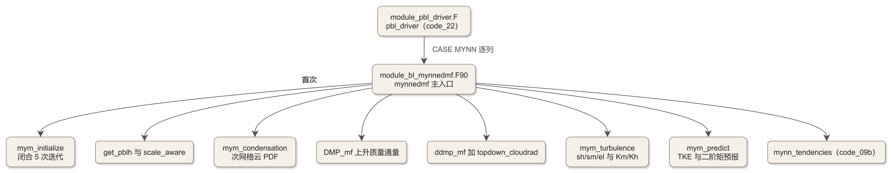
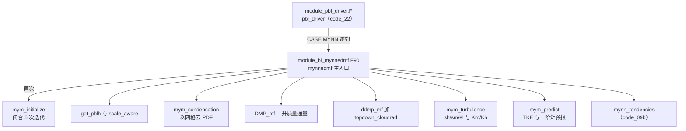

# 文库 code_09a：module_bl_mynnedmf.F90 上半——主入口、闭合初始化、混合长与湍流闭合

<!-- 本文件为骨架：CODE 占位符由 workspace/scripts/code_extract.py 注入保真块。
     组装命令：
     D:\Code\miniforge3\envs\WRFlearn\python.exe workspace\scripts\code_extract.py assemble source\WRFv4.8.0\WRFV4.8.0\phys\MYNN-EDMF\module_bl_mynnedmf.F90 workspace\code_library\skel_code_09a.md doc\code\code_09a_module_bl_mynnedmf.md -->

## 09a.0 版本指纹与阅读说明

- **源文件**：`phys/MYNN-EDMF/module_bl_mynnedmf.F90`（WRF 4.8.0，自由格式 .F90），全文 8776 行。本篇覆盖 L1–L3917（文件头、主入口 `mynnedmf`、闭合初始化、Level 2、混合长族、湍流闭合、二阶矩预测、次网格云 PDF）；L3923–L8776（`mynn_tendencies` 倾向驱动、`DMP_mf/ddmp_mf` 质量通量、`GET_PBLH`、三对角求解器族、`topdown_cloudrad`、blend 函数族）见 code_09b。
- **编译实体勘正**：MYNN 方案没有同名单文件 `module_bl_mynn.F`——编译实体就是本文件（教材 ch14 已勘正的口径）。
- **保真承诺**：所有代码块由 `code_extract.py` v1.1 按字节抽取（剥离行号前缀后与源逐位一致，md5 指纹可复核）。
- **符号口径**：闭合常数（a1/a2/b1/b2/c1/c5/g1/g2）与括号约定遵循 Nakanishi & Niino 系列；大气物理符号按《大气物理学》（盛裴轩）——位温/虚位温对应见教材 ch13 §13.2。
- **教材锚点**：ch14（边界层方案族：MYNN-EDMF 精读、PBLH 三型判据、BouLac 亲缘）、ch21（调用节拍）。

## 09a.1 一句话定位与调用链

**一句话**：`module_bl_mynnedmf.F90` 是 MYNN-EDMF 边界层方案的完整实现——1.5 阶（Level 2.5）到 3 阶湍流闭合（TKE + 温湿二阶矩）叠加上升/下沉质量通量（EDMF），一次列调用内完成“PBL 高度诊断 → 次网格云 → 湍流扩散系数 → TKE 预报 → 九变量倾向”全链条。



<details><summary>原始 Mermaid 源码（可点击展开）</summary>

<!--

-->

</details>

- 调用位：`module_pbl_driver.F` 的 `CASE (MYNN)` 分支每时间步逐列调用（code_22）；文件头注释里的流程图（原文 L45–L59）与本图一致。
- 与教材 ch14 的对应：`qke = 2·TKE` 的口径、PBLH 混合判据、BouLac 混合长亲缘（`boulac_length` 系从 BouLac 方案移植）都在本篇落地。

## 09a.2 文件头注释原文与精译

<!-- code_extract code_extract.py v1.1
source: phys/MYNN-EDMF/module_bl_mynnedmf.F90
ranges: L1-L134
file_lines: 8776
file_md5: ec93fee9745a3e0b25be55a61b5aff8a
display: line-numbered (strip L-prefix and !file: line to restore)
range_md5: 7f1c322f102ef8c64d0f5c24fa00d510
seg_lines: 134
-->

```fortran
!file: phys/MYNN-EDMF/module_bl_mynnedmf.F90    L1-L134
L00001  !>\file module_bl_mynnedmf.F90
L00002  !! This file contains the entity of MYNN-EDMF PBL scheme.
L00003  ! **********************************************************************
L00004  ! *   An improved Mellor-Yamada turbulence closure model               *
L00005  ! *                                                                    *
L00006  ! *      Original author: M. Nakanishi (N.D.A), naka@nda.ac.jp         *
L00007  ! *      Translated into F90 and implemented in WRF-ARW by:            *
L00008  ! *                       Mariusz Pagowski (NOAA-GSL)                  *
L00009  ! *      Subsequently developed by:                                    *
L00010  ! *                 Joseph Olson, Jaymes Kenyon (NOAA/GSL),            *
L00011  ! *                 Wayne Angevine (NOAA/CSL), Kay Suselj (NASA/JPL),  *
L00012  ! *                 Franciano Puhales (UFSM), Laura Fowler (NCAR),     *
L00013  ! *                 Elynn Wu (UCSD), and Jordan Schnell (NOAA/GSL),    *
L00014  ! *                 Tiziani Cherubin (MKWC, Univ. Hawaii),             *
L00015  ! *                 Xia Sun (NOAA/GSL/CIRES)                           *
L00016  ! *                                                                    *
L00017  ! *   Contents:                                                        *
L00018  ! *                                                                    *
L00019  ! *   mynnedmf - the main subroutine which calls all other routines    *
L00020  ! *   --------------                                                   *
L00021  ! *     1. mym_initialize  (to be called once initially)               *
L00022  ! *        gives the closure constants and initializes the turbulent   *
L00023  ! *        quantities.                                                 *
L00024  ! *     2. get_pblh                                                    *
L00025  ! *        Calculates the boundary layer height                        *
L00026  ! *     3. scale_aware                                                 *
L00027  ! *        Calculates scale-adaptive tapering functions                *
L00028  ! *     4. mym_condensation                                            *
L00029  ! *        determines the liquid water content and the cloud fraction  *
L00030  ! *        diagnostically.                                             *
L00031  ! *     5. dmp_mf                                                      *
L00032  ! *        Calls the (nonlocal) mass-flux component                    *
L00033  ! *     6. ddmp_mf                                                     *
L00034  ! *        Calls the downdraft mass-flux component                     *
L00035  ! *    (-) mym_level2      (called in the other subroutines)           *
L00036  ! *        calculates the stability functions at Level 2.              *
L00037  ! *    (-) mym_length      (called in the other subroutines)           *
L00038  ! *        calculates the master length scale.                         *
L00039  ! *     7. mym_turbulence                                              *
L00040  ! *        calculates the vertical diffusivity coefficients and the    *
L00041  ! *        production terms for the turbulent quantities.              *
L00042  ! *     8. mym_predict                                                 *
L00043  ! *        predicts the turbulent quantities at the next step.         *
L00044  ! *                                                                    *
L00045  ! *             call mym_initialize                                    *
L00046  ! *                  |                                                 *
L00047  ! *                  |<----------------+                               *
L00048  ! *                  |                 |                               *
L00049  ! *             call get_pblh          |                               *
L00050  ! *             call scale_aware       |                               *
L00051  ! *             call mym_condensation  |                               *
L00052  ! *             call dmp_mf            |                               *
L00053  ! *             call ddmp_mf           |                               *
L00054  ! *             call mym_turbulence    |                               *
L00055  ! *             call mym_predict       |                               *
L00056  ! *                  |                 |                               *
L00057  ! *                  |-----------------+                               *
L00058  ! *                  |                                                 *
L00059  ! *                 end                                                *
L00060  ! *                                                                    *
L00061  ! *   Variables worthy of special mention:                             *
L00062  ! *     tref   : Reference temperature                                 *
L00063  ! *     thl    : Liquid water potential temperature                    *
L00064  ! *     qw     : Total water (water vapor+liquid water) content        *
L00065  ! *     ql     : Liquid water content                                  *
L00066  ! *     vt, vq : Functions for computing the buoyancy flux             *
L00067  ! *     qke    : 2 * TKE                                               *
L00068  ! *     el     : mixing length                                         *
L00069  ! *                                                                    *
L00070  ! *     If the water contents are unnecessary, e.g., in the case of    *
L00071  ! *     ocean models, thl is the potential temperature and qw, ql, vt  *
L00072  ! *     and vq are all zero.                                           *
L00073  ! *                                                                    *
L00074  ! *   Grid arrangement:                                                *
L00075  ! *             k+1 +---------+                                        *
L00076  ! *                 |         |     i = 1 - nx                         *
L00077  ! *             (k) |    *    |     k = 1 - nz                         *
L00078  ! *                 |         |                                        *
L00079  ! *              k  +---------+                                        *
L00080  ! *                 i   (i)  i+1                                       *
L00081  ! *                                                                    *
L00082  ! *     All the predicted variables are defined at the center (*) of   *
L00083  ! *     the grid boxes. The diffusivity coefficients and two of their  *
L00084  ! *     components (el and stability functions sh & sm) are, however,  *
L00085  ! *     defined on the walls of the grid boxes.                        *
L00086  ! *     # Upper boundary values are given at k=nz.                     *
L00087  ! *                                                                    *
L00088  ! *   References:                                                      *
L00089  ! *     1. Nakanishi, M., 2001:                                        *
L00090  ! *        Boundary-Layer Meteor., 99, 349-378.                        *
L00091  ! *     2. Nakanishi, M. and H. Niino, 2004:                           *
L00092  ! *        Boundary-Layer Meteor., 112, 1-31.                          *
L00093  ! *     3. Nakanishi, M. and H. Niino, 2006:                           *
L00094  ! *        Boundary-Layer Meteor., 119, 397-407.                       *
L00095  ! *     4. Nakanishi, M. and H. Niino, 2009:                           *
L00096  ! *        Jour. Meteor. Soc. Japan, 87, 895-912.                      *
L00097  ! *     5. Olson J. and coauthors, 2019: A description of the          *
L00098  ! *        MYNN-EDMF scheme and coupling to other components in        *
L00099  ! *        WRF-ARW. NOAA Tech. Memo. OAR GSD, 61, 37 pp.,              *
L00100  ! *        https://doi.org/10.25923/n9wm-be49.                         * 
L00101  ! *     6. Puhales, Franciano S. and coauthors, 2020: Turbulent        *
L00102  ! *        Kinetic Energy Budget for MYNN-EDMF PBL Scheme in WRF model.*
L00103  ! *        Universidade Federal de Santa Maria Technical Note. 9 pp.   *
L00104  ! *        https://repositorio.ufsm.br/handle/1/28327                  *
L00105  ! *     7. Olson, J. B., W. M. Angevine, D. D. Turner, X. Sun,         *
L00106  ! *        J. M. Simonson, C. Evans, J. S. Kenyon, H. Li, J. Schnell,  *
L00107  ! *        F. S. Puhales, T. Cherubini, W. Li, and M. Zhang, 2026:     *
L00108  ! *        A Description of the MYNN-EDMF Turbulence Scheme. NOAA Tech.*
L00109  ! *        Memo. OAR GSL-77. 60 pp. https://doi.org/10.25923/rahr-sj70 *
L00110  !***********************************************************************
L00111  ! notes on the versioning of the myhnn-edmf:
L00112  !
L00113  ! Version 1.0.0: Described by references 1-4 (above). Implemented into WRF
L00114  !    WRFv3.0-v3.4.1 for HRRRv1/RAPv2.
L00115  !
L00116  ! Version 2.0.0: Still best described by references 1-4 (above). Approximately pplies to
L00117  !    WRFv3.5-v3.6.1 and used in HRRRv2/RAPv3.
L00118  !
L00119  ! Version 3.0.0:  Still best described by references 1-4 (above), despite significant
L00120  !    code departures from the original scheme. This version pproximately pplies to
L00121  !    WRFv3.7-3.9 and used for HRRRv3/RAPv4.
L00122  !
L00123  ! Version 4.0.0: Best described by reference 5 (above). Approximately applies to
L00124  !    WRFv4.0-v4.4 (but not well synced during this period) and used for HRRRv4/RAPv5.
L00125  !
L00126  ! Version 5.0.0: Mods stemming from both RRFSv1 development and community development in WRF.
L00127  !    Approximately applies to WRFv4.5-v4.7 / CCPP
L00128  !
L00129  ! Version 6.0.0: Mods stemming from both RRFSv2+ development and community development in WRF.
L00130  !     This version marks the begining of the MYNN-EDMF submodule repository, where all
L00131  !     development is now tracked in a public-facing github repository (https://github.com/NCAR/MYNN-EDMF.git).
L00132  !     WRFv4.8 / CCPP / MPAS. Many updates captured in the Olson et al. (2026) MYNN-EDMF
L00133  !     tech note (see listed references above).
L00134  !====================================================================
```

> **逐句精译与解读**：
>
> - **血统**：原始作者 Nakanishi（日本防卫大学）；F90 化与 WRF 移植 Mariusz Pagowski（NOAA/GSL）；此后 NOAA/GSL 的 Olson、Kenyon、Angevine 等人持续开发——**这是业务驱动的演进线**（HRRR 快速更新循环是它的主战场）。
> - **版本史**（L111–L133 原注释）：V1.0（WRFv3.0–3.4，HRRRv1）→ V2.0（HRRRv2）→ V3.0（HRRRv3，代码已大幅偏离原方案）→ V4.0（WRFv4.0–4.4，Olson et al. 2019 技术备忘录）→ V5.0（RRFSv1，WRFv4.5–4.7/CCPP）→ **V6.0（WRFv4.8/CCPP/MPAS）**——开发转入独立 GitHub 仓库 NCAR/MYNN-EDMF，配套 Olson et al. (2026) 技术备忘录 GSL-77。**版本 6 的代码已经是“独立项目定期同步进 WRF”的形态**，读 4.8 源码时要意识到它比 WRF 主干更“新”。
> - **变量特记**（L61–L72）：`thl` 液水位温（θ_l = θ − L_v/c_p·q_c − L_s/c_p·q_i）、`qw` 总水、`qke = 2·TKE`（Mellor-Yamada 系的 q² 记法）、`el` 主混合长、`vt/vq` 浮力通量函数——“若不需水物质（如海洋模式），thl 即位温、vt/vq 为零”的说明点明了这套闭合对干/湿配置的兼容设计。
> - **网格约定**（L74–L87）：预报量在格心，扩散系数与 el/sh/sm 在格面（interface）——**stagger 纪律**贯穿全部子程序（参数表里 `kts:kte+1` 即界面维度）。
> - **参考文献七篇**：NN2001/2004/2006/2009 四篇理论基础 + Olson 2019 技术备忘录（整体描述）+ Puhales 2020（TKE 收支）+ Olson 2026（最新描述）。**读本文件时手边放 NN2009 与 Olson 2026 两篇**。

## 09a.3 模块头与调试开关

<!-- code_extract code_extract.py v1.1
source: phys/MYNN-EDMF/module_bl_mynnedmf.F90
ranges: L136-L147
file_lines: 8776
file_md5: ec93fee9745a3e0b25be55a61b5aff8a
display: line-numbered (strip L-prefix and !file: line to restore)
range_md5: 57829d3b59c941750781078938fc3372
seg_lines: 12
-->

```fortran
!file: phys/MYNN-EDMF/module_bl_mynnedmf.F90    L136-L147
L00136  module module_bl_mynnedmf
L00137  
L00138   implicit none
L00139  
L00140  !--------------------------------------------------------------------
L00141  ! global debugging configuration options:
L00142  !--------------------------------------------------------------------
L00143   logical,parameter:: debug_code = .false.
L00144   integer,parameter:: idbg       = 452 !specific i-point to write out
L00145   integer,parameter:: jdbg       = 272 !specific j-point to write out
L00146  
L00147  contains
```

> 模块级只有三个调试常数（`debug_code=false`、`idbg/jdbg` 指定诊断格点）——**与 Thompson 的“无状态模块”同一哲学**：全部状态在实参里，模块零共享数据。`contains` 之后 30 个子程序全部平铺。

## 09a.4 主入口 `mynnedmf` 逐段精讲

### 09a.4.1 签名与实参契约

<!-- code_extract code_extract.py v1.1
source: phys/MYNN-EDMF/module_bl_mynnedmf.F90
ranges: L157-L218
file_lines: 8776
file_md5: ec93fee9745a3e0b25be55a61b5aff8a
display: line-numbered (strip L-prefix and !file: line to restore)
range_md5: d295afa56cabbc05bee51b5ef6ba952f
seg_lines: 62
-->

```fortran
!file: phys/MYNN-EDMF/module_bl_mynnedmf.F90    L157-L218
L00157    subroutine mynnedmf(            i                 , j                 , &
L00158               initflag           , restart           , cycling           , &
L00159               delt               , dz1               , dx                , &
L00160               !3d state variables
L00161               u1                 , v1                , w1                , &
L00162               th1                , sqv1              , sqc1              , &
L00163               sqi1               , sqs1              , qnc1              , &
L00164               qni1               , qnwfa1            , qnifa1            , &
L00165               qnbca1             , ozone1            , pres1             , &
L00166               ex1                , rho1              , tk1               , &
L00167               !2d surface fields
L00168               xland              , ts                , qsfc              , &
L00169               ps                 , ust               , ch                , &
L00170               hfx                , qfx               , znt               , &
L00171               wspd               , uoce              , voce              , &
L00172               !eddy-diffusivity
L00173               qke1               , qke_adv1          , el1               , &
L00174               sh1                , sm1               , kh1               , &
L00175               km1                ,                                         &
L00176               !smoke variables
L00177               nchem              , ndvel             ,                     &
L00178               chem1              , vdep              , frp               , &
L00179               emis_ant_no        , mix_chem,enh_mix  , settle1           , &
L00180               !generic scalar array
L00181               scalars            , nscalars          ,                     &
L00182               !higher-order moments
L00183               tsq1               , qsq1              , cov1              , &
L00184               !tendencies
L00185               du1                , dv1               , dth1              , &
L00186               dqv1               , dqc1              , dqi1              , &
L00187               dqnc1              , dqni1             , dqs1              , &
L00188               dqnwfa1            , dqnifa1           , dqnbca1           , &
L00189               dozone1            , rthraten1         ,                     &
L00190               !2d output
L00191               pblh               , kpbl              , maxwidth_dd       , &
L00192               maxwidth           , maxmf             , ztop_plume        , &
L00193               excess_h           , excess_q          , maxmf_dd          , &
L00194               maxtkeprod         , cldtop_cooling    , ent_eff           , &
L00195               !tke budget arrays
L00196               dqke1              , qwt1              , qshear1           , &
L00197               qbuoy1             , qdiss1            ,                     &
L00198               !subgrid clouds
L00199               qc_bl1             , qi_bl1            , cldfra_bl1        , &
L00200               !namelist configurations option
L00201               bl_mynn_tkeadvect  , tke_budget        , bl_mynn_cloudpdf  , &
L00202               bl_mynn_mixlength  , bl_mynn_closure   , bl_mynn_ess       , &
L00203               bl_mynn_edmf       , bl_mynn_edmf_mom  , bl_mynn_edmf_tke  , &
L00204               bl_mynn_mixscalars , bl_mynn_mixaerosols,bl_mynn_mixnumcon , &
L00205               bl_mynn_output     , bl_mynn_cloudmix  , bl_mynn_mixqt     , &
L00206               bl_mynn_edmf_dd    ,                                         &
L00207               !3d emdf output
L00208               edmf_a1            , edmf_w1           , edmf_qt1          , &
L00209               edmf_thl1          , edmf_ent1         , edmf_qc1          , &
L00210               sub_thl1           , sub_sqv1          , det_thl1          , &
L00211               det_sqv1           ,                                         &
L00212               !spp
L00213               spp_pbl            , pattern_spp_pbl1  ,                     &
L00214               !check flags
L00215               FLAG_QC            , FLAG_QI           , FLAG_QNC          , &
L00216               FLAG_QNI           , FLAG_QS           , FLAG_QNWFA        , &
L00217               FLAG_QNIFA         , FLAG_QNBCA        , FLAG_OZONE        , &
L00218               KTS                , KTE               , errmsg, errflg      )
```

> - **实参即接口清单**（对照教材 ch14 §14.7 的 namelist 全表）：17 个 `bl_mynn_*` namelist 开关直接作为形参传入（由 `pbl_driver` 从 `config_flags` 解包）——**开关不经全局模块、逐列透传**，CCPP 化的痕迹（物理与框架解耦）。
> - **字段三组**：环境/表面（`u1…tk1` 状态列 + `ts/qsfc/ps/ust/ch/hfx/qfx` 表面量）、湍流量（`qke1/el1/sh1/sm1/kh1/km1` + 二阶矩 `tsq1/qsq1/cov1`）、输出（倾向 `du1…` 与 EDMF 诊断 `edmf_a1/edmf_w1/…`）。
> - **`FLAG_*` 九个逻辑量**：与 driver 的 `f_*` 同源（Registry 包判定字段在场性），方案内据此跳过缺失物种——与 microphysics_driver 的 OPTIONAL 实参同一套“在场即配置”哲学。
> - **`spp_pbl/pattern_spp_pbl1`**：随机参数扰动（Stochastic Parameter Perturbation）入口——湍流系数的集合扰动从这一对参数进（用法见 `mym_turbulence` 末尾）。

<!-- code_extract code_extract.py v1.1
source: phys/MYNN-EDMF/module_bl_mynnedmf.F90
ranges: L220-L341
file_lines: 8776
file_md5: ec93fee9745a3e0b25be55a61b5aff8a
display: line-numbered (strip L-prefix and !file: line to restore)
range_md5: e93d17d6dca6674f2495234a14f32f33
seg_lines: 122
-->

```fortran
!file: phys/MYNN-EDMF/module_bl_mynnedmf.F90    L220-L341
L00220  !-------------------------------------------------------------------
L00221   use module_bl_mynnedmf_common, only: cp,xlvcp,xlscp,p608,p1000mb,rcp,&
L00222        karman,gtr,cphh_st,cphm_unst,cphh_unst,b1,zero,one,p01,p5,      &
L00223        five,kind_phys
L00224      
L00225   integer, intent(in) :: initflag
L00226   logical, intent(in) :: restart,cycling
L00227   integer, intent(in) :: tke_budget
L00228   integer, intent(in) :: bl_mynn_cloudpdf
L00229   integer, intent(in) :: bl_mynn_mixlength
L00230   integer, intent(in) :: bl_mynn_edmf
L00231   integer, intent(in) :: bl_mynn_edmf_dd
L00232   logical, intent(in) :: bl_mynn_tkeadvect
L00233   integer, intent(in) :: bl_mynn_edmf_mom
L00234   integer, intent(in) :: bl_mynn_edmf_tke
L00235   integer, intent(in) :: bl_mynn_mixscalars
L00236   integer, intent(in) :: bl_mynn_mixaerosols
L00237   integer, intent(in) :: bl_mynn_mixnumcon
L00238   integer, intent(in) :: bl_mynn_output
L00239   integer, intent(in) :: bl_mynn_cloudmix
L00240   integer, intent(in) :: bl_mynn_mixqt
L00241   integer, intent(in) :: bl_mynn_ess
L00242   real(kind_phys), intent(in) :: bl_mynn_closure
L00243  
L00244   logical, intent(in) :: FLAG_QI,FLAG_QNI,FLAG_QC,FLAG_QNC,&
L00245                          FLAG_QNWFA,FLAG_QNIFA,FLAG_QNBCA, &
L00246                          FLAG_OZONE,FLAG_QS
L00247  
L00248   logical, intent(in) :: mix_chem,enh_mix
L00249  
L00250   integer, intent(in) :: KTS,KTE
L00251  
L00252   character(len=*),intent(out):: &
L00253      errmsg        ! output error message (-).
L00254   integer,intent(out):: &
L00255      errflg        ! output error flag (-).
L00256  
L00257  #ifdef HARDCODE_VERTICAL
L00258  # define kts 1
L00259  # define kte HARDCODE_VERTICAL
L00260  #endif
L00261  
L00262  !scalar variables
L00263   real(kind_phys), intent(in)    :: delt
L00264   real(kind_phys), intent(in)    :: dx
L00265   real(kind_phys), intent(in)    :: ust,ch,qsfc,ps,wspd,xland
L00266   real(kind_phys), intent(in)    :: ts,znt,hfx,qfx,uoce,voce
L00267   real(kind_phys), intent(inout) :: pblh,excess_h,excess_q
L00268   real(kind_phys), intent(inout) :: maxmf,maxwidth,ztop_plume
L00269   real(kind_phys), intent(inout) :: maxmf_dd,maxwidth_dd,maxtkeprod,cldtop_cooling,ent_eff
L00270   integer,         intent(in)    :: i,j
L00271   integer,         intent(inout) :: kpbl
L00272  !local
L00273   real(kind_phys) :: psig_bl,psig_shcu,rmol,rmolh
L00274   integer :: imd,jmd
L00275   integer :: k,kproblem
L00276  
L00277  !column variables (all end with a "1")
L00278   real(kind_phys), dimension(kts:kte), intent(in)      ::            &
L00279         dz1,u1,v1,w1,th1,pres1,ex1,rho1,tk1,rthraten1
L00280   real(kind_phys), dimension(kts:kte), intent(inout)   ::            &
L00281         sqv1,sqc1,sqi1,sqs1,qni1,qnc1,qnwfa1,qnifa1,qnbca1,ozone1,   &
L00282         qke1,tsq1,qsq1,cov1,qke_adv1,                                &
L00283         sh1,sm1,el1,                                                 & !interface, but kte+1 not included
L00284         du1,dv1,dth1,dqv1,dqc1,dqi1,dqs1,                            &
L00285         dqni1,dqnc1,dqnwfa1,dqnifa1,dqnbca1,dozone1,                 &
L00286         qc_bl1,qi_bl1,cldfra_bl1,edmf_a1,edmf_w1,                    &
L00287         edmf_qt1,edmf_thl1,edmf_ent1,edmf_qc1,                       &
L00288         sub_thl1,sub_sqv1,det_thl1,det_sqv1
L00289   real(kind_phys), dimension(kts:kte), intent(inout), optional ::    &
L00290         qwt1,qshear1,qbuoy1,qdiss1,dqke1
L00291   real(kind_phys), dimension(kts:kte), intent(out)     ::            & !interface
L00292         kh1,km1
L00293  !local
L00294   real(kind_phys), dimension(kts:kte)                  ::            &
L00295         qc_bl1_old,qi_bl1_old,cldfra_bl1_old,dummy1,dummy2,          &
L00296         diss_heat1,                                                  &
L00297         thl1,thv1,thlv1,qv1,qc1,qi1,qs1,sqw1,                        &
L00298         thl_tot1,qc_tot1,qi_tot1,                                    &
L00299         dfm1, dfh1, dfq1, tcd1, qcd1,                                &
L00300         pdk1, pdt1, pdq1, pdc1,                                      &
L00301         vt1, vq1, sgm1, kzero1
L00302   real(kind_phys), dimension(kts:kte)                  ::            &
L00303         edmf_u1,edmf_v1,edmf_qv1
L00304   
L00305  !smoke/chemical arrays
L00306   integer, intent(in) ::   nchem, ndvel
L00307   real(kind_phys), dimension(kts:kte,nchem), intent(inout) :: chem1
L00308   real(kind_phys), dimension(kts:kte,nchem), intent(in   ) :: settle1
L00309   real(kind_phys), dimension(ndvel), intent(in)    :: vdep
L00310   real(kind_phys),                   intent(in)    :: frp,emis_ant_no
L00311   real(kind_phys), dimension(kts:kte+1,nchem)      :: s_awchem1
L00312   integer :: ic
L00313  !scalar array
L00314   integer, intent(in) ::   nscalars 
L00315   real(kind_phys), dimension(kts:kte,nscalars), intent(inout) :: scalars
L00316   real(kind_phys), dimension(kts:kte+1,nscalars)      :: s_awscalars1
L00317  
L00318  !local vars
L00319  !mass-flux variables
L00320   real(kind_phys), dimension(kts:kte) ::                             &
L00321         dth1mf,dqv1mf,dqc1mf,du1mf,dv1mf
L00322   real(kind_phys), dimension(kts:kte) ::                             &
L00323         edmf_a_dd1,edmf_w_dd1,edmf_qt_dd1,edmf_thl_dd1,              &
L00324         edmf_ent_dd1,edmf_qc_dd1
L00325   real(kind_phys), dimension(kts:kte) ::                             &
L00326         sub_u1,sub_v1,det_sqc1,det_u1,det_v1
L00327   real(kind_phys), dimension(kts:kte+1) ::                           & !interface
L00328         s_aw1,s_awthl1,s_awqt1,                                      &
L00329         s_awqv1,s_awqc1,s_awu1,s_awv1,s_awqke1,s_awqsq1,             &
L00330         s_awqnc1,s_awqni1,s_awqnwfa1,s_awqnifa1,                     &
L00331         s_awqnbca1
L00332   real(kind_phys), dimension(kts:kte+1) ::                           & !interface
L00333         sd_aw1,sd_awthl1,sd_awqt1,                                   &
L00334         sd_awqv1,sd_awqc1,sd_awu1,sd_awv1,sd_awqke1,                 &
L00335         sd_awqi1,sd_awqnc1,sd_awqni1,                                &
L00336         sd_awqnwfa1,sd_awqnifa1
L00337   integer:: ktop_plume
L00338   real(kind_phys), dimension(kts:kte+1) :: zw1              !interface
L00339  !mass flux (or analytical) tke production
L00340   real(kind_phys), dimension(kts:kte) :: TKEprod_dn,TKEprod_up
L00341  
```

> - **依赖极简**：唯一的模块依赖是 `module_bl_mynnedmf_common`（常数包：cp/xlvcp/karman/b1/zero… 与 kind_phys 精度参数）——**方案自带常数命名空间**，与 model_constants 隔离（教材 ch14 §14.3 讲过 MYNN 常数体系）。
> - **列变量全部 `*1` 后缀**（单列版本）：`sqv1/sqc1…` 是比湿（specific q，分母含干空气+水汽）——注意 L665–L668 处转换成混合比 `qv1 = sqv1/(1−sqv1)`；`sh1/sm1/el1` 注释明确“interface 维度但不含 kte+1”。
> - **局部工作数组**：`thl1/thv1/thlv1` 热力学三兄弟、`dfm1/dfh1/dfq1` 扩散系数、`pdk1/pdt1/pdq1/pdc1` 生产项、`s_aw*1/sd_aw*1` 两组界面量（aw = area-weighted，上升/下沉质量通量的界面通量）、`edmf_*` 上升流属性族。
> - `errflg/errmsg` 输出对：CCPP 标准错误协议。

### 09a.4.2 编译期配置选项

<!-- code_extract code_extract.py v1.1
source: phys/MYNN-EDMF/module_bl_mynnedmf.F90
ranges: L342-L384
file_lines: 8776
file_md5: ec93fee9745a3e0b25be55a61b5aff8a
display: line-numbered (strip L-prefix and !file: line to restore)
range_md5: 107cc30fcfc6a828f50c7e3efe0d6d98
seg_lines: 43
-->

```fortran
!file: phys/MYNN-EDMF/module_bl_mynnedmf.F90    L342-L384
L00342  !-------------------------------------------------- 
L00343  !-------- configuration options:
L00344  !--------------------------------------------------
L00345  !Option to switch flux-profile relationship for surface (from Puhales et al. 2020)
L00346  !0: use original Dyer-Hicks, 1: use Cheng-Brustaert and Blended COARE
L00347   integer,parameter:: bl_mynn_stfunc = 0
L00348  
L00349  !>Use Canuto/Kitamura mod (remove Ric and negative TKE) (real; 1.0:yes, 0.0:no)
L00350  !!For more info, see Canuto et al. (2008 JAS) and Kitamura (Journal of the
L00351  !!Meteorological Society of Japan, Vol. 88, No. 5, pp. 857-864, 2010).
L00352  !!Note that this change required further modification of other parameters
L00353  !!above (c2, c3). If you want to remove this option, set c2 and c3 constants
L00354  !!(above) back to NN2009 values (see commented out lines next to the
L00355  !!parameters above). This only removes the negative TKE problem
L00356  !!but does not necessarily improve performance - neutral impact. Also,
L00357  !!it is a real variable because it is used within an equation to
L00358  !!activate/deactive this option
L00359   real(kind_phys),parameter:: CKmod   = 1.0
L00360  
L00361  !>Parameter used for the conversion of tsq to qpe when using the TTE closure
L00362   real(kind_phys),parameter:: taue    = 80.
L00363  
L00364  !>Option to control the upwind/centerd finite differencing of explicit mass-flux solver when
L00365  !>bl_mynn_edmf = 2  (0: mass flux inactive, 1: implicit, 2: explicit)
L00366   real(kind_phys),parameter:: upwind  = 1.0 ! upwind=1.0: use upwind approximation for mass-flux calculation
L00367                                             ! upwind=0.5: use centered difference for mass-flux calculation
L00368                                             ! explicit mass-flux can use either upwind or centered-difference
L00369                                             ! implicit mass-flux only uses the centered differencing method.
L00370  !---------------------------------------------------
L00371   
L00372   real(kind_phys) :: cpm,sqcg,flt,fltv,flq,flqv,flqc,                &
L00373         pmz,phh,exnerg,zet,phi_m,                                    &
L00374         afk,abk,th_sfc,wsp
L00375  
L00376   logical :: INITIALIZE_QKE,problem
L00377  
L00378  !stochastic fields
L00379   integer,  intent(in)                             :: spp_pbl
L00380   real(kind_phys), dimension(kts:kte), intent(in)  :: pattern_spp_pbl1
L00381  
L00382  !substepping TKE
L00383   integer :: nsub
L00384   real(kind_phys) :: delt2
```

> - **`bl_mynn_stfunc=0`**（PARAMETER，编译期写死）：0 = 原始 Kansas 型通量廓线（Dyer–Hicks），1 = Puhales et al. (2020) 的 Cheng–Brutsaert 与 COARE 混合——**切换开关但默认关闭**，2020 新物理以参数形式待命。
> - **`CKmod=1.0`**：Canuto/Kitamura 修正（去除临界 Ric 与负 TKE 问题）——注释明说“启用它需要连带改 c2/c3 常数，若要退回 NN2009 原值须把上方的常数改回”。**一个开关牵动常数族**是这套闭合改造的第一陷阱。
> - **`taue=80`**（s）：温度方差到潜在能量（qpe）的转换时间尺度——TTE（total turbulent energy）闭合的核心参数（Machulskaya & Mironov 2020）。
> - **`upwind=1.0`**：显式质量通量求解器（`bl_mynn_edmf=2`）的上风/中心差分选择——1.0 上风（保守）、0.5 中心（精确）。

### 09a.4.3 调试、清零与首次初始化

<!-- code_extract code_extract.py v1.1
source: phys/MYNN-EDMF/module_bl_mynnedmf.F90
ranges: L386-L449
file_lines: 8776
file_md5: ec93fee9745a3e0b25be55a61b5aff8a
display: line-numbered (strip L-prefix and !file: line to restore)
range_md5: b5ec78160f3cd564961fb18d83f58071
seg_lines: 64
-->

```fortran
!file: phys/MYNN-EDMF/module_bl_mynnedmf.F90    L386-L449
L00386      errmsg = " "
L00387      errflg = 0
L00388  
L00389      if (debug_code) then !check incoming values
L00390         problem = .false.
L00391         do k=kts,kte
L00392            wsp  = sqrt(u1(k)**2 + v1(k)**2)
L00393            if (abs(hfx) > 1200. .or. abs(qfx) > 0.001 .or.           &
L00394                wsp > 270. .or. tk1(k) > 380. .or. tk1(k) < 160. .or. &
L00395                sqv1(k) < zero .or. sqc1(k) < zero .or.               &
L00396                (ps-pres1(kts)) < zero) then
L00397               kproblem = k
L00398               problem = .true.
L00399               print*,"Incoming problem at: i=",i," j=",j," k=",k
L00400               print*," QFX=",qfx," HFX=",hfx
L00401               print*," wsp=",wsp," T=",tk1(k)
L00402               print*," qv=",sqv1(k)," qc=",sqc1(k)
L00403               print*," u*=",ust," wspd=",wspd
L00404               print*," xland=",xland," ts=",ts
L00405               print*," ps=",ps,"delp1=",ps-pres1(kts)
L00406               print*," znt=",znt," dx=",dx," dz(1)=",dz1(1)
L00407            endif
L00408         enddo
L00409         if (problem) then
L00410            print*,"===tk:",tk1(max(kproblem-3,1):min(kproblem+3,kte))
L00411            print*,"===qv:",sqv1(max(kproblem-3,1):min(kproblem+3,kte))
L00412            print*,"===qc:",sqc1(max(kproblem-3,1):min(kproblem+3,kte))
L00413            print*,"===qi:",sqi1(max(kproblem-3,1):min(kproblem+3,kte))
L00414            print*,"====u:",u1(max(kproblem-3,1):min(kproblem+3,kte))
L00415            print*,"====v:",v1(max(kproblem-3,1):min(kproblem+3,kte))
L00416            print*,"====p:",pres1(max(kproblem-3,1):min(kproblem+3,kte))
L00417         endif
L00418      endif
L00419  
L00420  !***  Begin debugging
L00421      IMD=10
L00422      JMD=10
L00423  !***  End debugging
L00424  
L00425      !initialize 3d output arrays
L00426      edmf_a1      =zero
L00427      edmf_w1      =zero
L00428      edmf_qt1     =zero
L00429      edmf_thl1    =zero
L00430      edmf_ent1    =zero
L00431      edmf_qc1     =zero
L00432      edmf_u1      =zero
L00433      edmf_v1      =zero
L00434      edmf_qv1     =zero
L00435      sub_thl1     =zero
L00436      sub_sqv1     =zero
L00437      det_thl1     =zero
L00438      det_sqv1     =zero
L00439      edmf_a_dd1   =zero
L00440      edmf_w_dd1   =zero
L00441      edmf_qc_dd1  =zero
L00442      !initialize 2d fields
L00443      ktop_plume   =0    !int
L00444      ztop_plume   =zero
L00445      maxwidth     =zero
L00446      maxmf        =zero
L00447      excess_h     =zero
L00448      excess_q     =zero
L00449      kzero1       =zero
```

> - **入口体检**（debug_code 开启时）：hfx>1200 W/m²、风速>270 m/s、温度出 [160,380] K、负比湿——**输入越界打印格点现场**（排查物理-动力接口异常的第一入口）。
> - **EDMF 输出数组清零**：`edmf_*1`（上升流面积/速度/属性）、`sub_*/det_*`（次网格通量的上升/下沉分解）——每列每步从零算起。

<!-- code_extract code_extract.py v1.1
source: phys/MYNN-EDMF/module_bl_mynnedmf.F90
ranges: L451-L584
file_lines: 8776
file_md5: ec93fee9745a3e0b25be55a61b5aff8a
display: line-numbered (strip L-prefix and !file: line to restore)
range_md5: f71af4d84e026f7d3adb577484478d54
seg_lines: 134
-->

```fortran
!file: phys/MYNN-EDMF/module_bl_mynnedmf.F90    L451-L584
L00451      ! DH* CHECK HOW MUCH OF THIS INIT IF-BLOCK IS ACTUALLY NEEDED FOR RESTARTS
L00452  !> - Within the MYNN-EDMF, there is a dependecy check for the first time step,
L00453  !! If true, a three-dimensional initialization loop is entered. Within this loop,
L00454  !! several arrays are initialized and k-oriented (vertical) subroutines are called 
L00455  !! at every i and j point, corresponding to the x- and y- directions, respectively.  
L00456      if (initflag > 0 .and. .not.restart) then
L00457  
L00458         !test to see if we want to initialize qke
L00459         if ( (restart .or. cycling)) then
L00460            if (maxval(qke1(:)) < 0.0002) then
L00461               initialize_qke = .true.
L00462               !print*,"qke is too small, must initialize"
L00463            else
L00464               initialize_qke = .false.
L00465               !print*,"using background qke, will not initialize"
L00466            endif
L00467         else ! not cycling or restarting:
L00468            initialize_qke = .true.
L00469            !print*,"not restart nor cycling, must initialize qke"
L00470         endif
L00471   
L00472         if (.not.restart .or. .not.cycling) THEN
L00473            sh1         =zero
L00474            sm1         =zero
L00475            el1         =zero
L00476            tsq1        =zero
L00477            qsq1        =zero
L00478            cov1        =zero
L00479            cldfra_bl1  =zero
L00480            qc_bl1      =zero
L00481            qi_bl1      =zero
L00482            qke1        =zero
L00483            qke_adv1    =zero
L00484         end if
L00485         dqc1           =zero
L00486         dqi1           =zero
L00487         dqni1          =zero
L00488         dqnc1          =zero
L00489         dqnwfa1        =zero
L00490         dqnifa1        =zero
L00491         dqnbca1        =zero
L00492         dozone1        =zero
L00493         qc_bl1_old     =zero
L00494         cldfra_bl1_old =zero
L00495         sgm1           =zero
L00496         vt1            =zero
L00497         vq1            =zero
L00498         km1            =zero
L00499         kh1            =zero
L00500  
L00501         if (tke_budget .eq. 1) then
L00502            qwt1        =zero
L00503            qshear1     =zero
L00504            qbuoy1      =zero
L00505            qdiss1      =zero
L00506            dqke1       =zero
L00507         endif
L00508  
L00509         zw1(kts)=zero
L00510         do k=kts,kte
L00511            !keep snow out for now - increases ceiling bias
L00512            sqw1(k)=sqv1(k)+sqc1(k)+sqi1(k)!+sqs1(k)
L00513            thl1(k)=th1(k) - xlvcp/ex1(k)*sqc1(k) &
L00514                 &         - xlscp/ex1(k)*(sqi1(k))!+sqs1(k))
L00515            !Use form from Tripoli and Cotton (1981) with their
L00516            !suggested min temperature to improve accuracy.
L00517            !thl1(k)=th1(k)*(1.- xlvcp/MAX(tk1(k),TKmin)*sqc1(k) &
L00518            !    &             - xlscp/MAX(tk1(k),TKmin)*sqi1(k))
L00519            thlv1(k)=thl1(k)*(one+p608*sqv1(k))
L00520            thv1(k)=th1(k)*(one+p608*sqv1(k) - (sqc1(k)+sqi1(k)))
L00521            zw1(k+1)=zw1(k)+dz1(k)
L00522         enddo
L00523  
L00524         if (INITIALIZE_QKE) then
L00525            !Initialize tke for initial PBLH calc only - using
L00526            !simple PBLH form of Koracin and Berkowicz (1988, BLM)
L00527            !to linearly taper off tke towards top of PBL.
L00528            do k=kts,kte
L00529               qke1(k)=five * ust * MAX((ust*700._kind_phys - zw1(k))/(MAX(ust,p01)*700.), p01)
L00530            enddo
L00531         endif
L00532  
L00533  
L00534  !>  - Call get_pblh() to calculate hybrid (\f$\theta_{v}-TKE\f$) PBL height.
L00535         call get_pblh(kts,kte,pblh,thv1,qke1,ust,zw1,dz1,xland,kpbl)
L00536               
L00537  !>  - Call scale_aware() to calculate similarity functions for scale-adaptive control
L00538  !! (\f$P_{\sigma-PBL}\f$ and \f$P_{\sigma-shcu}\f$).
L00539         call scale_aware(dx,pblh,psig_bl,psig_shcu)
L00540  
L00541         ! DH* CHECK IF WE CAN DO WITHOUT CALLING THIS ROUTINE FOR RESTARTS
L00542  !>  - Call mym_initialize() to initializes the mixing length, TKE, \f$\theta^{'2}\f$,
L00543  !! \f$q^{'2}\f$, and \f$\theta^{'}q^{'}\f$. These variables are calculated after 
L00544  !! obtaining prerequisite variables by calling the following subroutines from 
L00545  !! within mym_initialize(): mym_level2() and mym_length().
L00546         rmol = zero
L00547         rmolh= zero
L00548         call mym_initialize (                & 
L00549              &kts,kte,ckmod,taue,xland,pblh, &
L00550              &dz1, dx, zw1, pres1, ex1,      &
L00551              &u1, v1, thl1, sqv1,            &
L00552              &th1, thv1, thlv1,              &
L00553              &sh1, sm1,                      &
L00554              &ust, rmol, rmolh,              &
L00555              &el1, qke1,                     &
L00556              &tsq1, qsq1, cov1,              &
L00557              &psig_bl, cldfra_bl1,           &
L00558              &bl_mynn_mixlength,             &
L00559              &bl_mynn_ess,                   &
L00560              &edmf_w1,edmf_a1,               &
L00561              &edmf_w_dd1,edmf_a_dd1,         &
L00562              &initialize_qke,                &
L00563              &spp_pbl,pattern_spp_pbl1       )
L00564  
L00565         if (.not.restart) then
L00566            !initialize qke_adv array if using advection
L00567            IF (bl_mynn_tkeadvect) THEN
L00568               DO k=KTS,KTE
L00569                  qke_adv1(k)=qke1(k)
L00570               ENDDO
L00571            ENDIF
L00572         ENDIF
L00573  
L00574  !***  Begin debugging
L00575  !       IF (I==IMD .AND. J==JMD) THEN
L00576  !          PRINT*,"MYNN DRIVER INIT: k=",1," sh=",sh1(k)
L00577  !          PRINT*," sqw=",sqw1(k)," thl=",thl1(k)," k_m=",km1(k)
L00578  !          PRINT*," xland=",xland," rmol=",rmol," ust=",ust
L00579  !          PRINT*," qke=",qke1(k)," el=",el1(k)," tsq=",tsq1(k)
L00580  !          PRINT*," PBLH=",PBLH," u=",u1(k)," v=",v1(k)
L00581  !       ENDIF
L00582  !***  End debugging
L00583  
L00584      ENDIF ! end initflag
```

> - **`initflag` 首步分支**（`initflag > 0 .and. .not.restart`）：三件事——①清零湍流量（`sh1/sm1/el1/tsq1/…`）；②构造热力学列：`sqw1 = sqv+sqc+sqi`（**注释：雪暂不纳入——提高云底偏差**）、`thl1 = th1 − xlvcp/ex·sqc − xlscp/ex·sqi`（液水位温的定义式，书 (6.3) 对应的湿系统推广）、`thv1 = th1·(1+0.608·sqv − (sqc+sqi))`（虚位温，书 (2.2.10) 的位温形态）；③`INITIALIZE_QKE` 判定——restart/cycling 时仅当 `maxval(qke1) < 0.0002` 才重建，否则沿用背景场。
> - **QKE 初始化廓线**（Koracin & Berkowicz 1988）：`qke1(k) = 5·u*²·MAX((u*·700−z)/(max(u*,0.01)·700), 0.01)`——以 700 m 为尺度的线性衰减，只用于首步 PBLH 估计。
> - **初始化三调用**：`get_pblh`（混合 θ_v–TKE 判据的高度诊断）→ `scale_aware`（网格自适应函数 P_σ-PBL/P_σ-shcu——**灰区模拟（4–16 km）的平滑退化为局地闭合**）→ `mym_initialize`（闭合常数初始化，内部 5 次迭代，见 §09a.5）。
> - `tke_budget=1` 时 TKE 收支五项（`qwt/qshear/qbuoy/qdiss/dqke`）同步清零。

### 09a.4.4 每步主流程：列构造与 Monin–Obukhov 参数

<!-- code_extract code_extract.py v1.1
source: phys/MYNN-EDMF/module_bl_mynnedmf.F90
ranges: L586-L678
file_lines: 8776
file_md5: ec93fee9745a3e0b25be55a61b5aff8a
display: line-numbered (strip L-prefix and !file: line to restore)
range_md5: 9a7fc96149ee697ed35a3777cca6b26e
seg_lines: 93
-->

```fortran
!file: phys/MYNN-EDMF/module_bl_mynnedmf.F90    L586-L678
L00586  !> - After initializing all required variables, the regular procedures 
L00587  !! performed at every time step are ready for execution.
L00588      IF (bl_mynn_tkeadvect) THEN
L00589         qke1(kts:kte)=qke_adv1(kts:kte)
L00590      ENDIF
L00591  
L00592      !Initialize some arrays
L00593      if (tke_budget .eq. 1) then
L00594         dqke1(kts:kte)=qke1(kts:kte)
L00595      endif
L00596      cldfra_bl1_old(kts:kte)=cldfra_bl1(kts:kte)
L00597      qc_bl1_old(kts:kte)=qc_bl1(kts:kte)
L00598      qi_bl1_old(kts:kte)=qi_bl1(kts:kte)
L00599      cldfra_bl1 =zero
L00600      qc_bl1     =zero
L00601      qi_bl1     =zero
L00602      dqc1       =zero
L00603      dqi1       =zero
L00604      dqs1       =zero
L00605      dqni1      =zero
L00606      dqnc1      =zero
L00607      dqnwfa1    =zero
L00608      dqnifa1    =zero
L00609      dqnbca1    =zero
L00610      dozone1    =zero
L00611      !edmf
L00612      edmf_a1    =zero
L00613      edmf_w1    =zero
L00614      edmf_qc1   =zero
L00615      edmf_qv1   =zero
L00616      edmf_thl1  =zero
L00617      edmf_u1    =zero
L00618      edmf_v1    =zero
L00619      s_aw1      =zero
L00620      s_awthl1   =zero
L00621      s_awqt1    =zero
L00622      s_awqv1    =zero
L00623      s_awqc1    =zero
L00624      s_awu1     =zero
L00625      s_awv1     =zero
L00626      s_awqke1   =zero
L00627      s_awqsq1   =zero
L00628      s_awqnc1   =zero
L00629      s_awqni1   =zero
L00630      s_awqnwfa1 =zero
L00631      s_awqnifa1 =zero
L00632      s_awqnbca1 =zero
L00633      s_awchem1(kts:kte+1,1:nchem) = zero
L00634      s_awscalars1(kts:kte+1,1:nscalars) = zero
L00635      !edmf-downdraft
L00636      edmf_a_dd1 =zero
L00637      edmf_w_dd1 =zero
L00638      edmf_qc_dd1=zero
L00639      sd_aw1     =zero
L00640      sd_awthl1  =zero
L00641      sd_awqt1   =zero
L00642      sd_awqv1   =zero
L00643      sd_awqc1   =zero
L00644      sd_awqi1   =zero
L00645      sd_awqnc1  =zero
L00646      sd_awqni1  =zero
L00647      sd_awqnwfa1=zero
L00648      sd_awqnifa1=zero
L00649      sd_awu1    =zero
L00650      sd_awv1    =zero
L00651      sd_awqke1  =zero
L00652      sub_thl1   =zero
L00653      sub_sqv1   =zero
L00654      sub_u1     =zero
L00655      sub_v1     =zero
L00656      det_thl1   =zero
L00657      det_sqv1   =zero
L00658      det_sqc1   =zero
L00659      det_u1     =zero
L00660      det_v1     =zero
L00661  
L00662      zw1(kts)=zero
L00663      do k = kts,kte
L00664         zw1(k+1)=zw1(k)+dz1(k)
L00665         qv1(k) = sqv1(k)/(one-sqv1(k))
L00666         qc1(k) =	sqc1(k)/(one-sqv1(k))
L00667         qi1(k) =	sqi1(k)/(one-sqv1(k))
L00668         qs1(k) =	sqs1(k)/(one-sqv1(k))
L00669         !keep snow out for now - increases ceiling bias
L00670         sqw1(k)= sqv1(k)+sqc1(k)+sqi1(k)!+sqs1(k)
L00671         thl1(k)= th1(k) - xlvcp/ex1(k)*sqc1(k) &
L00672               &         - xlscp/ex1(k)*(sqi1(k))!+sqs1(k))
L00673         !Use form from Tripoli and Cotton (1981) with their
L00674         !suggested min temperature to improve accuracy.
L00675         !thl1(k)=th1(i,k)*(one- xlvcp/MAX(tk1(k),TKmin)*sqc1(k) &
L00676         !    &               - xlscp/MAX(tk1(k),TKmin)*sqi1(k))
L00677         thv1(k)=th1(k)*(one+p608*sqv1(k) - (sqc1(k)+sqi1(k)))
L00678      enddo ! end k
```

> - **TKE 平流开关的记账法**（L588–L590）：`bl_mynn_tkeadvect` 时 `qke1 ← qke_adv1`——qke 的水平平流交给动力内核（通过 `qke_adv` 字段），物理只算垂直过程；步末再 `qke_adv1 ← qke1`（L1064）交接。**物理-动力往返交接的另一例**（与 qke 同构的做法见 T 的时间分裂）。
> - **混合比转换**（L665–L668）：`qv1 = sqv1/(1−sqv1)`——比湿 → 混合比，方案内部全程用混合比。
> - `zw1(k+1) = zw1(k)+dz1(k)` 构造界面高度（L662–L664 与 L521–L522 两处同构——init 与每步各一次）。

<!-- code_extract code_extract.py v1.1
source: phys/MYNN-EDMF/module_bl_mynnedmf.F90
ranges: L680-L716
file_lines: 8776
file_md5: ec93fee9745a3e0b25be55a61b5aff8a
display: line-numbered (strip L-prefix and !file: line to restore)
range_md5: 8c2031981a97e70da6d0553a39e943d2
seg_lines: 37
-->

```fortran
!file: phys/MYNN-EDMF/module_bl_mynnedmf.F90    L680-L716
L00680  !>  - Call get_pblh() to calculate the hybrid \f$\theta_{v}-TKE\f$
L00681  !! PBL height diagnostic.
L00682      call get_pblh(kts,kte,pblh,thv1,qke1,ust,zw1,dz1,xland,kpbl)
L00683  
L00684  !>  - Call scale_aware() to calculate the similarity functions,
L00685  !! \f$P_{\sigma-PBL}\f$ and \f$P_{\sigma-shcu}\f$, to control 
L00686  !! the scale-adaptive behaviour for the local and nonlocal 
L00687  !! components, respectively.
L00688      call scale_aware(dx,pblh,psig_bl,psig_shcu)
L00689  
L00690      sqcg= zero   !ill-defined variable; qcg has been removed
L00691      cpm=cp*(one + 0.84_kind_phys*max(sqv1(kts),1e-8_kind_phys))
L00692      exnerg=(ps/p1000mb)**rcp
L00693  
L00694      !-----------------------------------------------------
L00695      !ORIGINAL CODE
L00696      !flt = hfx/( rho(i,kts)*cpm ) &
L00697      ! +xlvcp*ch(i)*(sqc(kts)/exner(i,kts) -sqcg/exnerg)
L00698      !flq = qfx/  rho(i,kts)       &
L00699      !    -ch(i)*(sqc(kts)   -sqcg )
L00700      !-----------------------------------------------------
L00701      flqv = qfx/rho1(kts)
L00702      flqc = zero !currently no sea-spray fluxes, fog settling handled elsewhere
L00703      th_sfc = ts/ex1(kts)
L00704  
L00705      ! TURBULENT FLUX FOR TKE BOUNDARY CONDITIONS
L00706      flq =flqv+flqc                   !! LATENT
L00707      flt =hfx/(rho1(kts)*cpm )-xlvcp*flqc/ex1(kts)  !! Temperature flux
L00708      fltv=flt + flqv*p608*th_sfc      !! Virtual temperature flux
L00709  
L00710      ! Update 1/L using updated sfc heat flux and friction velocity
L00711      rmol= -karman*gtr*fltv/max(ust**3,1.0e-6_kind_phys)
L00712      rmolh=-karman*gtr*flt /max(ust**3,1.0e-6_kind_phys)
L00713      zet = p5*dz1(kts)*rmol
L00714      zet = max(zet, -10._kind_phys)
L00715      zet = min(zet,  10._kind_phys)
L00716      !if(i.eq.idbg)print*,"updated z/L=",zet
```

> - **每步再诊断**：`get_pblh`/`scale_aware` 每步调用（不只是 init）——PBLH 随热力场演化。
> - **表面通量**（L694–L708）：`flqv = qfx/ρ`（水汽通量）、`flqc = 0`（注释：当前无海盐飞沫通量）、`flt = hfx/(ρ·cpm) − xlvcp·flqc/ex`（温度通量，感热+潜热耦合项）、`fltv = flt + flqv·0.608·th_sfc`（**虚位温通量**——浮力的正确度量，书 (2.2.10) 虚温订正在通量层的应用）。原始代码（被注释的 ORIGINAL CODE）显示曾用 ch 系数形态，现为显式通量形态。
> - **Monin–Obukhov 参数**（L711–L715）：`rmol = −κ·(g/θ)·fltv/max(u*³,1e-6)` 即 1/L（Obukhov 长度倒数，书 (6.8) 稳定度参数的源码形态）；`zet = 0.5·dz1(kts)·rmol` 取最底层中点 z/L 并钳 ±10。

### 09a.4.5 表面相似函数分支

<!-- code_extract code_extract.py v1.1
source: phys/MYNN-EDMF/module_bl_mynnedmf.F90
ranges: L717-L745
file_lines: 8776
file_md5: ec93fee9745a3e0b25be55a61b5aff8a
display: line-numbered (strip L-prefix and !file: line to restore)
range_md5: 18c54fa90468e82732d7312a41e5e43e
seg_lines: 29
-->

```fortran
!file: phys/MYNN-EDMF/module_bl_mynnedmf.F90    L717-L745
L00717      if (bl_mynn_stfunc == 0) then
L00718         !Original Kansas-type stability functions
L00719         if ((xland-1.5) .ge. zero) then       ! WATER
L00720            if ( zet >= zero ) then
L00721               !pmz = one + (cphm_st-one) * zet
L00722               pmz = one + 3.0_kind_phys * zet
L00723               phh = one +  cphh_st * zet
L00724            else
L00725               pmz = one/    (one-cphm_unst*zet)**0.25 - zet
L00726               phh = one/sqrt(one-cphh_unst*zet)
L00727            end if
L00728         else                                  ! LAND
L00729            if ( zet >= zero ) then
L00730               !pmz = one + (cphm_st-one) * zet
L00731               pmz = 0.95_kind_phys + 3.5_kind_phys * zet
L00732               phh = one + cphh_st       * zet
L00733            else
L00734               !pmz = one/(one-cphm_unst*zet)**0.25 - zet
L00735               pmz = 0.95_kind_phys/(one-cphm_unst*zet)**0.25 - zet
L00736               phh = one       /sqrt(one-cphh_unst*zet)
L00737            end if
L00738         endif
L00739         phi_m = phim(zet)
L00740      else
L00741         !Updated stability functions (Puhales, 2020)
L00742         phi_m = phim(zet)
L00743         pmz   = phi_m - zet
L00744         phh   = phih(zet)
L00745      end if
```

> - **Kansas 型稳定函数**（stfunc=0）：水面/陆地两套——水面稳定侧 `pmz = 1+3.0·zet`，不稳定侧 `pmz = (1−cphm_unst·zet)^0.25 − zet`；**陆地不稳定侧加了 0.95 系数**（陆面粗糙非均匀的经验削弱）。`phi_m = phim(zet)` 由尾部函数（code_09b phim/phih）提供。
> - **Puhales (2020) 替代**（stfunc=1）：`pmz = phi_m − zet`（积分关系）、`phh = phih(zet)`——同一组函数的统一表达，消除水陆非对称。
> - `pmz/phh` 是表面层（kts）的动量/热量稳定函数，供 `mym_predict` 的底边界生产项用（§09a.10）。

### 09a.4.6 次网格云与质量通量调用

<!-- code_extract code_extract.py v1.1
source: phys/MYNN-EDMF/module_bl_mynnedmf.F90
ranges: L747-L762
file_lines: 8776
file_md5: ec93fee9745a3e0b25be55a61b5aff8a
display: line-numbered (strip L-prefix and !file: line to restore)
range_md5: 223534c70a98b3b39bb0073393c09bcc
seg_lines: 16
-->

```fortran
!file: phys/MYNN-EDMF/module_bl_mynnedmf.F90    L747-L762
L00747  !>  - Call mym_condensation() to calculate the nonconvective component
L00748  !! of the subgrid cloud fraction and mixing ratio as well as the functions
L00749  !! used to calculate the buoyancy flux. Different cloud PDFs can be
L00750  !! selected by use of the namelist parameter \p bl_mynn_cloudpdf.
L00751  
L00752      call mym_condensation (kts,kte,                   &
L00753           &dx,dz1,zw1,xland,                           &
L00754           &thl1,sqw1,sqv1,sqc1,sqi1,sqs1,              &
L00755           &pres1,ex1,tsq1,qsq1,cov1,                   &
L00756           &sh1,el1,bl_mynn_cloudpdf,                   &
L00757           &qc_bl1,qi_bl1,cldfra_bl1,                   &
L00758           &pblh,hfx,                                   &
L00759           &vt1, vq1, th1, sgm1,                        &
L00760           &bl_mynn_closure,                            &
L00761           &spp_pbl, pattern_spp_pbl1                   )
L00762  
```

> `mym_condensation`（§09a.11）：输出次网格云量 `qc_bl1/qi_bl1/cldfra_bl1` 与**浮力通量函数 vt/vq**——后者把“云水凝结对浮力的贡献”折算进湍流闭合（NN2009 附录 B 的 β_θ/β_q）。`bl_mynn_cloudpdf` 三选（0/1/2）。

<!-- code_extract code_extract.py v1.1
source: phys/MYNN-EDMF/module_bl_mynnedmf.F90
ranges: L764-L812
file_lines: 8776
file_md5: ec93fee9745a3e0b25be55a61b5aff8a
display: line-numbered (strip L-prefix and !file: line to restore)
range_md5: 942e13d248a70a047767913e8915a48a
seg_lines: 49
-->

```fortran
!file: phys/MYNN-EDMF/module_bl_mynnedmf.F90    L764-L812
L00764      TKEprod_up = zero
L00765      if (bl_mynn_edmf > 0) then
L00766         !PRINT*,"Calling DMP Mass-Flux"
L00767         call DMP_mf(i,j,                               &
L00768              &kts,kte,delt,zw1,dz1,pres1,rho1,         &
L00769              &bl_mynn_edmf_mom,                        &
L00770              &bl_mynn_edmf_tke,                        &
L00771              &bl_mynn_mixscalars,                      &
L00772              &bl_mynn_mixaerosols,                     &
L00773              &bl_mynn_mixnumcon,                       &
L00774              &bl_mynn_closure,                         &
L00775              &u1,v1,w1,th1,thl1,thv1,tk1,              &
L00776              &sqw1,sqv1,sqc1,qke1,qsq1,                &
L00777              &qnc1,qni1,qnwfa1,qnifa1,qnbca1,          &
L00778              &ex1,vt1,vq1,sgm1,                        &
L00779              &ust,flt,fltv,flq,flqv,                   &
L00780              &pblh,kpbl,dx,                            &
L00781              &xland,th_sfc,                            &
L00782              ! now outputs - tendencies
L00783              ! &,dth1mf,dqv1mf,dqc1mf,du1mf,dv1mf      &
L00784              ! outputs - updraft properties
L00785              &edmf_a1,edmf_w1,edmf_qt1,                &
L00786              &edmf_thl1,edmf_ent1,edmf_qc1,            &
L00787              &edmf_qv1,edmf_u1,edmf_v1,                &
L00788              ! for the solver
L00789              &s_aw1,s_awthl1,s_awqt1,                  &
L00790              &s_awqv1,s_awqc1,                         &
L00791              &s_awu1,s_awv1,s_awqke1,s_awqsq1,         &
L00792              &s_awqnc1,s_awqni1,                       &
L00793              &s_awqnwfa1,s_awqnifa1,s_awqnbca1,        &
L00794              &sub_thl1,sub_sqv1,                       &
L00795              &sub_u1,sub_v1,                           &
L00796              &det_thl1,det_sqv1,det_sqc1,              &
L00797              &det_u1,det_v1,                           &
L00798              ! chem/smoke mixing
L00799              &nchem,chem1,s_awchem1,                   &
L00800              &mix_chem,                                &
L00801              &nscalars,scalars,s_awscalars1,           &
L00802              &qc_bl1,cldfra_bl1,                       &
L00803              &qc_bl1_old,cldfra_bl1_old,               &
L00804              &FLAG_QC,FLAG_QI,                         &
L00805              &FLAG_QNC,FLAG_QNI,                       &
L00806              &FLAG_QNWFA,FLAG_QNIFA,FLAG_QNBCA,        &
L00807              &Psig_shcu,                               &
L00808              &maxwidth,ktop_plume,                     &
L00809              &maxmf,ztop_plume,excess_h,excess_q,      &
L00810              &spp_pbl,pattern_spp_pbl1,                &
L00811              &TKEprod_up,el1                           )
L00812      endif
```

> - **`DMP_mf`（上升质量通量）**：`bl_mynn_edmf > 0` 时调用——实参约 60 个（上升流求解器是全方案最重的子程序，1345 行，code_09b）。输出 `edmf_a1/w1/qt1/thl1/ent1/qc1`（面积、速度、总水、液水位温、卷入率、云水）与界面通量 `s_aw*1` 族。
> - **`TKEprod_up` 输出**：上升流对 TKE 的非局地生产——进 `mym_turbulence` 的生产项（L2848 起各占一半）。

<!-- code_extract code_extract.py v1.1
source: phys/MYNN-EDMF/module_bl_mynnedmf.F90
ranges: L814-L861
file_lines: 8776
file_md5: ec93fee9745a3e0b25be55a61b5aff8a
display: line-numbered (strip L-prefix and !file: line to restore)
range_md5: b9cb3f7692b16ca659bcc04b3b718e27
seg_lines: 48
-->

```fortran
!file: phys/MYNN-EDMF/module_bl_mynnedmf.F90    L814-L861
L00814      !> Options for downdrafts or analytical top-down method:
L00815      !!  - Add TKE source driven by cloud top cooling and
L00816      !!  calculate the buoyancy production of TKE from cloud-top cooling
L00817      !!  for downdraft or analytic options. 
L00818      tkeprod_dn     = zero
L00819      maxtkeprod     = zero
L00820      cldtop_cooling = zero
L00821      ent_eff        = zero
L00822      maxmf_dd       = zero
L00823      maxwidth_dd    = zero
L00824      if (bl_mynn_edmf_dd > 0) then
L00825         call ddmp_mf(kts,kte,delt,dx,zw1,dz1,pres1,    &
L00826              &u1,v1,th1,thl1,thv1,tk1,                 &
L00827              &sqw1,sqv1,sqc1,sqi1,qnc1,qni1,           &
L00828              &qnwfa1,qnifa1,                           &
L00829              &qke1,rho1,ex1,                           &
L00830              &qc_bl1,qi_bl1,cldfra_bl1,                &
L00831              &ust,flt,flq,fltv,                        &
L00832              &pblh,kpbl,                               &
L00833              &edmf_a_dd1,edmf_w_dd1,edmf_qt_dd1,       &
L00834              &edmf_thl_dd1,edmf_ent_dd1,               &
L00835              &edmf_qc_dd1,                             &
L00836              &sd_aw1,sd_awthl1,sd_awqt1,               &
L00837              &sd_awqv1,sd_awqc1,sd_awqi1,              &
L00838              &sd_awqnc1,sd_awqni1,                     &
L00839              &sd_awqnwfa1,sd_awqnifa1,                 &
L00840              &sd_awu1,sd_awv1,                         &
L00841              &sd_awqke1,                               &
L00842              &tkeprod_dn,el1,                          &
L00843              &rthraten1,psig_bl,                       &
L00844              &maxmf_dd,maxwidth_dd                     )
L00845         
L00846         !make sure there is some tke production for shallow fog,
L00847         !when the nonlocal (mf) approach is no longer appropriate.
L00848         call topdown_cloudrad(kts,kte,                 &
L00849              &dz1,zw1,fltv,u1(kts),v1(kts),            &
L00850              &xland,kpbl,pblh,                         &
L00851              &sqc1,sqi1,sqw1,thl1,th1,                 &
L00852              &ex1,pres1,rho1,thv1,                     &
L00853              &cldfra_bl1,qc_bl1,qi_bl1,rthraten1,      &
L00854              &tkeprod_dn,psig_bl,                      &
L00855              maxtkeprod,cldtop_cooling,ent_eff         )
L00856      endif
L00857  
L00858      !Capability to substep the eddy-diffusivity portion
L00859      !do nsub = 1,2
L00860      delt2 = delt !*0.5    !only works if topdown=0
L00861  
```

> - **下沉流**（`bl_mynn_edmf_dd > 0`）：`ddmp_mf`（546 行，code_09b）+ **云顶辐射冷却的 TKE 源** `topdown_cloudrad`——层云顶辐射冷却驱动下沉流的“解析自上而下”通道（Shall 雾/层云的关键）。注释明说“浅雾在非局地（mf）方法失效时也要保证有 TKE 生产”。
> - `cldtop_cooling/ent_eff/maxtkeprod/maxmf_dd` 是研究输出（诊断下沉流效率）。

### 09a.4.7 湍流闭合与二阶矩预测

<!-- code_extract code_extract.py v1.1
source: phys/MYNN-EDMF/module_bl_mynnedmf.F90
ranges: L862-L915
file_lines: 8776
file_md5: ec93fee9745a3e0b25be55a61b5aff8a
display: line-numbered (strip L-prefix and !file: line to restore)
range_md5: 99f50750515c1e0600e1da8fc150ff0d
seg_lines: 54
-->

```fortran
!file: phys/MYNN-EDMF/module_bl_mynnedmf.F90    L862-L915
L00862      !thlv with updated subgrid clouds
L00863      do k=kts,kte
L00864         qc_tot1(k) =max(qc_bl1(k),sqc1(k))
L00865         qi_tot1(k) =max(qi_bl1(k),sqi1(k)+sqs1(k))
L00866         thlv1(k)   =(th1(k) - xlvcp/ex1(k)*qc_tot1(k)  &
L00867              &              - xlscp/ex1(k)*qi_tot1(k)) &
L00868              &              * (one+p608*sqv1(k))
L00869         thl_tot1(k)=th1(k)  - xlvcp/ex1(k)*qc_tot1(k)  &
L00870              &              - xlscp/ex1(k)*qi_tot1(k)
L00871         thv1(k)    =th1(k)*(one+p608*sqv1(k) - (qc_tot1(k)+qi_tot1(k)))
L00872      enddo
L00873  
L00874      call mym_turbulence(                                 &
L00875              &kts,kte,xland,bl_mynn_closure,ckmod,taue,   &
L00876              &dz1, dx, zw1, pres1, ex1,                   &
L00877              &u1, v1, thl1, thv1, thlv1,                  &
L00878              &sqc1, sqw1,                                 &
L00879              &qke1, tsq1, qsq1, cov1,                     &
L00880              &vt1, vq1,                                   &
L00881              &rmol, rmolh, flt, fltv, flq,                &
L00882              &pblh, th1,                                  &
L00883              &sh1,sm1,el1,                                &
L00884              &Dfm1,Dfh1,Dfq1,                             &
L00885              &Tcd1,Qcd1,Pdk1,                             &
L00886              &Pdt1,Pdq1,Pdc1,                             &
L00887              &qWT1,qSHEAR1,qBUOY1,qDISS1,                 &
L00888              &tke_budget,                                 &
L00889              &Psig_bl,Psig_shcu,                          &
L00890              &cldfra_bl1,bl_mynn_mixlength,               &
L00891              &bl_mynn_ess,                                &
L00892              &edmf_w1,edmf_a1,                            &
L00893              &edmf_w_dd1,edmf_a_dd1,                      &
L00894              &TKEprod_dn,TKEprod_up,                      &
L00895              &spp_pbl,pattern_spp_pbl1                    )
L00896  
L00897  !>  - Call mym_predict() to solve TKE and 
L00898  !! \f$\theta^{'2}, q^{'2}, and \theta^{'}q^{'}\f$
L00899  !! for the following time step.
L00900      call mym_predict(kts,kte,bl_mynn_closure,            &
L00901              &delt2, dz1,                                 &
L00902              &ust, flt, flq, pmz, phh,                    &
L00903              &el1, dfq1, rho1, pdk1, pdt1, pdq1, pdc1,    &
L00904              &qke1, tsq1, qsq1, cov1,                     &
L00905              &s_aw1, s_awqke1, s_awqsq1,                  &
L00906              &bl_mynn_edmf, bl_mynn_edmf_tke,             &
L00907              &qWT1, qDISS1, tke_budget, upwind            )
L00908  
L00909  !>  - Calculate the heating due to dissipation of TKE
L00910  !! Set max dissipative heating rate to 7.2 K per hour and limit heating above 100 mb.
L00911      do k=kts,kte-1
L00912         diss_heat1(k) = min(max((qke1(k)**1.5_kind_phys)/(b1*max(p5*(el1(k)+el1(k+1)),one))/cp, zero),0.002_kind_phys)
L00913         diss_heat1(k) = diss_heat1(k) * exp(-10000._kind_phys/max(pres1(k),one)) 
L00914      enddo
L00915      diss_heat1(kte) = zero
```

> - **总凝结量的热力学重建**（L863–L872）：`qc_tot1 = max(qc_bl1, sqc1)`（次网格与网格尺度取大）、`qi_tot1 = max(qi_bl1, sqi1+sqs1)`——**雪算进冰相浮力**（与 sqw1 的“不含雪”形成对照：云量不含雪、浮力含雪）；`thl_tot1/thv1/thlv1` 按总凝结量重建。
> - **`mym_turbulence`**（§09a.9）：算混合长、稳定函数、生产项、扩散系数。
> - **`mym_predict`**（§09a.10）：Crank–Nicolson 隐式推进 qke/tsq/qsq/cov。
> - **TKE 耗散加热**（L909–L915）：`diss_heat = min(qke^1.5/(b1·el)/cp, 0.002)`——**上限 0.002 K/s = 7.2 K/h**；再乘 `exp(−10000/p)`（100 hPa 以上指数衰减归零）——湍流耗散加热到平流层要关掉，物理直觉直接编码。

### 09a.4.8 倾向求解与收尾

<!-- code_extract code_extract.py v1.1
source: phys/MYNN-EDMF/module_bl_mynnedmf.F90
ranges: L917-L1035
file_lines: 8776
file_md5: ec93fee9745a3e0b25be55a61b5aff8a
display: line-numbered (strip L-prefix and !file: line to restore)
range_md5: 1873fc3d6568bf9043822d8b1e650bb3
seg_lines: 119
-->

```fortran
!file: phys/MYNN-EDMF/module_bl_mynnedmf.F90    L917-L1035
L00917  !>  - Call mynn_tendencies() to solve for tendencies of 
L00918  !! \f$U, V, \theta, q_{v}, q_{c}, and q_{i}\f$.
L00919      call mynn_tendencies(kts,kte,i,                      &
L00920              &delt, dz1, zw1, xland, pblh, rho1,          &
L00921              &u1, v1, th1, tk1, qv1,                      &
L00922              &qc1, qi1, kzero1, qnc1, qni1,               & !kzero replaces qs1 - not mixing snow
L00923              &ps, pres1, ex1, thl1,                       &
L00924              &sqv1, sqc1, sqi1, kzero1, sqw1,             & !kzero replaces sqs - not mixing snow
L00925              &thl_tot1, qc_tot1, qi_tot1,                 &
L00926              &qnwfa1, qnifa1, qnbca1, ozone1,             &
L00927              &ust,flt,flq,flqv,flqc,                      &
L00928              &wspd,uoce,voce,                             &
L00929              &tsq1, qsq1, cov1,                           &
L00930              &tcd1, qcd1,                                 &
L00931              &dfm1, dfh1, dfq1,                           &
L00932              &Du1, Dv1, Dth1, Dqv1,                       &
L00933              &Dqc1, Dqi1, Dqs1, Dqnc1, Dqni1,             &
L00934              &Dqnwfa1, Dqnifa1, Dqnbca1,                  &
L00935              &Dozone1,                                    &
L00936              &diss_heat1,                                 &
L00937              ! mass flux components
L00938              &s_aw1,s_awthl1,s_awqt1,                     &
L00939              &s_awqv1,s_awqc1,s_awu1,s_awv1,              &
L00940              &s_awqnc1,s_awqni1,                          &
L00941              &s_awqnwfa1,s_awqnifa1,s_awqnbca1,           &
L00942              &sd_aw1,sd_awthl1,sd_awqt1,                  &
L00943              &sd_awqv1,sd_awqc1,sd_awqi1,                 &
L00944              &sd_awqnc1,sd_awqni1,                        &
L00945              &sd_awqnwfa1,sd_awqnifa1,                    &
L00946              &sd_awu1,sd_awv1,                            &
L00947              &sub_thl1,sub_sqv1,                          &
L00948              &sub_u1,sub_v1,                              &
L00949              &det_thl1,det_sqv1,det_sqc1,                 &
L00950              &det_u1,det_v1,                              &
L00951              &FLAG_QC,FLAG_QI,FLAG_QNC,                   &
L00952              &FLAG_QNI,FLAG_QS,                           &
L00953              &FLAG_QNWFA,FLAG_QNIFA,                      &
L00954              &FLAG_QNBCA,FLAG_OZONE,                      &
L00955              &cldfra_bl1,                                 &
L00956              &bl_mynn_cloudmix,                           &
L00957              &bl_mynn_mixqt,                              &
L00958              &bl_mynn_edmf,                               &
L00959              &bl_mynn_edmf_mom,                           &
L00960              &bl_mynn_mixscalars,                         &
L00961              &bl_mynn_mixaerosols,                        &
L00962              &bl_mynn_mixnumcon,                          &
L00963              &upwind                                      )
L00964  
L00965      if ( mix_chem ) then
L00966            call mynn_mix_chem(kts,kte,i,                  &
L00967                 &delt, dz1, pblh,                         &
L00968                 &nchem, ndvel,                            &
L00969                 &chem1, vdep, settle1,                    &
L00970                 &rho1, flt,                               &
L00971                 &tcd1, qcd1,                              &
L00972                 &dfh1,                                    &
L00973                 &s_aw1,s_awchem1,                         &
L00974                 &emis_ant_no,                             &
L00975                 &frp,                                     &
L00976                 &enh_mix,                                 &
L00977                 &bl_mynn_edmf, upwind                     )
L00978         do ic = 1,nchem
L00979            do k = kts,kte
L00980               chem1(k,ic) = max(1.e-12, chem1(k,ic))
L00981            enddo
L00982         enddo
L00983      endif
L00984  
L00985      if ( bl_mynn_mixscalars .eq. 1) then
L00986         call mynn_mix_scalars(kts,kte,i,               &
L00987              &delt, dz1,                               &
L00988              &nscalars, scalars,                       &
L00989              &rho1, flt,                               &
L00990              &tcd1, qcd1,                              &
L00991              &dfh1,                                    &
L00992              &s_aw1,s_awscalars1,                      &
L00993              &bl_mynn_edmf, upwind                     )
L00994      endif
L00995         
L00996      
L00997      call retrieve_exchange_coeffs(kts,kte,               &
L00998           dfm1, dfh1, dz1, km1, kh1                       )
L00999  
L01000      !update the TKE budget
L01001      if (tke_budget .eq. 1) then
L01002         !! TKE budget is now given in m**2/s**-3 (Puhales, 2020)
L01003         !! Lower boundary condtions (using similarity relationships such as the prognostic equation for Qke)
L01004         k=kts
L01005         qSHEAR1(k)   = 4.*(ust**3*phi_m/(karman*dz1(k)))-qSHEAR1(k+1) !! staggered
L01006         qBUOY1(k)    = 4.*(-ust**3*zet/(karman*dz1(k)))-qBUOY1(k+1) !! staggered
L01007         !! unstaggering SHEAR and BUOY and trasfering all TKE budget to 3D array               
L01008         do k = kts,kte-1
L01009            dummy1(k) = p5*(qSHEAR1(k)+qSHEAR1(k+1)) !!! unstaggering in z
L01010            dummy2(k) = p5*(qBUOY1(k)+qBUOY1(k+1)) !!! unstaggering in z
L01011            dqke1(k)  = p5*(qke1(k)-dqke1(k))/delt
L01012         enddo
L01013         qSHEAR1      = dummy1
L01014         qBUOY1       = dummy2
L01015         !! Upper boundary conditions
L01016         k=kte
L01017         qSHEAR1(k)   = zero
L01018         qBUOY1(k)    = zero
L01019         qWT1(k)      = zero
L01020         qDISS1(k)    = zero
L01021         dqke1(k)     = zero
L01022      endif
L01023  
L01024      !update updraft/downdraft properties
L01025      if (bl_mynn_output > 0) then !research mode == 1 or 2
L01026         !if mode 2, then overwrite updrafts with downdrafts
L01027         if (bl_mynn_output == 2 .and. bl_mynn_edmf_dd == 1) then
L01028            edmf_a1(kts:kte)   =edmf_a_dd1(kts:kte)
L01029            edmf_w1(kts:kte)   =edmf_w_dd1(kts:kte)
L01030            edmf_qt1(kts:kte)  =edmf_qt_dd1(kts:kte)
L01031            edmf_thl1(kts:kte) =edmf_thl_dd1(kts:kte)
L01032            edmf_ent1(kts:kte) =edmf_ent_dd1(kts:kte)
L01033            edmf_qc1(kts:kte)  =edmf_qc_dd1(kts:kte)
L01034         endif
L01035      endif
```

> - **`mynn_tendencies`**（1574 行，code_09b）：消耗 `dfm/dfh/tcd/qcd`（局地扩散+逆梯度）与 `s_aw/sd_aw/sub/det`（质量通量通量），产出九变量倾向（u/v/θ/qv/qc/qi/qnc/qni/qs + 气溶胶/臭氧）。
> - **化学/标量混合**（L965–L994）：`mynn_mix_chem`（烟羽混合、沉降 vdep、火点 frp 增强 `enh_mix`）与 `mynn_mix_scalars`（通用标量）——**边界层化学耦合的内嵌通道**。
> - **`retrieve_exchange_coeffs`**：由 dfm/dfh/dz 反解 `km1/kh1` 输出（给 driver/历史用）。
> - **TKE 收支**（L1000–L1022）：底边界用相似律补齐（`qSHEAR(kts) = 4u*³φm/(κ·dz) − qSHEAR(kts+1)`——staggered 差分），逐层 unstagger（0.5 相邻平均），顶边界清零；`dqke1 = 0.5·(qke−dqke1)/delt` 还原成趋势。
> - **`bl_mynn_output=2` 时 EDMF 诊断输出换成下沉流**（L1027–L1034）——同一组输出字段承载升/降两种视角。

## 09a.5 `mym_initialize`：闭合的迭代初始化

<!-- code_extract code_extract.py v1.1
source: phys/MYNN-EDMF/module_bl_mynnedmf.F90
ranges: L1074-L1305
file_lines: 8776
file_md5: ec93fee9745a3e0b25be55a61b5aff8a
display: line-numbered (strip L-prefix and !file: line to restore)
range_md5: 5ab257d45010d84e30e54cf8e69dcb06
seg_lines: 232
-->

```fortran
!file: phys/MYNN-EDMF/module_bl_mynnedmf.F90    L1074-L1305
L01074  !=======================================================================
L01075  !     SUBROUTINE  mym_initialize:
L01076  !
L01077  !     Input variables:
L01078  !       iniflag         : <>0; turbulent quantities will be initialized
L01079  !                         = 0; turbulent quantities have been already
L01080  !                              given, i.e., they will not be initialized
L01081  !       nx, nz          : Dimension sizes of the
L01082  !                         x and z directions, respectively
L01083  !       tref            : Reference temperature                      (K)
L01084  !       dz(nz)          : Vertical grid spacings                     (m)
L01085  !                         # dz(nz)=dz(nz-1)
L01086  !       zw(nz+1)        : Heights of the walls of the grid boxes     (m)
L01087  !                         # zw(1)=0.0 and zw(k)=zw(k-1)+dz(k-1)
L01088  !       exner(nx,nz)    : Exner function at zw*h+zg             (J/kg K)
L01089  !                         defined by c_p*( p_basic/1000hPa )^kappa
L01090  !                         This is usually computed by integrating
L01091  !                         d(pi0)/dz = -h*g/tref.
L01092  !       rmol(nx)        : Inverse of the Obukhov length         (m^(-1))
L01093  !       flt, flq(nx)    : Turbulent fluxes of potential temperature and
L01094  !                         total water, respectively:
L01095  !                                    flt=-u_*Theta_*             (K m/s)
L01096  !                                    flq=-u_*qw_*            (kg/kg m/s)
L01097  !       ust(nx)         : Friction velocity                        (m/s)
L01098  !       pmz(nx)         : phi_m-zeta at z1*h+z0, where z1 (=0.5*dz(1))
L01099  !                         is the first grid point above the surafce, z0
L01100  !                         the roughness length and zeta=(z1*h+z0)*rmo
L01101  !       phh(nx)         : phi_h at z1*h+z0
L01102  !       u, v(nx,nz)     : Components of the horizontal wind        (m/s)
L01103  !       thl(nx,nz)      : Liquid water potential temperature
L01104  !                                                                    (K)
L01105  !       qw(nx,nz)       : Total water content Q_w                (kg/kg)
L01106  !
L01107  !     Output variables:
L01108  !       ql(nx,nz)       : Liquid water content                   (kg/kg)
L01109  !       vt, vq(nx,nz)   : Functions for computing the buoyancy flux
L01110  !       qke(nx,nz)      : Twice the turbulent kinetic energy q^2
L01111  !                                                              (m^2/s^2)
L01112  !       tsq(nx,nz)      : Variance of Theta_l                      (K^2)
L01113  !       qsq(nx,nz)      : Variance of Q_w
L01114  !       cov(nx,nz)      : Covariance of Theta_l and Q_w              (K)
L01115  !       el(nx,nz)       : Master length scale L                      (m)
L01116  !                         defined on the walls of the grid boxes
L01117  !
L01118  !     Work arrays:        see subroutine mym_level2
L01119  !       pd?(nx,nz,ny) : Half of the production terms at Level 2
L01120  !                         defined on the walls of the grid boxes
L01121  !       qkw(nx,nz,ny) : q on the walls of the grid boxes         (m/s)
L01122  !
L01123  !     # As to dtl, ...gh, see subroutine mym_turbulence.
L01124  !
L01125  !-------------------------------------------------------------------
L01126  
L01127  !>\ingroup gsd_mynn_edmf
L01128  !! This subroutine initializes the mixing length, TKE, \f$\theta^{'2}\f$,
L01129  !! \f$q^{'2}\f$, and \f$\theta^{'}q^{'}\f$.
L01130  !!\section gen_mym_ini GSD MYNN-EDMF mym_initialize General Algorithm 
L01131  !> @{
L01132    SUBROUTINE  mym_initialize (                                & 
L01133         &            kts,kte,ckmod,taue,xland,pblh,            &
L01134         &            dz, dx, zw, p, exner,                     &
L01135         &            u, v, thl, qw,                            &
L01136  !       &            ust, rmo, pmz, phh, flt, flq,             &
L01137         &            theta, thv, thlv, sh, sm,                 &
L01138         &            ust, rmol, rmolh, el,                     &
L01139         &            Qke, Tsq, Qsq, Cov,                       &
L01140         &            Psig_bl, cldfra_bl1,                      &
L01141         &            bl_mynn_mixlength,                        &
L01142         &            bl_mynn_ess,                              &
L01143         &            edmf_w1,edmf_a1,                          &
L01144         &            edmf_w_dd1,edmf_a_dd1,                    &
L01145         &            INITIALIZE_QKE,                           &
L01146         &            spp_pbl,pattern_spp_pbl1                  )
L01147  !
L01148  !-------------------------------------------------------------------
L01149      use module_bl_mynnedmf_common, only: b1,b2,gtr,karman,    &
L01150           qkemin,zero,one,two,three,hundred,p01,p333,p5,p666,  &
L01151           kind_phys
L01152      
L01153      integer, intent(in)           :: kts,kte
L01154      integer, intent(in)           :: bl_mynn_mixlength
L01155      integer, intent(in)           :: bl_mynn_ess
L01156      logical, intent(in)           :: INITIALIZE_QKE
L01157  !    real(kind_phys), intent(in)   :: ust, rmol, pmz, phh, flt, flq
L01158      real(kind_phys), intent(in)   :: rmol, rmolh, Psig_bl, xland, pblh
L01159      real(kind_phys), intent(in)   :: dx, ust, ckmod, taue
L01160      real(kind_phys), dimension(kts:kte),   intent(in) :: dz
L01161      real(kind_phys), dimension(kts:kte+1), intent(in) :: zw
L01162      real(kind_phys), dimension(kts:kte),   intent(in) :: u,v,thl,&
L01163           &thlv,qw,cldfra_bl1,edmf_w1,edmf_a1,edmf_w_dd1,edmf_a_dd1,&
L01164           &p,exner
L01165      real(kind_phys), dimension(kts:kte),   intent(inout) :: tsq,qsq,cov
L01166      real(kind_phys), dimension(kts:kte),   intent(inout) :: el,qke
L01167      real(kind_phys), dimension(kts:kte) ::                       &
L01168           &ql,pdk,pdt,pdq,pdc,dtl,dqw,dtv,                        &
L01169           &gm,gh,sm,sh,qkw,qtw,vt,vq,qpe
L01170      integer :: k,l,lmax
L01171      real(kind_phys):: phm,vkz,elq,elv,b1l,b2l,pmz=1.,phh=1.,     &
L01172           &flt=0.,fltv=0.,flq=0.,tmpq
L01173      real(kind_phys):: ustm
L01174      real(kind_phys), dimension(kts:kte) :: theta,thv
L01175      real(kind_phys), dimension(kts:kte) :: pattern_spp_pbl1
L01176      integer ::spp_pbl
L01177  
L01178  !> - At first ql, vt and vq are set to zero.
L01179      DO k = kts,kte
L01180         ql(k) = zero
L01181         vt(k) = zero
L01182         vq(k) = zero
L01183         qkw(k)= zero
L01184         qtw(k)= zero
L01185      END DO
L01186      ustm = max(p01, ust)
L01187  !
L01188  !> - Call mym_level2() to calculate the stability functions at level 2.
L01189      CALL mym_level2 ( kts,kte,                      &
L01190           &            ckmod, bl_mynn_ess,           &
L01191           &            zw, dz, xland, pblh,          &
L01192           &            u, v, thl, thv, thlv,         &
L01193           &            theta, p, exner,              &
L01194           &            qke, cldfra_bl1,              &
L01195           &            edmf_a1, edmf_w1,             &
L01196           &            qw, ql, vt, vq,               &
L01197           &            dtl, dqw, dtv, gm, gh, sm, sh )
L01198  !
L01199  !   **  Preliminary setting  **
L01200  
L01201      el(kts) = zero
L01202      IF (INITIALIZE_QKE) THEN
L01203         !qke(kts) = ust**2 * ( b1*pmz )**(2.0/3.0)
L01204         qke(kts) = 1.5_kind_phys * ustm**2 * ( b1*pmz )**p666
L01205         DO k = kts+1,kte
L01206            !qke(k) = 0.0
L01207            !linearly taper off towards top of pbl
L01208            qke(k)=qke(kts)*MAX((ust*700._kind_phys - zw(k))/(ustm*700._kind_phys), p01)
L01209         ENDDO
L01210      ENDIF
L01211  !
L01212      phm      = phh*b2 / ( b1*pmz )**p333
L01213      tsq(kts) = min(three,          phm*( max(zero,flt)/ustm )**2)
L01214      qsq(kts) = min(5e-6_kind_phys, phm*( max(zero,flq)/ustm )**2)
L01215      cov(kts) = phm*( flt/ustm )*( flq/ustm )
L01216      qpe(kts) = min(three, max(zero, two * tsq(kts) * gtr**2 * taue**2))
L01217  !
L01218      DO k = kts+1,kte
L01219         vkz = karman*zw(k)
L01220         el(k) = vkz/( one + vkz/hundred )
L01221  !       qke(k) = 0.0
L01222  !
L01223         tsq(k) = zero
L01224         qsq(k) = zero
L01225         cov(k) = zero
L01226         qpe(k) = zero
L01227      END DO
L01228  !
L01229  !   **  Initialization with an iterative manner          **
L01230  !   **  lmax is the iteration count. This is arbitrary.  **
L01231      lmax = 5
L01232  !
L01233      DO l = 1,lmax
L01234  !
L01235  !> - call mym_length() to calculate the master length scale.
L01236         CALL mym_length (                          &
L01237              &            kts,kte,xland,           &
L01238              &            dz, dx, zw,              &
L01239              &            rmol, rmolh,             &
L01240              &            flt, fltv, flq,          &
L01241              &            vt, vq,                  &
L01242              &            u, v, qke, qpe,          &
L01243              &            dtv,                     &
L01244              &            el,                      &
L01245              &            pblh,theta,              &
L01246              &            qkw, qtw,                &
L01247              &            Psig_bl,cldfra_bl1,      &
L01248              &            bl_mynn_mixlength,       &
L01249              &            edmf_w1,edmf_a1,         &
L01250              &            edmf_w_dd1,edmf_a_dd1    )
L01251  !
L01252         DO k = kts+1,kte
L01253            elq    = el(k)*qkw(k)
L01254            pdk(k) = elq*( sm(k)*gm(k) + &
L01255                 &         sh(k)*gh(k) )
L01256            pdt(k) = elq*  sh(k)*dtl(k)**2
L01257            pdq(k) = elq*  sh(k)*dqw(k)**2
L01258            pdc(k) = elq*  sh(k)*dtl(k)*dqw(k)
L01259         END DO
L01260  !
L01261  !   **  Strictly, vkz*h(i,j) -> karman*( 0.5*dz(1)*h(i,j)+z0 )  **
L01262         vkz = karman*p5*dz(kts)
L01263         elv = p5*( el(kts+1)+el(kts) ) /  vkz
L01264         IF (INITIALIZE_QKE)THEN 
L01265            !qke(kts) = ust**2 * ( b1*pmz*elv    )**(2.0/3.0)
L01266            qke(kts) = one * ustm**2 * ( b1*pmz*elv    )**p666 
L01267         ENDIF
L01268  
L01269         phm      = phh*b2 / ( b1*pmz/elv**2 )**p333
L01270         tsq(kts) = min(three,          phm*( max(zero,flt)/ustm )**2)
L01271         qsq(kts) = min(5e-6_kind_phys, phm*( max(zero,flq)/ustm )**2)
L01272         cov(kts) = phm*( flt/ustm )*( flq/ustm )
L01273         
L01274         DO k = kts+1,kte-1
L01275            b1l = b1*0.25*( el(k+1)+el(k) )
L01276            !tmpq=MAX(b1l*( pdk(k+1)+pdk(k) ),qkemin)
L01277            !add MIN to limit unreasonable QKE
L01278            tmpq=MIN(MAX(b1l*( pdk(k+1)+pdk(k) ),qkemin),125._kind_phys)
L01279            !print*,'tmpq=',tmpq,pdk(k+1),pdk(k)
L01280            IF (INITIALIZE_QKE)THEN
L01281               qke(k) = tmpq**p666
L01282            ENDIF
L01283  
L01284            IF ( qke(k) .LE. zero ) THEN
L01285               b2l = zero
L01286            ELSE
L01287               b2l = b2*( b1l/b1 ) / SQRT( qke(k) )
L01288            END IF
L01289  
L01290            tsq(k) = min(three,          max(zero, b2l*( pdt(k+1)+pdt(k) )))
L01291            qsq(k) = min(5e-6_kind_phys, max(zero, b2l*( pdq(k+1)+pdq(k) )))
L01292            cov(k) = b2l*( pdc(k+1)+pdc(k) )
L01293         END DO
L01294  
L01295      END DO
L01296  
L01297      IF (INITIALIZE_QKE)THEN
L01298         qke(kts)=p5*(qke(kts)+qke(kts+1))
L01299         qke(kte)=qke(kte-1)
L01300      ENDIF
L01301      tsq(kte)=tsq(kte-1)
L01302      qsq(kte)=qsq(kte-1)
L01303      cov(kte)=cov(kte-1)
L01304  
L01305    END SUBROUTINE mym_initialize
```

> - **任务**：给定初值场，算出 `el/qke/tsq/qsq/cov` 的“自洽初值”。核心是 **5 次迭代**（L1231 `lmax = 5`）：每轮 `mym_level2`（稳定函数）→ `mym_length`（混合长）→ 由生产项半积分诊断 `pdk/pdt/pdq/pdc`（L1252–L1259）→ 更新 qke/二阶矩（L1264–L1293）。**闭合方程组的初值靠不动点迭代**，这是 1.5 阶闭合初始化的标准做法。
> - **底边界方差**（L1212–L1216）：`phm = phh·b2/(b1·pmz)^(1/3)`，`tsq(kts) = min(3, phm·(max(0,flt)/u*)²)`——表面温度方差由 Monin–Obukhov 相似律给出；`qpe = 2·tsq·(g/θ)²·taue²`（TTE 闭合的潜在能量初值）。
> - **钳位**：`tmpq = MIN(MAX(b1l·(pdk(k+1)+pdk(k)), qkemin), 125)`——**qke 上限 125**（注释：防止不合理 QKE）；`tsq ≤ 3`、`qsq ≤ 5e-6`。
> - `INITIALIZE_QKE` 为假时只算 el/二阶矩、qke 保持输入值（restart 场景）。

## 09a.6 `mym_level2`：Level 2 稳定函数与有效静力稳定度

<!-- code_extract code_extract.py v1.1
source: phys/MYNN-EDMF/module_bl_mynnedmf.F90
ranges: L1309-L1551
file_lines: 8776
file_md5: ec93fee9745a3e0b25be55a61b5aff8a
display: line-numbered (strip L-prefix and !file: line to restore)
range_md5: f51a36a62856390dc233fa2333b67844
seg_lines: 243
-->

```fortran
!file: phys/MYNN-EDMF/module_bl_mynnedmf.F90    L1309-L1551
L01309  ! ==================================================================
L01310  !     SUBROUTINE  mym_level2:
L01311  !
L01312  !     Input variables:    see subroutine mym_initialize
L01313  !
L01314  !     Output variables:
L01315  !       dtl(nx,nz,ny) : Vertical gradient of Theta_l             (K/m)
L01316  !       dqw(nx,nz,ny) : Vertical gradient of Q_w
L01317  !       dtv(nx,nz,ny) : Vertical gradient of Theta_V             (K/m)
L01318  !       gm (nx,nz,ny) : G_M divided by L^2/q^2                (s^(-2))
L01319  !       gh (nx,nz,ny) : G_H divided by L^2/q^2                (s^(-2))
L01320  !       sm (nx,nz,ny) : Stability function for momentum, at Level 2
L01321  !       sh (nx,nz,ny) : Stability function for heat, at Level 2
L01322  !
L01323  !       These are defined on the walls of the grid boxes.
L01324  !
L01325  
L01326  !>\ingroup gsd_mynn_edmf
L01327  !! This subroutine calculates the level 2, non-dimensional wind shear
L01328  !! \f$G_M\f$ and vertical temperature gradient \f$G_H\f$ as well as 
L01329  !! the level 2 stability funcitons \f$S_h\f$ and \f$S_m\f$.
L01330  !!\param kts    horizontal dimension
L01331  !!\param kte    vertical dimension
L01332  !!\param dz     vertical grid spacings (\f$m\f$)
L01333  !!\param u      west-east component of the horizontal wind (\f$m s^{-1}\f$)
L01334  !!\param v      south-north component of the horizontal wind (\f$m s^{-1}\f$)
L01335  !!\param thl    liquid water potential temperature
L01336  !!\param qw     total water content \f$Q_w\f$
L01337  !!\param ql     liquid water content (\f$kg kg^{-1}\f$)
L01338  !!\param vt
L01339  !!\param vq
L01340  !!\param dtl     vertical gradient of \f$\theta_l\f$ (\f$K m^{-1}\f$)
L01341  !!\param dqw     vertical gradient of \f$Q_w\f$
L01342  !!\param dtv     vertical gradient of \f$\theta_V\f$ (\f$K m^{-1}\f$)
L01343  !!\param gm      \f$G_M\f$ divided by \f$L^{2}/q^{2}\f$ (\f$s^{-2}\f$)
L01344  !!\param gh      \f$G_H\f$ divided by \f$L^{2}/q^{2}\f$ (\f$s^{-2}\f$)
L01345  !!\param sm      stability function for momentum, at Level 2
L01346  !!\param sh      stability function for heat, at Level 2
L01347  !!\section gen_mym_level2 GSD MYNN-EDMF mym_level2 General Algorithm
L01348  !! @ {
L01349    SUBROUTINE  mym_level2 (kts,kte,                &
L01350         &            ckmod, bl_mynn_ess,           &
L01351         &            zw, dz, xland, pblh,          &
L01352         &            u, v, thl, thv, thlv,         &
L01353         &            th, p, exner,                 &
L01354         &            qke, cldfra,                  &
L01355         &            edmf_a, edmf_w,               &
L01356         &            qw, ql, vt, vq,               &
L01357         &            dtl, dqw, dtv, gm, gh, sm, sh )
L01358  !
L01359  !-------------------------------------------------------------------
L01360   use module_bl_mynnedmf_common, only: tv0,gtr,cp, &
L01361        qkemin,a1,a2,b1,c1,c2,c5,g1,g2,zero,one,two,&
L01362        three,four,ten,twenty,hundred,p1,p2,p25,p3, &
L01363        p5,p95,kind_phys
L01364      
L01365   integer, intent(in)   :: kts,kte
L01366  
L01367  #ifdef HARDCODE_VERTICAL
L01368  # define kts 1
L01369  # define kte HARDCODE_VERTICAL
L01370  #endif
L01371  
L01372   real(kind_phys), intent(in)::xland,pblh,ckmod
L01373   integer, intent(in)        ::bl_mynn_ess
L01374   real(kind_phys), dimension(kts:kte), intent(in)  :: dz
L01375   real(kind_phys), dimension(kts:kte), intent(in)  :: u,v, &
L01376        &thl,qw,ql,vt,vq,thv,thlv,th,p,exner,edmf_a,edmf_w, &
L01377        &qke,cldfra
L01378   real(kind_phys), dimension(kts:kte+1), intent(in):: zw
L01379   real(kind_phys), dimension(kts:kte), intent(out) ::      &
L01380        &dtl,dqw,dtv,gm,gh,sm,sh
L01381   real(kind_phys), dimension(kts:kte):: ri
L01382   integer :: k
L01383   real(kind_phys):: rfc,f1,f2,rf1,rf2,smc,shc,             &
L01384        &ri1,ri2,ri3,ri4,duz,dtz,dqz,vtt,vqq,dtq,dzk,       &
L01385        &afk,abk,rf
L01386   real(kind_phys):: a2fac,thv1,thv0,eth0,eth1,lambda,qsat, &
L01387        &xl,tabs,clam0,clam,wt,mfi,qkei,cldfrai,ugrid,      &
L01388        &cfac,uonset,taper
L01389   real(kind_phys), parameter:: thvp = 0.0 !0.25 !percentage of thv in blend
L01390  
L01391  !    ev  = 2.5e6
L01392  !    tv0 = 0.61*tref
L01393  !    tv1 = 1.61*tref
L01394  !    gtr = 9.81/tref
L01395  !
L01396  !intialize output
L01397   dtl(kts)=zero
L01398   dqw(kts)=zero
L01399   dtv(kts)=zero
L01400   gm(kts)=zero
L01401   gh(kts)=zero
L01402   sm(kts)=zero
L01403   sh(kts)=zero
L01404   ri(kts)=zero
L01405  
L01406   select case (bl_mynn_ess)  !moist static stability
L01407  
L01408      case (0) !use buoyancy flux functions to calculate effective static stability (ess)
L01409  
L01410         do k = kts+1,kte
L01411            dzk = p5 *( dz(k)+dz(k-1) )
L01412            afk = dz(k)/( dz(k)+dz(k-1) )
L01413            abk = one -afk
L01414            duz = ( u(k)-u(k-1) )**2 +( v(k)-v(k-1) )**2
L01415            duz =   duz                    /dzk**2
L01416            dtz = ( thl(k)-thl(k-1) )/( dzk )
L01417            dqz = ( qw(k)-qw(k-1) )/( dzk )
L01418  
L01419            vtt =  one +vt(k)*abk +vt(k-1)*afk  ! Beta-theta in NN09, Eq. 39
L01420            vqq =  tv0 +vq(k)*abk +vq(k-1)*afk  ! Beta-q
L01421            dtq =  vtt*dtz +vqq*dqz
L01422  
L01423            dtl(k) =  dtz
L01424            dqw(k) =  dqz
L01425            dtv(k) =  dtq
L01426  
L01427            gm(k)  =  duz
L01428            gh(k)  = -dtq*gtr
L01429  
L01430            !   **  Gradient Richardson number  **
L01431            ri(k) = -gh(k)/MAX( duz, 1.0e-10_kind_phys )
L01432         enddo
L01433         
L01434      case (1) !form of effective static stability (ess) similar to O'Gorman (2011, JAS)
L01435         !but modified to better fit within the MYNN-EDMF. This approach
L01436         !destabilizes the lapse rates in grid cells with tke/mf/clouds by adding
L01437         !a negative eqiv potential temperature gradient proportional to the
L01438         !turbulence and cloud fractions. The coefficient for lambda (clam) has
L01439         !units of s/m (i.e., eddy timescale / pbl depth ~ 1.8), but needs to be
L01440         !limited over land as noted below.
L01441         !--------------------------------
L01442         !taper ess for hurricane conditions
L01443         ugrid  = sqrt(u(kts)**2 + v(kts)**2)
L01444         uonset = 15._kind_phys
L01445         taper  = one - p95*min(one, max(zero, ugrid - uonset)/twenty) !reduce to 0.1
L01446         if ((xland-1.5).GE.zero) then !water
L01447            clam0 = 1.8_kind_phys * taper
L01448         else                          !land
L01449            !since the MF and TKE is much large over land and pblhs are much deeper,
L01450            !we need a smaller tuning constant.
L01451            clam0 = 0.08_kind_phys
L01452         endif
L01453  
L01454         do k = kts+1,kte
L01455            dzk   = p5 *  ( dz(k)+dz(k-1) )
L01456            afk   = dz(k)/( dz(k)+dz(k-1) )
L01457            abk   = one -afk
L01458            duz   = ( u(k)-u(k-1) )**2 + ( v(k)-v(k-1) )**2
L01459            duz   =   duz               / dzk**2
L01460            dtz   = ( thl(k)-thl(k-1) ) / dzk
L01461            dqz   = ( qw(k) -qw(k-1)  ) / dzk
L01462  
L01463            !blend clam to free tropospheric value (0.2) above the pblh
L01464            wt    = min(one, max(zero, zw(k)-(pblh+hundred))/max(400._kind_phys, p3*pblh)) !0 below pblh, 1 above pblh
L01465            clam  = clam0*(one-wt) + p2*wt
L01466            !choke of clam near the surface
L01467            clam  = clam * min(one, max(zero, zw(k)-twenty)/200.0_kind_phys)
L01468            
L01469            !Use a blended subgrid-cloud-included theta-v and theta-l-v for background
L01470            !thermodynamic profile:
L01471            thv1  = thvp*thv(k)   + (one-thvp)*thlv(k)
L01472            thv0  = thvp*thv(k-1) + (one-thvp)*thlv(k-1)
L01473            !Then use the equivalent potential pemerature profile to adjust the sbability in partially
L01474            !saturated conditions with an upwards vertical component.
L01475            !equivalent potential temperature at k
L01476            tabs  = th(k)*exner(k)
L01477            xl    = xl_blend(tabs)            ! blended latent heat
L01478            qsat  = qsat_blend(tabs,p(k))     ! saturation water vapor mixing ratio
L01479            eth1  = th(k)*exp(xl*qsat/(cp*tabs))
L01480            !equivalent potential temperature at k-1
L01481            tabs  = th(k-1)*exner(k-1)
L01482            xl    = xl_blend(tabs)            ! blended latent heat
L01483            qsat  = qsat_blend(tabs,p(k-1))   ! saturation water vapor mixing ratio
L01484            eth0  = th(k-1)*exp(xl*qsat/(cp*tabs))
L01485  
L01486            !mass flux at interface (0 to 0.2 m/s):
L01487            mfi   = max(zero, min(p2, (p5*(edmf_a(k)+edmf_a(k-1))) * (p5*(edmf_w(k)+edmf_w(k-1)))))
L01488  
L01489            !normalize tke to be comparable in magnitude to marine mass flux (0 to 0.1 m/s).
L01490            !Roughly half the tke is ascending, so 0.5*tke = 0.25*qke.
L01491            qkei  = max(qkemin, p5*(qke(k)+qke(k-1)))  !avg qke at interface
L01492            qkei  = min(p5, sqrt(p25*qkei))*p2
L01493            
L01494            !control factor for cloudy grid cells and/or have nonzero mass flux
L01495            cldfrai =  p5*(cldfra(k)+cldfra(k-1)) !avg cloud fraction at interface
L01496            !introduce factor for limit reduction of ess in fully resolved clouds where latent heating is explicit
L01497            cfac    = max( 0.01_kind_phys, min(2.7_kind_phys * (cldfrai - one)**2, one))
L01498            !cfac    = max( 0.01_kind_phys, min(4.5_kind_phys * (min(0.85_kind_phys,cldfrai) - 0.85_kind_phys)**2, one))
L01499            cldfrai = min(p1, cldfrai*cfac)*ten
L01500            !cldfrai  = max(ncld, min(p1,mfi)) !TEST: always allow some destabilization in grid cells with plumes.
L01501            
L01502            !lambda significantly departs from OGorman (2011) by using MYNN-EDMF-specific information: 
L01503            lambda= clam * max(mfi, qkei) * cldfrai
L01504            !lambda= clam * (mfi + qkei) * cldfrai
L01505            dtq   = ( thv1-thv0 )/dzk + lambda*min(zero, ( eth1-eth0 )/dzk )
L01506            !dtq = max(zero, dtq)
L01507  
L01508            dtl(k)=  dtz
L01509            dqw(k)=  dqz
L01510            dtv(k)=  dtq
L01511  
L01512            gm(k) =  duz
L01513            gh(k) = -dtq*gtr
L01514  
L01515            !   **  Gradient Richardson number  **
L01516            ri(k) = -gh(k)/MAX( duz, 1.0e-10_kind_phys )
L01517         enddo
L01518         
L01519      end select
L01520      
L01521      do k = kts+1,kte
L01522         !a2fac is needed for the Canuto/Kitamura mod
L01523         a2fac = one/(one + ckmod*MAX(ri(k),zero))
L01524  
L01525         rfc = g1/( g1+g2 )
L01526         f1  = b1*( g1-c1 ) +three*a2*a2fac *( one    -c2 )*( one-c5 ) &
L01527             &              +two  *a1*( three-two*c2 )
L01528         f2  = b1*( g1+g2 ) -three*a1*( one      -c2 )
L01529         rf1 = b1*( g1-c1 )/f1
L01530         rf2 = b1*  g1     /f2
L01531         smc = a1   /(a2*a2fac)*  f1/f2
L01532         shc = three*(a2*a2fac)*( g1+g2 )
L01533  
L01534         ri1 = p5/smc
L01535         ri2 = rf1*smc
L01536         ri3 = four*rf2*smc -two*ri2
L01537         ri4 = ri2**2
L01538  
L01539         !   **  Flux Richardson number  **
L01540         rf = MIN( ri1*( ri(k) + ri2-SQRT(ri(k)**2 - ri3*ri(k) + ri4) ), rfc )
L01541  
L01542         sh(k) = shc*( rfc-rf )/( one-rf )
L01543         sm(k) = smc*( rf1-rf )/( rf2-rf ) * sh(k)
L01544      enddo
L01545  
L01546  #ifdef HARDCODE_VERTICAL
L01547  # undef kts
L01548  # undef kte
L01549  #endif
L01550  
L01551    END SUBROUTINE mym_level2
```

> - **输出**：剪切 `gm = duz`（风切变平方/dz²）、浮力 `gh = −dtq·g/θ`（dtq 是含水汽凝结订正的 θ_v 梯度：`dtq = vtt·dtz + vqq·dqz`，vtt/vq 即 β_θ/β_q——NN2009 式 39）、梯度 Richardson 数 `ri = −gh/max(duz,1e-10)`（书 (6.8.10) 判据的源码形态，教材 ch14 §14.2）。
> - **ess 两种口径**（`bl_mynn_ess` select）：
>   - **case 0**（浮力通量函数法）：直接用 `vt/vq` 加权出 dtq——NN2009 原始方案。
>   - **case 1**（O'Gorman 2011 修正）：在 dtq 上加 `lambda·min(0, dθe/dz)`——**用等效位温梯度在部分饱和区破稳**（湿静力稳定度的非局地订正）；`lambda = clam·max(mfi, qkei)·cldfrai`，`clam` 水面 1.8、陆地 0.08（注释明说陆地湍流太强需更小调参常数），飓风风速>15 m/s 线性衰减（taper），层结向自由大气值 0.2 混合（wt 权重）。**这是 MYNN6 对湿边界层最重要的新物理**。
> - **Level 2 稳定函数闭式**（L1521–L1544）：`a2fac = 1/(1+CKmod·max(ri,0))`（Canuto/Kitamura 因子）→ `rfc/f1/f2/rf1/rf2/smc/shc` 五个中间量（全由闭合常数 a1/a2/b1/c1/c2/c5/g1/g2 组成）→ 通量 Richardson 数 `rf` 的二次方程取小根并封顶 rfc → `sh = shc·(rfc−rf)/(1−rf)`、`sm = smc·(rf1−rf)/(rf2−rf)·sh`。**这就是 Mellor–Yamada Level 2 的解析解**——L2.5/L3 的稳定函数都从它出发（§09a.9）。

## 09a.7 `mym_length`：主混合长的三套配方

<!-- code_extract code_extract.py v1.1
source: phys/MYNN-EDMF/module_bl_mynnedmf.F90
ranges: L1571-L2011
file_lines: 8776
file_md5: ec93fee9745a3e0b25be55a61b5aff8a
display: line-numbered (strip L-prefix and !file: line to restore)
range_md5: 7a482df620fee166c618e835cf5f0175
seg_lines: 441
-->

```fortran
!file: phys/MYNN-EDMF/module_bl_mynnedmf.F90    L1571-L2011
L01571    SUBROUTINE  mym_length (                     & 
L01572      &            kts,kte,xland,                &
L01573      &            dz, dx, zw,                   &
L01574      &            rmol, rmolh, flt, fltv, flq,  &
L01575      &            vt, vq,                       &
L01576      &            u1, v1, qke, qpe,             &
L01577      &            dtv,                          &
L01578      &            el,                           &
L01579      &            pblh, theta, qkw, qtw,        &
L01580      &            Psig_bl, cldfra_bl1,          &
L01581      &            bl_mynn_mixlength,            &
L01582      &            edmf_w1,edmf_a1,              &
L01583      &            edmf_w_dd1,edmf_a_dd1         )
L01584      
L01585  !-------------------------------------------------------------------
L01586      use module_bl_mynnedmf_common, only:       &
L01587           qkemin,qmin,tv0,gtr,karman,grav,zmax, &
L01588           zero,one,two,four,five,ten,twenty,    &
L01589           thirty,forty,fifty,hundred,           &
L01590           p1,p2,p25,p3,p333,p4,p5,kind_phys
L01591      
L01592      integer, intent(in)   :: kts,kte
L01593  
L01594  #ifdef HARDCODE_VERTICAL
L01595  # define kts 1
L01596  # define kte HARDCODE_VERTICAL
L01597  #endif
L01598  
L01599      integer, intent(in)   :: bl_mynn_mixlength
L01600      real(kind_phys), dimension(kts:kte),   intent(in) :: dz
L01601      real(kind_phys), dimension(kts:kte+1), intent(in) :: zw
L01602      real(kind_phys), intent(in) :: rmol,rmolh,flt,fltv,flq,Psig_bl,xland
L01603      real(kind_phys), intent(in) :: dx,pblh
L01604      real(kind_phys), dimension(kts:kte), intent(in)   :: u1,v1,  &
L01605           &qke,qpe,vt,vq,cldfra_bl1,edmf_w1,edmf_a1,edmf_w_dd1,edmf_a_dd1
L01606      real(kind_phys), dimension(kts:kte), intent(out)  :: el
L01607      real(kind_phys), dimension(kts:kte), intent(inout):: qkw,qtw
L01608      real(kind_phys), dimension(kts:kte), intent(in)   :: dtv
L01609      real(kind_phys):: elt,vsc
L01610      real(kind_phys), dimension(kts:kte), intent(in) :: theta
L01611      real(kind_phys), dimension(kts:kte) :: qtke,elBLmin,elBLavg,thetaw
L01612      real(kind_phys):: wt,wt2,pblh2,h1,h2,hs,elBLmin0,elBLavg0,cldavg
L01613  
L01614      ! THE FOLLOWING CONSTANTS ARE IMPORTANT FOR REGULATING THE
L01615      ! MIXING LENGTHS:
L01616      real(kind_phys):: cns,   &   !< for surface layer (els) in stable conditions
L01617              alp1,            &   !< for turbulent length scale (elt)
L01618              alp2,            &   !< for buoyancy length scale (elb)
L01619              alp3,            &   !< for buoyancy enhancement factor of elb
L01620              alp4,            &   !< for surface layer (els) in unstable conditions
L01621              alp5,            &   !< for BouLac mixing length or above PBLH
L01622              alp6                 !< for mass-flux/
L01623  
L01624      !THE FOLLOWING LIMITS DO NOT DIRECTLY AFFECT THE ACTUAL PBLH.
L01625      !THEY ONLY IMPOSE LIMITS ON THE CALCULATION OF THE MIXING LENGTH 
L01626      !SCALES SO THAT THE BOULAC MIXING LENGTH (IN FREE ATMOS) DOES
L01627      !NOT ENCROACH UPON THE BOUNDARY LAYER MIXING LENGTH (els, elb & elt).
L01628      real(kind_phys), parameter :: minpblh     = 250.  !< min mixed-layer height
L01629      real(kind_phys), parameter :: maxdz       = 750.  !< max (half) transition layer depth
L01630                                       !! =0.3*2500 m PBLH, so the transition
L01631                                       !! layer stops growing for PBLHs > 2.5 km.
L01632      real(kind_phys), parameter :: mindz       = 250.  !< min (half) transition layer depth
L01633  
L01634      !SURFACE LAYER LENGTH SCALE MODS TO REDUCE IMPACT IN UPPER BOUNDARY LAYER
L01635      real(kind_phys), parameter :: ZSLH        = 100.  !< Max height correlated to surface conditions (m)
L01636      real(kind_phys), parameter :: CSL         = 2.    !< CSL = constant of proportionality to L O(1)
L01637      real(kind_phys), parameter :: qkw_elb_min = 0.05  !this assumes some minumum TKE/TPE is present 
L01638  
L01639      integer :: i,j,k
L01640      real(kind_phys):: afk,abk,zwk,zwk1,dzk,qdz,vflx,bv,tau_cloud,      &
L01641             & wstar,elb,els,elf,el_stab,el_mf,el_stab_mf,elb_mf,elt_max,&
L01642             & pblh_plus_ent,uonset,ugrid,wt_u1,wt_u2,el_les,qkw_mf,     &
L01643             & z_m,el_unstab,els1,alp3z,cpblh,wt_dx
L01644      real(kind_phys), parameter :: ctau = 1000. !constant for tau_cloud
L01645  
L01646  !    tv0 = 0.61*tref
L01647  !    gtr = 9.81/tref
L01648  
L01649      SELECT CASE(bl_mynn_mixlength)
L01650  
L01651        CASE (0) ! ORIGINAL MYNN MIXING LENGTH + BouLac
L01652  
L01653          cns  = 2.7_kind_phys
L01654          alp1 = 0.23_kind_phys
L01655          alp2 = one
L01656          alp3 = five
L01657          alp4 = hundred
L01658          alp5 = p3
L01659  
L01660          ! Impose limits on the height integration for elt and the transition layer depth
L01661          pblh2= pblh+dz(kts)          !originally integrated to model top, not just pblh.
L01662          h1   = max(p3*pblh2,mindz)
L01663          h1   = min(h1,maxdz)         ! 1/2 transition layer depth
L01664          h2   = h1*p5                ! 1/4 transition layer depth
L01665  
L01666          qkw(kts) = SQRT(MAX(qke(kts), qkemin))
L01667          DO k = kts+1,kte
L01668             afk = dz(k)/( dz(k)+dz(k-1) )
L01669             abk = one -afk
L01670             qkw(k) = SQRT(MAX(qke(k)*abk+qke(k-1)*afk, qkemin))
L01671          END DO
L01672          qtw = qkw
L01673  
L01674          elt = 1.0e-5_kind_phys
L01675          vsc = 1.0e-5_kind_phys
L01676  
L01677          !   **  Strictly, zwk*h(i,j) -> ( zwk*h(i,j)+z0 )  **
L01678          k   = kts+1
L01679          zwk = zw(k)
L01680          DO WHILE (zwk .LE. pblh2+h1)
L01681             dzk = p5*( dz(k)+dz(k-1) )
L01682             qdz = MAX( qkw(k)-qmin, 0.03 )*dzk
L01683             elt = elt +qdz*zwk
L01684             vsc = vsc +qdz
L01685             k   = k+1
L01686             zwk = zw(k)
L01687          END DO
L01688  
L01689          elt  = alp1*elt/vsc
L01690          vflx = ( vt(kts)+one )*flt +( vq(kts)+tv0 )*flq
L01691          vsc  = ( gtr*elt*MAX( vflx, zero ) )**p333
L01692  
L01693          !   **  Strictly, el(i,k=1) is not zero.  **
L01694          el(kts) = zero
L01695          zwk1    = zw(kts+1)
L01696  
L01697          DO k = kts+1,kte
L01698             zwk = zw(k)              !full-sigma levels
L01699  
L01700             !   **  Length scale limited by the buoyancy effect  **
L01701             IF ( dtv(k) .GT. zero ) THEN
L01702                bv  = SQRT( gtr*dtv(k) )
L01703                elb = alp2*qkw(k) / bv &
L01704                    &       *( one + alp3/alp2*&
L01705                    &SQRT( vsc/( bv*elt ) ) )
L01706                elf = alp2 * qkw(k)/bv
L01707  
L01708             ELSE
L01709                elb = 1.0e10_kind_phys
L01710                elf = elb
L01711             ENDIF
L01712  
L01713             !   **  Length scale in the surface layer  **
L01714             IF ( rmol .GT. 0.0 ) THEN
L01715                els  = karman*zwk/(one+cns*MIN( zwk*rmol, zmax ))
L01716             ELSE
L01717                els  = karman*zwk*( one - alp4* zwk*rmol )**p2
L01718             END IF
L01719  
L01720             !   ** HARMONC AVERGING OF MIXING LENGTH SCALES:
L01721             !       el(k) =    MIN(elb/( elb/elt+elb/els+one ),elf)
L01722             !       el(k) =    elb/( elb/elt+elb/els+one )
L01723  
L01724             wt=p5*TANH((zwk - (pblh2+h1))/h2) + p5
L01725  
L01726             el(k) = MIN(elb/( elb/elt+elb/els+one ),elf)
L01727  
L01728          END DO
L01729  
L01730        CASE (1) !NONLOCAL (using BouLac) FORM OF MIXING LENGTH
L01731  
L01732          !wt_u* are for hurricane tuning, meant to reduce diffusion in hurricanes
L01733          ugrid = sqrt(u1(kts)**2 + v1(kts)**2)
L01734          uonset= 15._kind_phys
L01735          wt_u1 = one - p2*min(one, max(zero, ugrid - uonset)/forty) !reduce to 0.8
L01736          wt_u2 = one - p5*min(one, max(zero, ugrid - uonset)/forty) !reduce to 0.5
L01737          !scale-awareness for the mesoscale greyzone (4-16 km)
L01738          wt_dx = one - min(one, (max(zero, dx-4000._kind_phys)/12000._kind_phys))
L01739          
L01740          cns   = 3.5_kind_phys
L01741          alp1  = 0.23_kind_phys*wt_dx + (one-wt_dx)*0.24_kind_phys
L01742          alp2  = p3*wt_dx             + (one-wt_dx)*0.40_kind_phys
L01743          alp3  = five * wt_u2 !taper off bouyancy enhancement in shear-driven pbls
L01744          if ((xland-1.5).GE.zero) then !hurricane tuning, over water only
L01745             alp4  = twenty * wt_u2
L01746          else
L01747             alp4  = 15.0_kind_phys
L01748          endif
L01749          alp5  = p3
L01750          alp6  = fifty
L01751  
L01752          ! Impose limits on the height integration for elt and the transition layer depth
L01753          pblh2 = max(pblh,200._kind_phys)
L01754          h1    = max(p3*pblh2,300._kind_phys)
L01755          h1    = min(h1,600._kind_phys)   ! 1/2 transition layer depth
L01756          h2    = h1*p5                    ! 1/4 transition layer depth
L01757  
L01758          qtke(kts)  =max(p5*qke(kts), p5*qkemin) !tke at full sigma levels
L01759          thetaw(kts)=theta(kts)            !theta at full-sigma levels
L01760          qkw(kts)   =sqrt(max(qke(kts)         , qkemin))
L01761          qtw(kts)   =sqrt(max(qke(kts)+qpe(kts), qkemin))
L01762          DO k = kts+1,kte
L01763             afk      = dz(k)/( dz(k)+dz(k-1) )
L01764             abk      = one -afk
L01765             qkw(k)   = sqrt(max(qke(k)*abk+qke(k-1)*afk, qkemin))
L01766             qtw(k)   = sqrt(max((qke(k)+qpe(k))*abk+(qke(k-1)+qpe(k-1))*afk, qkemin))
L01767             qtke(k)  = max(p5*(qkw(k)**2), 0.005_kind_phys) ! q -> TKE
L01768             thetaw(k)= theta(k)*abk + theta(k-1)*afk
L01769          END DO
L01770  
L01771          elt = 1.0e-5_kind_phys
L01772          vsc = 1.0e-5_kind_phys
L01773  
L01774          !   **  Strictly, zwk*h(i,j) -> ( zwk*h(i,j)+z0 )  **
L01775          k   = kts+1
L01776          zwk = zw(k)
L01777          DO WHILE (zwk .LE. pblh2+max(200.,min(p3*pblh2,600._kind_phys)))
L01778             dzk = p5*( dz(k)+dz(k-1) )
L01779             qdz = min(max( qkw(k), 0.01_kind_phys ), 30.0_kind_phys)*dzk
L01780             elt = elt +qdz*zwk
L01781             vsc = vsc +qdz
L01782             k   = k+1
L01783             zwk = zw(k)
L01784          END DO
L01785  
L01786          if ((xland-1.5).GE.zero) then !hurricane tuning, over water only
L01787             elt_max=350.+100.*min(one, max(zero, ugrid - twenty)/thirty)
L01788          else
L01789             elt_max=400._kind_phys
L01790          endif
L01791          elt = MIN( MAX( alp1*elt/vsc, 8._kind_phys), elt_max)
L01792          !avoid use of buoyancy flux functions which are ill-defined at the surface
L01793          !vflx = ( vt(kts)+one )*flt + ( vq(kts)+tv0 )*flq
L01794          vflx= fltv-0.005_kind_phys
L01795          vsc = ( gtr*elt*MAX( vflx, zero ) )**p333
L01796  
L01797          !   **  Strictly, el(i,j,1) is not zero.  **
L01798          el(kts) = zero
L01799          zwk1    = zw(kts+1)         !full-sigma levels
L01800  
L01801          ! COMPUTE BouLac mixing length
L01802          CALL boulac_length(kts,kte,zw,dz,qtke,thetaw,elBLmin,elBLavg)
L01803  
L01804          DO k = kts+1,kte
L01805             zwk    = zw(k)          !full-sigma levels
L01806             qkw_mf = max((p5*((edmf_a1(k)+edmf_a1(k-1))))*(p5*((edmf_w1(k)+edmf_w1(k-1)))), &
L01807                    & abs(edmf_a_dd1(k-1)*edmf_w_dd1(k-1)))
L01808             !pblh-dependent modifier
L01809             cpblh  = min((zwk + p25*pblh2)/pblh2, one)
L01810             qkw_mf = cpblh * qkw_mf
L01811             alp3z  = cpblh * alp3
L01812             !   **  Length scale limited by the buoyancy effect  **
L01813             IF ( dtv(k) .GT. 0.0 ) THEN
L01814                bv     = max( sqrt( gtr*dtv(k) ), 0.001_kind_phys)
L01815                elb_mf = alp6*qkw_mf/bv
L01816                elb_mf = elb_mf / (one + (elb_mf/100._kind_phys))
L01817                elb    = alp2*(max(qkw(k),qkw_elb_min))/bv    &
L01818                     &  *( one + alp3z*SQRT( vsc/(bv*elt) ) )
L01819                elb    = max(elb, elb_mf)
L01820                elb    = MIN(elb, zwk)
L01821                elf    = one * max(qkw(k), qkw_elb_min)/bv
L01822                elf    = max(elf, elb_mf)
L01823                elBLavg(k) = MAX(alp5*elBLavg(k), elb_mf)
L01824             ELSE
L01825                elb        = 1.0e10_kind_phys
L01826                elf        = elb
L01827                elBLavg(k) = p4*elBLavg(k)
L01828             ENDIF
L01829  
L01830             z_m = MAX(karman, zwk - four)
L01831             !   **  Length scale in the surface layer  **
L01832             IF ( rmol .GT. 0.0 ) THEN
L01833                els  = karman*zwk/(one+cns*MIN( zwk*rmol, zmax ))
L01834                els1 = karman*z_m/(one+cns*MIN( zwk*rmol, zmax ))
L01835             ELSE
L01836                els  = karman*zwk*( one - alp4* zwk*rmol)**p2
L01837                els1 = karman*z_m*( one - alp4* zwk*rmol)**p2
L01838             END IF
L01839  
L01840             !   ** NOW BLEND THE MIXING LENGTH SCALES:
L01841             wt =p5*TANH((zwk - (pblh2+h1))/h2) + p5
L01842             !add blending to use BouLac mixing length in free atmos;
L01843             !defined relative to the PBLH (pblh) + transition layer (h1)
L01844             !el(k) = MIN(elb/( elb/elt+elb/els+one ),elf)
L01845             !squared blending - but take out elb (makes it underdiffusive)
L01846             !el_unstab = SQRT( els**2/(one + (els**2/elt**2) +(els**2/elb**2)))
L01847             !el_unstab = sqrt( els**2/(one + (els**2/elt**2)))
L01848             !non-squared blending:
L01849             el_unstab = els/(one + (els1/elt))
L01850             el(k)     = min(el_unstab, elb)
L01851             el(k)     = min(el(k), elf)  !elf can be smaller than elb in upper pbl
L01852             if ((xland-1.5).GE.zero) then !hurricane tuning, over water only
L01853                el(k)  = el(k)*wt_u1
L01854             endif
L01855             el(k)     = el(k)*(one-wt) + elBLavg(k)*wt
L01856  
L01857             !if (el(k) > 1000.) then
L01858             !   print*,"big ML at k=",k," el=",el(k),"elb=",elb," elBL=",elBLavg(k), &
L01859             !   " elt=",elt," els=",els," N=",bv," qtke=",qtke(k), &
L01860             !   " pblh=",pblh2," zwk=",zwk," wt=",wt
L01861             !endif
L01862  
L01863          END DO
L01864  
L01865       CASE (2) !Local (mostly) mixing length formulation
L01866  
L01867          Uonset = 3.5_kind_phys + dz(kts)*p1
L01868          Ugrid  = sqrt(u1(kts)**2 + v1(kts)**2)
L01869          cns    = 3.5_kind_phys !  * (one - MIN(MAX(Ugrid - Uonset, 0.0)/10.0, 1.0))
L01870          alp1   = 0.22_kind_phys
L01871          alp2   = p3
L01872          alp3   = 2.5_kind_phys
L01873          alp4   = five
L01874          alp5   = alp2  !like alp2, but for free atmosphere
L01875          alp6   = fifty !used for MF mixing length
L01876  
L01877          ! Impose limits on the height integration for elt and the transition layer depth
L01878          !pblh2=MAX(pblh,minpblh)
L01879          pblh2=MAX(pblh, 200._kind_phys)
L01880          !h1=MAX(0.3*pblh2,mindz)
L01881          !h1=MIN(h1,maxdz)         ! 1/2 transition layer depth
L01882          h1=MAX(p3*pblh2,300._kind_phys)
L01883          h1=MIN(h1,600._kind_phys)
L01884          h2=h1*p5                ! 1/4 transition layer depth
L01885  
L01886          qtke(kts)=MAX(p5*qke(kts), p5*qkemin) !tke at full sigma levels
L01887          qkw(kts) = SQRT(MAX(qke(kts)         , qkemin))
L01888          qtw(kts) = SQRT(MAX(qke(kts)+qpe(kts), qkemin))
L01889          DO k = kts+1,kte
L01890             afk    = dz(k)/( dz(k)+dz(k-1) )
L01891             abk    = one -afk
L01892             qkw(k) = SQRT(MAX(qke(k)*abk+qke(k-1)*afk                    , qkemin))
L01893             qtw(k) = SQRT(MAX((qke(k)+qpe(k))*abk+(qke(k-1)+qpe(k-1))*afk, qkemin))
L01894             qtke(k)= p5*qkw(k)**2  ! qkw -> TKE
L01895          END DO
L01896  
L01897          elt = 1.0e-5
L01898          vsc = 1.0e-5
L01899  
L01900          !   **  Strictly, zwk*h(i,j) -> ( zwk*h(i,j)+z0 )  **
L01901          PBLH_PLUS_ENT = MAX(pblh+h1, 100.)
L01902          k = kts+1
L01903          zwk = zw(k)
L01904          DO WHILE (zwk .LE. PBLH_PLUS_ENT)
L01905             dzk = p5*( dz(k)+dz(k-1) )
L01906             qdz = min(max( qkw(k)-qmin, 0.03 ), 30.0)*dzk
L01907             elt = elt +qdz*zwk
L01908             vsc = vsc +qdz
L01909             k   = k+1
L01910             zwk = zw(k)
L01911          END DO
L01912  
L01913          elt = MIN( MAX(alp1*elt/vsc, ten), 400.)
L01914          !avoid use of buoyancy flux functions which are ill-defined at the surface
L01915          !vflx = ( vt(kts)+one )*flt +( vq(kts)+tv0 )*flq
L01916          vflx = fltv
L01917          vsc  = ( gtr*elt*MAX( vflx, zero ) )**p333
L01918  
L01919          !   **  Strictly, el(i,j,1) is not zero.  **
L01920          el(kts) = zero
L01921          zwk1    = zw(kts+1)
L01922  
L01923          DO k = kts+1,kte
L01924             zwk = zw(k)              !full-sigma levels
L01925             dzk = p5*( dz(k)+dz(k-1) )
L01926             cldavg = p5*(cldfra_bl1(k-1)+cldfra_bl1(k))
L01927             qkw_mf = max((p5*(edmf_a1(k)+edmf_a1(k-1)))*(p5*(edmf_w1(k)+edmf_w1(k-1))), &
L01928                    & abs(edmf_a_dd1(k-1)*edmf_w_dd1(k-1)))
L01929  
L01930             !   **  Length scale limited by the buoyancy effect  **
L01931             IF ( dtv(k) .GT. 0.0 ) THEN
L01932                !impose min value on bv
L01933                bv  = MAX( SQRT( gtr*dtv(k) ), 0.001)  
L01934                !elb_mf = alp2*qkw(k) / bv  &
L01935                elb_mf = MAX(alp2*qkw(k),                    &
L01936                    &        alp6*qkw_mf) / bv               &
L01937                    &  *( one + alp3*SQRT( vsc/( bv*elt ) ) )
L01938                elb = MIN(MAX(alp5*qkw(k), alp6*qkw_mf)/bv, zwk)
L01939  
L01940                !tau_cloud = MIN(MAX(0.5*pblh/((gtr*pblh*MAX(vflx,1.0e-4))**p333),30.),150.)
L01941                wstar = 1.25*(gtr*pblh*MAX(vflx,1.0e-4))**p333
L01942                tau_cloud = MIN(MAX(ctau * wstar/grav, 30.), 150.)
L01943                !minimize influence of surface heat flux on tau far away from the PBLH.
L01944                wt=p5*TANH((zwk - (pblh2+h1))/h2) + p5
L01945                tau_cloud = tau_cloud*(1.-wt) + fifty*wt
L01946                elf = MIN(MAX(tau_cloud*SQRT(MIN(qtke(k),forty)), &
L01947                    &         alp6*qkw_mf/bv), zwk)
L01948  
L01949                !IF (zwk > pblh .AND. elf > 400.) THEN
L01950                !   ! COMPUTE BouLac mixing length
L01951                !   !CALL boulac_length0(k,kts,kte,zw,dz,qtke,thetaw,elBLmin0,elBLavg0)
L01952                !   !elf = alp5*elBLavg0
L01953                !   elf = MIN(MAX(50.*SQRT(qtke(k)), 400.), zwk)
L01954                !ENDIF
L01955  
L01956             ELSE
L01957                ! use version in development for RAP/HRRR 2016
L01958                ! JAYMES-
L01959                ! tau_cloud is an eddy turnover timescale;
L01960                ! see Teixeira and Cheinet (2004), Eq. 1, and
L01961                ! Cheinet and Teixeira (2003), Eq. 7.  The
L01962                ! coefficient 0.5 is tuneable. Expression in
L01963                ! denominator is identical to vsc (a convective
L01964                ! velocity scale), except that elt is relpaced
L01965                ! by pblh, and zero is replaced by 1.0e-4 to
L01966                ! prevent division by zero.
L01967                !tau_cloud = MIN(MAX(0.5*pblh/((gtr*pblh*MAX(vflx,1.0e-4))**p333),50.),150.)
L01968                wstar     = 1.25*(gtr*pblh*MAX(vflx,1.0e-4))**p333
L01969                tau_cloud = MIN(MAX(ctau * wstar/grav, fifty), 200.)
L01970                !minimize influence of surface heat flux on tau far away from the PBLH.
L01971                wt        = p5*TANH((zwk - (pblh2+h1))/h2) + p5
L01972                !tau_cloud = tau_cloud*(1.-wt) + 50.*wt
L01973                tau_cloud = tau_cloud*(one-wt) + MAX(hundred,dzk*p25)*wt
L01974  
L01975                elb       = MIN(tau_cloud*SQRT(MIN(qtke(k),40.)), zwk)
L01976                !elf = elb
L01977                elf       = elb !/(1. + (elb/800.))  !bound free-atmos mixing length to < 800 m.
L01978                elb_mf    = elb
L01979           END IF
L01980           elf    = elf/(one + (elf/800.))  !bound free-atmos mixing length to < 800 m.
L01981           elb_mf = MAX(elb_mf, 0.01) !to avoid divide-by-zero below
L01982  
L01983           !   **  Length scale in the surface layer  **
L01984           IF ( rmol .GT. 0.0 ) THEN
L01985              els  = karman*zwk/(one+cns*MIN( zwk*rmol, zmax ))
L01986           ELSE
L01987              els  =  karman*zwk*( one - alp4* zwk*rmol)**p2
L01988           END IF
L01989  
L01990           !   ** NOW BLEND THE MIXING LENGTH SCALES:
L01991           wt=p5*TANH((zwk - (pblh2+h1))/h2) + p5
L01992  
L01993           !try squared-blending
L01994           el(k) = SQRT( els**2/(one + (els**2/elt**2) +(els**2/elb_mf**2)))
L01995           el(k) = el(k)*(one-wt) + elf*wt
L01996         END DO
L01997  
L01998      END SELECT
L01999  
L02000      ! include scale-awareness. limit el to be < 0.25*dz)
L02001      DO k = kts+1,kte
L02002         el_les = p25*p5*( dz(k)+dz(k-1) )
L02003         el(k)  = el(k)*Psig_bl + (one-Psig_bl)*min(el_les,el(k))
L02004      ENDDO
L02005        
L02006  #ifdef HARDCODE_VERTICAL
L02007  # undef kts
L02008  # undef kte
L02009  #endif
L02010  
L02011    END SUBROUTINE mym_length
```

> **公共骨架**：①界面速度 `qkw = sqrt(qke 界面插值)`；②**湍流长度 elt** = 从底到 PBL 顶+过渡层的加权积分 `∫q·z·dz/∫q·dz × alp1`（长度尺度 = 积分尺度×系数）；③**浮力限制长度 elb**（稳定层结 `dtv>0` 时 `elb ∝ q/bv·(1+alp3·sqrt(vsc/(bv·elt)))`，bv=Brunt–Väisälä 频率）；④**表面层长度 els**（`κz/(1+cns·z/L)` 稳定侧 / `κz·(1−alp4·z/L)^(1/2)` 不稳定侧——**MO 相似律的混合长形态**）；⑤按高度 tanh 混合到自由大气。三套 CASE 的差异全在系数与混合方式：
>
> - **CASE 0（原始 MYNN）**：`el = MIN(elb/(elb/elt+elb/els+1), elf)`——**谐波平均**（ elt/els/elb 三者取调和权重，哪个小听哪个），系数 cns=2.7、alp1=0.23、alp3=5。
> - **CASE 1（非局地 BouLac 混合，默认 `bl_mynn_mixlength=1`）**：最复杂的一套——①**飓风调参** `wt_u1/wt_u2`（风速>15 m/s 时线性削弱 alp3/alp4/el）；②**灰区感知** `wt_dx`（dx>4 km 向 0.24/0.40 系数过渡）；③**质量通量混合长** `elb_mf = alp6·qkw_mf/bv`（qkw_mf = 上升流 aw×w 或下沉流 aw×w）——**非局地热泡的混合长直接由通量强度定**，且 `cpblh` 令其只在 PBL 上部起作用；④先非平方混合 `el_unstab = els/(1+els1/elt)` 再与 elb/elf 取小；⑤**自由大气用 BouLac 长度**（`CALL boulac_length` → `elBLavg`，tanh 权重过渡）——`elBLavg(k) = MAX(alp5·elBLavg, elb_mf)` 让 MF 长度在云层也可生效。
> - **CASE 2（局地为主）**：自由大气改用**涡翻转时间尺度** `tau_cloud = clamp(1000·w*/g, 30, 150)` 秒，`elf = MIN(tau_cloud·sqrt(qtke), alp6·qkw_mf/bv, zwk)`——Teixeira & Cheinet (2004) 的思想（注释里带推导指引）；平方混合 `el = sqrt(els²/(1+els²/elt²+els²/elb_mf²))`。
> - **共同收尾**（L2000–L2004）：`el = el·Psig_bl + (1−Psig_bl)·min(0.25·dz, el)`——**网格自适应：粗网格用连续长度、LES 分辨率限到 1/4 层厚**。
> - 常数注释自承 “THE FOLLOWING CONSTANTS ARE IMPORTANT FOR REGULATING THE MIXING LENGTHS”——**改边界层扩散行为的第一动刀点就是这组 alp/cns**。

## 09a.8 `boulac_length0` / `boulac_length`：气块抬升距离法

<!-- code_extract code_extract.py v1.1
source: phys/MYNN-EDMF/module_bl_mynnedmf.F90
ranges: L2026-L2175
file_lines: 8776
file_md5: ec93fee9745a3e0b25be55a61b5aff8a
display: line-numbered (strip L-prefix and !file: line to restore)
range_md5: 03dbcb980510d69376c348d5ed6ef0ea
seg_lines: 150
-->

```fortran
!file: phys/MYNN-EDMF/module_bl_mynnedmf.F90    L2026-L2175
L02026    SUBROUTINE boulac_length0(k,kts,kte,zw,dz,qtke,theta,lb1,lb2)
L02027  !
L02028  !    NOTE: This subroutine was taken from the BouLac scheme in WRF-ARW
L02029  !          and modified for integration into the MYNN PBL scheme.
L02030  !          WHILE loops were added to reduce the computational expense.
L02031  !          This subroutine computes the length scales up and down
L02032  !          and then computes the min, average of the up/down
L02033  !          length scales, and also considers the distance to the
L02034  !          surface.
L02035  !
L02036  !      dlu = the distance a parcel can be lifted upwards give a finite
L02037  !            amount of TKE.
L02038  !      dld = the distance a parcel can be displaced downwards given a
L02039  !            finite amount of TKE.
L02040  !      lb1 = the minimum of the length up and length down
L02041  !      lb2 = the average of the length up and length down
L02042  !-------------------------------------------------------------------
L02043      use module_bl_mynnedmf_common, only: gtr,zero,two,p1,p5,kind_phys
L02044      
L02045       integer, intent(in) :: k,kts,kte
L02046       real(kind_phys), dimension(kts:kte), intent(in) :: qtke,dz,theta
L02047       real(kind_phys), intent(out) :: lb1,lb2
L02048       real(kind_phys), dimension(kts:kte+1), intent(in) :: zw
L02049  
L02050       !LOCAL VARS
L02051       integer :: izz, found
L02052       real(kind_phys):: dlu,dld
L02053       real(kind_phys):: dzt, zup, beta, zup_inf, bbb, tl, zdo, zdo_sup, zzz
L02054  
L02055  
L02056       !----------------------------------
L02057       ! FIND DISTANCE UPWARD             
L02058       !----------------------------------
L02059       zup=zero
L02060       dlu=zw(kte+1)-zw(k)-dz(k)*p5
L02061       zzz=zero
L02062       zup_inf=zero
L02063       beta=gtr           !Buoyancy coefficient (g/tref)
L02064  
L02065       !print*,"FINDING Dup, k=",k," zw=",zw(k)
L02066  
L02067       if (k .lt. kte) then      !cant integrate upwards from highest level
L02068          found = 0
L02069          izz=k
L02070          DO WHILE (found .EQ. 0)
L02071  
L02072             if (izz .lt. kte) then
L02073                dzt=dz(izz)                   ! layer depth above
L02074                zup=zup-beta*theta(k)*dzt     ! initial PE the parcel has at k
L02075                !print*,"  ",k,izz,theta(izz),dz(izz)
L02076                zup=zup+beta*(theta(izz+1)+theta(izz))*dzt*p5 ! PE gained by lifting a parcel to izz+1
L02077                zzz=zzz+dzt                   ! depth of layer k to izz+1
L02078                !print*,"  PE=",zup," TKE=",qtke(k)," z=",zw(izz)
L02079                if (qtke(k).lt.zup .and. qtke(k).ge.zup_inf) then
L02080                   bbb=(theta(izz+1)-theta(izz))/dzt
L02081                   if (bbb .ne. zero) then
L02082                      !fractional distance up into the layer where TKE becomes < PE
L02083                      tl=(-beta*(theta(izz)-theta(k)) + &
L02084                        & sqrt( max(zero,(beta*(theta(izz)-theta(k)))**2 + &
L02085                        &       two*bbb*beta*(qtke(k)-zup_inf))))/bbb/beta
L02086                   else
L02087                      if (theta(izz) .ne. theta(k))then
L02088                         tl=(qtke(k)-zup_inf)/(beta*(theta(izz)-theta(k)))
L02089                      else
L02090                         tl=zero
L02091                      endif
L02092                   endif
L02093                   dlu=zzz-dzt+tl
L02094                   !print*,"  FOUND Dup:",dlu," z=",zw(izz)," tl=",tl
L02095                   found =1
L02096                endif
L02097                zup_inf=zup
L02098                izz=izz+1
L02099             ELSE
L02100                found = 1
L02101             ENDIF
L02102  
L02103          ENDDO
L02104  
L02105       endif
L02106  
L02107       !----------------------------------
L02108       ! FIND DISTANCE DOWN               
L02109       !----------------------------------
L02110       zdo=zero
L02111       zdo_sup=zero
L02112       dld=zw(k)
L02113       zzz=zero
L02114  
L02115       !print*,"FINDING Ddown, k=",k," zwk=",zw(k)
L02116       if (k .gt. kts) then  !cant integrate downwards from lowest level
L02117  
L02118          found = 0
L02119          izz=k
L02120          DO WHILE (found .EQ. 0)
L02121  
L02122             if (izz .gt. kts) then
L02123                dzt=dz(izz-1)
L02124                zdo=zdo+beta*theta(k)*dzt
L02125                !print*,"  ",k,izz,theta(izz),dz(izz-1)
L02126                zdo=zdo-beta*(theta(izz-1)+theta(izz))*dzt*p5
L02127                zzz=zzz+dzt
L02128                !print*,"  PE=",zdo," TKE=",qtke(k)," z=",zw(izz)
L02129                if (qtke(k).lt.zdo .and. qtke(k).ge.zdo_sup) then
L02130                   bbb=(theta(izz)-theta(izz-1))/dzt
L02131                   if (bbb .ne. zero) then
L02132                      tl=(beta*(theta(izz)-theta(k))+ &
L02133                        & sqrt( max(zero,(beta*(theta(izz)-theta(k)))**2 + &
L02134                        &       two*bbb*beta*(qtke(k)-zdo_sup))))/bbb/beta
L02135                   else
L02136                      if (theta(izz) .ne. theta(k)) then
L02137                         tl=(qtke(k)-zdo_sup)/(beta*(theta(izz)-theta(k)))
L02138                      else
L02139                         tl=zero
L02140                      endif
L02141                   endif
L02142                   dld=zzz-dzt+tl
L02143                   !print*,"  FOUND Ddown:",dld," z=",zw(izz)," tl=",tl
L02144                   found = 1
L02145                endif
L02146                zdo_sup=zdo
L02147                izz=izz-1
L02148             ELSE
L02149                found = 1
L02150             ENDIF
L02151          ENDDO
L02152  
L02153       endif
L02154  
L02155       !----------------------------------
L02156       ! GET MINIMUM (OR AVERAGE)         
L02157       !----------------------------------
L02158       !The surface layer length scale can exceed z for large z/L,
L02159       !so keep maximum distance down > z.
L02160       dld = min(dld,zw(k+1))!not used in PBL anyway, only free atmos
L02161       lb1 = min(dlu,dld)     !minimum
L02162       !JOE-fight floating point errors
L02163       dlu=MAX(p1,MIN(dlu,1000._kind_phys))
L02164       dld=MAX(p1,MIN(dld,1000._kind_phys))
L02165       lb2 = sqrt(dlu*dld)    !average - biased towards smallest
L02166       !lb2 = 0.5*(dlu+dld)   !average
L02167  
L02168       if (k .eq. kte) then
L02169          lb1 = zero
L02170          lb2 = zero
L02171       endif
L02172       !print*,"IN MYNN-BouLac",k,lb1
L02173       !print*,"IN MYNN-BouLac",k,dld,dlu
L02174  
L02175    END SUBROUTINE boulac_length0
```

> BouLac 方案的混合长（教材 ch14 §14.5 的“双长度 dlu/dld”在此落地）：**把气块动能换算成抬升位能**——从 k 层出发向上/向下逐层积分位能变化 `zup = −β·θ(k)·dzt + β·θ̄·dzt`（β=g/θ₀），直到 TKE < 累积位能；层内精确落点用**求根公式**（`tl = (−β·Δθ + sqrt(β²Δθ²+2·bbb·β·ΔTKE))/(bbb·β)`，bbb 是层内位温梯度）。`lb1 = min(dlu,dld)`（限制长度）、`lb2 = sqrt(dlu·dld)`（几何平均——**偏向较小者**，注释自承）。`length0` 是单层版（返回标量）、`length` 是整列版（WHILE 循环降开销）。
>
> **物理对照**：这与书 (6.8) 的“气块法判据”同源——TKE 能把气块抬多高，混合长就多大；教材 ch14 §14.5 讲 BouLac 时用“双长度”术语，这里能看到它的积分实现。

<!-- code_extract code_extract.py v1.1
source: phys/MYNN-EDMF/module_bl_mynnedmf.F90
ranges: L2186-L2333
file_lines: 8776
file_md5: ec93fee9745a3e0b25be55a61b5aff8a
display: line-numbered (strip L-prefix and !file: line to restore)
range_md5: b6fdc4cb7dc25d48a7dd29b1b62c1e2b
seg_lines: 148
-->

```fortran
!file: phys/MYNN-EDMF/module_bl_mynnedmf.F90    L2186-L2333
L02186    SUBROUTINE boulac_length(kts,kte,zw,dz,qtke,theta,lb1,lb2)
L02187  !      dlu = the distance a parcel can be lifted upwards give a finite 
L02188  !            amount of TKE.
L02189  !      dld = the distance a parcel can be displaced downwards given a
L02190  !            finite amount of TKE.
L02191  !      lb1 = the minimum of the length up and length down
L02192  !      lb2 = the average of the length up and length down
L02193  !-------------------------------------------------------------------
L02194      use module_bl_mynnedmf_common, only: gtr,zero,one,two,p1,p5,kind_phys
L02195      
L02196       integer, intent(in) :: kts,kte
L02197       real(kind_phys), dimension(kts:kte),   intent(in) :: qtke,dz,theta
L02198       real(kind_phys), dimension(kts:kte),   intent(out):: lb1,lb2
L02199       real(kind_phys), dimension(kts:kte+1), intent(in) :: zw
L02200  
L02201       !LOCAL VARS
L02202       integer :: iz, izz, found
L02203       real(kind_phys), dimension(kts:kte) :: dlu,dld
L02204       real(kind_phys), parameter :: Lmax=1500.  !soft limit
L02205       real(kind_phys):: dzt, zup, beta, zup_inf, bbb, tl, zdo, zdo_sup, zzz
L02206  
L02207       !print*,"IN MYNN-BouLac",kts, kte
L02208  
L02209       do iz=kts,kte
L02210  
L02211          !----------------------------------
L02212          ! FIND DISTANCE UPWARD
L02213          !----------------------------------
L02214          zup    =zero
L02215          dlu(iz)=zw(kte+1)-zw(iz)-dz(iz)*p5
L02216          zzz    =zero
L02217          zup_inf=zero
L02218          beta   =gtr           !Buoyancy coefficient (g/tref)
L02219  
L02220          !print*,"FINDING Dup, k=",iz," zw=",zw(iz)
L02221  
L02222          if (iz .lt. kte) then      !cant integrate upwards from highest level
L02223  
L02224            found = 0
L02225            izz=iz
L02226            DO WHILE (found .EQ. 0)
L02227  
L02228              if (izz .lt. kte) then
L02229                dzt=dz(izz)                    ! layer depth above
L02230                zup=zup-beta*theta(iz)*dzt     ! initial PE the parcel has at iz
L02231                !print*,"  ",iz,izz,theta(izz),dz(izz)
L02232                zup=zup+beta*(theta(izz+1)+theta(izz))*dzt*p5 ! PE gained by lifting a parcel to izz+1
L02233                zzz=zzz+dzt                   ! depth of layer iz to izz+1
L02234                !print*,"  PE=",zup," TKE=",qtke(iz)," z=",zw(izz)
L02235                if (qtke(iz).lt.zup .and. qtke(iz).ge.zup_inf) then
L02236                   bbb=(theta(izz+1)-theta(izz))/dzt
L02237                   if (bbb .ne. 0.) then
L02238                      !fractional distance up into the layer where TKE becomes < PE
L02239                      tl=(-beta*(theta(izz)-theta(iz)) + &
L02240                        & sqrt( max(zero,(beta*(theta(izz)-theta(iz)))**2 + &
L02241                        &       two*bbb*beta*(qtke(iz)-zup_inf))))/bbb/beta
L02242                   else
L02243                      if (theta(izz) .ne. theta(iz))then
L02244                         tl=(qtke(iz)-zup_inf)/(beta*(theta(izz)-theta(iz)))
L02245                      else
L02246                         tl=zero
L02247                      endif
L02248                   endif            
L02249                   dlu(iz)=zzz-dzt+tl
L02250                   !print*,"  FOUND Dup:",dlu(iz)," z=",zw(izz)," tl=",tl
L02251                   found =1
L02252                endif
L02253                zup_inf=zup
L02254                izz=izz+1
L02255               ELSE
L02256                found = 1
L02257              ENDIF
L02258  
L02259            ENDDO
L02260  
L02261          endif
L02262                     
L02263          !----------------------------------
L02264          ! FIND DISTANCE DOWN
L02265          !----------------------------------
L02266          zdo    =zero
L02267          zdo_sup=zero
L02268          dld(iz)=zw(iz)
L02269          zzz    =zero
L02270  
L02271          !print*,"FINDING Ddown, k=",iz," zwk=",zw(iz)
L02272          if (iz .gt. kts) then  !cant integrate downwards from lowest level
L02273  
L02274            found = 0
L02275            izz=iz       
L02276            DO WHILE (found .EQ. 0) 
L02277  
L02278              if (izz .gt. kts) then
L02279                dzt=dz(izz-1)
L02280                zdo=zdo+beta*theta(iz)*dzt
L02281                !print*,"  ",iz,izz,theta(izz),dz(izz-1)
L02282                zdo=zdo-beta*(theta(izz-1)+theta(izz))*dzt*p5
L02283                zzz=zzz+dzt
L02284                !print*,"  PE=",zdo," TKE=",qtke(iz)," z=",zw(izz)
L02285                if (qtke(iz).lt.zdo .and. qtke(iz).ge.zdo_sup) then
L02286                   bbb=(theta(izz)-theta(izz-1))/dzt
L02287                   if (bbb .ne. 0.) then
L02288                      tl=(beta*(theta(izz)-theta(iz))+ &
L02289                        & sqrt( max(zero,(beta*(theta(izz)-theta(iz)))**2 + &
L02290                        &       two*bbb*beta*(qtke(iz)-zdo_sup))))/bbb/beta
L02291                   else
L02292                      if (theta(izz) .ne. theta(iz)) then
L02293                         tl=(qtke(iz)-zdo_sup)/(beta*(theta(izz)-theta(iz)))
L02294                      else
L02295                         tl=zero
L02296                      endif
L02297                   endif            
L02298                   dld(iz)=zzz-dzt+tl
L02299                   !print*,"  FOUND Ddown:",dld(iz)," z=",zw(izz)," tl=",tl
L02300                   found = 1
L02301                endif
L02302                zdo_sup=zdo
L02303                izz=izz-1
L02304              ELSE
L02305                found = 1
L02306              ENDIF
L02307            ENDDO
L02308  
L02309          endif
L02310  
L02311          !----------------------------------
L02312          ! GET MINIMUM (OR AVERAGE)
L02313          !----------------------------------
L02314          !The length scale down should not exceed z.
L02315          dld(iz) = min(dld(iz),zw(iz+1))
L02316          !apply soft upper limit (only impacts very large lb; lb=100 by 5%, lb=500 by 20%)
L02317          dlu(iz)=MAX(p1, dlu(iz)/(one + (dlu(iz)/Lmax)) )
L02318          dld(iz)=MAX(p1, dld(iz)/(one + (dld(iz)/Lmax)) )
L02319  
L02320          !minimum of up/down length scales
L02321          lb1(iz) = min(dlu(iz),dld(iz))
L02322          !average - biased towards smallest
L02323          lb2(iz) = sqrt(dlu(iz)*dld(iz))
L02324  
L02325          !print*,"IN MYNN-BouLac",kts, kte,lb1(iz)
L02326          !print*,"IN MYNN-BouLac",iz,dld(iz),dlu(iz)
L02327  
L02328       ENDDO
L02329  
L02330       lb1(kte) = lb1(kte-1)
L02331       lb2(kte) = lb2(kte-1)
L02332          
L02333    END SUBROUTINE boulac_length
```

> 整列版的两个工程细节：**软上限** `dlu/(1+dlu/1500)`（1500 m 处削 5%、5000 m 削 25%——比硬 clamp 平滑）；顶/底边界取邻层值（`lb1(kte) = lb1(kte−1)`）。

## 09a.9 `mym_turbulence`：从 L2 到 L3 的扩散系数

<!-- code_extract code_extract.py v1.1
source: phys/MYNN-EDMF/module_bl_mynnedmf.F90
ranges: L2384-L2579
file_lines: 8776
file_md5: ec93fee9745a3e0b25be55a61b5aff8a
display: line-numbered (strip L-prefix and !file: line to restore)
range_md5: 4acf8ac9bf7762cfbfa5253604741727
seg_lines: 196
-->

```fortran
!file: phys/MYNN-EDMF/module_bl_mynnedmf.F90    L2384-L2579
L02384    SUBROUTINE  mym_turbulence (                                &
L02385      &            kts,kte,                                     &
L02386      &            xland,closure,ckmod,taue,                    &
L02387      &            dz, dx, zw, p, exner,                        &
L02388      &            u, v, thl, thv, thlv, ql, qw,                &
L02389      &            qke, tsq, qsq, cov,                          &
L02390      &            vt, vq,                                      &
L02391      &            rmol, rmolh, flt, fltv, flq,                 &
L02392      &            pblh,theta,                                  &
L02393      &            sh, sm,                                      &
L02394      &            El,                                          &
L02395      &            Dfm, Dfh, Dfq, Tcd, Qcd, Pdk, Pdt, Pdq, Pdc, &
L02396      &		 qWT1,qSHEAR1,qBUOY1,qDISS1,                  &
L02397      &            tke_budget,                                  &
L02398      &            Psig_bl,Psig_shcu,cldfra_bl1,                &
L02399      &            bl_mynn_mixlength,                           &
L02400      &            bl_mynn_ess,                                 &
L02401      &            edmf_w1,edmf_a1,                             &
L02402      &            edmf_w_dd1,edmf_a_dd1,                       &
L02403      &            TKEprod_dn,TKEprod_up,                       &
L02404      &            spp_pbl,pattern_spp_pbl1                     )
L02405  
L02406  !-------------------------------------------------------------------
L02407      use module_bl_mynnedmf_common, only: gtr,tv0,             &
L02408           a1,a2,b1,b2,c1,e1c,e2c,e3c,e4c,e5c,cc3,              &
L02409           zero,one,two,three,four,seven,nine,p1,p2,p5,         &
L02410           kind_phys
L02411      
L02412      integer, intent(in)   :: kts,kte
L02413  
L02414  #ifdef HARDCODE_VERTICAL
L02415  # define kts 1
L02416  # define kte HARDCODE_VERTICAL
L02417  #endif
L02418  
L02419      integer, intent(in)               :: bl_mynn_mixlength
L02420      integer, intent(in)               :: tke_budget
L02421      integer, intent(in)               :: bl_mynn_ess
L02422      real(kind_phys), intent(in)       :: closure,ckmod,taue
L02423      real(kind_phys), dimension(kts:kte),   intent(in) :: dz
L02424      real(kind_phys), dimension(kts:kte+1), intent(in) :: zw
L02425      real(kind_phys), intent(in)       :: rmol,rmolh,flt,fltv,flq,          &
L02426           &Psig_bl,Psig_shcu,xland,dx,pblh
L02427      real(kind_phys), dimension(kts:kte), intent(in) :: u,v,thl,thv,        &
L02428           &thlv,qw,ql,vt,vq,qke,tsq,qsq,cov,cldfra_bl1,edmf_w1,edmf_a1,     &
L02429           &edmf_w_dd1,edmf_a_dd1,TKEprod_dn,TKEprod_up,p,exner
L02430  
L02431      real(kind_phys), dimension(kts:kte), intent(out) :: dfm,dfh,dfq,       &
L02432           &pdk,pdt,pdq,pdc,tcd,qcd,el
L02433  
L02434      real(kind_phys), dimension(kts:kte), intent(inout), optional ::        &
L02435           qWT1,qSHEAR1,qBUOY1,qDISS1
L02436      real(kind_phys):: q3sq_old,qWTP_old,qWTP_new
L02437      real(kind_phys):: dudz,dvdz,dTdz,upwp,vpwp,Tpwp
L02438  
L02439      real(kind_phys), dimension(kts:kte) :: qkw,qtw,dtl,dqw,dtv,gm,gh,sm,sh,qpe
L02440  
L02441      integer :: k
L02442  !    real(kind_phys):: cc2,cc3,e1c,e2c,e3c,e4c,e5c
L02443      real(kind_phys):: e6c,dzk,afk,abk,vtt,vqq,                             &
L02444           &cw25,clow,cupp,gamt,gamq,smd,gamv,elq,elh,elqt
L02445  
L02446      real(kind_phys):: cldavg
L02447      real(kind_phys), dimension(kts:kte), intent(in) :: theta
L02448  
L02449      real(kind_phys)::  a2fac, duz, ri !JOE-Canuto/Kitamura mod
L02450  
L02451      real(kind_phys):: auh,aum,adh,adm,aeh,aem,Req,Rsl,Rsl2,                &
L02452             gmelq,sm20,sh20,sm25max,sh25max,sm25min,sh25min,                &
L02453             sm_pbl,sh_pbl,pblh2,wt,slht,mfmax,cpblh
L02454  
L02455      DOUBLE PRECISION  q2sq, t2sq, r2sq, c2sq, elsq, gmel, ghel
L02456      DOUBLE PRECISION  q3sq, t3sq, r3sq, c3sq, dlsq, qdiv
L02457      DOUBLE PRECISION  e1, e2, e3, e4, enum, eden, wden
L02458  
L02459  !   Stochastic
L02460      integer,         intent(in)                   :: spp_pbl
L02461      real(kind_phys), dimension(kts:kte)           :: pattern_spp_pbl1
L02462      real(kind_phys):: shb, Prlim
L02463      real(kind_phys), parameter :: Prlimit_fre = 6.0 !Pr limit in free troposphere
L02464      real(kind_phys), parameter :: Prlimit_sfc = 4.0 !Pr limit at the surface
L02465  
L02466  !
L02467  !    tv0 = 0.61*tref
L02468  !    gtr = 9.81/tref
L02469  !
L02470  !    cc2 =  1.0-c2
L02471  !    cc3 =  1.0-c3
L02472  !    e1c =  3.0*a2*b2*cc3
L02473  !    e2c =  9.0*a1*a2*cc2
L02474  !    e3c =  9.0*a2*a2*cc2*( 1.0-c5 )
L02475  !    e4c = 12.0*a1*a2*cc2
L02476  !    e5c =  6.0*a1*a1
L02477  
L02478      qkw  = zero
L02479      qtw  = zero
L02480      pblh2= max(pblh, 200._kind_phys)
L02481      if (closure .lt. 2.7) then
L02482         qpe = zero
L02483      else
L02484         do k = kts,kte
L02485            !Calculate qpe (twice tpe) as in Machulskaya and Mironov (2020, BLM), but with magnitudes
L02486            !tapered at low-levels to limit high 10-m wind speed biases:
L02487            cpblh  = min((zw(k) + p1*pblh2)/(0.8_kind_phys*pblh2), one)
L02488            !qpe(k) = two * tsq(k) * gtr**2 * (p5*(el(k+1)+el(k))/10.)**2/(p5*max(0.01,qke(k)))
L02489            qpe(k) = min(three, max(zero, cpblh * two * tsq(k) * gtr**2 * taue**2))
L02490         enddo
L02491      endif
L02492  
L02493      CALL mym_level2 (kts,kte,                   &
L02494      &            ckmod, bl_mynn_ess,            &
L02495      &            zw, dz, xland, pblh,           &
L02496      &            u, v, thl, thv, thlv,          &
L02497      &            theta, p, exner,               &
L02498      &            qke, cldfra_bl1,               &
L02499      &            edmf_a1, edmf_w1,   	      	&
L02500      &            qw, ql, vt, vq,                &
L02501      &            dtl, dqw, dtv, gm, gh, sm, sh  )
L02502  !
L02503      CALL mym_length (                           &
L02504      &            kts,kte,xland,                 &
L02505      &            dz, dx, zw,                    &
L02506      &            rmol, rmolh, flt, fltv, flq,   &
L02507      &            vt, vq,                        &
L02508      &            u, v, qke, qpe,                &
L02509      &            dtv,                           &
L02510      &            el,                            &
L02511      &            pblh, theta,                   &
L02512      &            qkw, qtw,                      &
L02513      &            Psig_bl, cldfra_bl1,           &
L02514      &            bl_mynn_mixlength,             &
L02515      &            edmf_w1,edmf_a1,               &
L02516      &            edmf_w_dd1,edmf_a_dd1          )
L02517  !
L02518  
L02519      DO k = kts+1,kte
L02520         dzk  = p5 *( dz(k)+dz(k-1) )
L02521         afk  = dz(k)/( dz(k)+dz(k-1) )
L02522         abk  = one -afk
L02523         elsq = el(k)**2
L02524         q3sq = qkw(k)**2
L02525         q2sq = b1*elsq*( sm(k)*gm(k)+sh(k)*gh(k) )
L02526  
L02527         sh20 = MAX(sh(k), 1e-5_kind_phys)
L02528         sm20 = MAX(sm(k), 1e-5_kind_phys)
L02529         sh(k)= MAX(sh(k), 1e-5_kind_phys)
L02530  
L02531         !Canuto/Kitamura mod
L02532         duz = ( u(k)-u(k-1) )**2 +( v(k)-v(k-1) )**2
L02533         duz =   duz                    /dzk**2
L02534         !   **  Gradient Richardson number  **
L02535         ri = -gh(k)/MAX( duz, 1.0e-10_kind_phys )
L02536         !a2fac is needed for the Canuto-Kitamura modification (CKmod)
L02537         a2fac = one/(one + ckmod*max(ri,zero))
L02538  
L02539         !The form of Zilitinkevich et al. (2006) but modified
L02540         !half-way towards Esau and Grachev (2007, Wind Eng)
L02541         !Prlim = MIN(0.76_kind_phys + 3.0_kind_phys*MAX(ri,zero), Prlimit_fre)
L02542         !Prlim = MIN(0.76_kind_phys + 4.0_kind_phys*MAX(ri,zero), Prlimit_fre)
L02543  
L02544         !TZC - Kondo Correction
L02545         if (ri >= one) then
L02546            ! Kh/Km = 1/(7*Ri)
L02547            Prlim = min(seven*ri, Prlimit_fre)
L02548         elseif (ri >= 0.01 .and. ri <= one) then
L02549            ! Kh/Km(i,k) = 1/(6.873*Ri + 1/(6.873*Ri))
L02550            Prlim = min(6.873_kind_phys*ri + one/(6.873_kind_phys*ri), Prlimit_fre)
L02551         else
L02552            ! no Pr limit required?
L02553            Prlim = Prlimit_fre
L02554         end if
L02555         wt    = min(one, zw(k)/max(pblh, 200._kind_phys))  !0 at sfc, 1 at/above pblh
L02556         Prlim = wt*Prlim + (one-wt)*min(Prlimit_sfc, Prlim)
L02557  !     
L02558  !  Modified: Dec/22/2005, from here, (dlsq -> elsq)
L02559         gmel = gm(k)*elsq
L02560         ghel = gh(k)*elsq
L02561  !  Modified: Dec/22/2005, up to here
L02562  
L02563         ! Level 2.0 debug prints
L02564         IF ( debug_code ) THEN
L02565           IF (sh(k)<0.0 .OR. sm(k)<0.0) THEN
L02566             print*,"MYNN; mym_turbulence 2.0; sh=",sh(k)," k=",k
L02567             print*," gm=",gm(k)," gh=",gh(k)," sm=",sm(k)
L02568             print*," q2sq=",q2sq," q3sq=",q3sq," q3/q2=",q3sq/q2sq
L02569             print*," qke=",qke(k)," el=",el(k)," ri=",ri
L02570             print*," PBLH=",pblh," u=",u(k)," v=",v(k)
L02571           ENDIF
L02572         ENDIF
L02573  
L02574  !     **  Since qkw is set to more than 0.0, q3sq > 0.0.  **
L02575  
L02576  !     new stability criteria in level 2.5 (as well as level 3) - little/no impact
L02577  !     **  Limitation on q, instead of L/q  **
L02578         dlsq =  elsq
L02579         IF ( q3sq/dlsq .LT. -gh(k) ) q3sq = -dlsq*gh(k)
```

> - **qpe**（closure≥2.7，TTE 闭合）：`qpe = min(3, max(0, cpblh·2·tsq·(g/θ)²·taue²))`——温度方差×浮力²×时间尺度²=潜在能量（Machulskaya & Mironov 2020），`cpblh` 低层衰减控制 10 m 风速偏差。
> - **重算 L2**：`mym_level2`/`mym_length` 每步重调（qke 已被上一步更新）。
> - **Pr 数限制**（Kondo 修正分段）：Ri≥1 时 `Prlim = min(7Ri, 6)`、0.01≤Ri<1 时 `Prlim = min(6.873Ri + 1/(6.873Ri), 6)`（**先增后减的中段凸形**）、再按高度把表面层限制为 4——**Kh/Km 比的物理上限**（稳定层结热量扩散比动量衰减更快）。

<!-- code_extract code_extract.py v1.1
source: phys/MYNN-EDMF/module_bl_mynnedmf.F90
ranges: L2581-L2938
file_lines: 8776
file_md5: ec93fee9745a3e0b25be55a61b5aff8a
display: line-numbered (strip L-prefix and !file: line to restore)
range_md5: 2a08e64f82042af6473a565252448b78
seg_lines: 358
-->

```fortran
!file: phys/MYNN-EDMF/module_bl_mynnedmf.F90    L2581-L2938
L02581         IF ( q3sq .LT. q2sq ) THEN
L02582            !Apply Helfand & Labraga mod
L02583            qdiv = SQRT( q3sq/q2sq )   !HL89: (1-alfa)
L02584  !
L02585            !Use level 2.5 stability functions
L02586            !e1   = q3sq - e1c*ghel*a2fac
L02587            !e2   = q3sq - e2c*ghel*a2fac
L02588            !e3   = e1   + e3c*ghel*a2fac**2
L02589            !e4   = e1   - e4c*ghel*a2fac
L02590            !eden = e2*e4 + e3*e5c*gmel
L02591            !eden = MAX( eden, 1.0d-20 )
L02592            !sm(k) = q3sq*a1*( e3-3.0*c1*e4       )/eden
L02593            !!JOE-Canuto/Kitamura mod
L02594            !!sh(k) = q3sq*a2*( e2+3.0*c1*e5c*gmel )/eden
L02595            !sh(k) = q3sq*(a2*a2fac)*( e2+3.0*c1*e5c*gmel )/eden
L02596            !sm(k) = sm(k) * qdiv
L02597  
L02598            !Use level 2.0 functions as in original MYNN
L02599            sh(k) = sh(k) * qdiv
L02600            sm(k) = sm(k) * qdiv
L02601  
L02602            !Recalculate terms for later use
L02603            !JOE-Canuto/Kitamura mod
L02604            !e1   = q3sq - e1c*ghel * qdiv**2
L02605            !e2   = q3sq - e2c*ghel * qdiv**2
L02606            !e3   = e1   + e3c*ghel * qdiv**2
L02607            !e4   = e1   - e4c*ghel * qdiv**2
L02608            e1   = q3sq - e1c*ghel*a2fac * qdiv**2
L02609            e2   = q3sq - e2c*ghel*a2fac * qdiv**2
L02610            e3   = e1   + e3c*ghel*a2fac**2 * qdiv**2
L02611            e4   = e1   - e4c*ghel*a2fac * qdiv**2
L02612            eden = e2*e4 + e3*e5c*gmel * qdiv**2
L02613            eden = MAX( eden, 1.0d-20 )
L02614            !!JOE-Canuto/Kitamura mod
L02615            !!sh(k) = q3sq*a2*( e2+3.0*c1*e5c*gmel )/eden
L02616            !sh(k) = q3sq*(a2*a2fac)*( e2+3.0*c1*e5c*gmel )/eden
L02617         ELSE
L02618            !JOE-Canuto/Kitamura mod
L02619            !e1   = q3sq - e1c*ghel
L02620            !e2   = q3sq - e2c*ghel
L02621            !e3   = e1   + e3c*ghel
L02622            !e4   = e1   - e4c*ghel
L02623            e1   = q3sq - e1c*ghel*a2fac
L02624            e2   = q3sq - e2c*ghel*a2fac
L02625            e3   = e1   + e3c*ghel*a2fac**2
L02626            e4   = e1   - e4c*ghel*a2fac
L02627            eden = e2*e4 + e3*e5c*gmel
L02628            eden = MAX( eden, 1.0d-20 )
L02629  
L02630            qdiv = one
L02631            !Use level 2.5 stability functions
L02632            sm(k) = q3sq*a1*( e3-three*c1*e4       )/eden
L02633            !  sm_pbl = q3sq*a1*( e3-3.0*c1*e4       )/eden
L02634            !!JOE-Canuto/Kitamura mod
L02635            !!sh(k) = q3sq*a2*( e2+3.0*c1*e5c*gmel )/eden
L02636            sh(k) = q3sq*(a2*a2fac)*( e2+three*c1*e5c*gmel )/eden
L02637         END IF !end Helfand & Labraga check
L02638  
L02639         !Impose broad limits on Sh and Sm:
L02640         gmelq    = max(real(gmel/q3sq, kind_phys), 1e-8_kind_phys)
L02641         sm25max  = four  !MIN(sm20*3.0, SQRT(.1936/gmelq))
L02642         sh25max  = four  !MIN(sh20*3.0, 0.76*b2)
L02643         sm25min  = zero !MAX(sm20*0.1, 1e-6)
L02644         sh25min  = zero !MAX(sh20*0.1, 1e-6)
L02645  
L02646         !JOE: Level 2.5 debug prints
L02647         ! HL88 , lev2.5 criteria from eqs. 3.17, 3.19, & 3.20
L02648         IF ( debug_code ) THEN
L02649           IF ((sh(k)<sh25min .OR. sm(k)<sm25min .OR. &
L02650                sh(k)>sh25max .OR. sm(k)>sm25max) ) THEN
L02651             print*,"In mym_turbulence 2.5: k=",k
L02652             print*," sm=",sm(k)," sh=",sh(k)
L02653             print*," ri=",ri," Pr=",sm(k)/max(sh(k),1e-8_kind_phys)
L02654             print*," gm=",gm(k)," gh=",gh(k)
L02655             print*," q2sq=",q2sq," q3sq=",q3sq, q3sq/q2sq
L02656             print*," qke=",qke(k)," el=",el(k)
L02657             print*," PBLH=",pblh," u=",u(k)," v=",v(k)
L02658             print*," SMnum=",q3sq*a1*( e3-three*c1*e4)," SMdenom=",eden
L02659             print*," SHnum=",q3sq*(a2*a2fac)*( e2+three*c1*e5c*gmel ),&
L02660                    " SHdenom=",eden
L02661           ENDIF
L02662         ENDIF
L02663  
L02664         !Enforce constraints for level 2.5 functions
L02665         IF ( sh(k) > sh25max ) sh(k) = sh25max
L02666         IF ( sh(k) < sh25min ) sh(k) = sh25min
L02667         !IF ( sm(k) > sm25max ) sm(k) = sm25max
L02668         !IF ( sm(k) < sm25min ) sm(k) = sm25min
L02669  
L02670         shb   = max(sh(k), 0.004_kind_phys)
L02671         sm(k) = min(sm(k), Prlim*shb)
L02672  
L02673  !   **  Level 3 : start  **
L02674         IF ( closure .GE. 3.0 ) THEN
L02675            t2sq = qdiv*b2*elsq*sh(k)*dtl(k)**2
L02676            r2sq = qdiv*b2*elsq*sh(k)*dqw(k)**2
L02677            c2sq = qdiv*b2*elsq*sh(k)*dtl(k)*dqw(k)
L02678            t3sq = MAX( tsq(k)*abk+tsq(k-1)*afk, zero )
L02679            r3sq = MAX( qsq(k)*abk+qsq(k-1)*afk, zero )
L02680            c3sq =      cov(k)*abk+cov(k-1)*afk
L02681  
L02682  !  Modified: Dec/22/2005, from here
L02683            c3sq = SIGN( MIN( ABS(c3sq), SQRT(t3sq*r3sq) ), c3sq )
L02684  !
L02685            vtt  = one +vt(k)*abk +vt(k-1)*afk
L02686            vqq  = tv0 +vq(k)*abk +vq(k-1)*afk
L02687  
L02688            t2sq = vtt*t2sq +vqq*c2sq
L02689            r2sq = vtt*c2sq +vqq*r2sq
L02690            c2sq = MAX( vtt*t2sq+vqq*r2sq, 0.0d0 )
L02691            t3sq = vtt*t3sq +vqq*c3sq
L02692            r3sq = vtt*c3sq +vqq*r3sq
L02693            c3sq = MAX( vtt*t3sq+vqq*r3sq, 0.0d0 )
L02694  !
L02695            cw25 = e1*( e2 + three*c1*e5c*gmel*qdiv**2 )/( three*eden )
L02696  !
L02697  !     **  Limitation on q, instead of L/q  **
L02698            dlsq =  elsq
L02699            IF ( q3sq/dlsq .LT. -gh(k) ) q3sq = -dlsq*gh(k)
L02700  !
L02701  !     **  Limitation on c3sq (0.12 =< cw =< 0.76) **
L02702            ! Use Janjic's (2001; p 13-17) methodology (eqs 4.11-414 and 5.7-5.10)
L02703            ! to calculate an exact limit for c3sq:
L02704            auh = 27._kind_phys*a1*((a2*a2fac)**2)*b2*(gtr)**2
L02705            aum = 54._kind_phys*(a1**2)*(a2*a2fac)*b2*c1*(gtr)
L02706            adh = nine*a1*((a2*a2fac)**2)*(12._kind_phys*a1 + three*b2)*(gtr)**2
L02707            adm = 18._kind_phys*(a1**2)*(a2*a2fac)*(b2 - three*(a2*a2fac))*(gtr)
L02708  
L02709            aeh = (nine*a1*((a2*a2fac)**2)*b1 +nine*a1*((a2*a2fac)**2)*            &
L02710                  (12._kind_phys*a1 + three*b2))*(gtr)
L02711            aem = three*a1*(a2*a2fac)*b1*(three*(a2*a2fac) + three*b2*c1 +         &
L02712                  (18._kind_phys*a1*c1 - b2)) +                                    &
L02713                  (18._kind_phys)*(a1**2)*(a2*a2fac)*(b2 - three*(a2*a2fac))
L02714  
L02715            Req = -aeh/aem
L02716            Rsl = (auh + aum*Req)/(three*adh + three*adm*Req)
L02717            !For now, use default values, since tests showed little/no sensitivity
L02718            Rsl = 0.12_kind_phys   !lower limit
L02719            Rsl2= one - two*Rsl    !upper limit
L02720            !IF (k==2)print*,"Dynamic limit RSL=",Rsl
L02721            !IF (Rsl < 0.10 .OR. Rsl > 0.18) THEN
L02722            !   print*,'--- ERROR: MYNN: Dynamic Cw '// &
L02723            !        'limit exceeds reasonable limits'
L02724            !   print*," MYNN: Dynamic Cw limit needs attention=",Rsl
L02725            !ENDIF
L02726  
L02727            !JOE-Canuto/Kitamura mod
L02728            !e2   = q3sq - e2c*ghel * qdiv**2
L02729            !e3   = q3sq + e3c*ghel * qdiv**2
L02730            !e4   = q3sq - e4c*ghel * qdiv**2
L02731            e2   = q3sq - e2c*ghel*a2fac * qdiv**2
L02732            e3   = q3sq + e3c*ghel*a2fac**2 * qdiv**2
L02733            e4   = q3sq - e4c*ghel*a2fac * qdiv**2
L02734            eden = e2*e4  + e3 *e5c*gmel * qdiv**2
L02735  
L02736            !JOE-Canuto/Kitamura mod
L02737            !wden = cc3*gtr**2 * dlsq**2/elsq * qdiv**2 &
L02738            !     &        *( e2*e4c - e3c*e5c*gmel * qdiv**2 )
L02739            wden = cc3*gtr**2 * dlsq**2/elsq * qdiv**2 &
L02740                 &        *( e2*e4c*a2fac - e3c*e5c*gmel*a2fac**2 * qdiv**2 )
L02741  
L02742            IF ( wden .NE. zero ) THEN
L02743               !set dynamic limits
L02744               clow = q3sq*( 0.12-cw25 )*eden/wden
L02745               cupp = q3sq*( 0.76-cw25 )*eden/wden
L02746               !clow = q3sq*( Rsl -cw25 )*eden/wden
L02747               !cupp = q3sq*( Rsl2-cw25 )*eden/wden
L02748  !
L02749               IF ( wden .GT. zero ) THEN
L02750                  c3sq  = MIN( MAX( c3sq, c2sq+clow ), c2sq+cupp )
L02751               ELSE
L02752                  c3sq  = MAX( MIN( c3sq, c2sq+clow ), c2sq+cupp )
L02753               END IF
L02754            END IF
L02755  !
L02756            e1   = e2 + e5c*gmel * qdiv**2
L02757            eden = MAX( eden, 1.0d-20 )
L02758  !  Modified: Dec/22/2005, up to here
L02759  
L02760            !JOE-Canuto/Kitamura mod
L02761            !e6c  = 3.0*a2*cc3*gtr * dlsq/elsq
L02762            e6c  = 3.0*(a2*a2fac)*cc3*gtr * dlsq/elsq
L02763  
L02764            !============================
L02765            !     **  for Gamma_theta  **
L02766            !!          enum = qdiv*e6c*( t3sq-t2sq )
L02767            IF ( t2sq .GE. zero ) THEN
L02768               enum = MAX( qdiv*e6c*( t3sq-t2sq ), 0.0d0 )
L02769            ELSE
L02770               enum = MIN( qdiv*e6c*( t3sq-t2sq ), 0.0d0 )
L02771            ENDIF
L02772            gamt =-e1  *enum    /eden
L02773  
L02774            !============================
L02775            !     **  for Gamma_q  **
L02776            !!          enum = qdiv*e6c*( r3sq-r2sq )
L02777            IF ( r2sq .GE. zero ) THEN
L02778               enum = MAX( qdiv*e6c*( r3sq-r2sq ), 0.0d0 )
L02779            ELSE
L02780               enum = MIN( qdiv*e6c*( r3sq-r2sq ), 0.0d0 )
L02781            ENDIF
L02782            gamq =-e1  *enum    /eden
L02783  
L02784            !============================
L02785            !     **  for Sm' and Sh'd(Theta_V)/dz  **
L02786            !!          enum = qdiv*e6c*( c3sq-c2sq )
L02787            enum = MAX( qdiv*e6c*( c3sq-c2sq ), 0.0d0)
L02788  
L02789            !JOE-Canuto/Kitamura mod
L02790            !smd  = dlsq*enum*gtr/eden * qdiv**2 * (e3c+e4c)*a1/a2
L02791            smd  = dlsq*enum*gtr/eden * qdiv**2 * (e3c*a2fac**2 + &
L02792                 & e4c*a2fac)*a1/(a2*a2fac)
L02793  
L02794            gamv = e1  *enum*gtr/eden
L02795            sm(k) = sm(k) +smd
L02796  
L02797            !============================
L02798            !     **  For elh (see below), qdiv at Level 3 is reset to 1.0.  **
L02799            qdiv = one
L02800  
L02801            ! Level 3 debug prints
L02802            IF ( debug_code ) THEN
L02803              IF (sh(k)<-0.3 .OR. sm(k)<-0.3 .OR. &
L02804                qke(k) < -0.1 .or. ABS(smd) .gt. 2.0) THEN
L02805                print*," MYNN; mym_turbulence3.0; sh=",sh(k)," k=",k
L02806                print*," gm=",gm(k)," gh=",gh(k)," sm=",sm(k)
L02807                print*," q2sq=",q2sq," q3sq=",q3sq," q3/q2=",q3sq/q2sq
L02808                print*," qke=",qke(k)," el=",el(k)," ri=",ri
L02809                print*," PBLH=",pblh," u=",u(k)," v=",v(k)
L02810              ENDIF
L02811            ENDIF
L02812  
L02813  !   **  Level 3 : end  **
L02814  
L02815         ELSE
L02816  !     **  At Level 2.5, qdiv is not reset.  **
L02817            gamt = zero
L02818            gamq = zero
L02819            gamv = zero
L02820         END IF
L02821  !
L02822  !      Add min background stability function (diffusivity) within model levels
L02823  !      with active plumes and clouds.
L02824         cldavg = p5*(cldfra_bl1(k-1) + cldfra_bl1(k))
L02825         mfmax  = max(p5*(edmf_a1(k-1)+edmf_a1(k))*p5*(edmf_w1(k-1)+edmf_w1(k)), abs(edmf_a_dd1(k)*edmf_w_dd1(k)))
L02826         ! impose minimum for mass-flux columns
L02827         sm(k) = max(sm(k), 0.04_kind_phys*min(10._kind_phys*mfmax,one) )
L02828         sh(k) = max(sh(k), 0.04_kind_phys*min(10._kind_phys*mfmax,one) )
L02829         ! impose minimum for clouds
L02830         sm(k) = max(sm(k), 0.04_kind_phys*min(cldavg, p5) )
L02831         sh(k) = max(sh(k), 0.04_kind_phys*min(cldavg, p5) )
L02832         ! impose minimum for tkeprod_down
L02833         if (tkeprod_dn(k)>1e-6) sm(k) = max(sm(k), 0.01_kind_phys)
L02834         if (tkeprod_dn(k)>1e-6) sh(k) = max(sh(k), 0.01_kind_phys)
L02835         ! impose minimum sm for tte configurations. this may overide Pr limitations above.
L02836         if (closure .ge. 2.7 .and. closure .lt. 3.0) then
L02837            sm(k) = max(sm(k),min(p2, max(zero,three*qpe(k))))
L02838         endif
L02839         !
L02840         elq   = el(k)*qkw(k)
L02841         elqt  = el(k)*qtw(k)  !for km with total turbulent energy; elq = elqt when closure < 2.7
L02842         elh   = elq*qdiv
L02843  
L02844         ! Production of TKE (pdk), T-variance (pdt),
L02845         ! q-variance (pdq), and covariance (pdc)
L02846         pdk(k) = elq *(sm(k)*gm(k)                    &
L02847              & +       sh(k)*gh(k)+gamv ) +           &
L02848              &   p5*TKEprod_dn(k)         +           & ! xmchen
L02849              &   p5*TKEprod_up(k)
L02850         pdt(k) = elh *( sh(k)*dtl(k)+gamt )*dtl(k)
L02851         pdq(k) = elh *( sh(k)*dqw(k)+gamq )*dqw(k)
L02852         pdc(k) = elh *( sh(k)*dtl(k)+gamt )*dqw(k)*p5 &
L02853              & + elh *( sh(k)*dqw(k)+gamq )*dtl(k)*p5
L02854  
L02855         ! Contergradient terms
L02856         tcd(k) = elq*gamt
L02857         qcd(k) = elq*gamq
L02858  
L02859         ! Eddy Diffusivity/Viscosity divided by dz
L02860         dfm(k) = elqt*sm(k) / dzk
L02861         dfh(k) = elq *sh(k) / dzk
L02862  !  Modified: Dec/22/2005, from here
L02863  !   **  In sub.mym_predict, dfq for the TKE and scalar variance **
L02864  !   **  are set to 3.0*dfm and 1.0*dfm, respectively. (Sqfac)   **
L02865         dfq(k) =     dfm(k)
L02866  !  Modified: Dec/22/2005, up to here
L02867  
L02868     IF (tke_budget .eq. 1) THEN
L02869         !TKE BUDGET
L02870  !       dudz = ( u(k)-u(k-1) )/dzk
L02871  !       dvdz = ( v(k)-v(k-1) )/dzk
L02872  !       dTdz = ( thl(k)-thl(k-1) )/dzk
L02873  
L02874  !       upwp = -elq*sm(k)*dudz
L02875  !       vpwp = -elq*sm(k)*dvdz
L02876  !       Tpwp = -elq*sh(k)*dTdz
L02877  !       Tpwp = SIGN(MAX(ABS(Tpwp),1.E-6),Tpwp)
L02878  
L02879         
L02880  !!  TKE budget  (Puhales, 2020, WRF 4.2.1)  << EOB   
L02881  
L02882         !!!Shear Term
L02883         !!!qSHEAR1(k)=-(upwp*dudz + vpwp*dvdz)
L02884         qSHEAR1(k) = elq*sm(k)*gm(k) !staggered
L02885  
L02886         !!!Buoyancy Term    
L02887         !!!qBUOY1(k)=grav*Tpwp/thl(k)
L02888         !qBUOY1(k)= elq*(sh(k)*gh(k) + gamv)
L02889         !qBUOY1(k) = elq*(sh(k)*(-dTdz*grav/thl(k)) + gamv) !! ORIGINAL CODE
L02890         
L02891         !! Buoyncy term takes the TKEprodTD(k) production now
L02892         qBUOY1(k) = elq*(sh(k)*gh(k)+gamv)  +         &
L02893         &           p5*TKEprod_dn(k)       +          & ! xmchen
L02894         &           p5*TKEprod_up(k) 
L02895  
L02896         !!!Dissipation Term (now it evaluated in mym_predict)
L02897         !qDISS1(k) = (q3sq**(3./2.))/(b1*MAX(el(k),1.)) !! ORIGINAL CODE
L02898         
L02899         !! >> EOB
L02900      ENDIF
L02901  
L02902      END DO
L02903  !
L02904      !make sure all inent(out) vars are initialized
L02905      dfm(kts) = zero
L02906      dfh(kts) = zero
L02907      dfq(kts) = zero
L02908      pdk(kts) = zero
L02909      pdt(kts) = zero
L02910      pdq(kts) = zero
L02911      pdc(kts) = zero
L02912      tcd(kts) = zero
L02913      qcd(kts) = zero
L02914  
L02915      tcd(kte) = zero
L02916      qcd(kte) = zero
L02917  
L02918  !
L02919      DO k = kts,kte-1
L02920         dzk = dz(k)
L02921         tcd(k) = ( tcd(k+1)-tcd(k) )/( dzk )
L02922         qcd(k) = ( qcd(k+1)-qcd(k) )/( dzk )
L02923      END DO
L02924  !
L02925      if (spp_pbl==1) then
L02926         DO k = kts,kte
L02927            dfm(k)= dfm(k) + dfm(k)* pattern_spp_pbl1(k) * 1.5 * MAX(exp(-MAX(zw(k)-8000.,zero)/2000.),0.001)
L02928            dfh(k)= dfh(k) + dfh(k)* pattern_spp_pbl1(k) * 1.5 * MAX(exp(-MAX(zw(k)-8000.,zero)/2000.),0.001)
L02929         END DO
L02930      endif
L02931  
L02932  !    RETURN
L02933  #ifdef HARDCODE_VERTICAL
L02934  # undef kts
L02935  # undef kte
L02936  #endif
L02937  
L02938    END SUBROUTINE mym_turbulence
```

> - **Helfand & Labraga (1989) 判据**（L2581）：`q3sq < q2sq`（湍动能不足）时 `qdiv = sqrt(q3sq/q2sq)` = (1−α)，L2.5 稳定函数乘 qdiv 衰减；q3sq≥q2sq 时用完整 L2.5 闭式 `sm = q3sq·a1·(e3−3c1·e4)/eden`、`sh = q3sq·(a2·a2fac)·(e2+3c1·e5c·gmel)/eden`（e1–e4/eden 是含 GM/GH 的多项式组）。**L2 与 L2.5 的切换由湍流强度判据动态决定**——MYNN 与标准 MY 的关键差异点（教材 ch14 §14.4）。
> - **Level 3 对比度项**（closure≥3，L2673 起）：由预报的二阶矩（t3sq/r3sq/c3sq 与 L2.5 诊断值 t2sq/r2sq/c2sq 之差）算非高斯修正——`gamt/gamq` 进逆梯度项 `tcd/qcd`，`gamv` 进 TKE 浮力生产；`c3sq` 的动态限（Janjic 2001 方法算 Rsl，**实际写死 0.12**，注释保留了动态限代码）保证 cw ∈ [0.12, 0.76] 物理区间。**L3 = L2.5 + 逆梯度扩散**。
> - **云/羽流的最小扩散**（L2822–L2838）：有质量通量（`mfmax>0`）、有云（`cldavg>0`）、有下沉 TKE 生产时，`sm/sh` 强制 ≥0.04——**湍流闭合为非局地过程保底**；TTE 配置另有 qpe 下限。
> - **生产项与扩散系数**（L2840–L2866）：`pdk = el·q·(sm·gm+sh·gh+gamv) + 0.5·TKEprod_dn + 0.5·TKEprod_up`（**MF 生产各占一半进入剪切层平均**）、`dfm = el·qtw·sm/dzk`、`dfh = el·q·sh/dzk`——注意 `elq` 用 qkw（TKE 速度）而 `elqt` 用 qtw（含 qpe 的总湍流速度，closure<2.7 时两者相等）。
> - **TKE 收支**（tke_budget=1）：剪切项 `qSHEAR = el·q·sm·gm`、浮力项 `qBUOY = el·q·(sh·gh+gamv) + MF 生产`（Puhales 2020 口径，单位 m²/s³）。
> - **SPP 随机扰动**（L2925–L2930）：`dfm/dfh ×= (1 + 1.5·pattern·exp(−max(zw−8000,0)/2000))`——扰动只在 8 km 以下生效、随高度指数衰减。**集合预报的湍流不确定性通道**。

## 09a.10 `mym_predict`：Crank–Nicolson 三对角预测

<!-- code_extract code_extract.py v1.1
source: phys/MYNN-EDMF/module_bl_mynnedmf.F90
ranges: L2986-L3155
file_lines: 8776
file_md5: ec93fee9745a3e0b25be55a61b5aff8a
display: line-numbered (strip L-prefix and !file: line to restore)
range_md5: a9967e8e4118d7c49673da3b16694961
seg_lines: 170
-->

```fortran
!file: phys/MYNN-EDMF/module_bl_mynnedmf.F90    L2986-L3155
L02986  SUBROUTINE  mym_predict (kts,kte,                                     &
L02987       &            closure,                                            &
L02988       &            delt, dz,                                           &
L02989       &            ust, flt, flq, pmz, phh,                            &
L02990       &            el,  dfq, rho,                                      &
L02991       &            pdk, pdt, pdq, pdc,                                 &
L02992       &            qke, tsq, qsq, cov,                                 &
L02993       &            s_aw1, s_awqke1, s_awqsq1,                          &
L02994       &            bl_mynn_edmf, bl_mynn_edmf_tke,                     &
L02995       &            qWT1, qDISS1,tke_budget, upwind                     )
L02996  
L02997  !-------------------------------------------------------------------
L02998    use module_bl_mynnedmf_common, only: qkemin,karman,sqfac,b1,b2,     &
L02999         zero,one,two,three,p5,kind_phys
L03000    
L03001    integer, intent(in) :: kts,kte    
L03002  
L03003  #ifdef HARDCODE_VERTICAL
L03004  # define kts 1
L03005  # define kte HARDCODE_VERTICAL
L03006  #endif
L03007  
L03008  real(kind_phys), intent(in)    :: closure,upwind
L03009  integer, intent(in) :: bl_mynn_edmf,bl_mynn_edmf_tke,tke_budget
L03010  real(kind_phys), dimension(kts:kte), intent(in) :: dz, dfq, el, rho
L03011  real(kind_phys), dimension(kts:kte), intent(inout) :: pdk, pdt, pdq, pdc
L03012  real(kind_phys), intent(in)    :: flt, flq, pmz, phh
L03013  real(kind_phys), intent(in)    :: ust, delt
L03014  real(kind_phys), dimension(kts:kte), intent(inout) :: qke,tsq, qsq, cov
L03015  real(kind_phys), dimension(kts:kte+1), intent(inout) :: s_awqke1,s_awqsq1,s_aw1
L03016      
L03017  !!  TKE budget  (Puhales, 2020, WRF 4.2.1)  << EOB 
L03018  real(kind_phys), dimension(kts:kte), intent(out) :: qWT1, qDISS1
L03019  real(kind_phys), dimension(kts:kte) :: tke_up,dzinv  
L03020  !! >> EOB
L03021      
L03022  integer :: k
L03023  real(kind_phys), dimension(kts:kte) :: qkw, bp, rp, df3q
L03024  real(kind_phys):: vkz,pdk1,phm,pdt1,pdq1,pdc1,b1l,b2l,onoff
L03025  real(kind_phys), dimension(kts:kte) :: dtz,upcont,dncont
L03026  real(kind_phys), dimension(kts:kte) :: a,b,c,d,x
L03027  
L03028  real(kind_phys), dimension(kts:kte) :: rhoinv
L03029  real(kind_phys), dimension(kts:kte+1) :: rhoz,kqdz,kmdz
L03030  !------------------------------------------------------------------
L03031  ! REGULATE THE MOMENTUM MIXING FROM THE MASS-FLUX SCHEME (on or off)
L03032  IF (bl_mynn_edmf_tke == 0) THEN
L03033     onoff=zero
L03034  ELSE
L03035     onoff=one
L03036  ENDIF
L03037  
L03038  !   **  Strictly, vkz*h(i,j) -> karman*( 0.5*dz(1)*h(i,j)+z0 )  **
L03039  vkz = karman*p5*dz(kts)
L03040  !
L03041  !   **  dfq for the TKE is 3.0*dfm.  **
L03042  !
L03043  DO k = kts,kte
L03044  !   qke(k) = MAX(qke(k), zero)
L03045     qkw(k) = SQRT( MAX( qke(k), qkemin ) )
L03046     df3q(k)=Sqfac*dfq(k)
L03047     dtz(k)=delt/dz(k)
L03048  END DO
L03049  
L03050  !add stability criteria
L03051  !Prepare "constants" for diffusion equation.
L03052  !khdz = rho*Kh/dz = rho*dfh
L03053  rhoz(kts)  =rho(kts)
L03054  rhoinv(kts)=one/rho(kts)
L03055  kqdz(kts)  =rhoz(kts)*df3q(kts)
L03056  kmdz(kts)  =rhoz(kts)*dfq(kts)
L03057  DO k=kts+1,kte
L03058     rhoz(k)  =(rho(k)*dz(k-1) + rho(k-1)*dz(k))/(dz(k-1)+dz(k))
L03059     rhoz(k)  =    MAX(rhoz(k),1E-4_kind_phys)
L03060     rhoinv(k)=one/MAX(rho(k) ,1E-4_kind_phys)
L03061     kqdz(k)  = rhoz(k)*df3q(k) ! for TKE
L03062     kmdz(k)  = rhoz(k)*dfq(k)  ! for T'2, q'2, and T'q'
L03063  ENDDO
L03064  rhoz(kte+1)=rhoz(kte)
L03065  kqdz(kte+1)=rhoz(kte+1)*df3q(kte)
L03066  kmdz(kte+1)=rhoz(kte+1)*dfq(kte)
L03067  
L03068  if (bl_mynn_edmf == 1) then
L03069     !stability criteria for mf
L03070     DO k=kts+1,kte-1
L03071        kqdz(k) = MAX(kqdz(k),  p5* s_aw1(k))
L03072        kqdz(k) = MAX(kqdz(k), -p5*(s_aw1(k)-s_aw1(k+1)))
L03073        kmdz(k) = MAX(kmdz(k),  p5* s_aw1(k))
L03074        kmdz(k) = MAX(kmdz(k), -p5*(s_aw1(k)-s_aw1(k+1)))
L03075  !      kqdz(k) = max(kqdz(k),  0.5*(s_aw1(k)+sd_aw1(k)))
L03076  !      kqdz(k) = max(kqdz(k), -0.5*(s_aw1(k)-s_aw1(k+1)) -0.5*(sd_aw1(k)-sd_aw1(k+1)) )
L03077  !      kmdz(k) = max(kmdz(k),  0.5*(s_aw1(k)+sd_aw1(k)))
L03078  !      kmdz(k) = max(kmdz(k), -0.5*(s_aw1(k)-s_aw1(k+1)) -0.5*(sd_aw1(k)-sd_aw1(k+1)) )
L03079     ENDDO
L03080  endif
L03081  
L03082  !-----------------------------------------------------------------------
L03083  !   **  Compute production terms at the surface  **
L03084  !-----------------------------------------------------------------------
L03085  pdk1 = two*ust**3*pmz/( vkz )
L03086  phm  = two/ust   *phh/( vkz )
L03087  pdt1 = phm*flt**2
L03088  pdq1 = phm*flq**2
L03089  pdc1 = phm*flt*flq
L03090  !
L03091  ! **  pdk(1)+pdk(2) corresponds to pdk1.  **
L03092  pdk(kts) = pdk1 - pdk(kts+1)
L03093  
L03094  !!  pdt(kts) = pdt1 -pdt(kts+1)
L03095  !!  pdq(kts) = pdq1 -pdq(kts+1)
L03096  !!  pdc(kts) = pdc1 -pdc(kts+1)
L03097  pdt(kts) = pdt(kts+1)
L03098  pdq(kts) = pdq(kts+1)
L03099  pdc(kts) = pdc(kts+1)
L03100  
L03101  !----------------------------------------------------------------------
L03102  !   **  Prediction of twice the turbulent kinetic energy  **
L03103  !----------------------------------------------------------------------
L03104  !! DO k = kts+1,kte-1
L03105  DO k = kts,kte-1
L03106     b1l = b1*p5*( el(k+1)+el(k) )
L03107     bp(k) = two*qkw(k) / b1l
L03108     rp(k) = pdk(k+1) + pdk(k)
L03109  ENDDO
L03110  bp(kte) = zero
L03111  
L03112  ! Since df3q(kts)=0.0, a(1)=0.0 and b(1)=1.+dtz(k)*df3q(k+1)+bp(k)*delt.
L03113  if (bl_mynn_edmf > 1) then
L03114  
L03115      DO k=kts+1,kte-1
L03116         upcont(k)= s_awqke1(k)- s_aw1(k)*(qke(k)*upwind+qke(k-1)*(one-upwind))
L03117         dncont(k)=zero !sd_awqke1(k)-sd_aw1(k)*(qke(k)*upwind+qke(k-1)*(one-upwind))                                                                                           
L03118      ENDDO
L03119      ! no flux at the top of the atmosphere
L03120      upcont(kte)=zero
L03121      dncont(kte)=zero
L03122  
L03123      k=kts
L03124      a(1)=zero
L03125      b(1)=one + dtz(k)*kqdz(k+1)*rhoinv(k) + bp(k)*delt
L03126      c(1)=    - dtz(k)*kqdz(k+1)*rhoinv(k)
L03127      d(1)=max(qkemin, qke(k)) + rp(k)*delt                        &
L03128          &    - dtz(k)*(upcont(k+1)+dncont(k+1))
L03129  
L03130      DO k=kts+1,kte-1
L03131         a(k)=   - dtz(k)*kqdz(k)*rhoinv(k)
L03132         b(k)=one+ dtz(k)*(kqdz(k)+kqdz(k+1))*rhoinv(k) + bp(k)*delt
L03133         c(k)=   - dtz(k)*kqdz(k+1)*rhoinv(k)
L03134         d(k)=max(qkemin, qke(k)) + rp(k)*delt                     &
L03135            &    - dtz(k)*(upcont(k+1)-upcont(k)+dncont(k+1)-dncont(k))
L03136      ENDDO
L03137  
L03138  else !implicit
L03139     DO k=kts,kte-1
L03140  !       a(k-kts+1)=-dtz(k)*df3q(k)
L03141  !       b(k-kts+1)=1.+dtz(k)*(df3q(k)+df3q(k+1))+bp(k)*delt
L03142  !       c(k-kts+1)=-dtz(k)*df3q(k+1)
L03143  !       d(k-kts+1)=rp(k)*delt + qke(k)
L03144  !JOE 8/22/20 improve conservation
L03145        a(k)=   - dtz(k)*kqdz(k)*rhoinv(k)                         &
L03146            &   + 0.5*dtz(k)*rhoinv(k)*s_aw1(k)*onoff
L03147        b(k)=1. + dtz(k)*(kqdz(k)+kqdz(k+1))*rhoinv(k)             &
L03148            &   + 0.5*dtz(k)*rhoinv(k)*(s_aw1(k)-s_aw1(k+1))*onoff &
L03149            &   + bp(k)*delt
L03150        c(k)=   - dtz(k)*kqdz(k+1)*rhoinv(k)                       &
L03151            &   - 0.5*dtz(k)*rhoinv(k)*s_aw1(k+1)*onoff
L03152        d(k)=rp(k)*delt + qke(k)                                   &
L03153            &   + dtz(k)*rhoinv(k)*(s_awqke1(k)-s_awqke1(k+1))*onoff
L03154     ENDDO
L03155  endif
```

> - **头注释的方程推导**（L2956–L2981 原文）：把湍流量方程 `dQ/dt = Dh − Ah + P − F·Q` 的垂直扩散与耗散用 Crank–Nicolson 半隐式离散成三对角方程组 `−a·Q(k+1) + [1+b+dt·F/2]·Q(k) − c·Q(k−1) = 右端`——**这是全方案数值方法的核心**（Nakanishi 2001 的原始离散）。
> - **kqdz/kmdz**：界面上的扩散通量系数 `ρ·K/dz`（TKE 用 `Sqfac·dfq`=3·Km、二阶矩用 dfq=Km）；**JOE 8/22/20 的守恒性改进**：用 kqdz（通量形式）替代旧的 df3q（差分形式），注释自承 “improve conservation”。
> - **MF 隐式耦合**（closure 分支）：`bl_mynn_edmf=1`（隐式 MF）时 `a/b/c` 里加 `±0.5·dtz·s_aw·onoff` 项、右端加 `(s_awqke(k)−s_awqke(k+1))`——**质量通量的垂直输运与局地扩散同矩阵求解**；`onoff = bl_mynn_edmf_tke`（MF 对 TKE 的输运开关）。
> - **显式 MF**（`bl_mynn_edmf>1`）：MF 输运改到右端 `upcont`（上风差分 `qke(k)·upwind+qke(k−1)·(1−upwind)` 的通量形式）。
> - **底边界生产**（L3083–L3099）：`pdk1 = 2u*³·pmz/(κ·dz/2)`（相似律剪切生产）、`pdt1 = (2/u*)·phh/(κ·dz/2)·flt²`（温度方差生产）——表面层用 §09a.4.5 的 pmz/phh。

<!-- code_extract code_extract.py v1.1
source: phys/MYNN-EDMF/module_bl_mynnedmf.F90
ranges: L3157-L3417
file_lines: 8776
file_md5: ec93fee9745a3e0b25be55a61b5aff8a
display: line-numbered (strip L-prefix and !file: line to restore)
range_md5: 28f56e46201ee635787fda2166249226
seg_lines: 261
-->

```fortran
!file: phys/MYNN-EDMF/module_bl_mynnedmf.F90    L3157-L3417
L03157  !!"no flux at top"
L03158  !  a(kte)=-1. !0.
L03159  !  b(kte)=1.
L03160  !  c(kte)=0.
L03161  !  d(kte)=0.
L03162  !! "prescribed value"
L03163  a(kte)=0.
L03164  b(kte)=1.
L03165  c(kte)=0.
L03166  d(kte)=qke(kte)
L03167  
L03168  !CALL tridiag(kte,a,b,c,d)
L03169  CALL tridiag2(kte,a,b,c,d,x)
L03170  
L03171  DO k=kts,kte
L03172  !   qke(k)=max(d(k-kts+1), qkemin)
L03173     qke(k)=max(x(k), qkemin)
L03174     qke(k)=min(qke(k), 150.)
L03175  ENDDO
L03176        
L03177     
L03178  !! TKE budget  (Puhales, 2020, WRF 4.2.1)  << EOB 
L03179  IF (tke_budget .eq. 1) THEN
L03180     !! TKE Vertical transport << EOBvt
L03181     tke_up=p5*qke
L03182     dzinv=one/dz
L03183     k=kts
L03184     qWT1(k)=dzinv(k)*(                                                &
L03185          &  (kqdz(k+1)*(tke_up(k+1)-tke_up(k))-kqdz(k)*tke_up(k))     &
L03186          &  + p5*rhoinv(k)*(s_aw1(k+1)*tke_up(k+1)                    &
L03187          &  +      (s_aw1(k+1)-s_aw1(k))*tke_up(k)                    &
L03188          &  +      (s_awqke1(k)-s_awqke1(k+1)))*onoff) !unstaggered
L03189     DO k=kts+1,kte-1
L03190        qWT1(k)=dzinv(k)*(                                             &
L03191              & (kqdz(k+1)*(tke_up(k+1)-tke_up(k))-kqdz(k)*(tke_up(k)-tke_up(k-1))) &
L03192              &  + p5*rhoinv(k)*(s_aw1(k+1)*tke_up(k+1)                &
L03193              &  +      (s_aw1(k+1)-s_aw1(k))*tke_up(k)                &
L03194              &  -                  s_aw1(k)*tke_up(k-1)               &
L03195              &  +      (s_awqke1(k)-s_awqke1(k+1)))*onoff) !unstaggered
L03196     ENDDO
L03197     k=kte
L03198     qWT1(k)=dzinv(k)*(-kqdz(k)*(tke_up(k)-tke_up(k-1))                &
L03199         &  + p5*rhoinv(k)*(-s_aw1(k)*tke_up(k)-s_aw1(k)*tke_up(k-1)+s_awqke1(k))*onoff) !unstaggered
L03200     !!  >> EOBvt
L03201     qDISS1=bp*tke_up !! TKE dissipation rate !unstaggered
L03202  END IF
L03203  !! >> EOB 
L03204  
L03205  if ( closure > 2.5 ) then
L03206     !-----------------------------------------------------------------
L03207     !   **  Prediction of the moisture variance  **
L03208     !-----------------------------------------------------------------
L03209     do k = kts,kte-1
L03210        b2l   = b2*p5*( el(k+1)+el(k) )
L03211        bp(k) = two*qkw(k) / b2l
L03212        rp(k) = pdq(k+1) + pdq(k)
L03213     enddo
L03214     bp(kte) = zero
L03215  
L03216  
L03217     if (bl_mynn_edmf > 1) then
L03218        do k=kts+1,kte-1
L03219           upcont(k)= s_awqsq1(k)- s_aw1(k)*(qsq(k)*upwind+qsq(k-1)*(one-upwind))
L03220           dncont(k)=zero !sd_awqsq1(k)-sd_aw1(k)*(qsq(k)*upwind+qsq(k-1)*(one-upwind))
L03221        enddo
L03222        ! no flux at the top of the atmosphere
L03223        upcont(kte)=zero
L03224        dncont(kte)=zero
L03225  
L03226        k=kts
L03227        a(1)=zero
L03228        b(1)=one + dtz(k)*kmdz(k+1)*rhoinv(k) + bp(k)*delt
L03229        c(1)=    - dtz(k)*kmdz(k+1)*rhoinv(k)
L03230        d(1)=max(zero, qsq(k)) + rp(k)*delt                        &
L03231            &    - dtz(k)*(upcont(k+1)+dncont(k+1))
L03232  
L03233        do k=kts+1,kte-1
L03234           a(k)=   - dtz(k)*kmdz(k)*rhoinv(k)
L03235           b(k)=one+ dtz(k)*(kmdz(k)+kmdz(k+1))*rhoinv(k) + bp(k)*delt
L03236           c(k)=   - dtz(k)*kmdz(k+1)*rhoinv(k)
L03237           d(k)=max(zero, qsq(k)) + rp(k)*delt                     &
L03238              &    - dtz(k)*(upcont(k+1)-upcont(k)+dncont(k+1)-dncont(k))
L03239        enddo
L03240         
L03241     else !implicit
L03242  
L03243        do k=kts,kte-1
L03244           a(k)=   - dtz(k)*kmdz(k)*rhoinv(k)                         &
L03245               &   + 0.5*dtz(k)*rhoinv(k)*s_aw1(k)*onoff
L03246           b(k)=1. + dtz(k)*(kmdz(k)+kmdz(k+1))*rhoinv(k)             &
L03247               &   + 0.5*dtz(k)*rhoinv(k)*(s_aw1(k)-s_aw1(k+1))*onoff &
L03248               &   + bp(k)*delt
L03249           c(k)=   - dtz(k)*kmdz(k+1)*rhoinv(k)                       &
L03250               &   - 0.5*dtz(k)*rhoinv(k)*s_aw1(k+1)*onoff
L03251           d(k)=rp(k)*delt + qsq(k)                                   &
L03252               &   + dtz(k)*rhoinv(k)*(s_awqsq1(k)-s_awqsq1(k+1))*onoff
L03253        enddo
L03254     endif
L03255  
L03256     a(kte)=-one
L03257     b(kte)=one
L03258     c(kte)=zero
L03259     d(kte)=zero !qsq(kte)
L03260  
L03261     !call tridiag(kte,a,b,c,d)
L03262     call tridiag2(kte,a,b,c,d,x)
L03263  
L03264     do k=kts,kte
L03265        !qke(k)=max(d(k-kts+1), qkemin)
L03266        qsq(k)=max(x(k), 1e-17_kind_phys)
L03267        qsq(k)=min(qsq(k),6e-6_kind_phys)
L03268     enddo
L03269  
L03270  else
L03271     !level 2.5 - use level 2 diagnostic
L03272     do k = kts,kte-1
L03273        if ( qkw(k) .le. zero ) then
L03274           b2l = zero
L03275        else
L03276           b2l = b2*0.25_kind_phys*( el(k+1)+el(k) )/qkw(k)
L03277        end if
L03278        qsq(k) = min(6e-6_kind_phys, max(1e-17_kind_phys, b2l*( pdq(k+1)+pdq(k) )))
L03279     enddo
L03280     qsq(kte)=qsq(kte-1)
L03281  endif
L03282      
L03283  !!!!!!!!!!!!!!!!!!!!!!end level 2.6   
L03284  
L03285      IF ( closure .GE. 2.7 ) THEN
L03286  !
L03287  !   **  dfq for the scalar variance is 1.0*dfm.  **
L03288  !
L03289  !   **  Prediction of the temperature variance  **
L03290  !!       DO k = kts+1,kte-1
L03291         DO k = kts,kte-1
L03292            b2l   = b2*p5*( el(k+1)+el(k) )
L03293            bp(k) = two*qkw(k) / b2l
L03294            rp(k) = pdt(k+1) + pdt(k) 
L03295         END DO
L03296         
L03297  !zero gradient for tsq at bottom and top
L03298         
L03299  !!       a(1)=0.
L03300  !!       b(1)=1.
L03301  !!       c(1)=-1.
L03302  !!       d(1)=0.
L03303  
L03304  ! Since dfq(kts)=0.0, a(1)=0.0 and b(1)=1.+dtz(k)*dfq(k+1)+bp(k)*delt.
L03305         DO k=kts,kte-1
L03306            !a(k-kts+1)=-dtz(k)*dfq(k)
L03307            !b(k-kts+1)=1.+dtz(k)*(dfq(k)+dfq(k+1))+bp(k)*delt
L03308            !c(k-kts+1)=-dtz(k)*dfq(k+1)
L03309            !d(k-kts+1)=rp(k)*delt + tsq(k)
L03310  !JOE 8/22/20 improve conservation
L03311            a(k)=   - dtz(k)*kmdz(k)*rhoinv(k)
L03312            b(k)=one+ dtz(k)*(kmdz(k)+kmdz(k+1))*rhoinv(k) + bp(k)*delt
L03313            c(k)=   - dtz(k)*kmdz(k+1)*rhoinv(k)
L03314            d(k)=rp(k)*delt + max(zero, tsq(k))
L03315         ENDDO
L03316  
L03317  !!       DO k=kts+1,kte-1
L03318  !!          a(k-kts+1)=-dtz(k)*dfq(k)
L03319  !!          b(k-kts+1)=1.+dtz(k)*(dfq(k)+dfq(k+1))
L03320  !!          c(k-kts+1)=-dtz(k)*dfq(k+1)
L03321  !!          d(k-kts+1)=rp(k)*delt + tsq(k) - tsq(k)*bp(k)*delt
L03322  !!       ENDDO
L03323  
L03324         a(kte)=-1. !0.
L03325         b(kte)=one
L03326         c(kte)=zero
L03327         d(kte)=zero
L03328         
L03329  !       CALL tridiag(kte,a,b,c,d)
L03330         CALL tridiag2(kte,a,b,c,d,x)
L03331  
L03332         DO k=kts,kte
L03333            !tsq(k)=d(k-kts+1)
L03334            tsq(k)=min(three, max(zero,x(k)))
L03335         ENDDO
L03336      ELSE
L03337         !less than level 2.7 - default to level 2 diagnostic
L03338         DO k = kts,kte-1
L03339            IF ( qkw(k) .LE. zero ) THEN
L03340               b2l = zero
L03341            ELSE
L03342               b2l = b2*0.25*( el(k+1)+el(k) )/qkw(k)
L03343            END IF
L03344            tsq(k) = min(three, max(zero, b2l*( pdt(k+1)+pdt(k) )))
L03345         END DO
L03346         tsq(kte)=tsq(kte-1)
L03347      ENDIF
L03348  
L03349      !Full level 3 closure
L03350      IF ( closure .GE. 3.0 ) THEN
L03351  !   **  Prediction of the temperature-moisture covariance  **
L03352         DO k = kts,kte-1
L03353            b2l = b2*p5*( el(k+1)+el(k) )
L03354            bp(k) = two*qkw(k) / b2l
L03355            rp(k) = pdc(k+1) + pdc(k) 
L03356         END DO
L03357         
L03358  !zero gradient for tqcov at bottom and top
L03359  !!       a(1)=0.
L03360  !!       b(1)=1.
L03361  !!       c(1)=-1.
L03362  !!       d(1)=0.
L03363  
L03364  ! Since dfq(kts)=0.0, a(1)=0.0 and b(1)=1.+dtz(k)*dfq(k+1)+bp(k)*delt.
L03365         DO k=kts,kte-1
L03366            !a(k-kts+1)=-dtz(k)*dfq(k)
L03367            !b(k-kts+1)=1.+dtz(k)*(dfq(k)+dfq(k+1))+bp(k)*delt
L03368            !c(k-kts+1)=-dtz(k)*dfq(k+1)
L03369            !d(k-kts+1)=rp(k)*delt + cov(k)
L03370  !JOE 8/22/20 improve conservation
L03371            a(k)=   - dtz(k)*kmdz(k)*rhoinv(k)
L03372            b(k)=one+ dtz(k)*(kmdz(k)+kmdz(k+1))*rhoinv(k) + bp(k)*delt
L03373            c(k)=   - dtz(k)*kmdz(k+1)*rhoinv(k)
L03374            d(k)=rp(k)*delt + cov(k)
L03375         ENDDO
L03376  
L03377  !!       DO k=kts+1,kte-1
L03378  !!          a(k-kts+1)=-dtz(k)*dfq(k)
L03379  !!          b(k-kts+1)=1.+dtz(k)*(dfq(k)+dfq(k+1))
L03380  !!          c(k-kts+1)=-dtz(k)*dfq(k+1)
L03381  !!          d(k-kts+1)=rp(k)*delt + cov(k) - cov(k)*bp(k)*delt
L03382  !!       ENDDO
L03383  
L03384         a(kte)=-1. !0.
L03385         b(kte)=one
L03386         c(kte)=zero
L03387         d(kte)=zero
L03388  
L03389  !       CALL tridiag(kte,a,b,c,d)
L03390         CALL tridiag2(kte,a,b,c,d,x)
L03391         
L03392         DO k=kts,kte
L03393  !          cov(k)=d(k-kts+1)
L03394            cov(k)=x(k)
L03395         ENDDO
L03396         
L03397      ELSE
L03398  
L03399         !Not level 3 - default to level 2 diagnostic
L03400         DO k = kts,kte-1
L03401            IF ( qkw(k) .LE. zero ) THEN
L03402               b2l = zero
L03403            ELSE
L03404               b2l = b2*0.25*( el(k+1)+el(k) )/qkw(k)
L03405            END IF
L03406            cov(k) = b2l*( pdc(k+1)+pdc(k) )
L03407         END DO
L03408         cov(kte)=cov(kte-1)
L03409        
L03410      END IF
L03411  
L03412  #ifdef HARDCODE_VERTICAL
L03413  # undef kts
L03414  # undef kte
L03415  #endif
L03416  
L03417    END SUBROUTINE mym_predict
```

> - **三对角求解**：`CALL tridiag2(kte,a,b,c,d,x)`（求解器三兄弟 tridiag/tridiag2/tridiag3 在 code_09b；这里统一用 tridiag2）。
> - **四量预测的分支结构**：qke（`bl_mynn_edmf` 两种耦合，解出后钳 [qkemin, 150]）；qsq（closure>2.5 走三对角、否则 L2 诊断 `b2l·(pdq+pdq)`，钳 [1e-17, 6e-6]）；tsq（closure≥2.7 三对角、钳 [0,3]）；cov（closure≥3.0 三对角、否则诊断）——**closure 参数（2.5/2.6/2.7/3.0）逐量决定“预报还是诊断”**，这就是 1.5 阶到 3 阶闭合的软件开关面。
> - TKE 收支的垂直输运项 `qWT1` 与耗散项 `qDISS1 = bp·tke_up`（qke 的一半——`qke=2TKE`，耗散率 = qke^1.5/(b1·el)）在此一并输出。

## 09a.11 `mym_condensation`：次网格云 PDF 三选

<!-- code_extract code_extract.py v1.1
source: phys/MYNN-EDMF/module_bl_mynnedmf.F90
ranges: L3453-L3617
file_lines: 8776
file_md5: ec93fee9745a3e0b25be55a61b5aff8a
display: line-numbered (strip L-prefix and !file: line to restore)
range_md5: a8a46594f38723d18532fccf4f1a0521
seg_lines: 165
-->

```fortran
!file: phys/MYNN-EDMF/module_bl_mynnedmf.F90    L3453-L3617
L03453    SUBROUTINE  mym_condensation (kts,kte,   &
L03454      &            dx, dz, zw, xland,        &
L03455      &            thl, qw, qv, qc, qi, qs,  &
L03456      &            p,exner,                  &
L03457      &            tsq, qsq, cov,            &
L03458      &            Sh, el, bl_mynn_cloudpdf, &
L03459      &            qc_bl1, qi_bl1,           &
L03460      &            cldfra_bl1,               &
L03461      &            PBLH1,HFX1,               &
L03462      &            Vt, Vq, th, sgm,          &
L03463      &            closure,                  &
L03464      &            spp_pbl, pattern_spp_pbl1 )
L03465  
L03466  !-------------------------------------------------------------------
L03467      use module_bl_mynnedmf_common, only: cp,xlv,r_d,r_v,xlvcp,ep_2,   &
L03468           ep_3,p608,cpv,rr2,rrp,tv0,tice,tliq,b2,                      &
L03469           zero,one,two,three,four,five,ten,hundred,p1,p2,p5,           &
L03470           kind_phys
L03471      
L03472      integer, intent(in)   :: kts,kte, bl_mynn_cloudpdf
L03473  
L03474  #ifdef HARDCODE_VERTICAL
L03475  # define kts 1
L03476  # define kte HARDCODE_VERTICAL
L03477  #endif
L03478  
L03479      real(kind_phys), intent(in)      :: HFX1,xland
L03480      real(kind_phys), intent(in)      :: dx,pblh1,closure
L03481      real(kind_phys), dimension(kts:kte), intent(in) :: dz
L03482      real(kind_phys), dimension(kts:kte+1), intent(in) :: zw
L03483      real(kind_phys), dimension(kts:kte), intent(in) :: p,exner,thl,qw,   &
L03484           &qv,qc,qi,qs,tsq,qsq,cov,th
L03485  
L03486      real(kind_phys), dimension(kts:kte), intent(inout) :: vt,vq,sgm
L03487  
L03488      real(kind_phys), dimension(kts:kte) :: alp,a,bet,b,ql,q1,RH
L03489      real(kind_phys), dimension(kts:kte), intent(out) :: qc_bl1,qi_bl1,   &
L03490           &cldfra_bl1
L03491      DOUBLE PRECISION :: t3sq, r3sq, c3sq
L03492  
L03493      real(kind_phys):: qsl,esat,qsat,dqsl,cld0,q1k,qlk,eq1,qll,           &
L03494           &q2p,pt,rac,qt,t,xl,rsl,cpm,Fng,qww,alpha,beta,bb,sgmq,sgmc,    &
L03495           &ls,wt,wt2,cld_factor,fac_damp,liq_frac,ql_ice,ql_water,        &
L03496           &qmq,qsat_tk,q1_rh,rh_adj,zsl,maxqc,cldfra_rh,cldfra_qsq,       &
L03497           &cldfra_rh0,cldfra_rh1,cldfra_qsq0,cldfra_qsq1,clim,qlim
L03498      !lower limits for sgm (for mixing ratio estimates) in case sgm falls out (% of qw)
L03499      real(kind_phys), parameter :: qlim_sfc =0.008
L03500      real(kind_phys), parameter :: qlim_pbl =0.020
L03501      real(kind_phys), parameter :: qlim_trp =0.025
L03502      !lower limits for sqm (for cloud fraction) in case sgm falls out (% of qw)
L03503      real(kind_phys), parameter :: clim_sfc =0.010
L03504      real(kind_phys), parameter :: clim_pbl =0.020
L03505      real(kind_phys), parameter :: clim_trp =0.030
L03506      real(kind_phys), parameter :: rhcrit   =0.83 !for cloudpdf = 2
L03507      real(kind_phys), parameter :: rhmax    =1.10 !for cloudpdf = 2
L03508      integer :: i,j,k
L03509  
L03510      real(kind_phys):: erf
L03511  
L03512      !VARIABLES FOR ALTERNATIVE SIGMA
L03513      real:: dth,dtl,dqw,dzk,els
L03514      real(kind_phys), dimension(kts:kte), intent(in) :: Sh,el
L03515  
L03516      !variables for SGS BL clouds
L03517      real(kind_phys)           :: zagl,damp,PBLH2
L03518      real(kind_phys)           :: cfmax
L03519  
L03520      !JAYMES:  variables for tropopause-height estimation
L03521      real(kind_phys)           :: theta1, theta2, ht1, ht2
L03522      integer                   :: k_tropo
L03523  
L03524  !   Stochastic
L03525      integer,  intent(in)      :: spp_pbl
L03526      real(kind_phys), dimension(kts:kte) :: pattern_spp_pbl1
L03527      real(kind_phys)           :: qw_pert
L03528  
L03529  ! First, obtain an estimate for the tropopause height (k), using the method employed in the
L03530  ! Thompson subgrid-cloud scheme.  This height will be a consideration later when determining 
L03531  ! the "final" subgrid-cloud properties.
L03532  ! JAYMES:  added 3 Nov 2016, adapted from G. Thompson
L03533  
L03534      DO k = kte-3, kts, -1
L03535         theta1 = th(k)
L03536         theta2 = th(k+2)
L03537         ht1 = 44307.692 * (one - (p(k)/101325.)**0.190)
L03538         ht2 = 44307.692 * (one - (p(k+2)/101325.)**0.190)
L03539         if ( (((theta2-theta1)/(ht2-ht1)) .lt. 10./1500. ) .AND.       &
L03540       &                       (ht1.lt.19000.) .and. (ht1.gt.4000.) ) then 
L03541            goto 86
L03542         endif
L03543      ENDDO
L03544   86   continue
L03545      k_tropo = MAX(kts+2, k+2)
L03546  
L03547      zagl = 0.
L03548  
L03549      SELECT CASE(bl_mynn_cloudpdf)
L03550  
L03551        CASE (0) ! ORIGINAL MYNN PARTIAL-CONDENSATION SCHEME
L03552  
L03553          DO k = kts,kte-1
L03554             t  = th(k)*exner(k)
L03555  
L03556  !x      if ( ct .gt. zero ) then
L03557  !       a  =  17.27
L03558  !       b  = 237.3
L03559  !x      else
L03560  !x        a  =  21.87
L03561  !x        b  = 265.5
L03562  !x      end if
L03563  !
L03564  !   **  3.8 = 0.622*6.11 (hPa)  **
L03565  
L03566             !SATURATED VAPOR PRESSURE
L03567             esat = esat_blend(t)
L03568             !SATURATED SPECIFIC HUMIDITY
L03569             !qsl=ep_2*esat/(p(k)-ep_3*esat)
L03570             qsl=ep_2*esat/max(1.e-4,(p(k)-ep_3*esat))
L03571             !dqw/dT: Clausius-Clapeyron
L03572             dqsl = qsl*ep_2*xlv/( r_d*t**2 )
L03573  
L03574             alp(k) = one/( one+dqsl*xlvcp )
L03575             bet(k) = dqsl*exner(k)
L03576  
L03577             !Sommeria and Deardorff (1977) scheme, as implemented
L03578             !in Nakanishi and Niino (2009), Appendix B
L03579             t3sq = MAX( tsq(k), zero )
L03580             r3sq = MAX( qsq(k), zero )
L03581             c3sq =      cov(k)
L03582             c3sq = SIGN( MIN( ABS(c3sq), SQRT(t3sq*r3sq) ), c3sq )
L03583             r3sq = r3sq +bet(k)**2*t3sq -2.0*bet(k)*c3sq
L03584             !DEFICIT/EXCESS WATER CONTENT
L03585             qmq  = qw(k) -qsl
L03586             !ORIGINAL STANDARD DEVIATION
L03587             sgm(k) = SQRT( MAX( r3sq, 1.0d-10 ))
L03588             !NORMALIZED DEPARTURE FROM SATURATION
L03589             q1(k)   = qmq / sgm(k)
L03590             !CLOUD FRACTION. rr2 = 1/SQRT(2) = 0.707
L03591             cldfra_bl1(k) = 0.5*( one+erf( q1(k)*rr2 ) )
L03592  
L03593             q1k  = q1(k)
L03594             eq1  = rrp*EXP( -0.5*q1k*q1k )
L03595             qll  = MAX( cldfra_bl1(k)*q1k + eq1, zero )
L03596             !ESTIMATED LIQUID WATER CONTENT (UNNORMALIZED)
L03597             ql(k) = alp(k)*sgm(k)*qll
L03598             !LIMIT SPECIES TO TEMPERATURE RANGES
L03599             liq_frac = min(one, max(zero,(t-240.0)/29.0))
L03600             qc_bl1(k) = liq_frac*ql(k)
L03601             qi_bl1(k) = (one - liq_frac)*ql(k)
L03602  
L03603             !Now estimate the buoyancy flux functions
L03604             q2p = xlvcp/exner(k)
L03605             pt = thl(k) +q2p*ql(k) ! potential temp
L03606  
L03607             !qt is a THETA-V CONVERSION FOR TOTAL WATER (i.e., THETA-V = qt*THETA)
L03608             qt   = one +p608*qw(k) -(1.+p608)*(qc_bl1(k)+qi_bl1(k))*cldfra_bl1(k)
L03609             rac  = alp(k)*( cldfra_bl1(K)-qll*eq1 )*( q2p*qt-(1.+p608)*pt )
L03610  
L03611             !BUOYANCY FACTORS: wherever vt and vq are used, there is a
L03612             !"+1" and "+tv0", respectively, so these are subtracted out here.
L03613             !vt is unitless and vq has units of K.
L03614             vt(k) =      qt-one -rac*bet(k)
L03615             vq(k) = p608*pt-tv0 +rac
L03616  
L03617          END DO
```

> - **对流层顶估计**（L3529–L3545，Jaymes 2016 改自 Thompson 方案）：找位温垂直变化率 < 10 K/1500 m 且 4–19 km 的层——**云 PDF 在平流层关闭的判据**（L3842：k≥k_tropo 清零）。
> - **CASE 0（原始 MYNN，NN2009 附录 B）**：Sommeria & Deardorff (1977) 正态 PDF——总水方差 `r3sq = qsq + bet²·tsq − 2·bet·cov`（**温湿协方差换算到饱和扰动方差**）、云量 `cldfra = 0.5·(1+erf(q1/√2))`（q1 = 饱和差/σ）、归一化液水 `qll = cldfra·q1 + rrp·exp(−q1²/2)`（SD77 式 29a——**erf 的解析伴随项**）、`ql = alp·sgm·qll`；`liq_frac = (T−240)/29` 温度混合决定 qc/qi 分相。
> - **vt/vq 浮力因子**（L3603–L3615）：`rac` 项把“云量内的凝结加热”折进浮力通量——NN2009 式 B8 的实现；注释明说 vt/vq 在使用处会 +1/+tv0，这里预先扣除。

<!-- code_extract code_extract.py v1.1
source: phys/MYNN-EDMF/module_bl_mynnedmf.F90
ranges: L3619-L3674
file_lines: 8776
file_md5: ec93fee9745a3e0b25be55a61b5aff8a
display: line-numbered (strip L-prefix and !file: line to restore)
range_md5: e17894dde17ae30e8c2205b1a621ec4c
seg_lines: 56
-->

```fortran
!file: phys/MYNN-EDMF/module_bl_mynnedmf.F90    L3619-L3674
L03619        CASE (1, -1) !ALTERNATIVE FORM (Nakanishi & Niino 2004 BLM, eq. B6, and
L03620                         !Kuwano-Yoshida et al. 2010 QJRMS, eq. 7):
L03621          DO k = kts,kte-1
L03622             t  = th(k)*exner(k)
L03623             !SATURATED VAPOR PRESSURE
L03624             esat = esat_blend(t)
L03625             !SATURATED SPECIFIC HUMIDITY
L03626             !qsl=ep_2*esat/(p(k)-ep_3*esat)
L03627             qsl=ep_2*esat/max(1.e-4,(p(k)-ep_3*esat))
L03628             !dqw/dT: Clausius-Clapeyron
L03629             dqsl = qsl*ep_2*xlv/( r_d*t**2 )
L03630  
L03631             alp(k) = one/( one+dqsl*xlvcp )
L03632             bet(k) = dqsl*exner(k)
L03633  
L03634             if (k .eq. kts) then 
L03635               dzk = 0.5*dz(k)
L03636             else
L03637               dzk = dz(k)
L03638             end if
L03639             dth = 0.5*(thl(k+1)+thl(k)) - 0.5*(thl(k)+thl(MAX(k-1,kts)))
L03640             dqw = 0.5*(qw(k+1) + qw(k)) - 0.5*(qw(k) + qw(MAX(k-1,kts)))
L03641             sgm(k) = SQRT( MAX( (alp(k)**2 * MAX(el(k)**2, p1) * &
L03642                               b2 * MAX(Sh(k),0.03))/four * &
L03643                        (dqw/dzk - bet(k)*(dth/dzk ))**2 , 1.0e-10) )
L03644             qmq   = qw(k) -qsl
L03645             q1(k) = qmq / sgm(k)
L03646             cldfra_bl1(K) = p5*( one+erf( q1(k)*rr2 ) )
L03647  
L03648             !now compute estimated lwc for PBL scheme's use 
L03649             !qll IS THE NORMALIZED LIQUID WATER CONTENT (Sommeria and
L03650             !Deardorff (1977, eq 29a). rrp = 1/(sqrt(2*pi)) = 0.3989
L03651             q1k  = q1(k)
L03652             eq1  = rrp*EXP( -0.5*q1k*q1k )
L03653             qll  = MAX( cldfra_bl1(K)*q1k + eq1, zero )
L03654             !ESTIMATED LIQUID WATER CONTENT (UNNORMALIZED)
L03655             ql (k) = alp(k)*sgm(k)*qll
L03656             liq_frac = min(one, max(zero,(t-240.0)/29.0))
L03657             qc_bl1(k) = liq_frac*ql(k)
L03658             qi_bl1(k) = (one - liq_frac)*ql(k)
L03659  
L03660             !Now estimate the buoyancy flux functions
L03661             q2p = xlvcp/exner(k)
L03662             pt = thl(k) +q2p*ql(k) ! potential temp
L03663  
L03664             !qt is a THETA-V CONVERSION FOR TOTAL WATER (i.e., THETA-V = qt*THETA)
L03665             qt   = one +p608*qw(k) -(1.+p608)*(qc_bl1(k)+qi_bl1(k))*cldfra_bl1(k)
L03666             rac  = alp(k)*( cldfra_bl1(K)-qll*eq1 )*( q2p*qt-(1.+p608)*pt )
L03667  
L03668             !BUOYANCY FACTORS: wherever vt and vq are used, there is a
L03669             !"+1" and "+tv0", respectively, so these are subtracted out here.
L03670             !vt is unitless and vq has units of K.
L03671             vt(k) =      qt-one -rac*bet(k)
L03672             vq(k) = p608*pt-tv0 +rac
L03673  
L03674          END DO
```

> **CASE 1（−1）**：Nakanishi & Niino (2004) 式 B6 与 Kuwano-Yoshida (2010) 式 7——σ 不用二阶矩而是**用混合长闭合诊断**：`sgm² = (alp²·el²·b2·max(sh,0.03)/4)·(dqw/dz − bet·dth/dz)²`——湍流尺度的水汽起伏直接由梯度×混合长给出（无 tsq/qsq 时的退化方案）。云量/液水/浮力因子与 CASE 0 同构。

<!-- code_extract code_extract.py v1.1
source: phys/MYNN-EDMF/module_bl_mynnedmf.F90
ranges: L3676-L3917
file_lines: 8776
file_md5: ec93fee9745a3e0b25be55a61b5aff8a
display: line-numbered (strip L-prefix and !file: line to restore)
range_md5: 8bc01cfe2d62a280b11da7c7639b8a3d
seg_lines: 242
-->

```fortran
!file: phys/MYNN-EDMF/module_bl_mynnedmf.F90    L3676-L3917
L03676        CASE (2, -2)
L03677  
L03678          !Diagnostic statistical scheme of Chaboureau and Bechtold (2002), JAS
L03679          !but with use of higher-order moments to estimate sigma
L03680          pblh2=MAX(ten,pblh1)
L03681          DO k = kts,kte-1
L03682             zagl   = zw(k) + p5*dz(k)
L03683  
L03684             t      = th(k)*exner(k)
L03685             xl     = xl_blend(t)              ! obtain latent heat
L03686             qsat_tk= qsat_blend(t,  p(k))     ! saturation water vapor mixing ratio at tk and p
L03687             rh(k)  = MAX(MIN(rhmax, qw(k)/MAX(1E-10_kind_phys,qsat_tk)),0.001_kind_phys)
L03688  
L03689             !dqw/dT: Clausius-Clapeyron
L03690             dqsl   = qsat_tk*ep_2*xlv/( r_d*t**2 )
L03691             alp(k) = one/(one + dqsl*xlvcp )
L03692             bet(k) = dqsl*exner(k)
L03693   
L03694             rsl    = xl*qsat_tk / (r_v*t**2)  ! slope of C-C curve at t (=abs temperature)
L03695                                               ! CB02, Eqn. 4
L03696             cpm    = cp + qw(k)*cpv           ! CB02, sec. 2, para. 1
L03697             a(k)   = one/(one + xl*rsl/cpm)   ! CB02 variable "a"
L03698             b(k)   = a(k)*rsl                 ! CB02 variable "b"
L03699  
L03700             !SPP
L03701             qw_pert= qw(k) + qw(k)*p5*pattern_spp_pbl1(k)*real(spp_pbl,kind=kind_phys)
L03702  
L03703             !This form of qmq (the numerator of Q1) no longer uses the a(k) factor
L03704             qmq    = qw_pert - qsat_tk          ! saturation deficit/excess;
L03705  
L03706             !Use the form of Eq. (6) in Chaboureau and Bechtold (2002)
L03707             !except neglect all but the first term for sig_r
L03708             r3sq   = max( qsq(k), zero )
L03709             t3sq   = max( tsq(k), zero )
L03710             c3sq   =      cov(k)
L03711             c3sq   = SIGN( MIN( ABS(c3sq), SQRT(t3sq*r3sq) ), c3sq )
L03712  
L03713             if (closure .lt. 2.7) then
L03714                r3sq = r3sq
L03715             elseif ((closure .ge. 2.7) .and. (closure .lt. 3.0)) then
L03716                r3sq = r3sq +bet(k)**2*t3sq
L03717             else
L03718                r3sq = r3sq +bet(k)**2*t3sq -two*bet(k)*c3sq
L03719             endif
L03720             
L03721             !Calculate sigma using higher-order moments:
L03722             sgm(k) = max(1e-13, sqrt( real(r3sq,kind_phys) ))
L03723             !Set constraints on sigma relative to total water
L03724             sgm(k) = min( sgm(k), qw(k)*p5 )
L03725             
L03726             !introduce vertical grid spacing dependence on min sgm
L03727             wt     = min(one, max(zero, dz(k)-100.)/500.) !=0 for dz < 100 m, =1 for dz > 600 m
L03728             sgm(k) = sgm(k) + sgm(k)*p2*wt !inflate sgm for coarse dz
L03729             !save sgm for mixing ratio and cloud fraction estimates
L03730             sgmq   = sgm(k)
L03731             sgmc   = sgm(k)
L03732             
L03733             !allow minimum sgm to vary with z.
L03734             wt     = min(one, max(zero, (zagl - (pblh2+10.)))/250.) !0 in pbl, 1 aloft
L03735             clim   = clim_pbl*(one-wt) + clim_trp*wt
L03736             zsl    = min(150., max(50., p1*pblh2))        !crude ekman layer
L03737             wt     = min(one, max(zero, zagl - zsl)/150.)  !0 near sfc, 1 above 
L03738             clim   = clim_sfc*(one-wt) + clim*wt
L03739             sgmc   = max( sgmc, qw(k)*clim )
L03740             !apply absolute lower limit in case qw = 0.
L03741             sgmc   = max(1e-13, sgmc)
L03742             !For cloud fractions in saturated conditions, apply lower limit on sgmc
L03743             if (qmq .ge. zero) sgmc = max(0.02*qw(k), sgmc)
L03744             
L03745             q1(k)  = qmq  / sgmc  ! Q1, the normalized saturation
L03746  
L03747             !Add condition for falling/settling into low-RH layers, so at least
L03748             !some cloud fraction is applied for all qc, qs, and qi.
L03749             wt2    = min(one, max(zero, zagl - pblh2)/300.) !0 in pbl, 1 aloft
L03750             !ensure adequate RH & q1 when qi is at least 1e-9 (above the PBLH)
L03751             if ((qi(k)+qs(k))>1.e-10 .and. (zagl .gt. pblh2)) then
L03752                rh_adj  =min(rhmax, rhcrit + wt2*0.037_kind_phys*(max(zero, ten + log10(qi(k)+qs(k))) ))
L03753                rh_adj  =max(rh(k), rh_adj)
L03754                !add rh-based q1
L03755                q1_rh   =-3. + three*(rh_adj-rhcrit)/(one-rhcrit)
L03756                q1(k)   =max(q1_rh, q1(k) )
L03757             endif
L03758             !ensure adequate rh & q1 when qc is at least 1e-5 (above the PBLH)
L03759             if (qc(k)>1.e-5 .and. (zagl .gt. pblh2)) then
L03760                rh_adj  =min(rhmax, rhcrit + wt2*0.07_kind_phys*(max(zero, five + log10(qc(k))) ))
L03761                rh_adj  =max(rh(k), rh_adj)
L03762                !add rh-based q1
L03763                q1_rh   =-3. + three*(rh_adj-rhcrit)/(one-rhcrit)
L03764                q1(k)   =max(q1_rh, q1(k) )
L03765             endif
L03766  
L03767             q1k   = q1(k)          ! backup Q1 for later modification
L03768  
L03769             ! Specify cloud fraction
L03770             !Original C-B cloud fraction, allows cloud fractions out to q1 = -3.5
L03771             !cldfra_bl1(K) = max(0., min(1., 0.5+0.36*atan(1.55*q1(k)))) ! Eq. 7 in CB02
L03772             !Waynes LES fit  - over-diffuse, when limits removed from vt & vq & fng
L03773             !cldfra_bl1(K) = max(0., min(1., 0.5+0.36*atan(1.2*(q1(k)+0.4))))
L03774             !Best compromise: Improves marine stratus without adding much cold bias.
L03775             !RRFSv1
L03776             !cldfra_bl1(k) = max(zero, min(one, 0.5+0.36*atan(1.8*(q1k+0.2))))
L03777             !exp1
L03778             !cldfra_bl1(k) = max(zero, min(one, p5+0.36*atan(1.65*q1k)))
L03779  
L03780             !Use specialized forms within and outside the pbl.
L03781             wt2           = min(one, max(zero, (zagl - (pblh1-100.))/200.)) !0 in pbl, 1 aloft
L03782  
L03783             !cldfra_qsq0   = max(zero, min(one, p5+0.35*atan(4.1*(q1k))))
L03784             cldfra_qsq0   = max(zero, min(one, p5+0.35*atan(3.6*(q1k+0.05))))
L03785             !cldfra_qsq1   = max(zero, min(one, p5+0.37*atan(2.1*(q1k+0.4))))
L03786             cldfra_qsq1   = max(zero, min(one, p5+0.39*atan(1.6*(q1k+0.55))))
L03787             cldfra_qsq    = cldfra_qsq0*(one-wt2) + cldfra_qsq1*wt2
L03788  
L03789             !For ceiling detection, apply minimum rh-based cloud fraction
L03790             cldfra_rh0    = min(one, max(zero, 0.56*tanh((rh(k)-0.976)/0.030)+p5))
L03791             cldfra_rh1    = min(one, max(zero, 0.55*tanh((rh(k)-0.955)/0.055)+p5))
L03792             cldfra_rh     = zero !cldfra_rh0*(one-wt2) + cldfra_rh1*wt2
L03793  
L03794             cldfra_bl1(k) = max(cldfra_qsq, cldfra_rh)
L03795             
L03796             !Specify hydrometeors (grid mean = in-cloud * cloud fraction)
L03797             !allow minimum sgmq (lower limit of mixing ratios) to vary with z.
L03798             wt     = min(one, max(zero, (zagl - (pblh2+ten)))/300.) !0 in pbl, 1 aloft
L03799             qlim   = qlim_pbl*(one-wt) + qlim_trp*wt
L03800             zsl    = min(150., max(50., p1*pblh2)) !height of surface layer
L03801             wt     = min(one, max(zero, zagl - zsl)/200.)  !0 near sfc, 1 above
L03802             qlim   = qlim_sfc*(one-wt) + qlim*wt
L03803             sgmq   = max(sgmq, qw(k)*qlim)
L03804             
L03805             ql_water = min(sgmq, 0.025*qw(k))*cldfra_bl1(k)
L03806             ql_ice   = min(sgmq, 0.025*qw(k))*cldfra_bl1(k)
L03807  
L03808             ! The cloud water formulations are taken from CB02, Eq. 8.
L03809  !           maxqc = max(qw(k) - qsat_tk, zero)
L03810  !           if (q1k < zero) then        !unsaturated
L03811  !              !orig: ql_water = sgm(k)*exp(1.2*q1k-one)
L03812  !              !orig: ql_ice   = sgm(k)*exp(1.2*q1k-one)
L03813  !              ql_water = min(sgm(k),0.03*qw(k))*cldfra_bl1(k)
L03814  !              ql_ice   = min(sgm(k),0.03*qw(k))*cldfra_bl1(k)
L03815  !           elseif (q1k > 2.) then !supersaturated
L03816  !              ql_water = min(sgm(k)*q1k, maxqc)
L03817  !              ql_ice   =     sgm(k)*q1k
L03818  !           else                      !slightly saturated (0 > q1 < 2)
L03819  !              !orig: ql_water = min(sgm(k)*(exp(-1.) + 0.66*q1k + 0.086*q1k**2), maxqc)
L03820  !              !orig: ql_ice   =     sgm(k)*(exp(-1.) + 0.66*q1k + 0.086*q1k**2)
L03821  !              ql_water = min(sgm(k),0.02*qw(k))*(exp(-1.) + 0.66*q1k + 0.086*q1k**2)
L03822  !              ql_ice   = min(sgm(k),0.02*qw(k))*(exp(-1.) + 0.66*q1k + 0.086*q1k**2)
L03823  !           endif
L03824  
L03825             !In saturated grid cells, use average of SGS and resolved values
L03826             !if ( qc(k) > 1.e-6 ) ql_water = 0.5 * ( ql_water + qc(k) ) 
L03827             !ql_ice is actually the total frozen condensate (snow+ice),
L03828             !if ( (qi(k)+qs(k)) > 1.e-9 ) ql_ice = 0.5 * ( ql_ice + (qi(k)+qs(k)) )
L03829  
L03830             if (cldfra_bl1(k) < 0.001) then
L03831                ql_ice        = zero
L03832                ql_water      = zero
L03833                cldfra_bl1(k) = zero
L03834             endif
L03835  
L03836             liq_frac = MIN(one, MAX(zero, (t-tice)/(tliq-tice)))
L03837             qc_bl1(k) = liq_frac*ql_water       ! apply liq_frac to ql_water and ql_ice
L03838             qi_bl1(k) = (one-liq_frac)*ql_ice
L03839  
L03840             !Above tropopause:  eliminate subgrid clouds from CB scheme. Note that this was
L03841             !"k_tropo - 1" as of 20 Feb 2023. Changed to allow more high-level clouds.
L03842             if (k .ge. k_tropo) then
L03843                cldfra_bl1(K) = zero
L03844                qc_bl1(k)     = zero
L03845                qi_bl1(k)     = zero
L03846             endif
L03847  
L03848             !Buoyancy-flux-related calculations follow...
L03849             !limiting Q1 to avoid too much diffusion in cloud layers
L03850             !when using the buoyancy-flux functions.
L03851             !q1k=max(Q1(k),-2.0)
L03852             if ((xland-1.5).GE.zero) then  ! water
L03853                q1k=max(Q1(k),-2.5)
L03854             else                           ! land
L03855                q1k=max(Q1(k),-2.0)
L03856             endif
L03857             ! "Fng" represents the non-Gaussian transport factor
L03858             ! (non-dimensional) from Bechtold and Siebesma (1998, JAS)
L03859             if (q1k .ge. one) then
L03860                Fng = one
L03861             elseif (q1k .ge. -1.7 .and. q1k .lt. one) then
L03862                Fng = exp(-0.4*(q1k-one))
L03863             elseif (q1k .ge. -2.5 .and. q1k .lt. -1.7) then
L03864                Fng = three + exp(-3.8*(q1k+1.7))
L03865             else
L03866                Fng = min(23.9 + exp(-1.6*(q1k+2.5)), 60._kind_phys)
L03867             endif
L03868  
L03869             cfmax = min(cldfra_bl1(k), 0.6_kind_phys)
L03870             !Further limit the cf going into vt & vq near the surface
L03871             zsl   = min(max(25., p1*pblh2), hundred)
L03872             wt    = min(zagl/zsl, one) !=0 at z=0 m, =1 above ekman layer
L03873             cfmax = cfmax*wt
L03874  
L03875             bb = b(k)*t/th(k) ! bb is "b" in BCMT95.  Their "b" differs from
L03876                               ! "b" in CB02 (i.e., b(k) above) by a factor
L03877                               ! of T/theta.  Strictly, b(k) above is formulated in
L03878                               ! terms of sat. mixing ratio, but bb in BCMT95 is
L03879                               ! cast in terms of sat. specific humidity.  The
L03880                               ! conversion is neglected here.
L03881             qww   = one + p608*qw(k)
L03882             alpha = p608*th(k)
L03883             beta  = (th(k)/t)*(xl/cp) - 1.61*th(k)
L03884             vt(k) = qww   - cfmax*beta*bb*Fng   - one
L03885             vq(k) = alpha + cfmax*beta*a(k)*Fng - tv0
L03886             ! vt and vq correspond to beta-theta and beta-q, respectively,  
L03887             ! in NN09, Eq. B8.  They also correspond to the bracketed
L03888             ! expressions in BCMT95, Eq. 15, since (s*ql/sigma^2) = cldfra*Fng
L03889             ! The "-1" and "-tv0" terms are included for consistency with 
L03890             ! the legacy vt and vq formulations (above).
L03891          enddo
L03892  
L03893        END SELECT !end cloudPDF option
L03894  
L03895        !For testing purposes only, option for isolating on the mass-flux clouds.
L03896        IF (bl_mynn_cloudpdf .LT. 0) THEN
L03897           DO k = kts,kte-1
L03898              cldfra_bl1(k) = zero
L03899              qc_bl1(k)     = zero
L03900              qi_bl1(k)     = zero
L03901           END DO
L03902        ENDIF
L03903  
L03904        ql(kte)        = ql(kte-1)
L03905        vt(kte)        = vt(kte-1)
L03906        vq(kte)        = vq(kte-1)
L03907        qc_bl1(kte)    = zero
L03908        qi_bl1(kte)    = zero
L03909        cldfra_bl1(kte)= zero
L03910      RETURN
L03911  
L03912  #ifdef HARDCODE_VERTICAL
L03913  # undef kts
L03914  # undef kte
L03915  #endif
L03916  
L03917    END SUBROUTINE mym_condensation
```

> **CASE 2（−2，默认）**：Chaboureau & Bechtold (2002) 诊断统计方案 + 高阶矩 σ——
> - **σ 三段口径**（closure<2.7/2.7–3.0/≥3.0 递进加 tsq/cov 贡献）、粗网格膨胀（dz>100 m 时 +20%）；
> - **分层下限**：`clim`（表面层 1%→PBL 2%→自由大气 3% 的 qw 份额）保证云量不至于消失；
> - **冰云保护**（L3747–L3765）：PBL 之上冰/雪 > 1e-10 或云水 > 1e-5 时，用 `rh_adj = rhcrit + wt·系数·log10(q)` 反推 q1 下限——**有冰晶在就给云量**（卷云/砧云的次网格表达）；
> - **云量公式**：PBL 内 `0.5+0.35·atan(3.6·(q1+0.05))`、之上 `0.5+0.39·atan(1.6·(q1+0.55))`（**源码注释里保留了四代试错版本**——RRFSv1/exp1/Wayne LES fit，参数化调优的化石层）；
> - **非高斯因子 Fng**（Bechtold & Siebesma 1998，L3857–L3867）：q1 < 1 时 `Fng = exp(−0.4(q1−1))` 起爆、q1 < −2.5 时到 60——**强欠饱和时云内凝结的非高斯增强**（nc 云量小但 ql 不为零的机制）；
> - `cfmax ≤ 0.6` 且表面层线性衰减（雾滴沉积在别处处理的口径）；
> - `bl_mynn_cloudpdf < 0` 的负值选项：**只留质量通量云、清零次网格云**——分离两套云机制的实验开关。

## 09a.12 改造入口（→ 教材 ch20/ch21 案索引）

| 想改什么 | 动哪里 | 注意 |
|---|---|---|
| 混合长/扩散强度 | `mym_length` 三 CASE 的 alp/cns 系数 | 常数注释自承“最重要” |
| 稳定度函数修正 | `mym_level2` 闭式 + CKmod | 牵动 c2/c3 常数族 |
| 湿静力稳定度 | `mym_level2` case 1 的 clam/lambda | 水陆/飓风分支 |
| 次网格云 | `mym_condensation` CASE 2 的 atan 系数 | 注释保留四代版本可考古 |
| 逆梯度扩散 | `mym_turbulence` L3 段 gamt/gamq | closure≥3.0 才生效 |
| 闭合阶数实验 | `bl_mynn_closure`（2.5/2.6/2.7/3.0） | `mym_predict` 分支矩阵 |
| 集合扰动 | SPP 段（`mym_turbulence` 末尾） | pattern 归一化 |
| 教材案 | T2 峰值修正/虚拟温度阈值/BEM 反照率的 ch20 案均与此链无关；边界层改造案见 ch21 | — |

## 09a.13 上下游链接

- **下游（本模块内）**：code_09b——`mynn_tendencies`（倾向驱动）、`DMP_mf/ddmp_mf`（质量通量）、`GET_PBLH`、`tridiag*` 求解器、`topdown_cloudrad`、blend 函数族。
- **上游**：code_22——`module_pbl_driver.F`（CASE 分发与逐列装配）；伴生件 `phys/MYNN-EDMF/module_bl_mynnedmf_common.F`（常数包）不在文库单列（C 级，头注释见 code_09a 引用处）。
- **教材**：ch14（MYNN-EDMF 精读、PBLH 三型判据、BouLac 亲缘、qke=2TKE 口径）、ch13 §13.2–13.3（位温/液水位温/等效位温的热力学基础）、ch21（solve_em 调用位）。
