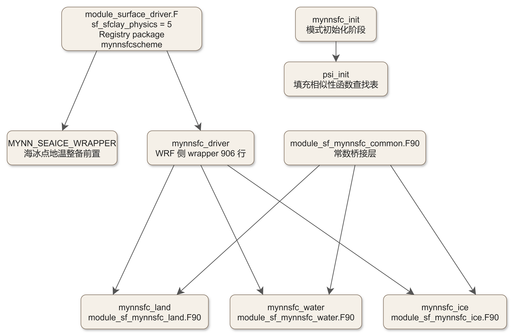
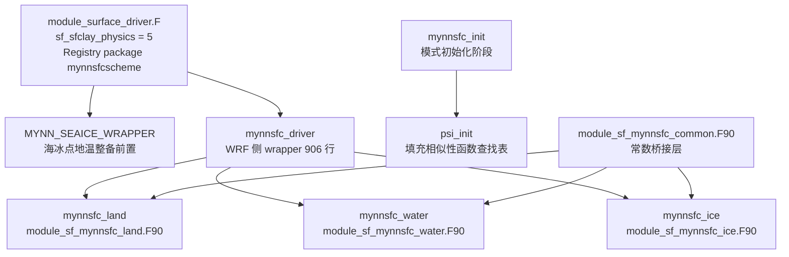

# code_10 — MYNN 表面层方案（MYNN-SFC 四件套 + 双运行线）

<!-- 本篇为多源文档：骨架占位符由 code_extract.py v1.2 多源 assemble 注入 -->

## 一、版本指纹

| 源文件 | 行数 | md5（整文件，按字节） |
|---|---|---|
| phys/MYNN-SFC/module_sf_mynnsfc.F90 | 4087 | 3d4f0bba16ed9af55bc77ca2d804b661 |
| phys/MYNN-SFC/WRF/module_sf_mynnsfc_driver.F90 | 906 | 3552d31bcd3f7f9a36087ca9dc4c6b99 |
| phys/MYNN-SFC/WRF/module_sf_mynnsfc_common.F90 | 77 | a159e6535dd733beadde213795809b7d |
| phys/MYNN-SFC/module_sf_mynnsfc_land.F90 | 1749 | d523ca4a2811fe481582f7a55f2719ff |
| phys/MYNN-SFC/module_sf_mynnsfc_water.F90 | 2104 | 09a709192675a2fac471033a04c3bdb5 |
| phys/MYNN-SFC/module_sf_mynnsfc_ice.F90 | 1552 | 82ecb47710aa19b163a5ebdf68f6421c |

- 抽取工具：workspace/scripts/code_extract.py v1.2（多源 assemble），2026-10-12；每个代码块首部的指纹注释自带该块的 range_md5，可逐块复核。
- 本篇 B 级节选原则：主讲底本取注释最全的 module_sf_mynnsfc.F90（CCPP 单柱线）；WRF 运行线（wrapper + 三伴生件）以关键段 + C 级接口索引呈现。跳过内容：OpenACC 数据搬运指令（enter/exit data copyin/copyout 长清单，属 FV3 移植管线而非物理）、debug_code 调试打印块。

## 二、定位

一句话：MYNN 表面层方案把「最低模式层气象状态 + 地表状态」闭合为 Monin-Obukhov 相似性意义上的湍流尺度（u*、t*、q*、z/L）与交换系数，供 LSM 计算通量、供模式输出 2 m/10 m 诊断量。

**谁在调它**（WRF 4.8.0 实测调用链）：



<details><summary>原始 Mermaid 源码（可点击展开）</summary>

<!--

-->

</details>

**双运行线警示**（源码普查实证）：

- WRF-ARW 运行线：`surface_driver.CASE(MYNNSFCSCHEME)` → `mynnsfc_driver`（phys/MYNN-SFC/WRF/）→ 按 xland、雪深 5 cm 阈值、xice 阈值把每个格点分派给 **_land / _water / _ice 三件**。这条线**不经过** module_sf_mynnsfc.F90。
- CCPP-FV3 单柱线：phys/MYNN-SFC/CCPP/ 下的 driver 才 `USE module_sf_mynnsfc`，调用 SFCLAY_mynn → SFCLAY1D_mynn。MPAS 线同理在 phys/MYNN-SFC/MPAS/。
- 因此：网络资料常把「MYNN 面层」直接等同于 module_sf_mynnsfc.F——在 4.8.0 源码树中这对 WRF 用户不成立。**但物理内核完全同构**：三件套里每个 mynnsfc_<下垫面> 就是 SFCLAY1D_mynn 剥掉三维包装、按单点展开后的版本，且各文件自带一套几乎相同的辅助函数库。本篇以 module_sf_mynnsfc.F90 为主讲底本（注释最全、局部变量文档化最好），WRF 线讲 wrapper 分派逻辑，三伴生件给 C 级注记与差异清单。

- 权威文献：Olson et al. 2021, A description of the MYNN Surface-Layer Scheme, NOAA Tech. Memo. OAR GSL-67, doi:10.25923/f6a8-bc75（三伴生件文件头自引）。
- 教材锚点：[ch14_pbl_family.md](../ch14_pbl_family.md)（边界层方案族——面层与 PBL 方案的耦合；MYNN 2.5 精读同章）、[ch16_land_surface_family.md](../ch16_land_surface_family.md)（surface driver 与 LSM 的 CHS/CQS2 接口）、[ch19_lanzhou_heatwave.md](../ch19_lanzhou_heatwave.md)（namelist 实配）、[ch20_modifying_wrf.md](../ch20_modifying_wrf.md)（改造案例落点）。
- 文库内关联：PBL 侧的 MYNN-EDMF 实体在 [code_09a_module_bl_mynnedmf.md](code_09a_module_bl_mynnedmf.md) 与 [code_09b_module_bl_mynnedmf.md](code_09b_module_bl_mynnedmf.md)；本篇与它通过 u*、w*、pblh 等量交换。同批后续的 PBL driver 走读篇（编号 22）是本篇的直接上游。

## 三、WRF 运行线：常数桥接层与 wrapper

### 3.1 常数桥接层 module_sf_mynnsfc_common（全文）

这一层是 MYNN 物理库「框架无关化」改造的关键：所有 MYNN 家族文件（_land/_water/_ice 与 MPAS/CCPP 各 driver）从这里拿常数，而不是各自硬编码。

<!-- code_extract code_extract.py v1.2
source: phys/MYNN-SFC/WRF/module_sf_mynnsfc_common.F90
ranges: L1-L77
file_lines: 77
file_md5: a159e6535dd733beadde213795809b7d
display: line-numbered (strip L-prefix and !file: line to restore)
range_md5: a159e6535dd733beadde213795809b7d
seg_lines: 77
-->

```fortran
!file: phys/MYNN-SFC/WRF/module_sf_mynnsfc_common.F90    L1-L77
L00001  !====================================================================
L00002  
L00003   module module_sf_mynnsfc_common
L00004  
L00005  !------------------------------------------
L00006  !Define Model-specific constants/parameters.
L00007  !This module will be used at the initialization stage
L00008  !where all model-specific constants are read and saved into
L00009  !memory. This module is then used again in the MYNNSFC_* scheme. All
L00010  !MYNN-specific constants are declared globally in the main
L00011  !module (module_sf_mynnsfc) further below:
L00012  !------------------------------------------
L00013  !
L00014  ! The following 5-6 lines are the only lines in this file that are not
L00015  ! universal for all dycores... Any ideas how to universalize it?
L00016  ! For MPAS:
L00017  ! use mpas_kind_types,only: kind_phys => RKIND
L00018  ! For WRF:
L00019    use ccpp_kind_types,  only : kind_phys
L00020  
L00021  !WRF CONSTANTS
L00022    use module_model_constants, only:         &
L00023      & karman, g, p1000mb,                   &
L00024      & cp, r_d, r_v, rcp, xlv, xlf, xls,     &
L00025      & svp1, svp2, svp3, p608, ep_2, rvovrd, &                                                                         
L00026      & cpv, cliq, cice, svpt0
L00027  !WRF CONFIGURATIONS
L00028    use module_state_description, only:       &
L00029      & ruclsmscheme
L00030    
L00031   implicit none
L00032   save
L00033  
L00034  ! To be specified from dycore
L00035  ! real:: cp           != 7.*r_d/2. (J/kg/K)
L00036  ! real:: cpv          != 4.*r_v    (J/kg/K) Spec heat H2O gas
L00037  ! real:: cice         != 2106.     (J/kg/K) Spec heat H2O ice
L00038  ! real:: cliq         != 4190.     (J/kg/K) Spec heat H2O liq
L00039  ! real:: p608         != R_v/R_d-1.
L00040  ! real:: ep_2         != R_d/R_v
L00041  ! real:: grav         != accel due to gravity
L00042  ! real:: karman       != von Karman constant
L00043  ! real:: t0c          != temperature of water at freezing, 273.15 K
L00044  ! real:: rcp          != r_d/cp
L00045  ! real:: r_d          != 287.  (J/kg/K) gas const dry air
L00046  ! real:: r_v          != 461.6 (J/kg/K) gas const water
L00047  ! real:: xlf          != 0.35E6 (J/kg) fusion at 0 C
L00048  ! real:: xlv          != 2.50E6 (J/kg) vaporization at 0 C
L00049  ! real:: xls          != 2.85E6 (J/kg) sublimation
L00050  ! real:: rvovrd       != r_v/r_d != 1.608
L00051  
L00052  ! Specified locally
L00053   real(kind_phys),parameter:: tref  = 300.0   ! reference temperature (K)
L00054  ! real(kind_phys),parameter:: p1000mb=100000.0
L00055  ! real(kind_phys),parameter:: svp1  = 0.6112 !(kPa)
L00056  ! real(kind_phys),parameter:: svp2  = 17.67  !(dimensionless)
L00057  ! real(kind_phys),parameter:: svp3  = 29.65  !(K)
L00058   real(kind_phys),parameter:: grav  = g
L00059   real(kind_phys),parameter:: t0c   = svpt0     != 273.15
L00060   real(kind_phys),parameter:: wfa_max = 800e6   !kg-1
L00061   real(kind_phys),parameter:: wfa_min = 1e6     !kg-1
L00062   real(kind_phys),parameter:: ifa_max = 300e6   !kg-1
L00063   real(kind_phys),parameter:: ifa_min = 0.0     !kg-1
L00064   real(kind_phys),parameter:: wfa_ht  = 2000.   !meters
L00065   real(kind_phys),parameter:: ifa_ht  = 10000.  !meters
L00066   
L00067  ! To be derived in the init routine
L00068   real(kind_phys),parameter:: ep_3   = 1.-ep_2 != 0.378
L00069   real(kind_phys),parameter:: gtr    = grav/tref
L00070   real(kind_phys),parameter:: rk     = cp/r_d
L00071   real(kind_phys),parameter:: tv0    =  p608*tref
L00072   real(kind_phys),parameter:: tv1    = (1.+p608)*tref
L00073   real(kind_phys),parameter:: xlscp  = (xlv+xlf)/cp
L00074   real(kind_phys),parameter:: xlvcp  = xlv/cp
L00075   real(kind_phys),parameter:: g_inv  = 1./grav
L00076  
L00077   end module module_sf_mynnsfc_common
```

> 讲解：①kind_phys 来自 ccpp_kind_types——精度由宿主框架决定（WRF 下实为 8 字节 double）；②全部常数通过 `use module_model_constants` 引入后**重命名**（r_d→rd、p608→ep1 风格在伴生件里是反向的：伴生件从 common 拿 ep1、ep2、ep3），保证同一份物理代码在 WRF/MPAS/FV3 下常数口径一致；③tref=300 K 等局部常数是后续物化推导（gtr、xlscp、xlvcp）的种子。改造提示：想动 Von Karman 常数或热容口径，动的是 module_model_constants（共享全模式），不要在 MYNN 文件里另立数字。

### 3.2 wrapper 文件头：新选项命名与文献

<!-- code_extract code_extract.py v1.2
source: phys/MYNN-SFC/WRF/module_sf_mynnsfc_driver.F90
ranges: L1-L68
file_lines: 906
file_md5: 3552d31bcd3f7f9a36087ca9dc4c6b99
display: line-numbered (strip L-prefix and !file: line to restore)
range_md5: 3162f903e4cad770304cd73c8ce2c28c
seg_lines: 68
-->

```fortran
!file: phys/MYNN-SFC/WRF/module_sf_mynnsfc_driver.F90    L1-L68
L00001  !> \file module_sf_mynnsfc_driver.F90
L00002  !!  This serves as the interface between the model surface driver and the MYNN
L00003  !!  surface-layer scheme(s) in module_sfc_mynnsfc_land.F90, module_sfc_mynnsfc_ice.F90, and
L00004  !!  module_sfc_mynnsfc_water.F90.
L00005  
L00006  !>\ingroup gsd_mynnsfc
L00007  !> The following references best describe the code within
L00008  !!  Olson, J. B., T. Smirnova, J. S. Kenyon, D. Turner, J. M. Brown, W. Zheng,
L00009  !!  and B. W. Green, 2021: A description of the MYNN Surface-Layer Scheme.
L00010  !!  NOAA Tech. Memo. OAR GSL-67, 26 pp., doi:10.25923/f6a8-bc75.
L00011  !!
L00012  !! Note that the old tech note (Olson et al. 2021, doi:10.25923/f6a8-bc75) is
L00013  !! still the best reference for the older version of the scheme that is used in
L00014  !! HRRRv4 and RAPv5. An updated tech note is underway... The physics in this
L00015  !! universalized and modularized version is still very similar to that in the
L00016  !! 2021 tech note, but different model-dependent configuration options have been
L00017  !! change to MYNN-specific options, such as:
L00018  !!
L00019  !!   old option "iz0tlnd" is now "sf_mynn_sfcflux_land":
L00020  !!   (default) =0: Zilitinkevich (1995); Czil now set to 0.095
L00021  !!             =1: Czil_new (modified according to Chen & Zhang 2008)
L00022  !!             =2: Modified Yang et al (2002, 2008) - generalized for all landuse
L00023  !!             =3: constant zt = z0/7.4 (original form; Garratt 1992)
L00024  !!
L00025  !!   old option "isftcflx" is now "sf_mynn_sfcflux_water":
L00026  !!             =0: z0, zt, and zq from COARE 3.0 (Fairall et al. 2003)
L00027  !!   (default) =1: z0, zt, and zq from COARE 3.5 (Edson et al 2013)
L00028  !!             =2: z0 from Davis et al (2008), zt & zq from COARE 3.5
L00029  !!             =3: z0 from Davis et al (2008), zt & zq from Garratt (1992)
L00030  !!             =4: z0 from Taylor and Yelland (2004), zt and zq from COARE 3.5
L00031  !!
L00032  !! This way, the new sf_mynn* options exist in all model frameworks (WRF/MPAS/CCPP)
L00033  !! and they carry the same meaning, wheras before, they carried a different meaning for
L00034  !! different schemes.
L00035  !=================================================================================================================
L00036   module module_sf_mynnsfc_driver
L00037  !=================================================================================================================
L00038   use module_sf_mynnsfc_common,only: kind_phys,cp,lsm_ruc => ruclsmscheme
L00039   use module_sf_mynnsfc_land,  only: mynnsfc_land
L00040   use module_sf_mynnsfc_water, only: mynnsfc_water
L00041   use module_sf_mynnsfc_ice,   only: mynnsfc_ice
L00042   
L00043   implicit none
L00044  
L00045   !Global configuration options, to be moved to namelist variables:
L00046   integer, parameter :: psi_opt         = 0       !0: mynn, 1: gfs
L00047   logical, parameter :: compute_flux    = .true.  !whether or not to compute the surface fluxes
L00048   logical, parameter :: compute_diag    = .true.  !whether or not to compute the 2- and 10-m diagnostics
L00049  
L00050  !define constant parameters for precision-control:
L00051   real(kind_phys), parameter :: sqrt3   = 1.7320508075688773
L00052   real(kind_phys), parameter :: atan1   = 0.785398163397     !in radians
L00053   real(kind_phys), parameter :: p333    = 1.0/3.0
L00054   real(kind_phys), parameter :: zero    = 0.0
L00055   real(kind_phys), parameter :: one     = 1.0
L00056   real(kind_phys), parameter :: two     = 2.0
L00057   real(kind_phys), parameter :: four    = 4.0
L00058   real(kind_phys), parameter :: ten     = 10.0
L00059   
L00060   real(kind_phys), dimension(0:1000 ),save :: psim_stab,psim_unstab, &
L00061                                               psih_stab,psih_unstab
L00062  
L00063   private
L00064   public:: mynnsfc_driver, &
L00065            mynnsfc_init,   &
L00066            mynnsfclay_finalize      
L00067  
L00068   contains
```

> 讲解：文件头给出本篇最重要的**选项名映射**——旧 WRF 选项 iz0tlnd（陆面 zt/zq）与 isftcflx（水面通量）被更名为 sf_mynn_sfcflux_land 与 sf_mynn_sfcflux_water，且**编号含义变了**（见 6.1 警示框）。模块级还硬编码了 psi_opt=0（用 MYNN 混合相似性函数表而非 GFS 表）、compute_flux 与 compute_diag 恒为真。psim_stab 等四张表存放在本模块的 SAVE 数组（0:1000），**以实参形式传给三个伴生件**——表只有一份、方案文件多份，这是三件套没有各自重建表的原因。

### 3.3 mynnsfc_init：查表初始化

<!-- code_extract code_extract.py v1.2
source: phys/MYNN-SFC/WRF/module_sf_mynnsfc_driver.F90
ranges: L73-L87
file_lines: 906
file_md5: 3552d31bcd3f7f9a36087ca9dc4c6b99
display: line-numbered (strip L-prefix and !file: line to restore)
range_md5: 1ed3fda78e9c814e94718a38a95bcb8f
seg_lines: 15
label: subroutine mynnsfc_init
-->

```fortran
!file: phys/MYNN-SFC/WRF/module_sf_mynnsfc_driver.F90    L73-L87    (subroutine mynnsfc_init)
L00073   subroutine mynnsfc_init(allowed_to_read,errmsg,errflg)
L00074  
L00075      logical, intent(in)           :: allowed_to_read
L00076      character(len=*), intent(out) :: errmsg
L00077      integer, intent(out)          :: errflg
L00078  
L00079      !Fill the PSIM and PSIH tables. This code was leveraged from
L00080      !module_sf_sfclayrev.F (from Pedro Jimenez and Jimy Dudhia).
L00081      !This subroutine returns a blended form from Dyer and Hicks (1974)
L00082      !and Grachev et al (2000) for unstable conditions and the form
L00083      !from Cheng and Brutsaert (2005) for stable conditions.
L00084  
L00085       call psi_init(psi_opt,errmsg,errflg)
L00086  
L00087   end subroutine mynnsfc_init
```

> 讲解：模式初始化阶段（surface driver 的 init 钩子）调用一次，把 z/L ∈ [0,10]（不稳定取负）以 0.01 步长预生成 1001 点的 ψ_m、ψ_h 表。运行期查表 + 线性插值，超越 ±10 才回退到闭式函数重算——GPU/性能考量，物理不变。

### 3.4 mynnsfc_driver：逐点分派

先看冷启动初值与逐点状态转换（3D→单点标量）：

<!-- code_extract code_extract.py v1.2
source: phys/MYNN-SFC/WRF/module_sf_mynnsfc_driver.F90
ranges: L325-L474
file_lines: 906
file_md5: 3552d31bcd3f7f9a36087ca9dc4c6b99
display: line-numbered (strip L-prefix and !file: line to restore)
range_md5: a40f812c4bb85a82583c5e173daa6281
seg_lines: 150
-->

```fortran
!file: phys/MYNN-SFC/WRF/module_sf_mynnsfc_driver.F90    L325-L474
L00325  !--- local variables and arrays:
L00326   integer:: i,j,k,vegtype_1,iter,loc_z0_type,ncalls
L00327   logical:: loc_redrag,loc_iter,loc_cycle
L00328   real(kind_phys),dimension(ims:ime,jms:jme):: wstar
L00329   real(kind_phys),dimension(ims:ime,jms:jme):: qstar
L00330  
L00331  !intermediate single-point variables will be *_1
L00332   real(kind_phys) :: mavail_1,pblh_1,xland_1,tsk_1,psfcpa_1,           &
L00333                       snowh_1,dx_1,lakemask_1,wat_depth_1,xice_1
L00334   real(kind_phys) :: u_1,v_1,u_2,v_2,qv_1,p_1,t_1,rho_1,dz8w_1,        &
L00335                       dz8w_2,rstoch_1,qvmr
L00336   real(kind_phys) :: hfx_1,qfx_1,lh_1,mol_1,rmol_1,                    &
L00337                       qsfc_1,qgh_1,znt_1,zol_1,ust_1,cpm_1,chs2_1,     &
L00338                       cqs_1,cqs2_1,chs_1,ch_1,flhc_1,flqc_1,gz1oz0_1,  &
L00339                       wspd_1,br_1,psim_1,psih_1
L00340   real(kind_phys) :: u10_1,v10_1,th2_1,t2_1,q2_1
L00341   real(kind_phys) :: cd_1,cda_1,ck_1,cka_1,ustm_1
L00342   !in WRF and MPAS, these variables do not propogate outside of this driver. Use as placeholders for CCPP driver:
L00343   real(kind_phys) :: wstar_1,qstar_1,tsurf_1,cm_1,stress_1,fm_1,fh_1,  &
L00344                       fm10_1,fh2_1,hflx_1,qflx_1
L00345   real(kind_phys) :: sigmaf_1,shdmax_1,z0pert_1,ztpert_1
L00346  
L00347   integer, parameter:: debug_driver = 0  !0: no output, 1: write output
L00348  !-----------------------------------------------------------------------------------------------------------------
L00349   errmsg = ' '
L00350   errflg = 0
L00351   iter   = 1 !ccpp variable
L00352  
L00353   !cycling flag is not in WRF, use local variable:
L00354   if (present(cycling)) then
L00355      loc_cycle = cycling
L00356   else
L00357      loc_cycle = .false.
L00358   endif
L00359  
L00360   if (debug_driver > 0) then
L00361      print*,"=======in beginning of mynn sfc driver=============="
L00362      print*,"flagc_lsm=",trim('does not exist')," flag_lsm=",flag_lsm
L00363      print*,"cycling=","does not exit"," loc_cycle=",loc_cycle
L00364      print*,"itimestep=",itimestep," restart=",restart
L00365   endif
L00366      
L00367   if (itimestep==1 .and. (.not.(restart) .or. .not.(loc_cycle))) then
L00368      !cold starts
L00369      do j = jts,jte
L00370         do i = its,ite
L00371            if (ust(i,j) .le. 1e-4 .or. ust(i,j) .gt. 4.0) then
L00372               u_1      = u3d(i,kts,j)
L00373               v_1      = v3d(i,kts,j)
L00374               ust(i,j) = max(0.04_kind_phys*sqrt(u_1*u_1 + v_1*v_1),0.001_kind_phys)
L00375            endif
L00376            pblh(i,j) = max(ten, 700._kind_phys*ust(i,j)) !this estimate is much better than zero
L00377            qfx(i,j)  = zero
L00378            hfx(i,j)  = zero
L00379            mol(i,j)  = zero
L00380         enddo
L00381      enddo
L00382   endif
L00383   if (itimestep==1) then
L00384      qstar = zero !local variable will not be read in for restarts or cycling
L00385   endif
L00386   
L00387   do j = jts,jte
L00388      do i = its,ite
L00389         qvmr     = qv3d(i,kts,j)   !mixing ratio
L00390         !convert 3D vars to single point - input only
L00391         dz8w_1   = dz8w(i,kts,j)
L00392         qv_1     = max(1e-8_kind_phys,qvmr/(one+qvmr)) !convert to specific humidity                                                                                                             
L00393         p_1      = p3d(i,kts,j)
L00394         t_1      = t3d(i,kts,j)
L00395         rho_1    = rho3d(i,kts,j)
L00396         !2nd model level winds - for diags with high-resolution grids:
L00397         dz8w_2   = dz8w(i,kts+1,j)
L00398         u_2      = u3d(i,kts+1,j)
L00399         v_2      = v3d(i,kts+1,j)
L00400         
L00401         u_1      = u3d(i,kts,j)
L00402         v_1      = v3d(i,kts,j)
L00403         ust_1    = ust(i,j)
L00404         stress_1 = ust_1**2
L00405         mol_1    = mol(i,j)
L00406         qsfc_1   = qsfc(i,j)/(one+qvmr)  !convert to specific humidity
L00407         qgh_1    = qgh(i,j)/(one+qvmr)   !convert to specific humidity
L00408         qstar_1  = qstar(i,j)
L00409  
L00410         !spp - input only
L00411         if(spp_pbl==1) then
L00412            rstoch_1 = pattern_spp_pbl(i,kts,j)
L00413         else
L00414            rstoch_1 = zero
L00415         endif
L00416  
L00417         !2d input only variables:
L00418         mavail_1 = mavail(i,j)
L00419         pblh_1   = pblh(i,j)
L00420         xland_1  = xland(i,j)
L00421         xice_1   = xice(i,j)
L00422         tsk_1    = tsk(i,j)
L00423         psfcpa_1 = psfcpa(i,j)
L00424         snowh_1  = snowh(i,j)
L00425         dx_1     = dx(i,j)
L00426         if(present(lakemask)) then
L00427            lakemask_1  = lakemask(i,j)
L00428         else
L00429            lakemask_1  = zero !default to ocean, since oceans >> lakes
L00430         endif
L00431         if(present(water_depth) .and. present(shalwater_z0)) then
L00432            wat_depth_1  = water_depth(i,j)
L00433         else
L00434            wat_depth_1  = 1000._kind_phys !default to deep ocean, since open oceans >> lakes
L00435         endif
L00436         
L00437         !inout arguments:
L00438         hfx_1    = hfx(i,j)
L00439         qfx_1    = qfx(i,j)/(one+qvmr)  !specific humidity flux
L00440         hflx_1   = hfx_1/(cp*rho_1) !ccpp
L00441         qflx_1   = qfx_1/rho_1      !ccpp
L00442         lh_1     = lh(i,j)
L00443         rmol_1   = rmol(i,j)
L00444         znt_1    = znt(i,j)
L00445         zol_1    = zol(i,j)
L00446         cpm_1    = cpm(i,j)
L00447         chs2_1   = chs2(i,j)
L00448         cqs2_1   = cqs2(i,j)
L00449         cqs_1    = cqs(i,j)
L00450         chs_1    = chs(i,j)
L00451         ch_1     = ch(i,j)
L00452         flhc_1   = flhc(i,j)
L00453         flqc_1   = flqc(i,j)
L00454         gz1oz0_1 = gz1oz0(i,j)
L00455         wspd_1   = wspd(i,j)
L00456         br_1     = br(i,j)
L00457         psim_1   = psim(i,j)
L00458         psih_1   = psih(i,j)
L00459  
L00460         !output arguments:
L00461         u10_1    = zero
L00462         v10_1    = zero
L00463         th2_1    = zero
L00464         t2_1     = zero
L00465         q2_1     = zero
L00466         wstar_1  = zero
L00467  
L00468         !optional configuration inputs:
L00469         loc_redrag = .false.
L00470         if(present(redrag)) loc_redrag = redrag  !CCPP option from GFS
L00471         loc_iter   = .true.
L00472         if(present(flag_iter)) loc_iter = flag_iter !CCPP option. In WRF or MPAS, just set = True 
L00473         loc_z0_type= 0
L00474         if(present(sfc_z0_type)) loc_z0_type = sfc_z0_type !CCPP option from GFS
```

> 讲解：①冷启动（itimestep==1 且非 restart）给 u* 一个 0.04·|V| 量级的初值、pblh 用 700·u* 与 10 m 取大做粗估——比零初值好得多，这是迭代方案的启动技巧；②逐点把三维场抽成标量并做**比湿换算**（qv_1 = qv/(1+qv)），返回时再换回混合比；③lakemask 缺省按海洋（0）、wat_depth 缺省按深海 1000 m——湖泊点必须确认上游真传了这两个量，否则湖面按海水盐度修正饱和比压；④z0pert/ztpert/vegtype 等 GFS 移植参数在 WRF 下缺省为零。

再看核心的三路分派与回写：

<!-- code_extract code_extract.py v1.2
source: phys/MYNN-SFC/WRF/module_sf_mynnsfc_driver.F90
ranges: L534-L724
file_lines: 906
file_md5: 3552d31bcd3f7f9a36087ca9dc4c6b99
display: line-numbered (strip L-prefix and !file: line to restore)
range_md5: 5a35733d20cd46e57d13e70eaabbc0e6
seg_lines: 191
-->

```fortran
!file: phys/MYNN-SFC/WRF/module_sf_mynnsfc_driver.F90    L534-L724
L00534         if (((xland_1-1.5) .lt. zero) .and. (snowh_1 .lt. snow_thresh)) then !5 cm threshold for binary snow/no-snow 
L00535         !if ((xland_1-1.5) .lt. zero) then !alternative - best for fractional landuse/snow, but unnecessarily duplicative for dominate types 
L00536            if (debug_driver > 0) then
L00537               print*,"--> calling mynnsfc_land..."
L00538               ncalls=ncalls+1
L00539            endif
L00540            call mynnsfc_land( &
L00541                   !model info
L00542                   i        = i         , j        = j         , itimestep= itimestep, flag_iter = loc_iter  , &
L00543                   dx       = dx_1      , xland    = xland_1   , iter     = iter     ,                         &
L00544                   !3d input - transformed to single point
L00545                   u_1      = u_1       , v_1      = v_1       , t_1      = t_1      , qv_1      = qv_1      , &
L00546                   p_1      = p_1       , dz8w_1   = dz8w_1    , rho_1    = rho_1    , u_2       = u_2       , &
L00547                   v_2      = v_2       , dz8w_2   = dz8w_2    ,                                               &
L00548                   !GFS input
L00549                   sigmaf   = sigmaf_1  , vegtype  = vegtype_1 , shdmax   = shdmax_1 , ivegsrc   = ivegsrc   , &  !optional intent(in)
L00550                   z0pert   = z0pert_1  , ztpert   = ztpert_1  , redrag   =loc_redrag,sfc_z0_type=loc_z0_type, &  !optional intent(in)
L00551                   !2d variables - transformed to single point
L00552                   chs      = chs_1     , chs2     = chs2_1    , cqs2     = cqs2_1   , cqs       = cqs_1     , &
L00553                   pblh     = pblh_1    , rmol     = rmol_1    , znt      = znt_1    , psfcpa    = psfcpa_1  , &
L00554                   ust      = ust_1     , ustm     = ustm_1    , stress   = stress_1 ,                         &
L00555                   mavail   = mavail_1  , zol      = zol_1     , mol      = mol_1    , tsurf     = tsurf_1   , &
L00556                   psim     = psim_1    , psih     = psih_1    , hfx      = hfx_1    , qfx       = qfx_1     , &
L00557                   tskin    = tsk_1     , u10      = u10_1     , v10      = v10_1    , th2       = th2_1     , &
L00558                   t2       = t2_1      , q2       = q2_1      , flhc     = flhc_1   , flqc      = flqc_1    , &
L00559                   snowh    = snowh_1   , qsfc     = qsfc_1    , qgh      = qgh_1    ,                         &
L00560                   lh       = lh_1      , gz1oz0   = gz1oz0_1  , wspd     = wspd_1   , rb        = br_1      , &
L00561                   cpm      = cpm_1     , ch       = ch_1      , cm       = cm_1     , rstoch_1  = rstoch_1  , &
L00562                   wstar    = wstar_1   , qstar    = qstar_1   ,                                               &
L00563                   ck       = ck_1      , cka      = cka_1     , cd       = cd_1     , cda       = cda_1     , &
L00564                   psix     = fm_1      , psit     = fh_1      , psix10   = fm10_1   , psit2     = fh2_1     , &
L00565                   !configuration options
L00566                   spp_sfc  = spp_pbl   , isfflx   = isfflx    , sf_mynn_sfcflux_land= sf_mynn_sfcflux_land  , &
L00567                   flag_restart= restart, flag_cycle= cycling  , compute_flux        = compute_flux          , &
L00568                   psi_opt  = psi_opt   , lsm      = flag_lsm  , compute_diag        = compute_diag          , &
L00569                   lsm_ruc  = lsm_ruc   ,                                                                      &
L00570                   !stability function tables
L00571                   psim_stab= psim_stab ,psim_unstab=psim_unstab,psih_stab=psih_stab ,psih_unstab=psih_unstab, &
L00572                   !error management
L00573                   errmsg   = errmsg    , errflg   = errflg                                                    &
L00574                      )
L00575         endif
L00576  
L00577         !if (((xland_1-1.5) .ge. zero) .or. ((xice_1 .gt. zero) .and. (xice_1 .lt. one))) then
L00578         if ((xland_1-1.5) .ge. zero) then !best for fractional landuse/snow
L00579            if (debug_driver > 0) then
L00580               print*,"--> calling mynnsfc_water..."
L00581               ncalls=ncalls+1
L00582            endif
L00583            call mynnsfc_water( &
L00584                   !model info
L00585                   i        = i         , j        = j         , itimestep= itimestep, flag_iter = loc_iter  , &
L00586                   dx       = dx_1      , xland    = xland_1   , iter     = iter     , lakemask  = lakemask_1, &
L00587                   wat_depth=wat_depth_1,                                                                      &
L00588                   !3d input - transformed to single point
L00589                   u_1      = u_1       , v_1      = v_1       , t_1      = t_1      , qv_1      = qv_1      , &
L00590                   p_1      = p_1       , dz8w_1   = dz8w_1    , rho_1    = rho_1    , u_2       = u_2       , &
L00591                   v_2      = v_2       , dz8w_2   = dz8w_2    ,                                               &
L00592                   !GFS input
L00593                   sigmaf   = sigmaf_1  , vegtype  = vegtype_1 , shdmax   = shdmax_1 , ivegsrc   = ivegsrc   , &  !optional intent(in)
L00594                   z0pert   = z0pert_1  , ztpert   = ztpert_1  , redrag   =loc_redrag, sfc_z0_type=loc_z0_type,&  !optional intent(in)
L00595                   !2d variables - transformed to single point
L00596                   chs      = chs_1     , chs2     = chs2_1    , cqs2     = cqs2_1   , cqs       = cqs_1     , &
L00597                   pblh     = pblh_1    , rmol     = rmol_1    , znt      = znt_1    , psfcpa    = psfcpa_1  , &
L00598                   ust      = ust_1     , ustm     = ustm_1    , stress   = stress_1 ,                         &
L00599                   mavail   = mavail_1  , zol      = zol_1     , mol      = mol_1    , tsurf     = tsurf_1   , &
L00600                   psim     = psim_1    , psih     = psih_1    , hfx      = hfx_1    , qfx       = qfx_1     , &
L00601                   tskin    = tsk_1     , u10      = u10_1     , v10      = v10_1    , th2       = th2_1     , &
L00602                   t2       = t2_1      , q2       = q2_1      , flhc     = flhc_1   , flqc      = flqc_1    , &
L00603                   snowh    = snowh_1   , qsfc     = qsfc_1    , qgh      = qgh_1    ,                         &
L00604                   lh       = lh_1      , gz1oz0   = gz1oz0_1  , wspd     = wspd_1   , rb        = br_1      , &
L00605                   cpm      = cpm_1     , ch       = ch_1      , cm       = cm_1     , rstoch_1  = rstoch_1  , &
L00606                   wstar    = wstar_1   , qstar    = qstar_1   ,                                               &
L00607                   ck       = ck_1      , cka      = cka_1     , cd       = cd_1     , cda       = cda_1     , &
L00608                   psix     = fm_1      , psit     = fh_1      , psix10   = fm10_1   , psit2     = fh2_1     , &
L00609                   !configuration options
L00610                   spp_sfc  = spp_pbl   , isfflx   = isfflx    ,sf_mynn_sfcflux_water= sf_mynn_sfcflux_water , &
L00611                   flag_restart= restart, flag_cycle= cycling  , compute_flux        = compute_flux          , &
L00612                   psi_opt  = psi_opt   ,                        compute_diag        = compute_diag          , &
L00613                   lsm_ruc  = lsm_ruc   , lsm      = flag_lsm  , shalwater_z0        = shalwater_z0          , &
L00614                   !stability function tables
L00615                   psim_stab= psim_stab ,psim_unstab=psim_unstab,psih_stab=psih_stab ,psih_unstab=psih_unstab, &
L00616                   !error management
L00617                   errmsg   = errmsg    , errflg   = errflg                                                    &
L00618                      )
L00619         endif
L00620  
L00621         if ((((xland_1-1.5) .lt. zero) .and. (snowh_1 .ge. snow_thresh)) .or. &  !land snow/ice
L00622              (xice_1.ge.xice_threshold .and. xice_1.lt.one)) then                !partial seaice
L00623            if (debug_driver > 0) then
L00624               print*,"--> calling mynnsfc_ice..."
L00625               ncalls=ncalls+1
L00626            endif
L00627            call mynnsfc_ice( &
L00628                  !model info
L00629                   i        = i         , j        = j         , itimestep= itimestep, flag_iter = loc_iter  , &
L00630                   dx       = dx_1      , xland    = xland_1   , iter     = iter     ,                         &
L00631                   !3d input - transformed to single point
L00632                   u_1      = u_1       , v_1      = v_1       , t_1      = t_1      , qv_1      = qv_1      , &
L00633                   p_1      = p_1       , dz8w_1   = dz8w_1    , rho_1    = rho_1    , u_2       = u_2       , &
L00634                   v_2      = v_2       , dz8w_2   = dz8w_2    ,                                               &
L00635                   !2d variables - transformed to single point
L00636                   chs      = chs_1     , chs2     = chs2_1    , cqs2     = cqs2_1   , cqs       = cqs_1     , &
L00637                   pblh     = pblh_1    , rmol     = rmol_1    , znt      = znt_1    , psfcpa    = psfcpa_1  , &
L00638                   ust      = ust_1     , ustm     = ustm_1    , stress   = stress_1 ,                         &
L00639                   mavail   = mavail_1  , zol      = zol_1     , mol      = mol_1    , tsurf     = tsurf_1   , &
L00640                   psim     = psim_1    , psih     = psih_1    , hfx      = hfx_1    , qfx       = qfx_1     , &
L00641                   tskin    = tsk_1     , u10      = u10_1     , v10      = v10_1    , th2       = th2_1     , &
L00642                   t2       = t2_1      , q2       = q2_1      , flhc     = flhc_1   , flqc      = flqc_1    , &
L00643                   snowh    = snowh_1   , qsfc     = qsfc_1    , qgh      = qgh_1    ,                         &
L00644                   lh       = lh_1      , gz1oz0   = gz1oz0_1  , wspd     = wspd_1   , rb        = br_1      , &
L00645                   cpm      = cpm_1     , ch       = ch_1      , cm       = cm_1     , rstoch_1  = rstoch_1  , &
L00646                   wstar    = wstar_1   , qstar    = qstar_1   ,                                               &
L00647                   ck       = ck_1      , cka      = cka_1     , cd       = cd_1     , cda       = cda_1     , &
L00648                   psix     = fm_1      , psit     = fh_1      , psix10   = fm10_1   , psit2     = fh2_1     , &
L00649                   !configuration options
L00650                   spp_sfc  = spp_pbl   , isfflx    = isfflx   ,                                               &
L00651                   flag_restart= restart, flag_cycle= cycling  , compute_flux       = compute_flux           , &
L00652                   psi_opt  = psi_opt   , lsm      = flag_lsm  , compute_diag       = compute_diag           , &
L00653                   lsm_ruc  = lsm_ruc   ,                                                                      &
L00654                   !stability function tables
L00655                   psim_stab= psim_stab ,psim_unstab=psim_unstab,psih_stab=psih_stab ,psih_unstab=psih_unstab, &
L00656                   !error management
L00657                   errmsg   = errmsg    , errflg   = errflg                                                    &
L00658                      )
L00659         endif
L00660         
L00661         !inout arguments:
L00662         hfx(i,j)    = hfx_1
L00663         qfx(i,j)    = qfx_1/(one-qv_1)  !mixing ratio flux
L00664         lh(i,j)     = lh_1/(one-qv_1)   !mixing ratio flux
L00665         mol(i,j)    = mol_1
L00666         rmol(i,j)   = rmol_1
L00667         qsfc(i,j)   = qsfc_1/(one-qv_1) !mixing ratio
L00668         qgh(i,j)    = qgh_1/(one-qv_1)  !mixing ratio
L00669         znt(i,j)    = znt_1
L00670         zol(i,j)    = zol_1
L00671         ust(i,j)    = ust_1
L00672         cpm(i,j)    = cpm_1
L00673         chs2(i,j)   = chs2_1
L00674         cqs2(i,j)   = cqs2_1
L00675         cqs(i,j)    = cqs_1
L00676         chs(i,j)    = chs_1
L00677         ch(i,j)     = ch_1
L00678         flhc(i,j)   = flhc_1
L00679         flqc(i,j)   = flqc_1
L00680         gz1oz0(i,j) = gz1oz0_1
L00681         wspd(i,j)   = wspd_1
L00682         br(i,j)     = br_1
L00683         psim(i,j)   = psim_1
L00684         psih(i,j)   = psih_1
L00685  
L00686         !output arguments:
L00687         u10(i,j)    = u10_1
L00688         v10(i,j)    = v10_1
L00689         th2(i,j)    = th2_1
L00690         t2(i,j)     = t2_1
L00691         q2(i,j)     = q2_1/(one-qv_1)  !mixing ratio
L00692         wstar(i,j)  = wstar_1
L00693         qstar(i,j)  = qstar_1
L00694  
L00695         !optional output arguments, mostly for ccpp:
L00696         if(present(hflx))hflx(i,j)= hfx_1/(cp*rho_1)
L00697         if(present(qflx))qflx(i,j)= qfx_1/rho_1
L00698         if(present(ck) .and. present(cka) .and. present(cd) .and. present(cda)) then
L00699            ck(i,j)  = ck_1
L00700            cka(i,j) = cka_1
L00701            cd(i,j)  = cd_1
L00702            cda(i,j) = cda_1
L00703         endif
L00704         if(present(fm) .and. present(fh) .and. present(fm10) .and. present(fh2)) then
L00705            fm(i,j)  = fm_1
L00706            fh(i,j)  = fh_1
L00707            fm10(i,j)= fm10_1
L00708            fh2(i,j) = fh2_1
L00709         endif
L00710         if(present(ustm))  ustm(i,j)  = ustm_1
L00711         if(present(stress))stress(i,j)= stress_1
L00712         if(present(cm))    cm(i,j)    = cm_1
L00713  
L00714         if (debug_driver == 1) then
L00715            write(*,*)"=== end of driver, ncalls=", ncalls
L00716            write(*,*)"br=",br_1,"zol=",zol_1," wspd=",wspd_1
L00717            write(*,*)"hfx=",hfx_1," qfx=",qfx_1," lh=",lh_1
L00718            write(*,*)"flqc=",flqc_1," flhc=",flhc_1," u*=",ust_1
L00719            !write(*,*)"psim_stab=",psim_stab(1)," psim_unstab=",psim_unstab(1)
L00720            !write(*,*)"psih_stab=",psih_stab(1)," psih_unstab=",psih_unstab(1)
L00721            write(*,*)"=================================================="
L00722         endif
L00723      enddo !i-loop
L00724   enddo !j-loop
```

> 讲解：分派判据（每点最多命中两类）：陆= xland<1.5 且 snowh<5 cm → mynnsfc_land；水= xland≥1.5 → mynnsfc_water；雪/冰=（陆地雪≥5 cm）或（0<xice<xice_threshold 之外的部分海冰）→ mynnsfc_ice。注意三件被调时**四张 ψ 表作为实参传入**（psim_stab=psim_stab…），伴生件自身不持有表。回写段有两个易踩的坑：qfx 与 lh 从「比湿通量」换回「混合比通量」用 /(1−qv_1)——与入口的 /(1+qv) 不对称，这是因为潜热通量符号约定在伴生件内部按混合比差计算；q2 同样换算。改造提示：想在 MYNN 面层加自定义通量项，最稳的位置是伴生件内部（单点、无 ACC 包裹），回写段只要保持换算方向不变即可。

## 四、CCPP 单柱线主讲：module_sf_mynnsfc

### 4.1 模块头与选项文档

<!-- code_extract code_extract.py v1.2
source: phys/MYNN-SFC/module_sf_mynnsfc.F90
ranges: L1-L113
file_lines: 4087
file_md5: 3d4f0bba16ed9af55bc77ca2d804b661
display: line-numbered (strip L-prefix and !file: line to restore)
range_md5: e5af72c4b91e1280fe42f9eb2d4df4a2
seg_lines: 113
-->

```fortran
!file: phys/MYNN-SFC/module_sf_mynnsfc.F90    L1-L113
L00001  !>\file module_sf_mynnsfc.F90
L00002  !! This file contains
L00003  !WRF:MODEL_LAYER:PHYSICS
L00004  !
L00005  !>\ingroup mynn_sfc
L00006  !> This module contain routines to calculate stability parameters, kinematic siscosity
L00007  !! in MYNN surface layer scheme
L00008  MODULE module_sf_mynnsfc
L00009  
L00010  !-------------------------------------------------------------------
L00011  !Modifications implemented by Joseph Olson NOAA/GSL
L00012  !The following overviews the current state of this scheme::
L00013  !
L00014  !   BOTH LAND AND WATER:
L00015  !1) Calculation of stability parameter (z/L) taken from Li et al. (2010 BLM)
L00016  !   for first iteration of first time step; afterwards, exact calculation
L00017  !   using basically the same iterative technique in the module_sf_sfclayrev.F,
L00018  !   which leverages Pedro Jimenez's code, and is adapted for MYNN.
L00019  !2) Fixed isflux=0 option to turn off scalar fluxes, but keep momentum
L00020  !   fluxes for idealized studies (credit: Anna Fitch).
L00021  !3) Kinematic viscosity varies with temperature according to Andreas (1989).
L00022  !4) Uses the blended Monin-Obukhov flux-profile relationships COARE (Fairall
L00023  !   et al 2003) for the unstable regime (a blended mix of Dyer-Hicks 1974 and
L00024  !   Grachev et al (2000). Uses Cheng and Brutsaert (2005) for stable conditions.
L00025  !5) The following overviews the namelist variables that control the
L00026  !   aerodynamic roughness lengths (over water) and the thermal and moisture
L00027  !   roughness lengths (defaults are recommended):
L00028  !
L00029  !   LAND only:
L00030  !   "iz0tlnd" namelist option is used to select the following momentum options:
L00031  !   (default) =0: Zilitinkevich (1995); Czil now set to 0.095
L00032  !             =1: Czil_new (modified according to Chen & Zhang 2008)
L00033  !             =2: Modified Yang et al (2002, 2008) - generalized for all landuse
L00034  !             =3: constant zt = z0/7.4 (original form; Garratt 1992)
L00035  !             =4: GFS - taken from sfc_diff.f, for comparison/testing
L00036  !
L00037  !   WATER only:
L00038  !   "isftcflx" namelist option is used to select the following scalar options:
L00039  !   (default) =0: z0, zt, and zq from the COARE algorithm. Set COARE_OPT (below) to
L00040  !                 3.0 (Fairall et al. 2003, default)
L00041  !                 3.5 (Edson et al 2013)
L00042  !             =1: z0 from Davis et al (2008), zt & zq from COARE 3.0/3.5
L00043  !             =2: z0 from Davis et al (2008), zt & zq from Garratt (1992)
L00044  !             =3: z0 from Taylor and Yelland (2004), zt and zq from COARE 3.0/3.5
L00045  !             =4: GFS - taken from sfc_diff.f, for comparison/testing
L00046  !
L00047  !   SNOW/ICE only:
L00048  !   Andreas (2002) snow/ice parameterization for thermal and
L00049  !   moisture roughness is used over all gridpoints with snow deeper than
L00050  !   0.1 m. This algorithm calculates a z0 for snow (Andreas et al. 2005, BLM),
L00051  !   which is only used as part of the thermal and moisture roughness
L00052  !   length calculation, not to directly impact the surface winds.
L00053  !
L00054  ! Misc:
L00055  !1) Added a more elaborate diagnostic for u10 & V10 for high vertical resolution
L00056  !   model configurations but for most model configurations with depth of
L00057  !   the lowest half-model level near 10 m, a neutral-log diagnostic is used.
L00058  !
L00059  !2) Option to activate stochastic parameter perturbations (SPP), which
L00060  !   perturb z0, zt, and zq, along with many other parameters in the MYNN-
L00061  !   EDMF scheme.
L00062  !
L00063  !NOTE: This code was primarily tested in combination with the RUC LSM.
L00064  !      Performance with the Noah (or other) LSM is relatively unknown.
L00065  !-------------------------------------------------------------------
L00066  !Include host model constants
L00067        use physcons, only : cp     => con_cp,     & !=7*Rd/2
L00068       &                     grav   => con_g,      & !=9.81
L00069       &                     Rd     => con_rd,     & !=287.
L00070       &                     Rv     => con_rv,     & !=461.6
L00071  !     &                     cpv    => con_cvap,   & !=4*Rv
L00072       &                     rovcp  => con_rocp,   & !=Rd/cp
L00073       &                     xlv    => con_hvap,   & !2.5e6
L00074       &                     xlf    => con_hfus,   & !3.5e5
L00075       &                     ep1    => con_fvirt,  & !Rv/Rd - 1
L00076       &                     ep2    => con_eps       !Rd/Rv
L00077  
L00078  !use kind_phys for real-types
L00079      use machine , only : kind_phys
L00080  
L00081  !-------------------------------------------------------------------
L00082    IMPLICIT NONE
L00083  !-------------------------------------------------------------------
L00084  !Drive and/or define more constant:
L00085    real(kind_phys), parameter :: ep3           = 1.-ep2
L00086    real(kind_phys), parameter :: g_inv         = 1.0/grav
L00087    real(kind_phys), parameter :: rvovrd        = Rv/Rd
L00088    real(kind_phys), parameter :: wmin          = 0.1    ! Minimum wind speed
L00089    real(kind_phys), parameter :: karman        = 0.4
L00090    real(kind_phys), parameter :: SVP1          = 0.6112
L00091    real(kind_phys), parameter :: SVP2          = 17.67
L00092    real(kind_phys), parameter :: SVP3          = 29.65
L00093    real(kind_phys), parameter :: SVPT0         = 273.15
L00094    real(kind_phys), parameter :: VCONVC        = 1.25
L00095    real(kind_phys), parameter :: onethird      = 1./3.
L00096    real(kind_phys), parameter :: sqrt3         = 1.7320508075688773
L00097    real(kind_phys), parameter :: atan1         = 0.785398163397     !in radians
L00098    real(kind_phys), parameter :: log01         = log(0.01)
L00099    real(kind_phys), parameter :: log05         = log(0.05)
L00100    real(kind_phys), parameter :: log07         = log(0.07)
L00101    real(kind_phys), parameter :: SNOWZ0        = 0.011
L00102    real(kind_phys), parameter :: COARE_OPT     = 3.0  ! 3.0 or 3.5
L00103  
L00104    !For debugging purposes:
L00105    INTEGER, PARAMETER :: debug_code = 0  !0: no extra ouput
L00106                                          !1: check input
L00107                                          !2: everything - heavy I/O
L00108  
L00109    REAL(kind_phys), DIMENSION(0:1000 ),SAVE :: psim_stab,psim_unstab, &
L00110                                       psih_stab,psih_unstab
L00111  !$acc declare create(psim_stab, psim_unstab, psih_stab, psih_unstab)
L00112  
L00113  CONTAINS
```

> 讲解：①头部注释完整记录了方案现状（Li 2010 初猜 + Jimenez 式迭代、Andreas 1989 动理黏性、COARE 混合不稳定相似性函数、Cheng–Brutsaert 2005 稳定相似性函数）与两套 namelist 选项（iz0tlnd 陆面 0–4、isftcflx 水面 0–4——**这是 CCPP 线的编号**，与 WRF 线的 sf_mynn_sfcflux_* 编号不同，见 6.1）；②SPP 随机参数扰动选项（spp_sfc）在 z0/zt/zq 三处生效；③psim_stab 等表在本模块为 SAVE 数组并有 `!$acc declare create`——GPU 侧常驻。

### 4.2 SFCLAY_mynn：三维包装（全文）

<!-- code_extract code_extract.py v1.2
source: phys/MYNN-SFC/module_sf_mynnsfc.F90
ranges: L119-L511
file_lines: 4087
file_md5: 3d4f0bba16ed9af55bc77ca2d804b661
display: line-numbered (strip L-prefix and !file: line to restore)
range_md5: 763cbb912617901d2192368bb6e7e5ec
seg_lines: 393
label: subroutine SFCLAY_mynn
-->

```fortran
!file: phys/MYNN-SFC/module_sf_mynnsfc.F90    L119-L511    (subroutine SFCLAY_mynn)
L00119     SUBROUTINE SFCLAY_mynn(                           &
L00120                U3D,V3D,T3D,QV3D,P3D,dz8w,             & !in
L00121                th3d,pi3d,qc3d,                        & !in
L00122                PSFCPA,PBLH,MAVAIL,XLAND,DX,           & !in
L00123                ISFFLX,isftcflx,lsm,lsm_ruc,           & !in
L00124                compute_flux,compute_diag,             & !in
L00125                iz0tlnd,psi_opt,                       & !in
L00126                sigmaf,vegtype,shdmax,ivegsrc,         & !intent(in)
L00127                z0pert,ztpert,                         & !intent(in)
L00128                redrag,sfc_z0_type,                    & !intent(in)
L00129                itimestep,iter,flag_iter,              & !in
L00130                flag_restart,                          & !in
L00131                      wet,       dry,       icy,       & !intent(in)
L00132                tskin_wat, tskin_lnd, tskin_ice,       & !intent(in)
L00133                tsurf_wat, tsurf_lnd, tsurf_ice,       & !intent(in)
L00134                 qsfc_wat,  qsfc_lnd,  qsfc_ice,       & !intent(in)
L00135                snowh_wat, snowh_lnd, snowh_ice,       & !intent(in)
L00136                  ZNT_wat,   ZNT_lnd,   ZNT_ice,       & !intent(inout)
L00137                  UST_wat,   UST_lnd,   UST_ice,       & !intent(inout)
L00138                   cm_wat,    cm_lnd,    cm_ice,       & !intent(inout)
L00139                   ch_wat,    ch_lnd,    ch_ice,       & !intent(inout)
L00140                   rb_wat,    rb_lnd,    rb_ice,       & !intent(inout)
L00141               stress_wat,stress_lnd,stress_ice,       & !intent(inout)
L00142                   fm_wat,    fm_lnd,    fm_ice,       & !intent(inout)
L00143                   fh_wat,    fh_lnd,    fh_ice,       & !intent(inout)
L00144                 fm10_wat,  fm10_lnd,  fm10_ice,       & !intent(inout)
L00145                  fh2_wat,   fh2_lnd,   fh2_ice,       & !intent(inout)
L00146                 HFLX_wat,  HFLX_lnd,  HFLX_ice,       &
L00147                 QFLX_wat,  QFLX_lnd,  QFLX_ice,       &
L00148                CH,CHS,CHS2,CQS2,CPM,                  &
L00149                ZNT,USTM,ZOL,MOL,RMOL,                 &
L00150                PSIM,PSIH,                             &
L00151                HFLX,HFX,QFLX,QFX,LH,FLHC,FLQC,        &
L00152                QGH,QSFC,                              &
L00153                U10,V10,TH2,T2,Q2,                     &
L00154                GZ1OZ0,WSPD,WSTAR,                     &
L00155                spp_sfc,pattern_spp_sfc,               &
L00156                ids,ide, jds,jde, kds,kde,             &
L00157                ims,ime, jms,jme, kms,kme,             &
L00158                its,ite, jts,jte, kts,kte,             &
L00159                errmsg, errflg                         )
L00160  !-------------------------------------------------------------------
L00161        IMPLICIT NONE
L00162  !-------------------------------------------------------------------
L00163  !-- U3D         3D u-velocity interpolated to theta points (m/s)
L00164  !-- V3D         3D v-velocity interpolated to theta points (m/s)
L00165  !-- T3D         3D temperature (K)
L00166  !-- QV3D        3D water vapor mixing ratio (Kg/Kg)
L00167  !-- P3D         3D pressure (Pa)
L00168  !-- dz8w        3D dz between full levels (m)
L00169  !-- CP          heat capacity at constant pressure for dry air (J/kg/K)
L00170  !-- grav        acceleration due to gravity (m/s^2)
L00171  !-- ROVCP       R/CP
L00172  !-- Rd          gas constant for dry air (J/kg/K)
L00173  !-- XLV         latent heat of vaporization for water (J/kg)
L00174  !-- PSFCPA      surface pressure (Pa)
L00175  !-- ZNT         roughness length (m)
L00176  !-- UST         u* in similarity theory (m/s)
L00177  !-- USTM        u* in similarity theory (m/s) w* added to WSPD. This is
L00178  !               used to couple with TKE scheme but not in MYNN.
L00179  !               (as of now, USTM = UST in this version)
L00180  !-- PBLH        PBL height from previous time (m)
L00181  !-- MAVAIL      surface moisture availability (between 0 and 1)
L00182  !-- ZOL         z/L height over Monin-Obukhov length
L00183  !-- MOL         T* (similarity theory) (K)
L00184  !-- RMOL        Reciprocal of M-O length (/m)
L00185  !-- REGIME      flag indicating PBL regime (stable, unstable, etc.)
L00186  !-- PSIM        similarity stability function for momentum
L00187  !-- PSIH        similarity stability function for heat
L00188  !-- XLAND       land mask (1 for land, 2 for water)
L00189  !-- HFX         upward heat flux at the surface (W/m^2)
L00190  !                  HFX = HFLX * rho * cp
L00191  !-- HFLX        upward temperature flux at the surface (K m s^-1)
L00192  !-- QFX         upward moisture flux at the surface (kg/m^2/s)
L00193  !                  QFX = QFLX * rho
L00194  !-- QFLX        upward moisture flux at the surface (kg kg-1 m s-1)
L00195  !-- LH          net upward latent heat flux at surface (W/m^2)
L00196  !-- TSK         surface temperature (K)
L00197  !-- FLHC        exchange coefficient for heat (W/m^2/K)
L00198  !-- FLQC        exchange coefficient for moisture (kg/m^2/s)
L00199  !-- CHS         heat/moisture exchange coefficient for LSM (m/s)
L00200  !-- QGH         lowest-level saturated mixing ratio
L00201  !-- QSFC        qv (specific humidity) at the surface
L00202  !-- QSFCMR      qv (mixing ratio) at the surface
L00203  !-- U10         diagnostic 10m u wind
L00204  !-- V10         diagnostic 10m v wind
L00205  !-- TH2         diagnostic 2m theta (K)
L00206  !-- T2          diagnostic 2m temperature (K)
L00207  !-- Q2          diagnostic 2m mixing ratio (kg/kg)
L00208  !-- SNOWH       Snow height (m)
L00209  !-- GZ1OZ0      log((z1+ZNT)/ZNT) where ZNT is roughness length
L00210  !-- WSPD        wind speed at lowest model level (m/s)
L00211  !-- BR          bulk Richardson number in surface layer
L00212  !-- ISFFLX      isfflx=1 for surface heat and moisture fluxes
L00213  !-- DX          horizontal grid size (m)
L00214  !-- SVP1        constant for saturation vapor pressure (=0.6112 kPa)
L00215  !-- SVP2        constant for saturation vapor pressure (=17.67 dimensionless)
L00216  !-- SVP3        constant for saturation vapor pressure (=29.65 K)
L00217  !-- SVPT0       constant for saturation vapor pressure (=273.15 K)
L00218  !-- EP1         constant for virtual temperature (Rv/Rd - 1) (dimensionless)
L00219  !-- EP2         constant for spec. hum. calc (Rd/Rv = 0.622) (dimensionless)
L00220  !-- EP3         constant for spec. hum. calc (1 - Rd/Rv = 0.378 ) (dimensionless)
L00221  !-- KARMAN      Von Karman constant
L00222  !-- ck          enthalpy exchange coeff at 10 meters
L00223  !-- cd          momentum exchange coeff at 10 meters
L00224  !-- cka         enthalpy exchange coeff at the lowest model level
L00225  !-- cda         momentum exchange coeff at the lowest model level
L00226  !-- isftcflx    =0: z0, zt, and zq from COARE3.0/3.5 (Fairall et al 2003/Edson et al 2013)
L00227  !   (water      =1: z0 from Davis et al (2008), zt & zq from COARE3.0/3.5
L00228  !    only)      =2: z0 from Davis et al (2008), zt & zq from Garratt (1992)
L00229  !               =3: z0 from Taylor and Yelland (2004), zt and zq from COARE 3.0/3.5
L00230  !-- iz0tlnd     =0: Zilitinkevich (1995) with Czil=0.095,
L00231  !   (land       =1: Czil_new (modified according to Chen & Zhang 2008)
L00232  !    only)      =2: Modified Yang et al (2002, 2008) - generalized for all landuse
L00233  !               =3: constant zt = z0/7.4 (Garratt 1992)
L00234  !
L00235  !-- ids         start index for i in domain
L00236  !-- ide         end index for i in domain
L00237  !-- jds         start index for j in domain
L00238  !-- jde         end index for j in domain
L00239  !-- kds         start index for k in domain
L00240  !-- kde         end index for k in domain
L00241  !-- ims         start index for i in memory
L00242  !-- ime         end index for i in memory
L00243  !-- jms         start index for j in memory
L00244  !-- jme         end index for j in memory
L00245  !-- kms         start index for k in memory
L00246  !-- kme         end index for k in memory
L00247  !-- its         start index for i in tile
L00248  !-- ite         end index for i in tile
L00249  !-- jts         start index for j in tile
L00250  !-- jte         end index for j in tile
L00251  !-- kts         start index for k in tile
L00252  !-- kte         end index for k in tile
L00253  !-- errmsg      CCPP error message
L00254  !-- errflg      CCPP error code
L00255  !=================================================================
L00256  ! SCALARS
L00257  !===================================
L00258        INTEGER,  INTENT(IN)   ::        ids,ide, jds,jde, kds,kde, &
L00259                                         ims,ime, jms,jme, kms,kme, &
L00260                                         its,ite, jts,jte, kts,kte
L00261        INTEGER,  INTENT(IN)   ::        itimestep,iter
L00262  !NAMELIST/CONFIGURATION OPTIONS:
L00263        integer, intent(in)           :: ISFFLX, LSM, LSM_RUC
L00264        INTEGER, OPTIONAL, INTENT(IN) :: ISFTCFLX, IZ0TLND
L00265        INTEGER, OPTIONAL, INTENT(IN) :: spp_sfc, psi_opt
L00266        logical, intent(in) :: compute_flux,compute_diag
L00267        integer, intent(in) :: ivegsrc
L00268        integer, intent(in) :: sfc_z0_type ! option for calculating surface roughness length over ocean
L00269        logical, intent(in) :: redrag ! reduced drag coeff. flag for high wind over sea (j.han)
L00270        logical, intent(in) :: flag_restart
L00271  
L00272  !Input data
L00273        integer, dimension(ims:ime), intent(in) :: vegtype
L00274        real(kind_phys), dimension(ims:ime), intent(in) ::           &
L00275       &                    sigmaf,shdmax,z0pert,ztpert
L00276  !===================================
L00277  ! 3D VARIABLES
L00278  !===================================
L00279        REAL(kind_phys), DIMENSION( ims:ime, kms:kme )             , &
L00280                              INTENT(IN   )   ::               dz8w, &
L00281                                                               QV3D, &
L00282                                                                P3D, &
L00283                                                                T3D, &
L00284                                                               QC3D, &
L00285                                                            U3D,V3D, &
L00286                                                          th3d,pi3d
L00287  
L00288        !GJF: This array must be assumed-shape since it is conditionally-allocated
L00289        REAL(kind_phys), DIMENSION( :,: ), OPTIONAL,                 &
L00290                              INTENT(IN) ::         pattern_spp_sfc
L00291  !===================================
L00292  ! 2D VARIABLES
L00293  !===================================
L00294        REAL(kind_phys), DIMENSION( ims:ime )                      , &
L00295                              INTENT(IN   )          ::      MAVAIL, &
L00296                                                               PBLH, &
L00297                                                              XLAND, &
L00298                                                             PSFCPA, &
L00299                                                                 DX
L00300  
L00301        REAL(kind_phys), DIMENSION( ims:ime )                      , &
L00302                              INTENT(OUT  )          ::     U10,V10, &
L00303                                                          TH2,T2,Q2
L00304  
L00305  
L00306        REAL(kind_phys), DIMENSION( ims:ime )                      , &
L00307                              INTENT(INOUT)          ::    HFLX,HFX, &
L00308                                                           QFLX,QFX, &
L00309                                                               RMOL, &
L00310                                                               QSFC, &
L00311                                                                QGH, &
L00312                                                                ZNT, &
L00313                                                                CPM, &
L00314                                                                CHS, &
L00315                                                                 CH, &
L00316                                                          FLHC,FLQC, &
L00317                                                        GZ1OZ0,WSPD, &
L00318                                                          PSIM,PSIH, &
L00319                                                          USTM,CHS2, &
L00320                                                          CQS2, WSTAR
L00321        REAL(kind_phys), DIMENSION( ims:ime ),                       &
L00322                              INTENT(INOUT)          ::          LH, &
L00323                                                                ZOL, &
L00324                                                                MOL
L00325  
L00326        LOGICAL, DIMENSION( ims:ime ), INTENT(IN)    ::              &
L00327  &                             wet,  dry,  icy,  flag_iter
L00328  
L00329        REAL(kind_phys), DIMENSION( ims:ime ), INTENT(IN) ::         &
L00330       &                    tskin_wat, tskin_lnd, tskin_ice,         &
L00331       &                    tsurf_wat, tsurf_lnd, tsurf_ice,         &
L00332       &                    snowh_wat, snowh_lnd, snowh_ice
L00333  
L00334        REAL(kind_phys), DIMENSION( ims:ime), INTENT(INOUT) ::       &
L00335       &                      ZNT_wat,   ZNT_lnd,   ZNT_ice,         &
L00336       &                      UST_wat,   UST_lnd,   UST_ice,         &
L00337       &                       cm_wat,    cm_lnd,    cm_ice,         &
L00338       &                       ch_wat,    ch_lnd,    ch_ice,         &
L00339       &                       rb_wat,    rb_lnd,    rb_ice,         &
L00340       &                   stress_wat,stress_lnd,stress_ice,         &
L00341       &                       fm_wat,    fm_lnd,    fm_ice,         &
L00342       &                       fh_wat,    fh_lnd,    fh_ice,         &
L00343       &                     fm10_wat,  fm10_lnd,  fm10_ice,         &
L00344       &                      fh2_wat,   fh2_lnd,   fh2_ice,         &
L00345       &                     HFLX_wat,  HFLX_lnd,  HFLX_ice,         &
L00346       &                     QFLX_wat,  QFLX_lnd,  QFLX_ice,         &
L00347       &                     qsfc_wat,  qsfc_lnd,  qsfc_ice
L00348  
L00349  ! CCPP error handling
L00350        character(len=*), intent(inout) :: errmsg
L00351        integer,          intent(inout) :: errflg
L00352  
L00353  !ADDITIONAL OUTPUT
L00354  !JOE-begin
L00355        REAL(kind_phys), DIMENSION( ims:ime ) :: qstar
L00356  !JOE-end
L00357  !===================================
L00358  ! 1D LOCAL ARRAYS
L00359  !===================================
L00360        REAL(kind_phys), DIMENSION( its:ite ) ::            U1D,V1D, & !level1 winds
L00361                                                          U1D2,V1D2, & !level2 winds
L00362                                                               QV1D, &
L00363                                                                P1D, &
L00364                                                           T1D,QC1D, &
L00365                                                             dz8w1d, & !level 1 height
L00366                                                             dz2w1d    !level 2 height
L00367  
L00368        REAL(kind_phys), DIMENSION( its:ite ) ::      rstoch1D
L00369  
L00370        INTEGER ::  I,J,K,itf,ktf
L00371  !-----------------------------------------------------------
L00372  
L00373        ! Initialize error-handling
L00374        errflg = 0
L00375        errmsg = ''
L00376  
L00377  !$acc enter data copyin( dz8w,U3D,V3D,QV3D,QC3D,P3D,T3D,       &
L00378  !$acc                       pattern_spp_sfc)
L00379  
L00380  !$acc enter data copyin( UST_WAT(:), UST_LND(:),  UST_ICE(:),     &
L00381  !$acc                    MOL(:),     QFLX(:),     HFLX(:),        &
L00382  !$acc                    QSFC(:),    QSFC_WAT(:), QSFC_LND(:),    &
L00383  !$acc                    QSFC_ICE(:))
L00384  
L00385  !$acc enter data create( dz8w1d(:),  dz2w1d(:),   U1D(:),         &
L00386  !$acc                    V1D(:),     U1D2(:),     V1D2(:),        &
L00387  !$acc                    QV1D(:),    QC1D(:),     P1D(:),         &
L00388  !$acc                    T1D(:),     rstoch1D(:), qstar(:))
L00389  
L00390  
L00391        IF (debug_code >= 1) THEN
L00392          write(*,*)"======= printing of constants:"
L00393          write(*,*)"cp=",    cp," g=",     grav
L00394          write(*,*)"Rd=",    Rd," ep1=",    ep1
L00395          write(*,*)"xlv=",  XLV," xlf=",   XLF
L00396          write(*,*)"ep2=", ep2
L00397        ENDIF
L00398  
L00399        itf=ite !MIN0(ite,ide-1)
L00400        ktf=kte !MIN0(kte,kde-1)
L00401  
L00402  !$acc parallel loop present(dz8w,U3D,V3D,QV3D,QC3D,P3D,T3D,       &
L00403  !$acc                       pattern_spp_sfc,dz8w1d,dz2w1d,U1D,    &
L00404  !$acc                       V1D,U1D2,V1D2,QV1D,QC1D,P1D,T1D,      &
L00405  !$acc                       rstoch1D,qstar)
L00406        DO i=its,ite
L00407           dz8w1d(I) = dz8w(i,kts)
L00408           dz2w1d(I) = dz8w(i,kts+1)
L00409           U1D(i) =U3D(i,kts)
L00410           V1D(i) =V3D(i,kts)
L00411           !2nd model level winds - for diags with high-res grids
L00412           U1D2(i) =U3D(i,kts+1)
L00413           V1D2(i) =V3D(i,kts+1)
L00414           QV1D(i)=QV3D(i,kts)
L00415           QC1D(i)=QC3D(i,kts)
L00416           P1D(i) =P3D(i,kts)
L00417           T1D(i) =T3D(i,kts)
L00418           if (spp_sfc==1) then
L00419              rstoch1D(i)=pattern_spp_sfc(i,kts)
L00420           else
L00421              rstoch1D(i)=0.0
L00422           endif
L00423           qstar(i)=0.0
L00424        ENDDO
L00425  
L00426        IF (itimestep==1 .AND. iter==1) THEN
L00427  !$acc parallel loop present(U1D,V1D,UST_WAT,UST_LND,UST_ICE,MOL,  &
L00428  !$acc                       QFLX,HFLX,QV3D,QSFC,QSFC_WAT,         &
L00429  !$acc                       QSFC_LND,QSFC_ICE)
L00430           DO i=its,ite
L00431              IF (.not. flag_restart) THEN
L00432                 !Everything here is used before calculated
L00433                 if (ust_wat(i) .lt. 1e-4 .or. ust_wat(i) .gt. 3.0) then
L00434                    UST_WAT(i)=MAX(0.04*SQRT(U1D(i)*U1D(i) + V1D(i)*V1D(i)),0.001_kind_phys)
L00435                 endif
L00436                 if (ust_lnd(i) .lt. 1e-4 .or. ust_lnd(i) .gt. 3.0) then
L00437                    UST_LND(i)=MAX(0.04*SQRT(U1D(i)*U1D(i) + V1D(i)*V1D(i)),0.001_kind_phys)
L00438                 endif
L00439                 if (ust_ice(i) .lt. 1e-4 .or. ust_ice(i) .gt. 3.0) then
L00440                    UST_ICE(i)=MAX(0.04*SQRT(U1D(i)*U1D(i) + V1D(i)*V1D(i)),0.001_kind_phys)
L00441                 endif
L00442                 MOL(i)=0.0
L00443              ENDIF ! restart
L00444              QFLX(i)=0.
L00445              HFLX(i)=0.
L00446              if ( LSM == LSM_RUC ) then
L00447              !- qsfc_lnd and qsfc_ice are already available
L00448                 QSFC(i)=QV3D(i,kts)/(1.+QV3D(i,kts))
L00449                 QSFC_WAT(i)=QSFC(i)
L00450              else
L00451                 QSFC(i)=QV3D(i,kts)/(1.+QV3D(i,kts))
L00452                 QSFC_WAT(i)=QSFC(i)
L00453                 QSFC_LND(i)=QSFC(i)
L00454                 QSFC_ICE(i)=QSFC(i)
L00455              endif ! lsm==lsm_ruc
L00456           ENDDO
L00457        ENDIF
L00458  
L00459  !$acc exit data delete( dz8w,U3D,V3D,QV3D,QC3D,P3D,T3D,         &
L00460  !$acc                   pattern_spp_sfc, QC1D)
L00461  
L00462        CALL SFCLAY1D_mynn(flag_iter,                             &
L00463             J,U1D,V1D,T1D,QV1D,P1D,dz8w1d,                       &
L00464             U1D2,V1D2,dz2w1d,                                    &
L00465             PSFCPA,PBLH,MAVAIL,XLAND,DX,                         &
L00466             ISFFLX,isftcflx,iz0tlnd,psi_opt,                     &
L00467             compute_flux,compute_diag,                           &
L00468             sigmaf,vegtype,shdmax,ivegsrc,                       &  !intent(in)
L00469             z0pert,ztpert,                                       &  !intent(in)
L00470             redrag,sfc_z0_type,                                  &  !intent(in)
L00471             itimestep,iter,flag_restart,lsm,lsm_ruc,             &
L00472                    wet,          dry,          icy,              &  !intent(in)
L00473              tskin_wat,    tskin_lnd,    tskin_ice,              &  !intent(in)
L00474              tsurf_wat,    tsurf_lnd,    tsurf_ice,              &  !intent(in)
L00475               qsfc_wat,     qsfc_lnd,     qsfc_ice,              &  !intent(in)
L00476              snowh_wat,    snowh_lnd,    snowh_ice,              &  !intent(in)
L00477                ZNT_wat,      ZNT_lnd,      ZNT_ice,              &  !intent(inout)
L00478                UST_wat,      UST_lnd,      UST_ice,              &  !intent(inout)
L00479                 cm_wat,       cm_lnd,       cm_ice,              &  !intent(inout)
L00480                 ch_wat,       ch_lnd,       ch_ice,              &  !intent(inout)
L00481                 rb_wat,       rb_lnd,       rb_ice,              &  !intent(inout)
L00482             stress_wat,   stress_lnd,   stress_ice,              &  !intent(inout)
L00483                 fm_wat,       fm_lnd,       fm_ice,              &  !intent(inout)
L00484                 fh_wat,       fh_lnd,       fh_ice,              &  !intent(inout)
L00485               fm10_wat,     fm10_lnd,     fm10_ice,              &  !intent(inout)
L00486                fh2_wat,      fh2_lnd,      fh2_ice,              &
L00487               HFLX_wat,     HFLX_lnd,     HFLX_ice,              &
L00488               QFLX_wat,     QFLX_lnd,     QFLX_ice,              &
L00489             ch,CHS,CHS2,CQS2,CPM,                                &
L00490             ZNT,USTM,ZOL,MOL,RMOL,                               &
L00491             PSIM,PSIH,                                           &
L00492             HFLX,HFX,QFLX,QFX,LH,FLHC,FLQC,                      &
L00493             QGH,QSFC,U10,V10,TH2,T2,Q2,                          &
L00494             GZ1OZ0,WSPD,wstar,qstar,                             &
L00495             spp_sfc,rstoch1D,                                    &
L00496             ids,ide, jds,jde, kds,kde,                           &
L00497             ims,ime, jms,jme, kms,kme,                           &
L00498             its,ite, jts,jte, kts,kte,                           &
L00499             errmsg, errflg                                       )
L00500  
L00501  !$acc exit data copyout( UST_WAT(:), UST_LND(:),  UST_ICE(:),   &
L00502  !$acc                    MOL(:),     QFLX(:),     HFLX(:),      &
L00503  !$acc                    QSFC(:),    QSFC_WAT(:), QSFC_LND(:),  &
L00504  !$acc                    QSFC_ICE(:))
L00505  
L00506  !$acc exit data delete( dz8w1d(:),   dz2w1d(:),   U1D(:),       &
L00507  !$acc                   V1D(:),      U1D2(:),     V1D2(:),      &
L00508  !$acc                   QV1D(:),     T1D(:),      P1D(:),       &
L00509  !$acc                   rstoch1D(:), qstar(:))
L00510  
L00511      END SUBROUTINE SFCLAY_MYNN
```

> 讲解：这是 CCPP 线的入口签名（WRF 侧对应物是 3.4 的 wrapper）。三件事：①把最低层（kts）与第二层（kts+1）的量抽成 1D 列向量，第二层风是高分辨率 10 m 诊断用的；②itimestep==1 且 iter==1 时给三分量 u* 初值（0.04·|V|，下限 0.001）并清零通量、初始化 QSFC——RUC LSM 时 QSFC 直接取 LSM 回传值，否则按表面饱和计算；③调用 SFCLAY1D_mynn。OpenACC enter/exit data 指令成对出现：GPU 数据域管理，物理逻辑全在 SFCLAY1D_mynn。

### 4.3 SFCLAY1D_mynn：物理核心（十段走读）

**S1 局部变量全景**——读后续代码前先看这张「变量地图」：

<!-- code_extract code_extract.py v1.2
source: phys/MYNN-SFC/module_sf_mynnsfc.F90
ranges: L688-L732
file_lines: 4087
file_md5: 3d4f0bba16ed9af55bc77ca2d804b661
display: line-numbered (strip L-prefix and !file: line to restore)
range_md5: 088ae56b0925fd8aa51cd2e89f09c59b
seg_lines: 45
-->

```fortran
!file: phys/MYNN-SFC/module_sf_mynnsfc.F90    L688-L732
L00688  !----------------------------------------------------------------
L00689  ! LOCAL VARS
L00690  !----------------------------------------------------------------
L00691        REAL(kind_phys), DIMENSION(its:ite) ::                      &
L00692                   ZA, &    !Height of lowest 1/2 sigma level(m)
L00693                  ZA2, &    !Height of 2nd lowest 1/2 sigma level(m)
L00694                THV1D, &    !Theta-v at lowest 1/2 sigma (K)
L00695                 TH1D, &    !Theta at lowest 1/2 sigma (K)
L00696                 TC1D, &    !T at lowest 1/2 sigma (Celsius)
L00697                 TV1D, &    !Tv at lowest 1/2 sigma (K)
L00698                RHO1D, &    !density at lowest 1/2 sigma level
L00699                 QVSH, &    !qv at lowest 1/2 sigma (spec humidity)
L00700                PSIH2, &    !M-O stability functions at z=2 m
L00701               PSIM10, &    !M-O stability functions at z=10 m
L00702               PSIH10, &    !M-O stability functions at z=10 m
L00703                WSPDI, &
L00704               GOVRTH, &    !grav/theta
L00705                 PSFC, &    !press at surface (Pa/1000)
L00706               QSFCMR, &    !qv at surface (mixing ratio, kg/kg)
L00707                THCON, &    !conversion from temp to theta
L00708            zratio_lnd,   zratio_ice,   zratio_wat, & !z0/zt
L00709               TSK_lnd,      TSK_ice,      TSK_wat, & !absolute temperature
L00710              THSK_lnd,     THSK_ice,     THSK_wat, & !theta
L00711             THVSK_lnd,    THVSK_ice,    THVSK_wat, & !theta-v
L00712            GZ1OZ0_lnd,   GZ1OZ0_ice,   GZ1OZ0_wat, & !LOG((ZA(I)+ZNT(i))/ZNT(i))
L00713            GZ1OZt_lnd,   GZ1OZt_ice,   GZ1OZt_wat, & !LOG((ZA(I)+ZT(i))/ZT(i))
L00714            GZ2OZ0_lnd,   GZ2OZ0_ice,   GZ2OZ0_wat, & !LOG((2.0+ZNT(I))/ZNT(I))
L00715            GZ2OZt_lnd,   GZ2OZt_ice,   GZ2OZt_wat, & !LOG((2.0+ZT(I))/ZT(I))
L00716           GZ10OZ0_lnd,  GZ10OZ0_ice,  GZ10OZ0_wat, & !LOG((10.+ZNT(I))/ZNT(I))
L00717           GZ10OZt_lnd,  GZ10OZt_ice,  GZ10OZt_wat, & !LOG((10.+ZT(I))/ZT(I))
L00718          ZNTstoch_lnd, ZNTstoch_ice, ZNTstoch_wat, &
L00719                ZT_lnd,       ZT_ice,       ZT_wat, &
L00720                ZQ_lnd,       ZQ_ice,       ZQ_wat, &
L00721              PSIQ_lnd,     PSIQ_ice,     PSIQ_wat, &
L00722             PSIQ2_lnd,    PSIQ2_ice,    PSIQ2_wat, &
L00723            QSFCMR_lnd,   QSFCMR_ice,   QSFCMR_wat
L00724  
L00725        INTEGER ::  N,I,K,L,yesno
L00726  
L00727        REAL(kind_phys) :: PL,E1,TABS
L00728        REAL(kind_phys) :: WSPD_lnd, WSPD_ice, WSPD_wat
L00729        REAL(kind_phys) :: DTHVDZ,DTHVM,VCONV,ZOL2,ZOL10,ZOLZA,ZOLZ0,ZOLZT
L00730        REAL(kind_phys) :: DTG,DTTHX,PSIQ,PSIQ2,PSIQ10,PSIT10
L00731        REAL(kind_phys) :: FLUXC,VSGD
L00732        REAL(kind_phys) :: restar,VISC,DQG,OLDUST,OLDTST
```

> 讲解：核心设计是**三下标并行变量组**：ZNT_lnd/ZNT_ice/ZNT_wat、GZ1OZ0_lnd/GZ1OZ0_ice/GZ1OZ0_wat……每个物理量按陆/冰/水三套并行存放，i 循环内用 dry/icy/wet 掩码各算各的，最后取最大（WSPD）或按掩码选一（ZNT、QSFC）。这是「部分海冰/混合下垫面」时代的代码形态——CCPP 线用这个三套并行结构，而 WRF 线把三套拆进三个独立文件。GZ1OZ0 族即 log((z+z0)/z0) 型对数——相似性理论的「中性骨架」，后面所有阻抗都是它减 ψ。

**S2 表面比湿初始化**：

<!-- code_extract code_extract.py v1.2
source: phys/MYNN-SFC/module_sf_mynnsfc.F90
ranges: L792-L905
file_lines: 4087
file_md5: 3d4f0bba16ed9af55bc77ca2d804b661
display: line-numbered (strip L-prefix and !file: line to restore)
range_md5: c3ad45e5dfea317e9cc6c32b5063be48
seg_lines: 114
-->

```fortran
!file: phys/MYNN-SFC/module_sf_mynnsfc.F90    L792-L905
L00792  !$acc parallel loop present(PSFCPA, PSFC, QSFC, T1D, flag_iter, tsurf_lnd,    &
L00793  !$acc                       QSFC_wat, QSFCMR_wat, wet, TSK_wat, tskin_wat,    &
L00794  !$acc                       QSFC_lnd, QSFCMR_lnd, dry, TSK_lnd, tskin_lnd,    &
L00795  !$acc                       QSFC_ice, QSFCMR_ice, icy, TSK_ice, tskin_ice)
L00796        DO I=its,ite
L00797  
L00798           ! PSFC ( in cmb) is used later in saturation checks
L00799           PSFC(I)=PSFCPA(I)/1000.
L00800           !tgs - do computations if flag_iter(i) = .true.
L00801           if ( flag_iter(i) ) then
L00802  
L00803           IF (ITIMESTEP == 1) THEN
L00804           !initialize surface specific humidity and mixing ratios for land, ice and water
L00805              IF (wet(i)) THEN
L00806                 TSK_wat(I) = tskin_wat(i)
L00807                 IF (TSK_wat(I) .LT. 273.15) THEN
L00808                    !SATURATION VAPOR PRESSURE WRT ICE (SVP1=.6112; 10*mb)
L00809                    E1=SVP1*EXP(4648*(1./273.15 - 1./TSK_wat(I)) - &
L00810                      & 11.64*LOG(273.15/TSK_wat(I)) + 0.02265*(273.15 - TSK_wat(I)))
L00811                 ELSE
L00812                    !SATURATION VAPOR PRESSURE WRT WATER (Bolton 1980)
L00813                    E1=SVP1*EXP(SVP2*(TSK_wat(I)-SVPT0)/(TSK_wat(i)-SVP3))
L00814                 ENDIF
L00815                 QSFC_wat(I)=EP2*E1/(PSFC(I)-ep3*E1)             !specific humidity
L00816                 QSFCMR_wat(I)=EP2*E1/(PSFC(I)-E1)                !mixing ratio
L00817                 IF(QSFC_wat(I)>1..or.QSFC_wat(I)<0.) print *,' QSFC_wat(I)',itimestep,i,QSFC_wat(I),TSK_wat(i)
L00818              ENDIF
L00819              IF (dry(i)) THEN
L00820                TSK_lnd(I) = tskin_lnd(i)
L00821                if( lsm == lsm_ruc) then
L00822                  QSFCMR_lnd(I)=QSFC_lnd(I)/(1.-QSFC_lnd(I))       !mixing ratio
L00823                else
L00824                 TABS = 0.5*(TSK_lnd(I) + T1D(I))
L00825                 IF (TABS .LT. 273.15) THEN
L00826                    !SATURATION VAPOR PRESSURE WRT ICE (SVP1=.6112; 10*mb)
L00827                    E1=SVP1*EXP(4648*(1./273.15 - 1./TABS) - &
L00828                      & 11.64*LOG(273.15/TABS) + 0.02265*(273.15 - TABS))
L00829                 ELSE
L00830                    !SATURATION VAPOR PRESSURE WRT WATER (Bolton 1980)
L00831                    E1=SVP1*EXP(SVP2*(TABS-SVPT0)/(TABS-SVP3))
L00832                 ENDIF
L00833                   QSFC_lnd(I)=EP2*E1/(PSFC(I)-ep3*E1)             !specific humidity
L00834                   QSFC_lnd(I)=0.5*(QSFC_lnd(I) + QSFC(I))
L00835                   QSFCMR_lnd(I)=QSFC_lnd(I)/(1.-QSFC_lnd(I))       !mixing ratio
L00836                endif ! lsm
L00837                IF(QSFC_lnd(I)>1..or.QSFC_lnd(I)<0.) print *,' QSFC_lnd(I)',itimestep,i,QSFC_lnd(I),Tskin_lnd(i),tsurf_lnd(i),qsfc(i)
L00838              ENDIF
L00839              IF (icy(i)) THEN
L00840                TSK_ice(I) = tskin_ice(i)
L00841                if( lsm == lsm_ruc) then
L00842                  QSFCMR_ice(I)=QSFC_ice(I)/(1.-QSFC_ice(I))        !mixing ratio
L00843                else
L00844                 IF (TSK_ice(I) .LT. 273.15) THEN
L00845                    !SATURATION VAPOR PRESSURE WRT ICE (SVP1=.6112; 10*mb)
L00846                    E1=SVP1*EXP(4648*(1./273.15 - 1./TSK_ice(I)) - &
L00847                      & 11.64*LOG(273.15/TSK_ice(I)) + 0.02265*(273.15 - TSK_ice(I)))
L00848                 ELSE
L00849                    !SATURATION VAPOR PRESSURE WRT WATER (Bolton 1980)
L00850                    E1=SVP1*EXP(SVP2*(TSK_ice(I)-SVPT0)/(TSK_ice(i)-SVP3))
L00851                 ENDIF
L00852                   QSFC_ice(I)=EP2*E1/(PSFC(I)-ep3*E1)             !specific humidity
L00853                   QSFCMR_ice(I)=EP2*E1/(PSFC(I)-E1)                !mixing ratio
L00854                endif ! lsm
L00855                IF(QSFC_ice(I)>1..or.QSFC_ice(I)<0.) print *,' QSFC_ice(I)',itimestep,i,QSFC_ice(I),TSK_ice(i)
L00856              ENDIF
L00857  
L00858           ELSE
L00859  
L00860              ! Use what comes out of the NST, LSM, SICE after check
L00861              IF (wet(i)) then
L00862                 TSK_wat(I) = tskin_wat(i)
L00863                 IF (TSK_wat(I) .LT. 273.15) THEN
L00864                    !SATURATION VAPOR PRESSURE WRT ICE (SVP1=.6112; 10*mb)
L00865                    E1=SVP1*EXP(4648*(1./273.15 - 1./TSK_wat(I)) - &
L00866                      & 11.64*LOG(273.15/TSK_wat(I)) + 0.02265*(273.15 - TSK_wat(I)))
L00867                 ELSE
L00868                    !SATURATION VAPOR PRESSURE WRT WATER (Bolton 1980)
L00869                    E1=SVP1*EXP(SVP2*(TSK_wat(I)-SVPT0)/(TSK_wat(i)-SVP3))
L00870                 ENDIF
L00871                 QSFC_wat(I)=EP2*E1/(PSFC(I)-ep3*E1)             !specific humidity
L00872              ENDIF
L00873              IF (dry(i).and.(QSFC_lnd(I)>1..or.QSFC_lnd(I)<0.)) then
L00874                 !print *,'bad QSFC_lnd(I)',itimestep,iter,i,QSFC_lnd(I),TSKin_lnd(I)
L00875                 TABS = 0.5*(TSKin_lnd(I) + T1D(I))
L00876                 IF (TABS .LT. 273.15) THEN
L00877                    !SATURATION VAPOR PRESSURE WRT ICE (SVP1=.6112; 10*mb)
L00878                    E1=SVP1*EXP(4648*(1./273.15 - 1./TABS) - &
L00879                      & 11.64*LOG(273.15/TABS) + 0.02265*(273.15 - TABS))
L00880                 ELSE
L00881                    !SATURATION VAPOR PRESSURE WRT WATER (Bolton 1980)
L00882                    E1=SVP1*EXP(SVP2*(TABS-SVPT0)/(TABS-SVP3))
L00883                 ENDIF
L00884                   QSFC_lnd(I)=EP2*E1/(PSFC(I)-ep3*E1)             !specific humidity
L00885                   QSFC_lnd(I)=0.5*(QSFC_lnd(I) + QSFC(I))
L00886              ENDIF
L00887              IF (icy(i).and.(QSFC_ice(I)>1..or.QSFC_ice(I)<0.)) then
L00888                 !print *,'bad QSFC_ice(I)',itimestep,iter,i,QSFC_ice(I),TSKin_ice(I)
L00889                 IF (TSKin_ice(I) .LT. 273.15) THEN
L00890                    !SATURATION VAPOR PRESSURE WRT ICE (SVP1=.6112; 10*mb)
L00891                    E1=SVP1*EXP(4648*(1./273.15 - 1./TSKin_ice(I)) - &
L00892                      & 11.64*LOG(273.15/TSKin_ice(I)) + 0.02265*(273.15 - TSKin_ice(I)))
L00893                 ELSE
L00894                    !SATURATION VAPOR PRESSURE WRT WATER (Bolton 1980)
L00895                    E1=SVP1*EXP(SVP2*(TSKin_ice(I)-SVPT0)/(TSKin_ice(i)-SVP3))
L00896                 ENDIF
L00897                   QSFC_ice(I)=EP2*E1/(PSFC(I)-ep3*E1)             !specific humidity
L00898              ENDIF
L00899  
L00900              IF (wet(i)) QSFCMR_wat(I)=QSFC_wat(I)/(1.-QSFC_wat(I))
L00901              IF (dry(i)) QSFCMR_lnd(I)=QSFC_lnd(I)/(1.-QSFC_lnd(I))
L00902              IF (icy(i)) QSFCMR_ice(I)=QSFC_ice(I)/(1.-QSFC_ice(I))
L00903  
L00904           ENDIF
L00905         endif ! flag_iter
```

> 讲解：饱和比压双公式——T<273.15 K 用冰面（Magnus 型，系数 4648/11.64/0.02265），否则用 Bolton 1980 水面（SVP1/SVP2/SVP3=0.6112 kPa/17.67/29.65 K）。陆地点在非 RUC LSM 时取 0.5×(饱和值+模式值) 折中——因为陆面真实蒸发受土壤湿度限制，这个折中是给后续 MAVAIL 机制的初值垫底。itimestep>1 走 else 分支：只对越界（QSFC>1 或 <0）的点做修复，正常点信任上一时刻值。

**S3 皮肤温度、位温与半层高**：

<!-- code_extract code_extract.py v1.2
source: phys/MYNN-SFC/module_sf_mynnsfc.F90
ranges: L937-L1005
file_lines: 4087
file_md5: 3d4f0bba16ed9af55bc77ca2d804b661
display: line-numbered (strip L-prefix and !file: line to restore)
range_md5: 16a4d6579993aca97ae7aae27ccabde4
seg_lines: 69
-->

```fortran
!file: phys/MYNN-SFC/module_sf_mynnsfc.F90    L937-L1005
L00937  
L00938  !$acc parallel loop present(PSFC, PSFCPA, QVSH, QV1D, THCON, flag_iter,        &
L00939  !$acc       dry, tskin_lnd, TSK_lnd, tsurf_lnd, THSK_lnd, THVSK_lnd, qsfc_lnd, &
L00940  !$acc       icy, tskin_ice, TSK_ice, tsurf_ice, THSK_ice, THVSK_ice, qsfc_ice, &
L00941  !$acc       wet, tskin_wat, TSK_wat, tsurf_wat, THSK_wat, THVSK_wat, qsfc_wat)
L00942        DO I=its,ite
L00943           ! PSFC ( in cmb) is used later in saturation checks
L00944           PSFC(I)=PSFCPA(I)/1000.
L00945           QVSH(I)=QV1D(I)/(1.+QV1D(I))        !CONVERT TO SPEC HUM (kg/kg)
L00946           THCON(I)=(100000./PSFCPA(I))**ROVCP
L00947          if( flag_iter(i) ) then
L00948           ! DEFINE SKIN TEMPERATURES FOR LAND/WATER/ICE
L00949           if(dry(i)) then
L00950             TSK_lnd(I) = tskin_lnd(i)
L00951             !TSK_lnd(I) = 0.5 * (tsurf_lnd(i)+tskin_lnd(i))
L00952             ! CONVERT SKIN TEMPERATURES TO POTENTIAL TEMPERATURE:
L00953             THSK_lnd(I) = TSK_lnd(I)*THCON(I)   !(K)
L00954             THVSK_lnd(I) = THSK_lnd(I)*(1.+EP1*qsfc_lnd(I))
L00955             if(THVSK_lnd(I) < 160. .or. THVSK_lnd(I) > 390.) &
L00956             print *,'THVSK_lnd(I)',itimestep,i,THVSK_lnd(I),THSK_lnd(i),tsurf_lnd(i),tskin_lnd(i),qsfc_lnd(i)
L00957           endif
L00958           if(icy(i)) then
L00959             TSK_ice(I) = tskin_ice(i)
L00960             !TSK_ice(I) = 0.5 * (tsurf_ice(i)+tskin_ice(i))
L00961             ! CONVERT SKIN TEMPERATURES TO POTENTIAL TEMPERATURE:
L00962             THSK_ice(I) = TSK_ice(I)*THCON(I)   !(K)
L00963             THVSK_ice(I) = THSK_ice(I)*(1.+EP1*qsfc_ice(I))   !(K)
L00964             if(THVSK_ice(I) < 160. .or. THVSK_ice(I) > 390.) &
L00965             print *,'THVSK_ice(I)',itimestep,i,THVSK_ice(I),THSK_ice(i),tsurf_ice(i),tskin_ice(i),qsfc_ice(i)
L00966           endif
L00967           if(wet(i)) then
L00968             TSK_wat(I) = tskin_wat(i)
L00969             !TSK_wat(I) = 0.5 * (tsurf_wat(i)+tskin_wat(i))
L00970             ! CONVERT SKIN TEMPERATURES TO POTENTIAL TEMPERATURE:
L00971             THSK_wat(I) = TSK_wat(I)*THCON(I)   !(K)
L00972             THVSK_wat(I) = THSK_wat(I)*(1.+EP1*QVSH(I))   !(K)
L00973             if(THVSK_wat(I) < 160. .or. THVSK_wat(I) > 390.) &
L00974             print *,'THVSK_wat(I)',i,THVSK_wat(I),THSK_wat(i),tsurf_wat(i),tskin_wat(i),qsfc_wat(i)
L00975           endif
L00976          endif ! flag_iter
L00977        ENDDO
L00978  
L00979  !$acc parallel loop present(TH1D, T1D, P1D, TC1D)
L00980        DO I=its,ite
L00981           ! CONVERT LOWEST LAYER TEMPERATURE TO POTENTIAL TEMPERATURE:
L00982           TH1D(I)=T1D(I)*(100000./P1D(I))**ROVCP  !(Theta, K)
L00983           TC1D(I)=T1D(I)-273.15                   !(T, Celsius)
L00984        ENDDO
L00985  
L00986  !$acc parallel loop present(THV1D, TH1D, QVSH, TV1D, T1D)
L00987        DO I=its,ite
L00988           ! CONVERT TO VIRTUAL TEMPERATURE
L00989           THV1D(I)=TH1D(I)*(1.+EP1*QVSH(I))             !(K)
L00990           TV1D(I)=T1D(I)*(1.+EP1*QVSH(I))               !(K)
L00991        ENDDO
L00992  
L00993  !$acc parallel loop present(RHO1D, P1D, TV1D, TH1D, ZA, ZA2, dz2w1d, dz8w1d, GOVRTH)
L00994        DO I=its,ite
L00995           RHO1D(I)=P1D(I)/(Rd*TV1D(I))     !now using value calculated in sfc driver
L00996           ZA(I)=0.5*dz8w1d(I)              !height of first half-sigma level
L00997           ZA2(I)=dz8w1d(I) + 0.5*dz2w1d(I) !height of 2nd half-sigma level
L00998           GOVRTH(I)=grav/TH1D(I)
L00999        ENDDO
L01000  
L01001        !tgs - should QFX and HFX be separate for land, ice and water?
L01002  !$acc parallel loop present(QFX, QFLX, RHO1D, HFX, HFLX)
L01003        DO I=its,ite
L01004           QFX(i)=QFLX(i)*RHO1D(I)
L01005           HFX(i)=HFLX(i)*RHO1D(I)*cp
```

> 讲解：①THSK/THVSK——地表虚位温，是 rb 与 z/L 的驱动温差一端；②ZA=0.5·dz8w(1)（第一半层高）、ZA2=dz8w(1)+0.5·dz2w(1)（第二半层高）——10 m 诊断的分辨率分支要用；③RHO1D 由最低层气压与虚温得，注释强调「现在用 sfc driver 算的值」；④QFX=QFLX·ρ、HFX=HFLX·ρ·cp——动理通量（m/s、K·m/s）与能量通量（W/m²）在此互相换算，后续每段用哪套要分清。

**S4 最低层饱和混合比 QGH 与湿静力容重 CPM**：

<!-- code_extract code_extract.py v1.2
source: phys/MYNN-SFC/module_sf_mynnsfc.F90
ranges: L1025-L1041
file_lines: 4087
file_md5: 3d4f0bba16ed9af55bc77ca2d804b661
display: line-numbered (strip L-prefix and !file: line to restore)
range_md5: 149543a3c672ffacf166e8c38def7ecf
seg_lines: 17
-->

```fortran
!file: phys/MYNN-SFC/module_sf_mynnsfc.F90    L1025-L1041
L01025  
L01026  !$acc parallel loop present(T1D,P1D,QGH,QV1D,CPM)
L01027        DO I=its,ite
L01028           ! QGH CHANGED TO USE LOWEST-LEVEL AIR TEMP
L01029           ! Q2SAT = QGH IN LSM
L01030           IF (T1D(I) .LT. 273.15) THEN
L01031              !SATURATION VAPOR PRESSURE WRT ICE
L01032              E1=SVP1*EXP(4648.*(1./273.15 - 1./T1D(I)) - &
L01033              &  11.64*LOG(273.15/T1D(I)) + 0.02265*(273.15 - T1D(I)))
L01034           ELSE
L01035              !SATURATION VAPOR PRESSURE WRT WATER (Bolton 1980)
L01036              E1=SVP1*EXP(SVP2*(T1D(I)-SVPT0)/(T1D(I)-SVP3))
L01037           ENDIF
L01038           PL=P1D(I)/1000.
L01039           !QGH(I)=EP2*E1/(PL-ep3*E1)    !specific humidity
L01040           QGH(I)=EP2*E1/(PL-E1)          !mixing ratio
L01041           CPM(I)=CP*(1.+0.84*QV1D(I))
```

> 讲解：QGH 是最低层气温（非表面温度）对应的饱和混合比，供 LSM 的 β 机制（蒸发阻抗）用；CPM=cp(1+0.84q) 是湿空气比热——感热通量公式里 ρ·cp 实为 ρ·CPM。

**S5 风速、对流速度尺度与总体 Richardson 数**：

<!-- code_extract code_extract.py v1.2
source: phys/MYNN-SFC/module_sf_mynnsfc.F90
ranges: L1066-L1205
file_lines: 4087
file_md5: 3d4f0bba16ed9af55bc77ca2d804b661
display: line-numbered (strip L-prefix and !file: line to restore)
range_md5: a28b7fc1b1af7f6269936c98d16374ea
seg_lines: 140
-->

```fortran
!file: phys/MYNN-SFC/module_sf_mynnsfc.F90    L1066-L1205
L01066  
L01067  !$acc parallel loop present(flag_iter,U1D,V1D,WSPD,wet,dry,icy,    &
L01068  !$acc                    THV1D,THVSK_wat,THVSK_lnd,THVSK_ice,   &
L01069  !$acc                    hfx,RHO1D,qfx,WSTAR,pblh,dx,GOVRTH,ZA, &
L01070  !$acc                    TSK_wat,TSK_lnd,TSK_ice,               &
L01071  !$acc                    rb_wat,rb_lnd,rb_ice)
L01072        DO I=its,ite
L01073          if( flag_iter(i) ) then
L01074           ! DH* 20200401 - note. A weird bug in Intel 18 on hera prevents using the
L01075           ! normal -O2 optimization in Release mode for this file. Not reproducible
L01076           ! by every user, the bug manifests itself in the resulting wind speed WSPD(I)
L01077           ! being -99.0 despite the assignments in lines 932 and 933. *DH
L01078           WSPD(I)=SQRT(U1D(I)*U1D(I)+V1D(I)*V1D(I))
L01079           WSPD_wat = -99.
L01080           WSPD_ice = -99.
L01081           WSPD_lnd = -99.
L01082  
L01083           IF (wet(i)) THEN
L01084              DTHVDZ=(THV1D(I)-THVSK_wat(I))
L01085              !--------------------------------------------------------
L01086              ! Calculate the convective velocity scale (WSTAR) and
L01087              ! subgrid-scale velocity (VSGD) following Beljaars (1995, QJRMS)
L01088              ! and Mahrt and Sun (1995, MWR), respectively
L01089              !-------------------------------------------------------
L01090              !tgs - the line below could be used when hflx_wat,qflx_wat are moved from
L01091              !      Interstitial to Sfcprop
L01092              !fluxc = max(hflx_wat(i) + ep1*THVSK_wat(I)*qflx_wat(i),0.)
L01093              fluxc = max(hfx(i)/RHO1D(i)/cp                    &
L01094              &    + ep1*THVSK_wat(I)*qfx(i)/RHO1D(i),0._kind_phys)
L01095              !WSTAR(I) = vconvc*(grav/TSK(i)*pblh(i)*fluxc)**onethird
L01096              WSTAR(I) = vconvc*(grav/TSK_wat(i)*pblh(i)*fluxc)**onethird
L01097              !--------------------------------------------------------
L01098              ! Mahrt and Sun low-res correction - modified for water points (halved)
L01099              ! (for 13 km ~ 0.18 m/s; for 3 km == 0 m/s)
L01100              !--------------------------------------------------------
L01101              VSGD = MIN( 0.25 * (max(dx(i)/5000.-1.,0._kind_phys))**onethird , 0.5_kind_phys)
L01102              WSPD_wat=SQRT(WSPD(I)*WSPD(I)+WSTAR(I)*WSTAR(I)+vsgd*vsgd)
L01103              WSPD_wat=MAX(WSPD_wat,wmin)
L01104              !--------------------------------------------------------
L01105              ! CALCULATE THE BULK RICHARDSON NUMBER OF SURFACE LAYER,
L01106              ! ACCORDING TO AKB(1976), EQ(12).
L01107              !--------------------------------------------------------
L01108              rb_wat(I)=GOVRTH(I)*ZA(I)*DTHVDZ/(WSPD_wat*WSPD_wat)
L01109              rb_wat(I)=MAX(rb_wat(I),-2.0_kind_phys)
L01110              rb_wat(I)=MIN(rb_wat(I), 2.0_kind_phys)
L01111           ENDIF ! end water point
L01112  
L01113           IF (dry(i)) THEN
L01114              DTHVDZ=(THV1D(I)-THVSK_lnd(I))
L01115              !--------------------------------------------------------
L01116              ! Calculate the convective velocity scale (WSTAR) and
L01117              ! subgrid-scale velocity (VSGD) following Beljaars (1995, QJRMS)
L01118              ! and Mahrt and Sun (1995, MWR), respectively
L01119              !-------------------------------------------------------
L01120              !tgs - the line below could be used when hflx_lnd,qflx_wat are moved from
L01121              !      Interstitial to Sfcprop
L01122              !fluxc = max(hflx_lnd(i) + ep1*THVSK_lnd(I)*qflx_lnd(i),0.)
L01123              fluxc = max(hfx(i)/RHO1D(i)/cp                    &
L01124              &    + ep1*THVSK_lnd(I)*qfx(i)/RHO1D(i),0._kind_phys)
L01125              ! WSTAR(I) = vconvc*(g/TSK(i)*pblh(i)*fluxc)**onethird
L01126              ! increase height scale, assuming that the non-local transoport
L01127              ! from the mass-flux (plume) mixing exceedsd the PBLH.
L01128              WSTAR(I) = vconvc*(grav/TSK_lnd(i)*MIN(1.5*pblh(i),4000._kind_phys)*fluxc)**onethird
L01129              !--------------------------------------------------------
L01130              ! Mahrt and Sun low-res correction
L01131              ! (for 13 km ~ 0.37 m/s; for 3 km == 0 m/s)
L01132              !--------------------------------------------------------
L01133              VSGD = MIN( 0.32 * (max(dx(i)/5000.-1.,0._kind_phys))**onethird , 0.5_kind_phys)
L01134              WSPD_lnd=SQRT(WSPD(I)*WSPD(I)+WSTAR(I)*WSTAR(I)+vsgd*vsgd)
L01135              WSPD_lnd=MAX(WSPD_lnd,wmin)
L01136              !--------------------------------------------------------
L01137              ! CALCULATE THE BULK RICHARDSON NUMBER OF SURFACE LAYER,
L01138              ! ACCORDING TO AKB(1976), EQ(12).
L01139              !--------------------------------------------------------
L01140              rb_lnd(I)=GOVRTH(I)*ZA(I)*DTHVDZ/(WSPD_lnd*WSPD_lnd)
L01141              !From Tilden Meyers:
L01142              !IF (rb_lnd(I) .GE 0.0) THEN
L01143              !   ust_lnd(i)=WSPD_lnd*0.1/(1.0 + 10.0*rb_lnd(I))
L01144              !ELSE
L01145              !   ust_lnd(i)=WSPD_lnd*0.1*(1.0 - 10.0*rb_lnd(I))**onethird
L01146              !ENDIF
L01147              rb_lnd(I)=MAX(rb_lnd(I),-2.0_kind_phys)
L01148              rb_lnd(I)=MIN(rb_lnd(I), 2.0_kind_phys)
L01149           ENDIF ! end land point
L01150  
L01151           IF (icy(i)) THEN
L01152              DTHVDZ=(THV1D(I)-THVSK_ice(I))
L01153              !--------------------------------------------------------
L01154              ! Calculate the convective velocity scale (WSTAR) and
L01155              ! subgrid-scale velocity (VSGD) following Beljaars (1995, QJRMS)
L01156              ! and Mahrt and Sun (1995, MWR), respectively
L01157              !-------------------------------------------------------
L01158              !tgs - the line below could be used when hflx_ice,qflx_ice are moved from
L01159              !      Interstitial to Sfcprop
L01160              !fluxc = max(hflx_ice(i) + ep1*THVSK_ice(I)*qflx_ice(i)/RHO1D(i),0.)
L01161              fluxc = max(hfx(i)/RHO1D(i)/cp                    &
L01162              &    + ep1*THVSK_ice(I)*qfx(i)/RHO1D(i),0._kind_phys)
L01163              ! WSTAR(I) = vconvc*(g/TSK(i)*pblh(i)*fluxc)**onethird
L01164              ! increase height scale, assuming that the non-local transport
L01165              ! from the mass-flux (plume) mixing exceedsd the PBLH.
L01166              WSTAR(I) = vconvc*(grav/TSK_ice(i)*MIN(1.5*pblh(i),4000._kind_phys)*fluxc)**onethird
L01167              !--------------------------------------------------------
L01168              ! Mahrt and Sun low-res correction
L01169              ! (for 13 km ~ 0.37 m/s; for 3 km == 0 m/s)
L01170              !--------------------------------------------------------
L01171              VSGD = MIN( 0.32 * (max(dx(i)/5000.-1.,0._kind_phys))**onethird , 0.5_kind_phys)
L01172              WSPD_ice=SQRT(WSPD(I)*WSPD(I)+WSTAR(I)*WSTAR(I)+vsgd*vsgd)
L01173              WSPD_ice=MAX(WSPD_ice,wmin)
L01174              !--------------------------------------------------------
L01175              ! CALCULATE THE BULK RICHARDSON NUMBER OF SURFACE LAYER,
L01176              ! ACCORDING TO AKB(1976), EQ(12).
L01177              !--------------------------------------------------------
L01178              rb_ice(I)=GOVRTH(I)*ZA(I)*DTHVDZ/(WSPD_ice*WSPD_ice)
L01179              rb_ice(I)=MAX(rb_ice(I),-2.0_kind_phys)
L01180              rb_ice(I)=MIN(rb_ice(I), 2.0_kind_phys)
L01181           ENDIF ! end ice point
L01182  
L01183           !NOW CONDENSE THE POSSIBLE WSPD VALUES BY TAKING THE MAXIMUM
L01184           WSPD(I) = MAX(WSPD_ice,WSPD_wat)
L01185           WSPD(I) = MAX(WSPD_lnd,WSPD(I))
L01186  
L01187           IF (debug_code == 2) THEN
L01188              write(*,*)"===== After rb calc in mynn sfc layer:"
L01189              write(*,*)"ITIMESTEP=",ITIMESTEP
L01190              write(*,*)"WSPD=", WSPD(I)," WSTAR=", WSTAR(I)," vsgd=",vsgd
L01191              IF (icy(i))write(*,*)"rb_ice=", rb_ice(I)," DTHVDZ=",DTHVDZ
L01192              IF (wet(i))write(*,*)"rb_wat=", rb_wat(I)," DTHVDZ=",DTHVDZ
L01193              IF (dry(i))write(*,*)"rb_lnd=", rb_lnd(I)," DTHVDZ=",DTHVDZ
L01194           ENDIF
L01195  
L01196           ! IF PREVIOUSLY UNSTABLE, DO NOT LET INTO REGIMES 1 AND 2 (STABLE)
L01197           !if (itimestep .GT. 1) THEN
L01198           !    IF(MOL(I).LT.0.)BR(I)=MIN(BR(I),0.0)
L01199           !ENDIF
L01200  
L01201          endif ! flag_iter
L01202        ENDDO
L01203  
L01204   1006   format(A,F7.3,A,f9.4,A,f9.5,A,f9.4)
L01205   1007   format(A,F2.0,A,f6.2,A,f7.3,A,f7.2)
```

> 讲解：三下标各算一遍，结构相同、系数不同：①fluxc=max(HFX/ρ/cp + ep1·THVSK·QFX/ρ, 0)——感热+潜热的浮力贡献合成；②W*=VCONVC·(g/TSK·h_eff·fluxc)^(1/3)，Beljaars 1995 对流速度尺度；h_eff 水面用 PBLH，陆面/冰面用 min(1.5·PBLH, 4000 m)——「质量流羽流输运可超 PBL 顶」的高度尺度放大；③VSGD 是 Mahrt–Sun 低分辨率修正，(dx/5000−1)^(1/3) 的形式使 dx≤5 km 时恒为零——3 km 教学域下 W* 修正不生效，13 km 下约 0.2–0.4 m/s；WSPD=√(V²+W*²+VSGD²) 与 wmin=0.1 m/s 下限；④rb=GOVRTH·ZA·Δθv/WSPD²（AKB 1976 式 12），钳位 ±2；⑤水面 VSGD 系数 0.25、陆/冰 0.32。最后三路 WSPD 取最大者收纳。

**S6 粗糙度 z0/zt/zq 分派**——本方案全部「选项」的汇集地：

<!-- code_extract code_extract.py v1.2
source: phys/MYNN-SFC/module_sf_mynnsfc.F90
ranges: L1213-L1495
file_lines: 4087
file_md5: 3d4f0bba16ed9af55bc77ca2d804b661
display: line-numbered (strip L-prefix and !file: line to restore)
range_md5: 6fc54a8e414df1b178d83b089242d7ec
seg_lines: 283
-->

```fortran
!file: phys/MYNN-SFC/module_sf_mynnsfc.F90    L1213-L1495
L01213  !$acc parallel loop present(flag_iter, PSFCPA, dz8w1d, pblh, &
L01214  !$acc                    device_errmsg, device_errflg, &
L01215  !$acc                    device_special_errmsg, device_special_errflg, &
L01216  !$acc                    wet, dry, icy, &
L01217  !$acc                    ZT_wat, ZT_lnd, ZT_ice, &
L01218  !$acc                    ZNT_wat, ZNT_lnd, ZNT_ice, &
L01219  !$acc                    ZNTstoch_wat, ZNTstoch_lnd, ZNTstoch_ice, &
L01220  !$acc                    UST_wat, UST_lnd, UST_ice, &
L01221  !$acc                    ZQ_wat, ZQ_lnd, ZQ_ice, &
L01222  !$acc                    snowh_wat, snowh_lnd, snowh_ice, &
L01223  !$acc                    THVSK_wat, THVSK_lnd, THVSK_ice, &
L01224  !$acc                    tskin_wat, tskin_lnd, tskin_ice, &
L01225  !$acc                    tsurf_wat, tsurf_lnd, tsurf_ice, &
L01226  !$acc                    qsfc_wat, qsfc_lnd, qsfc_ice, &
L01227  !$acc                    GZ1OZ0_wat, GZ1OZt_wat, GZ2OZ0_wat, GZ2OZt_wat, GZ10OZ0_wat, GZ10OZt_wat, &
L01228  !$acc                    GZ1OZ0_lnd, GZ1OZt_lnd, GZ2OZ0_lnd, GZ2OZt_lnd, GZ10OZ0_lnd, GZ10OZt_lnd, &
L01229  !$acc                    GZ1OZ0_ice, GZ1OZt_ice, GZ2OZ0_ice, GZ2OZt_ice, GZ10OZ0_ice, GZ10OZt_ice, &
L01230  !$acc                    zratio_wat, zratio_lnd, zratio_ice, &
L01231  !$acc                    stress_wat, stress_lnd, stress_ice, &
L01232  !$acc                    rb_wat, rb_lnd, rb_ice, &
L01233  !$acc                    qflx, qflx_lnd, &
L01234  !$acc                    hflx, hflx_lnd, &
L01235  !$acc                    psim, psih, psim10, psih10, psih2, &
L01236  !$acc                    psix_wat, psix10_wat, psit_wat, psit2_wat, psiq_wat, psiq2_wat, &
L01237  !$acc                    psix_lnd, psix10_lnd, psit_lnd, psit2_lnd, psiq_lnd, psiq2_lnd, &
L01238  !$acc                    psix_ice, psix10_ice, psit_ice, psit2_ice, psiq_ice, psiq2_ice, &
L01239  !$acc                    WSPD, WSPDI, U1D, V1D, TC1D, THV1D, rstoch1D, USTM, ZA, ZOL, QVSH, &
L01240  !$acc                    shdmax, vegtype, z0pert, ztpert, mol, rmol, wstar, qstar, sigmaf)
L01241  
L01242   DO I=its,ite
L01243     if( flag_iter(i) ) then
L01244  
L01245      !COMPUTE KINEMATIC VISCOSITY (m2/s) Andreas (1989) CRREL Rep. 89-11
L01246      !valid between -173 and 277 degrees C.
L01247      VISC=1.326e-5*(1. + 6.542e-3*TC1D(I) + 8.301e-6*TC1D(I)*TC1D(I) &
L01248                        - 4.84e-9*TC1D(I)*TC1D(I)*TC1D(I))
L01249  
L01250      IF (wet(i)) THEN
L01251         !--------------------------------------
L01252         ! WATER
L01253         !--------------------------------------
L01254         if (sfc_z0_type >= 0) then ! Avoid calculation is using wave model
L01255            ! CALCULATE z0 (znt)
L01256            !--------------------------------------
L01257  
L01258            IF (debug_code == 2) THEN
L01259              write(*,*)"=============Input to ZNT over water:"
L01260              write(*,*)"u*:",UST_wat(i)," wspd=",WSPD(i)," visc=",visc," za=",ZA(I)
L01261            ENDIF
L01262  
L01263            IF ( PRESENT(ISFTCFLX) ) THEN
L01264               IF ( ISFTCFLX .EQ. 0 ) THEN
L01265                  IF (COARE_OPT .EQ. 3.0) THEN
L01266                     !COARE 3.0 (MISLEADING SUBROUTINE NAME)
L01267                     CALL charnock_1955(ZNT_wat(i),UST_wat(i),WSPD(i),visc,ZA(I))
L01268                  ELSE
L01269                     !COARE 3.5
L01270                     CALL edson_etal_2013(ZNT_wat(i),UST_wat(i),WSPD(i),visc,ZA(I))
L01271                  ENDIF
L01272               ELSEIF ( ISFTCFLX .EQ. 1 .OR. ISFTCFLX .EQ. 2 ) THEN
L01273                  CALL davis_etal_2008(ZNT_wat(i),UST_wat(i))
L01274               ELSEIF ( ISFTCFLX .EQ. 3 ) THEN
L01275                  CALL Taylor_Yelland_2001(ZNT_wat(i),UST_wat(i),WSPD(i))
L01276               ELSEIF ( ISFTCFLX .EQ. 4 ) THEN
L01277                  !GFS surface layer scheme
L01278                  CALL GFS_z0_wat(ZNT_wat(i),UST_wat(i),WSPD(i),ZA(I),sfc_z0_type,redrag)
L01279               ENDIF
L01280            ELSE
L01281               !DEFAULT TO COARE 3.0/3.5
L01282               IF (COARE_OPT .EQ. 3.0) THEN
L01283                  !COARE 3.0
L01284                  CALL charnock_1955(ZNT_wat(i),UST_wat(i),WSPD(i),visc,ZA(I))
L01285               ELSE
L01286                  !COARE 3.5
L01287                  CALL edson_etal_2013(ZNT_wat(i),UST_wat(i),WSPD(i),visc,ZA(I))
L01288               ENDIF
L01289            ENDIF
L01290         endif !-end wave model check
L01291  
L01292         ! add stochastic perturbation of ZNT
L01293         if (spp_sfc==1) then
L01294            ZNTstoch_wat(I)  = MAX(ZNT_wat(I) + ZNT_wat(I)*1.0*rstoch1D(i), 1e-6_kind_phys)
L01295         else
L01296            ZNTstoch_wat(I)  = ZNT_wat(I)
L01297         endif
L01298  
L01299         IF (debug_code > 1) THEN
L01300            write(*,*)"==========Output ZNT over water:"
L01301            write(*,*)"ZNT:",ZNTstoch_wat(i)
L01302         ENDIF
L01303  
L01304         !COMPUTE ROUGHNESS REYNOLDS NUMBER (restar) USING NEW ZNT
L01305         ! AHW: Garrattt formula: Calculate roughness Reynolds number
L01306         !      Kinematic viscosity of air (linear approx to
L01307         !      temp dependence at sea level)
L01308         restar=MAX(ust_wat(i)*ZNTstoch_wat(i)/visc, 0.1_kind_phys)
L01309  
L01310         !--------------------------------------
L01311         !CALCULATE z_t and z_q
L01312         !--------------------------------------
L01313         IF (debug_code > 1) THEN
L01314            write(*,*)"=============Input to ZT over water:"
L01315            write(*,*)"u*:",UST_wat(i)," restar=",restar," visc=",visc
L01316         ENDIF
L01317  
L01318         IF ( PRESENT(ISFTCFLX) ) THEN
L01319            IF ( ISFTCFLX .EQ. 0 ) THEN
L01320               IF (COARE_OPT .EQ. 3.0) THEN
L01321                  CALL fairall_etal_2003(ZT_wat(i),ZQ_wat(i),restar,UST_wat(i),visc,&
L01322                                         rstoch1D(i),spp_sfc)
L01323               ELSE
L01324                  CALL fairall_etal_2014(ZT_wat(i),ZQ_wat(i),restar,UST_wat(i),visc,&
L01325                                         rstoch1D(i),spp_sfc)
L01326               ENDIF
L01327            ELSEIF ( ISFTCFLX .EQ. 1 ) THEN
L01328               IF (COARE_OPT .EQ. 3.0) THEN
L01329                  CALL fairall_etal_2003(ZT_wat(i),ZQ_wat(i),restar,UST_wat(i),visc,&
L01330                                         rstoch1D(i),spp_sfc)
L01331               ELSE
L01332                  CALL fairall_etal_2014(ZT_wat(i),ZQ_wat(i),restar,UST_wat(i),visc,&
L01333                                         rstoch1D(i),spp_sfc)
L01334               ENDIF
L01335            ELSEIF ( ISFTCFLX .EQ. 2 ) THEN
L01336               CALL garratt_1992(ZT_wat(i),ZQ_wat(i),ZNTstoch_wat(i),restar,2.0_kind_phys)
L01337            ELSEIF ( ISFTCFLX .EQ. 3 ) THEN
L01338               IF (COARE_OPT .EQ. 3.0) THEN
L01339                  CALL fairall_etal_2003(ZT_wat(i),ZQ_wat(i),restar,UST_wat(i),visc,&
L01340                                         rstoch1D(i),spp_sfc)
L01341               ELSE
L01342                  CALL fairall_etal_2014(ZT_wat(i),ZQ_wat(i),restar,UST_wat(i),visc,&
L01343                                         rstoch1D(i),spp_sfc)
L01344               ENDIF
L01345            ELSEIF ( ISFTCFLX .EQ. 4 ) THEN
L01346               !GFS zt formulation
L01347               CALL GFS_zt_wat(ZT_wat(i),ZNTstoch_wat(i),restar,WSPD(i),ZA(i),sfc_z0_type,device_errmsg,device_errflg)
L01348               if(errflg/=0) return
L01349  
L01350               ZQ_wat(i)=ZT_wat(i)
L01351            ENDIF
L01352         ELSE
L01353            !DEFAULT TO COARE 3.0/3.5
L01354            IF (COARE_OPT .EQ. 3.0) THEN
L01355               CALL fairall_etal_2003(ZT_wat(i),ZQ_wat(i),restar,UST_wat(i),visc,&
L01356                                      rstoch1D(i),spp_sfc)
L01357            ELSE
L01358               CALL fairall_etal_2014(ZT_wat(i),ZQ_wat(i),restar,UST_wat(i),visc,&
L01359                                      rstoch1D(i),spp_sfc)
L01360            ENDIF
L01361         ENDIF
L01362  
L01363         IF (debug_code > 1) THEN
L01364           write(*,*)"=============Output ZT & ZQ over water:"
L01365           write(*,*)"ZT:",ZT_wat(i)," ZQ:",ZQ_wat(i)
L01366         ENDIF
L01367  
L01368         GZ1OZ0_wat(I)= LOG((ZA(I)+ZNTstoch_wat(I))/ZNTstoch_wat(I))
L01369         GZ1OZt_wat(I)= LOG((ZA(I)+ZNTstoch_wat(i))/ZT_wat(i))
L01370         GZ2OZ0_wat(I)= LOG((2.0+ZNTstoch_wat(I))/ZNTstoch_wat(I))
L01371         GZ2OZt_wat(I)= LOG((2.0+ZNTstoch_wat(i))/ZT_wat(i))
L01372         GZ10OZ0_wat(I)=LOG((10.+ZNTstoch_wat(I))/ZNTstoch_wat(I))
L01373         GZ10OZt_wat(I)=LOG((10.+ZNTstoch_wat(i))/ZT_wat(i))
L01374         zratio_wat(i)=ZNTstoch_wat(I)/ZT_wat(I)   !need estimate for Li et al.
L01375  
L01376      ENDIF !end water point
L01377  
L01378      IF (dry(I)) THEN
L01379  
L01380         if ( IZ0TLND .EQ. 4 ) then
L01381            CALL GFS_z0_lnd(ZNT_lnd(i),shdmax(i),ZA(i),vegtype(i),ivegsrc,z0pert(i))
L01382         endif
L01383  
L01384         ! add stochastic perturbaction of ZNT
L01385         if (spp_sfc==1) then
L01386            ZNTstoch_lnd(I)  = MAX(ZNT_lnd(I) + ZNT_lnd(I)*1.0*rstoch1D(i), 1e-6_kind_phys)
L01387         else
L01388            ZNTstoch_lnd(I)  = ZNT_lnd(I)
L01389         endif
L01390         !add limit to prevent ridiculous values of z0 (more than dz/15)
L01391         ZNTstoch_lnd(I) = min(ZNTstoch_lnd(I), dz8w1d(i)*0.0666_kind_phys)
L01392  
L01393         !--------------------------------------
L01394         ! LAND
L01395         !--------------------------------------
L01396         !COMPUTE ROUGHNESS REYNOLDS NUMBER (restar) USING DEFAULT ZNT
L01397         restar=MAX(ust_lnd(i)*ZNTstoch_lnd(i)/visc, 0.1_kind_phys)
L01398  
L01399         !--------------------------------------
L01400         !GET z_t and z_q
L01401         !--------------------------------------
L01402         IF (snowh_lnd(i) > 50.) THEN  ! (mm) Treat as snow cover - use Andreas
L01403            CALL Andreas_2002(ZNTstoch_lnd(i),visc,ust_lnd(i),ZT_lnd(i),ZQ_lnd(i))
L01404         ELSE
L01405            IF ( PRESENT(IZ0TLND) ) THEN
L01406               IF ( IZ0TLND .LE. 1 ) THEN
L01407                  CALL zilitinkevich_1995(ZNTstoch_lnd(i),ZT_lnd(i),ZQ_lnd(i),restar,&
L01408                        UST_lnd(I),KARMAN,1.0_kind_phys,IZ0TLND,spp_sfc,rstoch1D(i))
L01409               ELSEIF ( IZ0TLND .EQ. 2 ) THEN
L01410                  ! DH note - at this point, qstar is either not initialized
L01411                  ! or initialized to zero, but certainly not set correctly
L01412                  device_special_errmsg = 'Logic error: qstar is not set correctly when calling Yang_2008'
L01413                  device_special_errflg = 1
L01414  #ifndef _OPENACC
L01415  ! Necessary since OpenACC does not support branching in parallel code
L01416  ! Must sync errmsg and errflg with device_errmsg and device_errflg, respectively
L01417  ! so that proper error message and error flag codes are returned.
L01418                  errmsg = device_special_errmsg
L01419                  errflg = device_special_errflg
L01420                  return
L01421  #endif
L01422                  CALL Yang_2008(ZNTSTOCH_lnd(i),ZT_lnd(i),ZQ_lnd(i),UST_lnd(i),MOL(I),&
L01423                                qstar(I),restar,visc)
L01424               ELSEIF ( IZ0TLND .EQ. 3 ) THEN
L01425                  !Original MYNN in WRF-ARW used this form:
L01426                  CALL garratt_1992(ZT_lnd(i),ZQ_lnd(i),ZNTSTOCH_lnd(i),restar,1.0_kind_phys)
L01427               ELSEIF ( IZ0TLND .EQ. 4 ) THEN
L01428                  !GFS:
L01429                  CALL GFS_zt_lnd(ZT_lnd(i),ZNTSTOCH_lnd(i),sigmaf(i),ztpert(i),UST_lnd(i))
L01430                  ZQ_lnd(i)=ZT_lnd(i)
L01431               ENDIF
L01432            ELSE
L01433               !DEFAULT TO ZILITINKEVICH
L01434               CALL zilitinkevich_1995(ZNTSTOCH_lnd(i),ZT_lnd(i),ZQ_lnd(i),restar,&
L01435                           UST_lnd(I),KARMAN,1.0_kind_phys,0,spp_sfc,rstoch1D(i))
L01436            ENDIF
L01437         ENDIF
L01438  
L01439         IF (ZNTstoch_lnd(i) < 1E-8 .OR. Zt_lnd(i) < 1E-10) THEN
L01440           write(0,*)"===(land) capture bad input in mynn sfc layer, i=:",i
L01441           write(0,*)" ZNT=", ZNTstoch_lnd(i)," ZT=",Zt_lnd(i)
L01442           write(0,*)" tsk=", tskin_lnd(i)," restar=",restar,&
L01443           " tsurf=", tsurf_lnd(i)," qsfc=", qsfc_lnd(i)," znt=", znt_lnd(i),&
L01444           " ust=", ust_lnd(i)," snowh=", snowh_lnd(i),"psfcpa=",PSFCPA(i), &
L01445           " dz=",dz8w1d(i)," qflx=",qflx_lnd(i)," hflx=",hflx_lnd(i)," hpbl=",pblh(i)
L01446         ENDIF
L01447  
L01448         GZ1OZ0_lnd(I)= LOG((ZA(I)+ZNTstoch_lnd(I))/ZNTstoch_lnd(I))
L01449         GZ1OZt_lnd(I)= LOG((ZA(I)+ZNTstoch_lnd(i))/ZT_lnd(i))
L01450         GZ2OZ0_lnd(I)= LOG((2.0+ZNTstoch_lnd(I))/ZNTstoch_lnd(I))
L01451         GZ2OZt_lnd(I)= LOG((2.0+ZNTstoch_lnd(i))/ZT_lnd(i))
L01452         GZ10OZ0_lnd(I)=LOG((10.+ZNTstoch_lnd(I))/ZNTstoch_lnd(I))
L01453         GZ10OZt_lnd(I)=LOG((10.+ZNTstoch_lnd(i))/ZT_lnd(i))
L01454         zratio_lnd(i)=ZNTstoch_lnd(I)/ZT_lnd(I)   !need estimate for Li et al.
L01455  
L01456      ENDIF !end land point
L01457  
L01458      IF (icy(I)) THEN
L01459  
L01460         ! add stochastic perturbaction of ZNT
L01461         if (spp_sfc==1) then
L01462            ZNTstoch_ice(I)  = MAX(ZNT_ice(I) + ZNT_ice(I)*1.0*rstoch1D(i), 1e-6_kind_phys)
L01463         else
L01464            ZNTstoch_ice(I)  = ZNT_ice(I)
L01465         endif
L01466  
L01467         !--------------------------------------
L01468         ! ICE
L01469         !--------------------------------------
L01470         !COMPUTE ROUGHNESS REYNOLDS NUMBER (restar) USING DEFAULT ZNT
L01471         restar=MAX(ust_ice(i)*ZNTstoch_ice(i)/visc, 0.1_kind_phys)
L01472         !--------------------------------------
L01473         !GET z_t and z_q
L01474         !--------------------------------------
L01475         CALL Andreas_2002(ZNTstoch_ice(i),visc,ust_ice(i),ZT_ice(i),ZQ_ice(i))
L01476  
L01477         GZ1OZ0_ice(I)= LOG((ZA(I)+ZNTstoch_ice(I))/ZNTstoch_ice(I))
L01478         GZ1OZt_ice(I)= LOG((ZA(I)+ZNTstoch_ice(i))/ZT_ice(i))
L01479         GZ2OZ0_ice(I)= LOG((2.0+ZNTstoch_ice(I))/ZNTstoch_ice(I))
L01480         GZ2OZt_ice(I)= LOG((2.0+ZNTstoch_ice(i))/ZT_ice(i))
L01481         GZ10OZ0_ice(I)=LOG((10.+ZNTstoch_ice(I))/ZNTstoch_ice(I))
L01482         GZ10OZt_ice(I)=LOG((10.+ZNTstoch_ice(i))/ZT_ice(i))
L01483         zratio_ice(i)=ZNTstoch_ice(I)/ZT_ice(I)   !need estimate for Li et al.
L01484  
L01485      ENDIF  !end ice point
L01486  
L01487      !Capture a representative ZNT
L01488      !tgs - should this be changed for fractional grid or fractional sea ice?
L01489      IF (dry(i)) THEN
L01490         ZNT(i)=ZNTstoch_lnd(I)
L01491      ELSEIF (wet(i)) THEN
L01492         ZNT(i)=ZNTstoch_wat(I)
L01493      ELSEIF (icy(i)) THEN
L01494         ZNT(i)=ZNTstoch_ice(I)
L01495      ENDIF
```

> 讲解：先算动理黏性 VISC（Andreas 1989 三次多项式，−173~277 °C 有效）——后面 roughness Reynolds 数 restar=u*·z0/VISC 的分母。**水面**：sfc_z0_type≥0 才自算 z0（负数留给波浪模型耦合），isftcflx 分派五式：0=Charnock 1955（COARE 3.0 名义默认）、1/2=Davis 2008、3=Taylor–Yelland 2001、4=GFS_z0_wat；zt/zq 由 Fairall 2003/2014（restar 参数化）或 Garratt 1992（factor=2.0）；**陆面**：iz0tlnd 分派五式（详见 4.5 组一），雪深>50 mm 直接走 Andreas 2002；SPP 扰动以乘性形式 z0·(1+rstoch) 加在 ZNTstoch 上；znt 钳位上限 dz/15——防止粗糙度超过格距可比量；**冰面**：无选项，Andreas 2002 一条路。最后每个下垫面组六个 GZ 对数 + zratio=z0/zt（Li 2010 初猜要用）。

**S7 稳定度分类 → ψ 函数 → 阻抗**：

<!-- code_extract code_extract.py v1.2
source: phys/MYNN-SFC/module_sf_mynnsfc.F90
ranges: L1497-L1906
file_lines: 4087
file_md5: 3d4f0bba16ed9af55bc77ca2d804b661
display: line-numbered (strip L-prefix and !file: line to restore)
range_md5: 248f3327f77b7a55a6810e41c411d9bd
seg_lines: 410
-->

```fortran
!file: phys/MYNN-SFC/module_sf_mynnsfc.F90    L1497-L1906
L01497      !--------------------------------------------------------------------
L01498      !--- DIAGNOSE STABILITY FUNCTIONS FOR THE APPROPRIATE STABILITY CLASS:
L01499      !    THE STABILITY CLASSES ARE DETERMINED BY THE BULK RICHARDSON NUMBER.
L01500      !--------------------------------------------------------------------
L01501  
L01502      IF (wet(i)) THEN
L01503         IF (rb_wat(I) .GT. 0.0) THEN
L01504  
L01505            IF (.not. flag_restart .or. (flag_restart .and. itimestep > 1) ) THEN
L01506               !COMPUTE z/L first guess:
L01507               CALL Li_etal_2010(ZOL(I),rb_wat(I),ZA(I)/ZNTstoch_wat(I),zratio_wat(I))
L01508               !ZOL(I)=ZA(I)*KARMAN*grav*MOL(I)/(TH1D(I)*MAX(UST_wat(I)*UST_wat(I),0.0001))
L01509               ZOL(I)=MAX(ZOL(I),0.0_kind_phys)
L01510               ZOL(I)=MIN(ZOL(I),20._kind_phys)
L01511  
L01512               IF (debug_code >= 1) THEN
L01513                 IF (ZNTstoch_wat(i) < 1E-8 .OR. Zt_wat(i) < 1E-10) THEN
L01514                   write(0,*)"===(wet) capture bad input in mynn sfc layer, i=:",i
L01515                   write(0,*)"rb=", rb_wat(I)," ZNT=", ZNTstoch_wat(i)," ZT=",Zt_wat(i)
L01516                   write(0,*)" tsk=", tskin_wat(i)," prev z/L=",ZOL(I),&
L01517                   " tsurf=", tsurf_wat(i)," qsfc=", qsfc_wat(i)," znt=", znt_wat(i),&
L01518                   " ust=", ust_wat(i)," snowh=", snowh_wat(i),"psfcpa=",PSFCPA(i),  &
L01519                   " dz=",dz8w1d(i)," qflx=",qflx(i)," hflx=",hflx(i)," hpbl=",pblh(i)
L01520                 ENDIF
L01521               ENDIF
L01522  
L01523               !Use Pedros iterative function to find z/L
L01524               !zol(I)=zolri(rb_wat(I),ZA(I),ZNTstoch_wat(I),ZT_wat(I),ZOL(I),psi_opt)
L01525               !Use brute-force method
L01526               zol(I)=zolrib(rb_wat(I),ZA(I),ZNTstoch_wat(I),zt_wat(I),GZ1OZ0_wat(I),GZ1OZt_wat(I),ZOL(I),psi_opt)
L01527            ENDIF ! restart
L01528            ZOL(I)=MAX(ZOL(I),0.0_kind_phys)
L01529            ZOL(I)=MIN(ZOL(I),20._kind_phys)
L01530  
L01531            zolzt = zol(I)*zt_wat(I)/ZA(I)                ! zt/L
L01532            zolz0 = zol(I)*ZNTstoch_wat(I)/ZA(I)          ! z0/L
L01533            zolza = zol(I)*(za(I)+ZNTstoch_wat(I))/za(I)  ! (z+z0/L
L01534            zol10 = zol(I)*(10.+ZNTstoch_wat(I))/za(I)    ! (10+z0)/L
L01535            zol2  = zol(I)*(2.+ZNTstoch_wat(I))/za(I)     ! (2+z0)/L
L01536  
L01537            !COMPUTE PSIM and PSIH
L01538            !CALL PSI_Suselj_Sood_2010(PSIM(I),PSIH(I),ZOL(I))
L01539            !CALL PSI_Beljaars_Holtslag_1991(PSIM(I),PSIH(I),ZOL(I))
L01540            !CALL PSI_Businger_1971(PSIM(I),PSIH(I),ZOL(I))
L01541            !CALL PSI_DyerHicks(PSIM(I),PSIH(I),ZOL(I),ZT_wat(I),ZNTstoch_wat(I),ZA(I))
L01542            !CALL PSI_CB2005(PSIM(I),PSIH(I),zolza,zolz0)
L01543            ! or use tables
L01544            psim(I)=psim_stable(zolza,psi_opt)-psim_stable(zolz0,psi_opt)
L01545            psih(I)=psih_stable(zolza,psi_opt)-psih_stable(zolzt,psi_opt)
L01546            psim10(I)=psim_stable(zol10,psi_opt)-psim_stable(zolz0,psi_opt)
L01547            psih10(I)=psih_stable(zol10,psi_opt)-psih_stable(zolz0,psi_opt)
L01548            psih2(I)=psih_stable(zol2,psi_opt)-psih_stable(zolzt,psi_opt)
L01549  
L01550            ! 1.0 over Monin-Obukhov length
L01551            RMOL(I)= ZOL(I)/ZA(I)
L01552  
L01553         ELSEIF(rb_wat(I) .EQ. 0.) THEN
L01554            !=========================================================
L01555            !-----CLASS 3; FORCED CONVECTION/NEUTRAL:
L01556            !=========================================================
L01557  
L01558            PSIM(I)=0.0
L01559            PSIH(I)=PSIM(I)
L01560            PSIM10(I)=0.
L01561            PSIH10(I)=0.
L01562            PSIH2(I)=0.
L01563  
L01564            ZOL(I)  =0.
L01565            RMOL(I) =0.
L01566  
L01567         ELSEIF(rb_wat(I) .LT. 0.)THEN
L01568            !==========================================================
L01569            !-----CLASS 4; FREE CONVECTION:
L01570            !==========================================================
L01571  
L01572            !COMPUTE z/L first guess:
L01573            IF (.not. flag_restart .or. (flag_restart .and. itimestep > 1) ) THEN
L01574               CALL Li_etal_2010(ZOL(I),rb_wat(I),ZA(I)/ZNTstoch_wat(I),zratio_wat(I))
L01575               !ZOL(I)=ZA(I)*KARMAN*grav*MOL(I)/(TH1D(I)*MAX(UST_wat(I)*UST_wat(I),0.001))
L01576               ZOL(I)=MAX(ZOL(I),-20.0_kind_phys)
L01577               ZOL(I)=MIN(ZOL(I),0.0_kind_phys)
L01578  
L01579               IF (debug_code >= 1) THEN
L01580                 IF (ZNTstoch_wat(i) < 1E-8 .OR. Zt_wat(i) < 1E-10) THEN
L01581                   write(0,*)"===(wet) capture bad input in mynn sfc layer, i=:",i
L01582                   write(0,*)"rb=", rb_wat(I)," ZNT=", ZNTstoch_wat(i)," ZT=",Zt_wat(i)
L01583                   write(0,*)" tsk=", tskin_wat(i)," wstar=",wstar(i)," prev z/L=",ZOL(I),&
L01584                   " tsurf=", tsurf_wat(i)," qsfc=", qsfc_wat(i)," znt=", znt_wat(i),&
L01585                   " ust=", ust_wat(i)," snowh=", snowh_wat(i),"psfcpa=",PSFCPA(i),  &
L01586                   " dz=",dz8w1d(i)," qflx=",qflx(i)," hflx=",hflx(i)," hpbl=",pblh(i)
L01587                 ENDIF
L01588               ENDIF
L01589  
L01590               !Use Pedros iterative function to find z/L
L01591               !zol(I)=zolri(rb_wat(I),ZA(I),ZNTstoch_wat(I),ZT_wat(I),ZOL(I),psi_opt)
L01592               !Use brute-force method
L01593               zol(I)=zolrib(rb_wat(I),ZA(I),ZNTstoch_wat(I),zt_wat(I),GZ1OZ0_wat(I),GZ1OZt_wat(I),ZOL(I),psi_opt)
L01594            ENDIF ! restart
L01595            ZOL(I)=MAX(ZOL(I),-20.0_kind_phys)
L01596            ZOL(I)=MIN(ZOL(I),0.0_kind_phys)
L01597  
L01598            zolzt = zol(I)*zt_wat(I)/ZA(I)                 ! zt/L
L01599            zolz0 = zol(I)*ZNTstoch_wat(I)/ZA(I)           ! z0/L
L01600            zolza = zol(I)*(za(I)+ZNTstoch_wat(I))/za(I)   ! (z+z0/L
L01601            zol10 = zol(I)*(10.+ZNTstoch_wat(I))/za(I)     ! (10+z0)/L
L01602            zol2  = zol(I)*(2.+ZNTstoch_wat(I))/za(I)      ! (2+z0)/L
L01603  
L01604            !COMPUTE PSIM and PSIH
L01605            !CALL PSI_Suselj_Sood_2010(PSIM(I),PSIH(I),ZOL(I))
L01606            !CALL PSI_Hogstrom_1996(PSIM(I),PSIH(I),ZOL(I), ZT_wat(I), ZNTstoch_wat(I), ZA(I))
L01607            !CALL PSI_Businger_1971(PSIM(I),PSIH(I),ZOL(I))
L01608            !CALL PSI_DyerHicks(PSIM(I),PSIH(I),ZOL(I),ZT_wat(I),ZNTstoch_wat(I),ZA(I))
L01609            ! use tables
L01610            psim(I)=psim_unstable(zolza,psi_opt)-psim_unstable(zolz0,psi_opt)
L01611            psih(I)=psih_unstable(zolza,psi_opt)-psih_unstable(zolzt,psi_opt)
L01612            psim10(I)=psim_unstable(zol10,psi_opt)-psim_unstable(zolz0,psi_opt)
L01613            psih10(I)=psih_unstable(zol10,psi_opt)-psih_unstable(zolz0,psi_opt)
L01614            psih2(I)=psih_unstable(zol2,psi_opt)-psih_unstable(zolzt,psi_opt)
L01615  
L01616            !---LIMIT PSIH AND PSIM IN THE CASE OF THIN LAYERS AND
L01617            !---HIGH ROUGHNESS.  THIS PREVENTS DENOMINATOR IN FLUXES
L01618            !---FROM GETTING TOO SMALL
L01619            PSIH(I)=MIN(PSIH(I),0.9*GZ1OZt_wat(I))
L01620            PSIM(I)=MIN(PSIM(I),0.9*GZ1OZ0_wat(I))
L01621            PSIH2(I)=MIN(PSIH2(I),0.9*GZ2OZt_wat(I))
L01622            PSIM10(I)=MIN(PSIM10(I),0.9*GZ10OZ0_wat(I))
L01623            PSIH10(I)=MIN(PSIH10(I),0.9*GZ10OZt_wat(I))
L01624  
L01625            RMOL(I) = ZOL(I)/ZA(I)
L01626  
L01627         ENDIF
L01628  
L01629         ! CALCULATE THE RESISTANCE:
L01630         PSIX_wat(I)  =MAX(GZ1OZ0_wat(I)-PSIM(I)   , 1.0_kind_phys)    ! = fm
L01631         PSIX10_wat(I)=MAX(GZ10OZ0_wat(I)-PSIM10(I), 1.0_kind_phys)    ! = fm10
L01632         PSIT_wat(I)  =MAX(GZ1OZt_wat(I)-PSIH(I)   , 1.0_kind_phys)    ! = fh
L01633         PSIT2_wat(I) =MAX(GZ2OZt_wat(I)-PSIH2(I)  , 1.0_kind_phys)    ! = fh2
L01634         PSIQ_wat(I)  =MAX(LOG((ZA(I)+ZQ_wat(i))/ZQ_wat(I))-PSIH(I) ,1.0_kind_phys)
L01635         PSIQ2_wat(I) =MAX(LOG((2.0+ZQ_wat(i))/ZQ_wat(I))-PSIH2(I) ,1.0_kind_phys)
L01636  
L01637      ENDIF ! end water points
L01638  
L01639      IF (dry(i)) THEN
L01640         IF (rb_lnd(I) .GT. 0.0) THEN
L01641  
L01642            IF (.not. flag_restart .or. (flag_restart .and. itimestep > 1) ) THEN
L01643               !COMPUTE z/L first guess:
L01644               CALL Li_etal_2010(ZOL(I),rb_lnd(I),ZA(I)/ZNTstoch_lnd(I),zratio_lnd(I))
L01645               !ZOL(I)=ZA(I)*KARMAN*grav*MOL(I)/(TH1D(I)*MAX(UST_lnd(I)*UST_lnd(I),0.0001))
L01646               ZOL(I)=MAX(ZOL(I),0.0_kind_phys)
L01647               ZOL(I)=MIN(ZOL(I),20._kind_phys)
L01648  
L01649               IF (debug_code >= 1) THEN
L01650                 IF (ZNTstoch_lnd(i) < 1E-8 .OR. Zt_lnd(i) < 1E-10) THEN
L01651                   write(0,*)"===(land) capture bad input in mynn sfc layer, i=:",i
L01652                   write(0,*)"rb=", rb_lnd(I)," ZNT=", ZNTstoch_lnd(i)," ZT=",Zt_lnd(i)
L01653                   write(0,*)" tsk=", tskin_lnd(i)," prev z/L=",ZOL(I),&
L01654                   " tsurf=", tsurf_lnd(i)," qsfc=", qsfc_lnd(i)," znt=", znt_lnd(i),&
L01655                   " ust=", ust_lnd(i)," snowh=", snowh_lnd(i),"psfcpa=",PSFCPA(i),  &
L01656                   " dz=",dz8w1d(i)," qflx=",qflx(i)," hflx=",hflx(i)," hpbl=",pblh(i)
L01657                 ENDIF
L01658               ENDIF
L01659  
L01660               !Use Pedros iterative function to find z/L
L01661               !zol(I)=zolri(rb_lnd(I),ZA(I),ZNTstoch_lnd(I),ZT_lnd(I),ZOL(I),psi_opt)
L01662               !Use brute-force method
L01663               zol(I)=zolrib(rb_lnd(I),ZA(I),ZNTstoch_lnd(I),zt_lnd(I),GZ1OZ0_lnd(I),GZ1OZt_lnd(I),ZOL(I),psi_opt)
L01664            ENDIF ! restart
L01665            ZOL(I)=MAX(ZOL(I),0.0_kind_phys)
L01666            ZOL(I)=MIN(ZOL(I),20._kind_phys)
L01667  
L01668            zolzt = zol(I)*zt_lnd(I)/ZA(I)                ! zt/L
L01669            zolz0 = zol(I)*ZNTstoch_lnd(I)/ZA(I)          ! z0/L
L01670            zolza = zol(I)*(za(I)+ZNTstoch_lnd(I))/za(I)  ! (z+z0/L
L01671            zol10 = zol(I)*(10.+ZNTstoch_lnd(I))/za(I)    ! (10+z0)/L
L01672            zol2  = zol(I)*(2.+ZNTstoch_lnd(I))/za(I)     ! (2+z0)/L
L01673  
L01674            !COMPUTE PSIM and PSIH
L01675            !CALL PSI_Beljaars_Holtslag_1991(PSIM(I),PSIH(I),ZOL(I))
L01676            !CALL PSI_Businger_1971(PSIM(I),PSIH(I),ZOL(I))
L01677            !CALL PSI_Zilitinkevich_Esau_2007(PSIM(I),PSIH(I),ZOL(I))
L01678            !CALL PSI_DyerHicks(PSIM(I),PSIH(I),ZOL(I),ZT_lnd(I),ZNTstoch_lnd(I),ZA(I))
L01679            !CALL PSI_CB2005(PSIM(I),PSIH(I),zolza,zolz0)
L01680            psim(I)=psim_stable(zolza,psi_opt)-psim_stable(zolz0,psi_opt)
L01681            psih(I)=psih_stable(zolza,psi_opt)-psih_stable(zolzt,psi_opt)
L01682            psim10(I)=psim_stable(zol10,psi_opt)-psim_stable(zolz0,psi_opt)
L01683            psih10(I)=psih_stable(zol10,psi_opt)-psih_stable(zolz0,psi_opt)
L01684            psih2(I)=psih_stable(zol2,psi_opt)-psih_stable(zolzt,psi_opt)
L01685  
L01686            ! 1.0 over Monin-Obukhov length
L01687            RMOL(I)= ZOL(I)/ZA(I)
L01688  
L01689         ELSEIF(rb_lnd(I) .EQ. 0.) THEN
L01690            !=========================================================
L01691            !-----CLASS 3; FORCED CONVECTION/NEUTRAL:
L01692            !=========================================================
L01693  
L01694            PSIM(I)=0.0
L01695            PSIH(I)=PSIM(I)
L01696            PSIM10(I)=0.
L01697            PSIH10(I)=0.
L01698            PSIH2(I)=0.
L01699  
L01700            ZOL(I)  =0.
L01701            RMOL(I) =0.
L01702  
L01703         ELSEIF(rb_lnd(I) .LT. 0.)THEN
L01704            !==========================================================
L01705            !-----CLASS 4; FREE CONVECTION:
L01706            !==========================================================
L01707  
L01708            IF (.not. flag_restart .or. (flag_restart .and. itimestep > 1) ) THEN
L01709               !COMPUTE z/L first guess:
L01710               CALL Li_etal_2010(ZOL(I),rb_lnd(I),ZA(I)/ZNTstoch_lnd(I),zratio_lnd(I))
L01711               !ZOL(I)=ZA(I)*KARMAN*grav*MOL(I)/(TH1D(I)*MAX(UST_lnd(I)*UST_lnd(I),0.001))
L01712               ZOL(I)=MAX(ZOL(I),-20.0_kind_phys)
L01713               ZOL(I)=MIN(ZOL(I),0.0_kind_phys)
L01714  
L01715               IF (debug_code >= 1) THEN
L01716                 IF (ZNTstoch_lnd(i) < 1E-8 .OR. Zt_lnd(i) < 1E-10) THEN
L01717                   write(0,*)"===(land) capture bad input in mynn sfc layer, i=:",i
L01718                   write(0,*)"rb=", rb_lnd(I)," ZNT=", ZNTstoch_lnd(i)," ZT=",Zt_lnd(i)
L01719                   write(0,*)" tsk=", tskin_lnd(i)," wstar=",wstar(i)," prev z/L=",ZOL(I),&
L01720                   " tsurf=", tsurf_lnd(i)," qsfc=", qsfc_lnd(i)," znt=", znt_lnd(i),&
L01721                   " ust=", ust_lnd(i)," snowh=", snowh_lnd(i),"psfcpa=",PSFCPA(i),  &
L01722                   " dz=",dz8w1d(i)," qflx=",qflx(i)," hflx=",hflx(i)," hpbl=",pblh(i)
L01723                 ENDIF
L01724               ENDIF
L01725  
L01726               !Use Pedros iterative function to find z/L
L01727               !zol(I)=zolri(rb_lnd(I),ZA(I),ZNTstoch_lnd(I),ZT_lnd(I),ZOL(I),psi_opt)
L01728               !Use brute-force method
L01729               zol(I)=zolrib(rb_lnd(I),ZA(I),ZNTstoch_lnd(I),zt_lnd(I),GZ1OZ0_lnd(I),GZ1OZt_lnd(I),ZOL(I),psi_opt)
L01730            ENDIF ! restart
L01731            ZOL(I)=MAX(ZOL(I),-20.0_kind_phys)
L01732            ZOL(I)=MIN(ZOL(I),0.0_kind_phys)
L01733  
L01734            zolzt = zol(I)*zt_lnd(I)/ZA(I)                 ! zt/L
L01735            zolz0 = zol(I)*ZNTstoch_lnd(I)/ZA(I)           ! z0/L
L01736            zolza = zol(I)*(za(I)+ZNTstoch_lnd(I))/za(I)   ! (z+z0/L
L01737            zol10 = zol(I)*(10.+ZNTstoch_lnd(I))/za(I)     ! (10+z0)/L
L01738            zol2  = zol(I)*(2.+ZNTstoch_lnd(I))/za(I)      ! (2+z0)/L
L01739  
L01740            !COMPUTE PSIM and PSIH
L01741            !CALL PSI_Hogstrom_1996(PSIM(I),PSIH(I),ZOL(I), ZT_lnd(I), ZNTstoch_lnd(I), ZA(I))
L01742            !CALL PSI_Businger_1971(PSIM(I),PSIH(I),ZOL(I))
L01743            !CALL PSI_DyerHicks(PSIM(I),PSIH(I),ZOL(I),ZT_lnd(I),ZNTstoch_lnd(I),ZA(I))
L01744            ! use tables
L01745            psim(I)=psim_unstable(zolza,psi_opt)-psim_unstable(zolz0,psi_opt)
L01746            psih(I)=psih_unstable(zolza,psi_opt)-psih_unstable(zolzt,psi_opt)
L01747            psim10(I)=psim_unstable(zol10,psi_opt)-psim_unstable(zolz0,psi_opt)
L01748            psih10(I)=psih_unstable(zol10,psi_opt)-psih_unstable(zolz0,psi_opt)
L01749            psih2(I)=psih_unstable(zol2,psi_opt)-psih_unstable(zolzt,psi_opt)
L01750  
L01751            !---LIMIT PSIH AND PSIM IN THE CASE OF THIN LAYERS AND
L01752            !---HIGH ROUGHNESS.  THIS PREVENTS DENOMINATOR IN FLUXES
L01753            !---FROM GETTING TOO SMALL
L01754            PSIH(I)=MIN(PSIH(I),0.9*GZ1OZt_lnd(I))
L01755            PSIM(I)=MIN(PSIM(I),0.9*GZ1OZ0_lnd(I))
L01756            PSIH2(I)=MIN(PSIH2(I),0.9*GZ2OZt_lnd(I))
L01757            PSIM10(I)=MIN(PSIM10(I),0.9*GZ10OZ0_lnd(I))
L01758            PSIH10(I)=MIN(PSIH10(I),0.9*GZ10OZt_lnd(I))
L01759  
L01760            RMOL(I) = ZOL(I)/ZA(I)
L01761  
L01762         ENDIF
L01763  
L01764         ! CALCULATE THE RESISTANCE:
L01765         PSIX_lnd(I)  =MAX(GZ1OZ0_lnd(I)-PSIM(I), 1.0_kind_phys)
L01766         PSIX10_lnd(I)=MAX(GZ10OZ0_lnd(I)-PSIM10(I), 1.0_kind_phys)
L01767         PSIT_lnd(I)  =MAX(GZ1OZt_lnd(I)-PSIH(I) , 1.0_kind_phys)
L01768         PSIT2_lnd(I) =MAX(GZ2OZt_lnd(I)-PSIH2(I), 1.0_kind_phys)
L01769         PSIQ_lnd(I)  =MAX(LOG((ZA(I)+ZQ_lnd(i))/ZQ_lnd(I))-PSIH(I) ,1.0_kind_phys)
L01770         PSIQ2_lnd(I) =MAX(LOG((2.0+ZQ_lnd(i))/ZQ_lnd(I))-PSIH2(I) ,1.0_kind_phys)
L01771  
L01772      ENDIF ! end land points
L01773  
L01774      IF (icy(i)) THEN
L01775         IF (rb_ice(I) .GT. 0.0) THEN
L01776  
L01777            IF (.not. flag_restart .or. (flag_restart .and. itimestep > 1) ) THEN
L01778               !COMPUTE z/L first guess:
L01779               CALL Li_etal_2010(ZOL(I),rb_ice(I),ZA(I)/ZNTstoch_ice(I),zratio_ice(I))
L01780               !ZOL(I)=ZA(I)*KARMAN*grav*MOL(I)/(TH1D(I)*MAX(UST_ice(I)*UST_ice(I),0.0001))
L01781               ZOL(I)=MAX(ZOL(I),0.0_kind_phys)
L01782               ZOL(I)=MIN(ZOL(I),20._kind_phys)
L01783  
L01784               IF (debug_code >= 1) THEN
L01785                 IF (ZNTstoch_ice(i) < 1E-8 .OR. Zt_ice(i) < 1E-10) THEN
L01786                   write(0,*)"===(ice) capture bad input in mynn sfc layer, i=:",i
L01787                   write(0,*)"rb=", rb_ice(I)," ZNT=", ZNTstoch_ice(i)," ZT=",Zt_ice(i)
L01788                   write(0,*)" tsk=", tskin_ice(i)," prev z/L=",ZOL(I),&
L01789                   " tsurf=", tsurf_ice(i)," qsfc=", qsfc_ice(i)," znt=", znt_ice(i),&
L01790                   " ust=", ust_ice(i)," snowh=", snowh_ice(i),"psfcpa=",PSFCPA(i),  &
L01791                   " dz=",dz8w1d(i)," qflx=",qflx(i)," hflx=",hflx(i)," hpbl=",pblh(i)
L01792                 ENDIF
L01793               ENDIF
L01794  
L01795               !Use Pedros iterative function to find z/L
L01796               !zol(I)=zolri(rb_ice(I),ZA(I),ZNTstoch_ice(I),ZT_ice(I),ZOL(I),psi_opt)
L01797               !Use brute-force method
L01798               zol(I)=zolrib(rb_ice(I),ZA(I),ZNTstoch_ice(I),zt_ice(I),GZ1OZ0_ice(I),GZ1OZt_ice(I),ZOL(I),psi_opt)
L01799            ENDIF ! restart
L01800            ZOL(I)=MAX(ZOL(I),0.0_kind_phys)
L01801            ZOL(I)=MIN(ZOL(I),20._kind_phys)
L01802  
L01803            zolzt = zol(I)*zt_ice(I)/ZA(I)                ! zt/L
L01804            zolz0 = zol(I)*ZNTstoch_ice(I)/ZA(I)          ! z0/L
L01805            zolza = zol(I)*(za(I)+ZNTstoch_ice(I))/za(I)  ! (z+z0/L
L01806            zol10 = zol(I)*(10.+ZNTstoch_ice(I))/za(I)    ! (10+z0)/L
L01807            zol2  = zol(I)*(2.+ZNTstoch_ice(I))/za(I)     ! (2+z0)/L
L01808  
L01809            !COMPUTE PSIM and PSIH
L01810            !CALL PSI_Beljaars_Holtslag_1991(PSIM(I),PSIH(I),ZOL(I))
L01811            !CALL PSI_Businger_1971(PSIM(I),PSIH(I),ZOL(I))
L01812            !CALL PSI_Zilitinkevich_Esau_2007(PSIM(I),PSIH(I),ZOL(I))
L01813            !CALL PSI_DyerHicks(PSIM(I),PSIH(I),ZOL(I),ZT_ice(I),ZNTstoch_ice(I),ZA(I))
L01814            !CALL PSI_CB2005(PSIM(I),PSIH(I),zolza,zolz0)
L01815            psim(I)=psim_stable(zolza,psi_opt)-psim_stable(zolz0,psi_opt)
L01816            psih(I)=psih_stable(zolza,psi_opt)-psih_stable(zolzt,psi_opt)
L01817            psim10(I)=psim_stable(zol10,psi_opt)-psim_stable(zolz0,psi_opt)
L01818            psih10(I)=psih_stable(zol10,psi_opt)-psih_stable(zolz0,psi_opt)
L01819            psih2(I)=psih_stable(zol2,psi_opt)-psih_stable(zolzt,psi_opt)
L01820  
L01821            ! 1.0 over Monin-Obukhov length
L01822            RMOL(I)= ZOL(I)/ZA(I)
L01823  
L01824         ELSEIF(rb_ice(I) .EQ. 0.) THEN
L01825            !=========================================================
L01826            !-----CLASS 3; FORCED CONVECTION/NEUTRAL:
L01827            !=========================================================
L01828  
L01829            PSIM(I)=0.0
L01830            PSIH(I)=PSIM(I)
L01831            PSIM10(I)=0.
L01832            PSIH10(I)=0.
L01833            PSIH2(I)=0.
L01834  
L01835            ZOL(I)  =0.
L01836            RMOL(I) =0.
L01837  
L01838         ELSEIF(rb_ice(I) .LT. 0.)THEN
L01839            !==========================================================
L01840            !-----CLASS 4; FREE CONVECTION:
L01841            !==========================================================
L01842  
L01843            IF (.not. flag_restart .or. (flag_restart .and. itimestep > 1) ) THEN
L01844               !COMPUTE z/L first guess:
L01845               CALL Li_etal_2010(ZOL(I),rb_ice(I),ZA(I)/ZNTstoch_ice(I),zratio_ice(I))
L01846               !ZOL(I)=ZA(I)*KARMAN*grav*MOL(I)/(TH1D(I)*MAX(UST_ice(I)*UST_ice(I),0.001))
L01847               ZOL(I)=MAX(ZOL(I),-20.0_kind_phys)
L01848               ZOL(I)=MIN(ZOL(I),0.0_kind_phys)
L01849  
L01850               IF (debug_code >= 1) THEN
L01851                 IF (ZNTstoch_ice(i) < 1E-8 .OR. Zt_ice(i) < 1E-10) THEN
L01852                   write(0,*)"===(ice) capture bad input in mynn sfc layer, i=:",i
L01853                   write(0,*)"rb=", rb_ice(I)," ZNT=", ZNTstoch_ice(i)," ZT=",Zt_ice(i)
L01854                   write(0,*)" tsk=", tskin_ice(i)," wstar=",wstar(i)," prev z/L=",ZOL(I),&
L01855                   " tsurf=", tsurf_ice(i)," qsfc=", qsfc_ice(i)," znt=", znt_ice(i),&
L01856                   " ust=", ust_ice(i)," snowh=", snowh_ice(i),"psfcpa=",PSFCPA(i),  &
L01857                   " dz=",dz8w1d(i)," qflx=",qflx(i)," hflx=",hflx(i)," hpbl=",pblh(i)
L01858                 ENDIF
L01859               ENDIF
L01860  
L01861               !Use Pedros iterative function to find z/L
L01862               !zol(I)=zolri(rb_ice(I),ZA(I),ZNTstoch_ice(I),ZT_ice(I),ZOL(I),psi_opt)
L01863               !Use brute-force method
L01864               zol(I)=zolrib(rb_ice(I),ZA(I),ZNTstoch_ice(I),zt_ice(I),GZ1OZ0_ice(I),GZ1OZt_ice(I),ZOL(I),psi_opt)
L01865            ENDIF ! restart
L01866            ZOL(I)=MAX(ZOL(I),-20.0_kind_phys)
L01867            ZOL(I)=MIN(ZOL(I),0.0_kind_phys)
L01868  
L01869            zolzt = zol(I)*zt_ice(I)/ZA(I)                 ! zt/L
L01870            zolz0 = zol(I)*ZNTstoch_ice(I)/ZA(I)           ! z0/L
L01871            zolza = zol(I)*(za(I)+ZNTstoch_ice(I))/za(I)   ! (z+z0/L
L01872            zol10 = zol(I)*(10.+ZNTstoch_ice(I))/za(I)     ! (10+z0)/L
L01873            zol2  = zol(I)*(2.+ZNTstoch_ice(I))/za(I)      ! (2+z0)/L
L01874  
L01875            !COMPUTE PSIM and PSIH
L01876            !CALL PSI_Hogstrom_1996(PSIM(I),PSIH(I),ZOL(I), ZT_ice(I), ZNTstoch_ice(I), ZA(I))
L01877            !CALL PSI_Businger_1971(PSIM(I),PSIH(I),ZOL(I))
L01878            !CALL PSI_DyerHicks(PSIM(I),PSIH(I),ZOL(I),ZT_ice(I),ZNTstoch_ice(I),ZA(I))
L01879            ! use tables
L01880            psim(I)=psim_unstable(zolza,psi_opt)-psim_unstable(zolz0,psi_opt)
L01881            psih(I)=psih_unstable(zolza,psi_opt)-psih_unstable(zolzt,psi_opt)
L01882            psim10(I)=psim_unstable(zol10,psi_opt)-psim_unstable(zolz0,psi_opt)
L01883            psih10(I)=psih_unstable(zol10,psi_opt)-psih_unstable(zolz0,psi_opt)
L01884            psih2(I)=psih_unstable(zol2,psi_opt)-psih_unstable(zolzt,psi_opt)
L01885  
L01886            !---LIMIT PSIH AND PSIM IN THE CASE OF THIN LAYERS AND
L01887            !---HIGH ROUGHNESS.  THIS PREVENTS DENOMINATOR IN FLUXES
L01888            !---FROM GETTING TOO SMALL
L01889            PSIH(I)=MIN(PSIH(I),0.9*GZ1OZt_ice(I))
L01890            PSIM(I)=MIN(PSIM(I),0.9*GZ1OZ0_ice(I))
L01891            PSIH2(I)=MIN(PSIH2(I),0.9*GZ2OZt_ice(I))
L01892            PSIM10(I)=MIN(PSIM10(I),0.9*GZ10OZ0_ice(I))
L01893            PSIH10(I)=MIN(PSIH10(I),0.9*GZ10OZt_ice(I))
L01894  
L01895            RMOL(I) = ZOL(I)/ZA(I)
L01896  
L01897         ENDIF
L01898  
L01899         ! CALCULATE THE RESISTANCE:
L01900         PSIX_ice(I)  =MAX(GZ1OZ0_ice(I)-PSIM(I)   , 1.0_kind_phys)
L01901         PSIX10_ice(I)=MAX(GZ10OZ0_ice(I)-PSIM10(I), 1.0_kind_phys)
L01902         PSIT_ice(I)  =MAX(GZ1OZt_ice(I)-PSIH(I)   , 1.0_kind_phys)
L01903         PSIT2_ice(I) =MAX(GZ2OZt_ice(I)-PSIH2(I)  , 1.0_kind_phys)
L01904         PSIQ_ice(I)  =MAX(LOG((ZA(I)+ZQ_ice(i))/ZQ_ice(I))-PSIH(I) ,1.0_kind_phys)
L01905         PSIQ2_ice(I) =MAX(LOG((2.0+ZQ_ice(i))/ZQ_ice(I))-PSIH2(I)  ,1.0_kind_phys)
L01906  
```

> 讲解：三下标三段几乎逐行同构，以水面段为例读懂一遍即可平移：①rb>0 稳定侧：Li_etal_2010 显式初猜 ZOL，再 zolrib 不动点迭代（20 步上限、收敛阈 0.01，失败回退 Li 2010）；ZOL 钳位 [0,20]；五个 z/L 变体（z0/L、zt/L、(z+z0)/L、(10+z0)/L、(2+z0)/L）分别进 ψ_m、ψ_h 查表做**差分** ψ(z)−ψ(z0)——「积分相似性函数差」；②rb=0 中性：ψ 全零；③rb<0 不稳定侧：同迭代流程但 ZOL 钳位 [−20,0]，且多一步 ψ 钳位 min(ψ, 0.9·GZ)——薄层高粗糙时防分母过小通量爆掉；④每个下垫面段末组装六个阻抗：PSIX=GZ1OZ0−ψ_m（动量）、PSIT=GZ1OZt−ψ_h（热）、PSIQ=log((z+zq)/zq)−ψ_h（水汽，注意 zq 骨架）等，一律下限 1.0。psi_opt 参数决定查哪张表（0=MYNN 混合、1=GFS），调用点全部走表函数 psim_stable(zolf,psi_opt)。

**S8 摩擦速度与温度/湿度尺度**：

<!-- code_extract code_extract.py v1.2
source: phys/MYNN-SFC/module_sf_mynnsfc.F90
ranges: L1908-L2007
file_lines: 4087
file_md5: 3d4f0bba16ed9af55bc77ca2d804b661
display: line-numbered (strip L-prefix and !file: line to restore)
range_md5: fa1257a3b63b6ebcf0e5ae84a37702c5
seg_lines: 100
-->

```fortran
!file: phys/MYNN-SFC/module_sf_mynnsfc.F90    L1908-L2007
L01908  
L01909      !------------------------------------------------------------
L01910      !-----COMPUTE THE FRICTIONAL VELOCITY:
L01911      !------------------------------------------------------------
L01912  
L01913      IF (wet(I)) THEN
L01914         ! TO PREVENT OSCILLATIONS AVERAGE WITH OLD VALUE
L01915         OLDUST = UST_wat(I)
L01916         UST_wat(I)=0.5*UST_wat(I)+0.5*KARMAN*WSPD(I)/PSIX_wat(I)
L01917         !NON-AVERAGED:
L01918         !UST_wat(I)=KARMAN*WSPD(I)/PSIX_wat(I)
L01919         stress_wat(i)=ust_wat(i)**2
L01920  
L01921         ! Compute u* without vconv for use in HFX calc when isftcflx > 0
L01922         WSPDI(I)=MAX(SQRT(U1D(I)*U1D(I)+V1D(I)*V1D(I)), wmin)
L01923         !tgs - should USTM be separater for dry, icy, wet?
L01924         USTM(I)=0.5*USTM(I)+0.5*KARMAN*WSPDI(I)/PSIX_wat(I)
L01925  
L01926         ! for possible future changes in sea-ice fraction from 0 to >0:
L01927         if (.not. icy(i)) ust_ice(i)=ust_wat(i)
L01928      ENDIF ! end water points
L01929  
L01930      IF (dry(I)) THEN
L01931         ! TO PREVENT OSCILLATIONS AVERAGE WITH OLD VALUE
L01932         OLDUST = UST_lnd(I)
L01933         UST_lnd(I)=0.5*UST_lnd(I)+0.5*KARMAN*WSPD(I)/PSIX_lnd(I)
L01934         !NON-AVERAGED:
L01935         !UST_lnd(I)=KARMAN*WSPD(I)/PSIX_lnd(I)
L01936         !From Tilden Meyers:
L01937         !IF (rb_lnd(I) .GE. 0.0) THEN
L01938         !   ust_lnd(i)=WSPD_lnd*0.1/(1.0 + 10.0*rb_lnd(I))
L01939         !ELSE
L01940         !   ust_lnd(i)=WSPD_lnd*0.1*(1.0 - 10.0*rb_lnd(I))**onethird
L01941         !ENDIF
L01942         UST_lnd(I)=MAX(UST_lnd(I),0.005_kind_phys)
L01943         stress_lnd(i)=ust_lnd(i)**2
L01944  
L01945         !set ustm = ust over land.
L01946         !tgs - should USTM be separater for dry, icy, wet?
L01947         USTM(I)=UST_lnd(I)
L01948      ENDIF ! end water points
L01949  
L01950      IF (icy(I)) THEN
L01951         ! TO PREVENT OSCILLATIONS AVERAGE WITH OLD VALUE
L01952         OLDUST = UST_ice(I)
L01953         UST_ice(I)=0.5*UST_ice(I)+0.5*KARMAN*WSPD(I)/PSIX_ice(I)
L01954         !NON-AVERAGED:
L01955         !UST_ice(I)=KARMAN*WSPD(I)/PSIX_ice(I)
L01956         UST_ice(I)=MAX(UST_ice(I),0.005_kind_phys)
L01957         stress_ice(i)=ust_ice(i)**2
L01958  
L01959         !Set ustm = ust over ice.
L01960         !tgs - should USTM be separate for for dry, icy, wet?
L01961         USTM(I)=UST_ice(I)
L01962  
L01963         ! for possible future changes in sea-ice fraction from 1 to <1:
L01964         !tgs - sea ice can be <1 now
L01965         if (.not. wet(i)) ust_wat(i)=ust_ice(i)
L01966      ENDIF ! end ice points
L01967  
L01968      !----------------------------------------------------
L01969      !----COMPUTE THE TEMPERATURE SCALE (a.k.a. FRICTION TEMPERATURE, T*, or MOL)
L01970      !----AND COMPUTE THE MOISTURE SCALE (or q*)
L01971      !----------------------------------------------------
L01972  
L01973      !tgs - should we have MOL and qstar separate for dry, icy and wet?
L01974      IF (wet(I)) THEN
L01975         DTG=THV1D(I)-THVSK_wat(I)
L01976         OLDTST=MOL(I)
L01977         MOL(I)=KARMAN*DTG/PSIT_wat(I)/PRT
L01978         !t_star(I) = -HFX(I)/(UST(I)*CPM(I)*RHO1D(I))
L01979         !t_star(I) = MOL(I)
L01980         !----------------------------------------------------
L01981         DQG=(QVSH(i)-qsfc_wat(i))*1000.   !(kg/kg -> g/kg)
L01982         qstar(I)=KARMAN*DQG/PSIQ_wat(I)/PRT
L01983      ENDIF
L01984  
L01985      IF (dry(I)) THEN
L01986         DTG=THV1D(I)-THVSK_lnd(I)
L01987         OLDTST=MOL(I)
L01988         MOL(I)=KARMAN*DTG/PSIT_lnd(I)/PRT
L01989         !t_star(I) = -HFX(I)/(UST(I)*CPM(I)*RHO1D(I))
L01990         !t_star(I) = MOL(I)
L01991         !----------------------------------------------------
L01992         DQG=(QVSH(i)-qsfc_lnd(i))*1000.   !(kg/kg -> g/kg)
L01993         qstar(I)=KARMAN*DQG/PSIQ_lnd(I)/PRT
L01994      ENDIF
L01995  
L01996      IF (icy(I)) THEN
L01997         DTG=THV1D(I)-THVSK_ice(I)
L01998         OLDTST=MOL(I)
L01999         MOL(I)=KARMAN*DTG/PSIT_ice(I)/PRT
L02000         !t_star(I) = -HFX(I)/(UST(I)*CPM(I)*RHO1D(I))
L02001         !t_star(I) = MOL(I)
L02002         !----------------------------------------------------
L02003         DQG=(QVSH(i)-qsfc_ice(i))*1000.   !(kg/kg -> g/kg)
L02004         qstar(I)=KARMAN*DQG/PSIQ_ice(I)/PRT
L02005      ENDIF
L02006  
L02007     endif ! flag_iter
```

> 讲解：①u* = 0.5·u*_old + 0.5·κ·WSPD/PSIX——与上时刻值对半平滑防振荡（注释保留了非平滑版）；陆/冰侧下限 0.005 m/s；水面 USTM 用无 W* 的 WSPDI 另算（isftcflx>0 的耗散加热项要用纯动力 u*），并做 wet/icy 交叉同步（全冰点把冰的 u* 抄给水——为将来部分海冰铺路）；②t*（变量名 MOL，注意与「Monin-Obukhov 长度 L」的命名陷阱：本文件里 ZOL=z/L、RMOL=1/L、MOL=t*）=κ·Δθv/PSIT/PRT，q*=κ·Δq[g/kg]/PSIQ/PRT，PRT=1 湍流 Prandtl 数。

**S9 通量组装**：

<!-- code_extract code_extract.py v1.2
source: phys/MYNN-SFC/module_sf_mynnsfc.F90
ranges: L2051-L2265
file_lines: 4087
file_md5: 3d4f0bba16ed9af55bc77ca2d804b661
display: line-numbered (strip L-prefix and !file: line to restore)
range_md5: b5572a4bc54f8f1d6b6e88ce8c534795
seg_lines: 215
-->

```fortran
!file: phys/MYNN-SFC/module_sf_mynnsfc.F90    L2051-L2265
L02051  
L02052     !----------------------------------------------------------
L02053     !  COMPUTE SURFACE HEAT AND MOISTURE FLUXES
L02054     !----------------------------------------------------------
L02055  !$acc parallel loop present(flag_iter, dry, wet, icy, &
L02056  !$acc                    QFX, HFX, FLHC, FLQC, LH, CHS, CH, CHS2, CQS2, &
L02057  !$acc                    RHO1D, MAVAIL, USTM, &
L02058  !$acc                    UST_lnd, UST_wat, UST_ice, &
L02059  !$acc                    PSIQ_lnd, PSIT_lnd, PSIX_lnd, &
L02060  !$acc                    PSIQ_wat, PSIT_wat, PSIX_wat, &
L02061  !$acc                    PSIQ_ice, PSIT_ice, PSIX_ice, &
L02062  !$acc                    PSIQ2_lnd, PSIT2_lnd, &
L02063  !$acc                    PSIQ2_wat, PSIT2_wat, &
L02064  !$acc                    PSIQ2_ice, PSIT2_ice, &
L02065  !$acc                    QSFC, QSFC_lnd, QSFC_wat, QSFC_ice, &
L02066  !$acc                    QFLX, QFLX_lnd, QFLX_wat, QFLX_ice, &
L02067  !$acc                    HFLX, HFLX_lnd, HFLX_wat, HFLX_ice, &
L02068  !$acc                    QSFCMR_lnd, QSFCMR_wat, QSFCMR_ice, &
L02069  !$acc                    QV1D, WSPD, WSPDI, CPM, TH1D, &
L02070  !$acc                    THSK_lnd, THSK_wat, THSK_ice, &
L02071  !$acc                    ch_lnd, ch_wat, ch_ice, &
L02072  !$acc                    cm_lnd, cm_wat, cm_ice)
L02073   DO I=its,ite
L02074    if( flag_iter(i) ) then
L02075  
L02076      IF (ISFFLX .LT. 1) THEN
L02077  
L02078         QFX(i)  = 0.
L02079         HFX(i)  = 0.
L02080         HFLX(i) = 0.
L02081         FLHC(I) = 0.
L02082         FLQC(I) = 0.
L02083         LH(I)   = 0.
L02084         CHS(I)  = 0.
L02085         CH(I)   = 0.
L02086         CHS2(i) = 0.
L02087         CQS2(i) = 0.
L02088         ch_wat(I)= 0.
L02089         cm_wat(I)= 0.
L02090         ch_lnd(I)= 0.
L02091         cm_lnd(I)= 0.
L02092         ch_ice(I)= 0.
L02093         cm_ice(I)= 0.
L02094  
L02095      ELSE
L02096  
L02097        IF (dry(i)) THEN
L02098  
L02099           !------------------------------------------
L02100           ! CALCULATE THE EXCHANGE COEFFICIENTS FOR HEAT (FLHC)
L02101           ! AND MOISTURE (FLQC)
L02102           !------------------------------------------
L02103           !tgs - should FLQC, FLHC be separate for dry, icy and wet?
L02104           FLQC(I)=RHO1D(I)*MAVAIL(I)*UST_lnd(I)*KARMAN/PSIQ_lnd(i)
L02105           FLHC(I)=RHO1D(I)*CPM(I)*UST_lnd(I)*KARMAN/PSIT_lnd(I)
L02106  
L02107           IF (compute_flux) THEN
L02108              !----------------------------------
L02109              ! COMPUTE SURFACE MOISTURE FLUX:
L02110              !----------------------------------
L02111              QFX(I)=FLQC(I)*(QSFCMR_lnd(I)-QV1D(I))
L02112              !QFX(I)=FLQC(I)*(QSFC_lnd(I)-QV1D(I))
L02113              QFX(I)=MAX(QFX(I),-0.02_kind_phys)      !allows small neg QFX
L02114              LH(i)=XLV*QFX(i)
L02115              ! BWG, 2020-06-17: Mod next 2 lines for fractional
L02116              QFLX_lnd(i)=QFX(i)/RHO1D(i)
L02117              QFLX(i)=QFLX_lnd(i)
L02118  
L02119              !----------------------------------
L02120              ! COMPUTE SURFACE HEAT FLUX:
L02121              !----------------------------------
L02122              !HFX(I)=FLHC(I)*(THSK_lnd(I)-TH1D(I))
L02123              HFX(I)=RHO1D(I)*CPM(I)*KARMAN*WSPD(i)/PSIX_lnd(I)*KARMAN/PSIT_lnd(I)*(THSK_lnd(I)-TH1D(i))
L02124              HFX(I)=MAX(HFX(I),-250._kind_phys)
L02125              ! BWG, 2020-06-17: Mod next 2 lines for fractional
L02126              HFLX_lnd(I)=HFX(I)/(RHO1D(I)*cpm(I))
L02127              HFLX(I)=HFLX_lnd(I)
L02128           ENDIF
L02129  
L02130           !TRANSFER COEFF FOR SOME LSMs:
L02131           !CHS(I)=UST(I)*KARMAN/(ALOG(KARMAN*UST(I)*ZA(I) &
L02132           !       /XKA+ZA(I)/ZL)-PSIH(I))
L02133  
L02134           !tgs - should QSFC, CHS, CHS2 and CQS2 be separate for dry, icy and wet?
L02135           CHS(I)=UST_lnd(I)*KARMAN/PSIT_lnd(I)
L02136  
L02137           !THESE ARE USED FOR 2-M DIAGNOSTICS ONLY
L02138           CQS2(I)=UST_lnd(I)*KARMAN/PSIQ2_lnd(i)
L02139           CHS2(I)=UST_lnd(I)*KARMAN/PSIT2_lnd(I)
L02140  
L02141           QSFC(I)=QSFC_lnd(I)
L02142  
L02143        ELSEIF (wet(i)) THEN
L02144  
L02145           !------------------------------------------
L02146           ! CALCULATE THE EXCHANGE COEFFICIENTS FOR HEAT (FLHC)
L02147           ! AND MOISTURE (FLQC)
L02148           !------------------------------------------
L02149           FLQC(I)=RHO1D(I)*MAVAIL(I)*UST_wat(I)*KARMAN/PSIQ_wat(i)
L02150           FLHC(I)=RHO1D(I)*CPM(I)*UST_wat(I)*KARMAN/PSIT_wat(I)
L02151  
L02152           IF (compute_flux) THEN
L02153              !----------------------------------
L02154              ! COMPUTE SURFACE MOISTURE FLUX:
L02155              !----------------------------------
L02156              QFX(I)=FLQC(I)*(QSFCMR_wat(I)-QV1D(I))
L02157              !QFX(I)=FLQC(I)*(QSFC_wat(I)-QV1D(I))
L02158              QFX(I)=MAX(QFX(I),-0.02_kind_phys)      !allows small neg QFX
L02159              LH(I)=XLV*QFX(I)
L02160              ! BWG, 2020-06-17: Mod next 2 lines for fractional
L02161              QFLX_wat(i)=QFX(i)/RHO1D(i)
L02162              QFLX(i)=QFLX_wat(i)
L02163  
L02164              !----------------------------------
L02165              ! COMPUTE SURFACE HEAT FLUX:
L02166              !----------------------------------
L02167              !HFX(I)=FLHC(I)*(THSK_wat(I)-TH1D(I))
L02168              HFX(I)=RHO1D(I)*CPM(I)*KARMAN*WSPD(i)/PSIX_wat(I)*KARMAN/PSIT_wat(I)*(THSK_wat(I)-TH1D(i))
L02169              IF ( PRESENT(ISFTCFLX) ) THEN
L02170                 IF ( ISFTCFLX.NE.0 ) THEN
L02171                    ! AHW: add dissipative heating term
L02172                    HFX(I)=HFX(I)+RHO1D(I)*USTM(I)*USTM(I)*WSPDI(I)
L02173                 ENDIF
L02174              ENDIF
L02175              ! BWG, 2020-06-17: Mod next 2 lines for fractional
L02176              HFLX_wat(I)=HFX(I)/(RHO1D(I)*cpm(I))
L02177              HFLX(I)=HFLX_wat(I)
L02178           ENDIF
L02179  
L02180           !TRANSFER COEFF FOR SOME LSMs:
L02181           !CHS(I)=UST(I)*KARMAN/(ALOG(KARMAN*UST(I)*ZA(I) &
L02182           !       /XKA+ZA(I)/ZL)-PSIH(I))
L02183           CHS(I)=UST_wat(I)*KARMAN/PSIT_wat(I)
L02184  
L02185           !THESE ARE USED FOR 2-M DIAGNOSTICS ONLY
L02186           CQS2(I)=UST_wat(I)*KARMAN/PSIQ2_wat(i)
L02187           CHS2(I)=UST_wat(I)*KARMAN/PSIT2_wat(I)
L02188  
L02189           QSFC(I)=QSFC_wat(I)
L02190  
L02191        ELSEIF (icy(i)) THEN
L02192  
L02193           !------------------------------------------
L02194           ! CALCULATE THE EXCHANGE COEFFICIENTS FOR HEAT (FLHC)
L02195           ! AND MOISTURE (FLQC)
L02196           !------------------------------------------
L02197           FLQC(I)=RHO1D(I)*MAVAIL(I)*UST_ice(I)*KARMAN/PSIQ_ice(i)
L02198           FLHC(I)=RHO1D(I)*CPM(I)*UST_ice(I)*KARMAN/PSIT_ice(I)
L02199  
L02200           IF (compute_flux) THEN
L02201              !----------------------------------
L02202              ! COMPUTE SURFACE MOISTURE FLUX:
L02203              !----------------------------------
L02204              QFX(I)=FLQC(I)*(QSFCMR_ice(I)-QV1D(I))
L02205              !QFX(I)=FLQC(I)*(QSFC_ice(I)-QV1D(I))
L02206              QFX(I)=MAX(QFX(I),-0.02_kind_phys)      !allows small neg QFX
L02207              LH(I)=XLF*QFX(I)
L02208              ! BWG, 2020-06-17: Mod next 2 lines for fractional
L02209              QFLX_ice(i)=QFX(i)/RHO1D(i)
L02210              QFLX(i)=QFLX_ice(i)
L02211  
L02212              !----------------------------------
L02213              ! COMPUTE SURFACE HEAT FLUX:
L02214              !----------------------------------
L02215              !HFX(I)=FLHC(I)*(THSK_ice(I)-TH1D(I))
L02216              HFX(I)=RHO1D(I)*CPM(I)*KARMAN*WSPD(i)/PSIX_ice(I)*KARMAN/PSIT_ice(I)*(THSK_ice(I)-TH1D(i))
L02217              HFX(I)=MAX(HFX(I),-250._kind_phys)
L02218              ! BWG, 2020-06-17: Mod next 2 lines for fractional
L02219              HFLX_ice(I)=HFX(I)/(RHO1D(I)*cpm(I))
L02220              HFLX(I)=HFLX_ice(I)
L02221           ENDIF
L02222  
L02223           !TRANSFER COEFF FOR SOME LSMs:
L02224           !CHS(I)=UST(I)*KARMAN/(ALOG(KARMAN*UST(I)*ZA(I) &
L02225           !       /XKA+ZA(I)/ZL)-PSIH(I))
L02226           CHS(I)=UST_ice(I)*KARMAN/PSIT_ice(I)
L02227  
L02228           !THESE ARE USED FOR 2-M DIAGNOSTICS ONLY
L02229           CQS2(I)=UST_ice(I)*KARMAN/PSIQ2_ice(i)
L02230           CHS2(I)=UST_ice(I)*KARMAN/PSIT2_ice(I)
L02231  
L02232           QSFC(I)=QSFC_ice(I)
L02233  
L02234        ENDIF
L02235  
L02236        IF (debug_code > 1) THEN
L02237           write(*,*)"QFX=",QFX(I),"FLQC=",FLQC(I)
L02238           if(icy(i))write(*,*)"ice, MAVAIL:",MAVAIL(I)," u*=",UST_ice(I)," psiq=",PSIQ_ice(i)
L02239           if(dry(i))write(*,*)"lnd, MAVAIL:",MAVAIL(I)," u*=",UST_lnd(I)," psiq=",PSIQ_lnd(i)
L02240           if(wet(i))write(*,*)"ocn, MAVAIL:",MAVAIL(I)," u*=",UST_wat(I)," psiq=",PSIQ_wat(i)
L02241        ENDIF
L02242  
L02243        ! The exchange coefficient for cloud water is assumed to be the
L02244        ! same as that for heat. CH is multiplied by WSPD.
L02245        ch(i)=flhc(i)/( cpm(i)*RHO1D(i) )
L02246  
L02247        !-----------------------------------------
L02248        !--- COMPUTE EXCHANGE COEFFICIENTS FOR FV3
L02249        !-----------------------------------------
L02250        IF (wet(i)) THEN
L02251           ch_wat(I)=(karman/psix_wat(I))*(karman/psit_wat(i))
L02252           cm_wat(I)=(karman/psix_wat(I))*(karman/psix_wat(I))
L02253        ENDIF
L02254        IF (dry(i)) THEN
L02255           ch_lnd(I)=(karman/psix_lnd(I))*(karman/psit_lnd(i))
L02256           cm_lnd(I)=(karman/psix_lnd(I))*(karman/psix_lnd(I))
L02257        ENDIF
L02258        IF (icy(i)) THEN
L02259           ch_ice(I)=(karman/psix_ice(I))*(karman/psit_ice(i))
L02260           cm_ice(I)=(karman/psix_ice(I))*(karman/psix_ice(I))
L02261        ENDIF
L02262  
L02263     ENDIF !end ISFFLX option
L02264    endif ! flag_iter
L02265  ENDDO ! end i-loop
```

> 讲解：ISFFLX<1 时全零（理想化实验关标量通量保动量——头注提到的 isflux=0 选项）。三分支：①FLQC=ρ·MAVAIL·u*·κ/PSIQ、FLHC=ρ·CPM·u*·κ/PSIT——**MAVAIL 只乘在潜热侧**（土壤湿度可用度是陆面概念，水面恒 1）；②QFX=FLQC·(QSFCMR−QV1D)，下限 −0.02 允许微量负凝结；HFX 的展开式是 ρ·CPM·(κWSPD/PSIX)·(κ/PSIT)·Δθ——即 CD·CH·WSPD·Δθ 的完整形式；水面 isftcflx≠0 加**耗散加热** ρ·USTM²·WSPDI（高速风下浪破碎耗散加热海面，台风试验开关）；冰面潜热用 XLF（升华/冻结）而水面用 XLV；③CHS=u*·κ/PSIT 给 LSM 作热交换系数（Noah 在此接手真实 2 m 诊断），CHS2/CQS2 是 2 m 版；④FV3 系数 ch=(κ/PSIX)(κ/PSIT)、cm=(κ/PSIX)²——无量纲交换系数（即 CD/CH 的 κ 归一形式），乘 WSPD 才是 WRF 意义的 CH。

**S10 近地面诊断**：

<!-- code_extract code_extract.py v1.2
source: phys/MYNN-SFC/module_sf_mynnsfc.F90
ranges: L2267-L2388
file_lines: 4087
file_md5: 3d4f0bba16ed9af55bc77ca2d804b661
display: line-numbered (strip L-prefix and !file: line to restore)
range_md5: a46d3855c97025f06d67f230f2b34017
seg_lines: 122
-->

```fortran
!file: phys/MYNN-SFC/module_sf_mynnsfc.F90    L2267-L2388
L02267  IF (compute_diag) then
L02268     !$acc parallel loop present(flag_iter, dry, wet, icy, &
L02269     !$acc                    ZA, ZA2, T2, TH2, TH1D, Q2, QV1D, PSFCPA, &
L02270     !$acc                    THSK_lnd, THSK_wat, THSK_ice, &
L02271     !$acc                    QSFC_lnd, QSFC_wat, QSFC_ice, &
L02272     !$acc                    U10, V10, U1D, V1D, U1D2, V1D2, &
L02273     !$acc                    ZNTstoch_lnd, ZNTstoch_lnd, ZNTstoch_ice, &
L02274     !$acc                    PSIX_lnd, PSIX_wat, PSIX_ice, &
L02275     !$acc                    PSIX10_lnd, PSIX10_wat, PSIX10_ice, &
L02276     !$acc                    PSIT2_lnd, PSIT2_wat, PSIT2_ice, &
L02277     !$acc                    PSIT_lnd, PSIT_wat, PSIT_ice, &
L02278     !$acc                    PSIQ2_lnd, PSIQ2_wat, PSIQ2_ice, &
L02279     !$acc                    PSIQ_lnd, PSIQ_wat, PSIQ_ice)
L02280     DO I=its,ite
L02281       if( flag_iter(i) ) then
L02282        !-----------------------------------------------------
L02283        !COMPUTE DIAGNOSTICS
L02284        !-----------------------------------------------------
L02285        !COMPUTE 10 M WNDS
L02286        !-----------------------------------------------------
L02287        ! If the lowest model level is close to 10-m, use it
L02288        ! instead of the flux-based diagnostic formula.
L02289        if (ZA(i) .le. 7.0) then
L02290           ! high vertical resolution
L02291           if(ZA2(i) .gt. 7.0 .and. ZA2(i) .lt. 13.0) then
L02292              !use 2nd model level
L02293              U10(I)=U1D2(I)
L02294              V10(I)=V1D2(I)
L02295           else
L02296              IF (dry(i)) THEN
L02297                !U10(I)=U1D(I)*PSIX10_lnd(I)/PSIX_lnd(I)
L02298                !V10(I)=V1D(I)*PSIX10_lnd(I)/PSIX_lnd(I)
L02299                !use neutral-log:
L02300                U10(I)=U1D(I)*log(10./ZNTstoch_lnd(I))/log(ZA(I)/ZNTstoch_lnd(I))
L02301                V10(I)=V1D(I)*log(10./ZNTstoch_lnd(I))/log(ZA(I)/ZNTstoch_lnd(I))
L02302              ELSEIF (wet(i)) THEN
L02303                U10(I)=U1D(I)*log(10./ZNTstoch_wat(I))/log(ZA(I)/ZNTstoch_wat(I))
L02304                V10(I)=V1D(I)*log(10./ZNTstoch_wat(I))/log(ZA(I)/ZNTstoch_wat(I))
L02305              ELSEIF (icy(i)) THEN
L02306                U10(I)=U1D(I)*log(10./ZNTstoch_ice(I))/log(ZA(I)/ZNTstoch_ice(I))
L02307                V10(I)=V1D(I)*log(10./ZNTstoch_ice(I))/log(ZA(I)/ZNTstoch_ice(I))
L02308              ENDIF
L02309           endif
L02310        elseif (ZA(i) .gt. 7.0 .and. ZA(i) .lt. 13.0) then
L02311           !moderate vertical resolution
L02312           IF (dry(i)) THEN
L02313              !U10(I)=U1D(I)*PSIX10_lnd(I)/PSIX_lnd(I)
L02314              !V10(I)=V1D(I)*PSIX10_lnd(I)/PSIX_lnd(I)
L02315              !use neutral-log:
L02316              U10(I)=U1D(I)*log(10./ZNTstoch_lnd(I))/log(ZA(I)/ZNTstoch_lnd(I))
L02317              V10(I)=V1D(I)*log(10./ZNTstoch_lnd(I))/log(ZA(I)/ZNTstoch_lnd(I))
L02318           ELSEIF (wet(i)) THEN
L02319              U10(I)=U1D(I)*log(10./ZNTstoch_wat(I))/log(ZA(I)/ZNTstoch_wat(I))
L02320              V10(I)=V1D(I)*log(10./ZNTstoch_wat(I))/log(ZA(I)/ZNTstoch_wat(I))
L02321           ELSEIF (icy(i)) THEN
L02322              U10(I)=U1D(I)*log(10./ZNTstoch_ice(I))/log(ZA(I)/ZNTstoch_ice(I))
L02323              V10(I)=V1D(I)*log(10./ZNTstoch_ice(I))/log(ZA(I)/ZNTstoch_ice(I))
L02324           ENDIF
L02325        else
L02326           ! very coarse vertical resolution
L02327           IF (dry(i)) THEN
L02328              U10(I)=U1D(I)*PSIX10_lnd(I)/PSIX_lnd(I)
L02329              V10(I)=V1D(I)*PSIX10_lnd(I)/PSIX_lnd(I)
L02330           ELSEIF (wet(i)) THEN
L02331              U10(I)=U1D(I)*PSIX10_wat(I)/PSIX_wat(I)
L02332              V10(I)=V1D(I)*PSIX10_wat(I)/PSIX_wat(I)
L02333           ELSEIF (icy(i)) THEN
L02334              U10(I)=U1D(I)*PSIX10_ice(I)/PSIX_ice(I)
L02335              V10(I)=V1D(I)*PSIX10_ice(I)/PSIX_ice(I)
L02336           ENDIF
L02337        endif
L02338  
L02339        !-----------------------------------------------------
L02340        !COMPUTE 2m T, TH, AND Q
L02341        !THESE WILL BE OVERWRITTEN FOR LAND POINTS IN THE LSM
L02342        !-----------------------------------------------------
L02343        IF (dry(i)) THEN
L02344           DTG=TH1D(I)-THSK_lnd(I)
L02345           TH2(I)=THSK_lnd(I)+DTG*PSIT2_lnd(I)/PSIT_lnd(I)
L02346           !***  BE CERTAIN THAT THE 2-M THETA IS BRACKETED BY
L02347           !***  THE VALUES AT THE SURFACE AND LOWEST MODEL LEVEL.
L02348           IF ((TH1D(I)>THSK_lnd(I) .AND. (TH2(I)<THSK_lnd(I) .OR. TH2(I)>TH1D(I))) .OR. &
L02349              (TH1D(I)<THSK_lnd(I) .AND. (TH2(I)>THSK_lnd(I) .OR. TH2(I)<TH1D(I)))) THEN
L02350              TH2(I)=THSK_lnd(I) + 2.*(TH1D(I)-THSK_lnd(I))/ZA(I)
L02351           ENDIF
L02352           T2(I)=TH2(I)*(PSFCPA(I)/100000.)**ROVCP
L02353  
L02354           Q2(I)=QSFC_lnd(I)+(QV1D(I)-QSFC_lnd(I))*PSIQ2_lnd(i)/PSIQ_lnd(i)
L02355           Q2(I)= MAX(Q2(I), MIN(QSFC_lnd(I), QV1D(I)))
L02356           Q2(I)= MIN(Q2(I), 1.05*QV1D(I))
L02357        ELSEIF (wet(i)) THEN
L02358           DTG=TH1D(I)-THSK_wat(I)
L02359           TH2(I)=THSK_wat(I)+DTG*PSIT2_wat(I)/PSIT_wat(I)
L02360           !***  BE CERTAIN THAT THE 2-M THETA IS BRACKETED BY
L02361           !***  THE VALUES AT THE SURFACE AND LOWEST MODEL LEVEL.
L02362           IF ((TH1D(I)>THSK_wat(I) .AND. (TH2(I)<THSK_wat(I) .OR. TH2(I)>TH1D(I))) .OR. &
L02363              (TH1D(I)<THSK_wat(I) .AND. (TH2(I)>THSK_wat(I) .OR. TH2(I)<TH1D(I)))) THEN
L02364              TH2(I)=THSK_wat(I) + 2.*(TH1D(I)-THSK_wat(I))/ZA(I)
L02365           ENDIF
L02366           T2(I)=TH2(I)*(PSFCPA(I)/100000.)**ROVCP
L02367  
L02368           Q2(I)=QSFC_wat(I)+(QV1D(I)-QSFC_wat(I))*PSIQ2_wat(i)/PSIQ_wat(i)
L02369           Q2(I)= MAX(Q2(I), MIN(QSFC_wat(I), QV1D(I)))
L02370           Q2(I)= MIN(Q2(I), 1.05*QV1D(I))
L02371        ELSEIF (icy(i)) THEN
L02372           DTG=TH1D(I)-THSK_ice(I)
L02373           TH2(I)=THSK_ice(I)+DTG*PSIT2_ice(I)/PSIT_ice(I)
L02374           !***  BE CERTAIN THAT THE 2-M THETA IS BRACKETED BY
L02375           !***  THE VALUES AT THE SURFACE AND LOWEST MODEL LEVEL.
L02376           IF ((TH1D(I)>THSK_ice(I) .AND. (TH2(I)<THSK_ice(I) .OR. TH2(I)>TH1D(I))) .OR. &
L02377              (TH1D(I)<THSK_ice(I) .AND. (TH2(I)>THSK_ice(I) .OR. TH2(I)<TH1D(I)))) THEN
L02378              TH2(I)=THSK_ice(I) + 2.*(TH1D(I)-THSK_ice(I))/ZA(I)
L02379           ENDIF
L02380           T2(I)=TH2(I)*(PSFCPA(I)/100000.)**ROVCP
L02381  
L02382           Q2(I)=QSFC_ice(I)+(QV1D(I)-QSFC_ice(I))*PSIQ2_ice(i)/PSIQ_ice(i)
L02383           Q2(I)= MAX(Q2(I), MIN(QSFC_ice(I), QV1D(I)))
L02384           Q2(I)= MIN(Q2(I), 1.05*QV1D(I))
L02385        ENDIF
L02386       endif ! flag_iter
L02387     ENDDO
L02388  ENDIF ! end compute_diag
```

> 讲解：10 m 风三分支按最低层高 ZA 与层厚自适应：高分辨率（ZA≤7 m 且 ZA2∈(7,13) m）直接用第二模式层风——比诊断公式更真；中等分辨率用中性对数外插 log(10/z0)/log(ZA/z0)；粗分辨率（ZA>13 m）才用通量比 PSIX10/PSIX（含稳定度修正）。2 m 位温 = THSK + Δθ·PSIT2/PSIT，带**括位保护**：结果必须夹在表面值与最低层值之间，越界退化为线性插值 THSK+2Δθ/ZA；Q2 同结构并钳位 [min(QSFC,QV1D), 1.05·QV1D]。陆地点的 T2/Q2 注释明言将被 LSM 覆写（Noah 有自己的 2 m 迭代）。

### 4.4 z/L 迭代器与初猜

<!-- code_extract code_extract.py v1.2
source: phys/MYNN-SFC/module_sf_mynnsfc.F90
ranges: L3661-L3831
file_lines: 4087
file_md5: 3d4f0bba16ed9af55bc77ca2d804b661
display: line-numbered (strip L-prefix and !file: line to restore)
range_md5: 9471729fa5333c83bd8718447891aba9
seg_lines: 171
-->

```fortran
!file: phys/MYNN-SFC/module_sf_mynnsfc.F90    L3661-L3831
L03661  !>\ingroup mynn_sfc
L03662        REAL(kind_phys) function zolri(ri,za,z0,zt,zol1,psi_opt)
L03663  
L03664        !> This iterative algorithm was taken from the revised surface layer
L03665        !! scheme in WRF-ARW, written by Pedro Jimenez and Jimy Dudhia and
L03666        !! summarized in Jimenez et al. (2012, MWR). This function was adapted
L03667        !! to input the thermal roughness length, zt, (as well as z0) and use initial
L03668        !! estimate of z/L.
L03669  
L03670        IMPLICIT NONE
L03671        REAL(kind_phys), INTENT(IN) :: ri,za,z0,zt,zol1
L03672        INTEGER, INTENT(IN) :: psi_opt
L03673        REAL(kind_phys) :: x1,x2,fx1,fx2
L03674        INTEGER :: n
L03675        INTEGER, PARAMETER :: nmax = 20
L03676        !REAL(kind_phys), DIMENSION(nmax):: zLhux
L03677  
L03678        if (ri.lt.0.)then
L03679           x1=zol1 - 0.02  !-5.
L03680           x2=0.
L03681        else
L03682           x1=0.
L03683           x2=zol1 + 0.02 !5.
L03684        endif
L03685  
L03686        n=1
L03687        fx1=zolri2(x1,ri,za,z0,zt,psi_opt)
L03688        fx2=zolri2(x2,ri,za,z0,zt,psi_opt)
L03689  
L03690        Do While (abs(x1 - x2) > 0.01 .and. n < nmax)
L03691          if(abs(fx2).lt.abs(fx1))then
L03692            x1=x1-fx1/(fx2-fx1)*(x2-x1)
L03693            fx1=zolri2(x1,ri,za,z0,zt,psi_opt)
L03694            zolri=x1
L03695          else
L03696            x2=x2-fx2/(fx2-fx1)*(x2-x1)
L03697            fx2=zolri2(x2,ri,za,z0,zt,psi_opt)
L03698            zolri=x2
L03699          endif
L03700          n=n+1
L03701          !print*," n=",n," x1=",x1," x2=",x2
L03702          !zLhux(n)=zolri
L03703        enddo
L03704  
L03705        if (n==nmax .and. abs(x1 - x2) >= 0.01) then
L03706           !if convergence fails, use approximate values:
L03707           CALL Li_etal_2010(zolri, ri, za/z0, z0/zt)
L03708           !zLhux(n)=zolri
L03709           !print*,"iter FAIL, n=",n," Ri=",ri," z0=",z0
L03710        else
L03711           !print*,"SUCCESS,n=",n," Ri=",ri," z0=",z0
L03712        endif
L03713  
L03714        end function
L03715  !-------------------------------------------------------------------
L03716        REAL(kind_phys) function zolri2(zol2,ri2,za,z0,zt,psi_opt)
L03717  
L03718        ! INPUT: =================================
L03719        ! zol2 - estimated z/L
L03720        ! ri2  - calculated bulk Richardson number
L03721        ! za   - 1/2 depth of first model layer
L03722        ! z0   - aerodynamic roughness length
L03723        ! zt   - thermal roughness length
L03724        ! OUTPUT: ================================
L03725        ! zolri2 - delta Ri
L03726  
L03727        IMPLICIT NONE
L03728        INTEGER, INTENT(IN)            :: psi_opt
L03729        REAL(kind_phys), INTENT(IN)    :: ri2,za,z0,zt
L03730        REAL(kind_phys), INTENT(INOUT) :: zol2
L03731        REAL(kind_phys) :: zol20,zol3,psim1,psih1,psix2,psit2,zolt
L03732  
L03733        if(zol2*ri2 .lt. 0.)zol2=0.  ! limit zol2 - must be same sign as ri2
L03734  
L03735        zol20=zol2*z0/za ! z0/L
L03736        zol3=zol2+zol20  ! (z+z0)/L
L03737        zolt=zol2*zt/za  ! zt/L
L03738  
L03739        if (ri2.lt.0) then
L03740           !psix2=log((za+z0)/z0)-(psim_unstable(zol3)-psim_unstable(zol20))
L03741           !psit2=log((za+zt)/zt)-(psih_unstable(zol3)-psih_unstable(zol20))
L03742           psit2=MAX(log((za+z0)/zt)-(psih_unstable(zol3,psi_opt)-psih_unstable(zolt,psi_opt)), 1.0_kind_phys)
L03743           psix2=MAX(log((za+z0)/z0)-(psim_unstable(zol3,psi_opt)-psim_unstable(zol20,psi_opt)), 1.0_kind_phys)
L03744        else
L03745           !psix2=log((za+z0)/z0)-(psim_stable(zol3)-psim_stable(zol20))
L03746           !psit2=log((za+zt)/zt)-(psih_stable(zol3)-psih_stable(zol20))
L03747           psit2=MAX(log((za+z0)/zt)-(psih_stable(zol3,psi_opt)-psih_stable(zolt,psi_opt)), 1.0_kind_phys)
L03748           psix2=MAX(log((za+z0)/z0)-(psim_stable(zol3,psi_opt)-psim_stable(zol20,psi_opt)),1.0_kind_phys)
L03749        endif
L03750  
L03751        zolri2=zol2*psit2/psix2**2 - ri2
L03752        !print*,"  target ri=",ri2," est ri=",zol2*psit2/psix2**2
L03753  
L03754        end function
L03755  !====================================================================
L03756  
L03757        REAL(kind_phys) function zolrib(ri,za,z0,zt,logz0,logzt,zol1,psi_opt)
L03758  
L03759        !$acc routine seq
L03760        ! This iterative algorithm to compute z/L from bulk-Ri
L03761  
L03762        IMPLICIT NONE
L03763        REAL(kind_phys), INTENT(IN) :: ri,za,z0,zt,logz0,logzt
L03764        INTEGER, INTENT(IN)         :: psi_opt
L03765        REAL(kind_phys), INTENT(INOUT) :: zol1
L03766        REAL(kind_phys) :: zol20,zol3,zolt,zolold
L03767        INTEGER :: n
L03768        INTEGER, PARAMETER :: nmax = 20
L03769        !REAL(kind_phys), DIMENSION(nmax):: zLhux
L03770        REAL(kind_phys) :: psit2,psix2
L03771  
L03772        !print*,"+++++++INCOMING: z/L=",zol1," ri=",ri
L03773        if (zol1*ri .lt. 0.) THEN
L03774           !print*,"begin: WRONG QUADRANTS: z/L=",zol1," ri=",ri
L03775           zol1=0.
L03776        endif
L03777  
L03778        if (ri .lt. 0.) then
L03779          zolold=-99999.
L03780          zolrib=-66666.
L03781        else
L03782          zolold=99999.
L03783          zolrib=66666.
L03784        endif
L03785        n=1
L03786  
L03787        DO While (abs(zolold - zolrib) > 0.01 .and. n < nmax)
L03788  
L03789          if(n==1)then
L03790            zolold=zol1
L03791          else
L03792            zolold=zolrib
L03793          endif
L03794          zol20=zolold*z0/za ! z0/L
L03795          zol3=zolold+zol20  ! (z+z0)/L
L03796          zolt=zolold*zt/za  ! zt/L
L03797          !print*,"z0/L=",zol20," (z+z0)/L=",zol3," zt/L=",zolt
L03798          if (ri.lt.0) then
L03799             !psit2=log((za+zt)/zt)-(psih_unstable(zol3)-psih_unstable(zol20))
L03800             !psit2=log((za+z0)/zt)-(psih_unstable(zol3)-psih_unstable(zol20))
L03801             psit2=MAX(logzt-(psih_unstable(zol3,psi_opt)-psih_unstable(zolt,psi_opt)), 1.0_kind_phys)
L03802             psix2=MAX(logz0-(psim_unstable(zol3,psi_opt)-psim_unstable(zol20,psi_opt)), 1.0_kind_phys)
L03803          else
L03804             !psit2=log((za+zt)/zt)-(psih_stable(zol3)-psih_stable(zol20))
L03805             !psit2=log((za+z0)/zt)-(psih_stable(zol3)-psih_stable(zol20))
L03806             psit2=MAX(logzt-(psih_stable(zol3,psi_opt)-psih_stable(zolt,psi_opt)), 1.0_kind_phys)
L03807             psix2=MAX(logz0-(psim_stable(zol3,psi_opt)-psim_stable(zol20,psi_opt)), 1.0_kind_phys)
L03808          endif
L03809          !print*,"n=",n," psit2=",psit2," psix2=",psix2
L03810          zolrib=ri*psix2**2/psit2
L03811          !zLhux(n)=zolrib
L03812          n=n+1
L03813        enddo
L03814  
L03815        if (n==nmax .and. abs(zolold - zolrib) > 0.01 ) then
L03816           !print*,"iter FAIL, n=",n," Ri=",ri," z/L=",zolri
L03817           !if convergence fails, use approximate values:
L03818           CALL Li_etal_2010(zolrib, ri, za/z0, z0/zt)
L03819           !zLhux(n)=zolrib
L03820           !print*,"FAILED, n=",n," Ri=",ri," z0=",z0
L03821           !print*,"z/L=",zLhux(1:nmax)
L03822        else
L03823           !if(zolrib*ri .lt. 0.) THEN
L03824           !   !print*,"end: WRONG QUADRANTS: z/L=",zolrib," ri=",ri
L03825           !   !CALL Li_etal_2010(zolrib, ri, za/z0, z0/zt)
L03826           !endif
L03827           !print*,"SUCCESS,n=",n," Ri=",ri," z0=",z0
L03828        endif
L03829  
L03830        end function
L03831  !====================================================================
```

> 讲解：三个函数，两套算法：①zolri+zolri2——Pedro Jimenez（sfclayrev）的**割线/二分混合**：对 f(z/L)=z/L·PSIT/PSIX²−Ri 求根，失败回退 Li 2010；当前主流程注释掉了；②zolrib——实际在用的**不动点迭代**：z/L ← Ri·PSIX²/PSIT，20 步上限，初猜同号钳位，失败回退 Li 2010。初猜与回退共用 Li_etal_2010（见 4.5 组四）——一个把 rb、z/z0、z0/zt 作为自变量的显式有理拟合，保证任何稳定度下都有合法 z/L 起点。改造提示：改收敛判据（0.01）或步数（nmax=20）只影响精度/速度不影响物理；把 zolrib 换成 zolri 是纯数值试验，两者物理等价。

### 4.5 相似性函数与粗糙度参数化库

**组一：陆面 zt/zq 参数化**（iz0tlnd/sf_mynn_sfcflux_land 分派目标）：

<!-- code_extract code_extract.py v1.2
source: phys/MYNN-SFC/module_sf_mynnsfc.F90
ranges: L2575-L2635
file_lines: 4087
file_md5: 3d4f0bba16ed9af55bc77ca2d804b661
display: line-numbered (strip L-prefix and !file: line to restore)
range_md5: a262f5713298c023db441bcd989f2240
seg_lines: 61
label: subroutine zilitinkevich_1995
-->

```fortran
!file: phys/MYNN-SFC/module_sf_mynnsfc.F90    L2575-L2635    (subroutine zilitinkevich_1995)
L02575    SUBROUTINE zilitinkevich_1995(Z_0,Zt,Zq,restar,ustar,KARMAN,&
L02576          & landsea,IZ0TLND2,spp_sfc,rstoch)
L02577  
L02578         !$acc routine seq
L02579         IMPLICIT NONE
L02580         REAL(kind_phys), INTENT(IN)       :: Z_0,restar,ustar,KARMAN,landsea
L02581         INTEGER,  OPTIONAL,   INTENT(IN)  :: IZ0TLND2
L02582         REAL(kind_phys), INTENT(OUT)      :: Zt,Zq
L02583         REAL(kind_phys) :: CZIL       !=0.100 in Chen et al. (1997)
L02584                                       !=0.075 in Zilitinkevich (1995)
L02585                                       !=0.500 in Lemone et al. (2008)
L02586         INTEGER,  INTENT(IN)  ::    spp_sfc
L02587         REAL(kind_phys), INTENT(IN)  :: rstoch
L02588  
L02589  
L02590         IF (landsea-1.5 .GT. 0) THEN    !WATER
L02591  
L02592            !THIS IS BASED ON Zilitinkevich, Grachev, and Fairall (2001;
L02593            !Their equations 15 and 16).
L02594            IF (restar .LT. 0.1) THEN
L02595               Zt = Z_0*EXP(KARMAN*2.0)
L02596               Zt = MIN( Zt, 6.0e-5_kind_phys)
L02597               Zt = MAX( Zt, 2.0e-9_kind_phys)
L02598               Zq = Z_0*EXP(KARMAN*3.0)
L02599               Zq = MIN( Zq, 6.0e-5_kind_phys)
L02600               Zq = MAX( Zq, 2.0e-9_kind_phys)
L02601            ELSE
L02602               Zt = Z_0*EXP(-KARMAN*(4.0*SQRT(restar)-3.2))
L02603               Zt = MIN( Zt, 6.0e-5_kind_phys)
L02604               Zt = MAX( Zt, 2.0e-9_kind_phys)
L02605               Zq = Z_0*EXP(-KARMAN*(4.0*SQRT(restar)-4.2))
L02606               Zq = MIN( Zt, 6.0e-5_kind_phys)
L02607               Zq = MAX( Zt, 2.0e-9_kind_phys)
L02608            ENDIF
L02609  
L02610         ELSE                             !LAND
L02611  
L02612            !Option to modify CZIL according to Chen & Zhang, 2009
L02613            IF ( IZ0TLND2 .EQ. 1 ) THEN
L02614               CZIL = 10.0 ** ( -0.40 * ( Z_0 / 0.07 ) )
L02615            ELSE
L02616               CZIL = 0.095 !0.075 !0.10
L02617            END IF
L02618  
L02619            Zt = Z_0*EXP(-KARMAN*CZIL*SQRT(restar))
L02620            Zt = MIN( Zt, 0.75*Z_0)
L02621  
L02622            Zq = Z_0*EXP(-KARMAN*CZIL*SQRT(restar))
L02623            Zq = MIN( Zq, 0.75*Z_0)
L02624  
L02625  ! stochastically perturb thermal and moisture roughness length.
L02626  ! currently set to half the amplitude:
L02627            if (spp_sfc==1) then
L02628               Zt = Zt + Zt * 0.5 * rstoch
L02629               Zt = MAX(Zt, 0.0001_kind_phys)
L02630               Zq = Zt
L02631            endif
L02632  
L02633         ENDIF
L02634  
L02635     END SUBROUTINE zilitinkevich_1995
```

> 讲解：默认式（选项 0/1）。Zilitinkevich 1995：zt=z0·exp(−κ·Cz·Re_r^0.45)，Cz 选项 0 取常数 0.095、选项 1 按 Chen–Zhang 2008 随植被/粗糙度变——物理上 zt 远小于 z0（标量输运比动量更受分子层控制）。

<!-- code_extract code_extract.py v1.2
source: phys/MYNN-SFC/module_sf_mynnsfc.F90
ranges: L2868-L2898
file_lines: 4087
file_md5: 3d4f0bba16ed9af55bc77ca2d804b661
display: line-numbered (strip L-prefix and !file: line to restore)
range_md5: f96d9057a278c9c6dc77ca5b050dba7f
seg_lines: 31
label: subroutine Yang_2008
-->

```fortran
!file: phys/MYNN-SFC/module_sf_mynnsfc.F90    L2868-L2898    (subroutine Yang_2008)
L02868         SUBROUTINE Yang_2008(Z_0,Zt,Zq,ustar,tstar,qst,Ren,visc)
L02869  
L02870         !$acc routine seq
L02871         IMPLICIT NONE
L02872         REAL(kind_phys), INTENT(IN)  :: Z_0, Ren, ustar, tstar, qst, visc
L02873         REAL(kind_phys) ::      ht,     &! roughness height at critical Reynolds number
L02874                                 tstar2, &! bounded T*, forced to be non-positive
L02875                                 qstar2, &! bounded q*, forced to be non-positive
L02876                                 Z_02,   &! bounded Z_0 for variable Renc2 calc
L02877                                 Renc2    ! variable Renc, function of Z_0
L02878         REAL(kind_phys), INTENT(OUT) :: Zt,Zq
L02879         REAL(kind_phys), PARAMETER   :: Renc=300., & !old constant Renc
L02880                                         beta=1.5,  & !important for diurnal variation
L02881                                         m=170.,    & !slope for Renc2 function
L02882                                         b=691.       !y-intercept for Renc2 function
L02883  
L02884         Z_02 = MIN(Z_0,0.5_kind_phys)
L02885         Z_02 = MAX(Z_02,0.04_kind_phys)
L02886         Renc2= b + m*log(Z_02)
L02887         ht     = Renc2*visc/MAX(ustar,0.01_kind_phys)
L02888         tstar2 = MIN(tstar, 0.0_kind_phys)
L02889         qstar2 = MIN(qst,0.0_kind_phys)
L02890  
L02891         Zt     = ht * EXP(-beta*(ustar**0.5)*(ABS(tstar2)**1.0))
L02892         Zq     = ht * EXP(-beta*(ustar**0.5)*(ABS(qstar2)**1.0))
L02893         !Zq     = Zt
L02894  
L02895         Zt = MIN(Zt, Z_0/2.0)
L02896         Zq = MIN(Zq, Z_0/2.0)
L02897  
L02898      END SUBROUTINE Yang_2008
```

> 讲解：Yang 2002/2008 修正式（选项 2），把 zt 与 u*·z0/VISC（restar）显式挂钩并考虑空气密度效应；注意 S6 分派处的警示——走此选项时 qstar 尚未正确赋值，代码直接报 Logic error（CCPP 化后加的保护）。

<!-- code_extract code_extract.py v1.2
source: phys/MYNN-SFC/module_sf_mynnsfc.F90
ranges: L2747-L2769
file_lines: 4087
file_md5: 3d4f0bba16ed9af55bc77ca2d804b661
display: line-numbered (strip L-prefix and !file: line to restore)
range_md5: 9dd0f35f2188fd079fd801dea582c102
seg_lines: 23
label: subroutine garratt_1992
-->

```fortran
!file: phys/MYNN-SFC/module_sf_mynnsfc.F90    L2747-L2769    (subroutine garratt_1992)
L02747     SUBROUTINE garratt_1992(Zt,Zq,Z_0,Ren,landsea)
L02748         !$acc routine seq
L02749         IMPLICIT NONE
L02750         REAL(kind_phys), INTENT(IN)  :: Ren, Z_0,landsea
L02751         REAL(kind_phys), INTENT(OUT) :: Zt,Zq
L02752         REAL(kind_phys)              :: Rq
L02753         REAL(kind_phys), PARAMETER   :: e=2.71828183
L02754  
L02755         IF (landsea-1.5 .GT. 0) THEN    !WATER
L02756  
L02757            Zt = Z_0*EXP(2.0 - (2.48*(Ren**0.25)))
L02758            Zq = Z_0*EXP(2.0 - (2.28*(Ren**0.25)))
L02759  
L02760            Zq = MIN( Zq, 5.5e-5_kind_phys)
L02761            Zq = MAX( Zq, 2.0e-9_kind_phys)
L02762            Zt = MIN( Zt, 5.5e-5_kind_phys)
L02763            Zt = MAX( Zt, 2.0e-9_kind_phys) !same lower limit as ECMWF
L02764         ELSE                            !LAND
L02765            Zq = Z_0/(e**2.)      !taken from Garratt (1980,1992)
L02766            Zt = Zq
L02767         ENDIF
L02768  
L02769      END SUBROUTINE garratt_1992
```

> 讲解：最简式（选项 3）：zt=z0/7.4、zq=z0/factor。同一段代码被陆面（factor=1.0）与水面（isftcflx=2，factor=2.0）共用——factor 实参区分两处调用。

<!-- code_extract code_extract.py v1.2
source: phys/MYNN-SFC/module_sf_mynnsfc.F90
ranges: L2902-L2959
file_lines: 4087
file_md5: 3d4f0bba16ed9af55bc77ca2d804b661
display: line-numbered (strip L-prefix and !file: line to restore)
range_md5: 01eb39757a01af0e1ae76f2714a32143
seg_lines: 58
label: subroutine GFS_z0_lnd
-->

```fortran
!file: phys/MYNN-SFC/module_sf_mynnsfc.F90    L2902-L2959    (subroutine GFS_z0_lnd)
L02902      SUBROUTINE GFS_z0_lnd(z0max,shdmax,z1,vegtype,ivegsrc,z0pert)
L02903  
L02904          !$acc routine seq
L02905          REAL(kind_phys), INTENT(OUT)  :: z0max
L02906          REAL(kind_phys), INTENT(IN)   :: shdmax,z1,z0pert
L02907          INTEGER, INTENT(IN)           :: vegtype,ivegsrc
L02908          REAL(kind_phys)               :: tem1, tem2
L02909  
L02910  !            z0max = max(1.0e-6, min(0.01 * z0max, z1))
L02911  !already converted into meters in the wrapper
L02912              z0max = max(1.0e-6_kind_phys, min(z0max, z1))
L02913  !** xubin's new z0  over land
L02914              tem1  = 1.0 - shdmax
L02915              tem2  = tem1 * tem1
L02916              tem1  = 1.0  - tem2
L02917  
L02918              if( ivegsrc == 1 ) then
L02919  
L02920                if (vegtype == 10) then
L02921                  z0max = exp( tem2*log01 + tem1*log07 )
L02922                elseif (vegtype == 6) then
L02923                  z0max = exp( tem2*log01 + tem1*log05 )
L02924                elseif (vegtype == 7) then
L02925  !               z0max = exp( tem2*log01 + tem1*log01 )
L02926                  z0max = 0.01
L02927                elseif (vegtype == 16) then
L02928  !               z0max = exp( tem2*log01 + tem1*log01 )
L02929                  z0max = 0.01
L02930                else
L02931                  z0max = exp( tem2*log01 + tem1*log(z0max) )
L02932                endif
L02933  
L02934              elseif (ivegsrc == 2 ) then
L02935  
L02936                if (vegtype == 7) then
L02937                  z0max = exp( tem2*log01 + tem1*log07 )
L02938                elseif (vegtype == 8) then
L02939                  z0max = exp( tem2*log01 + tem1*log05 )
L02940                elseif (vegtype == 9) then
L02941  !               z0max = exp( tem2*log01 + tem1*log01 )
L02942                  z0max = 0.01
L02943                elseif (vegtype == 11) then
L02944  !               z0max = exp( tem2*log01 + tem1*log01 )
L02945                  z0max = 0.01
L02946                else
L02947                  z0max = exp( tem2*log01 + tem1*log(z0max) )
L02948                endif
L02949  
L02950              endif
L02951  
L02952  ! mg, sfc-perts: add surface perturbations to z0max over land
L02953              if (z0pert /= 0.0 ) then
L02954                z0max = z0max * (10.**z0pert)
L02955              endif
L02956  
L02957              z0max = max(z0max, 1.0e-6_kind_phys)
L02958  
L02959      END SUBROUTINE GFS_z0_lnd
```

<!-- code_extract code_extract.py v1.2
source: phys/MYNN-SFC/module_sf_mynnsfc.F90
ranges: L2963-L2989
file_lines: 4087
file_md5: 3d4f0bba16ed9af55bc77ca2d804b661
display: line-numbered (strip L-prefix and !file: line to restore)
range_md5: 7c66c575cdf56368f0ba1349a4548e89
seg_lines: 27
label: subroutine GFS_zt_lnd
-->

```fortran
!file: phys/MYNN-SFC/module_sf_mynnsfc.F90    L2963-L2989    (subroutine GFS_zt_lnd)
L02963      SUBROUTINE GFS_zt_lnd(ztmax,z0max,sigmaf,ztpert,ustar_lnd)
L02964  
L02965          !$acc routine seq
L02966          REAL(kind_phys), INTENT(OUT)  :: ztmax
L02967          REAL(kind_phys), INTENT(IN)   :: z0max,sigmaf,ztpert,ustar_lnd
L02968          REAL(kind_phys)               :: czilc, tem1, tem2
L02969          REAL(kind_phys), PARAMETER    :: ca = 0.4
L02970  
L02971  !           czilc = 10.0 ** (- (0.40/0.07) * z0) ! fei's canopy height dependance of czil
L02972             czilc = 0.8
L02973  
L02974             tem1  = 1.0 - sigmaf
L02975             ztmax = z0max*exp( - tem1*tem1                 &
L02976      &                     * czilc*ca*sqrt(ustar_lnd*(0.01/1.5e-05)))
L02977  !
L02978  !            czilc = 10.0 ** (- 4. * z0max) ! Trier et al. (2011, WAF)
L02979  !            ztmax = z0max * exp( - czilc * ca      &
L02980  !     &            * 258.2 * sqrt(ustar_lnd*z0max) )
L02981  
L02982  
L02983  ! mg, sfc-perts: add surface perturbations to ztmax/z0max ratio over land
L02984              if (ztpert /= 0.0) then
L02985                ztmax = ztmax * (10.**ztpert)
L02986              endif
L02987              ztmax = max(ztmax, 1.0e-6_kind_phys)
L02988  
L02989      END SUBROUTINE GFS_zt_lnd
```

> 讲解：GFS 对照组（选项 4）：z0 从植被类型查表（ivegsrc 两套分类）并按 shdmax（最大植被覆盖度）与 z0pert（随机扰动）调整；zt 带 sigmaf（植被占比）权重与 ztpert。这是 NCEP sfc_diff.f 的移植，物理与 MYNN 主线无关，供对比试验。

**组二：水面 z0 参数化**（isftcflx/sf_mynn_sfcflux_water 分派目标）：

<!-- code_extract code_extract.py v1.2
source: phys/MYNN-SFC/module_sf_mynnsfc.F90
ranges: L2697-L2713
file_lines: 4087
file_md5: 3d4f0bba16ed9af55bc77ca2d804b661
display: line-numbered (strip L-prefix and !file: line to restore)
range_md5: ac44cf69a2bebfc5bfe101583d662214
seg_lines: 17
label: subroutine charnock_1955
-->

```fortran
!file: phys/MYNN-SFC/module_sf_mynnsfc.F90    L2697-L2713    (subroutine charnock_1955)
L02697     SUBROUTINE charnock_1955(Z_0,ustar,wsp10,visc,zu)
L02698         !$acc routine seq
L02699         IMPLICIT NONE
L02700         REAL(kind_phys), INTENT(IN)  :: ustar, visc, wsp10, zu
L02701         REAL(kind_phys), INTENT(OUT) :: Z_0
L02702         REAL(kind_phys), PARAMETER   :: CZO2=0.011
L02703         REAL(kind_phys)              :: CZC    ! variable charnock "constant"
L02704         REAL(kind_phys)              :: wsp10m ! logarithmically calculated 10 m
L02705  
L02706         wsp10m = wsp10*log(10./1e-4)/log(zu/1e-4)
L02707         CZC = CZO2 + 0.007*MIN(MAX((wsp10m-10.)/8., 0._kind_phys), 1.0_kind_phys)
L02708  
L02709         Z_0 = CZC*ustar*ustar*g_inv + (0.11*visc/MAX(ustar,0.05_kind_phys))
L02710         Z_0 = MAX( Z_0, 1.27e-7_kind_phys)  !These max/mins were suggested by
L02711         Z_0 = MIN( Z_0, 2.85e-3_kind_phys)  !Davis et al. (2008)
L02712  
L02713     END SUBROUTINE charnock_1955
```

> 讲解：COARE 3.0 的 z0——Charnock 关系 z0=α·u*²/g 加黏性光滑流修正项 0.11·VISC/u*；COARE_OPT 编译期常数选 3.0/3.5 两套系数。

<!-- code_extract code_extract.py v1.2
source: phys/MYNN-SFC/module_sf_mynnsfc.F90
ranges: L2720-L2738
file_lines: 4087
file_md5: 3d4f0bba16ed9af55bc77ca2d804b661
display: line-numbered (strip L-prefix and !file: line to restore)
range_md5: 119f8f5b596cbb2175ce7af90f262767
seg_lines: 19
label: subroutine edson_etal_2013
-->

```fortran
!file: phys/MYNN-SFC/module_sf_mynnsfc.F90    L2720-L2738    (subroutine edson_etal_2013)
L02720     SUBROUTINE edson_etal_2013(Z_0,ustar,wsp10,visc,zu)
L02721         !$acc routine seq
L02722         IMPLICIT NONE
L02723         REAL(kind_phys), INTENT(IN)  :: ustar, visc, wsp10, zu
L02724         REAL(kind_phys), INTENT(OUT) :: Z_0
L02725         REAL(kind_phys), PARAMETER   :: m=0.0017, b=-0.005
L02726         REAL(kind_phys)              :: CZC    ! variable charnock "constant"
L02727         REAL(kind_phys)              :: wsp10m ! logarithmically calculated 10 m
L02728  
L02729         wsp10m = wsp10*log(10/1e-4)/log(zu/1e-4)
L02730         wsp10m = MIN(19._kind_phys, wsp10m)
L02731         CZC    = m*wsp10m + b
L02732         CZC    = MAX(CZC, 0.0_kind_phys)
L02733  
L02734         Z_0 = CZC*ustar*ustar*g_inv + (0.11*visc/MAX(ustar,0.07_kind_phys))
L02735         Z_0 = MAX( Z_0, 1.27e-7_kind_phys)  !These max/mins were suggested by
L02736         Z_0 = MIN( Z_0, 2.85e-3_kind_phys)  !Davis et al. (2008)
L02737  
L02738     END SUBROUTINE edson_etal_2013
```

> 讲解：COARE 3.5（Edson 2013）——重标定的 Charnock α 随 u* 弱变化；WRF 线的 sf_mynn_sfcflux_water=1（默认）即此式。

<!-- code_extract code_extract.py v1.2
source: phys/MYNN-SFC/module_sf_mynnsfc.F90
ranges: L2638-L2666
file_lines: 4087
file_md5: 3d4f0bba16ed9af55bc77ca2d804b661
display: line-numbered (strip L-prefix and !file: line to restore)
range_md5: 51ddd34b1a11ddb35f18a33df89c6b98
seg_lines: 29
label: subroutine davis_etal_2008
-->

```fortran
!file: phys/MYNN-SFC/module_sf_mynnsfc.F90    L2638-L2666    (subroutine davis_etal_2008)
L02638     SUBROUTINE davis_etal_2008(Z_0,ustar)
L02639  
L02640      !a.k.a. : Donelan et al. (2004)
L02641      !This formulation for roughness length was designed to match
L02642      !the labratory experiments of Donelan et al. (2004).
L02643      !This is an update version from Davis et al. 2008, which
L02644      !corrects a small-bias in Z_0 (AHW real-time 2012).
L02645  
L02646         !$acc routine seq
L02647         IMPLICIT NONE
L02648         REAL(kind_phys), INTENT(IN)  :: ustar
L02649         REAL(kind_phys), INTENT(OUT) :: Z_0
L02650         REAL(kind_phys) :: ZW, ZN1, ZN2
L02651         REAL(kind_phys), PARAMETER :: OZO=1.59E-5
L02652  
L02653         !OLD FORM: Z_0 = 10.*EXP(-10./(ustar**onethird))
L02654         !NEW FORM:
L02655  
L02656         ZW  = MIN((ustar/1.06)**(0.3),1.0_kind_phys)
L02657         ZN1 = 0.011*ustar*ustar*g_inv + OZO
L02658         ZN2 = 10.*exp(-9.5*ustar**(-onethird)) + &
L02659               0.11*1.5E-5/MAX(ustar,0.01_kind_phys)
L02660               !0.11*1.5E-5/AMAX1(ustar,0.01)
L02661         Z_0 = (1.0-ZW) * ZN1 + ZW * ZN2
L02662  
L02663         Z_0 = MAX( Z_0, 1.27e-7_kind_phys)  !These max/mins were suggested by
L02664         Z_0 = MIN( Z_0, 2.85e-3_kind_phys)  !Davis et al. (2008)
L02665  
L02666     END SUBROUTINE davis_etal_2008
```

<!-- code_extract code_extract.py v1.2
source: phys/MYNN-SFC/module_sf_mynnsfc.F90
ranges: L2671-L2690
file_lines: 4087
file_md5: 3d4f0bba16ed9af55bc77ca2d804b661
display: line-numbered (strip L-prefix and !file: line to restore)
range_md5: e352bff29f779f97c6983f3900b8dba7
seg_lines: 20
label: subroutine Taylor_Yelland_2001
-->

```fortran
!file: phys/MYNN-SFC/module_sf_mynnsfc.F90    L2671-L2690    (subroutine Taylor_Yelland_2001)
L02671     SUBROUTINE Taylor_Yelland_2001(Z_0,ustar,wsp10)
L02672         !$acc routine seq
L02673         IMPLICIT NONE
L02674         REAL(kind_phys), INTENT(IN)  :: ustar,wsp10
L02675         REAL(kind_phys), INTENT(OUT) :: Z_0
L02676         REAL(kind_phys), parameter   :: pi=3.14159265
L02677         REAL(kind_phys) :: hs, Tp, Lp
L02678  
L02679         !hs is the significant wave height
L02680          hs = 0.0248*(wsp10**2.)
L02681         !Tp dominant wave period
L02682          Tp = 0.729*MAX(wsp10,0.1_kind_phys)
L02683         !Lp is the wavelength of the dominant wave
L02684          Lp = grav*Tp**2/(2*pi)
L02685  
L02686         Z_0 = 1200.*hs*(hs/Lp)**4.5
L02687         Z_0 = MAX( Z_0, 1.27e-7_kind_phys)  !These max/mins were suggested by
L02688         Z_0 = MIN( Z_0, 2.85e-3_kind_phys)  !Davis et al. (2008)
L02689  
L02690     END SUBROUTINE Taylor_Yelland_2001
```

> 讲解：Davis 2008 是「有限拖曳系数」型（高速风下 CD 饱和，台风模拟常用）；Taylor–Yelland 2001 则用**波陡**参数化——依赖浪场信息，单柱模式里用有效波高/波长近似，脱离波浪模型时物理意义打折。

<!-- code_extract code_extract.py v1.2
source: phys/MYNN-SFC/module_sf_mynnsfc.F90
ranges: L2992-L3043
file_lines: 4087
file_md5: 3d4f0bba16ed9af55bc77ca2d804b661
display: line-numbered (strip L-prefix and !file: line to restore)
range_md5: 231bae38778c1f4ea3e1194a17f986a1
seg_lines: 52
label: subroutine GFS_z0_wat
-->

```fortran
!file: phys/MYNN-SFC/module_sf_mynnsfc.F90    L2992-L3043    (subroutine GFS_z0_wat)
L02992      SUBROUTINE GFS_z0_wat(z0rl_wat,ustar_wat,WSPD,z1,sfc_z0_type,redrag)
L02993  
L02994          !$acc routine seq
L02995          REAL(kind_phys), INTENT(OUT)  :: z0rl_wat
L02996          REAL(kind_phys), INTENT(INOUT):: ustar_wat
L02997          REAL(kind_phys), INTENT(IN)   :: wspd,z1
L02998          LOGICAL, INTENT(IN)           :: redrag
L02999          INTEGER, INTENT(IN)           :: sfc_z0_type
L03000          REAL(kind_phys)               :: z0,z0max,wind10m
L03001          REAL(kind_phys), PARAMETER    :: charnock = 0.014, z0s_max=.317e-2
L03002  
L03003  !            z0           = 0.01 * z0rl_wat
L03004  !Already converted to meters in the wrapper
L03005              z0           = z0rl_wat
L03006              z0max        = max(1.0e-6_kind_phys, min(z0,z1))
L03007              ustar_wat    = sqrt(grav * z0 / charnock)
L03008              wind10m      = wspd*log(10./1e-4)/log(z1/1e-4)
L03009              !wind10m      = sqrt(u10m(i)*u10m(i)+v10m(i)*v10m(i))
L03010  !
L03011              if (sfc_z0_type >= 0) then
L03012                if (sfc_z0_type == 0) then
L03013                  z0 = (charnock / grav) * ustar_wat * ustar_wat
L03014  
L03015  ! mbek -- toga-coare flux algorithm
L03016  !               z0 = (charnock / g) * ustar(i)*ustar(i) +  arnu/ustar(i)
L03017  !  new implementation of z0
L03018  !               cc = ustar(i) * z0 / rnu
L03019  !               pp = cc / (1. + cc)
L03020  !               ff = g * arnu / (charnock * ustar(i) ** 3)
L03021  !               z0 = arnu / (ustar(i) * ff ** pp)
L03022  
L03023                  if (redrag) then
L03024                    !z0rl_wat = 100.0 * max(min(z0, z0s_max), 1.e-7)
L03025                    z0rl_wat = max(min(z0, z0s_max), 1.e-7_kind_phys)
L03026                  else
L03027                    !z0rl_wat = 100.0 * max(min(z0,.1), 1.e-7)
L03028                    z0rl_wat = max(min(z0,.1_kind_phys), 1.e-7_kind_phys)
L03029                  endif
L03030  
L03031                elseif (sfc_z0_type == 6) then   ! wang
L03032                   call znot_m_v6(wind10m, z0)  ! wind, m/s, z0, m
L03033                   !z0rl_wat = 100.0 * z0          ! cm
L03034                elseif (sfc_z0_type == 7) then   ! wang
L03035                   call znot_m_v7(wind10m, z0)  ! wind, m/s, z0, m
L03036                   !z0rl_wat = 100.0 * z0          ! cm
L03037                else
L03038                   z0rl_wat = 1.0e-6
L03039                endif
L03040  
L03041              endif
L03042  
L03043      END SUBROUTINE GFS_z0_wat
```

<!-- code_extract code_extract.py v1.2
source: phys/MYNN-SFC/module_sf_mynnsfc.F90
ranges: L3046-L3105
file_lines: 4087
file_md5: 3d4f0bba16ed9af55bc77ca2d804b661
display: line-numbered (strip L-prefix and !file: line to restore)
range_md5: 6036bf1f7656556d596cc0215a4728d6
seg_lines: 60
label: subroutine GFS_zt_wat
-->

```fortran
!file: phys/MYNN-SFC/module_sf_mynnsfc.F90    L3046-L3105    (subroutine GFS_zt_wat)
L03046      SUBROUTINE GFS_zt_wat(ztmax,z0rl_wat,restar,WSPD,z1,sfc_z0_type,device_errmsg,device_errflg)
L03047          !$acc routine seq
L03048          real(kind_phys), INTENT(OUT)  :: ztmax
L03049          real(kind_phys), INTENT(IN)   :: wspd,z1,z0rl_wat,restar
L03050          INTEGER, INTENT(IN)           :: sfc_z0_type
L03051  
L03052  ! Using device_errmsg and device_errflg rather than the CCPP errmsg and errflg
L03053  ! so that this subroutine can be run on an accelerator device with OpenACC.
L03054  !        character(len=*), intent(out) :: errmsg
L03055  !        integer,          intent(out) :: errflg
L03056          character(len=512), intent(out) :: device_errmsg
L03057          integer,            intent(out) :: device_errflg
L03058  
L03059          real(kind_phys)               :: z0,z0max,wind10m,rat,ustar_wat
L03060          real(kind_phys), PARAMETER    :: charnock = 0.014, z0s_max=.317e-2
L03061  
L03062          ! Initialize error-handling
L03063  !        errflg = 0
L03064  !        errmsg = ''
L03065          device_errflg = 0
L03066          device_errmsg = ''
L03067  
L03068  !            z0           = 0.01 * z0rl_wat
L03069  !Already converted to meters in the wrapper
L03070              z0           = z0rl_wat
L03071              z0max        = max(1.0e-6_kind_phys, min(z0,z1))
L03072              ustar_wat    = sqrt(grav * z0 / charnock)
L03073              wind10m      = wspd*log(10./1e-4)/log(z1/1e-4)
L03074  
L03075  !**  test xubin's new z0
L03076  
L03077  !           ztmax  = z0max
L03078  
L03079  !input            restar = max(ustar_wat(i)*z0max*visi, 0.000001)
L03080  
L03081  !           restar = log(restar)
L03082  !           restar = min(restar,5.)
L03083  !           restar = max(restar,-5.)
L03084  !           rat    = aa1 + (bb1 + cc1*restar) * restar
L03085  !           rat    = rat    / (1. + (bb2 + cc2*restar) * restar))
L03086  !  rat taken from zeng, zhao and dickinson 1997
L03087  
L03088              rat   = min(7.0_kind_phys, 2.67 * sqrt(sqrt(restar)) - 2.57)
L03089              ztmax = max(z0max * exp(-rat), 1.0e-6_kind_phys)
L03090  !
L03091              if (sfc_z0_type == 6) then
L03092                call znot_t_v6(wind10m, ztmax)   ! 10-m wind,m/s, ztmax(m)
L03093              else if (sfc_z0_type == 7) then
L03094                call znot_t_v7(wind10m, ztmax)   ! 10-m wind,m/s, ztmax(m)
L03095              else if (sfc_z0_type > 0) then
L03096                write(0,*)'not a valid option for sfc_z0_type=',sfc_z0_type
L03097  !              errflg = 1
L03098  !              errmsg = 'ERROR(GFS_zt_wat): sfc_z0_type not valid.'
L03099                device_errflg = 1
L03100                device_errmsg = 'ERROR(GFS_zt_wat): sfc_z0_type not valid.'
L03101                return
L03102  
L03103              endif
L03104  
L03105      END SUBROUTINE GFS_zt_wat
```

> 讲解：GFS 水面对照（选项 4/5）：z0 三种（常数 1e-5、u* 型、Liu 型 restar 幂律）由 sfc_z0_type 细分，sfc_z0_type=6/7 时转波浪模型式 znot_m_v6/v7；redrag 是 NCEP 的高速风降拖曳开关。zt_wat 同样按 restar 幂律并支持波浪模型选项。

<!-- code_extract code_extract.py v1.2
source: phys/MYNN-SFC/module_sf_mynnsfc.F90
ranges: L3111-L3156
file_lines: 4087
file_md5: 3d4f0bba16ed9af55bc77ca2d804b661
display: line-numbered (strip L-prefix and !file: line to restore)
range_md5: ce22055d4128a9eb4cea4cdd5a6f378a
seg_lines: 46
label: subroutine znot_m_v6
-->

```fortran
!file: phys/MYNN-SFC/module_sf_mynnsfc.F90    L3111-L3156    (subroutine znot_m_v6)
L03111        SUBROUTINE znot_m_v6(uref, znotm)
L03112        !$acc routine seq
L03113        use machine , only : kind_phys
L03114        IMPLICIT NONE
L03115  ! Calculate areodynamical roughness over water with input 10-m wind
L03116  ! For low-to-moderate winds, try to match the Cd-U10 relationship from COARE V3.5 (Edson et al. 2013)
L03117  ! For high winds, try to fit available observational data
L03118  !
L03119  ! Bin Liu, NOAA/NCEP/EMC 2017
L03120  !
L03121  ! uref(m/s)   :   wind speed at 10-m height
L03122  ! znotm(meter):   areodynamical roughness scale over water
L03123  !
L03124  
L03125        REAL(kind_phys), INTENT(IN) :: uref
L03126        REAL(kind_phys), INTENT(OUT):: znotm
L03127        REAL(kind_phys), PARAMETER  :: p13 = -1.296521881682694e-02,     &
L03128       &      p12 =  2.855780863283819e-01, p11 = -1.597898515251717e+00,&
L03129       &      p10 = -8.396975715683501e+00,                              &
L03130  
L03131       &      p25 =  3.790846746036765e-10, p24 =  3.281964357650687e-09,&
L03132       &      p23 =  1.962282433562894e-07, p22 = -1.240239171056262e-06,&
L03133       &      p21 =  1.739759082358234e-07, p20 =  2.147264020369413e-05,&
L03134  
L03135       &      p35 =  1.840430200185075e-07, p34 = -2.793849676757154e-05,&
L03136       &      p33 =  1.735308193700643e-03, p32 = -6.139315534216305e-02,&
L03137       &      p31 =  1.255457892775006e+00, p30 = -1.663993561652530e+01,&
L03138  
L03139       &      p40 =  4.579369142033410e-04
L03140  
L03141  
L03142         if (uref >= 0.0 .and.  uref <= 6.5 ) then
L03143          znotm = exp(p10 + uref * (p11 + uref * (p12 + uref*p13)))
L03144         elseif (uref > 6.5 .and. uref <= 15.7) then
L03145          znotm = p20 + uref * (p21 + uref * (p22 + uref * (p23       &
L03146       &              + uref * (p24 + uref * p25))))
L03147         elseif (uref > 15.7 .and. uref <= 53.0) then
L03148          znotm = exp( p30 + uref * (p31 + uref * (p32 + uref * (p33  &
L03149       &                   + uref * (p34 + uref * p35)))))
L03150         elseif ( uref > 53.0) then
L03151           znotm = p40
L03152         else
L03153            print*, 'Wrong input uref value:',uref
L03154         endif
L03155  
L03156        END SUBROUTINE znot_m_v6
```

<!-- code_extract code_extract.py v1.2
source: phys/MYNN-SFC/module_sf_mynnsfc.F90
ranges: L3167-L3221
file_lines: 4087
file_md5: 3d4f0bba16ed9af55bc77ca2d804b661
display: line-numbered (strip L-prefix and !file: line to restore)
range_md5: 36af2433bd9f1119a909cbda0995b869
seg_lines: 55
label: subroutine znot_t_v6
-->

```fortran
!file: phys/MYNN-SFC/module_sf_mynnsfc.F90    L3167-L3221    (subroutine znot_t_v6)
L03167        SUBROUTINE znot_t_v6(uref, znott)
L03168  
L03169        !$acc routine seq
L03170        IMPLICIT NONE
L03171  !
L03172        REAL(kind_phys), INTENT(IN) :: uref
L03173        REAL(kind_phys), INTENT(OUT):: znott
L03174        REAL(kind_phys), PARAMETER  ::      p00 =  1.100000000000000e-04,&
L03175       &      p15 = -9.144581627678278e-10, p14 =  7.020346616456421e-08,&
L03176       &      p13 = -2.155602086883837e-06, p12 =  3.333848806567684e-05,&
L03177       &      p11 = -2.628501274963990e-04, p10 =  8.634221567969181e-04,&
L03178  
L03179       &      p25 = -8.654513012535990e-12, p24 =  1.232380050058077e-09,&
L03180       &      p23 = -6.837922749505057e-08, p22 =  1.871407733439947e-06,&
L03181       &      p21 = -2.552246987137160e-05, p20 =  1.428968311457630e-04,&
L03182  
L03183       &      p35 =  3.207515102100162e-12, p34 = -2.945761895342535e-10,&
L03184       &      p33 =  8.788972147364181e-09, p32 = -3.814457439412957e-08,&
L03185       &      p31 = -2.448983648874671e-06, p30 =  3.436721779020359e-05,&
L03186  
L03187       &      p45 = -3.530687797132211e-11, p44 =  3.939867958963747e-09,&
L03188       &      p43 = -1.227668406985956e-08, p42 = -1.367469811838390e-05,&
L03189       &      p41 =  5.988240863928883e-04, p40 = -7.746288511324971e-03,&
L03190  
L03191       &      p56 = -1.187982453329086e-13, p55 =  4.801984186231693e-11,&
L03192       &      p54 = -8.049200462388188e-09, p53 =  7.169872601310186e-07,&
L03193       &      p52 = -3.581694433758150e-05, p51 =  9.503919224192534e-04,&
L03194       &      p50 = -1.036679430885215e-02,                              &
L03195  
L03196       &      p60 =  4.751256171799112e-05
L03197  
L03198        if (uref >= 0.0 .and. uref < 5.9 ) then
L03199           znott = p00
L03200        elseif (uref >= 5.9 .and. uref <= 15.4) then
L03201           znott = p10 + uref * (p11 + uref * (p12 + uref * (p13  &
L03202       &               + uref * (p14 + uref * p15))))
L03203        elseif (uref > 15.4 .and. uref <= 21.6) then
L03204           znott = p20 + uref * (p21 + uref * (p22 + uref * (p23  &
L03205       &               + uref * (p24 + uref * p25))))
L03206        elseif (uref > 21.6 .and. uref <= 42.2) then
L03207           znott = p30 + uref * (p31 + uref * (p32 + uref * (p33  &
L03208       &               + uref * (p34 + uref * p35))))
L03209        elseif ( uref > 42.2 .and. uref <= 53.3) then
L03210           znott = p40 + uref * (p41 + uref * (p42 + uref * (p43  &
L03211       &               + uref * (p44 + uref * p45))))
L03212        elseif ( uref > 53.3 .and. uref <= 80.0) then
L03213           znott = p50 + uref * (p51 + uref * (p52 + uref * (p53  &
L03214       &               + uref * (p54 + uref * (p55 + uref * p56)))))
L03215        elseif ( uref > 80.0) then
L03216           znott = p60
L03217        else
L03218           print*, 'Wrong input uref value:',uref
L03219        endif
L03220  
L03221        END SUBROUTINE znot_t_v6
```

<!-- code_extract code_extract.py v1.2
source: phys/MYNN-SFC/module_sf_mynnsfc.F90
ranges: L3231-L3271
file_lines: 4087
file_md5: 3d4f0bba16ed9af55bc77ca2d804b661
display: line-numbered (strip L-prefix and !file: line to restore)
range_md5: a2a730e30c0f6426770cdc8e2e89c5d1
seg_lines: 41
label: subroutine znot_m_v7
-->

```fortran
!file: phys/MYNN-SFC/module_sf_mynnsfc.F90    L3231-L3271    (subroutine znot_m_v7)
L03231        SUBROUTINE znot_m_v7(uref, znotm)
L03232  
L03233        !$acc routine seq
L03234        IMPLICIT NONE
L03235  !
L03236  ! uref(m/s)   :   wind speed at 10-m height
L03237  ! znotm(meter):   areodynamical roughness scale over water
L03238  !
L03239  
L03240        REAL(kind_phys), INTENT(IN) :: uref
L03241        REAL(kind_phys), INTENT(OUT):: znotm
L03242  
L03243        REAL(kind_phys), PARAMETER  ::      p13 = -1.296521881682694e-02,&
L03244       &      p12 =  2.855780863283819e-01, p11 = -1.597898515251717e+00,&
L03245       &      p10 = -8.396975715683501e+00,                              &
L03246  
L03247       &      p25 =  3.790846746036765e-10, p24 =  3.281964357650687e-09,&
L03248       &      p23 =  1.962282433562894e-07, p22 = -1.240239171056262e-06,&
L03249       &      p21 =  1.739759082358234e-07, p20 =  2.147264020369413e-05,&
L03250  
L03251       &      p35 =  1.897534489606422e-07, p34 = -3.019495980684978e-05,&
L03252       &      p33 =  1.931392924987349e-03, p32 = -6.797293095862357e-02,&
L03253       &      p31 =  1.346757797103756e+00, p30 = -1.707846930193362e+01,&
L03254  
L03255       &      p40 =  3.371427455376717e-04
L03256  
L03257        if (uref >= 0.0 .and.  uref <= 6.5 ) then
L03258          znotm = exp( p10 + uref * (p11 + uref * (p12 + uref * p13)))
L03259        elseif (uref > 6.5 .and. uref <= 15.7) then
L03260          znotm = p20 + uref * (p21 + uref * (p22 + uref * (p23        &
L03261       &              + uref * (p24 + uref * p25))))
L03262        elseif (uref > 15.7 .and. uref <= 53.0) then
L03263          znotm = exp( p30 + uref * (p31 + uref * (p32 + uref * (p33   &
L03264       &                   + uref * (p34 + uref * p35)))))
L03265        elseif ( uref > 53.0) then
L03266          znotm = p40
L03267        else
L03268          print*, 'Wrong input uref value:',uref
L03269        endif
L03270  
L03271        END SUBROUTINE znot_m_v7
```

<!-- code_extract code_extract.py v1.2
source: phys/MYNN-SFC/module_sf_mynnsfc.F90
ranges: L3280-L3336
file_lines: 4087
file_md5: 3d4f0bba16ed9af55bc77ca2d804b661
display: line-numbered (strip L-prefix and !file: line to restore)
range_md5: a865cac24afbff00c687f0ce311e6c64
seg_lines: 57
label: subroutine znot_t_v7
-->

```fortran
!file: phys/MYNN-SFC/module_sf_mynnsfc.F90    L3280-L3336    (subroutine znot_t_v7)
L03280        SUBROUTINE znot_t_v7(uref, znott)
L03281  
L03282        !$acc routine seq
L03283        IMPLICIT NONE
L03284  !
L03285  ! uref(m/s)   :   wind speed at 10-m height
L03286  ! znott(meter):   scalar roughness scale over water
L03287  !
L03288  
L03289        REAL(kind_phys), INTENT(IN) :: uref
L03290        REAL(kind_phys), INTENT(OUT):: znott
L03291        REAL(kind_phys), PARAMETER  ::      p00 =  1.100000000000000e-04,&
L03292       &      p15 = -9.193764479895316e-10, p14 =  7.052217518653943e-08,&
L03293       &      p13 = -2.163419217747114e-06, p12 =  3.342963077911962e-05,&
L03294       &      p11 = -2.633566691328004e-04, p10 =  8.644979973037803e-04,&
L03295  
L03296       &      p25 = -9.402722450219142e-12, p24 =  1.325396583616614e-09,&
L03297       &      p23 = -7.299148051141852e-08, p22 =  1.982901461144764e-06,&
L03298       &      p21 = -2.680293455916390e-05, p20 =  1.484341646128200e-04,&
L03299  
L03300       &      p35 =  7.921446674311864e-12, p34 = -1.019028029546602e-09,&
L03301       &      p33 =  5.251986927351103e-08, p32 = -1.337841892062716e-06,&
L03302       &      p31 =  1.659454106237737e-05, p30 = -7.558911792344770e-05,&
L03303  
L03304       &      p45 = -2.694370426850801e-10, p44 =  5.817362913967911e-08,&
L03305       &      p43 = -5.000813324746342e-06, p42 =  2.143803523428029e-04,&
L03306       &      p41 = -4.588070983722060e-03, p40 =  3.924356617245624e-02,&
L03307  
L03308       &      p56 = -1.663918773476178e-13, p55 =  6.724854483077447e-11,&
L03309       &      p54 = -1.127030176632823e-08, p53 =  1.003683177025925e-06,&
L03310       &      p52 = -5.012618091180904e-05, p51 =  1.329762020689302e-03,&
L03311       &      p50 = -1.450062148367566e-02, p60 =  6.840803042788488e-05
L03312  
L03313          if (uref >= 0.0 .and. uref < 5.9 ) then
L03314             znott = p00
L03315          elseif (uref >= 5.9 .and. uref <= 15.4) then
L03316             znott = p10 + uref * (p11 + uref * (p12 + uref * (p13     &
L03317       &                 + uref * (p14 + uref * p15))))
L03318          elseif (uref > 15.4 .and. uref <= 21.6) then
L03319             znott = p20 + uref * (p21 + uref * (p22 + uref * (p23     &
L03320       &                 + uref * (p24 + uref * p25))))
L03321          elseif (uref > 21.6 .and. uref <= 42.6) then
L03322             znott = p30 + uref * (p31 + uref * (p32 + uref * (p33     &
L03323       &                 + uref * (p34 + uref * p35))))
L03324          elseif ( uref > 42.6 .and. uref <= 53.0) then
L03325             znott = p40 + uref * (p41 + uref * (p42 + uref * (p43     &
L03326       &                 + uref * (p44 + uref * p45))))
L03327          elseif ( uref > 53.0 .and. uref <= 80.0) then
L03328             znott = p50 + uref * (p51 + uref * (p52 + uref * (p53     &
L03329       &                 + uref * (p54 + uref * (p55 + uref * p56)))))
L03330          elseif ( uref > 80.0) then
L03331             znott = p60
L03332          else
L03333             print*, 'Wrong input uref value:',uref
L03334          endif
L03335  
L03336          END SUBROUTINE znot_t_v7
```

> 讲解：四个波浪模型耦合用 z0 参数化（Wang 系列 v6/v7，按 10 m 风的经验拟合）。注意 phys/module_sf_exchcoef.F 里还有一份同名拷贝（WRF 旧波浪耦合路径用的），两处实现同源——改这里时搜一下另一处是否也要同步。v6 与 v7 的差别是 v7 在高风速下略降 CD。

**组三：水面/雪冰 zt/zq**：

<!-- code_extract code_extract.py v1.2
source: phys/MYNN-SFC/module_sf_mynnsfc.F90
ranges: L2781-L2815
file_lines: 4087
file_md5: 3d4f0bba16ed9af55bc77ca2d804b661
display: line-numbered (strip L-prefix and !file: line to restore)
range_md5: c63d6e360284f1336553bfdfd5707f89
seg_lines: 35
label: subroutine fairall_etal_2003
-->

```fortran
!file: phys/MYNN-SFC/module_sf_mynnsfc.F90    L2781-L2815    (subroutine fairall_etal_2003)
L02781      SUBROUTINE fairall_etal_2003(Zt,Zq,Ren,ustar,visc,rstoch,spp_sfc)
L02782         !$acc routine seq
L02783         IMPLICIT NONE
L02784         REAL(kind_phys), INTENT(IN)   :: Ren,ustar,visc,rstoch
L02785         INTEGER, INTENT(IN)           :: spp_sfc
L02786         REAL(kind_phys), INTENT(OUT)  :: Zt,Zq
L02787  
L02788         IF (Ren .le. 2.) then
L02789  
L02790            Zt = (5.5e-5)*(Ren**(-0.60))
L02791            Zq = Zt
L02792            !FOR SMOOTH SEAS, CAN USE GARRATT
L02793            !Zq = 0.2*visc/MAX(ustar,0.1)
L02794            !Zq = 0.3*visc/MAX(ustar,0.1)
L02795  
L02796         ELSE
L02797  
L02798            !FOR ROUGH SEAS, USE COARE
L02799            Zt = (5.5e-5)*(Ren**(-0.60))
L02800            Zq = Zt
L02801  
L02802         ENDIF
L02803  
L02804         if (spp_sfc==1) then
L02805            Zt = Zt + Zt * 0.5 * rstoch
L02806            Zq = Zt
L02807         endif
L02808  
L02809         Zt = MIN(Zt,1.0e-4_kind_phys)
L02810         Zt = MAX(Zt,2.0e-9_kind_phys)
L02811  
L02812         Zq = MIN(Zt,1.0e-4_kind_phys)
L02813         Zq = MAX(Zt,2.0e-9_kind_phys)
L02814  
L02815      END SUBROUTINE fairall_etal_2003
```

<!-- code_extract code_extract.py v1.2
source: phys/MYNN-SFC/module_sf_mynnsfc.F90
ranges: L2823-L2842
file_lines: 4087
file_md5: 3d4f0bba16ed9af55bc77ca2d804b661
display: line-numbered (strip L-prefix and !file: line to restore)
range_md5: 0b6d4555d5d25178b66808a61e9e75ff
seg_lines: 20
label: subroutine fairall_etal_2014
-->

```fortran
!file: phys/MYNN-SFC/module_sf_mynnsfc.F90    L2823-L2842    (subroutine fairall_etal_2014)
L02823      SUBROUTINE fairall_etal_2014(Zt,Zq,Ren,ustar,visc,rstoch,spp_sfc)
L02824         !$acc routine seq
L02825         IMPLICIT NONE
L02826         REAL(kind_phys), INTENT(IN)  :: Ren,ustar,visc,rstoch
L02827         INTEGER, INTENT(IN)          :: spp_sfc
L02828         REAL(kind_phys), INTENT(OUT) :: Zt,Zq
L02829  
L02830         !Zt = (5.5e-5)*(Ren**(-0.60))
L02831         Zt = MIN(1.6E-4_kind_phys, 5.8E-5/(Ren**0.72))
L02832         Zq = Zt
L02833  
L02834         IF (spp_sfc ==1) THEN
L02835            Zt = MAX(Zt + Zt*0.5*rstoch,2.0e-9_kind_phys)
L02836            Zq = MAX(Zt + Zt*0.5*rstoch,2.0e-9_kind_phys)
L02837         ELSE
L02838            Zt = MAX(Zt,2.0e-9_kind_phys)
L02839            Zq = MAX(Zt,2.0e-9_kind_phys)
L02840         ENDIF
L02841  
L02842      END SUBROUTINE fairall_etal_2014
```

> 讲解：COARE 3.0/3.5 的标量粗糙度：zt、zq 由 restar 的指数式给光滑流极限 + SPP 扰动挂点；3.5 版系数重标定。这是水面 zt/zq 的默认（isftcflx=0/1/3）。

<!-- code_extract code_extract.py v1.2
source: phys/MYNN-SFC/module_sf_mynnsfc.F90
ranges: L3344-L3389
file_lines: 4087
file_md5: 3d4f0bba16ed9af55bc77ca2d804b661
display: line-numbered (strip L-prefix and !file: line to restore)
range_md5: 5aba6e1b8c1f99ebc7625dd2efb3c00b
seg_lines: 46
label: subroutine Andreas_2002
-->

```fortran
!file: phys/MYNN-SFC/module_sf_mynnsfc.F90    L3344-L3389    (subroutine Andreas_2002)
L03344      SUBROUTINE Andreas_2002(Z_0,bvisc,ustar,Zt,Zq)
L03345  
L03346         !$acc routine seq
L03347         IMPLICIT NONE
L03348         REAL(kind_phys), INTENT(IN)  :: Z_0, bvisc, ustar
L03349         REAL(kind_phys), INTENT(OUT) :: Zt, Zq
L03350         REAL(kind_phys) :: Ren2, zntsno
L03351  
L03352         REAL(kind_phys), PARAMETER  ::                               &
L03353                             bt0_s=1.25,  bt0_t=0.149,  bt0_r=0.317,  &
L03354                             bt1_s=0.0,   bt1_t=-0.55,  bt1_r=-0.565, &
L03355                             bt2_s=0.0,   bt2_t=0.0,    bt2_r=-0.183
L03356  
L03357         REAL(kind_phys), PARAMETER  ::                               &
L03358                             bq0_s=1.61,  bq0_t=0.351,  bq0_r=0.396,  &
L03359                             bq1_s=0.0,   bq1_t=-0.628, bq1_r=-0.512, &
L03360                             bq2_s=0.0,   bq2_t=0.0,    bq2_r=-0.180
L03361  
L03362        !Calculate zo for snow (Andreas et al. 2005, BLM)
L03363         zntsno = 0.135*bvisc/ustar +                                 &
L03364                 (0.035*(ustar*ustar)*g_inv) *                        &
L03365                 (5.*exp(-1.*(((ustar - 0.18)/0.1)*((ustar - 0.18)/0.1))) + 1.)
L03366         Ren2 = ustar*zntsno/bvisc
L03367  
L03368         ! Make sure that Re is not outside of the range of validity
L03369         ! for using their equations
L03370         IF (Ren2 .gt. 1000.) Ren2 = 1000.
L03371  
L03372         IF (Ren2 .le. 0.135) then
L03373  
L03374            Zt = zntsno*EXP(bt0_s + bt1_s*LOG(Ren2) + bt2_s*LOG(Ren2)**2)
L03375            Zq = zntsno*EXP(bq0_s + bq1_s*LOG(Ren2) + bq2_s*LOG(Ren2)**2)
L03376  
L03377         ELSE IF (Ren2 .gt. 0.135 .AND. Ren2 .lt. 2.5) then
L03378  
L03379            Zt = zntsno*EXP(bt0_t + bt1_t*LOG(Ren2) + bt2_t*LOG(Ren2)**2)
L03380            Zq = zntsno*EXP(bq0_t + bq1_t*LOG(Ren2) + bq2_t*LOG(Ren2)**2)
L03381  
L03382         ELSE
L03383  
L03384            Zt = zntsno*EXP(bt0_r + bt1_r*LOG(Ren2) + bt2_r*LOG(Ren2)**2)
L03385            Zq = zntsno*EXP(bq0_r + bq1_r*LOG(Ren2) + bq2_r*LOG(Ren2)**2)
L03386  
L03387         ENDIF
L03388  
L03389      END SUBROUTINE Andreas_2002
```

> 讲解：雪/冰专用：由 restar 分三个流区（光滑/过渡/粗糙）给 zt、zq——SMT（surface renewal theory）参数化。冰面无选项直接用；陆面雪深>50 mm（源码写 50.，参数 snowh_thresh 注释为 mm）时覆盖 Zilitinkevich。头注强调：雪 z0 只影响标量粗糙度，不直接改变动量 z0。

**组四：经典 ψ 库与 Li 2010 初猜**：

<!-- code_extract code_extract.py v1.2
source: phys/MYNN-SFC/module_sf_mynnsfc.F90
ranges: L3523-L3548
file_lines: 4087
file_md5: 3d4f0bba16ed9af55bc77ca2d804b661
display: line-numbered (strip L-prefix and !file: line to restore)
range_md5: fb51b86bac9609dfca6e1d1a8587d979
seg_lines: 26
label: subroutine PSI_Businger_1971
-->

```fortran
!file: phys/MYNN-SFC/module_sf_mynnsfc.F90    L3523-L3548    (subroutine PSI_Businger_1971)
L03523      SUBROUTINE PSI_Businger_1971(psi_m, psi_h, zL)
L03524  
L03525         IMPLICIT NONE
L03526         REAL(kind_phys), INTENT(IN)  :: zL
L03527         REAL(kind_phys), INTENT(OUT) :: psi_m, psi_h
L03528         REAL(kind_phys)  :: x, y
L03529         REAL(kind_phys), PARAMETER  ::  Pi180 = 3.14159265/180.
L03530  
L03531         IF (zL .lt. 0.) THEN  !UNSTABLE
L03532  
L03533            x = (1. - 15.0*zL)**0.25
L03534            y = (1. - 9.0*zL)**0.5
L03535  
L03536            psi_m = LOG(((1.+x)/2.)**2.) + &
L03537                   &LOG((1.+x**2.)/2.) - &
L03538                   &2.0*ATAN(x) + Pi180*90.
L03539            psi_h = 2.*LOG((1.+y)/2.)
L03540  
L03541         ELSE                 !STABLE
L03542  
L03543            psi_m = -4.7*zL
L03544            psi_h = -(4.7/0.74)*zL
L03545  
L03546         ENDIF
L03547  
L03548      END SUBROUTINE PSI_Businger_1971
```

<!-- code_extract code_extract.py v1.2
source: phys/MYNN-SFC/module_sf_mynnsfc.F90
ranges: L3430-L3460
file_lines: 4087
file_md5: 3d4f0bba16ed9af55bc77ca2d804b661
display: line-numbered (strip L-prefix and !file: line to restore)
range_md5: 49a427f656c11afb23360b5b617ea9e2
seg_lines: 31
label: subroutine PSI_DyerHicks
-->

```fortran
!file: phys/MYNN-SFC/module_sf_mynnsfc.F90    L3430-L3460    (subroutine PSI_DyerHicks)
L03430      SUBROUTINE PSI_DyerHicks(psi_m, psi_h, zL, Zt, Z_0, Za)
L03431  
L03432         IMPLICIT NONE
L03433         REAL(kind_phys), INTENT(IN)  :: zL, Zt, Z_0, Za
L03434         REAL(kind_phys), INTENT(OUT) :: psi_m, psi_h
L03435         REAL(kind_phys)  :: x, x0, y, y0, zmL, zhL
L03436  
L03437         zmL = Z_0*zL/Za  !Zo/L
L03438         zhL = Zt*zL/Za   !Zt/L
L03439  
L03440         IF (zL .gt. 0.) THEN  !STABLE
L03441  
L03442            psi_m = -5.0*(zL - zmL)
L03443            psi_h = -5.0*(zL - zhL)
L03444  
L03445         ELSE                 !UNSTABLE
L03446  
L03447            x = (1.-16.*zL)**0.25
L03448            x0= (1.-16.*zmL)**0.25
L03449  
L03450            y = (1.-16.*zL)**0.5
L03451            y0= (1.-16.*zhL)**0.5
L03452  
L03453            psi_m = 2.*LOG((1.+x)/(1.+x0)) +         &
L03454                      &LOG((1.+x**2.)/(1.+x0**2.)) - &
L03455                      &2.0*ATAN(x) + 2.0*ATAN(x0)
L03456            psi_h = 2.*LOG((1.+y)/(1.+y0))
L03457  
L03458         ENDIF
L03459  
L03460      END SUBROUTINE PSI_DyerHicks
```

<!-- code_extract code_extract.py v1.2
source: phys/MYNN-SFC/module_sf_mynnsfc.F90
ranges: L3394-L3423
file_lines: 4087
file_md5: 3d4f0bba16ed9af55bc77ca2d804b661
display: line-numbered (strip L-prefix and !file: line to restore)
range_md5: 11513e301dbcdeb927490cc5871b10e0
seg_lines: 30
label: subroutine PSI_Hogstrom_1996
-->

```fortran
!file: phys/MYNN-SFC/module_sf_mynnsfc.F90    L3394-L3423    (subroutine PSI_Hogstrom_1996)
L03394      SUBROUTINE PSI_Hogstrom_1996(psi_m, psi_h, zL, Zt, Z_0, Za)
L03395  
L03396         IMPLICIT NONE
L03397         REAL(kind_phys), INTENT(IN)  :: zL, Zt, Z_0, Za
L03398         REAL(kind_phys), INTENT(OUT) :: psi_m, psi_h
L03399         REAL(kind_phys)  :: x, x0, y, y0, zmL, zhL
L03400  
L03401         zmL = Z_0*zL/Za
L03402         zhL = Zt*zL/Za
L03403  
L03404         IF (zL .gt. 0.) THEN  !STABLE (not well tested - seem large)
L03405  
L03406            psi_m = -5.3*(zL - zmL)
L03407            psi_h = -8.0*(zL - zhL)
L03408  
L03409         ELSE                 !UNSTABLE
L03410  
L03411            x = (1.-19.0*zL)**0.25
L03412            x0= (1.-19.0*zmL)**0.25
L03413            y = (1.-11.6*zL)**0.5
L03414            y0= (1.-11.6*zhL)**0.5
L03415  
L03416            psi_m = 2.*LOG((1.+x)/(1.+x0)) +         &
L03417                      &LOG((1.+x**2.)/(1.+x0**2.)) - &
L03418                      &2.0*ATAN(x) + 2.0*ATAN(x0)
L03419            psi_h = 2.*LOG((1.+y)/(1.+y0))
L03420  
L03421         ENDIF
L03422  
L03423      END SUBROUTINE PSI_Hogstrom_1996
```

<!-- code_extract code_extract.py v1.2
source: phys/MYNN-SFC/module_sf_mynnsfc.F90
ranges: L3466-L3489
file_lines: 4087
file_md5: 3d4f0bba16ed9af55bc77ca2d804b661
display: line-numbered (strip L-prefix and !file: line to restore)
range_md5: e6150e84d97b4e468d1b27601b862306
seg_lines: 24
label: subroutine PSI_Beljaars_Holtslag_1991
-->

```fortran
!file: phys/MYNN-SFC/module_sf_mynnsfc.F90    L3466-L3489    (subroutine PSI_Beljaars_Holtslag_1991)
L03466      SUBROUTINE PSI_Beljaars_Holtslag_1991(psi_m, psi_h, zL)
L03467  
L03468         IMPLICIT NONE
L03469         REAL(kind_phys), INTENT(IN)  :: zL
L03470         REAL(kind_phys), INTENT(OUT) :: psi_m, psi_h
L03471         REAL(kind_phys), PARAMETER   :: a=1., b=0.666, c=5., d=0.35
L03472  
L03473         IF (zL .lt. 0.) THEN  !UNSTABLE
L03474  
L03475            WRITE(*,*)"WARNING: Universal stability functions from"
L03476            WRITE(*,*)"        Beljaars and Holtslag (1991) should only"
L03477            WRITE(*,*)"        be used in the stable regime!"
L03478            psi_m = 0.
L03479            psi_h = 0.
L03480  
L03481         ELSE                 !STABLE
L03482  
L03483            psi_m = -(a*zL + b*(zL -(c/d))*exp(-d*zL) + (b*c/d))
L03484            psi_h = -((1.+.666*a*zL)**1.5 + &
L03485                    b*(zL - (c/d))*exp(-d*zL) + (b*c/d) -1.)
L03486  
L03487         ENDIF
L03488  
L03489      END SUBROUTINE PSI_Beljaars_Holtslag_1991
```

<!-- code_extract code_extract.py v1.2
source: phys/MYNN-SFC/module_sf_mynnsfc.F90
ranges: L3496-L3518
file_lines: 4087
file_md5: 3d4f0bba16ed9af55bc77ca2d804b661
display: line-numbered (strip L-prefix and !file: line to restore)
range_md5: 0411ab5e4edf8440efcf81ec3ec08611
seg_lines: 23
label: subroutine PSI_Zilitinkevich_Esau_2007
-->

```fortran
!file: phys/MYNN-SFC/module_sf_mynnsfc.F90    L3496-L3518    (subroutine PSI_Zilitinkevich_Esau_2007)
L03496      SUBROUTINE PSI_Zilitinkevich_Esau_2007(psi_m, psi_h, zL)
L03497  
L03498         IMPLICIT NONE
L03499         REAL(kind_phys), INTENT(IN)  :: zL
L03500         REAL(kind_phys), INTENT(OUT) :: psi_m, psi_h
L03501         REAL(kind_phys), PARAMETER   :: Cm=3.0, Ct=2.5
L03502  
L03503         IF (zL .lt. 0.) THEN  !UNSTABLE
L03504  
L03505            WRITE(*,*)"WARNING: Universal stability function from"
L03506            WRITE(*,*)"        Zilitinkevich and Esau (2007) should only"
L03507            WRITE(*,*)"        be used in the stable regime!"
L03508            psi_m = 0.
L03509            psi_h = 0.
L03510  
L03511         ELSE                 !STABLE
L03512  
L03513            psi_m = -Cm*(zL**(5./6.))
L03514            psi_h = -Ct*(zL**(4./5.))
L03515  
L03516         ENDIF
L03517  
L03518      END SUBROUTINE PSI_Zilitinkevich_Esau_2007
```

<!-- code_extract code_extract.py v1.2
source: phys/MYNN-SFC/module_sf_mynnsfc.F90
ranges: L3557-L3579
file_lines: 4087
file_md5: 3d4f0bba16ed9af55bc77ca2d804b661
display: line-numbered (strip L-prefix and !file: line to restore)
range_md5: 89ec1c5def082e38385c57a0a7bef806
seg_lines: 23
label: subroutine PSI_Suselj_Sood_2010
-->

```fortran
!file: phys/MYNN-SFC/module_sf_mynnsfc.F90    L3557-L3579    (subroutine PSI_Suselj_Sood_2010)
L03557      SUBROUTINE PSI_Suselj_Sood_2010(psi_m, psi_h, zL)
L03558  
L03559         IMPLICIT NONE
L03560         REAL(kind_phys), INTENT(IN)  :: zL
L03561         REAL(kind_phys), INTENT(OUT) :: psi_m, psi_h
L03562         REAL(kind_phys), PARAMETER   :: Rfc=0.19, Ric=0.183, PHIT=0.8
L03563  
L03564         IF (zL .gt. 0.) THEN  !STABLE
L03565  
L03566            psi_m = -(zL/Rfc + 1.1223*EXP(1.-1.6666/zL))
L03567            !psi_h = -zL*Ric/((Rfc**2.)*PHIT) + 8.209*(zL**1.1091)
L03568            !THEIR EQ FOR PSI_H CRASHES THE MODEL AND DOES NOT MATCH
L03569            !THEIR FIG 1. THIS EQ (BELOW) MATCHES THEIR FIG 1 BETTER:
L03570            psi_h = -(zL*Ric/((Rfc**2.)*5.) + 7.09*(zL**1.1091))
L03571  
L03572         ELSE                 !UNSTABLE
L03573  
L03574            psi_m = 0.9904*LOG(1. - 14.264*zL)
L03575            psi_h = 1.0103*LOG(1. - 16.3066*zL)
L03576  
L03577         ENDIF
L03578  
L03579      END SUBROUTINE PSI_Suselj_Sood_2010
```

<!-- code_extract code_extract.py v1.2
source: phys/MYNN-SFC/module_sf_mynnsfc.F90
ranges: L3585-L3596
file_lines: 4087
file_md5: 3d4f0bba16ed9af55bc77ca2d804b661
display: line-numbered (strip L-prefix and !file: line to restore)
range_md5: c2f2ab0e8929a5236bcb73f26e235f77
seg_lines: 12
label: subroutine PSI_CB2005
-->

```fortran
!file: phys/MYNN-SFC/module_sf_mynnsfc.F90    L3585-L3596    (subroutine PSI_CB2005)
L03585      SUBROUTINE PSI_CB2005(psim1,psih1,zL,z0L)
L03586  
L03587         IMPLICIT NONE
L03588         REAL(kind_phys), INTENT(IN)  :: zL,z0L
L03589         REAL(kind_phys), INTENT(OUT) :: psim1,psih1
L03590  
L03591         psim1 = -6.1*LOG(zL + (1.+ zL**2.5)**0.4)            &
L03592                 -6.1*LOG(z0L + (1.+ z0L**2.5)**0.4)
L03593         psih1 = -5.5*log(zL + (1.+ zL**1.1)**0.90909090909)  &
L03594                 -5.5*log(z0L + (1.+ z0L**1.1)**0.90909090909)
L03595  
L03596      END SUBROUTINE PSI_CB2005
```

> 讲解：七套**备选**相似性函数——主流程默认不走它们（S7 里的调用点全部被注释掉），实际生效的是 4.6 的查表版 MYNN 混合式。保留这些子程序的价值：①教学对照——Businger 1971 是教科书标准式、Dyer–Hicks 是最常见的简化式、Høgström 1996 是欧洲系常用重标定、Beljaars–Holtslag 是稳定侧带凸起修正的经典、Cheng–Brutsaert 2005 是当前稳定侧正式方案；②试验挂点——把任一 CALL 反注释即可切函数（记得同步查表版的 *_full 函数，两处必须一致）。这套库在三个伴生件里各有一份小写命名拷贝。

<!-- code_extract code_extract.py v1.2
source: phys/MYNN-SFC/module_sf_mynnsfc.F90
ranges: L3602-L3659
file_lines: 4087
file_md5: 3d4f0bba16ed9af55bc77ca2d804b661
display: line-numbered (strip L-prefix and !file: line to restore)
range_md5: 0a3615b8a4e6ae663e013bba53d47978
seg_lines: 58
label: subroutine Li_etal_2010
-->

```fortran
!file: phys/MYNN-SFC/module_sf_mynnsfc.F90    L3602-L3659    (subroutine Li_etal_2010)
L03602      SUBROUTINE Li_etal_2010(zL, Rib, zaz0, z0zt)
L03603  
L03604         !$acc routine seq
L03605         IMPLICIT NONE
L03606         REAL(kind_phys), INTENT(OUT)  :: zL
L03607         REAL(kind_phys), INTENT(IN) :: Rib, zaz0, z0zt
L03608         REAL(kind_phys) :: alfa, beta, zaz02, z0zt2
L03609         REAL(kind_phys), PARAMETER  ::                                &
L03610                            & au11=0.045,   bu11=0.003,   bu12=0.0059, &
L03611                            & bu21=-0.0828, bu22=0.8845,  bu31=0.1739, &
L03612                            & bu32=-0.9213, bu33=-0.1057
L03613         REAL(kind_phys), PARAMETER  ::                                &
L03614                            & aw11=0.5738,  aw12=-0.4399, aw21=-4.901, &
L03615                            & aw22=52.50,   bw11=-0.0539, bw12=1.540,  &
L03616                            & bw21=-0.669,  bw22=-3.282
L03617         REAL(kind_phys), PARAMETER  ::                                &
L03618                            & as11=0.7529,  as21=14.94,   bs11=0.1569, &
L03619                            & bs21=-0.3091, bs22=-1.303
L03620  
L03621         !set limits according to Li et al (2010), p 157.
L03622         zaz02=zaz0
L03623         IF (zaz0 .lt. 100.0) zaz02=100.
L03624         IF (zaz0 .gt. 100000.0) zaz02=100000.
L03625  
L03626         !set more limits according to Li et al (2010)
L03627         z0zt2=z0zt
L03628         IF (z0zt .lt. 0.5) z0zt2=0.5
L03629         IF (z0zt .gt. 100.0) z0zt2=100.
L03630  
L03631         alfa = LOG(zaz02)
L03632         beta = LOG(z0zt2)
L03633  
L03634         IF (Rib .le. 0.0) THEN
L03635            zL = au11*alfa*Rib**2 + (                   &
L03636                 &  (bu11*beta + bu12)*alfa**2 +        &
L03637                 &  (bu21*beta + bu22)*alfa    +        &
L03638                 &  (bu31*beta**2 + bu32*beta + bu33))*Rib
L03639            !if(zL .LT. -15 .OR. zl .GT. 0.)print*,"VIOLATION Rib<0:",zL
L03640            zL = MAX(zL,-15._kind_phys) !LIMITS SET ACCORDING TO Li et al (2010)
L03641            zL = MIN(zL,0._kind_phys)   !Figure 1.
L03642         ELSEIF (Rib .gt. 0.0 .AND. Rib .le. 0.2) THEN
L03643            zL = ((aw11*beta + aw12)*alfa +             &
L03644               &  (aw21*beta + aw22))*Rib**2 +          &
L03645               & ((bw11*beta + bw12)*alfa +             &
L03646               &  (bw21*beta + bw22))*Rib
L03647            !if(zL .LT. 0 .OR. zl .GT. 4)print*,"VIOLATION 0<Rib<0.2:",zL
L03648            zL = MIN(zL,4._kind_phys) !LIMITS APPROX SET ACCORDING TO Li et al (2010)
L03649            zL = MAX(zL,0._kind_phys) !THEIR FIGURE 1B.
L03650         ELSE
L03651            zL = (as11*alfa + as21)*Rib + bs11*alfa +   &
L03652               &  bs21*beta + bs22
L03653            !if(zL .LE. 1 .OR. zl .GT. 23)print*,"VIOLATION Rib>0.2:",zL
L03654            zL = MIN(zL,20._kind_phys) !LIMITS ACCORDING TO Li et al (2010), THIER
L03655                             !FIGUE 1C.
L03656            zL = MAX(zL,1._kind_phys)
L03657         ENDIF
L03658  
L03659      END SUBROUTINE Li_etal_2010
```

> 讲解：Li 2010 BLM 的显式初猜：由 rb、z/z0、z0/zt（zratio）三个无量纲数直接拟合 z/L，不稳定侧是带理函数项的复合式、稳定侧是幂律式。它是迭代启动的第一步，也是迭代失败的回退值——物理上不精确但永远有定义。

### 4.6 查表系统：psi_init 与两套表函数

<!-- code_extract code_extract.py v1.2
source: phys/MYNN-SFC/module_sf_mynnsfc.F90
ranges: L3834-L3877
file_lines: 4087
file_md5: 3d4f0bba16ed9af55bc77ca2d804b661
display: line-numbered (strip L-prefix and !file: line to restore)
range_md5: cface2a6e52bc42eba2c04257508ad6e
seg_lines: 44
label: subroutine psi_init
-->

```fortran
!file: phys/MYNN-SFC/module_sf_mynnsfc.F90    L3834-L3877    (subroutine psi_init)
L03834     SUBROUTINE psi_init(psi_opt,errmsg,errflg)
L03835  
L03836      integer                       :: N,psi_opt
L03837      real(kind_phys)               :: zolf
L03838      character(len=*), intent(out) :: errmsg
L03839      integer, intent(out)          :: errflg
L03840  
L03841      if (psi_opt == 0) then
L03842         DO N=0,1000
L03843            ! stable function tables
L03844            zolf = float(n)*0.01
L03845            psim_stab(n)=psim_stable_full(zolf)
L03846            psih_stab(n)=psih_stable_full(zolf)
L03847  
L03848            ! unstable function tables
L03849            zolf = -float(n)*0.01
L03850            psim_unstab(n)=psim_unstable_full(zolf)
L03851            psih_unstab(n)=psih_unstable_full(zolf)
L03852         ENDDO
L03853      else
L03854         DO N=0,1000
L03855            ! stable function tables
L03856            zolf = float(n)*0.01
L03857            psim_stab(n)=psim_stable_full_gfs(zolf)
L03858            psih_stab(n)=psih_stable_full_gfs(zolf)
L03859  
L03860            ! unstable function tables
L03861            zolf = -float(n)*0.01
L03862            psim_unstab(n)=psim_unstable_full_gfs(zolf)
L03863            psih_unstab(n)=psih_unstable_full_gfs(zolf)
L03864         ENDDO
L03865      endif
L03866  
L03867      !Simple test to see if initialization worked:
L03868      if (psim_stab(1) < 0. .AND. psih_stab(1) < 0. .AND. &
L03869          psim_unstab(1) > 0. .AND. psih_unstab(1) > 0.) then
L03870         errmsg = 'In MYNN SFC, Psi tables have been initialized'
L03871         errflg = 0
L03872      else
L03873         errmsg = 'Error in MYNN SFC: Problem initializing psi tables'
L03874         errflg = 1
L03875      endif
L03876  
L03877     END SUBROUTINE psi_init
```

<!-- code_extract code_extract.py v1.2
source: phys/MYNN-SFC/module_sf_mynnsfc.F90
ranges: L3878-L4085
file_lines: 4087
file_md5: 3d4f0bba16ed9af55bc77ca2d804b661
display: line-numbered (strip L-prefix and !file: line to restore)
range_md5: 286542010bbff0eeb2204a60cc7d4520
seg_lines: 208
-->

```fortran
!file: phys/MYNN-SFC/module_sf_mynnsfc.F90    L3878-L4085
L03878  ! ==================================================================
L03879  ! ... integrated similarity functions from MYNN...
L03880  !
L03881  !>\ingroup mynn_sfc
L03882     real(kind_phys) function psim_stable_full(zolf)
L03883          !$acc routine seq
L03884          real(kind_phys) :: zolf
L03885  
L03886          !psim_stable_full=-6.1*log(zolf+(1+zolf**2.5)**(1./2.5))
L03887          psim_stable_full=-6.1*log(zolf+(1+zolf**2.5)**0.4)
L03888  
L03889     end function
L03890  
L03891  !>\ingroup mynn_sfc
L03892     real(kind_phys) function psih_stable_full(zolf)
L03893          !$acc routine seq
L03894          real(kind_phys) :: zolf
L03895  
L03896          !psih_stable_full=-5.3*log(zolf+(1+zolf**1.1)**(1./1.1))
L03897          psih_stable_full=-5.3*log(zolf+(1+zolf**1.1)**0.9090909090909090909)
L03898  
L03899     end function
L03900  
L03901  !>\ingroup mynn_sfc
L03902     real(kind_phys) function psim_unstable_full(zolf)
L03903          !$acc routine seq
L03904          real(kind_phys) :: zolf,x,ym,psimc,psimk
L03905  
L03906          x=(1.-16.*zolf)**.25
L03907          !psimk=2*ALOG(0.5*(1+X))+ALOG(0.5*(1+X*X))-2.*ATAN(X)+2.*ATAN(1.)
L03908          !psimk=2.*ALOG(0.5*(1+X))+ALOG(0.5*(1+X*X))-2.*ATAN(X)+2.*atan1
L03909          psimk=2.*LOG(0.5*(1+X))+LOG(0.5*(1+X*X))-2.*ATAN(X)+2.*atan1
L03910  
L03911          ym=(1.-10.*zolf)**onethird
L03912          !psimc=(3./2.)*log((ym**2.+ym+1.)/3.)-sqrt(3.)*ATAN((2.*ym+1)/sqrt(3.))+4.*ATAN(1.)/sqrt(3.)
L03913          psimc=1.5*log((ym**2 + ym+1.)*onethird)-sqrt3*ATAN((2.*ym+1)/sqrt3)+4.*atan1/sqrt3
L03914  
L03915          psim_unstable_full=(psimk+zolf**2*(psimc))/(1+zolf**2.)
L03916  
L03917     end function
L03918  
L03919  !>\ingroup mynn_sfc
L03920     real(kind_phys) function psih_unstable_full(zolf)
L03921          !$acc routine seq
L03922          real(kind_phys) :: zolf,y,yh,psihc,psihk
L03923  
L03924          y=(1.-16.*zolf)**.5
L03925          !psihk=2.*log((1+y)/2.)
L03926          psihk=2.*log((1+y)*0.5)
L03927  
L03928          yh=(1.-34.*zolf)**onethird
L03929          !psihc=(3./2.)*log((yh**2.+yh+1.)/3.)-sqrt(3.)*ATAN((2.*yh+1)/sqrt(3.))+4.*ATAN(1.)/sqrt(3.)
L03930          psihc=1.5*log((yh**2.+yh+1.)*onethird)-sqrt3*ATAN((2.*yh+1)/sqrt3)+4.*atan1/sqrt3
L03931  
L03932          psih_unstable_full=(psihk+zolf**2*(psihc))/(1+zolf**2)
L03933  
L03934     end function
L03935  
L03936  ! ==================================================================
L03937  ! ... integrated similarity functions from GFS...
L03938  !
L03939  !>\ingroup mynn_sfc
L03940  !!
L03941     REAL(kind_phys) function psim_stable_full_gfs(zolf)
L03942          !$acc routine seq
L03943          REAL(kind_phys) :: zolf
L03944          REAL(kind_phys), PARAMETER :: alpha4 = 20.
L03945          REAL(kind_phys) :: aa
L03946  
L03947          aa     = sqrt(1. + alpha4 * zolf)
L03948          psim_stable_full_gfs  = -1.*aa + log(aa + 1.)
L03949  
L03950     end function
L03951  
L03952  !>\ingroup mynn_sfc
L03953  !!
L03954     real(kind_phys) function psih_stable_full_gfs(zolf)
L03955          !$acc routine seq
L03956          real(kind_phys) :: zolf
L03957          real(kind_phys), PARAMETER :: alpha4 = 20.
L03958          real(kind_phys) :: bb
L03959  
L03960          bb     = sqrt(1. + alpha4 * zolf)
L03961          psih_stable_full_gfs  = -1.*bb + log(bb + 1.)
L03962  
L03963     end function
L03964  
L03965  !>\ingroup mynn_sfc
L03966  !!
L03967     real(kind_phys) function psim_unstable_full_gfs(zolf)
L03968          !$acc routine seq
L03969          real(kind_phys) :: zolf
L03970          real(kind_phys) :: hl1,tem1
L03971          real(kind_phys), PARAMETER :: a0=-3.975,  a1=12.32,  &
L03972                             b1=-7.755,  b2=6.041
L03973  
L03974          if (zolf .ge. -0.5) then
L03975             hl1   = zolf
L03976             psim_unstable_full_gfs  = (a0  + a1*hl1)  * hl1   / (1.+ (b1+b2*hl1)  *hl1)
L03977          else
L03978             hl1   = -zolf
L03979             tem1  = 1.0 / sqrt(hl1)
L03980             psim_unstable_full_gfs  = log(hl1) + 2. * sqrt(tem1) - .8776
L03981          end if
L03982  
L03983     end function
L03984  
L03985  !>\ingroup mynn_sfc
L03986  !!
L03987     real(kind_phys) function psih_unstable_full_gfs(zolf)
L03988          !$acc routine seq
L03989          real(kind_phys) :: zolf
L03990          real(kind_phys) :: hl1,tem1
L03991          real(kind_phys), PARAMETER :: a0p=-7.941, a1p=24.75, &
L03992                             b1p=-8.705, b2p=7.899
L03993  
L03994          if (zolf .ge. -0.5) then
L03995             hl1   = zolf
L03996             psih_unstable_full_gfs  = (a0p + a1p*hl1) * hl1   / (1.+ (b1p+b2p*hl1)*hl1)
L03997          else
L03998             hl1   = -zolf
L03999             tem1  = 1.0 / sqrt(hl1)
L04000             psih_unstable_full_gfs  = log(hl1) + .5 * tem1 + 1.386
L04001          end if
L04002  
L04003     end function
L04004  
L04005  !>\ingroup mynn_sfc
L04006  !! look-up table functions - or, if beyond -10 < z/L < 10, recalculate
L04007     real(kind_phys) function psim_stable(zolf,psi_opt)
L04008          !$acc routine seq
L04009          integer :: nzol,psi_opt
L04010          real(kind_phys) :: rzol,zolf
L04011  
L04012          nzol = int(zolf*100.)
L04013          rzol = zolf*100. - nzol
L04014          if(nzol+1 .lt. 1000)then
L04015             psim_stable = psim_stab(nzol) + rzol*(psim_stab(nzol+1)-psim_stab(nzol))
L04016          else
L04017             if (psi_opt == 0) then
L04018                psim_stable = psim_stable_full(zolf)
L04019             else
L04020                psim_stable = psim_stable_full_gfs(zolf)
L04021             endif
L04022          endif
L04023  
L04024     end function
L04025  
L04026  !>\ingroup mynn_sfc
L04027     real(kind_phys) function psih_stable(zolf,psi_opt)
L04028          !$acc routine seq
L04029          integer :: nzol,psi_opt
L04030          real(kind_phys) :: rzol,zolf
L04031  
L04032          nzol = int(zolf*100.)
L04033          rzol = zolf*100. - nzol
L04034          if(nzol+1 .lt. 1000)then
L04035             psih_stable = psih_stab(nzol) + rzol*(psih_stab(nzol+1)-psih_stab(nzol))
L04036          else
L04037             if (psi_opt == 0) then
L04038                psih_stable = psih_stable_full(zolf)
L04039             else
L04040                psih_stable = psih_stable_full_gfs(zolf)
L04041             endif
L04042          endif
L04043  
L04044     end function
L04045  
L04046  !>\ingroup mynn_sfc
L04047     real(kind_phys) function psim_unstable(zolf,psi_opt)
L04048          !$acc routine seq
L04049          integer :: nzol,psi_opt
L04050          real(kind_phys) :: rzol,zolf
L04051  
L04052          nzol = int(-zolf*100.)
L04053          rzol = -zolf*100. - nzol
L04054          if(nzol+1 .lt. 1000)then
L04055             psim_unstable = psim_unstab(nzol) + rzol*(psim_unstab(nzol+1)-psim_unstab(nzol))
L04056          else
L04057             if (psi_opt == 0) then
L04058                psim_unstable = psim_unstable_full(zolf)
L04059             else
L04060                psim_unstable = psim_unstable_full_gfs(zolf)
L04061             endif
L04062          endif
L04063  
L04064     end function
L04065  
L04066  !>\ingroup mynn_sfc
L04067     real(kind_phys) function psih_unstable(zolf,psi_opt)
L04068          !$acc routine seq
L04069          integer :: nzol,psi_opt
L04070          real(kind_phys) :: rzol,zolf
L04071  
L04072          nzol = int(-zolf*100.)
L04073          rzol = -zolf*100. - nzol
L04074          if(nzol+1 .lt. 1000)then
L04075             psih_unstable = psih_unstab(nzol) + rzol*(psih_unstab(nzol+1)-psih_unstab(nzol))
L04076          else
L04077             if (psi_opt == 0) then
L04078                psih_unstable = psih_unstable_full(zolf)
L04079             else
L04080                psih_unstable = psih_unstable_full_gfs(zolf)
L04081             endif
L04082          endif
L04083  
L04084     end function
L04085  !========================================================================
```

> 讲解：两套四组共八个闭式函数 + 四个查表包装：**MYNN 组**（psi_opt=0，默认）——稳定侧 Cheng–Brutsaert 2005（ψ=−6.1·ln(ζ+(1+ζ^2.5)^0.4) 与 −5.3·ln(ζ+(1+ζ^1.1)^0.909…)），不稳定侧是**混合式**：ψ=(ψ_K+ζ²·ψ_C)/(1+ζ²)，ψ_K 是 Dyer–Hicks 1974（x=(1−16ζ)^(1/4) 的 Businger–Dyer 形），ψ_C 是 Grachev 2000 自由对流形（ym=(1−10ζ)^(1/3)），权重 ζ² 使近中性趋 Dyer–Hicks、强不稳定趋 Grachev——这就是头注说的「COARE 混合」；**GFS 组**（psi_opt=1）——稳定侧 α=20 的指数式、不稳定侧 a0/a1/b1/b2 有理式，ζ<−0.5 切自由对流幂律。查表包装：nzol=int(ζ·100) 线性插值，|ζ|>10 出表回闭式。psi_init 末尾的自检（四表符号校验）是运行期 canary——表初始化失败立即报错。

## 五、三伴生件 C 级注记

三件 = WRF 运行线的实体。每件 = 单点版 SFCLAY1D（无三维包装、无 OpenACC、无 debug 大段）+ 自带辅助函数库拷贝。**任何物理修改都要问一句：主文件与三件、乃至 module_sf_exchcoef.F 里的拷贝，一共几处要同步？**

### 5.1 module_sf_mynnsfc_land.F90（1749 行，B 级不展开）

<!-- code_extract code_extract.py v1.2
source: phys/MYNN-SFC/module_sf_mynnsfc_land.F90
ranges: L1-L46
file_lines: 1749
file_md5: d523ca4a2811fe481582f7a55f2719ff
display: line-numbered (strip L-prefix and !file: line to restore)
range_md5: a2a2d6314f32ef209b836bf63a3d724c
seg_lines: 46
-->

```fortran
!file: phys/MYNN-SFC/module_sf_mynnsfc_land.F90    L1-L46
L00001  !>\file module_sf_mynnsfc_land.F90
L00002  !! This file contains
L00003  !WRF:MODEL_LAYER:PHYSICS
L00004  !
L00005  !>\ingroup mynn_sfc
L00006  !> This module contains routines to calculate the surface exchange coefficients, u*,
L00007  !! scalar fluxes, and near-surface diagnostics as described in the latest
L00008  !! MYNN surface layer scheme tech note:
L00009  !! Olson, J. B., T. Smirnova, J. S. Kenyon, D. Turner, J. M. Brown, W. Zheng, and
L00010  !! B. W. Green, 2021: A description of the MYNN Surface-Layer Scheme. NOAA Tech. Memo.
L00011  !! OAR GSL-67, 26 pp., doi:10.25923/f6a8-bc75.
L00012  !!
L00013  MODULE module_sf_mynnsfc_land
L00014  
L00015  !-------------------------------------------------------------------
L00016  !Modifications implemented by Joseph Olson NOAA/GSL
L00017  !This module contains the land-only portion of the MYNN surface-layer scheme:
L00018  !
L00019  !1) Calculation of stability parameter (z/L) taken from Li et al. (2010 BLM)
L00020  !   for first iteration of first time step; afterwards, exact calculation
L00021  !   using basically the same iterative technique in the module_sf_sfclayrev.F,
L00022  !   which leverages Pedro Jimenez's code, and is adapted for MYNN.
L00023  !2) Fixed isflux=0 option to turn off scalar fluxes, but keep momentum
L00024  !   fluxes for idealized studies (credit: Anna Fitch).
L00025  !3) Kinematic viscosity varies with temperature according to Andreas (1989).
L00026  !4) Uses the blended Monin-Obukhov flux-profile relationships of Dyer-Hicks 1974 and
L00027  !   Grachev et al (2000) in unstable conditions and uses Cheng and Brutsaert (2005) for stable conditions.
L00028  !5) The following overviews the namelist variables that control the
L00029  !   aerodynamic roughness lengths (over water) and the thermal and moisture
L00030  !   roughness lengths (defaults are recommended):
L00031  !
L00032  !   LAND only:
L00033  !   "sf_mynn_sfcfulx_land" namelist option is used to select the following momentum options:
L00034  !   (default) =0: Zilitinkevich (1995); Czil now set to 0.095
L00035  !             =1: Same as 0, but with z0-dependent Czil (according to Chen & Zhang 2008)
L00036  !             =2: Modified Yang et al (2002, 2008) - generalized for all landuse
L00037  !             =3: constant zt = z0/7.4 (original form; Garratt 1992)
L00038  !             =4: GFS - taken from sfc_diff.f, for comparison/testing
L00039  !
L00040  !6) Option to activate stochastic parameter perturbations (SPP), which
L00041  !   perturb z0, zt, and zq, along with many other parameters in the MYNN-
L00042  !   EDMF scheme.
L00043  !
L00044  !NOTE: This code was primarily tested in combination with the RUC LSM.
L00045  !      Performance with the Noah (or other) LSM is relatively unknown.
L00046  !-------------------------------------------------------------------
```

子程序清单（13 个）：mynnsfc_land（784 行主体）+ zilitinkevich_1995、garratt_1992、yang_2008、gfs_z0_land、gfs_zt_land + ψ 库七件（psi_hogstrom_1996/psi_dyerhicks/psi_beljaars_holtslag_1991/psi_zilitinkevich_esau_2007/psi_businger_1971/psi_suselj_sood_2010/psi_cb2005）+ li_etal_2010。

与主讲底本的差异：①zt/zq 分派按 **sf_mynn_sfcflux_land**（编号 0–4，语义见下节警示框）；②MAVAIL 在此真正参与 FLQC（水面件无此量）；③CHS 直连 LSM 接口；④无 GFS 水面族、无波浪模型族。

### 5.2 module_sf_mynnsfc_water.F90（2104 行，B 级不展开）

<!-- code_extract code_extract.py v1.2
source: phys/MYNN-SFC/module_sf_mynnsfc_water.F90
ranges: L1-L54
file_lines: 2104
file_md5: 09a709192675a2fac471033a04c3bdb5
display: line-numbered (strip L-prefix and !file: line to restore)
range_md5: 0eb7e5d4bd582fd0eda0756971b076a5
seg_lines: 54
-->

```fortran
!file: phys/MYNN-SFC/module_sf_mynnsfc_water.F90    L1-L54
L00001  !>\file module_sf_mynnsfc_water.F90
L00002  !! This file contains
L00003  !WRF:MODEL_LAYER:PHYSICS
L00004  !
L00005  !>\ingroup mynn_sfc
L00006  !> This module contains routines to calculate the surface exchange coefficients, u*,
L00007  !! scalar fluxes, and near-surface diagnostics as described in the latest
L00008  !! MYNN surface layer scheme tech note:
L00009  !! Olson, J. B., T. Smirnova, J. S. Kenyon, D. Turner, J. M. Brown, W. Zheng, and
L00010  !! B. W. Green, 2021: A description of the MYNN Surface-Layer Scheme. NOAA Tech. Memo.
L00011  !! OAR GSL-67, 26 pp., doi:10.25923/f6a8-bc75.
L00012  !!
L00013  MODULE module_sf_mynnsfc_water
L00014  
L00015  !-------------------------------------------------------------------
L00016  !Modifications implemented by Joseph Olson NOAA/GSL
L00017  !The following overviews the current state of this scheme::
L00018  !
L00019  !   WATER ONLY:
L00020  !1) Calculation of stability parameter (z/L) taken from Li et al. (2010 BLM)
L00021  !   for first iteration of first time step; afterwards, exact calculation
L00022  !   using basically the same iterative technique in the module_sf_sfclayrev.F,
L00023  !   which leverages Pedro Jimenez's code, and is adapted for MYNN.
L00024  !2) Fixed isflux=0 option to turn off scalar fluxes, but keep momentum
L00025  !   fluxes for idealized studies (credit: Anna Fitch).
L00026  !3) Kinematic viscosity varies with temperature according to Andreas (1989).
L00027  !4) Uses the blended Monin-Obukhov flux-profile relationships COARE (Fairall
L00028  !   et al 2003) for the unstable regime (a blended mix of Dyer-Hicks 1974 and
L00029  !   Grachev et al (2000).
L00030  !5) The following overviews the namelist variables that control the
L00031  !   aerodynamic roughness lengths (over water) and the thermal and moisture
L00032  !   roughness lengths (defaults are recommended):
L00033  !
L00034  !   WATER only:
L00035  !   "sf_mynn_sfcflux_water" namelist option is used to select the following scalar options:
L00036  !             =0: z0, zt, and zq from the COARE 3.0 (Fairall et al. 2003)
L00037  !   (default) =1: z0, zt, and zq from the COARE 3.5 (Edson et al 2013)
L00038  !             =2: z0 from Davis et al (2008), zt & zq from COARE 3.5
L00039  !             =3: z0 from Davis et al (2008), zt & zq from Garratt (1992)
L00040  !             =4: z0 from Taylor and Yelland (2004), zt and zq from COARE 3.5
L00041  !             =5: GFS - taken from sfc_diff.f, for comparison/testing.
L00042  !
L00043  ! Misc:
L00044  !1) Added a more elaborate diagnostic for u10 & V10 for high vertical resolution
L00045  !   model configurations but for most model configurations with depth of
L00046  !   the lowest half-model level near 10 m, a neutral-log diagnostic is used.
L00047  !
L00048  !2) Option to activate stochastic parameter perturbations (SPP), which
L00049  !   perturb z0, zt, and zq, along with many other parameters in the MYNN-
L00050  !   EDMF scheme.
L00051  !
L00052  !NOTE: This code was primarily tested in static SST mode, so some modifications
L00053  !      are anticipated when moving to a fully-coupled air-sea interaction.     
L00054  !-------------------------------------------------------------------
```

子程序清单（21 个）：mynnsfc_water（798 行主体）+ davis_etal_2008、taylor_yelland_2001、coare30_znt、edson_etal_2013、garratt_1992、fairall_etal_2003、fairall_etal_2014、gfs_z0_wat、gfs_zt_wat、znot_m_v6、znot_t_v6、znot_m_v7、znot_t_v7 + ψ 库六件 + li_etal_2010 + depth_dependent_z0。

湖面盐度校正（lakemask<0.5 视为海水，饱和比压降 1.88%）：

<!-- code_extract code_extract.py v1.2
source: phys/MYNN-SFC/module_sf_mynnsfc_water.F90
ranges: L293-L307
file_lines: 2104
file_md5: 09a709192675a2fac471033a04c3bdb5
display: line-numbered (strip L-prefix and !file: line to restore)
range_md5: 3c09d944b9bc4ba4f3d57e04902bdba8
seg_lines: 15
-->

```fortran
!file: phys/MYNN-SFC/module_sf_mynnsfc_water.F90    L293-L307
L00293  ! psfc ( in cmb) is used later in saturation checks
L00294  psfc=psfcpa/1000._kind_phys
L00295  
L00296  !tgs - do computations if flag_iter = .true.
L00297  if ( flag_iter ) then
L00298     tsk = tskin
L00299     !saturation vapor pressure wrt water (bolton 1980)
L00300     e1=svp1*exp(svp2*(tsk-svpt0)/(tsk-svp3))
L00301     !For seawater with a salinity of 35 psu (practical salinity units), the saturation
L00302     !vapor pressure is reduced by approximately 1.88% compared to pure water.
L00303     if (lakemask .lt. p5) e1=e1*0.9812_kind_phys
L00304     qsfc=ep2*e1/(psfc-ep3*e1)             !specific humidity
L00305     qsfcmr=ep2*e1/(psfc-e1)               !mixing ratio
L00306     !if(qsfc>one.or.qsfc<0.) print *,' qsfc=',qsfc," tsk=",tsk," itimestep=",itimestep,i,j
L00307  endif ! flag_iter
```

z0 分派与浅水修正：

<!-- code_extract code_extract.py v1.2
source: phys/MYNN-SFC/module_sf_mynnsfc_water.F90
ranges: L428-L453
file_lines: 2104
file_md5: 09a709192675a2fac471033a04c3bdb5
display: line-numbered (strip L-prefix and !file: line to restore)
range_md5: 69393bdac3da72652b2698c2966a3693
seg_lines: 26
-->

```fortran
!file: phys/MYNN-SFC/module_sf_mynnsfc_water.F90    L428-L453
L00428        if ( present(sf_mynn_sfcflux_water) ) then
L00429           if ( sf_mynn_sfcflux_water .eq. 0 ) then
L00430              !coare 3.0
L00431              call coare30_znt(znt,ust,wspd,visc,za)
L00432           elseif ( sf_mynn_sfcflux_water .eq. 1) then
L00433              !coare 3.5
L00434              call edson_etal_2013(znt,ust,wspd,visc,za)
L00435           elseif ( sf_mynn_sfcflux_water .eq. 2 .or. sf_mynn_sfcflux_water .eq. 3 ) then
L00436              call davis_etal_2008(znt,ust)
L00437           elseif ( sf_mynn_sfcflux_water .eq. 4 ) then
L00438              call taylor_yelland_2001(znt,ust,wspd)
L00439           elseif ( sf_mynn_sfcflux_water .eq. 5 ) then
L00440              !gfs surface layer physics
L00441              call gfs_z0_wat(znt,ust,wspd,za,sfc_z0_type,redrag)
L00442           endif
L00443        else
L00444           !default to coare 3.5
L00445           call edson_etal_2013(znt,ust,wspd,visc,za)
L00446        endif
L00447  
L00448        !shallow water z0 blending to the open-ocean z0 calculated above (from Pedro & Jimy)
L00449        if (present(shalwater_z0)) then
L00450           if (shalwater_z0 .eq. 1) then
L00451              znt = depth_dependent_z0(wat_depth,znt,ust)
L00452           endif
L00453        endif
```

<!-- code_extract code_extract.py v1.2
source: phys/MYNN-SFC/module_sf_mynnsfc_water.F90
ranges: L1027-L1051
file_lines: 2104
file_md5: 09a709192675a2fac471033a04c3bdb5
display: line-numbered (strip L-prefix and !file: line to restore)
range_md5: d4281739655acfe7479d658562928fef
seg_lines: 25
-->

```fortran
!file: phys/MYNN-SFC/module_sf_mynnsfc_water.F90    L1027-L1051
L01027   real(kind=kind_phys) function depth_dependent_z0(water_depth,z0,ust)
L01028  
L01029   implicit none
L01030   real(kind=kind_phys),intent(in):: water_depth,z0,ust
L01031   real(kind=kind_phys):: depth_b, wt
L01032   real(kind=kind_phys):: effective_depth
L01033   
L01034   if (water_depth .lt. 10.0) then
L01035      effective_depth = 10.0_kind_phys
L01036   elseif (water_depth .gt. 100.0) then
L01037      effective_depth = 100.0_kind_phys
L01038   else
L01039      effective_depth = water_depth
L01040   endif
L01041  
L01042   depth_b = one / 30.0_kind_phys * log (1260.0_kind_phys / effective_depth)
L01043   depth_dependent_z0 = exp((2.7_kind_phys * ust - 1.8_kind_phys / depth_b) / (ust + 0.17_kind_phys / depth_b) )
L01044   depth_dependent_z0 = MIN(depth_dependent_z0, p1)
L01045  
L01046   !blend to open ocean between 75 and 150 m
L01047   wt = min(one, max(zero, (water_depth-75._kind_phys)/75._kind_phys))
L01048   depth_dependent_z0 = (one-wt)*depth_dependent_z0 + wt*z0
L01049   
L01050   return
L01051   end function depth_dependent_z0 
```

> 讲解：三处水域特有物理：①**湖/海**：35 psu 海水饱和比压比纯水低 1.88%，lakemask<0.5（海）才乘 0.9812——湖面按淡水处理；②**z0 分派**：sf_mynn_sfcflux_water 编号 0–5（见 6.1），缺省（实参缺省）走 COARE 3.5；③**浅水**：shalwater_z0=1 时 depth_dependent_z0 把开阔海 z0 向深水值混合——浅水波陡大、粗糙度上修，blend 系数随水深与 u* 变化；此外 sf_mynn_sfcflux_water>1 时感热加耗散加热项。头注自述「此件在静态 SST 下测试，全耦合海气相互作用尚需改造」——做海气耦合改造时的已知风险点。

### 5.3 module_sf_mynnsfc_ice.F90（1552 行，B 级不展开）

<!-- code_extract code_extract.py v1.2
source: phys/MYNN-SFC/module_sf_mynnsfc_ice.F90
ranges: L1-L47
file_lines: 1552
file_md5: 82ecb47710aa19b163a5ebdf68f6421c
display: line-numbered (strip L-prefix and !file: line to restore)
range_md5: b61ce0afe621b7ad7ab2b429b7fd5fcc
seg_lines: 47
-->

```fortran
!file: phys/MYNN-SFC/module_sf_mynnsfc_ice.F90    L1-L47
L00001  !>\file module_sf_mynnsfc_ice.F90
L00002  !! This file contains
L00003  !WRF:MODEL_LAYER:PHYSICS
L00004  !
L00005  !>\ingroup mynn_sfc
L00006  !> This module contains routines to calculate the surface exchange coefficients, u*,
L00007  !! scalar fluxes, and near-surface diagnostics as described in the latest
L00008  !! MYNN surface layer scheme tech note:
L00009  !! Olson, J. B., T. Smirnova, J. S. Kenyon, D. Turner, J. M. Brown, W. Zheng, and
L00010  !! B. W. Green, 2021: A description of the MYNN Surface-Layer Scheme. NOAA Tech. Memo.
L00011  !! OAR GSL-67, 26 pp., doi:10.25923/f6a8-bc75.
L00012  !!
L00013  MODULE module_sf_mynnsfc_ice
L00014  
L00015  !-------------------------------------------------------------------
L00016  !Modifications implemented by Joseph Olson NOAA/GSL
L00017  !The following overviews the current state of this ice-only component of the
L00018  !MYNN surface-layer scheme::
L00019  !
L00020  !1) Calculation of stability parameter (z/L) taken from Li et al. (2010 BLM)
L00021  !   for first iteration of first time step; afterwards, exact calculation
L00022  !   using basically the same iterative technique in the module_sf_sfclayrev.F,
L00023  !   which leverages Pedro Jimenez's code, and is adapted for MYNN.
L00024  !2) Fixed isflux=0 option to turn off scalar fluxes, but keep momentum
L00025  !   fluxes for idealized studies (credit: Anna Fitch).
L00026  !3) Kinematic viscosity varies with temperature according to Andreas (1989).
L00027  !4) Uses the blended Monin-Obukhov flux-profile relationships COARE (Fairall
L00028  !   et al 2003) for the unstable regime (a blended mix of Dyer-Hicks 1974 and
L00029  !   Grachev et al (2000). Uses Cheng and Brutsaert (2005) for stable conditions.
L00030  !5) This module is only used over SNOW/ICE:
L00031  !   Andreas (2002) snow/ice parameterization for thermal and
L00032  !   moisture roughness is used over all gridpoints with snow deeper than
L00033  !   0.1 m. This algorithm calculates a z0 for snow (Andreas et al. 2005, BLM),
L00034  !   which is only used as part of the thermal and moisture roughness
L00035  !   length calculation, not to directly impact the surface winds.
L00036  !
L00037  ! Misc:
L00038  !1) Added a more elaborate diagnostic for u10 & V10 for high vertical resolution
L00039  !   model configurations but for most model configurations with depth of
L00040  !   the lowest half-model level near 10 m, a neutral-log diagnostic is used.
L00041  !
L00042  !2) Option to activate stochastic parameter perturbations (SPP), which
L00043  !   perturb z0, zt, and zq, along with many other parameters in the MYNN-
L00044  !   EDMF scheme.
L00045  !
L00046  !NOTE: This code was primarily tested in combination with the RUC LSM.
L00047  !      Performance with the Noah (or other) LSM is relatively unknown.
```

子程序清单（10 个）：mynnsfc_ice（721 行主体）+ Andreas_2002 + ψ 库六件 + li_etal_2010。

与主讲底本的差异：①zt/zq 只有 Andreas 2002 一条路，无选项；②无 MAVAIL（恒饱和）；③潜热用 XLF；④准入条件由 wrapper 控制（雪≥5 cm 的陆点或部分海冰点）。

## 六、改造入口与验收

### 6.1 选项编号对照（改造前必查）

| 选项（WRF namelist） | Registry 默认 | 编号语义（WRF 4.8.0 实测） |
|---|---|---|
| sf_sfclay_physics=5 | — | 启用 MYNN 面层（package mynnsfcscheme） |
| sf_mynn_sfcflux_land | 0 | 0=Zilitinkevich1995+Czil0.095；1=Czil 按 Chen–Zhang2008；2=Yang2008；3=Garratt1992（z0/7.4）；4=GFS 对照 |
| sf_mynn_sfcflux_water | 1 | 0=COARE3.0；1=COARE3.5；2=Davis2008+COARE3.5；3=Davis2008+Garratt；4=Taylor–Yelland+COARE3.5；5=GFS 对照 |

> **警示**：CCPP 主文件头注释里的 isftcflx（0–4）与 iz0tlnd（0–4）是**另一套编号**（isftcflx: 0=COARE3.0/3.5、1=Davis+COARE、2=Davis+Garratt、3=TY+COARE、4=GFS）。阅读代码时先确认走的是哪条线，抄 namelist 时以本表（WRF 线）为准。

### 6.2 高频改造点

1. **改 z0/zt/zq 参数化**（论文 2 类）：水面改 sf_mynn_sfcflux_water 分派处 + 对应子程序；陆面同。三件套各有一份拷贝——先 grep 子程序名确认全部副本。回归验证不必跑全模式：phys/MYNN-SFC/tests/ 有独立回归测试（tests/data/ 下 input_lnd/wat/icy.txt 与 output_*.txt 黄金文件，driver.F90 单独编译运行），改前留档、改后比对。
2. **改相似性函数**：S7 走查表，改函数要同时改 *_full 闭式（超界回退用）与 psi_init 表生成——两处不一致会在 |z/L|>10 段露馅。psi_opt=1 可整组切 GFS 表做对照。
3. **改稳定度迭代**：zolrib 收敛阈/步数/回退策略，见 4.4。
4. **加诊断量**：S10 的 compute_diag 块是唯一合法挂点；新增输出需走 Registry（ch04）。
5. **重新编译**：本篇所有文件是纯物理层（不涉 Registry.EM_COMMON 变更时），增量编译即可（[ch05_build_and_dev_loop.md](../ch05_build_and_dev_loop.md)）；若动 Registry 增加 namelist 项，记得 touch Registry/Registry.EM 触发 registry 工具重建（ch04 教训）。

## 七、上下游链接

- 上游（PBL 侧耦合与调用者）：[code_09a_module_bl_mynnedmf.md](code_09a_module_bl_mynnedmf.md)、[code_09b_module_bl_mynnedmf.md](code_09b_module_bl_mynnedmf.md)（MYNN-EDMF：u*、w*、pblh、ustm 交换）；PBL driver 走读（编号 22，同批后续交付）是本篇在物理驱动链上的直接上游。
- 下游消费者：LSM（Noah/RUC，经 CHS/CHS2/CQS2/QSFC/QGH/MAVAIL；Noah 全文精读为编号 12、13 篇，后续批次交付）与动力通量累加（first_rk_step_part1，编号 31 待交付）。
- 教材正文：[ch14_pbl_family.md](../ch14_pbl_family.md)、[ch16_land_surface_family.md](../ch16_land_surface_family.md)、[ch19_lanzhou_heatwave.md](../ch19_lanzhou_heatwave.md)、[ch20_modifying_wrf.md](../ch20_modifying_wrf.md)、[ch21_solve_em_dynamics.md](../ch21_solve_em_dynamics.md)。
