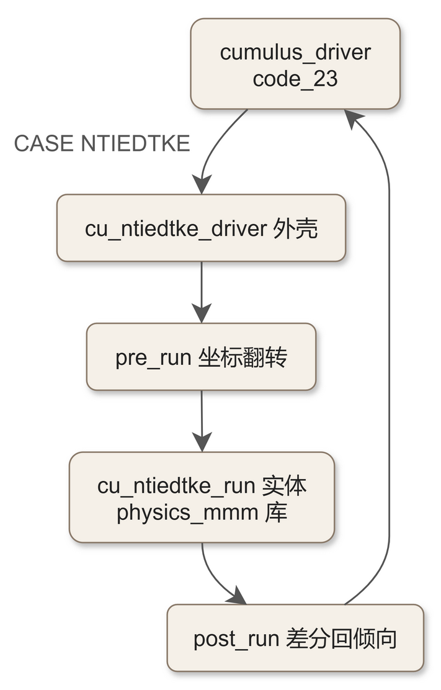
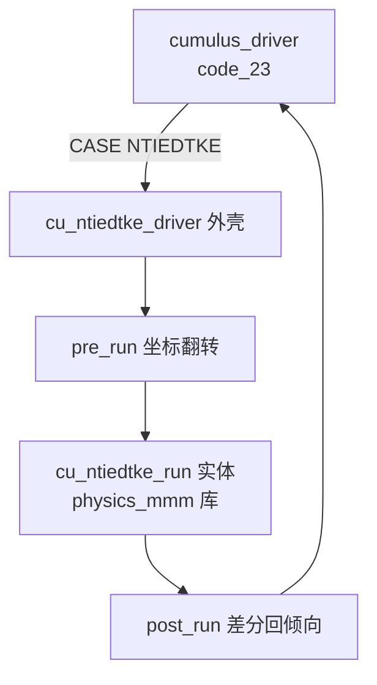

# code_11 — New Tiedtke 积云参数化的 WRF 外壳（module_cu_ntiedtke.F：CCPP 式三段桥接）

## 一、版本指纹

| 源文件 | 行数 | md5（整文件，按字节） |
|---|---|---|
| phys/module_cu_ntiedtke.F | 533 | c1e122b43d49f24a48868f942fd04092 |
| phys/physics_mmm/cu_ntiedtke.F90（实体，本篇不转录） | 3594 | 104dcb4bf2cee44771b8567c5d8056dc |

- 抽取工具：workspace/scripts/code_extract.py v1.2，2026-10-12；块首指纹注释自带 range_md5。
- 本篇 A 级全文（L1–L533 共 4 单元全收）+ physics_mmm 实体对照注记（单元地图与接口契约，见 §八）。

## 二、定位

一句话：New Tiedtke 积云方案（Tiedtke 1989 的质量通量闭合改造版，NCAR MMM 维护）在 WRF 4.8.0 的**接口外壳**——方案实体 cu_ntiedtke_run 在独立的 physics_mmm 物理库中，本文件只做三件事：WRF↔MMM 的垂直坐标翻转、积云步长与常数注入、状态差分式倾向回写。它是 WRF 4.8 物理库「CCPP 化」的活标本。

**谁在调它**：module_cumulus_driver.F 的 CASE('NTIEDTKE')（[code_23_module_cumulus_driver.md](code_23_module_cumulus_driver.md) §CASE 全走读）；教材锚点：[ch15_cumulus_family.md](../ch15_cumulus_family.md)。

**架构事实**（本树核验，2026-10-12 订正）：方案实体在 `phys/physics_mmm/cu_ntiedtke.F90`（3594 行 15 单元，见 §八）——physics_mmm 是 NCAR MMM 维护的共享物理库目录，随本源码树携带；文库方案的取舍是「physics_mmm 目录不单独成篇」（外围 C 级排除），实体以对照注记形式收录。

**三段桥接结构**：



<details><summary>原始 Mermaid 源码（可点击展开）</summary>

<!--

-->

</details>

## 三、文件头与模块声明

<!-- code_extract code_extract.py v1.2
source: phys/module_cu_ntiedtke.F
ranges: L1-L18
file_lines: 533
file_md5: c1e122b43d49f24a48868f942fd04092
display: line-numbered (strip L-prefix and !file: line to restore)
range_md5: c163ea1772adf065fde8fa73d0ba35d9
seg_lines: 18
-->

```fortran
!file: phys/module_cu_ntiedtke.F    L1-L18
L00001  !=================================================================================================================
L00002   module module_cu_ntiedtke
L00003   use ccpp_kind_types,only: kind_phys
L00004  
L00005   use cu_ntiedtke,only: cu_ntiedtke_run, &
L00006                         cu_ntiedtke_init
L00007   use cu_ntiedtke_common
L00008  
L00009   implicit none
L00010   private
L00011   public:: cu_ntiedtke_driver, &
L00012            ntiedtkeinit
L00013  
L00014  
L00015   contains
L00016  
L00017  
L00018  !=================================================================================================================
```

> 讲解：①use ccpp_kind_types 的 kind_phys——CCPP（Common Community Physics Package）物理容器的类型遗迹：New Tiedtke 从 WRF 4.4 起以 CCPP 兼容形态入库，WRF 侧保留这个外壳；②use cu_ntiedtke（实体：cu_ntiedtke_run/cu_ntiedtke_init）与 cu_ntiedtke_common（公共常数块）——两个模块都在 phys/physics_mmm/ 目录（§八）；③private + public 白名单只导出 cu_ntiedtke_driver 与 ntiedtkeinit——WRF 侧能看到的接口面被刻意收窄。

## 四、主入口 cu_ntiedtke_driver（全文）

<!-- code_extract code_extract.py v1.2
source: phys/module_cu_ntiedtke.F
ranges: L19-L275
file_lines: 533
file_md5: c1e122b43d49f24a48868f942fd04092
display: line-numbered (strip L-prefix and !file: line to restore)
range_md5: bb9f82f60ca25a4894e7b60471f72b31
seg_lines: 257
label: subroutine cu_ntiedtke_driver
-->

```fortran
!file: phys/module_cu_ntiedtke.F    L19-L275    (subroutine cu_ntiedtke_driver)
L00019   subroutine cu_ntiedtke_driver(                          &
L00020                   dt,itimestep,stepcu                     &
L00021                  ,raincv,pratec,qfx,hfx                   &
L00022                  ,u3d,v3d,w,t3d,qv3d,qc3d,qi3d,pi3d,rho3d &
L00023                  ,qvften,thften                           &
L00024                  ,dz8w,pcps,p8w,xland,cu_act_flag,dx      &
L00025                  ,f_qv,f_qc,f_qr,f_qi,f_qs                &
L00026                  ,grav,xlf,xls,xlv,rd,rv,cp               &
L00027                  ,rthcuten,rqvcuten,rqccuten,rqicuten     &
L00028                  ,rucuten,rvcuten                         &
L00029                  ,ids,ide,jds,jde,kds,kde                 &
L00030                  ,ims,ime,jms,jme,kms,kme                 &
L00031                  ,its,ite,jts,jte,kts,kte                 &
L00032                  ,errmsg,errflg)
L00033  !=================================================================================================================
L00034  !-- u3d         3d u-velocity interpolated to theta points (m/s)
L00035  !-- v3d         3d v-velocity interpolated to theta points (m/s)
L00036  !-- th3d        3d potential temperature (k)
L00037  !-- t3d         temperature (k)
L00038  !-- qv3d        3d water vapor mixing ratio (kg/kg)
L00039  !-- qc3d        3d cloud mixing ratio (kg/kg)
L00040  !-- qi3d        3d ice mixing ratio (kg/kg)
L00041  !-- rho3d       3d air density (kg/m^3)
L00042  !-- p8w         3d hydrostatic pressure at full levels (pa)
L00043  !-- pcps        3d hydrostatic pressure at half levels (pa)
L00044  !-- pi3d        3d exner function (dimensionless)
L00045  !-- qvften      3d total advective + PBL moisture tendency (kg kg-1 s-1)
L00046  !-- thften      3d total advective + PBL + radiative temperature tendency (k s-1)
L00047  !-- rthcuten      theta tendency due to 
L00048  !                 cumulus scheme precipitation (k/s)
L00049  !-- rucuten       u wind tendency due to 
L00050  !                 cumulus scheme precipitation (k/s)
L00051  !-- rvcuten       v wind tendency due to 
L00052  !                 cumulus scheme precipitation (k/s)
L00053  !-- rqvcuten      qv tendency due to 
L00054  !                 cumulus scheme precipitation (kg/kg/s)
L00055  !-- rqccuten      qc tendency due to 
L00056  !                 cumulus scheme precipitation (kg/kg/s)
L00057  !-- rqicuten      qi tendency due to 
L00058  !                 cumulus scheme precipitation (kg/kg/s)
L00059  !-- rainc         accumulated total cumulus scheme precipitation (mm)
L00060  !-- raincv        cumulus scheme precipitation (mm)
L00061  !-- pratec        precipitiation rate from cumulus scheme (mm/s)
L00062  !-- dz8w        dz between full levels (m)
L00063  !-- qfx         upward moisture flux at the surface (kg/m^2/s)
L00064  !-- hfx         upward heat flux at the surface (w/m^2) 
L00065  !-- dt          time step (s)
L00066  !-- ids         start index for i in domain
L00067  !-- ide         end index for i in domain
L00068  !-- jds         start index for j in domain
L00069  !-- jde         end index for j in domain
L00070  !-- kds         start index for k in domain
L00071  !-- kde         end index for k in domain
L00072  !-- ims         start index for i in memory
L00073  !-- ime         end index for i in memory
L00074  !-- jms         start index for j in memory
L00075  !-- jme         end index for j in memory
L00076  !-- kms         start index for k in memory
L00077  !-- kme         end index for k in memory
L00078  !-- its         start index for i in tile
L00079  !-- ite         end index for i in tile
L00080  !-- jts         start index for j in tile
L00081  !-- jte         end index for j in tile
L00082  !-- kts         start index for k in tile
L00083  !-- kte         end index for k in tile
L00084  !-----------------------------------------------------------------------------------------------------------------
L00085  
L00086  !--- input arguments:
L00087   logical,intent(in),optional:: f_qv,f_qc,f_qr,f_qi,f_qs
L00088  
L00089   integer,intent(in):: ids,ide,jds,jde,kds,kde, &
L00090                        ims,ime,jms,jme,kms,kme, &
L00091                        its,ite,jts,jte,kts,kte
L00092  
L00093   integer,intent(in):: itimestep,stepcu
L00094  
L00095   real(kind=kind_phys),intent(in):: cp,grav,rd,rv,xlf,xls,xlv
L00096  
L00097   real(kind=kind_phys),intent(in):: dt
L00098  
L00099   real(kind=kind_phys),intent(in),dimension(ims:ime,jms:jme):: dx,hfx,qfx,xland
L00100  
L00101   real(kind=kind_phys),intent(in),dimension(ims:ime,kms:kme,jms:jme):: &
L00102      dz8w,   &
L00103      pcps,   &
L00104      p8w,    &
L00105      pi3d,   &
L00106      qc3d,   &
L00107      qvften, &
L00108      thften, &
L00109      qi3d,   &
L00110      qv3d,   &
L00111      rho3d,  &
L00112      t3d,    &
L00113      u3d,    &
L00114      v3d,    &
L00115      w
L00116  
L00117  !--- inout arguments:
L00118   logical,intent(inout),dimension(ims:ime,jms:jme):: cu_act_flag
L00119  
L00120   real(kind=kind_phys),intent(inout),dimension(ims:ime,jms:jme):: raincv, pratec
L00121  
L00122   real(kind=kind_phys),intent(inout),dimension(ims:ime,kms:kme,jms:jme),optional:: &
L00123   rqccuten,  &
L00124   rqicuten,  &
L00125   rqvcuten,  &
L00126   rthcuten,  &
L00127   rucuten,   &
L00128   rvcuten
L00129  
L00130  !--- output arguments:
L00131   character(len=*),intent(out):: errmsg
L00132   integer,intent(out):: errflg
L00133  
L00134  !--- local variables and arrays:
L00135   integer:: i,im,j,k,kx,kx1
L00136   integer,dimension(its:ite)::  slimsk
L00137  
L00138   real(kind=kind_phys):: delt
L00139   real(kind=kind_phys),dimension(its:ite):: rn
L00140   real(kind=kind_phys),dimension(its:ite,kts:kte):: prsl,omg,ghtl
L00141   real(kind=kind_phys),dimension(its:ite,kts:kte):: uf,vf,tf,qvf,qcf,qif
L00142   real(kind=kind_phys),dimension(its:ite,kts:kte):: qvftenz,thftenz
L00143   real(kind=kind_phys),dimension(its:ite,kts:kte+1):: prsi,ghti,zi
L00144  
L00145   real(kind=kind_phys),dimension(its:ite):: dx_hv,hfx_hv,qfx_hv,xland_hv
L00146   real(kind=kind_phys),dimension(its:ite,kts:kte):: dz_hv,pi_hv,prsl_hv
L00147   real(kind=kind_phys),dimension(its:ite,kts:kte):: qv_hv,qc_hv,qi_hv,rho_hv,t_hv,u_hv,v_hv
L00148   real(kind=kind_phys),dimension(its:ite,kts:kte):: qvften_hv,thften_hv
L00149   real(kind=kind_phys),dimension(its:ite,kts:kte+1):: prsi_hv,w_hv
L00150  
L00151   real(kind=kind_phys),dimension(its:ite):: raincv_hv,pratec_hv
L00152   real(kind=kind_phys),dimension(its:ite,kts:kte):: rthcuten_hv,rqvcuten_hv,rqccuten_hv,rqicuten_hv, &
L00153                                                     rucuten_hv,rvcuten_hv
L00154  
L00155  !-----------------------------------------------------------------------------------------------------------------
L00156  
L00157   errmsg = ' '
L00158   errflg = 0
L00159  
L00160   call cu_ntiedtke_init( &
L00161                         con_cp  = cp  , con_rd = rd   , con_rv   = rv   , con_xlv = xlv    , &
L00162                         con_xls = xls , con_xlf = xlf , con_grav = grav , errmsg  = errmsg , &
L00163                         errflg  = errflg                                                     &
L00164                        )
L00165  
L00166   do j = jts,jte
L00167      do i = its,ite
L00168         cu_act_flag(i,j)=.true.
L00169      enddo
L00170   enddo
L00171  
L00172   do j = jts,jte
L00173  
L00174      do i = its,ite
L00175         dx_hv(i)    = dx(i,j)
L00176         hfx_hv(i)   = hfx(i,j)
L00177         qfx_hv(i)   = qfx(i,j)
L00178         xland_hv(i) = xland(i,j)
L00179      enddo
L00180  
L00181      do k = kts,kte
L00182         do i = its,ite
L00183            dz_hv(i,k)   = dz8w(i,k,j)
L00184            pi_hv(i,k)   = pi3d(i,k,j)
L00185            prsl_hv(i,k) = pcps(i,k,j)
L00186            qv_hv(i,k)   = qv3d(i,k,j)
L00187            qc_hv(i,k)   = qc3d(i,k,j)
L00188            qi_hv(i,k)   = qi3d(i,k,j)
L00189            rho_hv(i,k)  = rho3d(i,k,j)
L00190            t_hv(i,k)    = t3d(i,k,j)
L00191            u_hv(i,k)    = u3d(i,k,j)
L00192            v_hv(i,k)    = v3d(i,k,j)
L00193  
L00194            qvften_hv(i,k) = qvften(i,k,j)
L00195            thften_hv(i,k) = thften(i,k,j)
L00196         enddo
L00197      enddo
L00198      do k = kts,kte+1
L00199         do i = its,ite
L00200            prsi_hv(i,k) = p8w(i,k,j)
L00201            w_hv(i,k)    = w(i,k,j)
L00202         enddo
L00203      enddo
L00204  
L00205      call cu_ntiedtke_pre_run( &
L00206                       its    = its       , ite     = ite     , kts     = kts     , kte       = kte       , &
L00207                       im     = im        , kx      = kx      , kx1     = kx1     , itimestep = itimestep , &
L00208                       stepcu = stepcu    , dt      = dt      , grav    = grav    , xland     = xland_hv  , &
L00209                       dz     = dz_hv     , pres    = prsl_hv , presi   = prsi_hv , t         = t_hv      , &
L00210                       rho    = rho_hv    , qv      = qv_hv   , qc      = qc_hv   , qi        = qi_hv     , &
L00211                       u      = u_hv      , v       = v_hv    , w       = w_hv    , qvften    = qvften_hv , &
L00212                       thften = thften_hv , qvftenz = qvftenz , thftenz = thftenz , slimsk    = slimsk    , &
L00213                       delt   = delt      , prsl    = prsl    , ghtl    = ghtl    , tf        = tf        , &
L00214                       qvf    = qvf       , qcf     = qcf     , qif     = qif     , uf        = uf        , &
L00215                       vf     = vf        , prsi    = prsi    , ghti    = ghti    , omg       = omg       , &
L00216                       errmsg = errmsg    , errflg  = errflg                                                &
L00217                              )
L00218  
L00219      call cu_ntiedtke_run( &
L00220                       pu   = uf     , pv   = vf     , pt     = tf      , pqv    = qvf     , &
L00221                       pqc  = qcf    , pqi  = qif    , pqvf   = qvftenz , ptf    = thftenz , &
L00222                       poz  = ghtl   , pzz  = ghti   , pomg   = omg     , pap    = prsl    , &
L00223                       paph = prsi   , evap = qfx_hv , hfx    = hfx_hv  , zprecc = rn      , &
L00224                       lndj = slimsk , lq   = im     , km     = kx      , km1    = kx1     , &
L00225                       dt   = delt   , dx   = dx_hv  , errmsg = errmsg  , errflg = errflg    &
L00226                          )
L00227  
L00228      call cu_ntiedtke_post_run( &
L00229                       its      = its         , ite      = ite         , kts      = kts         , kte      = kte         , &
L00230                       stepcu   = stepcu      , dt       = dt          , exner    = pi_hv       , qv       = qv_hv       , &
L00231                       qc       = qc_hv       , qi       = qi_hv       , t        = t_hv        , u        = u_hv        , &
L00232                       v        = v_hv        , qvf      = qvf         , qcf      = qcf         , qif      = qif         , &
L00233                       tf       = tf          , uf       = uf          , vf       = vf          , rn       = rn          , &
L00234                       raincv   = raincv_hv   , pratec   = pratec_hv   , rthcuten = rthcuten_hv , rqvcuten = rqvcuten_hv , &
L00235                       rqccuten = rqccuten_hv , rqicuten = rqicuten_hv , rucuten  = rucuten_hv  , rvcuten  = rvcuten_hv  , &
L00236                       errmsg   = errmsg      , errflg   = errflg                                                          &
L00237                               )
L00238  
L00239      do i = its,ite
L00240         raincv(i,j) = raincv_hv(i)
L00241         pratec(i,j) = pratec_hv(i)
L00242      enddo
L00243  
L00244      do k = kts,kte
L00245         do i = its,ite
L00246            rucuten(i,k,j)  = rucuten_hv(i,k)
L00247            rvcuten(i,k,j)  = rvcuten_hv(i,k)
L00248            rthcuten(i,k,j) = rthcuten_hv(i,k)
L00249            rqvcuten(i,k,j) = rqvcuten_hv(i,k)
L00250         enddo
L00251      enddo
L00252  
L00253      if(present(rqccuten))then
L00254         if(f_qc) then
L00255            do k = kts,kte
L00256               do i = its,ite
L00257                  rqccuten(i,k,j) = rqccuten_hv(i,k)
L00258               enddo
L00259            enddo
L00260         endif
L00261      endif
L00262  
L00263      if(present(rqicuten))then
L00264         if(f_qi) then
L00265            do k = kts,kte
L00266               do i = its,ite
L00267                  rqicuten(i,k,j) = rqicuten_hv(i,k)
L00268               enddo
L00269            enddo
L00270         endif
L00271      endif
L00272  
L00273   enddo
L00274  
L00275   end subroutine cu_ntiedtke_driver
```

> 讲解：七站走读。①**参数注释块**（L33–L84）：注意 qvften/thften 的口径——「平流+PBL 的水汽倾向」与「平流+PBL+辐射的温度倾向」，这是 New Tiedtke 闭合式的外部强迫输入（区别于 KF 系只吃状态量）；optional 的 f_qv/f_qc/f_qr/f_qi/f_qs 是积分器压缩数组开关。②**CCPP 错误协议**（L157–158）：errmsg/errflg 出参、errflg=0 正常——与旧式 wrf_error_fatal 风格并列的物理库新约定。③**常数注入**（L160–164）：cu_ntiedtke_init 在**每个时间步**都被调用，把 cp/rd/rv/xlv/xls/xlf/grav 以 con_* 关键字实参注入——物理库自身不硬编码常数，双精度口径统一走 kind_phys。④cu_act_flag 全部置 true（L166–170）——WRF 侧不做触发门控，触发判据完全在实体闭合式内部；对比 KF 路径在 cumulus_driver 里的 CYCLE 门控（code_23）。⑤**列组织**（L172–203）：J 循环内把 3D 场抄进 (i,k) 的 _hv 转置数组——MMM 库按「列向量×列数」组织，与 WRF 的 (i,k,j) 惯例互异；prsi/w 在整层（kte+1），其余在半层。⑥**三段流水**（L205–237）：pre_run（翻转+整形）→ run（实体物理）→ post_run（差分回倾向），全程关键字实参——CCPP 风格的自文档化调用。⑦**回写门控**（L239–271）：rucuten/rvcuten/rthcuten/rqvcuten 无条件写回，rqccuten/rqicuten 要过 present + f_qc/f_qi 双门控——qc/qi 变量不存在于 Registry 时（低配微物理）跳过，避免写未分配数组。

## 五、ntiedtkeinit（全文）

<!-- code_extract code_extract.py v1.2
source: phys/module_cu_ntiedtke.F
ranges: L278-L350
file_lines: 533
file_md5: c1e122b43d49f24a48868f942fd04092
display: line-numbered (strip L-prefix and !file: line to restore)
range_md5: f1b14b360ba43215d3cddc5d9b7e627c
seg_lines: 73
label: subroutine ntiedtkeinit
-->

```fortran
!file: phys/module_cu_ntiedtke.F    L278-L350    (subroutine ntiedtkeinit)
L00278   subroutine ntiedtkeinit(rthcuten,rqvcuten,rqccuten,rqicuten, &
L00279                           rucuten,rvcuten,rthften,rqvften,     &
L00280                           restart,p_qc,p_qi,p_first_scalar,    &
L00281                           allowed_to_read,                     &
L00282                           ids, ide, jds, jde, kds, kde,        &
L00283                           ims, ime, jms, jme, kms, kme,        &
L00284                           its, ite, jts, jte, kts, kte)
L00285  !=================================================================================================================
L00286  
L00287  !--- input arguments:
L00288   logical,intent(in):: allowed_to_read,restart
L00289  
L00290   integer,intent(in):: ids, ide, jds, jde, kds, kde, &
L00291                        ims, ime, jms, jme, kms, kme, &
L00292                        its, ite, jts, jte, kts, kte
L00293   integer,intent(in):: p_first_scalar,p_qi,p_qc
L00294  
L00295  !--- output arguments:
L00296   real(kind=kind_phys),intent(out),dimension(ims:ime,kms:kme,jms:jme )::  &
L00297      rthcuten,rqvcuten,rqccuten,rqicuten,rucuten,rvcuten,rthften,rqvften
L00298  
L00299  !--- local variables and arrays:
L00300   integer:: i,j,k,itf,jtf,ktf
L00301  
L00302  !-----------------------------------------------------------------------------------------------------------------
L00303  
L00304   jtf = min0(jte,jde-1)
L00305   ktf = min0(kte,kde-1)
L00306   itf = min0(ite,ide-1)
L00307  
L00308   if(.not.restart)then
L00309      do j = jts,jtf
L00310         do k = kts,ktf
L00311            do i = its,itf
L00312               rthcuten(i,k,j) = 0.
L00313               rqvcuten(i,k,j) = 0.
L00314               rucuten(i,k,j)  = 0.
L00315               rvcuten(i,k,j)  = 0.
L00316            enddo
L00317         enddo
L00318      enddo
L00319  
L00320      do j = jts,jtf
L00321         do k = kts,ktf
L00322            do i = its,itf
L00323               rthften(i,k,j)=0.
L00324               rqvften(i,k,j)=0.
L00325            enddo
L00326         enddo
L00327      enddo
L00328  
L00329      if(p_qc .ge. p_first_scalar) then
L00330         do j = jts,jtf
L00331            do k = kts,ktf
L00332               do i = its,itf
L00333                  rqccuten(i,k,j)=0.
L00334               enddo
L00335            enddo
L00336         enddo
L00337      endif
L00338  
L00339      if(p_qi .ge. p_first_scalar) then
L00340         do j = jts,jtf
L00341            do k = kts,ktf
L00342               do i = its,itf
L00343                  rqicuten(i,k,j)=0.
L00344               enddo
L00345            enddo
L00346         enddo
L00347      endif
L00348   endif
L00349  
L00350   end subroutine ntiedtkeinit
```

> 讲解：倾向数组清零（restart 跳过——重启时倾向态从重启动文件来）；rthften/rqvften 是本方案的「外部倾向」暂存数组，同样清零；p_qc/p_qi≥p_first_scalar 才清 rqccuten/rqicuten——与 driver 的 present 门控同构，判断「该变量是否在 Registry 包内」（q_first_scalar 之前的变量是 2D/诊断量，不必清）。

## 六、cu_ntiedtke_pre_run（全文）

<!-- code_extract code_extract.py v1.2
source: phys/module_cu_ntiedtke.F
ranges: L353-L473
file_lines: 533
file_md5: c1e122b43d49f24a48868f942fd04092
display: line-numbered (strip L-prefix and !file: line to restore)
range_md5: 6e8699e485ab4105e00e0ed7fcb199fa
seg_lines: 121
label: subroutine cu_ntiedtke_pre_run
-->

```fortran
!file: phys/module_cu_ntiedtke.F    L353-L473    (subroutine cu_ntiedtke_pre_run)
L00353   subroutine cu_ntiedtke_pre_run(its,ite,kts,kte,im,kx,kx1,itimestep,stepcu,dt,grav,xland,dz,pres,presi,   &
L00354                                  t,rho,qv,qc,qi,u,v,w,qvften,thften,qvftenz,thftenz,slimsk,delt,prsl,ghtl, &
L00355                                  tf,qvf,qcf,qif,uf,vf,prsi,ghti,omg,errmsg,errflg)
L00356  !=================================================================================================================
L00357  
L00358  !--- input arguments:
L00359   integer,intent(in):: its,ite,kts,kte
L00360   integer,intent(in):: itimestep
L00361   integer,intent(in):: stepcu
L00362  
L00363   real(kind=kind_phys),intent(in):: dt,grav
L00364   real(kind=kind_phys),intent(in),dimension(its:ite):: xland
L00365   real(kind=kind_phys),intent(in),dimension(its:ite,kts:kte):: dz,pres,t,rho,qv,qc,qi,u,v
L00366   real(kind=kind_phys),intent(inout),dimension(its:ite,kts:kte):: qvften,thften
L00367   real(kind=kind_phys),intent(in),dimension(its:ite,kts:kte+1):: presi,w
L00368  
L00369  !--- inout arguments:
L00370   integer,intent(inout):: im,kx,kx1
L00371   integer,intent(inout),dimension(its:ite):: slimsk
L00372  
L00373   real(kind=kind_phys),intent(inout):: delt
L00374   real(kind=kind_phys),intent(inout),dimension(its:ite,kts:kte):: tf,qvf,qcf,qif,uf,vf
L00375   real(kind=kind_phys),intent(inout),dimension(its:ite,kts:kte):: ghtl,omg,prsl
L00376   real(kind=kind_phys),intent(inout),dimension(its:ite,kts:kte):: qvftenz,thftenz
L00377   real(kind=kind_phys),intent(inout),dimension(its:ite,kts:kte+1):: ghti,prsi
L00378  
L00379  !--- output arguments:
L00380   character(len=*),intent(out):: errmsg
L00381   integer,intent(out):: errflg
L00382  
L00383  !--- local variables and arrays:
L00384   integer:: i,k,pp,zz
L00385  
L00386   real(kind=kind_phys),dimension(its:ite,kts:kte):: zl,dot
L00387   real(kind=kind_phys),dimension(its:ite,kts:kte+1):: zi
L00388  
L00389  !-----------------------------------------------------------------------------------------------------------------
L00390  
L00391   im  = ite-its+1
L00392   kx  = kte-kts+1
L00393   kx1 = kx+1
L00394  
L00395   delt  = dt*stepcu
L00396  
L00397   do i = its,ite
L00398      slimsk(i) = (abs(xland(i)-2.))
L00399   enddo
L00400  
L00401   k = kts
L00402   do i = its,ite
L00403      zi(i,k) = 0.
L00404   enddo
L00405   do k = kts,kte
L00406      do i = its,ite
L00407         zi(i,k+1) = zi(i,k)+dz(i,k)
L00408      enddo
L00409   enddo
L00410   do k = kts,kte
L00411      do i = its,ite
L00412         zl(i,k)  = 0.5*(zi(i,k)+zi(i,k+1))
L00413         dot(i,k) = -0.5*grav*rho(i,k)*(w(i,k)+w(i,k+1))
L00414      enddo
L00415   enddo
L00416  
L00417   pp = 0
L00418   do k = kts,kte+1
L00419      zz = kte + 1 - pp
L00420      do i = its,ite
L00421         ghti(i,zz) = zi(i,k)
L00422         prsi(i,zz) = presi(i,k)
L00423      enddo
L00424      pp = pp + 1
L00425   enddo
L00426   pp = 0
L00427   do k = kts,kte
L00428      zz = kte-pp
L00429      do i = its,ite
L00430         ghtl(i,zz) = zl(i,k)
L00431         omg(i,zz)  = dot(i,k)
L00432         prsl(i,zz) = pres(i,k)
L00433      enddo
L00434      pp = pp + 1
L00435   enddo
L00436  
L00437   pp = 0
L00438   do k = kts,kte
L00439      zz = kte-pp
L00440      do i = its,ite
L00441         tf(i,zz)  = t(i,k)
L00442         qvf(i,zz) = qv(i,k)
L00443         qcf(i,zz) = qc(i,k)
L00444         qif(i,zz) = qi(i,k)
L00445         uf(i,zz)  = u(i,k)
L00446         vf(i,zz)  = v(i,k)
L00447      enddo
L00448      pp = pp + 1
L00449   enddo
L00450  
L00451   if(itimestep == 1) then
L00452      do k = kts,kte
L00453         do i = its,ite
L00454            qvftenz(i,k) = 0.
L00455            thftenz(i,k) = 0.
L00456         enddo
L00457      enddo
L00458   else
L00459      pp = 0
L00460      do k = kts,kte
L00461         zz = kte-pp
L00462         do i = its,ite
L00463            qvftenz(i,zz) = qvften(i,k)
L00464            thftenz(i,zz) = thften(i,k)
L00465         enddo
L00466         pp = pp + 1
L00467      enddo
L00468   endif
L00469  
L00470   errmsg = 'cu_ntiedtke_pre_run OK'
L00471   errflg = 0
L00472  
L00473   end subroutine cu_ntiedtke_pre_run
```

> 讲解：本篇核心教学点——**垂直坐标翻转**。①im/kx/kx1：列数与层数（kx1=kte+1 整层）；delt=dt·stepcu——积云步长是模式步的 stepcu 倍（namelist cu_used_step 语义在 driver 侧），实体内部按 delt 做一个「聚合步」的物理。②slimsk=|xland−2|：陆地 1、水面 0（MMM 的陆海标记与 WRF 的 XLAND=1 陆/2 水方向相反的绝对值 trick）。③**翻转**（pp/zz 对偶循环）：WRF 的 k 自上向下（kts 在顶），MMM 索引自下向上——ghti/prsi（整层高度/气压）、ghtl/omg/prsl（半层）、tf/qvf/qcf/qif/uf/vf（状态量）全部以 zz=kte+1−pp 或 kte−pp 倒序拷贝；zi 自地面向上累加 dz 得界面高度、zl 取层中。④**ω 型垂直速度**：omg=−0.5·grav·ρ·(w(i,k)+w(i,k+1))——把 WRF 的 w（m/s）换成质量加权的气压坐标 ω 型，实体 pomg 输入口径（半层平均+密度权重+负号约定一次到位）。⑤qvftenz/thftenz：itimestep=1 清零、其后翻转传入——前期倾向（平流+PBL[+辐射]）是闭合式的强迫项，「第一天不做积云修正」的初始化细节就在这。

## 七、cu_ntiedtke_post_run（全文）

<!-- code_extract code_extract.py v1.2
source: phys/module_cu_ntiedtke.F
ranges: L476-L529
file_lines: 533
file_md5: c1e122b43d49f24a48868f942fd04092
display: line-numbered (strip L-prefix and !file: line to restore)
range_md5: 4831cfafb3fb8e9b9d416c32250d5972
seg_lines: 54
label: subroutine cu_ntiedtke_post_run
-->

```fortran
!file: phys/module_cu_ntiedtke.F    L476-L529    (subroutine cu_ntiedtke_post_run)
L00476   subroutine cu_ntiedtke_post_run(its,ite,kts,kte,stepcu,dt,exner,qv,qc,qi,t,u,v,qvf,qcf,qif,tf,uf,vf,rn,raincv, &
L00477                                   pratec,rthcuten,rqvcuten,rqccuten,rqicuten,rucuten,rvcuten,errmsg,errflg)
L00478  !=================================================================================================================
L00479  
L00480  !--- input arguments:
L00481   integer,intent(in):: its,ite,kts,kte
L00482   integer,intent(in):: stepcu
L00483  
L00484   real(kind=kind_phys),intent(in):: dt
L00485   real(kind=kind_phys),intent(in),dimension(its:ite):: rn
L00486   real(kind=kind_phys),intent(in),dimension(its:ite,kts:kte):: exner,qv,qc,qi,t,u,v,qvf,qcf,qif,tf,uf,vf
L00487  
L00488  !--- inout arguments:
L00489   real(kind=kind_phys),intent(inout),dimension(its:ite):: raincv,pratec
L00490   real(kind=kind_phys),intent(inout),dimension(its:ite,kts:kte):: rqvcuten,rqccuten,rqicuten
L00491   real(kind=kind_phys),intent(inout),dimension(its:ite,kts:kte):: rthcuten,rucuten,rvcuten
L00492  
L00493  !--- output arguments:
L00494   character(len=*),intent(out):: errmsg
L00495   integer,intent(out):: errflg
L00496  
L00497  !--- local variables and arrays:
L00498   integer:: i,k,pp,zz
L00499  
L00500   real(kind=kind_phys):: delt,rdelt
L00501  
L00502  !-----------------------------------------------------------------------------------------------------------------
L00503  
L00504   delt  = dt*stepcu
L00505   rdelt = 1./delt
L00506  
L00507   do i = its,ite
L00508      raincv(i) = rn(i)/stepcu
L00509      pratec(i) = rn(i)/(stepcu*dt)
L00510   enddo
L00511  
L00512   pp = 0
L00513   do k = kts,kte
L00514      zz = kte - pp
L00515      do i = its,ite
L00516         rthcuten(i,k) = (tf(i,zz)-t(i,k))/exner(i,k)*rdelt
L00517         rqvcuten(i,k) = (qvf(i,zz)-qv(i,k))*rdelt
L00518         rqccuten(i,k) = (qcf(i,zz)-qc(i,k))*rdelt
L00519         rqicuten(i,k) = (qif(i,zz)-qi(i,k))*rdelt
L00520         rucuten(i,k)  = (uf(i,zz)-u(i,k))*rdelt
L00521         rvcuten(i,k)  = (vf(i,zz)-v(i,k))*rdelt
L00522      enddo
L00523      pp = pp + 1
L00524   enddo
L00525  
L00526   errmsg = 'cu_ntiedtke_timestep_final OK'
L00527   errflg = 0
L00528  
L00529   end subroutine cu_ntiedtke_post_run
```

> 讲解：①delt=dt·stepcu、rdelt=1/delt。②**降水均摊**：raincv=rn/stepcu（实体在聚合步内算的总降水 rn，均摊回每个模式步，mm/step 口径）、pratec=rn/(stepcu·dt)（mm/s）——cumulus_driver 据此累加 RAINC。③**状态差分式倾向**：六个倾向全部按（翻转回 k 序后的终态−进入时的初态）/delt 给出，rthcuten 额外除 exner 把温度差转回位温倾向——「输出倾向」而非「直接改状态」，与 WRF 的非时间分裂物理串联约定（辐射→陆面→PBL→积云……倾向统一进动力核）严丝合缝。对比 KF 系在实体内部直接修改 rqv/rth 数组再由 driver 收差分的做法（code_23 §CASE 对照）。

## 八、physics_mmm 实体对照（注记）

> **实体身份**（2026-10-12 核验）：`phys/physics_mmm/cu_ntiedtke.F90`——3594 行、15 单元、md5 104dcb4bf2cee44771b8567c5d8056dc。physics_mmm 是 NCAR MMM 维护的共享物理库目录（内含 cu_ntiedtke、bl_mynn 系、mp_wsm6、bl_shinhong、bl_ysu、bl_gwdo、sf_sfclayrev 等），随本源码树携带；文库方案的取舍是「physics_mmm 目录不单独成篇」（外围 C 级排除，plan §三写明），本篇按对照注记收录。

> **实体单元地图**（扫描器输出，行段为引用不转录）：cu_ntiedtke_init（L81–123，常数注入落地）、cu_ntiedtke_finalize（L129–141）、**cu_ntiedtke_run（L148–332，实体侧总控——外壳三段调用的 run 落点）**、**cumastrn（L342–1085，744 行主实体：质量通量闭环主求解；教材 ch15「cumastrn 十步」精读即此）**、cuinin（L1091–1216）、cutypen（L1221–1750，两类测试气块）、cuascn（L1755–2258）、cudlfsn（L2262–2487）、cuddrafn（L2495–2721）、cuflxn（L2725–3060）、cudtdqn（L3064–3148）、cududvn（L3152–3252）、cuadjtqn（L3256–3402）、cubasmcn（L3406–3485）、cuentrn（L3489–3538）。各单元职能的逐段精读见教材 [ch15_cumulus_family.md](../ch15_cumulus_family.md)（已覆盖 cumastrn 十步、cutypen 两类气块、三类闭合、卷入卷出、Sundqvist 降水与 scale_fac）。

> **外壳↔实体接口契约**（外壳调用点 L219–226 实参逐项对应，保真于本地源码）：pu/pv/pt/pqv/pqc/pqi=翻转后的 u/v/T/qv/qc/qi；pqvf/ptf=翻转后的前期倾向（闭合式强迫）；poz/pzz=半层/整层高度；pomg=ω 型垂直速度；pap/paph=半层/整层气压；evap=qfx_hv（地表蒸发通量）、hfx=hfx_hv（地表感热）；zprecc=rn（对流降水输出，mm/聚合步）；lndj=slimsk（陆海标记）；lq=列数 im；km/kx 与 km1/kx1=层数；dt=delt；dx=格距（对流调整的水平尺度依赖）。

> **订正记录**：批 3 成稿时曾误判「physics_mmm 子模块缺席本源码树」（当时只查了 WRF 根目录、漏了 phys/ 下的同名子目录）；用户复核指出后已核验订正本节并同步 notes/progress。教训：目录核查要下探一层。

## 九、改造入口

1. **常数与时间尺度**：cu_ntiedtke_init 的 con_* 注入与 delt=dt·stepcu——做积云步长敏感性实验（stepcu=1 逐步）只动 driver/namelist。
2. **触发门控**：cu_act_flag 恒 true——想加湿度/CAPE 触发阈值（如中科院风格 trigger），在 driver 的 J 循环置 false 即可跳过该列实体调用（实体完全不被触碰）。
3. **坐标翻转层通用化**：pre_run/post_run 的 pp/zz 对偶循环是「自下向上物理库」接入 WRF 的标准模板——移植 ICON/GFS 生态方案照抄此结构。
4. **闭合式强迫**：qvften/thften 的口径（平流+PBL[+辐射]）——改 cumulus_driver 里 rthften/rqvften 的组装（code_23）即可改变闭合式看到的外部倾向。
5. **输出形态**：状态差分式倾向——若需「逐云过程分项诊断」（如分离凝结/蒸发/夹卷项），必须进实体，外壳只能给净差。

## 十、上下游链接

- 调用方：[code_23_module_cumulus_driver.md](code_23_module_cumulus_driver.md)（CASE NTIEDTKE 与 stepcu/nlifecycle 语义）
- 同族对照：KF/旧 Tiedtke 等 CASE 分支均在 code_23；微物理驱动链：[code_21_module_microphysics_driver.md](code_21_module_microphysics_driver.md)
- 教材正文：[ch15_cumulus_family.md](../ch15_cumulus_family.md)、[ch20_modifying_wrf.md](../ch20_modifying_wrf.md)、[ch21_solve_em_dynamics.md](../ch21_solve_em_dynamics.md)（倾向进入动力核的位置）
