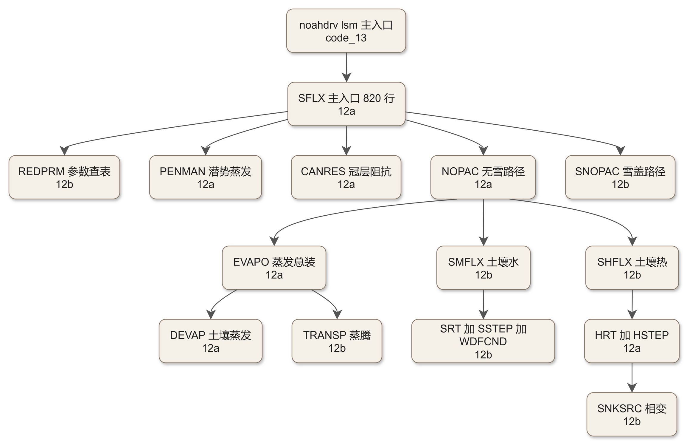
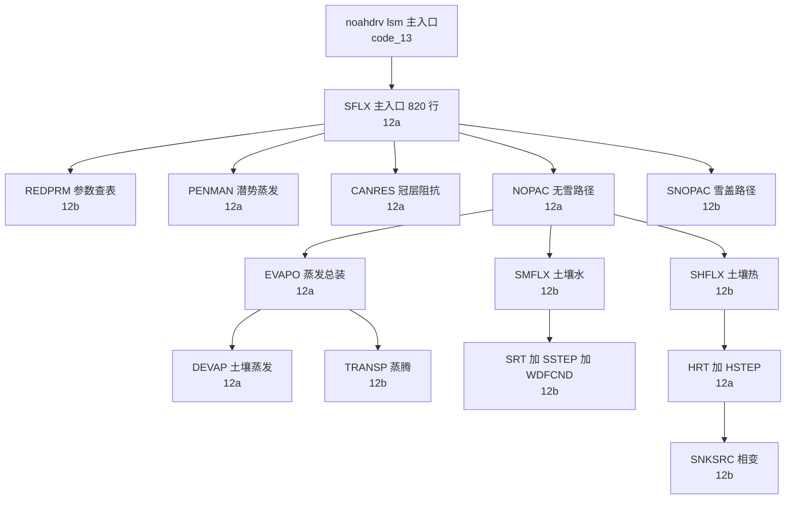

# code_12a — Noah LSM 本体·上半（module_sf_noahlsm.F：主入口 SFLX 与蒸发/热力线）

## 一、版本指纹

| 源文件 | 行数 | md5（整文件，按字节） |
|---|---|---|
| phys/module_sf_noahlsm.F | 4759 | 9bc3fbaae919bd37ca4d05e44599c582 |

- 抽取工具：workspace/scripts/code_extract.py v1.2，2026-10-12；块首指纹注释自带 range_md5。
- 本篇 A 级全文拆两：12a = 文件头 + SFLX（主入口）+ 蒸发/冠层/热力线共 13 单元（L1–L2312）；12b = REDPRM 起的参数查表/隐式求解器/雪线共 18 单元（L2315–L4756），见 [code_12b_module_sf_noahlsm.md](code_12b_module_sf_noahlsm.md)。

## 二、定位

一句话：Noah LSM（Chen–Dudhia 2001 谱系，Unified Noah v1.0 2007 统一化）的**方案本体**——土壤水、土壤温度、雪盖三套预报量的物理核心；一个模块 31 个子程序把潜热交换、径流、冻土相变、雪盖演化全部做完，noahdrv（code_13）只是它的逐格点驱动外壳。

**谁在调它**：module_sf_noahdrv.F 的 lsm 主入口按格点调 SFLX（[code_13_module_sf_noahdrv.md](code_13_module_sf_noahdrv.md)）；再上游是 lsm_driver 的方案分派。教材锚点：[ch16_land_surface_family.md](../ch16_land_surface_family.md) 全章；urban 硬参数与灌溉通道是 [ch19_lanzhou_heatwave.md](../ch19_lanzhou_heatwave.md)、[ch20_modifying_wrf.md](../ch20_modifying_wrf.md) 的常客；与 BEP/BEM（code_14/15/16）的关系见 [ch17_urban_canopy.md](../ch17_urban_canopy.md)。

**31 单元地图**（实线=调用，本篇/12b 标注）：



<details><summary>原始 Mermaid 源码（可点击展开）</summary>

<!--

-->

</details>

## 三、文件头：MPAS/WRF 双框架与三张参数表

<!-- code_extract code_extract.py v1.2
source: phys/module_sf_noahlsm.F
ranges: L1-L68
file_lines: 4759
file_md5: 9bc3fbaae919bd37ca4d05e44599c582
display: line-numbered (strip L-prefix and !file: line to restore)
range_md5: e6b28d531abf6824363c6dbe2989e5ae
seg_lines: 68
-->

```fortran
!file: phys/module_sf_noahlsm.F    L1-L68
L00001  MODULE module_sf_noahlsm
L00002  #if defined(mpas)
L00003  use mpas_atmphys_constants,only: CP=>cp,R_D=>R_d,XLF=>xlf,XLV=>xlv,RHOWATER=>rho_w,STBOLT=>stbolt,KARMAN=>karman
L00004  use mpas_atmphys_utilities, only: physics_error_fatal
L00005  #define FATAL_ERROR(M) call physics_error_fatal( M )
L00006  #else
L00007  USE module_model_constants, only : CP, R_D, XLF, XLV, RHOWATER, STBOLT, KARMAN
L00008  use module_wrf_error
L00009  #define FATAL_ERROR(M) call wrf_error_fatal( M )
L00010  #endif
L00011  
L00012  !ckay=KIRAN ALAPATY @ US EPA -- November 01, 2015
L00013  !
L00014  ! Tim Glotfelty@CNSU; AJ Deng@PSU
L00015  !modified for use with FASDAS 
L00016  !Flux Adjusting Surface Data Assimilation System to assimilate 
L00017  !surface layer and soil layers temperature and moisture using
L00018  ! surfance reanalsys 
L00019  !Reference: Alapaty et al., 2008: Development of the flux-adjusting surface
L00020  ! data assimilation system for mesoscale models. JAMC, 47, 2331-2350
L00021  !
L00022  
L00023  !   REAL, PARAMETER    :: CP = 1004.5
L00024    REAL, PARAMETER      :: RD = 287.04, SIGMA = 5.67E-8,                 &
L00025                            CPH2O = 4.218E+3,CPICE = 2.106E+3,            &
L00026                            LSUBF = 3.335E+5,                             &
L00027                            EMISSI_S = 0.95
L00028  
L00029  ! VEGETATION PARAMETERS
L00030          INTEGER :: LUCATS , BARE
L00031          INTEGER :: NATURAL
L00032          INTEGER :: LCZ_1,LCZ_2,LCZ_3,LCZ_4,LCZ_5,LCZ_6,LCZ_7,LCZ_8,LCZ_9,LCZ_10,LCZ_11
L00033          integer, PARAMETER :: NLUS=50
L00034          CHARACTER(LEN=256) LUTYPE
L00035          INTEGER, DIMENSION(1:NLUS) :: NROTBL
L00036          real, dimension(1:NLUS) ::  SNUPTBL, RSTBL, RGLTBL, HSTBL,                &
L00037                                      SHDTBL, MAXALB,                               &
L00038                                      EMISSMINTBL, EMISSMAXTBL,                     &
L00039                                      LAIMINTBL, LAIMAXTBL,                         &
L00040                                      Z0MINTBL, Z0MAXTBL,                           &
L00041                                      ALBEDOMINTBL, ALBEDOMAXTBL,                   &
L00042                                      ZTOPVTBL,ZBOTVTBL
L00043          REAL ::   TOPT_DATA,CMCMAX_DATA,CFACTR_DATA,RSMAX_DATA
L00044  
L00045  ! SOIL PARAMETERS
L00046          INTEGER :: SLCATS
L00047          INTEGER, PARAMETER :: NSLTYPE=30
L00048          CHARACTER(LEN=256) SLTYPE
L00049          REAL, DIMENSION (1:NSLTYPE) :: BB,DRYSMC,F11,                           &
L00050          MAXSMC, REFSMC,SATPSI,SATDK,SATDW, WLTSMC,QTZ
L00051  
L00052  ! LSM GENERAL PARAMETERS
L00053          INTEGER :: SLPCATS
L00054          INTEGER, PARAMETER :: NSLOPE=30
L00055          REAL, DIMENSION (1:NSLOPE) :: SLOPE_DATA
L00056          REAL ::  SBETA_DATA,FXEXP_DATA,CSOIL_DATA,SALP_DATA,REFDK_DATA,           &
L00057                   REFKDT_DATA,FRZK_DATA,ZBOT_DATA,  SMLOW_DATA,SMHIGH_DATA,        &
L00058                          CZIL_DATA
L00059          REAL ::  LVCOEF_DATA
L00060  
L00061          CHARACTER*256  :: err_message
L00062  
L00063          integer, private :: iloc, jloc
L00064  !$omp threadprivate(iloc, jloc)
L00065  !
L00066  CONTAINS
L00067  !
L00068  
```

> 讲解：①前 10 行是 MPAS/WRF 双框架编译开关——MPAS 分支把六个常数换名自 mpas_atmphys_constants，错误出口换 physics_error_fatal；Noah 自 v3.8 起是 WRF/MPAS 共享物理，改代码时两条线都要能过编译。②WRF 分支只从 module_model_constants 拿 CP/R_D/XLF/XLV/RHOWATER/STBOLT/KARMAN，其余常数自带：RD=287.04、SIGMA=5.67E-8、CPH2O=4.218E3（液态水比热）、CPICE=2.106E3（冰比热）、LSUBF=3.335E5（融解潜热 J/kg）、EMISSI_S=0.95（雪面发射率）。③三张参数表的存储声明全在模块级：植被表 NLUS=50 类上限（NROTBL 根层数、SNUPTBL 雪深阈值、RSTBL 最小气孔阻抗、RGLTBL/HS 光照与湿度差应力参数、SHDTBL/MAXALB，以及 v3.8+ 的 EMISS/LAI/Z0/ALBEDO 各 min-max 对与 ZTOPV/ZBOTV 冠层顶底高——UA 积雪物理用），并声明了 LCZ_1 至 LCZ_11 城市气候区占位；土壤表 NSLTYPE=30 类十个参数（BB、DRYSMC、F11、MAXSMC、REFSMC、SATPSI、SATDK、SATDW、WLTSMC、QTZ）；通用参数 SLOPE/SBETA/FXEXP/CSOIL/SALP/REFDK/REFKDT/FRZK/ZBOT/CZIL/LVCOEF。这些数组由 noahdrv 的 read_mp_* 系列从 VEGPARM.TBL/SOILPARM.TBL/GENPARM.TBL 读入，REDPRM（12b）只做查表。④iloc/jloc 声明为 private + threadprivate——OpenMP 并行下单点诊断打印的安全坐标。

## 四、主入口 SFLX（全文）

<!-- code_extract code_extract.py v1.2
source: phys/module_sf_noahlsm.F
ranges: L69-L888
file_lines: 4759
file_md5: 9bc3fbaae919bd37ca4d05e44599c582
display: line-numbered (strip L-prefix and !file: line to restore)
range_md5: 6852da7f39743096cb4e60a72dc28bf6
seg_lines: 820
label: subroutine SFLX
-->

```fortran
!file: phys/module_sf_noahlsm.F    L69-L888    (subroutine SFLX)
L00069        SUBROUTINE SFLX (IILOC,JJLOC,FFROZP,ISURBAN,DT,ZLVL,NSOIL,SLDPTH, &    !C
L00070                         LOCAL,                                           &    !L
L00071                         LLANDUSE, LSOIL,                                 &    !CL
L00072                         LWDN,SOLDN,SOLNET,SFCPRS,PRCP,SFCTMP,Q2,SFCSPD,  &    !F
L00073                         COSZ,PRCPRAIN, SOLARDIRECT,                      &    !F
L00074                         TH2,Q2SAT,DQSDT2,                                &    !I
L00075                         VEGTYP,SOILTYP,SLOPETYP,SHDFAC,SHDMIN,SHDMAX,    &    !I
L00076                         ALB, SNOALB,TBOT, Z0BRD, Z0, EMISSI, EMBRD,      &    !S
L00077                         CMC,T1,STC,SMC,SH2O,SNOWH,SNEQV,ALBEDO,CH,CM,    &    !H
L00078  ! ----------------------------------------------------------------------
L00079  ! OUTPUTS, DIAGNOSTICS, PARAMETERS BELOW GENERALLY NOT NECESSARY WHEN
L00080  ! COUPLED WITH E.G. A NWP MODEL (SUCH AS THE NOAA/NWS/NCEP MESOSCALE ETA
L00081  ! MODEL).  OTHER APPLICATIONS MAY REQUIRE DIFFERENT OUTPUT VARIABLES.
L00082  ! ----------------------------------------------------------------------
L00083                         ETA,SHEAT, ETA_KINEMATIC,FDOWN,                  &    !O
L00084                         EC,EDIR,ET,ETT,ESNOW,DRIP,DEW,                   &    !O
L00085                         BETA,ETP,SSOIL,                                  &    !O
L00086                         FLX1,FLX2,FLX3,                                  &    !O
L00087  		       FLX4,FVB,FBUR,FGSN,UA_PHYS,                      &    !UA 
L00088                         SNOMLT,SNCOVR,                                   &    !O
L00089                         RUNOFF1,RUNOFF2,RUNOFF3,                         &    !O
L00090                         RC,PC,RSMIN,XLAI,RCS,RCT,RCQ,RCSOIL,             &    !O
L00091                         SOILW,SOILM,Q1,SMAV,                             &    !D
L00092                         RDLAI2D,USEMONALB,                               &
L00093                         SNOTIME1,                                        &
L00094                         RIBB,                                            &
L00095                         SMCWLT,SMCDRY,SMCREF,SMCMAX,NROOT,   &
L00096                         SFHEAD1RT,                                       &    !I
L00097                         INFXS1RT,ETPND1,OPT_THCND,AOASIS                 &    !P
L00098                        ,XSDA_QFX,HFX_PHY,QFX_PHY,XQNORM                  &    !fasdas
L00099                        ,fasdas,HCPCT_FASDAS,IRRIGATION_CHANNEL           )    !fasdas
L00100  
L00101  ! ----------------------------------------------------------------------
L00102  ! SUBROUTINE SFLX - UNIFIED NOAHLSM VERSION 1.0 JULY 2007
L00103  ! ----------------------------------------------------------------------
L00104  ! SUB-DRIVER FOR "Noah LSM" FAMILY OF PHYSICS SUBROUTINES FOR A
L00105  ! SOIL/VEG/SNOWPACK LAND-SURFACE MODEL TO UPDATE SOIL MOISTURE, SOIL
L00106  ! ICE, SOIL TEMPERATURE, SKIN TEMPERATURE, SNOWPACK WATER CONTENT,
L00107  ! SNOWDEPTH, AND ALL TERMS OF THE SURFACE ENERGY BALANCE AND SURFACE
L00108  ! WATER BALANCE (EXCLUDING INPUT ATMOSPHERIC FORCINGS OF DOWNWARD
L00109  ! RADIATION AND PRECIP)
L00110  ! ----------------------------------------------------------------------
L00111  ! SFLX ARGUMENT LIST KEY:
L00112  ! ----------------------------------------------------------------------
L00113  !  C  CONFIGURATION INFORMATION
L00114  !  L  LOGICAL
L00115  ! CL  4-string character bearing logical meaning
L00116  !  F  FORCING DATA
L00117  !  I  OTHER (INPUT) FORCING DATA
L00118  !  S  SURFACE CHARACTERISTICS
L00119  !  H  HISTORY (STATE) VARIABLES
L00120  !  O  OUTPUT VARIABLES
L00121  !  D  DIAGNOSTIC OUTPUT
L00122  !  P  Parameters
L00123  !  Msic Miscellaneous terms passed from gridded driver
L00124  ! ----------------------------------------------------------------------
L00125  ! 1. CONFIGURATION INFORMATION (C):
L00126  ! ----------------------------------------------------------------------
L00127  !   DT         TIMESTEP (SEC) (DT SHOULD NOT EXCEED 3600 SECS, RECOMMEND
L00128  !                1800 SECS OR LESS)
L00129  !   ZLVL       HEIGHT (M) ABOVE GROUND OF ATMOSPHERIC FORCING VARIABLES
L00130  !   NSOIL      NUMBER OF SOIL LAYERS (AT LEAST 2, AND NOT GREATER THAN
L00131  !                PARAMETER NSOLD SET BELOW)
L00132  !   SLDPTH     THE THICKNESS OF EACH SOIL LAYER (M)
L00133  ! ----------------------------------------------------------------------
L00134  ! 2. LOGICAL:
L00135  ! ----------------------------------------------------------------------
L00136  !   LCH       Exchange coefficient (Ch) calculation flag (false: using
L00137  !                ch-routine SFCDIF; true: Ch is brought in)
L00138  !   LOCAL      Flag for local-site simulation (where there is no
L00139  !              maps for albedo, veg fraction, and roughness
L00140  !             true:  all LSM parameters (inluding albedo, veg fraction and
L00141  !                    roughness length) will be defined by three tables
L00142  !   LLANDUSE  (=USGS, using USGS landuse classification)
L00143  !   LSOIL     (=STAS, using FAO/STATSGO soil texture classification)
L00144  !   OPT_THCND option for how to treat thermal conductivity
L00145  ! ----------------------------------------------------------------------
L00146  ! 3. FORCING DATA (F):
L00147  ! ----------------------------------------------------------------------
L00148  !   LWDN       LW DOWNWARD RADIATION (W M-2; POSITIVE, NOT NET LONGWAVE)
L00149  !   SOLDN      SOLAR DOWNWARD RADIATION (W M-2; POSITIVE, NOT NET SOLAR)
L00150  !   SOLNET     NET DOWNWARD SOLAR RADIATION ((W M-2; POSITIVE)
L00151  !   SFCPRS     PRESSURE AT HEIGHT ZLVL ABOVE GROUND (PASCALS)
L00152  !   PRCP       PRECIP RATE (KG M-2 S-1) (NOTE, THIS IS A RATE)
L00153  !   SFCTMP     AIR TEMPERATURE (K) AT HEIGHT ZLVL ABOVE GROUND
L00154  !   TH2        AIR POTENTIAL TEMPERATURE (K) AT HEIGHT ZLVL ABOVE GROUND
L00155  !   Q2         MIXING RATIO AT HEIGHT ZLVL ABOVE GROUND (KG KG-1)
L00156  !   COSZ       Solar zenith angle (not used for now)
L00157  !   PRCPRAIN   Liquid-precipitation rate (KG M-2 S-1) (not used)
L00158  ! SOLARDIRECT  Direct component of downward solar radiation (W M-2) (not used)
L00159  !   FFROZP     FRACTION OF FROZEN PRECIPITATION
L00160  ! ----------------------------------------------------------------------
L00161  ! 4. OTHER FORCING (INPUT) DATA (I):
L00162  ! ----------------------------------------------------------------------
L00163  !   SFCSPD     WIND SPEED (M S-1) AT HEIGHT ZLVL ABOVE GROUND
L00164  !   Q2SAT      SAT SPECIFIC HUMIDITY AT HEIGHT ZLVL ABOVE GROUND (KG KG-1)
L00165  !   DQSDT2     SLOPE OF SAT SPECIFIC HUMIDITY CURVE AT T=SFCTMP
L00166  !                (KG KG-1 K-1)
L00167  ! ----------------------------------------------------------------------
L00168  ! 5. CANOPY/SOIL CHARACTERISTICS (S):
L00169  ! ----------------------------------------------------------------------
L00170  !   VEGTYP     VEGETATION TYPE (INTEGER INDEX)
L00171  !   SOILTYP    SOIL TYPE (INTEGER INDEX)
L00172  !   SLOPETYP   CLASS OF SFC SLOPE (INTEGER INDEX)
L00173  !   SHDFAC     AREAL FRACTIONAL COVERAGE OF GREEN VEGETATION
L00174  !                (FRACTION= 0.0-1.0)
L00175  !   SHDMIN     MINIMUM AREAL FRACTIONAL COVERAGE OF GREEN VEGETATION
L00176  !                (FRACTION= 0.0-1.0) <= SHDFAC
L00177  !   PTU        PHOTO THERMAL UNIT (PLANT PHENOLOGY FOR ANNUALS/CROPS)
L00178  !                (NOT YET USED, BUT PASSED TO REDPRM FOR FUTURE USE IN
L00179  !                VEG PARMS)
L00180  !   ALB        BACKROUND SNOW-FREE SURFACE ALBEDO (FRACTION), FOR JULIAN
L00181  !                DAY OF YEAR (USUALLY FROM TEMPORAL INTERPOLATION OF
L00182  !                MONTHLY MEAN VALUES' CALLING PROG MAY OR MAY NOT
L00183  !                INCLUDE DIURNAL SUN ANGLE EFFECT)
L00184  !   SNOALB     UPPER BOUND ON MAXIMUM ALBEDO OVER DEEP SNOW (E.G. FROM
L00185  !                ROBINSON AND KUKLA, 1985, J. CLIM. & APPL. METEOR.)
L00186  !   TBOT       BOTTOM SOIL TEMPERATURE (LOCAL YEARLY-MEAN SFC AIR
L00187  !                TEMPERATURE)
L00188  !   Z0BRD      Background fixed roughness length (M)
L00189  !   Z0         Time varying roughness length (M) as function of snow depth
L00190  !
L00191  !   EMBRD      Background surface emissivity (between 0 and 1)
L00192  !   EMISSI     Surface emissivity (between 0 and 1)
L00193  ! ----------------------------------------------------------------------
L00194  ! 6. HISTORY (STATE) VARIABLES (H):
L00195  ! ----------------------------------------------------------------------
L00196  !  CMC         CANOPY MOISTURE CONTENT (M)
L00197  !  T1          GROUND/CANOPY/SNOWPACK) EFFECTIVE SKIN TEMPERATURE (K)
L00198  !  STC(NSOIL)  SOIL TEMP (K)
L00199  !  SMC(NSOIL)  TOTAL SOIL MOISTURE CONTENT (VOLUMETRIC FRACTION)
L00200  !  SH2O(NSOIL) UNFROZEN SOIL MOISTURE CONTENT (VOLUMETRIC FRACTION)
L00201  !                NOTE: FROZEN SOIL MOISTURE = SMC - SH2O
L00202  !  SNOWH       ACTUAL SNOW DEPTH (M)
L00203  !  SNEQV       LIQUID WATER-EQUIVALENT SNOW DEPTH (M)
L00204  !                NOTE: SNOW DENSITY = SNEQV/SNOWH
L00205  !  ALBEDO      SURFACE ALBEDO INCLUDING SNOW EFFECT (UNITLESS FRACTION)
L00206  !                =SNOW-FREE ALBEDO (ALB) WHEN SNEQV=0, OR
L00207  !                =FCT(MSNOALB,ALB,VEGTYP,SHDFAC,SHDMIN) WHEN SNEQV>0
L00208  !  CH          SURFACE EXCHANGE COEFFICIENT FOR HEAT AND MOISTURE
L00209  !                (M S-1); NOTE: CH IS TECHNICALLY A CONDUCTANCE SINCE
L00210  !                IT HAS BEEN MULTIPLIED BY WIND SPEED.
L00211  !  CM          SURFACE EXCHANGE COEFFICIENT FOR MOMENTUM (M S-1); NOTE:
L00212  !                CM IS TECHNICALLY A CONDUCTANCE SINCE IT HAS BEEN
L00213  !                MULTIPLIED BY WIND SPEED.
L00214  ! ----------------------------------------------------------------------
L00215  ! 7. OUTPUT (O):
L00216  ! ----------------------------------------------------------------------
L00217  ! OUTPUT VARIABLES NECESSARY FOR A COUPLED NUMERICAL WEATHER PREDICTION
L00218  ! MODEL, E.G. NOAA/NWS/NCEP MESOSCALE ETA MODEL.  FOR THIS APPLICATION,
L00219  ! THE REMAINING OUTPUT/DIAGNOSTIC/PARAMETER BLOCKS BELOW ARE NOT
L00220  ! NECESSARY.  OTHER APPLICATIONS MAY REQUIRE DIFFERENT OUTPUT VARIABLES.
L00221  !   ETA        ACTUAL LATENT HEAT FLUX (W m-2: NEGATIVE, IF UP FROM
L00222  !              SURFACE)
L00223  !  ETA_KINEMATIC atctual latent heat flux in Kg m-2 s-1
L00224  !   SHEAT      SENSIBLE HEAT FLUX (W M-2: POSITIVE, IF UPWARD FROM
L00225  !              SURFACE)
L00226  !   FDOWN      Radiation forcing at the surface (W m-2) = SOLDN*(1-alb)+LWDN
L00227  ! ----------------------------------------------------------------------
L00228  !   EC         CANOPY WATER EVAPORATION (W m-2)
L00229  !   EDIR       DIRECT SOIL EVAPORATION (W m-2)
L00230  !   ET(NSOIL)  PLANT TRANSPIRATION FROM A PARTICULAR ROOT (SOIL) LAYER
L00231  !                 (W m-2)
L00232  !   ETT        TOTAL PLANT TRANSPIRATION (W m-2)
L00233  !   ESNOW      SUBLIMATION FROM (OR DEPOSITION TO IF <0) SNOWPACK
L00234  !                (W m-2)
L00235  !   DRIP       THROUGH-FALL OF PRECIP AND/OR DEW IN EXCESS OF CANOPY
L00236  !                WATER-HOLDING CAPACITY (M)
L00237  !   DEW        DEWFALL (OR FROSTFALL FOR T<273.15) (M)
L00238  ! ----------------------------------------------------------------------
L00239  !   BETA       RATIO OF ACTUAL/POTENTIAL EVAP (DIMENSIONLESS)
L00240  !   ETP        POTENTIAL EVAPORATION (W m-2)
L00241  !   SSOIL      SOIL HEAT FLUX (W M-2: NEGATIVE IF DOWNWARD FROM SURFACE)
L00242  ! ----------------------------------------------------------------------
L00243  !   FLX1       PRECIP-SNOW SFC (W M-2)
L00244  !   FLX2       FREEZING RAIN LATENT HEAT FLUX (W M-2)
L00245  !   FLX3       PHASE-CHANGE HEAT FLUX FROM SNOWMELT (W M-2)
L00246  ! ----------------------------------------------------------------------
L00247  !   SNOMLT     SNOW MELT (M) (WATER EQUIVALENT)
L00248  !   SNCOVR     FRACTIONAL SNOW COVER (UNITLESS FRACTION, 0-1)
L00249  ! ----------------------------------------------------------------------
L00250  !   RUNOFF1    SURFACE RUNOFF (M S-1), NOT INFILTRATING THE SURFACE
L00251  !   RUNOFF2    SUBSURFACE RUNOFF (M S-1), DRAINAGE OUT BOTTOM OF LAST
L00252  !                SOIL LAYER (BASEFLOW)
L00253  !   RUNOFF3    NUMERICAL TRUNCTATION IN EXCESS OF POROSITY (SMCMAX)
L00254  !                FOR A GIVEN SOIL LAYER AT THE END OF A TIME STEP (M S-1).
L00255  ! Note: the above RUNOFF2 is actually the sum of RUNOFF2 and RUNOFF3
L00256  ! ----------------------------------------------------------------------
L00257  !   RC         CANOPY RESISTANCE (S M-1)
L00258  !   PC         PLANT COEFFICIENT (UNITLESS FRACTION, 0-1) WHERE PC*ETP
L00259  !                = ACTUAL TRANSP
L00260  !   XLAI       LEAF AREA INDEX (DIMENSIONLESS)
L00261  !   RSMIN      MINIMUM CANOPY RESISTANCE (S M-1)
L00262  !   RCS        INCOMING SOLAR RC FACTOR (DIMENSIONLESS)
L00263  !   RCT        AIR TEMPERATURE RC FACTOR (DIMENSIONLESS)
L00264  !   RCQ        ATMOS VAPOR PRESSURE DEFICIT RC FACTOR (DIMENSIONLESS)
L00265  !   RCSOIL     SOIL MOISTURE RC FACTOR (DIMENSIONLESS)
L00266  ! ----------------------------------------------------------------------
L00267  ! 8. DIAGNOSTIC OUTPUT (D):
L00268  ! ----------------------------------------------------------------------
L00269  !   SOILW      AVAILABLE SOIL MOISTURE IN ROOT ZONE (UNITLESS FRACTION
L00270  !              BETWEEN SMCWLT AND SMCMAX)
L00271  !   SOILM      TOTAL SOIL COLUMN MOISTURE CONTENT (FROZEN+UNFROZEN) (M)
L00272  !   Q1         Effective mixing ratio at surface (kg kg-1), used for
L00273  !              diagnosing the mixing ratio at 2 meter for coupled model
L00274  !   SMAV       Soil Moisture Availability for each layer, as a fraction
L00275  !              between SMCWLT and SMCMAX.
L00276  !  Documentation for SNOTIME1 and SNOABL2 ?????
L00277  !  What categories of arguments do these variables fall into ????
L00278  !  Documentation for RIBB ?????
L00279  !  What category of argument does RIBB fall into ?????
L00280  ! ----------------------------------------------------------------------
L00281  ! 9. PARAMETERS (P):
L00282  ! ----------------------------------------------------------------------
L00283  !   SMCWLT     WILTING POINT (VOLUMETRIC)
L00284  !   SMCDRY     DRY SOIL MOISTURE THRESHOLD WHERE DIRECT EVAP FRM TOP
L00285  !                LAYER ENDS (VOLUMETRIC)
L00286  !   SMCREF     SOIL MOISTURE THRESHOLD WHERE TRANSPIRATION BEGINS TO
L00287  !                STRESS (VOLUMETRIC)
L00288  !   SMCMAX     POROSITY, I.E. SATURATED VALUE OF SOIL MOISTURE
L00289  !                (VOLUMETRIC)
L00290  !   NROOT      NUMBER OF ROOT LAYERS, A FUNCTION OF VEG TYPE, DETERMINED
L00291  !              IN SUBROUTINE REDPRM.
L00292  ! ----------------------------------------------------------------------
L00293  
L00294  
L00295        IMPLICIT NONE
L00296  ! ----------------------------------------------------------------------
L00297  
L00298  ! DECLARATIONS - LOGICAL AND CHARACTERS
L00299  ! ----------------------------------------------------------------------
L00300  
L00301        INTEGER, INTENT(IN) :: IILOC, JJLOC
L00302        LOGICAL, INTENT(IN)::  LOCAL
L00303        LOGICAL            ::  FRZGRA, SNOWNG
L00304        CHARACTER (LEN=256), INTENT(IN)::  LLANDUSE, LSOIL
L00305  
L00306  ! ----------------------------------------------------------------------
L00307  ! 1. CONFIGURATION INFORMATION (C):
L00308  ! ----------------------------------------------------------------------
L00309        INTEGER,INTENT(IN) ::  NSOIL,SLOPETYP,SOILTYP,VEGTYP
L00310        INTEGER, INTENT(IN) :: ISURBAN
L00311        INTEGER,INTENT(OUT)::  NROOT
L00312        INTEGER  KZ, K, iout
L00313  
L00314  ! ----------------------------------------------------------------------
L00315  ! 2. LOGICAL:
L00316  ! ----------------------------------------------------------------------
L00317        LOGICAL, INTENT(IN) :: RDLAI2D
L00318        LOGICAL, INTENT(IN) :: USEMONALB
L00319        INTEGER, INTENT(IN) :: OPT_THCND
L00320  
L00321        REAL, INTENT(INOUT):: SFHEAD1RT,INFXS1RT, ETPND1
L00322  
L00323        REAL, INTENT(IN)   :: SHDMIN,SHDMAX,DT,DQSDT2,LWDN,PRCP,PRCPRAIN,     &
L00324                              Q2,Q2SAT,SFCPRS,SFCSPD,SFCTMP, SNOALB,          &
L00325                              SOLDN,SOLNET,TBOT,TH2,ZLVL,                            &
L00326                              FFROZP,AOASIS
L00327        REAL, INTENT(OUT)  :: EMBRD
L00328        REAL, INTENT(OUT)  :: ALBEDO
L00329        REAL, INTENT(INOUT):: COSZ, SOLARDIRECT,CH,CM,                        &
L00330                              CMC,SNEQV,SNCOVR,SNOWH,T1,XLAI,SHDFAC,Z0BRD,    &
L00331                              EMISSI, ALB
L00332        REAL, INTENT(INOUT):: SNOTIME1
L00333        REAL, INTENT(INOUT):: RIBB
L00334        REAL, DIMENSION(1:NSOIL), INTENT(IN) :: SLDPTH
L00335        REAL, DIMENSION(1:NSOIL), INTENT(OUT):: ET
L00336        REAL, DIMENSION(1:NSOIL), INTENT(OUT):: SMAV
L00337        REAL, DIMENSION(1:NSOIL), INTENT(INOUT) ::  SH2O, SMC, STC
L00338        REAL,DIMENSION(1:NSOIL)::   RTDIS, ZSOIL
L00339  
L00340        REAL,INTENT(OUT)   :: ETA_KINEMATIC,BETA,DEW,DRIP,EC,EDIR,ESNOW,ETA,  &
L00341                              ETP,FLX1,FLX2,FLX3,SHEAT,PC,RUNOFF1,RUNOFF2,    &
L00342                              RUNOFF3,RC,RSMIN,RCQ,RCS,RCSOIL,RCT,SSOIL,      &
L00343                              SMCDRY,SMCMAX,SMCREF,SMCWLT,SNOMLT, SOILM,      &
L00344                              SOILW,FDOWN,Q1
L00345        LOGICAL, INTENT(IN) :: UA_PHYS   ! UA: flag for UA option
L00346        REAL,INTENT(OUT)    :: FLX4      ! UA: energy added to sensible heat
L00347        REAL,INTENT(OUT)    :: FVB       ! UA: frac. veg. w/snow beneath
L00348        REAL,INTENT(OUT)    :: FBUR      ! UA: fraction of canopy buried
L00349        REAL,INTENT(OUT)    :: FGSN      ! UA: ground snow cover fraction
L00350        REAL                :: ZTOPV     ! UA: height of canopy top
L00351        REAL                :: ZBOTV     ! UA: height of canopy bottom
L00352        REAL                :: GAMA      ! UA: = EXP(-1.* XLAI)
L00353        REAL                :: FNET      ! UA:
L00354        REAL                :: ETPN      ! UA:
L00355        REAL                :: RU        ! UA:
L00356  
L00357        REAL :: BEXP,CFACTR,CMCMAX,CSOIL,CZIL,DF1,DF1H,DF1A,DKSAT,DWSAT,      &
L00358                DSOIL,DTOT,ETT,FRCSNO,FRCSOI,EPSCA,F1,FXEXP,FRZX,HS,          &
L00359                KDT,LVH2O,PRCP1,PSISAT,QUARTZ,R,RCH,REFKDT,RR,RGL,            &
L00360                RSMAX,                                                        &
L00361                RSNOW,SNDENS,SNCOND,SBETA,SN_NEW,SLOPE,SNUP,SALP,SOILWM,      &
L00362                SOILWW,T1V,T24,T2V,TH2V,TOPT,TFREEZ,TSNOW,ZBOT,Z0,PRCPF,      &
L00363                ETNS,PTU,LSUBS
L00364          REAL ::  LVCOEF
L00365        REAL :: INTERP_FRACTION
L00366        REAL :: LAIMIN,    LAIMAX
L00367        REAL :: ALBEDOMIN, ALBEDOMAX
L00368        REAL :: EMISSMIN,  EMISSMAX
L00369        REAL :: Z0MIN,     Z0MAX
L00370  
L00371  ! ----------------------------------------------------------------------
L00372  ! DECLARATIONS - PARAMETERS
L00373  ! ----------------------------------------------------------------------
L00374        PARAMETER (TFREEZ = 273.15)
L00375        PARAMETER (LVH2O = 2.501E+6)
L00376        PARAMETER (LSUBS = 2.83E+6)
L00377        PARAMETER (R = 287.04)
L00378  !
L00379  !  FASDAS
L00380  !
L00381     INTEGER, INTENT(IN   )  ::  fasdas
L00382     REAL,    INTENT(INOUT)  ::  XSDA_QFX, XQNORM
L00383     REAL,    INTENT(INOUT)  ::  HFX_PHY, QFX_PHY
L00384     REAL,    INTENT(  OUT)  ::  HCPCT_FASDAS
L00385  !
L00386  !  END FASDAS
L00387  !
L00388  ! IRRIGATION
L00389    REAL, OPTIONAL,   INTENT(INOUT)  :: IRRIGATION_CHANNEL
L00390  
L00391  ! ----------------------------------------------------------------------
L00392  !   INITIALIZATION
L00393  ! ----------------------------------------------------------------------
L00394        ILOC = IILOC
L00395        JLOC = JJLOC
L00396  
L00397        RUNOFF1 = 0.0
L00398        RUNOFF2 = 0.0
L00399        RUNOFF3 = 0.0
L00400        SNOMLT = 0.0
L00401  
L00402        IF ( .NOT. UA_PHYS ) THEN
L00403            FLX4 = 0.0
L00404            FVB  = 0.0
L00405            FBUR = 0.0
L00406            FGSN = 0.0
L00407        ENDIF
L00408  
L00409  ! ----------------------------------------------------------------------
L00410  ! CALCULATE DEPTH (NEGATIVE) BELOW GROUND FROM TOP SKIN SFC TO BOTTOM OF
L00411  !   EACH SOIL LAYER.  NOTE:  SIGN OF ZSOIL IS NEGATIVE (DENOTING BELOW
L00412  !   GROUND)
L00413  ! ----------------------------------------------------------------------
L00414        ZSOIL (1) = - SLDPTH (1)
L00415        DO KZ = 2,NSOIL
L00416           ZSOIL (KZ) = - SLDPTH (KZ) + ZSOIL (KZ -1)
L00417        END DO
L00418  
L00419  ! ----------------------------------------------------------------------
L00420  ! NEXT IS CRUCIAL CALL TO SET THE LAND-SURFACE PARAMETERS, INCLUDING
L00421  ! SOIL-TYPE AND VEG-TYPE DEPENDENT PARAMETERS.
L00422  ! ----------------------------------------------------------------------
L00423           CALL REDPRM (VEGTYP,SOILTYP,SLOPETYP,CFACTR,CMCMAX,RSMAX,TOPT,   &
L00424                         REFKDT,KDT,SBETA, SHDFAC,RSMIN,RGL,HS,ZBOT,FRZX,    &
L00425                           PSISAT,SLOPE,SNUP,SALP,BEXP,DKSAT,DWSAT,          &
L00426                           SMCMAX,SMCWLT,SMCREF,SMCDRY,F1,QUARTZ,FXEXP,      &
L00427                           RTDIS,SLDPTH,ZSOIL,NROOT,NSOIL,CZIL,              &
L00428                           LAIMIN, LAIMAX, EMISSMIN, EMISSMAX, ALBEDOMIN,    &
L00429                           ALBEDOMAX, Z0MIN, Z0MAX, CSOIL, PTU, LLANDUSE,    &
L00430                           LSOIL,LOCAL,LVCOEF,ZTOPV,ZBOTV)
L00431  
L00432  !urban
L00433           IF(VEGTYP==ISURBAN)THEN
L00434                SHDFAC=0.05
L00435                RSMIN=400.0
L00436                SMCMAX = 0.45
L00437                SMCREF = 0.42
L00438                SMCWLT = 0.40
L00439                SMCDRY = 0.40
L00440           ENDIF
L00441  
L00442           IF ( SHDFAC >= SHDMAX ) THEN
L00443              EMBRD = EMISSMAX
L00444              IF (.NOT. RDLAI2D) THEN
L00445                 XLAI  = LAIMAX
L00446              ENDIF
L00447              IF (.NOT. USEMONALB) THEN
L00448                 ALB   = ALBEDOMIN
L00449              ENDIF
L00450              Z0BRD = Z0MAX
L00451           ELSE IF ( SHDFAC <= SHDMIN ) THEN
L00452              EMBRD = EMISSMIN
L00453              IF(.NOT. RDLAI2D) THEN
L00454                 XLAI  = LAIMIN
L00455              ENDIF
L00456              IF(.NOT. USEMONALB) then
L00457                 ALB   = ALBEDOMAX
L00458              ENDIF
L00459              Z0BRD = Z0MIN
L00460           ELSE
L00461  
L00462              IF ( SHDMAX > SHDMIN ) THEN
L00463  
L00464                 INTERP_FRACTION = ( SHDFAC - SHDMIN ) / ( SHDMAX - SHDMIN )
L00465                 ! Bound INTERP_FRACTION between 0 and 1
L00466                 INTERP_FRACTION = MIN ( INTERP_FRACTION, 1.0 )
L00467                 INTERP_FRACTION = MAX ( INTERP_FRACTION, 0.0 )
L00468                 ! Scale Emissivity and LAI between EMISSMIN and EMISSMAX by INTERP_FRACTION
L00469                 EMBRD = ( ( 1.0 - INTERP_FRACTION ) * EMISSMIN  ) + ( INTERP_FRACTION * EMISSMAX  )
L00470                 IF (.NOT. RDLAI2D) THEN
L00471                    XLAI  = ( ( 1.0 - INTERP_FRACTION ) * LAIMIN    ) + ( INTERP_FRACTION * LAIMAX    )
L00472                 ENDIF
L00473                 if (.not. USEMONALB) then
L00474                    ALB   = ( ( 1.0 - INTERP_FRACTION ) * ALBEDOMAX ) + ( INTERP_FRACTION * ALBEDOMIN )
L00475                 endif
L00476                 Z0BRD = ( ( 1.0 - INTERP_FRACTION ) * Z0MIN     ) + ( INTERP_FRACTION * Z0MAX     )
L00477  
L00478              ELSE
L00479  
L00480                 EMBRD = 0.5 * EMISSMIN  + 0.5 * EMISSMAX
L00481                 IF (.NOT. RDLAI2D) THEN
L00482                    XLAI  = 0.5 * LAIMIN    + 0.5 * LAIMAX
L00483                 ENDIF
L00484                 if (.not. USEMONALB) then
L00485                    ALB   = 0.5 * ALBEDOMIN + 0.5 * ALBEDOMAX
L00486                 endif
L00487                 Z0BRD = 0.5 * Z0MIN     + 0.5 * Z0MAX
L00488  
L00489              ENDIF
L00490  
L00491           ENDIF
L00492  ! ----------------------------------------------------------------------
L00493  !  INITIALIZE PRECIPITATION LOGICALS.
L00494  ! ----------------------------------------------------------------------
L00495           SNOWNG = .FALSE.
L00496           FRZGRA = .FALSE.
L00497  
L00498  ! ----------------------------------------------------------------------
L00499  ! IF INPUT SNOWPACK IS NONZERO, THEN COMPUTE SNOW DENSITY "SNDENS" AND
L00500  !   SNOW THERMAL CONDUCTIVITY "SNCOND" (NOTE THAT CSNOW IS A FUNCTION
L00501  !   SUBROUTINE)
L00502  ! ----------------------------------------------------------------------
L00503           IF ( SNEQV <= 1.E-7 ) THEN ! safer IF	kmh (2008/03/25)
L00504              SNEQV = 0.0
L00505              SNDENS = 0.0
L00506              SNOWH = 0.0
L00507              SNCOND = 1.0
L00508           ELSE
L00509              SNDENS = SNEQV / SNOWH
L00510              IF(SNDENS > 1.0) THEN
L00511               FATAL_ERROR( 'Physical snow depth is less than snow water equiv.' )
L00512              ENDIF
L00513              CALL CSNOW (SNCOND,SNDENS)
L00514           END IF
L00515  ! ----------------------------------------------------------------------
L00516  ! DETERMINE IF IT'S PRECIPITATING AND WHAT KIND OF PRECIP IT IS.
L00517  ! IF IT'S PRCPING AND THE AIR TEMP IS COLDER THAN 0 C, IT'S SNOWING!
L00518  ! IF IT'S PRCPING AND THE AIR TEMP IS WARMER THAN 0 C, BUT THE GRND
L00519  ! TEMP IS COLDER THAN 0 C, FREEZING RAIN IS PRESUMED TO BE FALLING.
L00520  ! ----------------------------------------------------------------------
L00521           IF (PRCP > 0.0) THEN
L00522  ! snow defined when fraction of frozen precip (FFROZP) > 0.5,
L00523  ! passed in from model microphysics.
L00524              IF (FFROZP .GT. 0.5) THEN
L00525                 SNOWNG = .TRUE.
L00526              ELSE
L00527                 IF (T1 <= TFREEZ) FRZGRA = .TRUE.
L00528              END IF
L00529           END IF
L00530  ! ----------------------------------------------------------------------
L00531  ! IF EITHER PRCP FLAG IS SET, DETERMINE NEW SNOWFALL (CONVERTING PRCP
L00532  ! RATE FROM KG M-2 S-1 TO A LIQUID EQUIV SNOW DEPTH IN METERS) AND ADD
L00533  ! IT TO THE EXISTING SNOWPACK.
L00534  ! NOTE THAT SINCE ALL PRECIP IS ADDED TO SNOWPACK, NO PRECIP INFILTRATES
L00535  ! INTO THE SOIL SO THAT PRCP1 IS SET TO ZERO.
L00536  ! ----------------------------------------------------------------------
L00537           IF ( (SNOWNG) .OR. (FRZGRA) ) THEN
L00538              SN_NEW = PRCP * DT * 0.001
L00539              SNEQV = SNEQV + SN_NEW
L00540              PRCPF = 0.0
L00541  
L00542  ! ----------------------------------------------------------------------
L00543  ! UPDATE SNOW DENSITY BASED ON NEW SNOWFALL, USING OLD AND NEW SNOW.
L00544  ! UPDATE SNOW THERMAL CONDUCTIVITY
L00545  ! ----------------------------------------------------------------------
L00546              CALL SNOW_NEW (SFCTMP,SN_NEW,SNOWH,SNDENS)
L00547              CALL CSNOW (SNCOND,SNDENS)
L00548  
L00549  ! ----------------------------------------------------------------------
L00550  ! PRECIP IS LIQUID (RAIN), HENCE SAVE IN THE PRECIP VARIABLE THAT
L00551  ! LATER CAN WHOLELY OR PARTIALLY INFILTRATE THE SOIL (ALONG WITH
L00552  ! ANY CANOPY "DRIP" ADDED TO THIS LATER)
L00553  ! ----------------------------------------------------------------------
L00554           ELSE
L00555              PRCPF = PRCP
L00556           ENDIF
L00557  ! ----------------------------------------------------------------------
L00558  ! DETERMINE SNOWCOVER AND ALBEDO OVER LAND.
L00559  ! ----------------------------------------------------------------------
L00560  ! ----------------------------------------------------------------------
L00561  ! IF SNOW DEPTH=0, SET SNOW FRACTION=0, ALBEDO=SNOW FREE ALBEDO.
L00562  ! ----------------------------------------------------------------------
L00563           IF (SNEQV  == 0.0) THEN
L00564              SNCOVR = 0.0
L00565              ALBEDO = ALB
L00566              EMISSI = EMBRD
L00567  	    IF(UA_PHYS) FGSN = 0.0
L00568  	    IF(UA_PHYS) FVB = 0.0
L00569  	    IF(UA_PHYS) FBUR = 0.0
L00570           ELSE
L00571  ! ----------------------------------------------------------------------
L00572  ! DETERMINE SNOW FRACTIONAL COVERAGE.
L00573  ! DETERMINE SURFACE ALBEDO MODIFICATION DUE TO SNOWDEPTH STATE.
L00574  ! ----------------------------------------------------------------------
L00575              CALL SNFRAC (SNEQV,SNUP,SALP,SNOWH,SNCOVR, &
L00576                           XLAI,SHDFAC,FVB,GAMA,FBUR,    &
L00577                           FGSN,ZTOPV,ZBOTV,UA_PHYS)
L00578  
L00579              IF ( UA_PHYS ) then
L00580                IF(SFCTMP <= T1) THEN
L00581                  RU = 0.
L00582                ELSE
L00583                  RU = 100.*SHDFAC*FGSN*MIN((SFCTMP-T1)/5., 1.)*(1.-EXP(-XLAI))
L00584                ENDIF
L00585                CH = CH/(1.+RU*CH)
L00586              ENDIF
L00587  
L00588              SNCOVR = MIN(SNCOVR,0.98) 
L00589  
L00590              CALL ALCALC (ALB,SNOALB,EMBRD,SHDFAC,SHDMIN,SNCOVR,T1, &
L00591                   ALBEDO,EMISSI,DT,SNOWNG,SNOTIME1,LVCOEF)
L00592           ENDIF
L00593  ! ----------------------------------------------------------------------
L00594  ! NEXT CALCULATE THE SUBSURFACE HEAT FLUX, WHICH FIRST REQUIRES
L00595  ! CALCULATION OF THE THERMAL DIFFUSIVITY.  TREATMENT OF THE
L00596  ! LATTER FOLLOWS THAT ON PAGES 148-149 FROM "HEAT TRANSFER IN
L00597  ! COLD CLIMATES", BY V. J. LUNARDINI (PUBLISHED IN 1981
L00598  ! BY VAN NOSTRAND REINHOLD CO.) I.E. TREATMENT OF TWO CONTIGUOUS
L00599  ! "PLANE PARALLEL" MEDIUMS (NAMELY HERE THE FIRST SOIL LAYER
L00600  ! AND THE SNOWPACK LAYER, IF ANY). THIS DIFFUSIVITY TREATMENT
L00601  ! BEHAVES WELL FOR BOTH ZERO AND NONZERO SNOWPACK, INCLUDING THE
L00602  ! LIMIT OF VERY THIN SNOWPACK.  THIS TREATMENT ALSO ELIMINATES
L00603  ! THE NEED TO IMPOSE AN ARBITRARY UPPER BOUND ON SUBSURFACE
L00604  ! HEAT FLUX WHEN THE SNOWPACK BECOMES EXTREMELY THIN.
L00605  ! ----------------------------------------------------------------------
L00606  ! FIRST CALCULATE THERMAL DIFFUSIVITY OF TOP SOIL LAYER, USING
L00607  ! BOTH THE FROZEN AND LIQUID SOIL MOISTURE, FOLLOWING THE
L00608  ! SOIL THERMAL DIFFUSIVITY FUNCTION OF PETERS-LIDARD ET AL.
L00609  ! (1998,JAS, VOL 55, 1209-1224), WHICH REQUIRES THE SPECIFYING
L00610  ! THE QUARTZ CONTENT OF THE GIVEN SOIL CLASS (SEE ROUTINE REDPRM)
L00611  ! ----------------------------------------------------------------------
L00612  ! ----------------------------------------------------------------------
L00613  ! NEXT ADD SUBSURFACE HEAT FLUX REDUCTION EFFECT FROM THE
L00614  ! OVERLYING GREEN CANOPY, ADAPTED FROM SECTION 2.1.2 OF
L00615  ! PETERS-LIDARD ET AL. (1997, JGR, VOL 102(D4))
L00616  ! ----------------------------------------------------------------------
L00617              CALL TDFCND (DF1,SMC (1),QUARTZ,SMCMAX,SH2O (1),BEXP, PSISAT, SOILTYP, OPT_THCND)
L00618  
L00619  !urban
L00620              IF ( VEGTYP == ISURBAN ) DF1=3.24
L00621  
L00622              DF1 = DF1 * EXP (SBETA * SHDFAC)
L00623  !
L00624  ! kmh 09/03/2006
L00625  ! kmh 03/25/2008  change SNCOVR threshold to 0.97
L00626  !
L00627              IF (  SNCOVR .GT. 0.97 ) THEN
L00628                 DF1 = SNCOND
L00629              ENDIF
L00630  !
L00631  ! ----------------------------------------------------------------------
L00632  ! FINALLY "PLANE PARALLEL" SNOWPACK EFFECT FOLLOWING
L00633  ! V.J. LINARDINI REFERENCE CITED ABOVE. NOTE THAT DTOT IS
L00634  ! COMBINED DEPTH OF SNOWDEPTH AND THICKNESS OF FIRST SOIL LAYER
L00635  ! ----------------------------------------------------------------------
L00636  
L00637           DSOIL = - (0.5 * ZSOIL (1))
L00638           IF (SNEQV == 0.) THEN
L00639              SSOIL = DF1 * (T1- STC (1) ) / DSOIL
L00640           ELSE
L00641              DTOT = SNOWH + DSOIL
L00642              FRCSNO = SNOWH / DTOT
L00643  
L00644  ! 1. HARMONIC MEAN (SERIES FLOW)
L00645  !        DF1 = (SNCOND*DF1)/(FRCSOI*SNCOND+FRCSNO*DF1)
L00646              FRCSOI = DSOIL / DTOT
L00647  ! 2. ARITHMETIC MEAN (PARALLEL FLOW)
L00648  !        DF1 = FRCSNO*SNCOND + FRCSOI*DF1
L00649              DF1H = (SNCOND * DF1)/ (FRCSOI * SNCOND+ FRCSNO * DF1)
L00650  
L00651  ! 3. GEOMETRIC MEAN (INTERMEDIATE BETWEEN HARMONIC AND ARITHMETIC MEAN)
L00652  !        DF1 = (SNCOND**FRCSNO)*(DF1**FRCSOI)
L00653  ! weigh DF by snow fraction
L00654  !        DF1 = DF1H*SNCOVR + DF1A*(1.0-SNCOVR)
L00655  !        DF1 = DF1H*SNCOVR + DF1*(1.0-SNCOVR)
L00656              DF1A = FRCSNO * SNCOND+ FRCSOI * DF1
L00657  
L00658  ! ----------------------------------------------------------------------
L00659  ! CALCULATE SUBSURFACE HEAT FLUX, SSOIL, FROM FINAL THERMAL DIFFUSIVITY
L00660  ! OF SURFACE MEDIUMS, DF1 ABOVE, AND SKIN TEMPERATURE AND TOP
L00661  ! MID-LAYER SOIL TEMPERATURE
L00662  ! ----------------------------------------------------------------------
L00663              DF1 = DF1A * SNCOVR + DF1* (1.0- SNCOVR)
L00664              SSOIL = DF1 * (T1- STC (1) ) / DTOT
L00665           END IF
L00666  ! ----------------------------------------------------------------------
L00667  ! DETERMINE SURFACE ROUGHNESS OVER SNOWPACK USING SNOW CONDITION FROM
L00668  ! THE PREVIOUS TIMESTEP.
L00669  ! ----------------------------------------------------------------------
L00670           IF (SNCOVR  > 0. ) THEN
L00671              CALL SNOWZ0 (SNCOVR,Z0,Z0BRD,SNOWH,FBUR,FGSN,SHDMAX,UA_PHYS)
L00672           ELSE
L00673              Z0=Z0BRD
L00674              IF(UA_PHYS) CALL SNOWZ0 (SNCOVR,Z0,Z0BRD,SNOWH,FBUR,FGSN, &
L00675  	                             SHDMAX,UA_PHYS)
L00676           END IF
L00677  ! ----------------------------------------------------------------------
L00678  ! NEXT CALL ROUTINE SFCDIF TO CALCULATE THE SFC EXCHANGE COEF (CH) FOR
L00679  ! HEAT AND MOISTURE.
L00680  
L00681  ! NOTE !!!
L00682  ! DO NOT CALL SFCDIF UNTIL AFTER ABOVE CALL TO REDPRM, IN CASE
L00683  ! ALTERNATIVE VALUES OF ROUGHNESS LENGTH (Z0) AND ZILINTINKEVICH COEF
L00684  ! (CZIL) ARE SET THERE VIA NAMELIST I/O.
L00685  
L00686  ! NOTE !!!
L00687  ! ROUTINE SFCDIF RETURNS A CH THAT REPRESENTS THE WIND SPD TIMES THE
L00688  ! "ORIGINAL" NONDIMENSIONAL "Ch" TYPICAL IN LITERATURE.  HENCE THE CH
L00689  ! RETURNED FROM SFCDIF HAS UNITS OF M/S.  THE IMPORTANT COMPANION
L00690  ! COEFFICIENT OF CH, CARRIED HERE AS "RCH", IS THE CH FROM SFCDIF TIMES
L00691  ! AIR DENSITY AND PARAMETER "CP".  "RCH" IS COMPUTED IN "CALL PENMAN".
L00692  ! RCH RATHER THAN CH IS THE COEFF USUALLY INVOKED LATER IN EQNS.
L00693  
L00694  ! NOTE !!!
L00695  ! ----------------------------------------------------------------------
L00696  ! SFCDIF ALSO RETURNS THE SURFACE EXCHANGE COEFFICIENT FOR MOMENTUM, CM,
L00697  ! ALSO KNOWN AS THE SURFACE DRAGE COEFFICIENT. Needed as a state variable
L00698  ! for iterative/implicit solution of CH in SFCDIF
L00699  ! ----------------------------------------------------------------------
L00700  !        IF(.NOT.LCH) THEN
L00701  !          T1V = T1 * (1.0+ 0.61 * Q2)
L00702  !          TH2V = TH2 * (1.0+ 0.61 * Q2)
L00703  !          CALL SFCDIF_off (ZLVL,Z0,T1V,TH2V,SFCSPD,CZIL,CM,CH)
L00704  !        ENDIF
L00705  
L00706  ! ----------------------------------------------------------------------
L00707  ! CALL PENMAN SUBROUTINE TO CALCULATE POTENTIAL EVAPORATION (ETP), AND
L00708  ! OTHER PARTIAL PRODUCTS AND SUMS SAVE IN COMMON/RITE FOR LATER
L00709  ! CALCULATIONS.
L00710  ! ----------------------------------------------------------------------
L00711  ! ----------------------------------------------------------------------
L00712  ! CALCULATE TOTAL DOWNWARD RADIATION (SOLAR PLUS LONGWAVE) NEEDED IN
L00713  ! PENMAN EP SUBROUTINE THAT FOLLOWS
L00714  ! ----------------------------------------------------------------------
L00715  !         FDOWN = SOLDN * (1.0- ALBEDO) + LWDN
L00716           FDOWN =  SOLNET + LWDN
L00717  ! ----------------------------------------------------------------------
L00718  ! CALC VIRTUAL TEMPS AND VIRTUAL POTENTIAL TEMPS NEEDED BY SUBROUTINES
L00719  ! PENMAN.
L00720           T2V = SFCTMP * (1.0+ 0.61 * Q2 )
L00721  
L00722           iout=0
L00723           if(iout.eq.1) then
L00724           print*,'before penman'
L00725           print*,' SFCTMP',SFCTMP,'SFCPRS',SFCPRS,'CH',CH,'T2V',T2V,      &
L00726         'TH2',TH2,'PRCP',PRCP,'FDOWN',FDOWN,'T24',T24,'SSOIL',SSOIL,      &
L00727          'Q2',Q2,'Q2SAT',Q2SAT,'ETP',ETP,'RCH',RCH,                       &
L00728          'EPSCA',EPSCA,'RR',RR  ,'SNOWNG',SNOWNG,'FRZGRA',FRZGRA,           &
L00729          'DQSDT2',DQSDT2,'FLX2',FLX2,'SNOWH',SNOWH,'SNEQV',SNEQV,         &
L00730          ' DSOIL',DSOIL,' FRCSNO',FRCSNO,' SNCOVR',SNCOVR,' DTOT',DTOT,   &
L00731         ' ZSOIL (1)',ZSOIL(1),' DF1',DF1,'T1',T1,' STC1',STC(1),          &
L00732          'ALBEDO',ALBEDO,'SMC',SMC,'STC',STC,'SH2O',SH2O
L00733           endif
L00734  
L00735           CALL PENMAN (SFCTMP,SFCPRS,CH,T2V,TH2,PRCP,FDOWN,T24,SSOIL,     &
L00736                         Q2,Q2SAT,ETP,RCH,EPSCA,RR,SNOWNG,FRZGRA,          &
L00737                         DQSDT2,FLX2,EMISSI,SNEQV,T1,SNCOVR,AOASIS,        &
L00738  		       ALBEDO,SOLDN,FVB,GAMA,STC(1),ETPN,FLX4,UA_PHYS)
L00739  !
L00740  ! ----------------------------------------------------------------------
L00741  ! CALL CANRES TO CALCULATE THE CANOPY RESISTANCE AND CONVERT IT INTO PC
L00742  ! IF NONZERO GREENNESS FRACTION
L00743  ! ----------------------------------------------------------------------
L00744  
L00745  ! ----------------------------------------------------------------------
L00746  !  FROZEN GROUND EXTENSION: TOTAL SOIL WATER "SMC" WAS REPLACED
L00747  !  BY UNFROZEN SOIL WATER "SH2O" IN CALL TO CANRES BELOW
L00748  ! ----------------------------------------------------------------------
L00749           IF ( (SHDFAC > 0.) .AND. (XLAI > 0.) ) THEN
L00750              CALL CANRES (SOLDN,CH,SFCTMP,Q2,SFCPRS,SH2O,ZSOIL,NSOIL,     &
L00751                            SMCWLT,SMCREF,RSMIN,RC,PC,NROOT,Q2SAT,DQSDT2,  &
L00752                            TOPT,RSMAX,RGL,HS,XLAI,                        &
L00753                            RCS,RCT,RCQ,RCSOIL,EMISSI)
L00754           ELSE
L00755              RC = 0.0
L00756           END IF
L00757  ! ----------------------------------------------------------------------
L00758  ! NOW DECIDE MAJOR PATHWAY BRANCH TO TAKE DEPENDING ON WHETHER SNOWPACK
L00759  ! EXISTS OR NOT:
L00760  ! ----------------------------------------------------------------------
L00761           ESNOW = 0.0
L00762           IF (SNEQV  == 0.0) THEN
L00763              CALL NOPAC (ETP,ETA,PRCP,SMC,SMCMAX,SMCWLT,                  &
L00764                              SMCREF,SMCDRY,CMC,CMCMAX,NSOIL,DT,           &
L00765                              SHDFAC,                                      &
L00766                              SBETA,Q2,T1,SFCTMP,T24,TH2,FDOWN,F1,EMISSI,  &
L00767                              SSOIL,                                       &
L00768                              STC,EPSCA,BEXP,PC,RCH,RR,CFACTR,             &
L00769                              SH2O,SLOPE,KDT,FRZX,PSISAT,ZSOIL,            &
L00770                              DKSAT,DWSAT,TBOT,ZBOT,RUNOFF1,RUNOFF2,       &
L00771                              RUNOFF3,EDIR,EC,ET,ETT,NROOT,RTDIS,          &
L00772                              QUARTZ,FXEXP,CSOIL,                          &
L00773                              BETA,DRIP,DEW,FLX1,FLX3,VEGTYP,ISURBAN,      &
L00774                              SFHEAD1RT,INFXS1RT,ETPND1,SOILTYP,OPT_THCND  &
L00775                             ,XSDA_QFX,QFX_PHY,XQNORM,fasdas,HCPCT_FASDAS,IRRIGATION_CHANNEL  ) !fasdas
L00776  
L00777              ETA_KINEMATIC = ETA
L00778           ELSE
L00779              CALL SNOPAC (ETP,ETA,PRCP,PRCPF,SNOWNG,SMC,SMCMAX,SMCWLT,    &
L00780                           SMCREF,SMCDRY,CMC,CMCMAX,NSOIL,DT,              &
L00781                           SBETA,DF1,                                      &
L00782                           Q2,T1,SFCTMP,T24,TH2,FDOWN,F1,SSOIL,STC,EPSCA,  &
L00783                           SFCPRS,BEXP,PC,RCH,RR,CFACTR,SNCOVR,SNEQV,SNDENS,&
L00784                           SNOWH,SH2O,SLOPE,KDT,FRZX,PSISAT,               &
L00785                           ZSOIL,DWSAT,DKSAT,TBOT,ZBOT,SHDFAC,RUNOFF1,     &
L00786                           RUNOFF2,RUNOFF3,EDIR,EC,ET,ETT,NROOT,SNOMLT,    &
L00787                           RTDIS,QUARTZ,FXEXP,CSOIL,                       &
L00788                           BETA,DRIP,DEW,FLX1,FLX2,FLX3,ESNOW,ETNS,EMISSI, &
L00789                           RIBB,SOLDN,                                     &
L00790                           ISURBAN,                                        &
L00791                           VEGTYP,                                         &
L00792                           ETPN,FLX4,UA_PHYS,                              &
L00793                           SFHEAD1RT,INFXS1RT,ETPND1,SOILTYP,OPT_THCND     &
L00794                          ,QFX_PHY,fasdas,HCPCT_FASDAS                     ) !fasdas
L00795              ETA_KINEMATIC =  ESNOW + ETNS - 1000.0*DEW
L00796           END IF
L00797  
L00798  !     Calculate effective mixing ratio at grnd level (skin)
L00799  !
L00800  !     Q1=Q2+ETA*CP/RCH
L00801       Q1=Q2+ETA_KINEMATIC*CP/RCH
L00802  !
L00803  ! ----------------------------------------------------------------------
L00804  ! DETERMINE SENSIBLE HEAT (H) IN ENERGY UNITS (W M-2)
L00805  ! ----------------------------------------------------------------------
L00806  
L00807           SHEAT = - (CH * CP * SFCPRS)/ (R * T2V) * ( TH2- T1 )
L00808           IF(UA_PHYS) SHEAT = SHEAT + FLX4   
L00809  !
L00810  ! FASDAS
L00811  !
L00812        IF ( fasdas == 1 ) THEN
L00813          HFX_PHY = SHEAT
L00814        ENDIF
L00815  !
L00816  ! END FASDAS
L00817  !
L00818  ! ----------------------------------------------------------------------
L00819  ! CONVERT EVAP TERMS FROM KINEMATIC (KG M-2 S-1) TO ENERGY UNITS (W M-2)
L00820  ! ----------------------------------------------------------------------
L00821        EDIR = EDIR * LVH2O
L00822        EC = EC * LVH2O
L00823        DO K=1,4
L00824        ET(K) = ET(K) * LVH2O
L00825        ENDDO
L00826        ETT = ETT * LVH2O
L00827        
L00828        ETPND1=ETPND1 * LVH2O
L00829  
L00830        ESNOW = ESNOW * LSUBS
L00831        ETP = ETP*((1.-SNCOVR)*LVH2O + SNCOVR*LSUBS)
L00832        IF(UA_PHYS) ETPN = ETPN*((1.-SNCOVR)*LVH2O + SNCOVR*LSUBS)
L00833        IF (ETP .GT. 0.) THEN
L00834           ETA = EDIR + EC + ETT + ESNOW
L00835        ELSE
L00836          ETA = ETP
L00837        ENDIF
L00838  ! ----------------------------------------------------------------------
L00839  ! DETERMINE BETA (RATIO OF ACTUAL TO POTENTIAL EVAP)
L00840  ! ----------------------------------------------------------------------
L00841        IF (ETP == 0.0) THEN
L00842          BETA = 0.0
L00843        ELSE
L00844          BETA = ETA/ETP
L00845        ENDIF
L00846  
L00847  ! ----------------------------------------------------------------------
L00848  ! CONVERT THE SIGN OF SOIL HEAT FLUX SO THAT:
L00849  !   SSOIL>0: WARM THE SURFACE  (NIGHT TIME)
L00850  !   SSOIL<0: COOL THE SURFACE  (DAY TIME)
L00851  ! ----------------------------------------------------------------------
L00852           SSOIL = -1.0* SSOIL
L00853  
L00854  ! ----------------------------------------------------------------------
L00855  !  FOR THE CASE OF LAND:
L00856  !  CONVERT RUNOFF3 (INTERNAL LAYER RUNOFF FROM SUPERSAT) FROM M TO M S-1
L00857  !  AND ADD TO SUBSURFACE RUNOFF/DRAINAGE/BASEFLOW.  RUNOFF2 IS ALREADY
L00858  !  A RATE AT THIS POINT
L00859  ! ----------------------------------------------------------------------
L00860           RUNOFF3 = RUNOFF3/ DT
L00861           RUNOFF2 = RUNOFF2+ RUNOFF3
L00862           SOILM = -1.0* SMC (1)* ZSOIL (1)
L00863           DO K = 2,NSOIL
L00864              SOILM = SOILM + SMC (K)* (ZSOIL (K -1) - ZSOIL (K))
L00865           END DO
L00866           SOILWM = -1.0* (SMCMAX - SMCWLT)* ZSOIL (1)
L00867           SOILWW = -1.0* (SMC (1) - SMCWLT)* ZSOIL (1)
L00868  
L00869           DO K = 1,NSOIL
L00870              SMAV(K)=(SMC(K) - SMCWLT)/(SMCMAX - SMCWLT)
L00871           END DO
L00872  
L00873           IF (NROOT >= 2) THEN
L00874              DO K = 2,NROOT
L00875                  SOILWM = SOILWM + (SMCMAX - SMCWLT)* (ZSOIL (K -1) - ZSOIL (K))
L00876                  SOILWW = SOILWW + (SMC(K) - SMCWLT)* (ZSOIL (K -1) - ZSOIL (K))
L00877              END DO
L00878           END IF
L00879           IF (SOILWM .LT. 1.E-6) THEN
L00880             SOILWM = 0.0
L00881             SOILW  = 0.0
L00882             SOILM  = 0.0
L00883           ELSE
L00884             SOILW = SOILWW / SOILWM
L00885           END IF
L00886  
L00887  ! ----------------------------------------------------------------------
L00888    END SUBROUTINE SFLX
```

> 讲解：Noah 的一次积分从参数准备到通量输出共十二站。**接口合同**（L101–293）：参数按 C/L/F/I/S/H/O/D/P 九类注释——Noah 统一版 2007 的完整文档，DT 建议 1800 s 及以下；IRRIGATION_CHANNEL 是 OPTIONAL 参数（灌溉通道，透传给 SMFLX，见 §六）。
>
> **① ZSOIL 负深**（L414–417）：ZSOIL(1)=−SLDPTH(1) 向下累加为负值——全模块「负深」约定的源头，一切层厚公式（如 −0.5·ZSOIL(2) 作半层距）都依赖这个符号约定。
>
> **② REDPRM 查表 + urban 硬参数**（L423–440）：全部土壤/植被/通用参数查表（12b §三）；紧接着城市硬覆盖：VEGTYP==ISURBAN 时 SHDFAC=0.05、RSMIN=400、SMC 四值 0.45/0.42/0.40/0.40——城市格点不信任地表数据集给的植被与土壤参数，直接硬编码。这是**改城市下垫面水热性质的第一入口**（更精细的城市方案走 BEP/BEM，ch17）。
>
> **③ 绿度插值**（L442–491）：EMBRD（发射率）、XLAI、ALB、Z0BRD（粗糙度）四个背景量由 SHDFAC 在 SHDMAX/SHDMIN 区间的位置决定——封顶取 EMISSMAX/LAIMAX/ALBEDOMIN/Z0MAX，裸土取反，中间按 INTERP_FRACTION 线性插值（钳位 0–1）；SHDMAX≤SHDMIN 的异常格点退化为 0.5 混合。RDLAI2D/USEMONALB 为真时 LAI/ALB 保留外场输入不覆盖。
>
> **④ 降水分型与雪增加**（L495–556）：SNEQV≤1e-7 清雪态（kmh 2008/03/25 加固，防残留小量）；有雪时 SNDENS=SNEQV/SNOWH（大于 1 报物理错误）并调 CSNOW 算雪导热；降水分型看 FFROZP——微物理方案给的冻水比例大于 0.5 判雪，否则地面温度低于冰点判冻雨；雪/冻雨时新雪 SN_NEW=PRCP·DT·0.001 全部进雪库、PRCPF=0（雪天雨水不入土），SNOW_NEW（12b）+CSNOW 更新密度与导热；雨天 PRCPF=PRCP 留给入渗。
>
> **⑤ 雪盖与反照率**（L563–592）：无雪直通 SNCOVR=0/ALBEDO=ALB/EMISSI=EMBRD；有雪调 SNFRAC（12b，SALP 曲线；UA 还输出 FVB/GAMA/FBUR/FGSN 并按雪埋拖曳 RU 修正 CH=CH/(1+RU·CH)）；SNCOVR 上限 0.98；ALCALC（§五）算雪龄反照率。
>
> **⑥ 热扩散与雪的平面平行串联**（L617–665）：TDFCND（12b）算表层导热 DF1（OPT_THCND=1 走 Peters-Lidard 1998，=2 时砂壤/粉砂壤退回 McCumber-Pielke 老公式）；urban 格点 DF1=3.24 硬编码；DF1·exp(SBETA·SHDFAC) 是冠层遮蔽对地热通量的衰减（Peters-Lidard 1997 §2.1.2）；SNCOVR>0.97 时 DF1 直接取雪导热。有雪时把「半层土壤+雪层」当两块平面平行介质：串联用调和平均 DF1H、并联用算术平均 DF1A、几何平均式仅注释，实际取 DF1=DF1A·SNCOVR+DF1·(1−SNCOVR) 按雪盖率线性混合；SSOIL=DF1·(T1−STC1)/DTOT。Lunardini 1981 的这套处理让薄雪极限不再病态——老 Noah 需对 SSOIL 设上限的问题就此消除。
>
> **⑦ SNOWZ0**（L670–676）：SNCOVR>0 调 SNOWZ0（12b）算雪面粗糙度；否则 Z0=Z0BRD。
>
> **⑧ PENMAN**（L716–738）：FDOWN=SOLNET+LWDN——净短波由驱动层直接给（注释保留 SOLDN·(1−ALBEDO)+LWDN 老式）；T2V 虚温；PENMAN（§十）输出潜势蒸发 ETP 与 RCH/EPSCA/RR/T24/FLX2 全套中间量。
>
> **⑨ CANRES**（L749–756）：SHDFAC>0 且 XLAI>0 才算冠层阻抗 RC 与植物系数 PC（§五）；冻土版把 SMC 换成未冻水 SH2O。
>
> **⑩ 主分支**（L761–796）：SNEQV==0 走 NOPAC（§九），否则 SNOPAC（12b §九）；ETA_KINEMATIC 相应取 ETA 或 ESNOW+ETNS−1000·DEW。
>
> **⑪ 收尾能量换算**（L801–837）：Q1=Q2+ETA_KINEMATIC·CP/RCH——皮肤面有效混合比，驱动层据此诊断 2 m 比湿；SHEAT=−CH·CP·SFCPRS/(R·T2V)·(TH2−T1)，UA 时加 FLX4；fasdas=1 时 HFX_PHY=SHEAT（同化挂钩）。蒸发项乘 LVH2O 转 W/m²；**注意 DO K=1,4——ET 只转前四层**，Noah 标准四层假设的硬编码，改层数的实验必须检查这里；ETP 按 (1−SNCOVR)·LVH2O+SNCOVR·LSUBS 混合潜热；ETP>0 时 ETA=EDIR+EC+ETT+ESNOW，否则 ETA=ETP（露/凝华整体计为潜热通量）。
>
> **⑫ 收尾水量诊断**（L839–885）：BETA=ETA/ETP；SSOIL 变号为「向下加热地面为正」；RUNOFF3/DT（层间超孔隙水）并入 RUNOFF2；SOILM/SOILWM/SOILWW/SOILW/SMAV 是根区含水量诊断量。

## 五、雪反照率 ALCALC 与冠层阻抗 CANRES

<!-- code_extract code_extract.py v1.2
source: phys/module_sf_noahlsm.F
ranges: L891-L1006
file_lines: 4759
file_md5: 9bc3fbaae919bd37ca4d05e44599c582
display: line-numbered (strip L-prefix and !file: line to restore)
range_md5: c18d7acac42159e01a23f80794ce2b26
seg_lines: 116
label: subroutine ALCALC
-->

```fortran
!file: phys/module_sf_noahlsm.F    L891-L1006    (subroutine ALCALC)
L00891        SUBROUTINE ALCALC (ALB,SNOALB,EMBRD,SHDFAC,SHDMIN,SNCOVR,TSNOW,ALBEDO,EMISSI,   &
L00892                           DT,SNOWNG,SNOTIME1,LVCOEF)
L00893  
L00894  ! ----------------------------------------------------------------------
L00895  ! CALCULATE ALBEDO INCLUDING SNOW EFFECT (0 -> 1)
L00896  !   ALB     SNOWFREE ALBEDO
L00897  !   SNOALB  MAXIMUM (DEEP) SNOW ALBEDO
L00898  !   SHDFAC    AREAL FRACTIONAL COVERAGE OF GREEN VEGETATION
L00899  !   SHDMIN    MINIMUM AREAL FRACTIONAL COVERAGE OF GREEN VEGETATION
L00900  !   SNCOVR  FRACTIONAL SNOW COVER
L00901  !   ALBEDO  SURFACE ALBEDO INCLUDING SNOW EFFECT
L00902  !   TSNOW   SNOW SURFACE TEMPERATURE (K)
L00903  ! ----------------------------------------------------------------------
L00904        IMPLICIT NONE
L00905  
L00906  ! ----------------------------------------------------------------------
L00907  ! SNOALB IS ARGUMENT REPRESENTING MAXIMUM ALBEDO OVER DEEP SNOW,
L00908  ! AS PASSED INTO SFLX, AND ADAPTED FROM THE SATELLITE-BASED MAXIMUM
L00909  ! SNOW ALBEDO FIELDS PROVIDED BY D. ROBINSON AND G. KUKLA
L00910  ! (1985, JCAM, VOL 24, 402-411)
L00911  ! ----------------------------------------------------------------------
L00912        REAL, INTENT(IN)  ::  ALB, SNOALB, EMBRD, SHDFAC, SHDMIN, SNCOVR, TSNOW
L00913        REAL, INTENT(IN)  :: DT
L00914        LOGICAL, INTENT(IN) :: SNOWNG
L00915        REAL, INTENT(INOUT):: SNOTIME1
L00916        REAL, INTENT(OUT) ::  ALBEDO, EMISSI
L00917        REAL              :: SNOALB2
L00918        REAL              :: TM,SNOALB1
L00919        REAL, INTENT(IN)  :: LVCOEF
L00920        REAL, PARAMETER   :: SNACCA=0.94,SNACCB=0.58,SNTHWA=0.82,SNTHWB=0.46
L00921  ! turn of vegetation effect
L00922  !      ALBEDO = ALB + (1.0- (SHDFAC - SHDMIN))* SNCOVR * (SNOALB - ALB)
L00923  !      ALBEDO = (1.0-SNCOVR)*ALB + SNCOVR*SNOALB !this is equivalent to below
L00924        ALBEDO = ALB + SNCOVR*(SNOALB-ALB)
L00925        EMISSI = EMBRD + SNCOVR*(EMISSI_S - EMBRD)
L00926  
L00927  !     BASE FORMULATION (DICKINSON ET AL., 1986, COGLEY ET AL., 1990)
L00928  !          IF (TSNOW.LE.263.16) THEN
L00929  !            ALBEDO=SNOALB
L00930  !          ELSE
L00931  !            IF (TSNOW.LT.273.16) THEN
L00932  !              TM=0.1*(TSNOW-263.16)
L00933  !              SNOALB1=0.5*((0.9-0.2*(TM**3))+(0.8-0.16*(TM**3)))
L00934  !            ELSE
L00935  !              SNOALB1=0.67
L00936  !             IF(SNCOVR.GT.0.95) SNOALB1= 0.6
L00937  !             SNOALB1 = ALB + SNCOVR*(SNOALB-ALB)
L00938  !            ENDIF
L00939  !          ENDIF
L00940  !            ALBEDO = ALB + SNCOVR*(SNOALB1-ALB)
L00941  
L00942  !     ISBA FORMULATION (VERSEGHY, 1991; BAKER ET AL., 1990)
L00943  !          SNOALB1 = SNOALB+COEF*(0.85-SNOALB)
L00944  !          SNOALB2=SNOALB1
L00945  !!m          LSTSNW=LSTSNW+1
L00946  !          SNOTIME1 = SNOTIME1 + DT
L00947  !          IF (SNOWNG) THEN
L00948  !             SNOALB2=SNOALB
L00949  !!m             LSTSNW=0
L00950  !             SNOTIME1 = 0.0
L00951  !          ELSE
L00952  !            IF (TSNOW.LT.273.16) THEN
L00953  !!              SNOALB2=SNOALB-0.008*LSTSNW*DT/86400
L00954  !!m              SNOALB2=SNOALB-0.008*SNOTIME1/86400
L00955  !              SNOALB2=(SNOALB2-0.65)*EXP(-0.05*DT/3600)+0.65
L00956  !!              SNOALB2=(ALBEDO-0.65)*EXP(-0.01*DT/3600)+0.65
L00957  !            ELSE
L00958  !              SNOALB2=(SNOALB2-0.5)*EXP(-0.0005*DT/3600)+0.5
L00959  !!              SNOALB2=(SNOALB-0.5)*EXP(-0.24*LSTSNW*DT/86400)+0.5
L00960  !!m              SNOALB2=(SNOALB-0.5)*EXP(-0.24*SNOTIME1/86400)+0.5
L00961  !            ENDIF
L00962  !          ENDIF
L00963  !
L00964  !!               print*,'SNOALB2',SNOALB2,'ALBEDO',ALBEDO,'DT',DT
L00965  !          ALBEDO = ALB + SNCOVR*(SNOALB2-ALB)
L00966  !          IF (ALBEDO .GT. SNOALB2) ALBEDO=SNOALB2
L00967  !!m          LSTSNW1=LSTSNW
L00968  !!          SNOTIME = SNOTIME1
L00969  
L00970  ! formulation by Livneh
L00971  ! ----------------------------------------------------------------------
L00972  ! SNOALB IS CONSIDERED AS THE MAXIMUM SNOW ALBEDO FOR NEW SNOW, AT
L00973  ! A VALUE OF 85%. SNOW ALBEDO CURVE DEFAULTS ARE FROM BRAS P.263. SHOULD
L00974  ! NOT BE CHANGED EXCEPT FOR SERIOUS PROBLEMS WITH SNOW MELT.
L00975  ! TO IMPLEMENT ACCUMULATIN PARAMETERS, SNACCA AND SNACCB, ASSERT THAT IT
L00976  ! IS INDEED ACCUMULATION SEASON. I.E. THAT SNOW SURFACE TEMP IS BELOW
L00977  ! ZERO AND THE DATE FALLS BETWEEN OCTOBER AND FEBRUARY
L00978  ! ----------------------------------------------------------------------
L00979           SNOALB1 = SNOALB+LVCOEF*(0.85-SNOALB)
L00980           SNOALB2=SNOALB1
L00981  ! ---------------- Initial LSTSNW --------------------------------------
L00982            IF (SNOWNG) THEN
L00983               SNOTIME1 = 0.
L00984            ELSE
L00985             SNOTIME1=SNOTIME1+DT
L00986  !               IF (TSNOW.LT.273.16) THEN
L00987                     SNOALB2=SNOALB1*(SNACCA**((SNOTIME1/86400.0)**SNACCB))
L00988  !               ELSE
L00989  !                  SNOALB2 =SNOALB1*(SNTHWA**((SNOTIME1/86400.0)**SNTHWB))
L00990  !               ENDIF
L00991            ENDIF
L00992  !
L00993             SNOALB2 = MAX ( SNOALB2, ALB )
L00994             ALBEDO = ALB + SNCOVR*(SNOALB2-ALB)
L00995             IF (ALBEDO .GT. SNOALB2) ALBEDO=SNOALB2
L00996  
L00997  !          IF (TSNOW.LT.273.16) THEN
L00998  !            ALBEDO=SNOALB-0.008*DT/86400
L00999  !          ELSE
L01000  !            ALBEDO=(SNOALB-0.5)*EXP(-0.24*DT/86400)+0.5
L01001  !          ENDIF
L01002  
L01003  !      IF (ALBEDO > SNOALB) ALBEDO = SNOALB
L01004  
L01005  ! ----------------------------------------------------------------------
L01006    END SUBROUTINE ALCALC
```

> 讲解：雪反照率三套公式并存——Dickinson 1986/Cogley 1990 与 ISBA（Verseghy 1991）两套完整注释保留，活跃代码是**线性混合 + Livneh 老化曲线**：①混合式 ALBEDO=ALB+SNCOVR·(SNOALB−ALB)、EMISSI=EMBRD+SNCOVR·(EMISSI_S−EMBRD)（雪面发射率 0.95）；②Livneh 老化：SNOALB1=SNOALB+LVCOEF·(0.85−SNOALB)——卫星最大雪反照率场（Robinson–Kukla 1985）被 LVCOEF（GENPARM.TBL）拉向 0.85 的「新雪」值；降雪时雪龄 SNOTIME1 清零，否则按秒累计；SNOALB2=SNOALB1·SNACCA^((SNOTIME1/86400)^SNACCB)（SNACCA=0.94、SNACCB=0.58，Bras P.263 曲线；融雪期参数 SNTHWA/SNTHWB 被注释——当前版本不区分积/融季）；③SNOALB2 下限取 ALB（不能比裸土还暗反着改），最终 ALBEDO 不超过 SNOALB2。改雪反照率方案就在这个函数，注释里的两套老方案是现成参考。

<!-- code_extract code_extract.py v1.2
source: phys/module_sf_noahlsm.F
ranges: L1009-L1145
file_lines: 4759
file_md5: 9bc3fbaae919bd37ca4d05e44599c582
display: line-numbered (strip L-prefix and !file: line to restore)
range_md5: 1f57d2bdf0f3a336c291bcc227065272
seg_lines: 137
label: subroutine CANRES
-->

```fortran
!file: phys/module_sf_noahlsm.F    L1009-L1145    (subroutine CANRES)
L01009        SUBROUTINE CANRES (SOLAR,CH,SFCTMP,Q2,SFCPRS,SMC,ZSOIL,NSOIL,       &
L01010                           SMCWLT,SMCREF,RSMIN,RC,PC,NROOT,Q2SAT,DQSDT2,    &
L01011                           TOPT,RSMAX,RGL,HS,XLAI,                          &
L01012                           RCS,RCT,RCQ,RCSOIL,EMISSI)
L01013  
L01014  ! ----------------------------------------------------------------------
L01015  ! SUBROUTINE CANRES
L01016  ! ----------------------------------------------------------------------
L01017  ! CALCULATE CANOPY RESISTANCE WHICH DEPENDS ON INCOMING SOLAR RADIATION,
L01018  ! AIR TEMPERATURE, ATMOSPHERIC WATER VAPOR PRESSURE DEFICIT AT THE
L01019  ! LOWEST MODEL LEVEL, AND SOIL MOISTURE (PREFERABLY UNFROZEN SOIL
L01020  ! MOISTURE RATHER THAN TOTAL)
L01021  ! ----------------------------------------------------------------------
L01022  ! SOURCE:  JARVIS (1976), NOILHAN AND PLANTON (1989, MWR), JACQUEMIN AND
L01023  ! NOILHAN (1990, BLM)
L01024  ! SEE ALSO:  CHEN ET AL (1996, JGR, VOL 101(D3), 7251-7268), EQNS 12-14
L01025  ! AND TABLE 2 OF SEC. 3.1.2
L01026  ! ----------------------------------------------------------------------
L01027  ! INPUT:
L01028  !   SOLAR   INCOMING SOLAR RADIATION
L01029  !   CH      SURFACE EXCHANGE COEFFICIENT FOR HEAT AND MOISTURE
L01030  !   SFCTMP  AIR TEMPERATURE AT 1ST LEVEL ABOVE GROUND
L01031  !   Q2      AIR HUMIDITY AT 1ST LEVEL ABOVE GROUND
L01032  !   Q2SAT   SATURATION AIR HUMIDITY AT 1ST LEVEL ABOVE GROUND
L01033  !   DQSDT2  SLOPE OF SATURATION HUMIDITY FUNCTION WRT TEMP
L01034  !   SFCPRS  SURFACE PRESSURE
L01035  !   SMC     VOLUMETRIC SOIL MOISTURE
L01036  !   ZSOIL   SOIL DEPTH (NEGATIVE SIGN, AS IT IS BELOW GROUND)
L01037  !   NSOIL   NO. OF SOIL LAYERS
L01038  !   NROOT   NO. OF SOIL LAYERS IN ROOT ZONE (1.LE.NROOT.LE.NSOIL)
L01039  !   XLAI    LEAF AREA INDEX
L01040  !   SMCWLT  WILTING POINT
L01041  !   SMCREF  REFERENCE SOIL MOISTURE (WHERE SOIL WATER DEFICIT STRESS
L01042  !             SETS IN)
L01043  ! RSMIN, RSMAX, TOPT, RGL, HS ARE CANOPY STRESS PARAMETERS SET IN
L01044  !   SURBOUTINE REDPRM
L01045  ! OUTPUT:
L01046  !   PC  PLANT COEFFICIENT
L01047  !   RC  CANOPY RESISTANCE
L01048  ! ----------------------------------------------------------------------
L01049  
L01050        IMPLICIT NONE
L01051        INTEGER, INTENT(IN) :: NROOT,NSOIL
L01052        INTEGER  K
L01053        REAL,    INTENT(IN) :: CH,DQSDT2,HS,Q2,Q2SAT,RSMIN,RGL,RSMAX,        &
L01054                               SFCPRS,SFCTMP,SMCREF,SMCWLT, SOLAR,TOPT,XLAI, &
L01055                               EMISSI
L01056        REAL,DIMENSION(1:NSOIL), INTENT(IN) :: SMC,ZSOIL
L01057        REAL,    INTENT(OUT):: PC,RC,RCQ,RCS,RCSOIL,RCT
L01058        REAL                :: DELTA,FF,GX,P,RR
L01059        REAL, DIMENSION(1:NSOIL) ::  PART
L01060        REAL, PARAMETER     :: SLV = 2.501000E6
L01061  
L01062  
L01063  ! ----------------------------------------------------------------------
L01064  ! INITIALIZE CANOPY RESISTANCE MULTIPLIER TERMS.
L01065  ! ----------------------------------------------------------------------
L01066        RCS = 0.0
L01067        RCT = 0.0
L01068        RCQ = 0.0
L01069        RCSOIL = 0.0
L01070  
L01071  ! ----------------------------------------------------------------------
L01072  ! CONTRIBUTION DUE TO INCOMING SOLAR RADIATION
L01073  ! ----------------------------------------------------------------------
L01074        RC = 0.0
L01075        FF = 0.55*2.0* SOLAR / (RGL * XLAI)
L01076        RCS = (FF + RSMIN / RSMAX) / (1.0+ FF)
L01077  
L01078  ! ----------------------------------------------------------------------
L01079  ! CONTRIBUTION DUE TO AIR TEMPERATURE AT FIRST MODEL LEVEL ABOVE GROUND
L01080  ! RCT EXPRESSION FROM NOILHAN AND PLANTON (1989, MWR).
L01081  ! ----------------------------------------------------------------------
L01082        RCS = MAX (RCS,0.0001)
L01083        RCT = 1.0- 0.0016* ( (TOPT - SFCTMP)**2.0)
L01084  
L01085  ! ----------------------------------------------------------------------
L01086  ! CONTRIBUTION DUE TO VAPOR PRESSURE DEFICIT AT FIRST MODEL LEVEL.
L01087  ! RCQ EXPRESSION FROM SSIB
L01088  ! ----------------------------------------------------------------------
L01089        RCT = MAX (RCT,0.0001)
L01090        RCQ = 1.0/ (1.0+ HS * (Q2SAT - Q2))
L01091  
L01092  ! ----------------------------------------------------------------------
L01093  ! CONTRIBUTION DUE TO SOIL MOISTURE AVAILABILITY.
L01094  ! DETERMINE CONTRIBUTION FROM EACH SOIL LAYER, THEN ADD THEM UP.
L01095  ! ----------------------------------------------------------------------
L01096        RCQ = MAX (RCQ,0.01)
L01097        GX = (SMC (1) - SMCWLT) / (SMCREF - SMCWLT)
L01098        IF (GX  >  1.) GX = 1.
L01099        IF (GX  <  0.) GX = 0.
L01100  
L01101  ! ----------------------------------------------------------------------
L01102  ! USE SOIL DEPTH AS WEIGHTING FACTOR
L01103  ! ----------------------------------------------------------------------
L01104  ! ----------------------------------------------------------------------
L01105  ! USE ROOT DISTRIBUTION AS WEIGHTING FACTOR
L01106  !      PART(1) = RTDIS(1) * GX
L01107  ! ----------------------------------------------------------------------
L01108        PART (1) = (ZSOIL (1)/ ZSOIL (NROOT)) * GX
L01109        DO K = 2,NROOT
L01110           GX = (SMC (K) - SMCWLT) / (SMCREF - SMCWLT)
L01111           IF (GX >  1.) GX = 1.
L01112           IF (GX <  0.) GX = 0.
L01113  ! ----------------------------------------------------------------------
L01114  ! USE SOIL DEPTH AS WEIGHTING FACTOR
L01115  ! ----------------------------------------------------------------------
L01116  ! ----------------------------------------------------------------------
L01117  ! USE ROOT DISTRIBUTION AS WEIGHTING FACTOR
L01118  !        PART(K) = RTDIS(K) * GX
L01119  ! ----------------------------------------------------------------------
L01120           PART (K) = ( (ZSOIL (K) - ZSOIL (K -1))/ ZSOIL (NROOT)) * GX
L01121        END DO
L01122        DO K = 1,NROOT
L01123           RCSOIL = RCSOIL + PART (K)
L01124        END DO
L01125  
L01126  ! ----------------------------------------------------------------------
L01127  ! DETERMINE CANOPY RESISTANCE DUE TO ALL FACTORS.  CONVERT CANOPY
L01128  ! RESISTANCE (RC) TO PLANT COEFFICIENT (PC) TO BE USED WITH POTENTIAL
L01129  ! EVAP IN DETERMINING ACTUAL EVAP.  PC IS DETERMINED BY:
L01130  !   PC * LINERIZED PENMAN POTENTIAL EVAP =
L01131  !   PENMAN-MONTEITH ACTUAL EVAPORATION (CONTAINING RC TERM).
L01132  ! ----------------------------------------------------------------------
L01133        RCSOIL = MAX (RCSOIL,0.0001)
L01134  
L01135        RC = RSMIN / (XLAI * RCS * RCT * RCQ * RCSOIL)
L01136  !      RR = (4.* SIGMA * RD / CP)* (SFCTMP **4.)/ (SFCPRS * CH) + 1.0
L01137        RR = (4.* EMISSI *SIGMA * RD / CP)* (SFCTMP **4.)/ (SFCPRS * CH) &
L01138               + 1.0
L01139  
L01140        DELTA = (SLV / CP)* DQSDT2
L01141  
L01142        PC = (RR + DELTA)/ (RR * (1. + RC * CH) + DELTA)
L01143  
L01144  ! ----------------------------------------------------------------------
L01145    END SUBROUTINE CANRES
```

> 讲解：Jarvis (1976) 型气孔阻抗四因子连乘：RCS 辐射因子=(FF+RSMIN/RSMAX)/(1+FF)、FF=0.55·2·SOLAR/(RGL·XLAI)；RCT 温度因子=1−0.0016·(TOPT−SFCTMP)²（Noilhan–Planton 1989）；RCQ 湿度差因子=1/(1+HS·(Q2SAT−Q2))（SSiB 口径）；RCSOIL 土壤水因子——逐根层 GX=(SMC−SMCWLT)/(SMCREF−SMCWLT) 钳位 0–1 后按「层厚/根区总深」加权（PART 数组；注释保留 RTDIS 加权备选——与 TRANSP 的 RTDIS+GX 联合权重是两套不同源的分法）。四因子各设下限（1e-4/1e-4/0.01/1e-4）防切线性病态。RC=RSMIN/(XLAI·RCS·RCT·RCQ·RCSOIL)。**PC 植物系数**是 Penman–Monteith 的线性化：RR=4·EMISSI·σ·RD/CP·SFCTMP⁴/(SFCPRS·CH)+1（长波线性化项，含发射率——与 PENMAN 的 RR 同式，两处必须一致地改）；DELTA=(SLV/CP)·DQSDT2；PC=(RR+DELTA)/(RR·(1+RC·CH)+DELTA)，含义是「PC·潜势蒸发 = 含气孔阻抗的实际蒸腾」。

## 六、雪导热 CSNOW 与蒸发线 DEVAP、DEVAP_hydro、EVAPO、FAC2MIT

<!-- code_extract code_extract.py v1.2
source: phys/module_sf_noahlsm.F
ranges: L1148-L1187
file_lines: 4759
file_md5: 9bc3fbaae919bd37ca4d05e44599c582
display: line-numbered (strip L-prefix and !file: line to restore)
range_md5: ae8dcc9d70bc58ecba668ac39eec4602
seg_lines: 40
label: subroutine CSNOW
-->

```fortran
!file: phys/module_sf_noahlsm.F    L1148-L1187    (subroutine CSNOW)
L01148        SUBROUTINE CSNOW (SNCOND,DSNOW)
L01149  
L01150  ! ----------------------------------------------------------------------
L01151  ! SUBROUTINE CSNOW
L01152  ! FUNCTION CSNOW
L01153  ! ----------------------------------------------------------------------
L01154  ! CALCULATE SNOW TERMAL CONDUCTIVITY
L01155  ! ----------------------------------------------------------------------
L01156        IMPLICIT NONE
L01157        REAL, INTENT(IN) :: DSNOW
L01158        REAL, INTENT(OUT):: SNCOND
L01159        REAL             :: C
L01160        REAL, PARAMETER  :: UNIT = 0.11631
L01161  
L01162  ! ----------------------------------------------------------------------
L01163  ! SNCOND IN UNITS OF CAL/(CM*HR*C), RETURNED IN W/(M*C)
L01164  ! CSNOW IN UNITS OF CAL/(CM*HR*C), RETURNED IN W/(M*C)
L01165  ! BASIC VERSION IS DYACHKOVA EQUATION (1960), FOR RANGE 0.1-0.4
L01166  ! ----------------------------------------------------------------------
L01167        C = 0.328*10** (2.25* DSNOW)
L01168  !      CSNOW=UNIT*C
L01169  
L01170  ! ----------------------------------------------------------------------
L01171  ! DE VAUX EQUATION (1933), IN RANGE 0.1-0.6
L01172  ! ----------------------------------------------------------------------
L01173  !      SNCOND=0.0293*(1.+100.*DSNOW**2)
L01174  !      CSNOW=0.0293*(1.+100.*DSNOW**2)
L01175  
L01176  ! ----------------------------------------------------------------------
L01177  ! E. ANDERSEN FROM FLERCHINGER
L01178  ! ----------------------------------------------------------------------
L01179  !      SNCOND=0.021+2.51*DSNOW**2
L01180  !      CSNOW=0.021+2.51*DSNOW**2
L01181  
L01182  !      SNCOND = UNIT * C
L01183  ! double snow thermal conductivity
L01184        SNCOND = 2.0 * UNIT * C
L01185  
L01186  ! ----------------------------------------------------------------------
L01187    END SUBROUTINE CSNOW
```

> 讲解：雪导热三选一：活跃式 Dyachkova 1960 指数律 C=0.328·10^(2.25·DSNOW)（0.1–0.4 g/cm³ 适用），乘 UNIT=0.11631 完成 cal/(cm·hr·K) 到 W/(m·K) 的换算，**再 ×2.0 经验翻倍**（注释明说 double snow thermal conductivity——WRF 团队的经验增强，改雪物理时的第一个嫌疑参数）；De Vaux 1933 与 Andersen（Flerchinger）公式注释保留。

<!-- code_extract code_extract.py v1.2
source: phys/module_sf_noahlsm.F
ranges: L1189-L1228
file_lines: 4759
file_md5: 9bc3fbaae919bd37ca4d05e44599c582
display: line-numbered (strip L-prefix and !file: line to restore)
range_md5: 9b6a3d416f54728c666d3a8e81da819d
seg_lines: 40
label: subroutine DEVAP
-->

```fortran
!file: phys/module_sf_noahlsm.F    L1189-L1228    (subroutine DEVAP)
L01189        SUBROUTINE DEVAP (EDIR,ETP1,SMC,ZSOIL,SHDFAC,SMCMAX,BEXP,         &
L01190                          DKSAT,DWSAT,SMCDRY,SMCREF,SMCWLT,FXEXP)
L01191  
L01192  ! ----------------------------------------------------------------------
L01193  ! SUBROUTINE DEVAP
L01194  ! FUNCTION DEVAP
L01195  ! ----------------------------------------------------------------------
L01196  ! CALCULATE DIRECT SOIL EVAPORATION
L01197  ! ----------------------------------------------------------------------
L01198        IMPLICIT NONE
L01199        REAL, INTENT(IN) :: ETP1,SMC,BEXP,DKSAT,DWSAT,FXEXP,              &
L01200                            SHDFAC,SMCDRY,SMCMAX,ZSOIL,SMCREF,SMCWLT
L01201        REAL, INTENT(OUT):: EDIR
L01202        REAL             :: FX, SRATIO
L01203  
L01204  
L01205  ! ----------------------------------------------------------------------
L01206  ! DIRECT EVAP A FUNCTION OF RELATIVE SOIL MOISTURE AVAILABILITY, LINEAR
L01207  ! WHEN FXEXP=1.
L01208  ! ----------------------------------------------------------------------
L01209  ! ----------------------------------------------------------------------
L01210  ! FX > 1 REPRESENTS DEMAND CONTROL
L01211  ! FX < 1 REPRESENTS FLUX CONTROL
L01212  ! ----------------------------------------------------------------------
L01213  
L01214        SRATIO = (SMC - SMCDRY) / (SMCMAX - SMCDRY)
L01215        IF (SRATIO > 0.) THEN
L01216          FX = SRATIO**FXEXP
L01217          FX = MAX ( MIN ( FX, 1. ) ,0. )
L01218        ELSE
L01219          FX = 0.
L01220        ENDIF
L01221  
L01222  ! ----------------------------------------------------------------------
L01223  ! ALLOW FOR THE DIRECT-EVAP-REDUCING EFFECT OF SHADE
L01224  ! ----------------------------------------------------------------------
L01225        EDIR = FX * ( 1.0- SHDFAC ) * ETP1
L01226  
L01227  ! ----------------------------------------------------------------------
L01228    END SUBROUTINE DEVAP
```

> 讲解：直接土壤蒸发：SRATIO=(SMC−SMCDRY)/(SMCMAX−SMCDRY)，FX=SRATIO^FXEXP 钳位 0–1；FXEXP 来自 GENPARM.TBL（=1 线性，>1 偏需求控制、<1 偏通量控制——注释给了物理解释）；EDIR=FX·(1−SHDFAC)·ETP1，植被遮蔽按 (1−SHDFAC) 削减。

<!-- code_extract code_extract.py v1.2
source: phys/module_sf_noahlsm.F
ranges: L1230-L1320
file_lines: 4759
file_md5: 9bc3fbaae919bd37ca4d05e44599c582
display: line-numbered (strip L-prefix and !file: line to restore)
range_md5: 30347fbb62401abb0843ce2191e55249
seg_lines: 91
label: subroutine DEVAP_hydro
-->

```fortran
!file: phys/module_sf_noahlsm.F    L1230-L1320    (subroutine DEVAP_hydro)
L01230        SUBROUTINE DEVAP_hydro (EDIR,ETP1,SMC,ZSOIL,SHDFAC,SMCMAX,BEXP,         &
L01231                          DKSAT,DWSAT,SMCDRY,SMCREF,SMCWLT,FXEXP,         &
L01232                          SFHEAD1RT,ETPND1,DT)
L01233  
L01234  ! ----------------------------------------------------------------------
L01235  ! SUBROUTINE DEVAP
L01236  ! FUNCTION DEVAP
L01237  ! ----------------------------------------------------------------------
L01238  ! CALCULATE DIRECT SOIL EVAPORATION
L01239  ! ----------------------------------------------------------------------
L01240        IMPLICIT NONE
L01241        REAL, INTENT(IN) :: ETP1,SMC,BEXP,DKSAT,DWSAT,FXEXP,              &
L01242                            SHDFAC,SMCDRY,SMCMAX,ZSOIL,SMCREF,SMCWLT
L01243        REAL, INTENT(OUT):: EDIR
L01244        REAL             :: FX, SRATIO
L01245  
L01246        REAL, INTENT(INOUT) :: SFHEAD1RT,ETPND1
L01247        REAL, INTENT(IN   ) :: DT
L01248         REAL             :: EDIRTMP
L01249  
L01250  
L01251  
L01252  ! ----------------------------------------------------------------------
L01253  ! DIRECT EVAP A FUNCTION OF RELATIVE SOIL MOISTURE AVAILABILITY, LINEAR
L01254  ! WHEN FXEXP=1.
L01255  ! ----------------------------------------------------------------------
L01256  ! ----------------------------------------------------------------------
L01257  ! FX > 1 REPRESENTS DEMAND CONTROL
L01258  ! FX < 1 REPRESENTS FLUX CONTROL
L01259  ! ----------------------------------------------------------------------
L01260  
L01261        SRATIO = (SMC - SMCDRY) / (SMCMAX - SMCDRY)
L01262        IF (SRATIO > 0.) THEN
L01263          FX = SRATIO**FXEXP
L01264          FX = MAX ( MIN ( FX, 1. ) ,0. )
L01265        ELSE
L01266          FX = 0.
L01267        ENDIF
L01268  
L01269  !DJG NDHMS/WRF-Hydro edits... Adjustment for ponded surface water : Reduce ETP1
L01270        EDIRTMP = 0.
L01271        ETPND1 = 0.
L01272  
L01273  !DJG NDHMS/WRF-Hydro edits...  Calc Max Potential Dir Evap. (ETP1 units: }=m/s)
L01274  
L01275  !DJG NDHMS/WRF-Hydro...currently set ponded water evap to 0.0 until further notice...11/5/2012
L01276  !EDIRTMP = ( 1.0- SHDFAC ) * ETP1
L01277  
L01278  ! Convert all units to (m)
L01279  ! Convert EDIRTMP  from (kg m{-2} s{-1}=m/s) to (m) ...
L01280        EDIRTMP = EDIRTMP * DT
L01281  
L01282  !DJG NDHMS/WRF-Hydro edits... Convert SFHEAD from (mm) to (m) ...
L01283        SFHEAD1RT=SFHEAD1RT * 0.001
L01284  
L01285  
L01286  
L01287  !DJG NDHMS/WRF-Hydro edits... Calculate ETPND as reduction in EDIR(TMP)...
L01288        IF (EDIRTMP > 0.) THEN
L01289         IF ( EDIRTMP > SFHEAD1RT ) THEN
L01290           ETPND1 = SFHEAD1RT
L01291           SFHEAD1RT=0.
L01292           EDIRTMP = EDIRTMP - ETPND1
L01293         ELSE
L01294           ETPND1 = EDIRTMP
L01295           EDIRTMP = 0.
L01296           SFHEAD1RT = SFHEAD1RT - ETPND1
L01297         END IF
L01298        END IF
L01299  
L01300  !DJG NDHMS/WRF-Hydro edits... Convert SFHEAD units back to (mm)
L01301        IF ( SFHEAD1RT /= 0.) SFHEAD1RT=SFHEAD1RT * 1000.
L01302  
L01303  !DJG NDHMS/WRF-Hydro edits...Convert ETPND and EDIRTMP back to (mm/s=kg m{-2} s{-1})
L01304        ETPND1 = ETPND1 / DT
L01305        EDIRTMP = EDIRTMP / DT
L01306  !DEBUG    print *, "After DEVAP...SFCHEAD+ETPND1",SFHEAD1RT+ETPND1*DT
L01307  
L01308  
L01309  ! ----------------------------------------------------------------------
L01310  ! ALLOW FOR THE DIRECT-EVAP-REDUCING EFFECT OF SHADE
L01311  ! ----------------------------------------------------------------------
L01312  !DJG NDHMS/WRF-Hydro edits...
L01313  !       EDIR = FX * ( 1.0- SHDFAC ) * ETP1
L01314         EDIR = FX * EDIRTMP
L01315  
L01316  
L01317  
L01318  
L01319  ! ----------------------------------------------------------------------
L01320    END SUBROUTINE DEVAP_hydro
```

> 讲解：WRF-Hydro 积水蒸发版——设计是把地表积水头 SFHEAD1RT（mm 与 m 反复换算）先耗于积水蒸发 ETPND1、剩余再给土壤蒸发（EDIR=FX·EDIRTMP）。但 EDIRTMP 当前硬编码 0（2012/11/5 注释「currently set ponded water evap to 0.0 until further notice」），且 EVAPO 里对它的调用连 WRF_HYDRO 分支内都被注释——**WRF 4.8.0 中是死代码**。收录价值：看 WRF-Hydro 挂点长什么样（#ifdef WRF_HYDRO + INOUT 标量透传），为 ch20 的水文耦合改造提供模板。

<!-- code_extract code_extract.py v1.2
source: phys/module_sf_noahlsm.F
ranges: L1323-L1421
file_lines: 4759
file_md5: 9bc3fbaae919bd37ca4d05e44599c582
display: line-numbered (strip L-prefix and !file: line to restore)
range_md5: 842f1343b789d4ba14e65a0c169d15f2
seg_lines: 99
label: subroutine EVAPO
-->

```fortran
!file: phys/module_sf_noahlsm.F    L1323-L1421    (subroutine EVAPO)
L01323        SUBROUTINE EVAPO (ETA1,SMC,NSOIL,CMC,ETP1,DT,ZSOIL,               &
L01324                           SH2O,                                          &
L01325                           SMCMAX,BEXP,PC,SMCWLT,DKSAT,DWSAT,             &
L01326                           SMCREF,SHDFAC,CMCMAX,                          &
L01327                           SMCDRY,CFACTR,                                 &
L01328                           EDIR,EC,ET,ETT,SFCTMP,Q2,NROOT,RTDIS,FXEXP,    &
L01329                           SFHEAD1RT,ETPND1)
L01330  
L01331  ! ----------------------------------------------------------------------
L01332  ! SUBROUTINE EVAPO
L01333  ! ----------------------------------------------------------------------
L01334  ! CALCULATE SOIL MOISTURE FLUX.  THE SOIL MOISTURE CONTENT (SMC - A PER
L01335  ! UNIT VOLUME MEASUREMENT) IS A DEPENDENT VARIABLE THAT IS UPDATED WITH
L01336  ! PROGNOSTIC EQNS. THE CANOPY MOISTURE CONTENT (CMC) IS ALSO UPDATED.
L01337  ! FROZEN GROUND VERSION:  NEW STATES ADDED: SH2O, AND FROZEN GROUND
L01338  ! CORRECTION FACTOR, FRZFACT AND PARAMETER SLOPE.
L01339  ! ----------------------------------------------------------------------
L01340        IMPLICIT NONE
L01341        INTEGER, INTENT(IN)   :: NSOIL, NROOT
L01342        INTEGER               :: I,K
L01343        REAL,    INTENT(IN)   :: BEXP, CFACTR,CMC,CMCMAX,DKSAT,           &
L01344                                   DT,DWSAT,ETP1,FXEXP,PC,Q2,SFCTMP,           &
L01345                                   SHDFAC,SMCDRY,SMCMAX,SMCREF,SMCWLT
L01346        REAL,    INTENT(OUT)  :: EC,EDIR,ETA1,ETT
L01347        REAL                  :: CMC2MS
L01348        REAL,DIMENSION(1:NSOIL), INTENT(IN) :: RTDIS, SMC, SH2O, ZSOIL
L01349        REAL,DIMENSION(1:NSOIL), INTENT(OUT) :: ET
L01350  
L01351        REAL,   INTENT(INOUT) :: SFHEAD1RT,ETPND1
L01352  
L01353  ! ----------------------------------------------------------------------
L01354  ! EXECUTABLE CODE BEGINS HERE IF THE POTENTIAL EVAPOTRANSPIRATION IS
L01355  ! GREATER THAN ZERO.
L01356  ! ----------------------------------------------------------------------
L01357        EDIR = 0.
L01358        EC = 0.
L01359        ETT = 0.
L01360        DO K = 1,NSOIL
L01361           ET (K) = 0.
L01362        END DO
L01363  
L01364  ! ----------------------------------------------------------------------
L01365  ! RETRIEVE DIRECT EVAPORATION FROM SOIL SURFACE.  CALL THIS FUNCTION
L01366  ! ONLY IF VEG COVER NOT COMPLETE.
L01367  ! FROZEN GROUND VERSION:  SH2O STATES REPLACE SMC STATES.
L01368  ! ----------------------------------------------------------------------
L01369        IF (ETP1 > 0.0) THEN
L01370           IF (SHDFAC <  1.) THEN
L01371  #ifdef WRF_HYDRO
L01372  !            CALL DEVAP_hydro (EDIR,ETP1,SMC (1),ZSOIL (1),SHDFAC,SMCMAX,      &
L01373  !                        BEXP,DKSAT,DWSAT,SMCDRY,SMCREF,SMCWLT,FXEXP,    &
L01374  !                         SFHEAD1RT,ETPND1,DT)
L01375  !DJG Reduce ETP1 by EDIR & ETPND1...
L01376  !                ETP1=ETP1-EDIR-ETPND1
L01377  
L01378  ! following is the temparay setting ...
L01379               CALL DEVAP (EDIR,ETP1,SMC (1),ZSOIL (1),SHDFAC,SMCMAX,      &
L01380                           BEXP,DKSAT,DWSAT,SMCDRY,SMCREF,SMCWLT,FXEXP)
L01381  !            ETP1=ETP1-EDIR
L01382  #else
L01383               CALL DEVAP (EDIR,ETP1,SMC (1),ZSOIL (1),SHDFAC,SMCMAX,      &
L01384                           BEXP,DKSAT,DWSAT,SMCDRY,SMCREF,SMCWLT,FXEXP)
L01385  #endif
L01386           END IF
L01387  ! ----------------------------------------------------------------------
L01388  ! INITIALIZE PLANT TOTAL TRANSPIRATION, RETRIEVE PLANT TRANSPIRATION,
L01389  ! AND ACCUMULATE IT FOR ALL SOIL LAYERS.
L01390  ! ----------------------------------------------------------------------
L01391  
L01392           IF (SHDFAC > 0.0) THEN
L01393              CALL TRANSP (ET,NSOIL,ETP1,SH2O,CMC,ZSOIL,SHDFAC,SMCWLT,     &
L01394                            CMCMAX,PC,CFACTR,SMCREF,SFCTMP,Q2,NROOT,RTDIS)
L01395              DO K = 1,NSOIL
L01396                 ETT = ETT + ET ( K )
L01397              END DO
L01398  ! ----------------------------------------------------------------------
L01399  ! CALCULATE CANOPY EVAPORATION.
L01400  ! IF STATEMENTS TO AVOID TANGENT LINEAR PROBLEMS NEAR CMC=0.0.
L01401  ! ----------------------------------------------------------------------
L01402              IF (CMC > 0.0) THEN
L01403                 EC = SHDFAC * ( ( CMC / CMCMAX ) ** CFACTR ) * ETP1
L01404              ELSE
L01405                 EC = 0.0
L01406              END IF
L01407  ! ----------------------------------------------------------------------
L01408  ! EC SHOULD BE LIMITED BY THE TOTAL AMOUNT OF AVAILABLE WATER ON THE
L01409  ! CANOPY.  -F.CHEN, 18-OCT-1994
L01410  ! ----------------------------------------------------------------------
L01411              CMC2MS = CMC / DT
L01412              EC = MIN ( CMC2MS, EC )
L01413           END IF
L01414        END IF
L01415  ! ----------------------------------------------------------------------
L01416  ! TOTAL UP EVAP AND TRANSP TYPES TO OBTAIN ACTUAL EVAPOTRANSP
L01417  ! ----------------------------------------------------------------------
L01418        ETA1 = EDIR + ETT + EC
L01419  
L01420  ! ----------------------------------------------------------------------
L01421    END SUBROUTINE EVAPO
```

> 讲解：蒸发总装：清零后 ETP1>0 才工作；SHDFAC<1 调 DEVAP 得 EDIR；SHDFAC>0 调 TRANSP（12b）得逐层蒸腾 ET/ETT；冠层截留蒸发 EC=SHDFAC·(CMC/CMCMAX)^CFACTR·ETP1，且被 CMC/DT 钳位（F. Chen 1994-10-18：一个步长内不能蒸干超过冠层持水量）；ETA1=EDIR+ETT+EC。WRF_HYDRO 分支里同样只调 DEVAP——印证 DEVAP_hydro 是死代码。冻土版传给 TRANSP 的是未冻水 SH2O。

<!-- code_extract code_extract.py v1.2
source: phys/module_sf_noahlsm.F
ranges: L1424-L1444
file_lines: 4759
file_md5: 9bc3fbaae919bd37ca4d05e44599c582
display: line-numbered (strip L-prefix and !file: line to restore)
range_md5: 1bdafc4328520f49dbfb267000368562
seg_lines: 21
label: subroutine FAC2MIT
-->

```fortran
!file: phys/module_sf_noahlsm.F    L1424-L1444    (subroutine FAC2MIT)
L01424    SUBROUTINE FAC2MIT(SMCMAX,FLIMIT)
L01425      IMPLICIT NONE		
L01426      REAL, INTENT(IN)  :: SMCMAX
L01427      REAL, INTENT(OUT) :: FLIMIT
L01428  
L01429      FLIMIT = 0.90
L01430  
L01431      IF ( SMCMAX == 0.395 ) THEN
L01432         FLIMIT = 0.59
L01433      ELSE IF ( ( SMCMAX == 0.434 ) .OR. ( SMCMAX == 0.404 ) ) THEN
L01434         FLIMIT = 0.85
L01435      ELSE IF ( ( SMCMAX == 0.465 ) .OR. ( SMCMAX == 0.406 ) ) THEN
L01436         FLIMIT = 0.86
L01437      ELSE IF ( ( SMCMAX == 0.476 ) .OR. ( SMCMAX == 0.439 ) ) THEN
L01438         FLIMIT = 0.74
L01439      ELSE IF ( ( SMCMAX == 0.200 ) .OR. ( SMCMAX == 0.464 ) ) THEN
L01440         FLIMIT = 0.80
L01441      ENDIF
L01442  
L01443  ! ----------------------------------------------------------------------
L01444    END SUBROUTINE FAC2MIT
```

> 讲解：按孔隙度 SMCMAX 查入渗限制系数表：默认 FLIMIT=0.90，特定土壤（0.395→0.59 等）单独给值——Mitchell 的建议：FAC2（各层 SH2O/SMCMAX 最大值）超过 FLIMIT 时土壤已近饱和，SMFLX 里强制走双步长时间方案抑制径流与土壤湿度的数值不稳定（见 12b §六）。

## 七、冻土液态水 FRH2O

<!-- code_extract code_extract.py v1.2
source: phys/module_sf_noahlsm.F
ranges: L1447-L1585
file_lines: 4759
file_md5: 9bc3fbaae919bd37ca4d05e44599c582
display: line-numbered (strip L-prefix and !file: line to restore)
range_md5: 1b2a7594baff130fce20879cd82dec93
seg_lines: 139
label: subroutine FRH2O
-->

```fortran
!file: phys/module_sf_noahlsm.F    L1447-L1585    (subroutine FRH2O)
L01447        SUBROUTINE FRH2O (FREE,TKELV,SMC,SH2O,SMCMAX,BEXP,PSIS)
L01448  
L01449  ! ----------------------------------------------------------------------
L01450  ! SUBROUTINE FRH2O
L01451  ! ----------------------------------------------------------------------
L01452  ! CALCULATE AMOUNT OF SUPERCOOLED LIQUID SOIL WATER CONTENT IF
L01453  ! TEMPERATURE IS BELOW 273.15K (T0).  REQUIRES NEWTON-TYPE ITERATION TO
L01454  ! SOLVE THE NONLINEAR IMPLICIT EQUATION GIVEN IN EQN 17 OF KOREN ET AL
L01455  ! (1999, JGR, VOL 104(D16), 19569-19585).
L01456  ! ----------------------------------------------------------------------
L01457  ! NEW VERSION (JUNE 2001): MUCH FASTER AND MORE ACCURATE NEWTON
L01458  ! ITERATION ACHIEVED BY FIRST TAKING LOG OF EQN CITED ABOVE -- LESS THAN
L01459  ! 4 (TYPICALLY 1 OR 2) ITERATIONS ACHIEVES CONVERGENCE.  ALSO, EXPLICIT
L01460  ! 1-STEP SOLUTION OPTION FOR SPECIAL CASE OF PARAMETER CK=0, WHICH
L01461  ! REDUCES THE ORIGINAL IMPLICIT EQUATION TO A SIMPLER EXPLICIT FORM,
L01462  ! KNOWN AS THE "FLERCHINGER EQN". IMPROVED HANDLING OF SOLUTION IN THE
L01463  ! LIMIT OF FREEZING POINT TEMPERATURE T0.
L01464  ! ----------------------------------------------------------------------
L01465  ! INPUT:
L01466  
L01467  !   TKELV.........TEMPERATURE (Kelvin)
L01468  !   SMC...........TOTAL SOIL MOISTURE CONTENT (VOLUMETRIC)
L01469  !   SH2O..........LIQUID SOIL MOISTURE CONTENT (VOLUMETRIC)
L01470  !   SMCMAX........SATURATION SOIL MOISTURE CONTENT (FROM REDPRM)
L01471  !   B.............SOIL TYPE "B" PARAMETER (FROM REDPRM)
L01472  !   PSIS..........SATURATED SOIL MATRIC POTENTIAL (FROM REDPRM)
L01473  
L01474  ! OUTPUT:
L01475  !   FRH2O.........SUPERCOOLED LIQUID WATER CONTENT
L01476  !   FREE..........SUPERCOOLED LIQUID WATER CONTENT
L01477  ! ----------------------------------------------------------------------
L01478        IMPLICIT NONE
L01479        REAL, INTENT(IN)     :: BEXP,PSIS,SH2O,SMC,SMCMAX,TKELV
L01480        REAL, INTENT(OUT)    :: FREE
L01481        REAL                 :: BX,DENOM,DF,DSWL,FK,SWL,SWLK
L01482        INTEGER              :: NLOG,KCOUNT
L01483  !      PARAMETER(CK = 0.0)
L01484        REAL, PARAMETER      :: CK = 8.0, BLIM = 5.5, ERROR = 0.005,       &
L01485                                HLICE = 3.335E5, GS = 9.81,DICE = 920.0,   &
L01486                                DH2O = 1000.0, T0 = 273.15
L01487  
L01488  ! ----------------------------------------------------------------------
L01489  ! LIMITS ON PARAMETER B: B < 5.5  (use parameter BLIM)
L01490  ! SIMULATIONS SHOWED IF B > 5.5 UNFROZEN WATER CONTENT IS
L01491  ! NON-REALISTICALLY HIGH AT VERY LOW TEMPERATURES.
L01492  ! ----------------------------------------------------------------------
L01493        BX = BEXP
L01494  
L01495  ! ----------------------------------------------------------------------
L01496  ! INITIALIZING ITERATIONS COUNTER AND ITERATIVE SOLUTION FLAG.
L01497  ! ----------------------------------------------------------------------
L01498        IF (BEXP >  BLIM) BX = BLIM
L01499        NLOG = 0
L01500  
L01501  ! ----------------------------------------------------------------------
L01502  !  IF TEMPERATURE NOT SIGNIFICANTLY BELOW FREEZING (T0), SH2O = SMC
L01503  ! ----------------------------------------------------------------------
L01504        KCOUNT = 0
L01505  !      FRH2O = SMC
L01506        IF (TKELV > (T0- 1.E-3)) THEN
L01507            FREE = SMC
L01508        ELSE
L01509  
L01510  ! ----------------------------------------------------------------------
L01511  ! OPTION 1: ITERATED SOLUTION FOR NONZERO CK
L01512  ! IN KOREN ET AL, JGR, 1999, EQN 17
L01513  ! ----------------------------------------------------------------------
L01514  ! INITIAL GUESS FOR SWL (frozen content)
L01515  ! ----------------------------------------------------------------------
L01516           IF (CK /= 0.0) THEN
L01517              SWL = SMC - SH2O
L01518  ! ----------------------------------------------------------------------
L01519  ! KEEP WITHIN BOUNDS.
L01520  ! ----------------------------------------------------------------------
L01521              IF (SWL > (SMC -0.02)) SWL = SMC -0.02
L01522  
L01523  ! ----------------------------------------------------------------------
L01524  !  START OF ITERATIONS
L01525  ! ----------------------------------------------------------------------
L01526              IF (SWL < 0.) SWL = 0.
L01527   1001       Continue
L01528                IF (.NOT.( (NLOG < 10) .AND. (KCOUNT == 0)))   goto 1002
L01529                NLOG = NLOG +1
L01530                DF = ALOG ( ( PSIS * GS / HLICE ) * ( ( 1. + CK * SWL )**2.) * &
L01531                     ( SMCMAX / (SMC - SWL) )** BX) - ALOG ( - (               &
L01532                     TKELV - T0)/ TKELV)
L01533                DENOM = 2. * CK / ( 1. + CK * SWL ) + BX / ( SMC - SWL )
L01534                SWLK = SWL - DF / DENOM
L01535  ! ----------------------------------------------------------------------
L01536  ! BOUNDS USEFUL FOR MATHEMATICAL SOLUTION.
L01537  ! ----------------------------------------------------------------------
L01538                IF (SWLK > (SMC -0.02)) SWLK = SMC - 0.02
L01539                IF (SWLK < 0.) SWLK = 0.
L01540  
L01541  ! ----------------------------------------------------------------------
L01542  ! MATHEMATICAL SOLUTION BOUNDS APPLIED.
L01543  ! ----------------------------------------------------------------------
L01544                DSWL = ABS (SWLK - SWL)
L01545  
L01546  ! ----------------------------------------------------------------------
L01547  ! IF MORE THAN 10 ITERATIONS, USE EXPLICIT METHOD (CK=0 APPROX.)
L01548  ! WHEN DSWL LESS OR EQ. ERROR, NO MORE ITERATIONS REQUIRED.
L01549  ! ----------------------------------------------------------------------
L01550                SWL = SWLK
L01551                IF ( DSWL <= ERROR ) THEN
L01552                      KCOUNT = KCOUNT +1
L01553                END IF
L01554  ! ----------------------------------------------------------------------
L01555  !  END OF ITERATIONS
L01556  ! ----------------------------------------------------------------------
L01557  ! BOUNDS APPLIED WITHIN DO-BLOCK ARE VALID FOR PHYSICAL SOLUTION.
L01558  ! ----------------------------------------------------------------------
L01559  !          FRH2O = SMC - SWL
L01560             goto 1001
L01561   1002   continue
L01562             FREE = SMC - SWL
L01563           END IF
L01564  ! ----------------------------------------------------------------------
L01565  ! END OPTION 1
L01566  ! ----------------------------------------------------------------------
L01567  ! ----------------------------------------------------------------------
L01568  ! OPTION 2: EXPLICIT SOLUTION FOR FLERCHINGER EQ. i.e. CK=0
L01569  ! IN KOREN ET AL., JGR, 1999, EQN 17
L01570  ! APPLY PHYSICAL BOUNDS TO FLERCHINGER SOLUTION
L01571  ! ----------------------------------------------------------------------
L01572           IF (KCOUNT == 0) THEN
L01573               PRINT *,'Flerchinger USEd in NEW version. Iterations=',NLOG
L01574                    FK = ( ( (HLICE / (GS * ( - PSIS)))*                    &
L01575                         ( (TKELV - T0)/ TKELV))** ( -1/ BX))* SMCMAX
L01576  !            FRH2O = MIN (FK, SMC)
L01577               IF (FK < 0.02) FK = 0.02
L01578               FREE = MIN (FK, SMC)
L01579  ! ----------------------------------------------------------------------
L01580  ! END OPTION 2
L01581  ! ----------------------------------------------------------------------
L01582           END IF
L01583        END IF
L01584  ! ----------------------------------------------------------------------
L01585    END SUBROUTINE FRH2O
```

> 讲解：冻土液态水含量（超冷液态水）：T>T0−1e-3 时 FREE=SMC（未冻）；否则解 Koren et al. 1999（JGR 104, 19569）**式 17 的隐式方程**——2001-06 新版先取对数再牛顿迭代（典型 1–2 次收敛，旧版直接迭代慢且不准）；CK=8（CK=0 时方程退化为 Flerchinger 显式式，作为迭代 10 次不收敛的回退并打印提示）；BEXP>5.5 钳位到 BLIM（B 太大时极低温下未冻水虚高——模拟经验）；迭代变量 SWL（含冰量）初值 SMC−SH2O、钳位 [0, SMC−0.02]；收敛容限 ERROR=0.005。函数本体被 HRT 的 SNKSRC 调用（12b §八），是冻土实验三件套之一。

## 八、土壤热传导右端 HRT 与推进 HSTEP

<!-- code_extract code_extract.py v1.2
source: phys/module_sf_noahlsm.F
ranges: L1588-L1850
file_lines: 4759
file_md5: 9bc3fbaae919bd37ca4d05e44599c582
display: line-numbered (strip L-prefix and !file: line to restore)
range_md5: 765b071582d716d9e15bdb84b6dcc934
seg_lines: 263
label: subroutine HRT
-->

```fortran
!file: phys/module_sf_noahlsm.F    L1588-L1850    (subroutine HRT)
L01588        SUBROUTINE HRT (RHSTS,STC,SMC,SMCMAX,NSOIL,ZSOIL,YY,ZZ1,          &
L01589                         TBOT,ZBOT,PSISAT,SH2O,DT,BEXP,SOILTYP,OPT_THCND, &
L01590                         F1,DF1,QUARTZ,CSOIL,AI,BI,CI,VEGTYP,ISURBAN      &
L01591                        ,HCPCT_FASDAS                                     ) !fasdas
L01592  
L01593  ! ----------------------------------------------------------------------
L01594  ! SUBROUTINE HRT
L01595  ! ----------------------------------------------------------------------
L01596  ! CALCULATE THE RIGHT HAND SIDE OF THE TIME TENDENCY TERM OF THE SOIL
L01597  ! THERMAL DIFFUSION EQUATION.  ALSO TO COMPUTE ( PREPARE ) THE MATRIX
L01598  ! COEFFICIENTS FOR THE TRI-DIAGONAL MATRIX OF THE IMPLICIT TIME SCHEME.
L01599  ! ----------------------------------------------------------------------
L01600        IMPLICIT NONE
L01601        LOGICAL              :: ITAVG
L01602        INTEGER, INTENT(IN)  :: OPT_THCND
L01603        INTEGER, INTENT(IN)  :: NSOIL, VEGTYP, SOILTYP
L01604        INTEGER, INTENT(IN)  :: ISURBAN
L01605        INTEGER              :: I, K
L01606  
L01607        REAL, INTENT(IN)     :: BEXP, CSOIL, DF1, DT,F1,PSISAT,QUARTZ,     &
L01608                                SMCMAX ,TBOT,YY,ZZ1, ZBOT
L01609        REAL, DIMENSION(1:NSOIL), INTENT(IN)   :: SMC,STC,ZSOIL
L01610        REAL, DIMENSION(1:NSOIL), INTENT(INOUT):: SH2O
L01611        REAL, DIMENSION(1:NSOIL), INTENT(OUT)  :: RHSTS
L01612        REAL, DIMENSION(1:NSOIL), INTENT(OUT)  :: AI, BI,CI
L01613        REAL                 :: DDZ, DDZ2, DENOM, DF1N, DF1K, DTSDZ,       &
L01614                                DTSDZ2,HCPCT,QTOT,SSOIL,SICE,TAVG,TBK,     &
L01615                                TBK1,TSNSR,TSURF,CSOIL_LOC
L01616        REAL, PARAMETER      :: T0 = 273.15, CAIR = 1004.0, CICE = 2.106E6,&
L01617                                CH2O = 4.2E6
L01618  
L01619  !
L01620  ! FASDAS
L01621  !
L01622        REAL, INTENT(  OUT)       :: HCPCT_FASDAS
L01623  !
L01624  ! END FASDAS
L01625  !
L01626  
L01627  !urban
L01628          IF( VEGTYP == ISURBAN ) then
L01629              CSOIL_LOC=3.0E6
L01630          ELSE
L01631              CSOIL_LOC=CSOIL
L01632          ENDIF
L01633  
L01634  ! ----------------------------------------------------------------------
L01635  ! INITIALIZE LOGICAL FOR SOIL LAYER TEMPERATURE AVERAGING.
L01636  ! ----------------------------------------------------------------------
L01637         ITAVG = .TRUE.
L01638  ! ----------------------------------------------------------------------
L01639  ! BEGIN SECTION FOR TOP SOIL LAYER
L01640  ! ----------------------------------------------------------------------
L01641  ! CALC THE HEAT CAPACITY OF THE TOP SOIL LAYER
L01642  ! ----------------------------------------------------------------------
L01643        HCPCT = SH2O (1)* CH2O + (1.0- SMCMAX)* CSOIL_LOC + (SMCMAX - SMC (1))&
L01644         * CAIR                                                           &
L01645                + ( SMC (1) - SH2O (1) )* CICE
L01646  !
L01647  ! FASDAS
L01648  !
L01649        HCPCT_FASDAS = HCPCT
L01650  !
L01651  ! END FASDAS
L01652  !
L01653  ! ----------------------------------------------------------------------
L01654  ! CALC THE MATRIX COEFFICIENTS AI, BI, AND CI FOR THE TOP LAYER
L01655  ! ----------------------------------------------------------------------
L01656        DDZ = 1.0 / ( -0.5 * ZSOIL (2) )
L01657        AI (1) = 0.0
L01658        CI (1) = (DF1 * DDZ) / (ZSOIL (1) * HCPCT)
L01659  
L01660  ! ----------------------------------------------------------------------
L01661  ! CALCULATE THE VERTICAL SOIL TEMP GRADIENT BTWN THE 1ST AND 2ND SOIL
L01662  ! LAYERS.  THEN CALCULATE THE SUBSURFACE HEAT FLUX. USE THE TEMP
L01663  ! GRADIENT AND SUBSFC HEAT FLUX TO CALC "RIGHT-HAND SIDE TENDENCY
L01664  ! TERMS", OR "RHSTS", FOR TOP SOIL LAYER.
L01665  ! ----------------------------------------------------------------------
L01666        BI (1) = - CI (1) + DF1 / (0.5 * ZSOIL (1) * ZSOIL (1)* HCPCT *    &
L01667         ZZ1)
L01668        DTSDZ = (STC (1) - STC (2)) / ( -0.5 * ZSOIL (2))
L01669        SSOIL = DF1 * (STC (1) - YY) / (0.5 * ZSOIL (1) * ZZ1)
L01670  !      RHSTS(1) = (DF1 * DTSDZ - SSOIL) / (ZSOIL(1) * HCPCT)
L01671        DENOM = (ZSOIL (1) * HCPCT)
L01672  
L01673  ! ----------------------------------------------------------------------
L01674  ! NEXT CAPTURE THE VERTICAL DIFFERENCE OF THE HEAT FLUX AT TOP AND
L01675  ! BOTTOM OF FIRST SOIL LAYER FOR USE IN HEAT FLUX CONSTRAINT APPLIED TO
L01676  ! POTENTIAL SOIL FREEZING/THAWING IN ROUTINE SNKSRC.
L01677  ! ----------------------------------------------------------------------
L01678  !      QTOT = SSOIL - DF1*DTSDZ
L01679        RHSTS (1) = (DF1 * DTSDZ - SSOIL) / DENOM
L01680  
L01681  ! ----------------------------------------------------------------------
L01682  ! CALCULATE FROZEN WATER CONTENT IN 1ST SOIL LAYER.
L01683  ! ----------------------------------------------------------------------
L01684        QTOT = -1.0* RHSTS (1)* DENOM
L01685  
L01686  ! ----------------------------------------------------------------------
L01687  ! IF TEMPERATURE AVERAGING INVOKED (ITAVG=TRUE; ELSE SKIP):
L01688  ! SET TEMP "TSURF" AT TOP OF SOIL COLUMN (FOR USE IN FREEZING SOIL
L01689  ! PHYSICS LATER IN FUNCTION SUBROUTINE SNKSRC).  IF SNOWPACK CONTENT IS
L01690  ! ZERO, THEN TSURF EXPRESSION BELOW GIVES TSURF = SKIN TEMP.  IF
L01691  ! SNOWPACK IS NONZERO (HENCE ARGUMENT ZZ1=1), THEN TSURF EXPRESSION
L01692  ! BELOW YIELDS SOIL COLUMN TOP TEMPERATURE UNDER SNOWPACK.  THEN
L01693  ! CALCULATE TEMPERATURE AT BOTTOM INTERFACE OF 1ST SOIL LAYER FOR USE
L01694  ! LATER IN FUNCTION SUBROUTINE SNKSRC
L01695  ! ----------------------------------------------------------------------
L01696        SICE = SMC (1) - SH2O (1)
L01697        IF (ITAVG) THEN
L01698           TSURF = (YY + (ZZ1-1) * STC (1)) / ZZ1
L01699  ! ----------------------------------------------------------------------
L01700  ! IF FROZEN WATER PRESENT OR ANY OF LAYER-1 MID-POINT OR BOUNDING
L01701  ! INTERFACE TEMPERATURES BELOW FREEZING, THEN CALL SNKSRC TO
L01702  ! COMPUTE HEAT SOURCE/SINK (AND CHANGE IN FROZEN WATER CONTENT)
L01703  ! DUE TO POSSIBLE SOIL WATER PHASE CHANGE
L01704  ! ----------------------------------------------------------------------
L01705           CALL TBND (STC (1),STC (2),ZSOIL,ZBOT,1,NSOIL,TBK)
L01706           IF ( (SICE > 0.) .OR. (STC (1) < T0) .OR.                         &
L01707              (TSURF < T0) .OR. (TBK < T0) ) THEN
L01708  !          TSNSR = SNKSRC (TAVG,SMC(1),SH2O(1),
L01709              CALL TMPAVG (TAVG,TSURF,STC (1),TBK,ZSOIL,NSOIL,1)
L01710              CALL SNKSRC (TSNSR,TAVG,SMC (1),SH2O (1),                      &
L01711                            ZSOIL,NSOIL,SMCMAX,PSISAT,BEXP,DT,1,QTOT)
L01712  !          RHSTS(1) = RHSTS(1) - TSNSR / ( ZSOIL(1) * HCPCT )
L01713              RHSTS (1) = RHSTS (1) - TSNSR / DENOM
L01714           END IF
L01715        ELSE
L01716  !          TSNSR = SNKSRC (STC(1),SMC(1),SH2O(1),
L01717           IF ( (SICE > 0.) .OR. (STC (1) < T0) ) THEN
L01718              CALL SNKSRC (TSNSR,STC (1),SMC (1),SH2O (1),                   &
L01719                            ZSOIL,NSOIL,SMCMAX,PSISAT,BEXP,DT,1,QTOT)
L01720  !          RHSTS(1) = RHSTS(1) - TSNSR / ( ZSOIL(1) * HCPCT )
L01721              RHSTS (1) = RHSTS (1) - TSNSR / DENOM
L01722           END IF
L01723  ! ----------------------------------------------------------------------
L01724  ! THIS ENDS SECTION FOR TOP SOIL LAYER.
L01725  ! ----------------------------------------------------------------------
L01726        END IF
L01727  
L01728  ! INITIALIZE DDZ2
L01729  ! ----------------------------------------------------------------------
L01730  
L01731        DDZ2 = 0.0
L01732        DF1K = DF1
L01733  
L01734  ! ----------------------------------------------------------------------
L01735  ! LOOP THRU THE REMAINING SOIL LAYERS, REPEATING THE ABOVE PROCESS
L01736  ! (EXCEPT SUBSFC OR "GROUND" HEAT FLUX NOT REPEATED IN LOWER LAYERS)
L01737  ! ----------------------------------------------------------------------
L01738  ! CALCULATE HEAT CAPACITY FOR THIS SOIL LAYER.
L01739  ! ----------------------------------------------------------------------
L01740        DO K = 2,NSOIL
L01741           HCPCT = SH2O (K)* CH2O + (1.0- SMCMAX)* CSOIL_LOC + (SMCMAX - SMC (  &
L01742                  K))* CAIR + ( SMC (K) - SH2O (K) )* CICE
L01743  ! ----------------------------------------------------------------------
L01744  ! THIS SECTION FOR LAYER 2 OR GREATER, BUT NOT LAST LAYER.
L01745  ! ----------------------------------------------------------------------
L01746  ! CALCULATE THERMAL DIFFUSIVITY FOR THIS LAYER.
L01747  ! ----------------------------------------------------------------------
L01748           IF (K /= NSOIL) THEN
L01749  
L01750  ! ----------------------------------------------------------------------
L01751  ! CALC THE VERTICAL SOIL TEMP GRADIENT THRU THIS LAYER
L01752  ! ----------------------------------------------------------------------
L01753              CALL TDFCND (DF1N,SMC (K),QUARTZ,SMCMAX,SH2O (K),BEXP, PSISAT, SOILTYP, OPT_THCND)
L01754  
L01755  !urban
L01756         IF ( VEGTYP == ISURBAN ) DF1N = 3.24
L01757  
L01758              DENOM = 0.5 * ( ZSOIL (K -1) - ZSOIL (K +1) )
L01759  
L01760  ! ----------------------------------------------------------------------
L01761  ! CALC THE MATRIX COEF, CI, AFTER CALC'NG ITS PARTIAL PRODUCT
L01762  ! ----------------------------------------------------------------------
L01763              DTSDZ2 = ( STC (K) - STC (K +1) ) / DENOM
L01764              DDZ2 = 2. / (ZSOIL (K -1) - ZSOIL (K +1))
L01765  
L01766  ! ----------------------------------------------------------------------
L01767  ! IF TEMPERATURE AVERAGING INVOKED (ITAVG=TRUE; ELSE SKIP):  CALCULATE
L01768  ! TEMP AT BOTTOM OF LAYER.
L01769  ! ----------------------------------------------------------------------
L01770              CI (K) = - DF1N * DDZ2 / ( (ZSOIL (K -1) - ZSOIL (K)) *      &
L01771         HCPCT)
L01772              IF (ITAVG) THEN
L01773                 CALL TBND (STC (K),STC (K +1),ZSOIL,ZBOT,K,NSOIL,TBK1)
L01774              END IF
L01775  
L01776           ELSE
L01777  ! ----------------------------------------------------------------------
L01778  ! SPECIAL CASE OF BOTTOM SOIL LAYER:  CALCULATE THERMAL DIFFUSIVITY FOR
L01779  ! BOTTOM LAYER.
L01780  ! ----------------------------------------------------------------------
L01781  
L01782  ! ----------------------------------------------------------------------
L01783  ! CALC THE VERTICAL SOIL TEMP GRADIENT THRU BOTTOM LAYER.
L01784  ! ----------------------------------------------------------------------
L01785              CALL TDFCND (DF1N,SMC (K),QUARTZ,SMCMAX,SH2O (K),BEXP, PSISAT, SOILTYP, OPT_THCND)
L01786  
L01787  
L01788  !urban
L01789         IF ( VEGTYP == ISURBAN ) DF1N = 3.24
L01790  
L01791              DENOM = .5 * (ZSOIL (K -1) + ZSOIL (K)) - ZBOT
L01792  
L01793  ! ----------------------------------------------------------------------
L01794  ! SET MATRIX COEF, CI TO ZERO IF BOTTOM LAYER.
L01795  ! ----------------------------------------------------------------------
L01796              DTSDZ2 = (STC (K) - TBOT) / DENOM
L01797  
L01798  ! ----------------------------------------------------------------------
L01799  ! IF TEMPERATURE AVERAGING INVOKED (ITAVG=TRUE; ELSE SKIP):  CALCULATE
L01800  ! TEMP AT BOTTOM OF LAST LAYER.
L01801  ! ----------------------------------------------------------------------
L01802              CI (K) = 0.
L01803              IF (ITAVG) THEN
L01804                 CALL TBND (STC (K),TBOT,ZSOIL,ZBOT,K,NSOIL,TBK1)
L01805              END IF
L01806  ! ----------------------------------------------------------------------
L01807  ! THIS ENDS SPECIAL LOOP FOR BOTTOM LAYER.
L01808           END IF
L01809  ! ----------------------------------------------------------------------
L01810  ! CALCULATE RHSTS FOR THIS LAYER AFTER CALC'NG A PARTIAL PRODUCT.
L01811  ! ----------------------------------------------------------------------
L01812           DENOM = ( ZSOIL (K) - ZSOIL (K -1) ) * HCPCT
L01813           RHSTS (K) = ( DF1N * DTSDZ2- DF1K * DTSDZ ) / DENOM
L01814           QTOT = -1.0* DENOM * RHSTS (K)
L01815  
L01816           SICE = SMC (K) - SH2O (K)
L01817           IF (ITAVG) THEN
L01818              CALL TMPAVG (TAVG,TBK,STC (K),TBK1,ZSOIL,NSOIL,K)
L01819  !            TSNSR = SNKSRC(TAVG,SMC(K),SH2O(K),ZSOIL,NSOIL,
L01820              IF ( (SICE > 0.) .OR. (STC (K) < T0) .OR.                   &
L01821                 (TBK .lt. T0) .OR. (TBK1 .lt. T0) ) THEN
L01822                 CALL SNKSRC (TSNSR,TAVG,SMC (K),SH2O (K),ZSOIL,NSOIL,    &
L01823                               SMCMAX,PSISAT,BEXP,DT,K,QTOT)
L01824                 RHSTS (K) = RHSTS (K) - TSNSR / DENOM
L01825              END IF
L01826           ELSE
L01827  !            TSNSR = SNKSRC(STC(K),SMC(K),SH2O(K),ZSOIL,NSOIL,
L01828              IF ( (SICE > 0.) .OR. (STC (K) < T0) ) THEN
L01829                 CALL SNKSRC (TSNSR,STC (K),SMC (K),SH2O (K),ZSOIL,NSOIL, &
L01830                               SMCMAX,PSISAT,BEXP,DT,K,QTOT)
L01831                 RHSTS (K) = RHSTS (K) - TSNSR / DENOM
L01832              END IF
L01833           END IF
L01834  
L01835  ! ----------------------------------------------------------------------
L01836  ! CALC MATRIX COEFS, AI, AND BI FOR THIS LAYER.
L01837  ! ----------------------------------------------------------------------
L01838           AI (K) = - DF1K * DDZ / ( (ZSOIL (K -1) - ZSOIL (K)) * HCPCT)
L01839  
L01840  ! ----------------------------------------------------------------------
L01841  ! RESET VALUES OF DF1, DTSDZ, DDZ, AND TBK FOR LOOP TO NEXT SOIL LAYER.
L01842  ! ----------------------------------------------------------------------
L01843           BI (K) = - (AI (K) + CI (K))
L01844           TBK = TBK1
L01845           DF1K = DF1N
L01846           DTSDZ = DTSDZ2
L01847           DDZ = DDZ2
L01848        END DO
L01849  ! ----------------------------------------------------------------------
L01850    END SUBROUTINE HRT
```

> 讲解：土壤热传导方程的空间离散：①逐层体积热容四组分 HCPCT=SH2O·CH2O+(1−SMCMAX)·CSOIL_LOC+(SMCMAX−SMC)·CAIR+(SMC−SH2O)·CICE（水/土壤骨架/空气/冰）；urban 格点 CSOIL_LOC=3.0E6 硬覆盖 GENPARM 给的 CSOIL——城市土壤热容改造点。②顶层 AI=0，CI/BI 里出现 ZZ1——皮肤温度耦合系数（无雪时由 NOPAC 给出、雪下取 1），SSOIL=DF1·(STC1−YY)/(0.5·ZSOIL1·ZZ1)；RHSTS(1)=(DF1·DTSDZ−SSOIL)/DENOM 是「下层通量−地表通量」的散度。③中间层每层重调 TDFCND 算 DF1N（urban 同样硬 3.24）；底层与 TBOT（年平均地温）定梯度。④ITAVG=.TRUE. 的冻土路径：TBND（12b）算层界面温度、TMPAVG（12b）算冻融层平均温度（0°C 等温面分区加权），SNKSRC（12b）以该层净热通量 QTOT=−DENOM·RHSTS(K) 为约束做相变钳位，潜热源项从 RHSTS 中扣除——「热通量先冻结水、剩余才降温」的能量守恒细节全在这条链上。

<!-- code_extract code_extract.py v1.2
source: phys/module_sf_noahlsm.F
ranges: L1853-L1901
file_lines: 4759
file_md5: 9bc3fbaae919bd37ca4d05e44599c582
display: line-numbered (strip L-prefix and !file: line to restore)
range_md5: 52f7d3e6b38b855f96d23ac52859ec9c
seg_lines: 49
label: subroutine HSTEP
-->

```fortran
!file: phys/module_sf_noahlsm.F    L1853-L1901    (subroutine HSTEP)
L01853        SUBROUTINE HSTEP (STCOUT,STCIN,RHSTS,DT,NSOIL,AI,BI,CI)
L01854  
L01855  ! ----------------------------------------------------------------------
L01856  ! SUBROUTINE HSTEP
L01857  ! ----------------------------------------------------------------------
L01858  ! CALCULATE/UPDATE THE SOIL TEMPERATURE FIELD.
L01859  ! ----------------------------------------------------------------------
L01860        IMPLICIT NONE
L01861        INTEGER, INTENT(IN)  :: NSOIL
L01862        INTEGER              :: K
L01863  
L01864        REAL, DIMENSION(1:NSOIL), INTENT(IN):: STCIN
L01865        REAL, DIMENSION(1:NSOIL), INTENT(OUT):: STCOUT
L01866        REAL, DIMENSION(1:NSOIL), INTENT(INOUT):: RHSTS
L01867        REAL, DIMENSION(1:NSOIL), INTENT(INOUT):: AI,BI,CI
L01868        REAL, DIMENSION(1:NSOIL) :: RHSTSin
L01869        REAL, DIMENSION(1:NSOIL) :: CIin
L01870        REAL                 :: DT
L01871  
L01872  ! ----------------------------------------------------------------------
L01873  ! CREATE FINITE DIFFERENCE VALUES FOR USE IN ROSR12 ROUTINE
L01874  ! ----------------------------------------------------------------------
L01875        DO K = 1,NSOIL
L01876           RHSTS (K) = RHSTS (K) * DT
L01877           AI (K) = AI (K) * DT
L01878           BI (K) = 1. + BI (K) * DT
L01879           CI (K) = CI (K) * DT
L01880        END DO
L01881  ! ----------------------------------------------------------------------
L01882  ! COPY VALUES FOR INPUT VARIABLES BEFORE CALL TO ROSR12
L01883  ! ----------------------------------------------------------------------
L01884        DO K = 1,NSOIL
L01885           RHSTSin (K) = RHSTS (K)
L01886        END DO
L01887        DO K = 1,NSOIL
L01888           CIin (K) = CI (K)
L01889        END DO
L01890  ! ----------------------------------------------------------------------
L01891  ! SOLVE THE TRI-DIAGONAL MATRIX EQUATION
L01892  ! ----------------------------------------------------------------------
L01893        CALL ROSR12 (CI,AI,BI,CIin,RHSTSin,RHSTS,NSOIL)
L01894  ! ----------------------------------------------------------------------
L01895  ! CALC/UPDATE THE SOIL TEMPS USING MATRIX SOLUTION
L01896  ! ----------------------------------------------------------------------
L01897        DO K = 1,NSOIL
L01898           STCOUT (K) = STCIN (K) + CI (K)
L01899        END DO
L01900  ! ----------------------------------------------------------------------
L01901    END SUBROUTINE HSTEP
```

> 讲解：热推进：RHSTS·DT、AI·DT、BI 改 1+BI·DT、CI·DT 把右端化成「量」，备份 RHSTTin/CIin 后调 ROSR12（12b 三对角追赶法），STCOUT=STCIN+解。与 SSTEP（12b）是同构姐妹函数——水与热各一份隐式推进，读其一可通其二。

## 九、无雪路径 NOPAC

<!-- code_extract code_extract.py v1.2
source: phys/module_sf_noahlsm.F
ranges: L1904-L2192
file_lines: 4759
file_md5: 9bc3fbaae919bd37ca4d05e44599c582
display: line-numbered (strip L-prefix and !file: line to restore)
range_md5: 84e0be3809dd83d53839e20f04702173
seg_lines: 289
label: subroutine NOPAC
-->

```fortran
!file: phys/module_sf_noahlsm.F    L1904-L2192    (subroutine NOPAC)
L01904        SUBROUTINE NOPAC (ETP,ETA,PRCP,SMC,SMCMAX,SMCWLT,                 &
L01905                           SMCREF,SMCDRY,CMC,CMCMAX,NSOIL,DT,SHDFAC,      &
L01906                           SBETA,Q2,T1,SFCTMP,T24,TH2,FDOWN,F1,EMISSI,    &
L01907                           SSOIL,                                         &
L01908                           STC,EPSCA,BEXP,PC,RCH,RR,CFACTR,               &
L01909                           SH2O,SLOPE,KDT,FRZFACT,PSISAT,ZSOIL,           &
L01910                           DKSAT,DWSAT,TBOT,ZBOT,RUNOFF1,RUNOFF2,         &
L01911                           RUNOFF3,EDIR,EC,ET,ETT,NROOT,RTDIS,            &
L01912                           QUARTZ,FXEXP,CSOIL,                            &
L01913                           BETA,DRIP,DEW,FLX1,FLX3,VEGTYP,ISURBAN,        &
L01914                           SFHEAD1RT,INFXS1RT,ETPND1,SOILTYP,OPT_THCND    &
L01915                          ,XSDA_QFX,QFX_PHY,XQNORM,fasdas,HCPCT_FASDAS    &
L01916                          ,IRRIGATION_CHANNEL    ) !fasdas
L01917  
L01918  ! ----------------------------------------------------------------------
L01919  ! SUBROUTINE NOPAC
L01920  ! ----------------------------------------------------------------------
L01921  ! CALCULATE SOIL MOISTURE AND HEAT FLUX VALUES AND UPDATE SOIL MOISTURE
L01922  ! CONTENT AND SOIL HEAT CONTENT VALUES FOR THE CASE WHEN NO SNOW PACK IS
L01923  ! PRESENT.
L01924  ! ----------------------------------------------------------------------
L01925        IMPLICIT NONE
L01926  
L01927        INTEGER, INTENT(IN)  :: OPT_THCND
L01928        INTEGER, INTENT(IN)  :: NROOT,NSOIL,VEGTYP,SOILTYP
L01929        INTEGER, INTENT(IN)  :: ISURBAN
L01930        INTEGER              :: K
L01931  
L01932        REAL, INTENT(IN)     :: BEXP,CFACTR, CMCMAX,CSOIL,DKSAT,DT,DWSAT, &
L01933                                EPSCA,ETP,FDOWN,F1,FXEXP,FRZFACT,KDT,PC,  &
L01934                                PRCP,PSISAT,Q2,QUARTZ,RCH,RR,SBETA,SFCTMP,&
L01935                                SHDFAC,SLOPE,SMCDRY,SMCMAX,SMCREF,SMCWLT, &
L01936                                T24,TBOT,TH2,ZBOT,EMISSI
L01937        REAL, INTENT(INOUT)  :: CMC,BETA,T1
L01938        REAL, INTENT(OUT)    :: DEW,DRIP,EC,EDIR,ETA,ETT,FLX1,FLX3,       &
L01939                                RUNOFF1,RUNOFF2,RUNOFF3,SSOIL
L01940  !DJG NDHMS/WRF-Hydro edit...
L01941        REAL, INTENT(INOUT)  :: SFHEAD1RT,INFXS1RT,ETPND1
L01942  
L01943        REAL, DIMENSION(1:NSOIL),INTENT(IN)     :: RTDIS,ZSOIL
L01944        REAL, DIMENSION(1:NSOIL),INTENT(OUT)    :: ET
L01945        REAL, DIMENSION(1:NSOIL), INTENT(INOUT) :: SMC,SH2O,STC
L01946        REAL, DIMENSION(1:NSOIL) :: ET1
L01947        REAL                 :: EC1,EDIR1,ETT1,DF1,ETA1,ETP1,PRCP1,YY,    &
L01948                                YYNUM,ZZ1
L01949  !
L01950  ! FASDAS
L01951  !
L01952        REAL                       ::  XSDA_QFX, QFX_PHY, XQNORM
L01953        INTEGER                    ::  fasdas
L01954        REAL , DIMENSION(1:NSOIL)  ::  EFT(NSOIL), wetty(1:NSOIL)
L01955        REAL                       ::  EFDIR, EFC, EALL_now
L01956        REAL, INTENT(  OUT)        ::  HCPCT_FASDAS
L01957        REAL, INTENT(IN),OPTIONAL  ::  IRRIGATION_CHANNEL
L01958  !
L01959  ! END FASDAS
L01960  !
L01961  ! ----------------------------------------------------------------------
L01962  ! EXECUTABLE CODE BEGINS HERE:
L01963  ! CONVERT ETP Fnd PRCP FROM KG M-2 S-1 TO M S-1 AND INITIALIZE DEW.
L01964  ! ----------------------------------------------------------------------
L01965        PRCP1 = PRCP * 0.001
L01966        ETP1 = ETP * 0.001
L01967        DEW = 0.0
L01968  ! ----------------------------------------------------------------------
L01969  ! INITIALIZE EVAP TERMS.
L01970  ! ----------------------------------------------------------------------
L01971  !
L01972  ! FASDAS
L01973  !
L01974        QFX_PHY = 0.0
L01975  !
L01976  ! END FASDAS
L01977  !
L01978        EDIR = 0.
L01979        EDIR1 = 0.
L01980        EC1 = 0.
L01981        EC = 0.
L01982        DO K = 1,NSOIL
L01983          ET(K) = 0.
L01984          ET1(K) = 0.
L01985  !
L01986  ! FASDAS
L01987  !
L01988          wetty(K) = 1.0
L01989  !
L01990  ! END FASDAS
L01991  !
L01992        END DO
L01993        ETT = 0.
L01994        ETT1 = 0.
L01995  
L01996  !DJG NDHMS/WRF-Hydro edit...
L01997        ETPND1 = 0.
L01998  
L01999  
L02000        IF (ETP > 0.0) THEN
L02001           CALL EVAPO (ETA1,SMC,NSOIL,CMC,ETP1,DT,ZSOIL,                  &
L02002                        SH2O,                                             &
L02003                        SMCMAX,BEXP,PC,SMCWLT,DKSAT,DWSAT,                &
L02004                        SMCREF,SHDFAC,CMCMAX,                             &
L02005                        SMCDRY,CFACTR,                                    &
L02006                         EDIR1,EC1,ET1,ETT1,SFCTMP,Q2,NROOT,RTDIS,FXEXP,  &
L02007                        SFHEAD1RT,ETPND1 )
L02008  !
L02009  ! FASDAS
L02010  !
L02011        IF( fasdas == 1 ) THEN
L02012          DO K=1,NSOIL
L02013          QFX_PHY = QFX_PHY + ET1(K)   ! m/s
L02014  ! dont add moisture fluxes if soil moisture is = or > smcref
L02015          IF(SMC(K).GE.SMCREF.and.XSDA_QFX.gt.0.0) wetty(K)=0.0
L02016          END DO
L02017         QFX_PHY = EDIR1+EC1+QFX_PHY    ! m/s
L02018         EALL_now = QFX_PHY           ! m/s
L02019         QFX_PHY = QFX_PHY*1000.0     ! Kg/m2/s
L02020  
L02021         if(EALL_now.ne.0.0) then
L02022         EFDIR = (EDIR1/EALL_now)*XSDA_QFX*1.0E-03*XQNORM
L02023         EFDIR = EFDIR * wetty(1)
L02024            !TWG2015 Bugfix Flip Sign to conform to Net upward Flux
L02025             EDIR1 = EDIR1 + EFDIR    ! new value
L02026         
L02027         EFC = (EC1/EALL_now)*XSDA_QFX*1.0E-03*XQNORM
L02028         !TWG2015 Bugfix Flip Sign to conform to Net upward Flux
L02029         EC1 = EC1 + EFC         ! new value
L02030  
L02031  
L02032         DO K=1,NSOIL
L02033          EFT(K) = (ET1(K)/EALL_now)*XSDA_QFX*1.0E-03*XQNORM
L02034          EFT(K) =  EFT(K) * wetty(K)
L02035          !TWG2015 Bugfix Flip Sign to conform to Net upward Flux
L02036          ET1(K) = ET1(K) + EFT(K) ! new value
L02037         END DO
L02038  
L02039  
L02040         END IF ! for non-zero eall_now
L02041        ELSE
L02042          QFX_PHY = 0.0
L02043        ENDIF
L02044  !
L02045  ! END FASDAS
L02046  !
L02047           CALL SMFLX (SMC,NSOIL,CMC,DT,PRCP1,ZSOIL,                      &
L02048                        SH2O,SLOPE,KDT,FRZFACT,                           &
L02049                        SMCMAX,BEXP,SMCWLT,DKSAT,DWSAT,                   &
L02050                        SHDFAC,CMCMAX,                                    &
L02051                        RUNOFF1,RUNOFF2,RUNOFF3,                          &
L02052                        EDIR1,EC1,ET1,                                    &
L02053                        DRIP, SFHEAD1RT,INFXS1RT,IRRIGATION_CHANNEL)
L02054  
L02055  ! ----------------------------------------------------------------------
L02056  ! CONVERT MODELED EVAPOTRANSPIRATION FROM  M S-1  TO  KG M-2 S-1.
L02057  ! ----------------------------------------------------------------------
L02058  
L02059           ETA = ETA1 * 1000.0
L02060  
L02061  ! ----------------------------------------------------------------------
L02062  ! IF ETP < 0, ASSUME DEW FORMS (TRANSFORM ETP1 INTO DEW AND REINITIALIZE
L02063  ! ETP1 TO ZERO).
L02064  ! ----------------------------------------------------------------------
L02065        ELSE
L02066           DEW = - ETP1
L02067  
L02068  ! ----------------------------------------------------------------------
L02069  ! CONVERT PRCP FROM 'KG M-2 S-1' TO 'M S-1' AND ADD DEW AMOUNT.
L02070  ! ----------------------------------------------------------------------
L02071  
L02072           PRCP1 = PRCP1+ DEW
L02073  !
L02074  ! FASDAS
L02075  !
L02076       IF( fasdas == 1 ) THEN
L02077         DO K=1,NSOIL
L02078          QFX_PHY = QFX_PHY + ET1(K)   ! m/s
L02079  ! dont add moisture fluxes if soil moisture is = or > smcref
L02080          IF(SMC(K).GE.SMCREF.and.XSDA_QFX.gt.0.0) wetty(K)=0.0
L02081         END DO
L02082         QFX_PHY = EDIR1+EC1+QFX_PHY    ! m/s
L02083          EALL_now = QFX_PHY     ! m/s
L02084         QFX_PHY = QFX_PHY*1000.0    ! Kg/m2/s
L02085  
L02086         IF(EALL_now.ne.0.0) then
L02087         EFDIR = (EDIR1/EALL_now)*XSDA_QFX*1.0E-03*XQNORM
L02088          EFDIR =  EFDIR * wetty(1)
L02089            !TWG2015 Bugfix Flip Sign to conform to Net Upward Flux
L02090             EDIR1 = EDIR1 + EFDIR    ! new value
L02091  
L02092          EFC = (EC1/EALL_now)*XSDA_QFX*1.0E-03*XQNORM
L02093          !TWG2015 Bugfix Flip Sign to conform to Net Upward Flux
L02094          EC1 = EC1+ EFC         ! new value
L02095  
L02096         DO K=1,NSOIL
L02097          EFT(K) = (ET1(K)/EALL_now)*XSDA_QFX*1.0E-03*XQNORM
L02098          EFT(K) = EFT(K) * wetty(K)
L02099          !TWG2015 Bugfix Flip Sign to conform to Net Upward Flux
L02100          ET1(K) = ET1(K) + EFT(K)   ! new value
L02101         END DO
L02102  
L02103          END IF ! for non-zero eall_now
L02104        ELSE
L02105          QFX_PHY = 0.0
L02106        ENDIF
L02107  !
L02108  ! END FASDAS
L02109  !
L02110           CALL SMFLX (SMC,NSOIL,CMC,DT,PRCP1,ZSOIL,                      &
L02111                        SH2O,SLOPE,KDT,FRZFACT,                           &
L02112                        SMCMAX,BEXP,SMCWLT,DKSAT,DWSAT,                   &
L02113                        SHDFAC,CMCMAX,                                    &
L02114                        RUNOFF1,RUNOFF2,RUNOFF3,                          &
L02115                        EDIR1,EC1,ET1,                                    &
L02116                        DRIP, SFHEAD1RT,INFXS1RT,IRRIGATION_CHANNEL)
L02117  
L02118  ! ----------------------------------------------------------------------
L02119  ! CONVERT MODELED EVAPOTRANSPIRATION FROM 'M S-1' TO 'KG M-2 S-1'.
L02120  ! ----------------------------------------------------------------------
L02121  !         ETA = ETA1 * 1000.0
L02122        END IF
L02123  
L02124  ! ----------------------------------------------------------------------
L02125  ! BASED ON ETP AND E VALUES, DETERMINE BETA
L02126  ! ----------------------------------------------------------------------
L02127  
L02128        IF ( ETP <= 0.0 ) THEN
L02129           BETA = 0.0
L02130           ETA = ETP
L02131           IF ( ETP < 0.0 ) THEN
L02132              BETA = 1.0
L02133           END IF
L02134        ELSE
L02135           BETA = ETA / ETP
L02136        END IF
L02137  
L02138  ! ----------------------------------------------------------------------
L02139  ! CONVERT MODELED EVAPOTRANSPIRATION COMPONENTS 'M S-1' TO 'KG M-2 S-1'.
L02140  ! ----------------------------------------------------------------------
L02141        EDIR = EDIR1*1000.
L02142        EC = EC1*1000.
L02143        DO K = 1,NSOIL
L02144          ET(K) = ET1(K)*1000.
L02145        END DO
L02146        ETT = ETT1*1000.
L02147  
L02148  ! ----------------------------------------------------------------------
L02149  ! GET SOIL THERMAL DIFFUXIVITY/CONDUCTIVITY FOR TOP SOIL LYR,
L02150  ! CALC. ADJUSTED TOP LYR SOIL TEMP AND ADJUSTED SOIL FLUX, THEN
L02151  ! CALL SHFLX TO COMPUTE/UPDATE SOIL HEAT FLUX AND SOIL TEMPS.
L02152  ! ----------------------------------------------------------------------
L02153  
L02154        CALL TDFCND (DF1,SMC (1),QUARTZ,SMCMAX,SH2O (1),BEXP, PSISAT, SOILTYP, OPT_THCND)
L02155  
L02156  !urban
L02157        IF ( VEGTYP == ISURBAN ) DF1=3.24
L02158  !
L02159  
L02160  ! ----------------------------------------------------------------------
L02161  ! VEGETATION GREENNESS FRACTION REDUCTION IN SUBSURFACE HEAT FLUX
L02162  ! VIA REDUCTION FACTOR, WHICH IS CONVENIENT TO APPLY HERE TO THERMAL
L02163  ! DIFFUSIVITY THAT IS LATER USED IN HRT TO COMPUTE SUB SFC HEAT FLUX
L02164  ! (SEE ADDITIONAL COMMENTS ON VEG EFFECT SUB-SFC HEAT FLX IN
L02165  ! ROUTINE SFLX)
L02166  ! ----------------------------------------------------------------------
L02167        DF1 = DF1 * EXP (SBETA * SHDFAC)
L02168  ! ----------------------------------------------------------------------
L02169  ! COMPUTE INTERMEDIATE TERMS PASSED TO ROUTINE HRT (VIA ROUTINE
L02170  ! SHFLX BELOW) FOR USE IN COMPUTING SUBSURFACE HEAT FLUX IN HRT
L02171  ! ----------------------------------------------------------------------
L02172        YYNUM = FDOWN - EMISSI*SIGMA * T24
L02173        YY = SFCTMP + (YYNUM / RCH + TH2- SFCTMP - BETA * EPSCA) / RR
L02174  
L02175        ZZ1 = DF1 / ( -0.5 * ZSOIL (1) * RCH * RR ) + 1.0
L02176  
L02177  !urban
L02178        CALL SHFLX (SSOIL,STC,SMC,SMCMAX,NSOIL,T1,DT,YY,ZZ1,ZSOIL,       &
L02179                    TBOT,ZBOT,SMCWLT,PSISAT,SH2O,BEXP,F1,DF1,            &
L02180                    QUARTZ,CSOIL,VEGTYP,ISURBAN,SOILTYP,OPT_THCND        &
L02181                   ,HCPCT_FASDAS                                         ) !fasdas
L02182  
L02183  ! ----------------------------------------------------------------------
L02184  ! SET FLX1 AND FLX3 (SNOPACK PHASE CHANGE HEAT FLUXES) TO ZERO SINCE
L02185  ! THEY ARE NOT USED HERE IN SNOPAC.  FLX2 (FREEZING RAIN HEAT FLUX) WAS
L02186  ! SIMILARLY INITIALIZED IN THE PENMAN ROUTINE.
L02187  ! ----------------------------------------------------------------------
L02188        FLX1 = CPH2O * PRCP * (T1- SFCTMP)
L02189        FLX3 = 0.0
L02190  
L02191  ! ----------------------------------------------------------------------
L02192    END SUBROUTINE NOPAC
```

> 讲解：无雪路径总控，七步：①清零与单位换算。②ETP>0 调 EVAPO 三通道（fasdas=1 时按 EDIR/EC/ET 的通量占比分配同化增量 XSDA_QFX·XQNORM，wetty 屏蔽已达田间持水量的层——Flux-Adjusting 同化，Alapaty et al. 2008）；ETP≤0 则 DEW=−ETP1 并入 PRCP1（露/霜水直接当降水参与下渗）。③两分支都调 SMFLX（12b）推进土壤水，IRRIGATION_CHANNEL 一并透传。④BETA 收口：ETP=0→0、ETP<0→1、否则 ETA/ETP。⑤TDFCND+urban 3.24+exp(SBETA·SHDFAC) 重算 DF1——与 SFLX 第⑥站同一套，这里再算一遍供 HRT 用（代码冗余但保持两路径独立可读）。⑥**皮肤温度耦合**：YYNUM=FDOWN−EMISSI·σ·T24；YY=SFCTMP+(YYNUM/RCH+TH2−SFCTMP−BETA·EPSCA)/RR——Penman 线性化能量平衡的反解；ZZ1=DF1/(−0.5·ZSOIL1·RCH·RR)+1——把皮肤温度与表层土温的耦合强度写进这两个量，交给 HRT 的 BI(1)。⑦SHFLX（12b）推进土温；FLX1=CPH2O·PRCP·(T1−SFCTMP)（雨滴与地面的温差热交换）、FLX3=0（雪相变项无雪恒零）。

## 十、潜势蒸发 PENMAN

<!-- code_extract code_extract.py v1.2
source: phys/module_sf_noahlsm.F
ranges: L2195-L2312
file_lines: 4759
file_md5: 9bc3fbaae919bd37ca4d05e44599c582
display: line-numbered (strip L-prefix and !file: line to restore)
range_md5: a7b2cb23eb44a1eaa13b23e9f7221b9f
seg_lines: 118
label: subroutine PENMAN
-->

```fortran
!file: phys/module_sf_noahlsm.F    L2195-L2312    (subroutine PENMAN)
L02195        SUBROUTINE PENMAN (SFCTMP,SFCPRS,CH,T2V,TH2,PRCP,FDOWN,T24,SSOIL, &
L02196       &                   Q2,Q2SAT,ETP,RCH,EPSCA,RR,SNOWNG,FRZGRA,       &
L02197       &                   DQSDT2,FLX2,EMISSI_IN,SNEQV,T1,SNCOVR,AOASIS,  &
L02198  		         ALBEDO,SOLDN,FVB,GAMA,STC1,ETPN,FLX4,UA_PHYS)
L02199  
L02200  ! ----------------------------------------------------------------------
L02201  ! SUBROUTINE PENMAN
L02202  ! ----------------------------------------------------------------------
L02203  ! CALCULATE POTENTIAL EVAPORATION FOR THE CURRENT POINT.  VARIOUS
L02204  ! PARTIAL SUMS/PRODUCTS ARE ALSO CALCULATED AND PASSED BACK TO THE
L02205  ! CALLING ROUTINE FOR LATER USE.
L02206  ! ----------------------------------------------------------------------
L02207        IMPLICIT NONE
L02208        LOGICAL, INTENT(IN)     :: SNOWNG, FRZGRA
L02209        REAL, INTENT(IN)        :: CH, DQSDT2,FDOWN,PRCP,                 &
L02210                                   Q2, Q2SAT,SSOIL, SFCPRS, SFCTMP,       &
L02211                                   T2V, TH2,EMISSI_IN,SNEQV,AOASIS
L02212        REAL, INTENT(IN)        :: T1 , SNCOVR
L02213        REAL, INTENT(IN)        :: ALBEDO,SOLDN,FVB,GAMA,STC1
L02214        LOGICAL, INTENT(IN)     :: UA_PHYS
L02215  !
L02216        REAL, INTENT(OUT)       :: EPSCA,ETP,FLX2,RCH,RR,T24
L02217        REAL, INTENT(OUT)       :: FLX4,ETPN
L02218        REAL                    :: A, DELTA, FNET,RAD,RHO,EMISSI,ELCP1,LVS
L02219        REAL                    :: TOTABS,UCABS,SIGNCK,FNETN,RADN,EPSCAN
L02220  
L02221        REAL, PARAMETER      :: ELCP = 2.4888E+3, LSUBC = 2.501000E+6,CP = 1004.6
L02222        REAL, PARAMETER      :: LSUBS = 2.83E+6
L02223        REAL, PARAMETER      :: ALGDSN = 0.5, ALVGSN = 0.13
L02224  
L02225  ! ----------------------------------------------------------------------
L02226  ! EXECUTABLE CODE BEGINS HERE:
L02227  ! ----------------------------------------------------------------------
L02228  ! ----------------------------------------------------------------------
L02229  ! PREPARE PARTIAL QUANTITIES FOR PENMAN EQUATION.
L02230  ! ----------------------------------------------------------------------
L02231          EMISSI=EMISSI_IN
L02232          ELCP1  = (1.0-SNCOVR)*ELCP  + SNCOVR*ELCP*LSUBS/LSUBC
L02233          LVS    = (1.0-SNCOVR)*LSUBC + SNCOVR*LSUBS
L02234  
L02235        FLX2 = 0.0
L02236  !      DELTA = ELCP * DQSDT2
L02237        DELTA = ELCP1 * DQSDT2
L02238        T24 = SFCTMP * SFCTMP * SFCTMP * SFCTMP
L02239  !      RR = T24 * 6.48E-8 / (SFCPRS * CH) + 1.0
L02240        RR = EMISSI*T24 * 6.48E-8 / (SFCPRS * CH) + 1.0
L02241        RHO = SFCPRS / (RD * T2V)
L02242  
L02243  ! ----------------------------------------------------------------------
L02244  ! ADJUST THE PARTIAL SUMS / PRODUCTS WITH THE LATENT HEAT
L02245  ! EFFECTS CAUSED BY FALLING PRECIPITATION.
L02246  ! ----------------------------------------------------------------------
L02247        RCH = RHO * CP * CH
L02248        IF (.NOT. SNOWNG) THEN
L02249           IF (PRCP >  0.0) RR = RR + CPH2O * PRCP / RCH
L02250        ELSE
L02251           RR = RR + CPICE * PRCP / RCH
L02252        END IF
L02253  
L02254  ! ----------------------------------------------------------------------
L02255  ! INCLUDE THE LATENT HEAT EFFECTS OF FRZNG RAIN CONVERTING TO ICE ON
L02256  ! IMPACT IN THE CALCULATION OF FLX2 AND FNET.
L02257  ! ----------------------------------------------------------------------
L02258  !      FNET = FDOWN - SIGMA * T24- SSOIL
L02259        FNET = FDOWN -  EMISSI*SIGMA * T24- SSOIL
L02260  
L02261        FLX4 = 0.0
L02262        IF(UA_PHYS) THEN
L02263          IF(SNEQV > 0. .AND. FNET > 0. .AND. SOLDN > 0. ) THEN
L02264           TOTABS = (1.-ALBEDO)*SOLDN*FVB           ! solar radiation absorbed 
L02265                                                    ! by vegetated fraction
L02266           UCABS = MIN(TOTABS,((1.0-ALGDSN)*(1.0-ALVGSN)*SOLDN*GAMA)*FVB)
L02267  !         print*,'penman',UCABS,TOTABS,SOLDN,GAMA,FVB
L02268  !         UCABS = MIN(TOTABS,(0.44*SOLDN*GAMA)*FVB)  
L02269                                                    ! UCABS -> solar radiation
L02270  						  ! absorbed under canopy
L02271           FLX4 = MIN(TOTABS - UCABS, MIN(250., 0.5*(1.-ALBEDO)*SOLDN))
L02272          ENDIF
L02273  
L02274          SIGNCK = (STC1-273.15)*(SFCTMP-273.15)
L02275  
L02276          IF(FLX4 > 0. .AND. (SIGNCK <= 0. .OR. STC1 < 273.15)) THEN
L02277            IF(FNET >= FLX4) THEN
L02278             FNETN = FNET - FLX4
L02279            ELSE
L02280             FLX4 = FNET
L02281             FNETN = 0.
L02282            ENDIF
L02283          ELSE
L02284            FLX4 = 0.0
L02285            FNETN = 0.
L02286          ENDIF
L02287        ENDIF
L02288  
L02289        IF (FRZGRA) THEN
L02290           FLX2 = - LSUBF * PRCP
L02291           FNET = FNET - FLX2
L02292           IF(UA_PHYS) FNETN = FNETN - FLX2
L02293  ! ----------------------------------------------------------------------
L02294  ! FINISH PENMAN EQUATION CALCULATIONS.
L02295  ! ----------------------------------------------------------------------
L02296        END IF
L02297        RAD = FNET / RCH + TH2- SFCTMP
L02298  !      A = ELCP * (Q2SAT - Q2)
L02299        A = ELCP1 * (Q2SAT - Q2)
L02300        EPSCA = (A * RR + RAD * DELTA) / (DELTA + RR)
L02301  ! Fei-Mike
L02302        IF (EPSCA>0.) EPSCA = EPSCA * AOASIS
L02303  !      ETP = EPSCA * RCH / LSUBC
L02304        ETP = EPSCA * RCH / LVS
L02305  
L02306        IF(UA_PHYS) THEN
L02307          RADN = FNETN / RCH + TH2- SFCTMP
L02308          EPSCAN = (A * RR + RADN * DELTA) / (DELTA + RR)
L02309          ETPN = EPSCAN * RCH / LVS
L02310        END IF
L02311  ! ----------------------------------------------------------------------
L02312    END SUBROUTINE PENMAN
```

> 讲解：Penman 潜势蒸发 + 中间量工厂：①T24=SFCTMP⁴；RR=EMISSI·T24·6.48E-8/(SFCPRS·CH)+1——长波线性化辐射项（6.48E-8 是 4σ/(RD·CP) 口径），含发射率是 v3.6+ 的修正；RHO=SFCPRS/(RD·T2V)、RCH=RHO·CP·CH——CH 本身是 conductance（m/s），乘 ρ·CP 才是热导 W/(m²K)。②降水的 RR 增项：雨 CPH2O·PRCP/RCH、雪 CPICE·PRCP/RCH（降水热容加入能量平衡）。③FLX2 冻雨潜热=−LSUBF·PRCP，进 FNET=FDOWN−EMISSI·σ·T24−SSOIL。④ELCP1/LVS 按雪盖率混合潜热（雪面用 LSUBS=2.83E6 升华潜热）：DELTA=ELCP1·DQSDT2、A=ELCP1·(Q2SAT−Q2)。⑤EPSCA=(A·RR+RAD·DELTA)/(DELTA+RR)、RAD=FNET/RCH+TH2−SFCTMP；**Fei–Mike 补丁：EPSCA>0 时乘 AOASIS**（绿洲系数，由驱动层传入——干旱区绿洲效应实验的现成挂点）；ETP=EPSCA·RCH/LVS。⑥UA 分支：FLX4 是冠层对雪面短波的截留再分配（TOTABS 植被吸收与 UCABS 冠下吸收之差，钳位 min(250, 0.5·(1−ALBEDO)·SOLDN)），只在「有雪+地表土温与气温异号或地表冻结」时从 FNET 扣除；ETPN 是扣除 FLX4 后的 UA 版潜势蒸发（SNOPAC 里雪面升华用它）。

## 十一、改造入口

1. **城市下垫面**：SFLX 的 ISURBAN 硬参数块（SHDFAC/RSMIN/SMC 四值）+ HRT 的 CSOIL_LOC=3.0E6 + 三处 DF1=3.24——改城市土壤热性质的全部位置；与 BEP/BEM（code_14/15/16）互斥使用。
2. **灌溉**：IRRIGATION_CHANNEL 的 OPTIONAL 透传链 SFLX→NOPAC→SMFLX（noahdrv 侧的驱动与格点源项见 code_13）；SMFLX 内 PCPDRP 加 0.001·IRRIGATION_CHANNEL。
3. **绿洲/干旱实验**：PENMAN 的 AOASIS 乘子（Fei–Mike 补丁）。
4. **雪反照率与雪导热**：ALCALC 的 SNACCA/SNACCB/LVCOEF 与 CSNOW 的 ×2.0 翻倍——城市雪面辐射偏差排查的第一站。
5. **fasdas 同化**：XSDA_QFX/XQNORM/QFX_PHY/HFX_PHY/HCPCT_FASDAS 贯穿 NOPAC/SFLX——地表数据同化二次开发的现成模板。
6. **四层假设陷阱**：SFLX 收尾 DO K=1,4 的 ET 能量换算与 SOILWM 根区累积——NSOIL≠4 的分层实验必须检查这些硬编码循环。

## 十二、上下游链接

- 下半（参数查表、三对角求解器、雪线、土壤水 SRT/SSTEP、SFCDIF_off）：[code_12b_module_sf_noahlsm.md](code_12b_module_sf_noahlsm.md)
- 驱动层（逐格点循环、TBL 读取、海冰/冰川分支）：[code_13_module_sf_noahdrv.md](code_13_module_sf_noahdrv.md)
- 面层对照（WRF 主线中 CH 的真实来源）：[code_10_module_sf_mynnsfc.md](code_10_module_sf_mynnsfc.md)；城市方案：[code_14a_module_sf_bep_bem.md](code_14a_module_sf_bep_bem.md)
- 教材正文：[ch16_land_surface_family.md](../ch16_land_surface_family.md)、[ch19_lanzhou_heatwave.md](../ch19_lanzhou_heatwave.md)、[ch20_modifying_wrf.md](../ch20_modifying_wrf.md)
