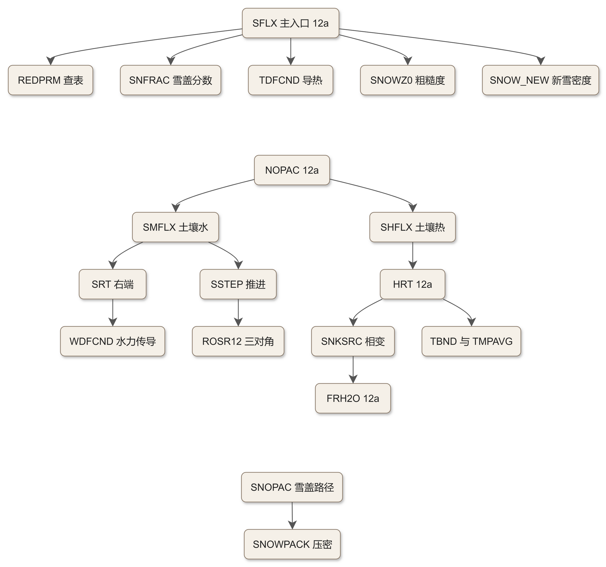
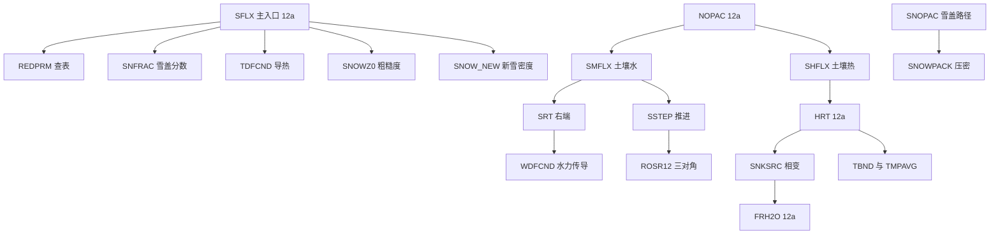

# code_12b — Noah LSM 本体·下半（module_sf_noahlsm.F：参数查表、隐式求解器与雪线）

## 一、版本指纹

| 源文件 | 行数 | md5（整文件，按字节） |
|---|---|---|
| phys/module_sf_noahlsm.F | 4759 | 9bc3fbaae919bd37ca4d05e44599c582 |

- 抽取工具：workspace/scripts/code_extract.py v1.2，2026-10-12；块首指纹注释自带 range_md5。
- 本篇是 A 级全文拆分的下半：REDPRM 起共 18 单元（L2315–L4756）；上半（文件头+SFLX 主入口+蒸发/热力线 13 单元，L1–L2312）见 [code_12a_module_sf_noahlsm.md](code_12a_module_sf_noahlsm.md)。

## 二、定位

一句话：Noah 本体的「底层」——三张 TBL 的查表出口、水热两套三对角隐式求解器、土壤水与雪盖的全部状态推进，以及 WRF 主线中已休眠的自带面层方案 SFCDIF_off；被 12a 的 SFLX/NOPAC 与 12b 的 SNOPAC 调用。

**单元地图**（实线=调用）：



<details><summary>原始 Mermaid 源码（可点击展开）</summary>

<!--

-->

</details>

## 三、参数查表 REDPRM

<!-- code_extract code_extract.py v1.2
source: phys/module_sf_noahlsm.F
ranges: L2315-L2535
file_lines: 4759
file_md5: 9bc3fbaae919bd37ca4d05e44599c582
display: line-numbered (strip L-prefix and !file: line to restore)
range_md5: 09fa7ecc3b90009e8bc1908c6d96bc49
seg_lines: 221
label: subroutine REDPRM
-->

```fortran
!file: phys/module_sf_noahlsm.F    L2315-L2535    (subroutine REDPRM)
L02315        SUBROUTINE REDPRM (VEGTYP,SOILTYP,SLOPETYP,CFACTR,CMCMAX,RSMAX,      &
L02316                           TOPT,                                             &
L02317                           REFKDT,KDT,SBETA, SHDFAC,RSMIN,RGL,HS,ZBOT,FRZX,  &
L02318                           PSISAT,SLOPE,SNUP,SALP,BEXP,DKSAT,DWSAT,          &
L02319                           SMCMAX,SMCWLT,SMCREF,SMCDRY,F1,QUARTZ,FXEXP,      &
L02320                           RTDIS,SLDPTH,ZSOIL, NROOT,NSOIL,CZIL,             &
L02321                           LAIMIN, LAIMAX, EMISSMIN, EMISSMAX, ALBEDOMIN,    &
L02322                           ALBEDOMAX, Z0MIN, Z0MAX, CSOIL, PTU, LLANDUSE,    &
L02323                           LSOIL, LOCAL,LVCOEF,ZTOPV,ZBOTV)
L02324  
L02325        IMPLICIT NONE
L02326  ! ----------------------------------------------------------------------
L02327  ! Internally set (default valuess)
L02328  ! all soil and vegetation parameters required for the execusion oF
L02329  ! the Noah lsm are defined in VEGPARM.TBL, SOILPARM.TB, and GENPARM.TBL.
L02330  ! ----------------------------------------------------------------------
L02331  !     Vegetation parameters:
L02332  !             ALBBRD: SFC background snow-free albedo
L02333  !             CMXTBL: MAX CNPY Capacity
L02334  !              Z0BRD: Background roughness length
L02335  !             SHDFAC: Green vegetation fraction
L02336  !              NROOT: Rooting depth
L02337  !              RSMIN: Mimimum stomatal resistance
L02338  !              RSMAX: Max. stomatal resistance
L02339  !                RGL: Parameters used in radiation stress function
L02340  !                 HS: Parameter used in vapor pressure deficit functio
L02341  !               TOPT: Optimum transpiration air temperature.
L02342  !             CMCMAX: Maximum canopy water capacity
L02343  !             CFACTR: Parameter used in the canopy inteception calculation
L02344  !               SNUP: Threshold snow depth (in water equivalent m) that
L02345  !                     implies 100 percent snow cover
L02346  !                LAI: Leaf area index
L02347  !
L02348  ! ----------------------------------------------------------------------
L02349  !      Soil parameters:
L02350  !        SMCMAX: MAX soil moisture content (porosity)
L02351  !        SMCREF: Reference soil moisture  (field capacity)
L02352  !        SMCWLT: Wilting point soil moisture
L02353  !        SMCWLT: Air dry soil moist content limits
L02354  !       SSATPSI: SAT (saturation) soil potential
L02355  !         DKSAT: SAT soil conductivity
L02356  !          BEXP: B parameter
L02357  !        SSATDW: SAT soil diffusivity
L02358  !           F1: Soil thermal diffusivity/conductivity coef.
L02359  !        QUARTZ: Soil quartz content
L02360  !  Modified by F. Chen (12/22/97)  to use the STATSGO soil map
L02361  !  Modified By F. Chen (01/22/00)  to include PLaya, Lava, and White San
L02362  !  Modified By F. Chen (08/05/02)  to include additional parameters for the Noah
L02363  ! NOTE: SATDW = BB*SATDK*(SATPSI/MAXSMC)
L02364  !         F11 = ALOG10(SATPSI) + BB*ALOG10(MAXSMC) + 2.0
L02365  !       REFSMC1=MAXSMC*(5.79E-9/SATDK)**(1/(2*BB+3)) 5.79E-9 m/s= 0.5 mm
L02366  !       REFSMC=REFSMC1+1./3.(MAXSMC-REFSMC1)
L02367  !       WLTSMC1=MAXSMC*(200./SATPSI)**(-1./BB)    (Wetzel and Chang, 198
L02368  !       WLTSMC=WLTSMC1-0.5*WLTSMC1
L02369  ! Note: the values for playa is set for it to have a thermal conductivit
L02370  ! as sand and to have a hydrulic conductivity as clay
L02371  !
L02372  ! ----------------------------------------------------------------------
L02373  ! Class parameter 'SLOPETYP' was included to estimate linear reservoir
L02374  ! coefficient 'SLOPE' to the baseflow runoff out of the bottom layer.
L02375  ! lowest class (slopetyp=0) means highest slope parameter = 1.
L02376  ! definition of slopetyp from 'zobler' slope type:
L02377  ! slope class  percent slope
L02378  ! 1            0-8
L02379  ! 2            8-30
L02380  ! 3            > 30
L02381  ! 4            0-30
L02382  ! 5            0-8 & > 30
L02383  ! 6            8-30 & > 30
L02384  ! 7            0-8, 8-30, > 30
L02385  ! 9            GLACIAL ICE
L02386  ! BLANK        OCEAN/SEA
L02387  !       SLOPE_DATA: linear reservoir coefficient
L02388  !       SBETA_DATA: parameter used to caluculate vegetation effect on soil heat
L02389  !       FXEXP_DAT:  soil evaporation exponent used in DEVAP
L02390  !       CSOIL_DATA: soil heat capacity [J M-3 K-1]
L02391  !       SALP_DATA: shape parameter of  distribution function of snow cover
L02392  !       REFDK_DATA and REFKDT_DATA: parameters in the surface runoff parameteriz
L02393  !       FRZK_DATA: frozen ground parameter
L02394  !       ZBOT_DATA: depth[M] of lower boundary soil temperature
L02395  !       CZIL_DATA: calculate roughness length of heat
L02396  !       SMLOW_DATA and MHIGH_DATA: two soil moisture wilt, soil moisture referen
L02397  !                 parameters
L02398  ! Set maximum number of soil-, veg-, and slopetyp in data statement.
L02399  ! ----------------------------------------------------------------------
L02400        INTEGER, PARAMETER     :: MAX_SLOPETYP=30,MAX_SOILTYP=30,MAX_VEGTYP=30
L02401        LOGICAL                :: LOCAL
L02402        CHARACTER (LEN=256), INTENT(IN)::  LLANDUSE, LSOIL
L02403  
L02404  ! Veg parameters
L02405        INTEGER, INTENT(IN)    :: VEGTYP
L02406        INTEGER, INTENT(OUT)   :: NROOT
L02407        REAL, INTENT(INOUT)    :: SHDFAC
L02408        REAL, INTENT(OUT)      :: HS,RSMIN,RGL,SNUP,                          &
L02409                                  CMCMAX,RSMAX,TOPT,                          &
L02410                                  EMISSMIN,  EMISSMAX,                        &
L02411                                  LAIMIN,    LAIMAX,                          &
L02412                                  Z0MIN,     Z0MAX,                           &
L02413                                  ALBEDOMIN, ALBEDOMAX, ZTOPV, ZBOTV
L02414  ! Soil parameters
L02415        INTEGER, INTENT(IN)    :: SOILTYP
L02416        REAL, INTENT(OUT)      :: BEXP,DKSAT,DWSAT,F1,QUARTZ,SMCDRY,          &
L02417                                  SMCMAX,SMCREF,SMCWLT,PSISAT
L02418  ! General parameters
L02419        INTEGER, INTENT(IN)    :: SLOPETYP,NSOIL
L02420        INTEGER                :: I
L02421  
L02422        REAL,    INTENT(OUT)   :: SLOPE,CZIL,SBETA,FXEXP,                     &
L02423                                  CSOIL,SALP,FRZX,KDT,CFACTR,      &
L02424                                  ZBOT,REFKDT,PTU
L02425        REAL,    INTENT(OUT)   :: LVCOEF
L02426        REAL,DIMENSION(1:NSOIL),INTENT(IN) :: SLDPTH,ZSOIL
L02427        REAL,DIMENSION(1:NSOIL),INTENT(OUT):: RTDIS
L02428        REAL                   :: FRZFACT,FRZK,REFDK
L02429  
L02430  !      SAVE
L02431  ! ----------------------------------------------------------------------
L02432  !
L02433                 IF (SOILTYP .gt. SLCATS) THEN
L02434                          FATAL_ERROR( 'Warning: too many input soil types' )
L02435                 END IF
L02436                 IF (VEGTYP .gt. LUCATS) THEN
L02437                       FATAL_ERROR( 'Warning: too many input landuse types' )
L02438                 END IF
L02439                 IF (SLOPETYP .gt. SLPCATS) THEN
L02440                       FATAL_ERROR( 'Warning: too many input slope types' )
L02441                 END IF
L02442  
L02443  ! ----------------------------------------------------------------------
L02444  !  SET-UP SOIL PARAMETERS
L02445  ! ----------------------------------------------------------------------
L02446        CSOIL = CSOIL_DATA
L02447        BEXP = BB (SOILTYP)
L02448        DKSAT = SATDK (SOILTYP)
L02449        DWSAT = SATDW (SOILTYP)
L02450        F1 = F11 (SOILTYP)
L02451        PSISAT = SATPSI (SOILTYP)
L02452        QUARTZ = QTZ (SOILTYP)
L02453        SMCDRY = DRYSMC (SOILTYP)
L02454        SMCMAX = MAXSMC (SOILTYP)
L02455        SMCREF = REFSMC (SOILTYP)
L02456        SMCWLT = WLTSMC (SOILTYP)
L02457  ! ----------------------------------------------------------------------
L02458  ! Set-up universal parameters (not dependent on SOILTYP, VEGTYP or
L02459  ! SLOPETYP)
L02460  ! ----------------------------------------------------------------------
L02461        ZBOT = ZBOT_DATA
L02462        SALP = SALP_DATA
L02463        SBETA = SBETA_DATA
L02464        REFDK = REFDK_DATA
L02465        FRZK = FRZK_DATA
L02466        FXEXP = FXEXP_DATA
L02467        REFKDT = REFKDT_DATA
L02468        PTU = 0.    ! (not used yet) to satisify intent(out)
L02469        KDT = REFKDT * DKSAT / REFDK
L02470        CZIL = CZIL_DATA
L02471        SLOPE = SLOPE_DATA (SLOPETYP)
L02472        LVCOEF = LVCOEF_DATA
L02473  
L02474  ! ----------------------------------------------------------------------
L02475  ! TO ADJUST FRZK PARAMETER TO ACTUAL SOIL TYPE: FRZK * FRZFACT
L02476  ! ----------------------------------------------------------------------
L02477        FRZFACT = (SMCMAX / SMCREF) * (0.412 / 0.468)
L02478        FRZX = FRZK * FRZFACT
L02479  
L02480  ! ----------------------------------------------------------------------
L02481  ! SET-UP VEGETATION PARAMETERS
L02482  ! ----------------------------------------------------------------------
L02483        TOPT = TOPT_DATA
L02484        CMCMAX = CMCMAX_DATA
L02485        CFACTR = CFACTR_DATA
L02486        RSMAX = RSMAX_DATA
L02487        NROOT = NROTBL (VEGTYP)
L02488        SNUP = SNUPTBL (VEGTYP)
L02489        RSMIN = RSTBL (VEGTYP)
L02490        RGL = RGLTBL (VEGTYP)
L02491        HS = HSTBL (VEGTYP)
L02492        EMISSMIN  = EMISSMINTBL  (VEGTYP)
L02493        EMISSMAX  = EMISSMAXTBL  (VEGTYP)
L02494        LAIMIN    = LAIMINTBL    (VEGTYP)
L02495        LAIMAX    = LAIMAXTBL    (VEGTYP)
L02496        Z0MIN     = Z0MINTBL     (VEGTYP)
L02497        Z0MAX     = Z0MAXTBL     (VEGTYP)
L02498        ALBEDOMIN = ALBEDOMINTBL (VEGTYP)
L02499        ALBEDOMAX = ALBEDOMAXTBL (VEGTYP)
L02500        ZTOPV     = ZTOPVTBL     (VEGTYP)
L02501        ZBOTV     = ZBOTVTBL     (VEGTYP)
L02502  
L02503                 IF (VEGTYP .eq. BARE) SHDFAC = 0.0
L02504                 IF (NROOT .gt. NSOIL) THEN
L02505                    WRITE (err_message,*) 'Error: too many root layers ',  &
L02506                                                   NSOIL,NROOT
L02507                    FATAL_ERROR( err_message )
L02508  ! ----------------------------------------------------------------------
L02509  ! CALCULATE ROOT DISTRIBUTION.  PRESENT VERSION ASSUMES UNIFORM
L02510  ! DISTRIBUTION BASED ON SOIL LAYER DEPTHS.
L02511  ! ----------------------------------------------------------------------
L02512                 END IF
L02513                 DO I = 1,NROOT
L02514                    RTDIS (I) = - SLDPTH (I)/ ZSOIL (NROOT)
L02515  ! ----------------------------------------------------------------------
L02516  !  SET-UP SLOPE PARAMETER
L02517  ! ----------------------------------------------------------------------
L02518                 END DO
L02519  
L02520  !        print*,'end of PRMRED'
L02521  !       print*,'VEGTYP',VEGTYP,'SOILTYP',SOILTYP,'SLOPETYP',SLOPETYP,    &
L02522  !    & 'CFACTR',CFACTR,'CMCMAX',CMCMAX,'RSMAX',RSMAX,'TOPT',TOPT,        &
L02523  !    & 'REFKDT',REFKDT,'KDT',KDT,'SBETA',SBETA, 'SHDFAC',SHDFAC,         &
L02524  !    &  'RSMIN',RSMIN,'RGL',RGL,'HS',HS,'ZBOT',ZBOT,'FRZX',FRZX,         &
L02525  !    &  'PSISAT',PSISAT,'SLOPE',SLOPE,'SNUP',SNUP,'SALP',SALP,'BEXP',    &
L02526  !    &   BEXP,                                                           &
L02527  !    &  'DKSAT',DKSAT,'DWSAT',DWSAT,                                     &
L02528  !    &  'SMCMAX',SMCMAX,'SMCWLT',SMCWLT,'SMCREF',SMCREF,'SMCDRY',SMCDRY, &
L02529  !    &  'F1',F1,'QUARTZ',QUARTZ,'FXEXP',FXEXP,                           &
L02530  !    &  'RTDIS',RTDIS,'SLDPTH',SLDPTH,'ZSOIL',ZSOIL, 'NROOT',NROOT,      &
L02531  !    &  'NSOIL',NSOIL,'Z0',Z0,'CZIL',CZIL,'LAI',LAI,                     &
L02532  !    &  'CSOIL',CSOIL,'PTU',PTU,                                         &
L02533  !    &  'LOCAL', LOCAL
L02534  
L02535        END  SUBROUTINE REDPRM
```

> 讲解：三张 TBL 的查表出口，Noah 所有可调参数的「出厂设置」：①土壤参数按 SOILTYP 查 SOILPARM.TBL（BB、SATDK、SATDW、F11、SATPSI、QTZ、DRYSMC、MAXSMC、REFSMC、WLTSMC）；②通用参数查 GENPARM.TBL（ZBOT、SALP、SBETA、REFDK、FRZK、FXEXP、REFKDT、CZIL、LVCOEF，SLOPE 按 SLOPETYP 查 Zobler 坡度类 1–7+9 冰川）；其中 **KDT=REFKDT·DKSAT/REFDK**——Schaake 入渗参数 KDT 由参考值标定；**FRZFACT=(SMCMAX/SMCREF)·(0.412/0.468)**、FRZX=FRZK·FRZFACT——冻土参数按土壤持水特性折算。③植被参数按 VEGTYP 查 VEGPARM.TBL（全局 TOPT/CMCMAX/CFACTR/RSMAX + 每类 NROTBL/SNUPTBL/RSTBL/RGLTBL/HS 与 EMISS/LAI/Z0/ALBEDO 的 min-max 对、ZTOPV/ZBOTV）；BARE 类强制 SHDFAC=0；NROOT>NSOIL 报错。④**RTDIS(I)=−SLDPTH(I)/ZSOIL(NROOT)**——均匀根区分布（层厚/根区总深），注释区保留了「按层深比例」等备选。换土壤/植被数据集（如高分辨率土壤库、论文 2 的下垫面参数改造）改 TBL 或在此加分支即可。

## 四、三对角求解器 ROSR12

<!-- code_extract code_extract.py v1.2
source: phys/module_sf_noahlsm.F
ranges: L2537-L2596
file_lines: 4759
file_md5: 9bc3fbaae919bd37ca4d05e44599c582
display: line-numbered (strip L-prefix and !file: line to restore)
range_md5: 41943e962f85eb3b55469de465cfee4a
seg_lines: 60
label: subroutine ROSR12
-->

```fortran
!file: phys/module_sf_noahlsm.F    L2537-L2596    (subroutine ROSR12)
L02537        SUBROUTINE ROSR12 (P,A,B,C,D,DELTA,NSOIL)
L02538  
L02539  ! ----------------------------------------------------------------------
L02540  ! SUBROUTINE ROSR12
L02541  ! ----------------------------------------------------------------------
L02542  ! INVERT (SOLVE) THE TRI-DIAGONAL MATRIX PROBLEM SHOWN BELOW:
L02543  ! ###                                            ### ###  ###   ###  ###
L02544  ! #B(1), C(1),  0  ,  0  ,  0  ,   . . .  ,    0   # #      #   #      #
L02545  ! #A(2), B(2), C(2),  0  ,  0  ,   . . .  ,    0   # #      #   #      #
L02546  ! # 0  , A(3), B(3), C(3),  0  ,   . . .  ,    0   # #      #   # D(3) #
L02547  ! # 0  ,  0  , A(4), B(4), C(4),   . . .  ,    0   # # P(4) #   # D(4) #
L02548  ! # 0  ,  0  ,  0  , A(5), B(5),   . . .  ,    0   # # P(5) #   # D(5) #
L02549  ! # .                                          .   # #  .   # = #   .  #
L02550  ! # .                                          .   # #  .   #   #   .  #
L02551  ! # .                                          .   # #  .   #   #   .  #
L02552  ! # 0  , . . . , 0 , A(M-2), B(M-2), C(M-2),   0   # #P(M-2)#   #D(M-2)#
L02553  ! # 0  , . . . , 0 ,   0   , A(M-1), B(M-1), C(M-1)# #P(M-1)#   #D(M-1)#
L02554  ! # 0  , . . . , 0 ,   0   ,   0   ,  A(M) ,  B(M) # # P(M) #   # D(M) #
L02555  ! ###                                            ### ###  ###   ###  ###
L02556  ! ----------------------------------------------------------------------
L02557        IMPLICIT NONE
L02558  
L02559        INTEGER, INTENT(IN)   :: NSOIL
L02560        INTEGER               :: K, KK
L02561  
L02562        REAL, DIMENSION(1:NSOIL), INTENT(IN):: A, B, D
L02563        REAL, DIMENSION(1:NSOIL),INTENT(INOUT):: C,P,DELTA
L02564  
L02565  ! ----------------------------------------------------------------------
L02566  ! INITIALIZE EQN COEF C FOR THE LOWEST SOIL LAYER
L02567  ! ----------------------------------------------------------------------
L02568        C (NSOIL) = 0.0
L02569        P (1) = - C (1) / B (1)
L02570  ! ----------------------------------------------------------------------
L02571  ! SOLVE THE COEFS FOR THE 1ST SOIL LAYER
L02572  ! ----------------------------------------------------------------------
L02573  
L02574  ! ----------------------------------------------------------------------
L02575  ! SOLVE THE COEFS FOR SOIL LAYERS 2 THRU NSOIL
L02576  ! ----------------------------------------------------------------------
L02577        DELTA (1) = D (1) / B (1)
L02578        DO K = 2,NSOIL
L02579           P (K) = - C (K) * ( 1.0 / (B (K) + A (K) * P (K -1)) )
L02580           DELTA (K) = (D (K) - A (K)* DELTA (K -1))* (1.0/ (B (K) + A (K)&
L02581                      * P (K -1)))
L02582        END DO
L02583  ! ----------------------------------------------------------------------
L02584  ! SET P TO DELTA FOR LOWEST SOIL LAYER
L02585  ! ----------------------------------------------------------------------
L02586        P (NSOIL) = DELTA (NSOIL)
L02587  
L02588  ! ----------------------------------------------------------------------
L02589  ! ADJUST P FOR SOIL LAYERS 2 THRU NSOIL
L02590  ! ----------------------------------------------------------------------
L02591        DO K = 2,NSOIL
L02592           KK = NSOIL - K + 1
L02593           P (KK) = P (KK) * P (KK +1) + DELTA (KK)
L02594        END DO
L02595  ! ----------------------------------------------------------------------
L02596    END SUBROUTINE ROSR12
```

> 讲解：Thomas 算法（追赶法）：前向消元算 P(K)=−C(K)/(B(K)+A(K)·P(K−1)) 与 DELTA(K)=(D(K)−A(K)·DELTA(K−1))/(B(K)+A(K)·P(K−1))，回代 P(KK)=P(KK)·P(KK+1)+DELTA(KK)；C(NSOIL)=0 底边界无下邻。Noah 水热两套三对角方程共用这一个求解器——ROSR12 是全模块唯一的线性代数设施。

## 五、土壤热推进外壳 SHFLX

<!-- code_extract code_extract.py v1.2
source: phys/module_sf_noahlsm.F
ranges: L2600-L2666
file_lines: 4759
file_md5: 9bc3fbaae919bd37ca4d05e44599c582
display: line-numbered (strip L-prefix and !file: line to restore)
range_md5: b2b8b06102da73beceaf9c345033a2fd
seg_lines: 67
label: subroutine SHFLX
-->

```fortran
!file: phys/module_sf_noahlsm.F    L2600-L2666    (subroutine SHFLX)
L02600        SUBROUTINE SHFLX (SSOIL,STC,SMC,SMCMAX,NSOIL,T1,DT,YY,ZZ1,ZSOIL, &
L02601                           TBOT,ZBOT,SMCWLT,PSISAT,SH2O,BEXP,F1,DF1,     &
L02602                           QUARTZ,CSOIL,VEGTYP,ISURBAN,SOILTYP,OPT_THCND &
L02603                          ,HCPCT_FASDAS                                  ) ! fasdas
L02604  
L02605  ! ----------------------------------------------------------------------
L02606  ! SUBROUTINE SHFLX
L02607  ! ----------------------------------------------------------------------
L02608  ! UPDATE THE TEMPERATURE STATE OF THE SOIL COLUMN BASED ON THE THERMAL
L02609  ! DIFFUSION EQUATION AND UPDATE THE FROZEN SOIL MOISTURE CONTENT BASED
L02610  ! ON THE TEMPERATURE.
L02611  ! ----------------------------------------------------------------------
L02612        IMPLICIT NONE
L02613  
L02614        INTEGER, INTENT(IN)   :: OPT_THCND
L02615        INTEGER, INTENT(IN)   :: NSOIL, VEGTYP, ISURBAN, SOILTYP
L02616        INTEGER               :: I
L02617  
L02618        REAL, INTENT(IN)      :: BEXP,CSOIL,DF1,DT,F1,PSISAT,QUARTZ,     &
L02619                                 SMCMAX, SMCWLT, TBOT,YY, ZBOT,ZZ1
L02620        REAL, INTENT(INOUT)   :: T1
L02621        REAL, INTENT(OUT)     :: SSOIL
L02622        REAL, DIMENSION(1:NSOIL), INTENT(IN)    :: SMC,ZSOIL
L02623        REAL, DIMENSION(1:NSOIL), INTENT(INOUT) :: SH2O
L02624        REAL, DIMENSION(1:NSOIL), INTENT(INOUT) :: STC
L02625        REAL, DIMENSION(1:NSOIL)             :: AI, BI, CI, STCF,RHSTS
L02626        REAL, PARAMETER       :: T0 = 273.15
L02627  
L02628  !
L02629  ! FASDAS
L02630  !
L02631        REAL, INTENT(  OUT)     :: HCPCT_FASDAS
L02632  !
L02633  ! END FASDAS
L02634  !
L02635  ! ----------------------------------------------------------------------
L02636  ! HRT ROUTINE CALCS THE RIGHT HAND SIDE OF THE SOIL TEMP DIF EQN
L02637  ! ----------------------------------------------------------------------
L02638  
L02639        ! Land case
L02640  
L02641        CALL HRT (RHSTS,STC,SMC,SMCMAX,NSOIL,ZSOIL,YY,ZZ1,TBOT,     &
L02642                  ZBOT,PSISAT,SH2O,DT,BEXP,SOILTYP,OPT_THCND,       &
L02643                  F1,DF1,QUARTZ,CSOIL,AI,BI,CI,VEGTYP,ISURBAN       &
L02644                 ,HCPCT_FASDAS                                      ) !fasdas
L02645  
L02646        CALL HSTEP (STCF,STC,RHSTS,DT,NSOIL,AI,BI,CI)
L02647  
L02648        DO I = 1,NSOIL
L02649           STC (I) = STCF (I)
L02650        ENDDO
L02651  
L02652  ! ----------------------------------------------------------------------
L02653  ! IN THE NO SNOWPACK CASE (VIA ROUTINE NOPAC BRANCH,) UPDATE THE GRND
L02654  ! (SKIN) TEMPERATURE HERE IN RESPONSE TO THE UPDATED SOIL TEMPERATURE
L02655  ! PROFILE ABOVE.  (NOTE: INSPECTION OF ROUTINE SNOPAC SHOWS THAT T1
L02656  ! BELOW IS A DUMMY VARIABLE ONLY, AS SKIN TEMPERATURE IS UPDATED
L02657  ! DIFFERENTLY IN ROUTINE SNOPAC)
L02658  ! ----------------------------------------------------------------------
L02659  ! ----------------------------------------------------------------------
L02660  ! CALCULATE SURFACE SOIL HEAT FLUX
L02661  ! ----------------------------------------------------------------------
L02662        T1 = (YY + (ZZ1- 1.0) * STC (1)) / ZZ1
L02663        SSOIL = DF1 * (STC (1) - T1) / (0.5 * ZSOIL (1))
L02664  
L02665  ! ----------------------------------------------------------------------
L02666    END SUBROUTINE SHFLX
```

> 讲解：HRT（右端+矩阵系数）→ HSTEP（ROSR12 推进）→ STC 原地更新的三步外壳。结尾的 T1=(YY+(ZZ1−1)·STC1)/ZZ1 与 SSOIL=DF1·(STC1−T1)/(0.5·ZSOIL1) 是皮肤温度反算：NOPAC 路径里 T1 被它真正更新（无雪时的皮肤温度由表层土温外推）；SNOPAC 路径里传入的 T1 是 dummy（雪面温度已在 SNOPAC 开头定死，注释明确说明）。

## 六、土壤水推进 SMFLX

<!-- code_extract code_extract.py v1.2
source: phys/module_sf_noahlsm.F
ranges: L2669-L2813
file_lines: 4759
file_md5: 9bc3fbaae919bd37ca4d05e44599c582
display: line-numbered (strip L-prefix and !file: line to restore)
range_md5: 133410d43d95fa473936e3b8b3a1cd5b
seg_lines: 145
label: subroutine SMFLX
-->

```fortran
!file: phys/module_sf_noahlsm.F    L2669-L2813    (subroutine SMFLX)
L02669        SUBROUTINE SMFLX (SMC,NSOIL,CMC,DT,PRCP1,ZSOIL,                   &
L02670       &                   SH2O,SLOPE,KDT,FRZFACT,                        &
L02671       &                   SMCMAX,BEXP,SMCWLT,DKSAT,DWSAT,                &
L02672       &                   SHDFAC,CMCMAX,                                 &
L02673       &                   RUNOFF1,RUNOFF2,RUNOFF3,                       &
L02674       &                   EDIR,EC,ET,                                    &
L02675       &                   DRIP, SFHEAD1RT,INFXS1RT,                      &
L02676                           IRRIGATION_CHANNEL )
L02677  
L02678  ! ----------------------------------------------------------------------
L02679  ! SUBROUTINE SMFLX
L02680  ! ----------------------------------------------------------------------
L02681  ! CALCULATE SOIL MOISTURE FLUX.  THE SOIL MOISTURE CONTENT (SMC - A PER
L02682  ! UNIT VOLUME MEASUREMENT) IS A DEPENDENT VARIABLE THAT IS UPDATED WITH
L02683  ! PROGNOSTIC EQNS. THE CANOPY MOISTURE CONTENT (CMC) IS ALSO UPDATED.
L02684  ! FROZEN GROUND VERSION:  NEW STATES ADDED: SH2O, AND FROZEN GROUND
L02685  ! CORRECTION FACTOR, FRZFACT AND PARAMETER SLOPE.
L02686  ! ----------------------------------------------------------------------
L02687        IMPLICIT NONE
L02688  
L02689        INTEGER, INTENT(IN)   :: NSOIL
L02690        INTEGER               :: I,K
L02691  
L02692        REAL, INTENT(IN)      :: BEXP, CMCMAX, DKSAT,DWSAT, DT, EC, EDIR,  &
L02693                                 KDT, PRCP1, SHDFAC, SLOPE, SMCMAX, SMCWLT
L02694        REAL, INTENT(OUT)                      :: DRIP, RUNOFF1, RUNOFF2, RUNOFF3
L02695        REAL, INTENT(INOUT)   :: CMC
L02696        REAL, DIMENSION(1:NSOIL), INTENT(IN)   :: ET,ZSOIL
L02697        REAL, DIMENSION(1:NSOIL), INTENT(INOUT):: SMC, SH2O
L02698        REAL, DIMENSION(1:NSOIL)             :: AI, BI, CI, STCF,RHSTS, RHSTT, &
L02699                                                SICE, SH2OA, SH2OFG, SH2OIN
L02700        REAL                  :: DUMMY, EXCESS,FRZFACT,PCPDRP,RHSCT,TRHSCT
L02701        REAL :: FAC2
L02702        REAL :: FLIMIT
L02703        REAL, INTENT(IN),OPTIONAL      :: IRRIGATION_CHANNEL
L02704        REAL,    INTENT(INOUT)                 :: SFHEAD1RT,INFXS1RT
L02705  
L02706  ! ----------------------------------------------------------------------
L02707  ! EXECUTABLE CODE BEGINS HERE.
L02708  ! ----------------------------------------------------------------------
L02709  ! ----------------------------------------------------------------------
L02710  ! COMPUTE THE RIGHT HAND SIDE OF THE CANOPY EQN TERM ( RHSCT )
L02711  ! ----------------------------------------------------------------------
L02712        DUMMY = 0.
L02713  
L02714  ! ----------------------------------------------------------------------
L02715  ! CONVERT RHSCT (A RATE) TO TRHSCT (AN AMOUNT) AND ADD IT TO EXISTING
L02716  ! CMC.  IF RESULTING AMT EXCEEDS MAX CAPACITY, IT BECOMES DRIP AND WILL
L02717  ! FALL TO THE GRND.
L02718  ! ----------------------------------------------------------------------
L02719        RHSCT = SHDFAC * PRCP1- EC
L02720        DRIP = 0.
L02721        TRHSCT = DT * RHSCT
L02722        EXCESS = CMC + TRHSCT
L02723  
L02724  ! ----------------------------------------------------------------------
L02725  ! PCPDRP IS THE COMBINED PRCP1 AND DRIP (FROM CMC) THAT GOES INTO THE
L02726  ! SOIL
L02727  ! ----------------------------------------------------------------------
L02728        IF (EXCESS > CMCMAX) DRIP = EXCESS - CMCMAX
L02729        PCPDRP = (1. - SHDFAC) * PRCP1+ DRIP / DT
L02730        IF(PRESENT(IRRIGATION_CHANNEL)) THEN
L02731           IF (IRRIGATION_CHANNEL.NE.0.)PCPDRP =PCPDRP+ 0.001*IRRIGATION_CHANNEL !conversion of units
L02732        END IF
L02733  ! ----------------------------------------------------------------------
L02734  ! STORE ICE CONTENT AT EACH SOIL LAYER BEFORE CALLING SRT and SSTEP
L02735  !
L02736        DO I = 1,NSOIL
L02737           SICE (I) = SMC (I) - SH2O (I)
L02738        END DO
L02739  ! ----------------------------------------------------------------------
L02740  ! CALL SUBROUTINES SRT AND SSTEP TO SOLVE THE SOIL MOISTURE
L02741  ! TENDENCY EQUATIONS.
L02742  ! IF THE INFILTRATING PRECIP RATE IS NONTRIVIAL,
L02743  !   (WE CONSIDER NONTRIVIAL TO BE A PRECIP TOTAL OVER THE TIME STEP
L02744  !    EXCEEDING ONE ONE-THOUSANDTH OF THE WATER HOLDING CAPACITY OF
L02745  !    THE FIRST SOIL LAYER)
L02746  ! THEN CALL THE SRT/SSTEP SUBROUTINE PAIR TWICE IN THE MANNER OF
L02747  !   TIME SCHEME "F" (IMPLICIT STATE, AVERAGED COEFFICIENT)
L02748  !   OF SECTION 2 OF KALNAY AND KANAMITSU (1988, MWR, VOL 116,
L02749  !   PAGES 1945-1958)TO MINIMIZE 2-DELTA-T OSCILLATIONS IN THE
L02750  !   SOIL MOISTURE VALUE OF THE TOP SOIL LAYER THAT CAN ARISE BECAUSE
L02751  !   OF THE EXTREME NONLINEAR DEPENDENCE OF THE SOIL HYDRAULIC
L02752  !   DIFFUSIVITY COEFFICIENT AND THE HYDRAULIC CONDUCTIVITY ON THE
L02753  !   SOIL MOISTURE STATE
L02754  ! OTHERWISE CALL THE SRT/SSTEP SUBROUTINE PAIR ONCE IN THE MANNER OF
L02755  !   TIME SCHEME "D" (IMPLICIT STATE, EXPLICIT COEFFICIENT)
L02756  !   OF SECTION 2 OF KALNAY AND KANAMITSU
L02757  ! PCPDRP IS UNITS OF KG/M**2/S OR MM/S, ZSOIL IS NEGATIVE DEPTH IN M
L02758  ! ----------------------------------------------------------------------
L02759  !  According to Dr. Ken Mitchell's suggestion, add the second contraint
L02760  !  to remove numerical instability of runoff and soil moisture
L02761  !  FLIMIT is a limit value for FAC2
L02762        FAC2=0.0
L02763        DO I=1,NSOIL
L02764           FAC2=MAX(FAC2,SH2O(I)/SMCMAX)
L02765        ENDDO
L02766        CALL FAC2MIT(SMCMAX,FLIMIT)
L02767  
L02768  ! ----------------------------------------------------------------------
L02769  ! FROZEN GROUND VERSION:
L02770  ! SMC STATES REPLACED BY SH2O STATES IN SRT SUBR.  SH2O & SICE STATES
L02771  ! INC&UDED IN SSTEP SUBR.  FROZEN GROUND CORRECTION FACTOR, FRZFACT
L02772  ! ADDED.  ALL WATER BALANCE CALCULATIONS USING UNFROZEN WATER
L02773  ! ----------------------------------------------------------------------
L02774  
L02775  #ifdef WRF_HYDRO
L02776  !DJG NDHMS/WRF-Hydro edit... Add previous ponded water to new precip drip...
L02777      PCPDRP = PCPDRP + SFHEAD1RT/1000./DT   ! convert SFHEAD1RT to (m/s)
L02778  #endif
L02779  
L02780  
L02781        IF ( ( (PCPDRP * DT) > (0.0001*1000.0* (- ZSOIL (1))* SMCMAX) )   &
L02782             .OR. (FAC2 > FLIMIT) ) THEN
L02783           CALL SRT (RHSTT,EDIR,ET,SH2O,SH2O,NSOIL,PCPDRP,ZSOIL,          &
L02784                      DWSAT,DKSAT,SMCMAX,BEXP,RUNOFF1,                    &
L02785                      RUNOFF2,DT,SMCWLT,SLOPE,KDT,FRZFACT,SICE,AI,BI,CI,  &
L02786                      SFHEAD1RT,INFXS1RT)
L02787           CALL SSTEP (SH2OFG,SH2O,DUMMY,RHSTT,RHSCT,DT,NSOIL,SMCMAX,     &
L02788                          CMCMAX,RUNOFF3,ZSOIL,SMC,SICE,AI,BI,CI,INFXS1RT)
L02789           DO K = 1,NSOIL
L02790              SH2OA (K) = (SH2O (K) + SH2OFG (K)) * 0.5
L02791           END DO
L02792           CALL SRT (RHSTT,EDIR,ET,SH2O,SH2OA,NSOIL,PCPDRP,ZSOIL,         &
L02793                      DWSAT,DKSAT,SMCMAX,BEXP,RUNOFF1,                    &
L02794                      RUNOFF2,DT,SMCWLT,SLOPE,KDT,FRZFACT,SICE,AI,BI,CI,  &
L02795                      SFHEAD1RT,INFXS1RT)
L02796           SH2OIN=SH2O
L02797           CALL SSTEP (SH2O,SH2OIN,CMC,RHSTT,RHSCT,DT,NSOIL,SMCMAX,       &
L02798                          CMCMAX,RUNOFF3,ZSOIL,SMC,SICE,AI,BI,CI,INFXS1RT)
L02799  
L02800        ELSE
L02801           CALL SRT (RHSTT,EDIR,ET,SH2O,SH2O,NSOIL,PCPDRP,ZSOIL,          &
L02802                      DWSAT,DKSAT,SMCMAX,BEXP,RUNOFF1,                    &
L02803                      RUNOFF2,DT,SMCWLT,SLOPE,KDT,FRZFACT,SICE,AI,BI,CI,  &
L02804                     SFHEAD1RT,INFXS1RT)
L02805           SH2OIN=SH2O
L02806           CALL SSTEP (SH2O,SH2OIN,CMC,RHSTT,RHSCT,DT,NSOIL,SMCMAX,       &
L02807                       CMCMAX,RUNOFF3,ZSOIL,SMC,SICE,AI,BI,CI,INFXS1RT)
L02808  !      RUNOF = RUNOFF
L02809  
L02810        END IF
L02811  
L02812  ! ----------------------------------------------------------------------
L02813    END SUBROUTINE SMFLX
```

> 讲解：①**冠层水收支**：RHSCT=SHDFAC·PRCP1−EC（植被截留降雨减冠层蒸发）；超 CMCMAX 的部分变 DRIP 落地；**PCPDRP=(1−SHDFAC)·PRCP1+DRIP/DT**——裸地直通雨加冠层滴下，才是真正进土壤的降水。②**灌溉通道**：PRESENT(IRRIGATION_CHANNEL) 时 PCPDRP 加 0.001·IRRIGATION_CHANNEL（mm 量到 m/s 的换算）——论文 2 类灌溉实验的物理挂点在 SMFLX、驱动挂点在 noahdrv。③WRF_HYDRO 下积水头并入 PCPDRP。④**双约束双步长**（Kalnay–Kanamitsu 1988 MWR 116, 1945）：FAC2=各层 SH2O/SMCMAX 最大值；当 PCPDRP·DT 超过第一层持水量的万分之一或 FAC2>FLIMIT（FAC2MIT，12a §六）时走「F 方案」——先算一遍 SRT/SSTEP 得试探态 SH2OFG、平均出 SH2OA、用 SH2OA 重算 SRT 再真正推进（隐式态+平均系数）；否则「D 方案」单步（隐式态+显式系数）。目的是抑制水力扩散率/导水率对土壤湿度的极端非线性在表层引起的 2Δt 振荡。⑤冻土版全程用未冻水 SH2O，SICE 冻结前快照。

## 七、雪盖分数 SNFRAC 与相变源 SNKSRC

<!-- code_extract code_extract.py v1.2
source: phys/module_sf_noahlsm.F
ranges: L2817-L2919
file_lines: 4759
file_md5: 9bc3fbaae919bd37ca4d05e44599c582
display: line-numbered (strip L-prefix and !file: line to restore)
range_md5: 8871073c6639f060615ff0497ae5bdaf
seg_lines: 103
label: subroutine SNFRAC
-->

```fortran
!file: phys/module_sf_noahlsm.F    L2817-L2919    (subroutine SNFRAC)
L02817        SUBROUTINE SNFRAC (SNEQV,SNUP,SALP,SNOWH,SNCOVR, &
L02818                           XLAI,SHDFAC,FVB,GAMA,FBUR,    &
L02819                           FGSN,ZTOPV,ZBOTV,UA_PHYS)
L02820  
L02821  ! ----------------------------------------------------------------------
L02822  ! SUBROUTINE SNFRAC
L02823  ! ----------------------------------------------------------------------
L02824  ! CALCULATE SNOW FRACTION (0 -> 1)
L02825  ! SNEQV   SNOW WATER EQUIVALENT (M)
L02826  ! SNUP    THRESHOLD SNEQV DEPTH ABOVE WHICH SNCOVR=1
L02827  ! SALP    TUNING PARAMETER
L02828  ! SNCOVR  FRACTIONAL SNOW COVER
L02829  ! ----------------------------------------------------------------------
L02830        IMPLICIT NONE
L02831  
L02832        REAL, INTENT(IN)     :: SNEQV,SNUP,SALP,SNOWH
L02833        REAL, INTENT(OUT)    :: SNCOVR
L02834        REAL                 :: RSNOW, Z0N
L02835        LOGICAL, INTENT(IN)  :: UA_PHYS  ! UA: flag for UA option
L02836        REAL, INTENT(IN)     :: ZTOPV    ! UA: height of canopy top
L02837        REAL, INTENT(IN)     :: ZBOTV    ! UA: height of canopy bottom
L02838        REAL, INTENT(IN)     :: SHDFAC   ! UA: vegetation fraction
L02839        REAL, INTENT(INOUT)  :: XLAI     ! UA: LAI modified by snow
L02840        REAL, INTENT(OUT)    :: FVB      ! UA: frac. veg. w/snow beneath
L02841        REAL, INTENT(OUT)    :: GAMA     ! UA: = EXP(-1.* XLAI)
L02842        REAL, INTENT(OUT)    :: FBUR     ! UA: fraction of canopy buried
L02843        REAL, INTENT(OUT)    :: FGSN     ! UA: ground snow cover fraction
L02844  
L02845        REAL ::  SNUPGRD = 0.02          ! UA: SWE limit for ground cover
L02846  
L02847  ! ----------------------------------------------------------------------
L02848  ! SNUP IS VEG-CLASS DEPENDENT SNOWDEPTH THRESHHOLD (SET IN ROUTINE
L02849  ! REDPRM) ABOVE WHICH SNOCVR=1.
L02850  ! ----------------------------------------------------------------------
L02851        IF (SNEQV < SNUP) THEN
L02852           RSNOW = SNEQV / SNUP
L02853           SNCOVR = 1. - ( EXP ( - SALP * RSNOW) - RSNOW * EXP ( - SALP))
L02854        ELSE
L02855           SNCOVR = 1.0
L02856        END IF
L02857  
L02858  !     FORMULATION OF DICKINSON ET AL. 1986
L02859  !     Z0N = 0.035
L02860  
L02861  !        SNCOVR=SNOWH/(SNOWH + 5*Z0N)
L02862  
L02863  !     FORMULATION OF MARSHALL ET AL. 1994
L02864  !        SNCOVR=SNEQV/(SNEQV + 2*Z0N)
L02865  
L02866        IF(UA_PHYS) THEN
L02867  
L02868  !---------------------------------------------------------------------
L02869  ! FGSN: FRACTION OF SOIL COVERED WITH SNOW
L02870  !---------------------------------------------------------------------
L02871          IF (SNEQV < SNUPGRD) THEN
L02872           FGSN = SNEQV / SNUPGRD
L02873          ELSE
L02874           FGSN = 1.0
L02875          END IF
L02876  !------------------------------------------------------------------
L02877  ! FBUR: VERTICAL FRACTION OF VEGETATION COVERED BY SNOW
L02878  ! GRASS, CROP, AND SHRUB: MULTIPLY 0.4 BY ZTOPV AND ZBOTV BECAUSE 
L02879  ! THEY WILL BE PRESSED DOWN BY THE SNOW.
L02880  ! FOREST: DON'T NEED TO CHANGE ZTOPV AND ZBOTV.
L02881  
L02882          IF(ZBOTV > 0. .AND. SNOWH > ZBOTV) THEN
L02883            IF(ZBOTV <= 0.5) THEN
L02884              FBUR = (SNOWH - 0.4*ZBOTV) / (0.4*(ZTOPV-ZBOTV)) ! short veg.
L02885            ELSE
L02886              FBUR = (SNOWH - ZBOTV) / (ZTOPV-ZBOTV)           !  tall veg.
L02887            ENDIF
L02888          ELSE
L02889            FBUR = 0.
L02890          ENDIF
L02891  
L02892          FBUR = MIN(MAX(FBUR,0.0),1.0)
L02893  
L02894  ! XLAI IS ADJUSTED FOR VERTICAL BURYING BY SNOW
L02895          XLAI = XLAI * (1.0 - FBUR)
L02896  ! ----------------------------------------------------------------------
L02897  ! SNOW-COVERED SOIL: (1-SHDFAC)*FGSN
L02898  ! VEGETATION WITH SNOW ABOVE DUE TO BURIAL FVEG_SN_AB = SHDFAC*FBUR
L02899  ! SNOW ON THE GROUND THAT CAN BE "SEEN" BY SATELLITE
L02900  ! (IF XLAI GOES TO ZERO): GAMA*FVB
L02901  ! Where GAMA = exp(-XLAI)
L02902  ! ----------------------------------------------------------------------
L02903  
L02904  ! VEGETATION WITH SNOW BELOW
L02905          FVB = SHDFAC * FGSN * (1.0 - FBUR)
L02906  
L02907  ! GAMA IS USED TO DIVIDE FVB INTO TWO PARTS:
L02908  ! GAMA=1 FOR XLAI=0 AND GAMA=0 FOR XLAI=6
L02909          GAMA = EXP(-1.* XLAI)
L02910        ELSE
L02911          ! Define intent(out) terms for .NOT. UA_PHYS case
L02912          FVB  = 0.0
L02913          GAMA = 0.0
L02914          FBUR = 0.0
L02915          FGSN = 0.0
L02916        END IF    ! UA_PHYS
L02917  
L02918  ! ----------------------------------------------------------------------
L02919    END SUBROUTINE SNFRAC
```

> 讲解：雪盖分数的 SALP 曲线：RSNOW=SNEQV/SNUP（SNUP 是植被类雪深阈值），SNCOVR=1−(exp(−SALP·RSNOW)−RSNOW·exp(−SALP))，SNEQV≥SNUP 时全盖（SALP 来自 GENPARM.TBL）；Dickinson 1986 与 Marshall 1994 备选式注释保留。**UA 分支**输出四件套：FGSN 地面积雪分数（0.02 m 水当量阈值）；FBUR 植被被雪掩埋的垂直分数（矮植被把冠层顶底高乘 0.4 模拟压弯，高植被不变）；XLAI 乘 (1−FBUR)（被埋的叶子不蒸腾）；FVB=SHDFAC·FGSN·(1−FBUR)、GAMA=exp(−XLAI)——「卫星视角能看到的雪」的分解式。这套量只在 UA 物理链（SNOWZ0/PENMAN/SFLX 的 RU 修正）里消费。

<!-- code_extract code_extract.py v1.2
source: phys/module_sf_noahlsm.F
ranges: L2922-L3007
file_lines: 4759
file_md5: 9bc3fbaae919bd37ca4d05e44599c582
display: line-numbered (strip L-prefix and !file: line to restore)
range_md5: 2ac051d42ba2438a59bd11d5321e2d56
seg_lines: 86
label: subroutine SNKSRC
-->

```fortran
!file: phys/module_sf_noahlsm.F    L2922-L3007    (subroutine SNKSRC)
L02922        SUBROUTINE SNKSRC (TSNSR,TAVG,SMC,SH2O,ZSOIL,NSOIL,               &
L02923       &                      SMCMAX,PSISAT,BEXP,DT,K,QTOT)
L02924  ! ----------------------------------------------------------------------
L02925  ! SUBROUTINE SNKSRC
L02926  ! ----------------------------------------------------------------------
L02927  ! CALCULATE SINK/SOURCE TERM OF THE TERMAL DIFFUSION EQUATION. (SH2O) IS
L02928  ! AVAILABLE LIQUED WATER.
L02929  ! ----------------------------------------------------------------------
L02930        IMPLICIT NONE
L02931  
L02932        INTEGER, INTENT(IN)   :: K,NSOIL
L02933        REAL, INTENT(IN)      :: BEXP, DT, PSISAT, QTOT, SMC, SMCMAX,    &
L02934                                 TAVG
L02935        REAL, INTENT(INOUT)   :: SH2O
L02936  
L02937        REAL, DIMENSION(1:NSOIL), INTENT(IN):: ZSOIL
L02938  
L02939        REAL                  :: DF, DZ, DZH, FREE, TSNSR,               &
L02940                                 TDN, TM, TUP, TZ, X0, XDN, XH2O, XUP
L02941  
L02942        REAL, PARAMETER       :: DH2O = 1.0000E3, HLICE = 3.3350E5,      &
L02943                                 T0 = 2.7315E2
L02944  
L02945        IF (K == 1) THEN
L02946           DZ = - ZSOIL (1)
L02947        ELSE
L02948           DZ = ZSOIL (K -1) - ZSOIL (K)
L02949        END IF
L02950  ! ----------------------------------------------------------------------
L02951  ! VIA FUNCTION FRH2O, COMPUTE POTENTIAL OR 'EQUILIBRIUM' UNFROZEN
L02952  ! SUPERCOOLED FREE WATER FOR GIVEN SOIL TYPE AND SOIL LAYER TEMPERATURE.
L02953  ! FUNCTION FRH20 INVOKES EQN (17) FROM V. KOREN ET AL (1999, JGR, VOL.
L02954  ! 104, PG 19573).  (ASIDE:  LATTER EQN IN JOURNAL IN CENTIGRADE UNITS.
L02955  ! ROUTINE FRH2O USE FORM OF EQN IN KELVIN UNITS.)
L02956  ! ----------------------------------------------------------------------
L02957  !      FREE = FRH2O(TAVG,SMC,SH2O,SMCMAX,BEXP,PSISAT)
L02958  
L02959  ! ----------------------------------------------------------------------
L02960  ! IN NEXT BLOCK OF CODE, INVOKE EQN 18 OF V. KOREN ET AL (1999, JGR,
L02961  ! VOL. 104, PG 19573.)  THAT IS, FIRST ESTIMATE THE NEW AMOUNTOF LIQUID
L02962  ! WATER, 'XH2O', IMPLIED BY THE SUM OF (1) THE LIQUID WATER AT THE BEGIN
L02963  ! OF CURRENT TIME STEP, AND (2) THE FREEZE OF THAW CHANGE IN LIQUID
L02964  ! WATER IMPLIED BY THE HEAT FLUX 'QTOT' PASSED IN FROM ROUTINE HRT.
L02965  ! SECOND, DETERMINE IF XH2O NEEDS TO BE BOUNDED BY 'FREE' (EQUIL AMT) OR
L02966  ! IF 'FREE' NEEDS TO BE BOUNDED BY XH2O.
L02967  ! ----------------------------------------------------------------------
L02968        CALL FRH2O (FREE,TAVG,SMC,SH2O,SMCMAX,BEXP,PSISAT)
L02969  
L02970  ! ----------------------------------------------------------------------
L02971  ! FIRST, IF FREEZING AND REMAINING LIQUID LESS THAN LOWER BOUND, THEN
L02972  ! REDUCE EXTENT OF FREEZING, THEREBY LETTING SOME OR ALL OF HEAT FLUX
L02973  ! QTOT COOL THE SOIL TEMP LATER IN ROUTINE HRT.
L02974  ! ----------------------------------------------------------------------
L02975        XH2O = SH2O + QTOT * DT / (DH2O * HLICE * DZ)
L02976        IF ( XH2O < SH2O .AND. XH2O < FREE) THEN
L02977           IF ( FREE > SH2O ) THEN
L02978              XH2O = SH2O
L02979           ELSE
L02980              XH2O = FREE
L02981           END IF
L02982        END IF
L02983  ! ----------------------------------------------------------------------
L02984  ! SECOND, IF THAWING AND THE INCREASE IN LIQUID WATER GREATER THAN UPPER
L02985  ! BOUND, THEN REDUCE EXTENT OF THAW, THEREBY LETTING SOME OR ALL OF HEAT
L02986  ! FLUX QTOT WARM THE SOIL TEMP LATER IN ROUTINE HRT.
L02987  ! ----------------------------------------------------------------------
L02988        IF ( XH2O > SH2O .AND. XH2O > FREE ) THEN
L02989           IF ( FREE < SH2O ) THEN
L02990              XH2O = SH2O
L02991           ELSE
L02992              XH2O = FREE
L02993           END IF
L02994        END IF
L02995  
L02996  ! ----------------------------------------------------------------------
L02997  ! CALCULATE PHASE-CHANGE HEAT SOURCE/SINK TERM FOR USE IN ROUTINE HRT
L02998  ! AND UPDATE LIQUID WATER TO REFLCET FINAL FREEZE/THAW INCREMENT.
L02999  ! ----------------------------------------------------------------------
L03000  !      SNKSRC = -DH2O*HLICE*DZ*(XH2O-SH2O)/DT
L03001        IF (XH2O < 0.) XH2O = 0.
L03002        IF (XH2O > SMC) XH2O = SMC
L03003        TSNSR = - DH2O * HLICE * DZ * (XH2O - SH2O)/ DT
L03004        SH2O = XH2O
L03005  
L03006  ! ----------------------------------------------------------------------
L03007    END SUBROUTINE SNKSRC
```

> 讲解：冻土相变源项，Koren 1999 **式 18** 的钳位实现：①FREE=FRH2O(TAVG,…)——当前层温下的平衡液态水（12a §七）；②XH2O=SH2O+QTOT·DT/(DH2O·HLICE·DZ)——假设热通量 QTOT 全部用于相变时的液态水增量；③双向钳位：冻结方向 XH2O<SH2O 且 XH2O<FREE 时取 SH2O/FREE 中较大者（不能冻过头）、融化方向对称（不能融过头）；④**TSNSR=−DH2O·HLICE·DZ·(XH2O−SH2O)/DT**——实际发生的相变潜热作为源项顶回能量方程（HRT 里从 RHSTS 扣除），SH2O 原地更新并钳位 [0,SMC]。能量守恒的「先相变、剩余降温」就由这一对钳位+源项回加完成。

## 八、雪盖路径 SNOPAC（全文）

<!-- code_extract code_extract.py v1.2
source: phys/module_sf_noahlsm.F
ranges: L3010-L3413
file_lines: 4759
file_md5: 9bc3fbaae919bd37ca4d05e44599c582
display: line-numbered (strip L-prefix and !file: line to restore)
range_md5: 9b9fa2b787b7818b030e7a0be193a3f9
seg_lines: 404
label: subroutine SNOPAC
-->

```fortran
!file: phys/module_sf_noahlsm.F    L3010-L3413    (subroutine SNOPAC)
L03010        SUBROUTINE SNOPAC (ETP,ETA,PRCP,PRCPF,SNOWNG,SMC,SMCMAX,SMCWLT,   &
L03011                            SMCREF,SMCDRY,CMC,CMCMAX,NSOIL,DT,            &
L03012                            SBETA,DF1,                                    &
L03013                            Q2,T1,SFCTMP,T24,TH2,FDOWN,F1,SSOIL,STC,EPSCA,&
L03014                           SFCPRS,BEXP,PC,RCH,RR,CFACTR,SNCOVR,ESD,SNDENS,&
L03015                            SNOWH,SH2O,SLOPE,KDT,FRZFACT,PSISAT,          &
L03016                            ZSOIL,DWSAT,DKSAT,TBOT,ZBOT,SHDFAC,RUNOFF1,   &
L03017                            RUNOFF2,RUNOFF3,EDIR,EC,ET,ETT,NROOT,SNOMLT,  &
L03018                            RTDIS,QUARTZ,FXEXP,CSOIL,                     &
L03019                            BETA,DRIP,DEW,FLX1,FLX2,FLX3,ESNOW,ETNS,EMISSI,&
L03020                            RIBB,SOLDN,                                   &
L03021                            ISURBAN,                                      &
L03022                            VEGTYP,                                       &
L03023                            ETPN,FLX4,UA_PHYS,                            &
L03024                            SFHEAD1RT,INFXS1RT,ETPND1,SOILTYP,OPT_THCND   &
L03025                           ,QFX_PHY,fasdas,HCPCT_FASDAS                   ) !fasdas
L03026  ! ----------------------------------------------------------------------
L03027  ! SUBROUTINE SNOPAC
L03028  ! ----------------------------------------------------------------------
L03029  ! CALCULATE SOIL MOISTURE AND HEAT FLUX VALUES & UPDATE SOIL MOISTURE
L03030  ! CONTENT AND SOIL HEAT CONTENT VALUES FOR THE CASE WHEN A SNOW PACK IS
L03031  ! PRESENT.
L03032  ! ----------------------------------------------------------------------
L03033        IMPLICIT NONE
L03034  
L03035        INTEGER, INTENT(IN)   :: OPT_THCND
L03036        INTEGER, INTENT(IN)   :: NROOT, NSOIL,VEGTYP,SOILTYP
L03037        INTEGER, INTENT(IN)   :: ISURBAN
L03038        INTEGER               :: K
L03039  !
L03040  ! kmh 09/03/2006 add IT16 for surface temperature iteration
L03041  !
L03042        INTEGER               :: IT16
L03043        LOGICAL, INTENT(IN)   :: SNOWNG
L03044  
L03045  !DJG NDHMS/WRF-Hydro edit...
L03046         REAL, INTENT(INOUT)    ::  SFHEAD1RT,INFXS1RT,ETPND1
L03047  
L03048        REAL, INTENT(IN)      :: BEXP,CFACTR, CMCMAX,CSOIL,DF1,DKSAT,     &
L03049                                 DT,DWSAT, EPSCA,FDOWN,F1,FXEXP,          &
L03050                                 FRZFACT,KDT,PC, PRCP,PSISAT,Q2,QUARTZ,   &
L03051                                 RCH,RR,SBETA,SFCPRS, SFCTMP, SHDFAC,     &
L03052                                 SLOPE,SMCDRY,SMCMAX,SMCREF,SMCWLT, T24,  &
L03053                                 TBOT,TH2,ZBOT,EMISSI,SOLDN
L03054        REAL, INTENT(INOUT)   :: CMC, BETA, ESD,FLX2,PRCPF,SNOWH,SNCOVR,  &
L03055                                 SNDENS, T1, RIBB, ETP
L03056        REAL, INTENT(OUT)     :: DEW,DRIP,EC,EDIR, ETNS, ESNOW,ETT,       &
L03057                                 FLX1,FLX3, RUNOFF1,RUNOFF2,RUNOFF3,      &
L03058                                 SSOIL,SNOMLT
L03059        REAL, DIMENSION(1:NSOIL),INTENT(IN)     :: RTDIS,ZSOIL
L03060        REAL, DIMENSION(1:NSOIL),INTENT(OUT)    :: ET
L03061        REAL, DIMENSION(1:NSOIL), INTENT(INOUT) :: SMC,SH2O,STC
L03062        REAL, DIMENSION(1:NSOIL) :: ET1
L03063        REAL                  :: DENOM,DSOIL,DTOT,EC1,EDIR1,ESDFLX,ETA,   &
L03064                                 ETT1, ESNOW1, ESNOW2, ETA1,ETP1,ETP2,    &
L03065                                 ETP3, ETNS1, ETANRG, ETAX, EX, FLX3X,    &
L03066                                 FRCSNO,FRCSOI, PRCP1, QSAT,RSNOW, SEH,   &
L03067                                 SNCOND,SSOIL1, T11,T12, T12A, T12AX,     &
L03068                                 T12B, T14, YY, ZZ1
L03069  !                               T12B, T14, YY, ZZ1,EMISSI_S
L03070  !
L03071  ! kmh 01/11/2007 add T15, T16, and DTOT2 for SFC T iteration and snow heat flux
L03072  !
L03073        REAL                  :: T15, T16, DTOT2
L03074        REAL, PARAMETER       :: ESDMIN = 1.E-6, LSUBC = 2.501000E+6,     &
L03075                                 LSUBS = 2.83E+6, TFREEZ = 273.15,        &
L03076                                 SNOEXP = 2.0
L03077        LOGICAL, INTENT(IN)   :: UA_PHYS  ! UA: flag for UA option
L03078        REAL, INTENT(INOUT)   :: FLX4     ! UA: energy removed by canopy
L03079        REAL, INTENT(IN)      :: ETPN     ! UA: adjusted pot. evap. [mm/s]
L03080        REAL                  :: ETP1N    ! UA: adjusted pot. evap. [m/s]
L03081  
L03082  !
L03083  !  FASDAS
L03084  !
L03085        REAL                  :: QFX_PHY
L03086        INTEGER               :: fasdas
L03087        REAL, INTENT(  OUT)   :: HCPCT_FASDAS
L03088  !
L03089  !  END FASDAS
L03090  !
L03091  ! ----------------------------------------------------------------------
L03092  ! EXECUTABLE CODE BEGINS HERE:
L03093  ! ----------------------------------------------------------------------
L03094  ! ----------------------------------------------------------------------
L03095  ! INITIALIZE EVAP TERMS.
L03096  ! ----------------------------------------------------------------------
L03097  ! conversions:
L03098  ! ESNOW [KG M-2 S-1]
L03099  ! ESDFLX [KG M-2 S-1] .le. ESNOW
L03100  ! ESNOW1 [M S-1]
L03101  ! ESNOW2 [M]
L03102  ! ETP [KG M-2 S-1]
L03103  ! ETP1 [M S-1]
L03104  ! ETP2 [M]
L03105  ! ----------------------------------------------------------------------
L03106        DEW = 0.
L03107        EDIR = 0.
L03108        EDIR1 = 0.
L03109        EC1 = 0.
L03110        EC = 0.
L03111  !      EMISSI_S=0.95    ! For snow
L03112  
L03113        DO K = 1,NSOIL
L03114           ET (K) = 0.
L03115           ET1 (K) = 0.
L03116        END DO
L03117        ETT = 0.
L03118        ETT1 = 0.
L03119  
L03120  !DJG NDHMS/WRF-Hydro edit...
L03121        ETPND1 = 0.
L03122  
L03123  
L03124        ETNS = 0.
L03125        ETNS1 = 0.
L03126        ESNOW = 0.
L03127        ESNOW1 = 0.
L03128        ESNOW2 = 0.
L03129  
L03130  ! ----------------------------------------------------------------------
L03131  ! CONVERT POTENTIAL EVAP (ETP) FROM KG M-2 S-1 TO ETP1 IN M S-1
L03132  ! ----------------------------------------------------------------------
L03133        PRCP1 = PRCPF *0.001
L03134  ! ----------------------------------------------------------------------
L03135  ! IF ETP<0 (DOWNWARD) THEN DEWFALL (=FROSTFALL IN THIS CASE).
L03136  ! ----------------------------------------------------------------------
L03137        BETA = 1.0
L03138        IF (ETP <= 0.0) THEN
L03139           IF ( ( RIBB >= 0.1 ) .AND. ( FDOWN > 150.0 ) ) THEN
L03140              ETP=(MIN(ETP*(1.0-RIBB),0.)*SNCOVR/0.980 + ETP*(0.980-SNCOVR))/0.980
L03141           ENDIF
L03142           IF(ETP == 0.) BETA = 0.0
L03143           ETP1 = ETP * 0.001
L03144           IF(UA_PHYS) ETP1N = ETPN * 0.001
L03145           DEW = -ETP1
L03146           ESNOW2 = ETP1*DT
L03147           ETANRG = ETP*((1.-SNCOVR)*LSUBC + SNCOVR*LSUBS)
L03148        ELSE
L03149           ETP1 = ETP * 0.001
L03150           IF(UA_PHYS) ETP1N = ETPN * 0.001
L03151           !  LAND CASE
L03152           IF (SNCOVR <  1.) THEN
L03153              CALL EVAPO (ETNS1,SMC,NSOIL,CMC,ETP1,DT,ZSOIL,           &
L03154                           SH2O,                                       &
L03155                           SMCMAX,BEXP,PC,SMCWLT,DKSAT,DWSAT,          &
L03156                           SMCREF,SHDFAC,CMCMAX,                       &
L03157                           SMCDRY,CFACTR,                              &
L03158                           EDIR1,EC1,ET1,ETT1,SFCTMP,Q2,NROOT,RTDIS,   &
L03159                           FXEXP, SFHEAD1RT,ETPND1)
L03160  ! ----------------------------------------------------------------------------
L03161              EDIR1 = EDIR1* (1. - SNCOVR)
L03162              EC1 = EC1* (1. - SNCOVR)
L03163              DO K = 1,NSOIL
L03164                 ET1 (K) = ET1 (K)* (1. - SNCOVR)
L03165              END DO
L03166              ETT1 = ETT1*(1.-SNCOVR)
L03167  !            ETNS1 = EDIR1+ EC1+ ETT1
L03168              ETNS1 = ETNS1*(1.-SNCOVR)
L03169  ! ----------------------------------------------------------------------------
L03170              EDIR = EDIR1*1000.
L03171              EC = EC1*1000.
L03172              DO K = 1,NSOIL
L03173                 ET (K) = ET1 (K)*1000.
L03174              END DO
L03175  !
L03176  ! FASDAS
L03177  !
L03178              if( fasdas ==  1 ) then
L03179                QFX_PHY = EDIR + EC
L03180                DO K=1,NSOIL
L03181                   QFX_PHY = QFX_PHY + ET(K)
L03182                END DO
L03183              endif
L03184  !
L03185  ! END FASDAS
L03186  !
L03187              ETT = ETT1*1000.
L03188              ETNS = ETNS1*1000.
L03189  
L03190  
L03191  !DJG NDHMS/WRF-Hydro edit...
L03192                 ETPND1 = ETPND1*1000.
L03193  
L03194  
L03195  ! ----------------------------------------------------------------------
L03196  
L03197           ENDIF
L03198           ESNOW = ETP*SNCOVR
L03199           IF(UA_PHYS) ESNOW = ETPN*SNCOVR   ! USE ADJUSTED ETP
L03200           ESNOW1 = ESNOW*0.001
L03201           ESNOW2 = ESNOW1*DT
L03202           ETANRG = ESNOW*LSUBS + ETNS*LSUBC
L03203        ENDIF
L03204  
L03205  ! ----------------------------------------------------------------------
L03206  ! IF PRECIP IS FALLING, CALCULATE HEAT FLUX FROM SNOW SFC TO NEWLY
L03207  ! ACCUMULATING PRECIP.  NOTE THAT THIS REFLECTS THE FLUX APPROPRIATE FOR
L03208  ! THE NOT-YET-UPDATED SKIN TEMPERATURE (T1).  ASSUMES TEMPERATURE OF THE
L03209  ! SNOWFALL STRIKING THE GROUND IS =SFCTMP (LOWEST MODEL LEVEL AIR TEMP).
L03210  ! ----------------------------------------------------------------------
L03211        FLX1 = 0.0
L03212        IF (SNOWNG) THEN
L03213           FLX1 = CPICE * PRCP * (T1- SFCTMP)
L03214        ELSE
L03215           IF (PRCP >  0.0) FLX1 = CPH2O * PRCP * (T1- SFCTMP)
L03216  ! ----------------------------------------------------------------------
L03217  ! CALCULATE AN 'EFFECTIVE SNOW-GRND SFC TEMP' (T12) BASED ON HEAT FLUXES
L03218  ! BETWEEN THE SNOW PACK AND THE SOIL AND ON NET RADIATION.
L03219  ! INCLUDE FLX1 (PRECIP-SNOW SFC) AND FLX2 (FREEZING RAIN LATENT HEAT)
L03220  ! FLUXES.  FLX1 FROM ABOVE, FLX2 BROUGHT IN VIA COMMOM BLOCK RITE.
L03221  ! FLX2 REFLECTS FREEZING RAIN LATENT HEAT FLUX USING T1 CALCULATED IN
L03222  ! PENMAN.
L03223  ! ----------------------------------------------------------------------
L03224        END IF
L03225        DSOIL = - (0.5 * ZSOIL (1))
L03226        DTOT = SNOWH + DSOIL
L03227        DENOM = 1.0+ DF1 / (DTOT * RR * RCH)
L03228  ! surface emissivity weighted by snow cover fraction
L03229  !      T12A = ( (FDOWN - FLX1 - FLX2 -                                   &
L03230  !     &       ((SNCOVR*EMISSI_S)+EMISSI*(1.0-SNCOVR))*SIGMA *T24)/RCH    &
L03231  !     &       + TH2 - SFCTMP - ETANRG/RCH ) / RR
L03232        T12A = ( (FDOWN - FLX1- FLX2- EMISSI * SIGMA * T24)/ RCH                    &
L03233                  + TH2- SFCTMP - ETANRG / RCH ) / RR
L03234  
L03235        T12B = DF1 * STC (1) / (DTOT * RR * RCH)
L03236  
L03237  ! ----------------------------------------------------------------------
L03238  ! IF THE 'EFFECTIVE SNOW-GRND SFC TEMP' IS AT OR BELOW FREEZING, NO SNOW
L03239  ! MELT WILL OCCUR.  SET THE SKIN TEMP TO THIS EFFECTIVE TEMP.  REDUCE
L03240  ! (BY SUBLIMINATION ) OR INCREASE (BY FROST) THE DEPTH OF THE SNOWPACK,
L03241  ! DEPENDING ON SIGN OF ETP.
L03242  ! UPDATE SOIL HEAT FLUX (SSOIL) USING NEW SKIN TEMPERATURE (T1)
L03243  ! SINCE NO SNOWMELT, SET ACCUMULATED SNOWMELT TO ZERO, SET 'EFFECTIVE'
L03244  ! PRECIP FROM SNOWMELT TO ZERO, SET PHASE-CHANGE HEAT FLUX FROM SNOWMELT
L03245  ! TO ZERO.
L03246  ! ----------------------------------------------------------------------
L03247  ! SUB-FREEZING BLOCK
L03248  ! ----------------------------------------------------------------------
L03249        T12 = (SFCTMP + T12A + T12B) / DENOM
L03250        IF (T12 <=  TFREEZ) THEN
L03251           T1 = T12
L03252           SSOIL = DF1 * (T1- STC (1)) / DTOT
L03253  !        ESD = MAX (0.0, ESD- ETP2)
L03254           ESD = MAX(0.0, ESD-ESNOW2)
L03255           FLX3 = 0.0
L03256           EX = 0.0
L03257  
L03258           SNOMLT = 0.0
L03259           IF(UA_PHYS) FLX4 = 0.0
L03260  ! ----------------------------------------------------------------------
L03261  ! IF THE 'EFFECTIVE SNOW-GRND SFC TEMP' IS ABOVE FREEZING, SNOW MELT
L03262  ! WILL OCCUR.  CALL THE SNOW MELT RATE,EX AND AMT, SNOMLT.  REVISE THE
L03263  ! EFFECTIVE SNOW DEPTH.  REVISE THE SKIN TEMP BECAUSE IT WOULD HAVE CHGD
L03264  ! DUE TO THE LATENT HEAT RELEASED BY THE MELTING. CALC THE LATENT HEAT
L03265  ! RELEASED, FLX3. SET THE EFFECTIVE PRECIP, PRCP1 TO THE SNOW MELT RATE,
L03266  ! EX FOR USE IN SMFLX.  ADJUSTMENT TO T1 TO ACCOUNT FOR SNOW PATCHES.
L03267  ! CALCULATE QSAT VALID AT FREEZING POINT.  NOTE THAT ESAT (SATURATION
L03268  ! VAPOR PRESSURE) VALUE OF 6.11E+2 USED HERE IS THAT VALID AT FRZZING
L03269  ! POINT.  NOTE THAT ETP FROM CALL PENMAN IN SFLX IS IGNORED HERE IN
L03270  ! FAVOR OF BULK ETP OVER 'OPEN WATER' AT FREEZING TEMP.
L03271  ! UPDATE SOIL HEAT FLUX (S) USING NEW SKIN TEMPERATURE (T1)
L03272  ! ----------------------------------------------------------------------
L03273  ! ABOVE FREEZING BLOCK
L03274  ! ----------------------------------------------------------------------
L03275        ELSE
L03276  !     From V3.9 original code (commented) replaced to allow complete melting of small snow amounts
L03277  !        T1 = TFREEZ * SNCOVR ** SNOEXP + T12 * (1.0- SNCOVR ** SNOEXP)
L03278           T1 = TFREEZ * max(0.01,SNCOVR ** SNOEXP) + T12 * (1.0- max(0.01,SNCOVR ** SNOEXP))
L03279           BETA = 1.0
L03280  
L03281  ! ----------------------------------------------------------------------
L03282  ! IF POTENTIAL EVAP (SUBLIMATION) GREATER THAN DEPTH OF SNOWPACK.
L03283  ! BETA<1
L03284  ! SNOWPACK HAS SUBLIMATED AWAY, SET DEPTH TO ZERO.
L03285  ! ----------------------------------------------------------------------
L03286           SSOIL = DF1 * (T1- STC (1)) / DTOT
L03287           IF (ESD-ESNOW2 <= ESDMIN) THEN
L03288              ESD = 0.0
L03289              EX = 0.0
L03290              SNOMLT = 0.0
L03291              FLX3 = 0.0
L03292              IF(UA_PHYS) FLX4 = 0.0
L03293  ! ----------------------------------------------------------------------
L03294  ! SUBLIMATION LESS THAN DEPTH OF SNOWPACK
L03295  ! SNOWPACK (ESD) REDUCED BY ESNOW2 (DEPTH OF SUBLIMATED SNOW)
L03296  ! ----------------------------------------------------------------------
L03297           ELSE
L03298              ESD = ESD-ESNOW2
L03299              ETP3 = ETP * LSUBC
L03300              SEH = RCH * (T1- TH2)
L03301              T14 = T1* T1
L03302              T14 = T14* T14
L03303  !           FLX3 = FDOWN - FLX1 - FLX2 -                                 &
L03304  !                  ((SNCOVR*EMISSI_S)+EMISSI*(1-SNCOVR))*SIGMA*T14 -     &
L03305  !                    SSOIL - SEH - ETANRG
L03306              FLX3 = FDOWN - FLX1- FLX2- EMISSI*SIGMA * T14- SSOIL - SEH - ETANRG
L03307              IF (FLX3 <= 0.0) FLX3 = 0.0
L03308  
L03309              IF(UA_PHYS .AND. FLX4 > 0. .AND. FLX3 > 0.) THEN
L03310                IF(FLX3 >= FLX4) THEN
L03311                  FLX3 = FLX3 - FLX4
L03312                ELSE
L03313                  FLX4 = FLX3
L03314                  FLX3 = 0.
L03315                ENDIF
L03316              ELSE
L03317                FLX4 = 0.0
L03318              ENDIF
L03319  
L03320  ! ----------------------------------------------------------------------
L03321  ! SNOWMELT REDUCTION DEPENDING ON SNOW COVER
L03322  ! ----------------------------------------------------------------------
L03323              EX = FLX3*0.001/ LSUBF
L03324  
L03325  ! ----------------------------------------------------------------------
L03326  ! ESDMIN REPRESENTS A SNOWPACK DEPTH THRESHOLD VALUE BELOW WHICH WE
L03327  ! CHOOSE NOT TO RETAIN ANY SNOWPACK, AND INSTEAD INCLUDE IT IN SNOWMELT.
L03328  ! ----------------------------------------------------------------------
L03329              SNOMLT = EX * DT
L03330              IF (ESD- SNOMLT >=  ESDMIN) THEN
L03331                 ESD = ESD- SNOMLT
L03332  ! ----------------------------------------------------------------------
L03333  ! SNOWMELT EXCEEDS SNOW DEPTH
L03334  ! ----------------------------------------------------------------------
L03335              ELSE
L03336                 EX = ESD / DT
L03337                 FLX3 = EX *1000.0* LSUBF
L03338                 SNOMLT = ESD
L03339  
L03340                 ESD = 0.0
L03341  ! ----------------------------------------------------------------------
L03342  ! END OF 'ESD .LE. ETP2' IF-BLOCK
L03343  ! ----------------------------------------------------------------------
L03344              END IF
L03345           END IF
L03346  
L03347  ! ----------------------------------------------------------------------
L03348  ! END OF 'T12 .LE. TFREEZ' IF-BLOCK
L03349  ! ----------------------------------------------------------------------
L03350  ! ----------------------------------------------------------------------
L03351  ! IF NON-GLACIAL LAND, ADD SNOWMELT RATE (EX) TO PRECIP RATE TO BE USED
L03352  ! IN SUBROUTINE SMFLX (SOIL MOISTURE EVOLUTION) VIA INFILTRATION.
L03353  !
L03354  ! RUNOFF/BASEFLOW LATER NEAR THE END OF SFLX (AFTER RETURN FROM CALL TO
L03355  ! SUBROUTINE SNOPAC)
L03356  ! ----------------------------------------------------------------------
L03357           PRCP1 = PRCP1+ EX
L03358  
L03359  ! ----------------------------------------------------------------------
L03360  ! SET THE EFFECTIVE POTNL EVAPOTRANSP (ETP1) TO ZERO SINCE THIS IS SNOW
L03361  ! CASE, SO SURFACE EVAP NOT CALCULATED FROM EDIR, EC, OR ETT IN SMFLX
L03362  ! (BELOW).
L03363  ! SMFLX RETURNS UPDATED SOIL MOISTURE VALUES FOR NON-GLACIAL LAND.
L03364  ! ----------------------------------------------------------------------
L03365        END IF
L03366        CALL SMFLX (SMC,NSOIL,CMC,DT,PRCP1,ZSOIL,                      &
L03367                     SH2O,SLOPE,KDT,FRZFACT,                           &
L03368                     SMCMAX,BEXP,SMCWLT,DKSAT,DWSAT,                   &
L03369                     SHDFAC,CMCMAX,                                    &
L03370                     RUNOFF1,RUNOFF2,RUNOFF3,                          &
L03371                     EDIR1,EC1,ET1,                                    &
L03372                     DRIP, SFHEAD1RT,INFXS1RT)
L03373  ! ----------------------------------------------------------------------
L03374  ! BEFORE CALL SHFLX IN THIS SNOWPACK CASE, SET ZZ1 AND YY ARGUMENTS TO
L03375  ! SPECIAL VALUES THAT ENSURE THAT GROUND HEAT FLUX CALCULATED IN SHFLX
L03376  ! MATCHES THAT ALREADY COMPUTER FOR BELOW THE SNOWPACK, THUS THE SFC
L03377  ! HEAT FLUX TO BE COMPUTED IN SHFLX WILL EFFECTIVELY BE THE FLUX AT THE
L03378  ! SNOW TOP SURFACE.  T11 IS A DUMMY ARGUEMENT SO WE WILL NOT USE THE
L03379  ! SKIN TEMP VALUE AS REVISED BY SHFLX.
L03380  ! ----------------------------------------------------------------------
L03381        ZZ1 = 1.0
L03382        YY = STC (1) -0.5* SSOIL * ZSOIL (1)* ZZ1/ DF1
L03383  
L03384  ! ----------------------------------------------------------------------
L03385  ! SHFLX WILL CALC/UPDATE THE SOIL TEMPS.  NOTE:  THE SUB-SFC HEAT FLUX
L03386  ! (SSOIL1) AND THE SKIN TEMP (T11) OUTPUT FROM THIS SHFLX CALL ARE NOT
L03387  ! USED  IN ANY SUBSEQUENT CALCULATIONS. RATHER, THEY ARE DUMMY VARIABLES
L03388  ! HERE IN THE SNOPAC CASE, SINCE THE SKIN TEMP AND SUB-SFC HEAT FLUX ARE
L03389  ! UPDATED INSTEAD NEAR THE BEGINNING OF THE CALL TO SNOPAC.
L03390  ! ----------------------------------------------------------------------
L03391        T11 = T1
L03392        CALL SHFLX (SSOIL1,STC,SMC,SMCMAX,NSOIL,T11,DT,YY,ZZ1,ZSOIL,     &
L03393                     TBOT,ZBOT,SMCWLT,PSISAT,SH2O,BEXP,F1,DF1,           &
L03394                     QUARTZ,CSOIL,VEGTYP,ISURBAN,SOILTYP,OPT_THCND       &
L03395                    ,HCPCT_FASDAS                                        ) !fasdas
L03396  
L03397  ! ----------------------------------------------------------------------
L03398  ! SNOW DEPTH AND DENSITY ADJUSTMENT BASED ON SNOW COMPACTION.  YY IS
L03399  ! ASSUMED TO BE THE SOIL TEMPERTURE AT THE TOP OF THE SOIL COLUMN.
L03400  ! ----------------------------------------------------------------------
L03401        ! LAND
L03402        IF (ESD >  0.) THEN
L03403           CALL SNOWPACK (ESD,DT,SNOWH,SNDENS,T1,YY,SNOMLT,UA_PHYS)
L03404        ELSE
L03405           ESD = 0.
L03406           SNOWH = 0.
L03407           SNDENS = 0.
L03408           SNCOND = 1.
L03409           SNCOVR = 0.
L03410        END IF
L03411  
L03412  ! ----------------------------------------------------------------------
L03413    END SUBROUTINE SNOPAC
```

> 讲解：有雪时 SFLX 的主分支，九步：①清零与单位换算（ESNOW 四口径并存：ESNOW kg/(m²s)、ESDFLX 上限、ESNOW1 m/s、ESNOW2 m）。②**ETP≤0 露/凝华**：BETA 逻辑；RIBB≥0.1 且 FDOWN>150 时的稳定边界层修正（把 ETP 按雪盖/无雪份额重新加权）；ETANRG 按 (1−SNCOVR)·LSUBC+SNCOVR·LSUBS 混合潜热；DEW=−ETP1、ESNOW2=ETP1·DT（雪面凝华增厚）。③**ETP>0**：SNCOVR<1 时调 EVAPO 三通道并把结果全部乘 (1−SNCOVR)——无雪份额照常蒸发；ESNOW=ETP·SNCOVR（UA 用 ETPN）为雪面升华、乘 LSUBS。④FLX1 降水-雪面热交换（雪 CPICE、雨 CPH2O 乘温差）。⑤**有效雪面温度 T12 的隐式解**：T12A=（辐射−FLX1−FLX2 项的皮肤能量平衡反解）/RR、T12B=DF1·STC1/(DTOT·RR·RCH)（雪层+半层土的导热项）、T12=(SFCTMP+T12A+T12B)/DENOM、DENOM=1+DF1/(DTOT·RR·RCH)——与 NOPAC 的 YY/ZZ1 同构但多了一层雪。⑥**T12≤冰点**：不融，T1=T12、SSOIL=DF1·(T1−STC1)/DTOT、雪库削去升华量 ESNOW2、FLX3=0。⑦**T12>冰点融雪**：T1=TFREEZ·max(0.01,SNCOVR^SNOEXP)+T12·(1−max(0.01,SNCOVR^SNOEXP))（V3.9 改动——SNCOVR 极小时不再把 T1 完全压回 T12）；升华先扣（雪库见底则全清）；融雪热 FLX3=FDOWN−FLX1−FLX2−EMISSI·σ·T14−SSOIL−SEH−ETANRG（T14=T1⁴、SEH=RCH·(T1−TH2)），负值归零，UA 的 FLX4 再扣；**EX=FLX3·0.001/LSUBF** 是融雪水当量率（m/s）、SNOMLT=EX·DT；雪库扛不住就融完、EX=ESD/DT 回填 FLX3（能量不白给）；**PRCP1 加 EX**——融雪水当降水入渗。⑧SMFLX 推进土壤水（入渗的是雨+融雪）。⑨**SHFLX 的雪下特化**：ZZ1=1、YY=STC1−0.5·SSOIL·ZSOIL1·ZZ1/DF1——强制 SHFLX 算出的地热通量与雪下通量一致（皮肤温度已定，T11 是 dummy）；ESD>0 调 SNOWPACK 压密，否则清雪态。

## 九、雪物理三件套 SNOWPACK、SNOWZ0、SNOW_NEW

<!-- code_extract code_extract.py v1.2
source: phys/module_sf_noahlsm.F
ranges: L3417-L3549
file_lines: 4759
file_md5: 9bc3fbaae919bd37ca4d05e44599c582
display: line-numbered (strip L-prefix and !file: line to restore)
range_md5: bb8ef8ebd4a461fc660bd4ce1dcf867b
seg_lines: 133
label: subroutine SNOWPACK
-->

```fortran
!file: phys/module_sf_noahlsm.F    L3417-L3549    (subroutine SNOWPACK)
L03417        SUBROUTINE SNOWPACK (ESD,DTSEC,SNOWH,SNDENS,TSNOW,TSOIL,SNOMLT,UA_PHYS)
L03418  
L03419  ! ----------------------------------------------------------------------
L03420  ! SUBROUTINE SNOWPACK
L03421  ! ----------------------------------------------------------------------
L03422  ! CALCULATE COMPACTION OF SNOWPACK UNDER CONDITIONS OF INCREASING SNOW
L03423  ! DENSITY, AS OBTAINED FROM AN APPROXIMATE SOLUTION OF E. ANDERSON'S
L03424  ! DIFFERENTIAL EQUATION (3.29), NOAA TECHNICAL REPORT NWS 19, BY VICTOR
L03425  ! KOREN, 03/25/95.
L03426  ! ----------------------------------------------------------------------
L03427  ! ESD     WATER EQUIVALENT OF SNOW (M)
L03428  ! DTSEC   TIME STEP (SEC)
L03429  ! SNOWH   SNOW DEPTH (M)
L03430  ! SNDENS  SNOW DENSITY (G/CM3=DIMENSIONLESS FRACTION OF H2O DENSITY)
L03431  ! TSNOW   SNOW SURFACE TEMPERATURE (K)
L03432  ! TSOIL   SOIL SURFACE TEMPERATURE (K)
L03433  
L03434  ! SUBROUTINE WILL RETURN NEW VALUES OF SNOWH AND SNDENS
L03435  ! ----------------------------------------------------------------------
L03436        IMPLICIT NONE
L03437  
L03438        INTEGER                :: IPOL, J
L03439        REAL, INTENT(IN)       :: ESD, DTSEC,TSNOW,TSOIL
L03440        REAL, INTENT(INOUT)    :: SNOWH, SNDENS
L03441        REAL                   :: BFAC,DSX,DTHR,DW,SNOWHC,PEXP,           &
L03442                                  TAVGC,TSNOWC,TSOILC,ESDC,ESDCX
L03443        REAL, PARAMETER        :: C1 = 0.01, C2 = 21.0, G = 9.81,         &
L03444                                  KN = 4000.0
L03445        LOGICAL, INTENT(IN)    :: UA_PHYS  ! UA: flag for UA option
L03446        REAL, INTENT(IN)       :: SNOMLT   ! UA: snow melt [m]
L03447        REAL                   :: SNOMLTC  ! UA: snow melt [cm]
L03448  ! ----------------------------------------------------------------------
L03449  ! CONVERSION INTO SIMULATION UNITS
L03450  ! ----------------------------------------------------------------------
L03451        SNOWHC = SNOWH *100.
L03452        ESDC = ESD *100.
L03453        IF(UA_PHYS) SNOMLTC = SNOMLT *100.
L03454        DTHR = DTSEC /3600.
L03455        TSNOWC = TSNOW -273.15
L03456        TSOILC = TSOIL -273.15
L03457  
L03458  ! ----------------------------------------------------------------------
L03459  ! CALCULATING OF AVERAGE TEMPERATURE OF SNOW PACK
L03460  ! ----------------------------------------------------------------------
L03461  ! ----------------------------------------------------------------------
L03462  ! CALCULATING OF SNOW DEPTH AND DENSITY AS A RESULT OF COMPACTION
L03463  !  SNDENS=DS0*(EXP(BFAC*ESD)-1.)/(BFAC*ESD)
L03464  !  BFAC=DTHR*C1*EXP(0.08*TAVGC-C2*DS0)
L03465  ! NOTE: BFAC*ESD IN SNDENS EQN ABOVE HAS TO BE CAREFULLY TREATED
L03466  ! NUMERICALLY BELOW:
L03467  !   C1 IS THE FRACTIONAL INCREASE IN DENSITY (1/(CM*HR))
L03468  !   C2 IS A CONSTANT (CM3/G) KOJIMA ESTIMATED AS 21 CMS/G
L03469  ! ----------------------------------------------------------------------
L03470        TAVGC = 0.5* (TSNOWC + TSOILC)
L03471        IF (ESDC >  1.E-2) THEN
L03472           ESDCX = ESDC
L03473        ELSE
L03474           ESDCX = 1.E-2
L03475        END IF
L03476  
L03477  !      DSX = SNDENS*((DEXP(BFAC*ESDC)-1.)/(BFAC*ESDC))
L03478  ! ----------------------------------------------------------------------
L03479  ! THE FUNCTION OF THE FORM (e**x-1)/x EMBEDDED IN ABOVE EXPRESSION
L03480  ! FOR DSX WAS CAUSING NUMERICAL DIFFICULTIES WHEN THE DENOMINATOR "x"
L03481  ! (I.E. BFAC*ESDC) BECAME ZERO OR APPROACHED ZERO (DESPITE THE FACT THAT
L03482  ! THE ANALYTICAL FUNCTION (e**x-1)/x HAS A WELL DEFINED LIMIT AS
L03483  ! "x" APPROACHES ZERO), HENCE BELOW WE REPLACE THE (e**x-1)/x
L03484  ! EXPRESSION WITH AN EQUIVALENT, NUMERICALLY WELL-BEHAVED
L03485  ! POLYNOMIAL EXPANSION.
L03486  
L03487  ! NUMBER OF TERMS OF POLYNOMIAL EXPANSION, AND HENCE ITS ACCURACY,
L03488  ! IS GOVERNED BY ITERATION LIMIT "IPOL".
L03489  !      IPOL GREATER THAN 9 ONLY MAKES A DIFFERENCE ON DOUBLE
L03490  !            PRECISION (RELATIVE ERRORS GIVEN IN PERCENT %).
L03491  !       IPOL=9, FOR REL.ERROR <~ 1.6 E-6 % (8 SIGNIFICANT DIGITS)
L03492  !       IPOL=8, FOR REL.ERROR <~ 1.8 E-5 % (7 SIGNIFICANT DIGITS)
L03493  !       IPOL=7, FOR REL.ERROR <~ 1.8 E-4 % ...
L03494  ! ----------------------------------------------------------------------
L03495        BFAC = DTHR * C1* EXP (0.08* TAVGC - C2* SNDENS)
L03496        IPOL = 4
L03497        PEXP = 0.
L03498  !        PEXP = (1. + PEXP)*BFAC*ESDC/REAL(J+1)
L03499        DO J = IPOL,1, -1
L03500           PEXP = (1. + PEXP)* BFAC * ESDCX / REAL (J +1)
L03501        END DO
L03502  
L03503        PEXP = PEXP + 1.
L03504  ! ----------------------------------------------------------------------
L03505  ! ABOVE LINE ENDS POLYNOMIAL SUBSTITUTION
L03506  ! ----------------------------------------------------------------------
L03507  !     END OF KOREAN FORMULATION
L03508  
L03509  !     BASE FORMULATION (COGLEY ET AL., 1990)
L03510  !     CONVERT DENSITY FROM G/CM3 TO KG/M3
L03511  !       DSM=SNDENS*1000.0
L03512  
L03513  !       DSX=DSM+DTSEC*0.5*DSM*G*ESD/
L03514  !    &      (1E7*EXP(-0.02*DSM+KN/(TAVGC+273.16)-14.643))
L03515  
L03516  !  &   CONVERT DENSITY FROM KG/M3 TO G/CM3
L03517  !       DSX=DSX/1000.0
L03518  
L03519  !     END OF COGLEY ET AL. FORMULATION
L03520  
L03521  ! ----------------------------------------------------------------------
L03522  ! SET UPPER/LOWER LIMIT ON SNOW DENSITY
L03523  ! ----------------------------------------------------------------------
L03524        DSX = SNDENS * (PEXP)
L03525        IF (DSX > 0.40) DSX = 0.40
L03526        IF (DSX < 0.05) DSX = 0.05
L03527  ! ----------------------------------------------------------------------
L03528  ! UPDATE OF SNOW DEPTH AND DENSITY DEPENDING ON LIQUID WATER DURING
L03529  ! SNOWMELT.  ASSUMED THAT 13% OF LIQUID WATER CAN BE STORED IN SNOW PER
L03530  ! DAY DURING SNOWMELT TILL SNOW DENSITY 0.40.
L03531  ! ----------------------------------------------------------------------
L03532        SNDENS = DSX
L03533        IF (TSNOWC >=  0.) THEN
L03534           DW = 0.13* DTHR /24.
L03535           IF ( UA_PHYS .AND. TSOILC >= 0.) THEN
L03536               DW = MIN (DW, 0.13*SNOMLTC/(ESDCX+0.13*SNOMLTC))
L03537           ENDIF
L03538           SNDENS = SNDENS * (1. - DW) + DW
L03539           IF (SNDENS >=  0.40) SNDENS = 0.40
L03540  ! ----------------------------------------------------------------------
L03541  ! CALCULATE SNOW DEPTH (CM) FROM SNOW WATER EQUIVALENT AND SNOW DENSITY.
L03542  ! CHANGE SNOW DEPTH UNITS TO METERS
L03543  ! ----------------------------------------------------------------------
L03544        END IF
L03545        SNOWHC = ESDC / SNDENS
L03546        SNOWH = SNOWHC *0.01
L03547  
L03548  ! ----------------------------------------------------------------------
L03549    END SUBROUTINE SNOWPACK
```

> 讲解：雪压密（Koren 1995，Anderson 差分方程 3.29 的近似解）：①BFAC=DTHR·C1·exp(0.08·TAVGC−C2·SNDENS)——C1=0.01 每厘米每小时、C2=21 cm³/g 是 Kojima 系数、TAVGC 取雪面/土面均温；②解析解含 (e^x−1)/x，x→0 时数值病态——**IPOL=4 项多项式展开替代**（注释给出精度表：IPOL=9 可达 8 位有效数字，代码取 4 项够用）；③DSX=SNDENS·PEXP 钳位 [0.05, 0.40] g/cm³；④融雪期液水增密：TSNOWC≥0 时每小时密度向 1 收缩 13%/24 的份额（UA 版受 SNOMLT 限制）；⑤SNOWH=ESDC/SNDENS——深度由水当量/密度回算。Cogley 1990 备选公式完整注释。

<!-- code_extract code_extract.py v1.2
source: phys/module_sf_noahlsm.F
ranges: L3552-L3597
file_lines: 4759
file_md5: 9bc3fbaae919bd37ca4d05e44599c582
display: line-numbered (strip L-prefix and !file: line to restore)
range_md5: cd75df73dca9af8a8db4d9821d165039
seg_lines: 46
label: subroutine SNOWZ0
-->

```fortran
!file: phys/module_sf_noahlsm.F    L3552-L3597    (subroutine SNOWZ0)
L03552        SUBROUTINE SNOWZ0 (SNCOVR,Z0, Z0BRD, SNOWH,FBUR,FGSN,SHDMAX,UA_PHYS)
L03553  
L03554  ! ----------------------------------------------------------------------
L03555  ! SUBROUTINE SNOWZ0
L03556  ! ----------------------------------------------------------------------
L03557  ! CALCULATE TOTAL ROUGHNESS LENGTH OVER SNOW
L03558  ! SNCOVR  FRACTIONAL SNOW COVER
L03559  ! Z0      ROUGHNESS LENGTH (m)
L03560  ! Z0S     SNOW ROUGHNESS LENGTH:=0.001 (m)
L03561  ! ----------------------------------------------------------------------
L03562        IMPLICIT NONE
L03563        REAL, INTENT(IN)        :: SNCOVR, Z0BRD
L03564        REAL, INTENT(OUT)       :: Z0
L03565        REAL, PARAMETER         :: Z0S=0.001
L03566        REAL, INTENT(IN)        :: SNOWH
L03567        REAL                    :: BURIAL
L03568        REAL                    :: Z0EFF
L03569        LOGICAL, INTENT(IN)     :: UA_PHYS   ! UA: flag for UA option
L03570        REAL, INTENT(IN)        :: FBUR      ! UA: fraction of canopy buried
L03571        REAL, INTENT(IN)        :: FGSN      ! UA: ground snow cover fraction
L03572        REAL, INTENT(IN)        :: SHDMAX    ! UA: maximum vegetation fraction
L03573        REAL, PARAMETER         :: Z0G=0.01  ! UA: soil roughness
L03574        REAL                    :: FV,A1,A2
L03575  
L03576        IF(UA_PHYS) THEN
L03577  
L03578            FV = SHDMAX * (1.-FBUR)
L03579            A1 = (1.-FV)**2*((1.-FGSN**2)*LOG(Z0G) + (FGSN**2)*LOG(Z0S))
L03580            A2 = (1.-(1.-FV)**2)*LOG(Z0BRD)
L03581            Z0 = EXP(A1+A2)
L03582  
L03583        ELSE
L03584  
L03585  !m        Z0 = (1.- SNCOVR)* Z0BRD + SNCOVR * Z0S
L03586            BURIAL = 7.0*Z0BRD - SNOWH
L03587            IF(BURIAL.LE.0.0007) THEN
L03588                Z0EFF = Z0S
L03589            ELSE      
L03590                Z0EFF = BURIAL/7.0
L03591            ENDIF
L03592        
L03593            Z0 = (1.- SNCOVR)* Z0BRD + SNCOVR * Z0EFF
L03594  
L03595        ENDIF
L03596  ! ----------------------------------------------------------------------
L03597    END SUBROUTINE SNOWZ0
```

> 讲解：雪面粗糙度。无 UA：掩埋法——BURIAL=7·Z0BRD−SNOWH，埋没殆尽（BURIAL≤0.0007）时 Z0EFF=Z0S=0.001 m，否则 Z0EFF=BURIAL/7（积雪把地形粗糙度逐渐「填平」的线性近似）；Z0=(1−SNCOVR)·Z0BRD+SNCOVR·Z0EFF 按雪盖率插值。UA：FV=SHDMAX·(1−FBUR) 植被暴露分数，对数域四分量混合 A1=(1−FV)²·((1−FGSN²)·ln Z0G+FGSN²·ln Z0S)、A2=(1−(1−FV)²)·ln Z0BRD、Z0=exp(A1+A2)。

<!-- code_extract code_extract.py v1.2
source: phys/module_sf_noahlsm.F
ranges: L3601-L3650
file_lines: 4759
file_md5: 9bc3fbaae919bd37ca4d05e44599c582
display: line-numbered (strip L-prefix and !file: line to restore)
range_md5: bd54313998d396e514440e5780e2004b
seg_lines: 50
label: subroutine SNOW_NEW
-->

```fortran
!file: phys/module_sf_noahlsm.F    L3601-L3650    (subroutine SNOW_NEW)
L03601        SUBROUTINE SNOW_NEW (TEMP,NEWSN,SNOWH,SNDENS)
L03602  
L03603  ! ----------------------------------------------------------------------
L03604  ! SUBROUTINE SNOW_NEW
L03605  ! ----------------------------------------------------------------------
L03606  ! CALCULATE SNOW DEPTH AND DENSITY TO ACCOUNT FOR THE NEW SNOWFALL.
L03607  ! NEW VALUES OF SNOW DEPTH & DENSITY RETURNED.
L03608  
L03609  ! TEMP    AIR TEMPERATURE (K)
L03610  ! NEWSN   NEW SNOWFALL (M)
L03611  ! SNOWH   SNOW DEPTH (M)
L03612  ! SNDENS  SNOW DENSITY (G/CM3=DIMENSIONLESS FRACTION OF H2O DENSITY)
L03613  ! ----------------------------------------------------------------------
L03614        IMPLICIT NONE
L03615        REAL, INTENT(IN)        :: NEWSN, TEMP
L03616        REAL, INTENT(INOUT)     :: SNDENS, SNOWH
L03617        REAL                    :: DSNEW, HNEWC, SNOWHC,NEWSNC,TEMPC
L03618  
L03619  ! ----------------------------------------------------------------------
L03620  ! CONVERSION INTO SIMULATION UNITS
L03621  ! ----------------------------------------------------------------------
L03622        SNOWHC = SNOWH *100.
L03623        NEWSNC = NEWSN *100.
L03624  
L03625  ! ----------------------------------------------------------------------
L03626  ! CALCULATING NEW SNOWFALL DENSITY DEPENDING ON TEMPERATURE
L03627  ! EQUATION FROM GOTTLIB L. 'A GENERAL RUNOFF MODEL FOR SNOWCOVERED
L03628  ! AND GLACIERIZED BASIN', 6TH NORDIC HYDROLOGICAL CONFERENCE,
L03629  ! VEMADOLEN, SWEDEN, 1980, 172-177PP.
L03630  !-----------------------------------------------------------------------
L03631        TEMPC = TEMP -273.15
L03632        IF (TEMPC <=  -15.) THEN
L03633           DSNEW = 0.05
L03634        ELSE
L03635           DSNEW = 0.05+0.0017* (TEMPC +15.)**1.5
L03636        END IF
L03637  ! ----------------------------------------------------------------------
L03638  ! ADJUSTMENT OF SNOW DENSITY DEPENDING ON NEW SNOWFALL
L03639  ! ----------------------------------------------------------------------
L03640        HNEWC = NEWSNC / DSNEW
L03641        IF (SNOWHC + HNEWC .LT. 1.0E-3) THEN
L03642           SNDENS = MAX(DSNEW,SNDENS)
L03643        ELSE
L03644           SNDENS = (SNOWHC * SNDENS + HNEWC * DSNEW)/ (SNOWHC + HNEWC)
L03645        ENDIF
L03646        SNOWHC = SNOWHC + HNEWC
L03647        SNOWH = SNOWHC *0.01
L03648  
L03649  ! ----------------------------------------------------------------------
L03650    END SUBROUTINE SNOW_NEW
```

> 讲解：新雪密度按气温分档（Gottlib 1980）：TEMPC≤−15°C 时 0.05 g/cm³，否则 0.05+0.0017·(TEMPC+15)^1.5——冷干雪轻、湿雪重；新雪按自身密度换深度 HNEWC 与旧雪库做深度加权平均密度，总深累加。

## 十、土壤水求解器 SRT

<!-- code_extract code_extract.py v1.2
source: phys/module_sf_noahlsm.F
ranges: L3653-L3947
file_lines: 4759
file_md5: 9bc3fbaae919bd37ca4d05e44599c582
display: line-numbered (strip L-prefix and !file: line to restore)
range_md5: 57d2d9a77a19ce89c2e5fef43e6acad4
seg_lines: 295
label: subroutine SRT
-->

```fortran
!file: phys/module_sf_noahlsm.F    L3653-L3947    (subroutine SRT)
L03653        SUBROUTINE SRT (RHSTT,EDIR,ET,SH2O,SH2OA,NSOIL,PCPDRP,            &
L03654                         ZSOIL,DWSAT,DKSAT,SMCMAX,BEXP,RUNOFF1,           &
L03655                       RUNOFF2,DT,SMCWLT,SLOPE,KDT,FRZX,SICE,AI,BI,CI,  &
L03656                       SFHEAD1RT,INFXS1RT )
L03657  
L03658  ! ----------------------------------------------------------------------
L03659  ! SUBROUTINE SRT
L03660  ! ----------------------------------------------------------------------
L03661  ! CALCULATE THE RIGHT HAND SIDE OF THE TIME TENDENCY TERM OF THE SOIL
L03662  ! WATER DIFFUSION EQUATION.  ALSO TO COMPUTE ( PREPARE ) THE MATRIX
L03663  ! COEFFICIENTS FOR THE TRI-DIAGONAL MATRIX OF THE IMPLICIT TIME SCHEME.
L03664  ! ----------------------------------------------------------------------
L03665        IMPLICIT NONE
L03666        INTEGER, INTENT(IN)       :: NSOIL
L03667        INTEGER                   :: IALP1, IOHINF, J, JJ,  K, KS
L03668  
L03669  !DJG NDHMS/WRF-Hydro edit... Variables used in OV routing infiltration calcs
L03670         REAL, INTENT(INOUT)     :: SFHEAD1RT, INFXS1RT
L03671         REAL                    :: SFCWATR,chcksm
L03672  
L03673  
L03674  
L03675        REAL, INTENT(IN)          :: BEXP, DKSAT, DT, DWSAT, EDIR, FRZX,  &
L03676                                     KDT, PCPDRP, SLOPE, SMCMAX, SMCWLT
L03677        REAL, INTENT(OUT)         :: RUNOFF1, RUNOFF2
L03678        REAL, DIMENSION(1:NSOIL), INTENT(IN)   :: ET, SH2O, SH2OA, SICE,  &
L03679                                                  ZSOIL
L03680        REAL, DIMENSION(1:NSOIL), INTENT(OUT)  :: RHSTT
L03681        REAL, DIMENSION(1:NSOIL), INTENT(OUT)  :: AI, BI, CI
L03682        REAL, DIMENSION(1:NSOIL)  :: DMAX
L03683        REAL                      :: ACRT, DD, DDT, DDZ, DDZ2, DENOM,     &
L03684                                     DENOM2,DICE, DSMDZ, DSMDZ2, DT1,     &
L03685                                     FCR,INFMAX,MXSMC,MXSMC2,NUMER,PDDUM, &
L03686                                     PX, SICEMAX,SLOPX, SMCAV, SSTT,      &
L03687                                     SUM, VAL, WCND, WCND2, WDF, WDF2
L03688        INTEGER, PARAMETER        :: CVFRZ = 3
L03689  
L03690  ! ----------------------------------------------------------------------
L03691  ! FROZEN GROUND VERSION:
L03692  ! REFERENCE FROZEN GROUND PARAMETER, CVFRZ, IS A SHAPE PARAMETER OF
L03693  ! AREAL DISTRIBUTION FUNCTION OF SOIL ICE CONTENT WHICH EQUALS 1/CV.
L03694  ! CV IS A COEFFICIENT OF SPATIAL VARIATION OF SOIL ICE CONTENT.  BASED
L03695  ! ON FIELD DATA CV DEPENDS ON AREAL MEAN OF FROZEN DEPTH, AND IT CLOSE
L03696  ! TO CONSTANT = 0.6 IF AREAL MEAN FROZEN DEPTH IS ABOVE 20 CM.  THAT IS
L03697  ! WHY PARAMETER CVFRZ = 3 (INT{1/0.6*0.6}).
L03698  ! CURRENT LOGIC DOESN'T ALLOW CVFRZ BE BIGGER THAN 3
L03699  ! ----------------------------------------------------------------------
L03700  
L03701  ! ----------------------------------------------------------------------
L03702  ! DETERMINE RAINFALL INFILTRATION RATE AND RUNOFF.  INCLUDE THE
L03703  ! INFILTRATION FORMULE FROM SCHAAKE AND KOREN MODEL.
L03704  ! MODIFIED BY Q DUAN
L03705  ! ----------------------------------------------------------------------
L03706  ! ----------------------------------------------------------------------
L03707  ! LET SICEMAX BE THE GREATEST, IF ANY, FROZEN WATER CONTENT WITHIN SOIL
L03708  ! LAYERS.
L03709  ! ----------------------------------------------------------------------
L03710        IOHINF = 1
L03711        SICEMAX = 0.0
L03712        DO KS = 1,NSOIL
L03713           IF (SICE (KS) >  SICEMAX) SICEMAX = SICE (KS)
L03714  ! ----------------------------------------------------------------------
L03715  ! DETERMINE RAINFALL INFILTRATION RATE AND RUNOFF
L03716  ! ----------------------------------------------------------------------
L03717        END DO
L03718  
L03719  #ifdef WRF_HYDRO
L03720  !DJG NDHMS/WRF-Hydro edit...
L03721  !DJG Use previously merged Precip and Sfchead for infil. cap. calc.
L03722        SFCWATR = PCPDRP
L03723        PDDUM = SFCWATR
L03724  !DJG original   PDDUM = PCPDRP
L03725        RUNOFF1 = 0.0
L03726        INFXS1RT = 0.0
L03727  #else
L03728        PDDUM = PCPDRP
L03729        RUNOFF1 = 0.0
L03730  #endif
L03731  
L03732  
L03733  
L03734  ! ----------------------------------------------------------------------
L03735  ! MODIFIED BY Q. DUAN, 5/16/94
L03736  ! ----------------------------------------------------------------------
L03737  !        IF (IOHINF == 1) THEN
L03738  
L03739  #ifdef WRF_HYDRO
L03740  !DJG NDHMS/WRF-Hydro edit...
L03741  !DJG IF (PCPDRP /=  0.0) THEN
L03742        IF (SFCWATR /=  0.0) THEN
L03743  #else
L03744       IF (PCPDRP /=  0.0) THEN
L03745  #endif
L03746           DT1 = DT /86400.
L03747           SMCAV = SMCMAX - SMCWLT
L03748  
L03749  ! ----------------------------------------------------------------------
L03750  ! FROZEN GROUND VERSION:
L03751  ! ----------------------------------------------------------------------
L03752           DMAX (1)= - ZSOIL (1)* SMCAV
L03753  
L03754           DICE = - ZSOIL (1) * SICE (1)
L03755           DMAX (1)= DMAX (1)* (1.0- (SH2OA (1) + SICE (1) - SMCWLT)/      &
L03756                      SMCAV)
L03757  
L03758           DD = DMAX (1)
L03759  
L03760  ! ----------------------------------------------------------------------
L03761  ! FROZEN GROUND VERSION:
L03762  ! ----------------------------------------------------------------------
L03763           DO KS = 2,NSOIL
L03764  
L03765              DICE = DICE+ ( ZSOIL (KS -1) - ZSOIL (KS) ) * SICE (KS)
L03766              DMAX (KS) = (ZSOIL (KS -1) - ZSOIL (KS))* SMCAV
L03767              DMAX (KS) = DMAX (KS)* (1.0- (SH2OA (KS) + SICE (KS)        &
L03768                          - SMCWLT)/ SMCAV)
L03769              DD = DD+ DMAX (KS)
L03770  ! ----------------------------------------------------------------------
L03771  ! VAL = (1.-EXP(-KDT*SQRT(DT1)))
L03772  ! IN BELOW, REMOVE THE SQRT IN ABOVE
L03773  ! ----------------------------------------------------------------------
L03774           END DO
L03775           VAL = (1. - EXP ( - KDT * DT1))
L03776           DDT = DD * VAL
L03777  #ifdef WRF_HYDRO
L03778  !DJG NDHMS/WRF-Hydro edit...
L03779  !DJG        PX = PCPDRP * DT
L03780           PX = SFCWATR * DT
L03781  #else
L03782           PX = PCPDRP * DT
L03783  #endif
L03784           IF (PX <  0.0) PX = 0.0
L03785  
L03786  
L03787  
L03788  ! ----------------------------------------------------------------------
L03789  ! FROZEN GROUND VERSION:
L03790  ! REDUCTION OF INFILTRATION BASED ON FROZEN GROUND PARAMETERS
L03791  ! ----------------------------------------------------------------------
L03792           INFMAX = (PX * (DDT / (PX + DDT)))/ DT
L03793           FCR = 1.
L03794           IF (DICE >  1.E-2) THEN
L03795              ACRT = CVFRZ * FRZX / DICE
L03796              SUM = 1.
L03797              IALP1 = CVFRZ - 1
L03798              DO J = 1,IALP1
L03799                 K = 1
L03800                 DO JJ = J +1,IALP1
L03801                    K = K * JJ
L03802                 END DO
L03803                 SUM = SUM + (ACRT ** ( CVFRZ - J)) / FLOAT (K)
L03804              END DO
L03805              FCR = 1. - EXP ( - ACRT) * SUM
L03806           END IF
L03807  
L03808  ! ----------------------------------------------------------------------
L03809  ! CORRECTION OF INFILTRATION LIMITATION:
L03810  ! IF INFMAX .LE. HYDROLIC CONDUCTIVITY ASSIGN INFMAX THE VALUE OF
L03811  ! HYDROLIC CONDUCTIVITY
L03812  ! ----------------------------------------------------------------------
L03813  !         MXSMC = MAX ( SH2OA(1), SH2OA(2) )
L03814           INFMAX = INFMAX * FCR
L03815  
L03816           MXSMC = SH2OA (1)
L03817           CALL WDFCND (WDF,WCND,MXSMC,SMCMAX,BEXP,DKSAT,DWSAT,           &
L03818                           SICEMAX)
L03819           INFMAX = MAX (INFMAX,WCND)
L03820  
L03821           INFMAX = MIN (INFMAX,PX/DT)
L03822  #ifdef WRF_HYDRO 
L03823  !DJG NDHMS/WRF-Hydro edit...
L03824  !DJG       IF (PCPDRP >  INFMAX) THEN
L03825           IF (SFCWATR > INFMAX) THEN
L03826  !DJG          RUNOFF1 = PCPDRP - INFMAX
L03827            RUNOFF1 = SFCWATR - INFMAX
L03828  #else
L03829           IF (PCPDRP >  INFMAX) THEN
L03830              RUNOFF1 = PCPDRP - INFMAX
L03831  #endif
L03832            INFXS1RT = RUNOFF1*DT*1000.
L03833            PDDUM = INFMAX
L03834           END IF
L03835  
L03836  ! ----------------------------------------------------------------------
L03837  ! TO AVOID SPURIOUS DRAINAGE BEHAVIOR, 'UPSTREAM DIFFERENCING' IN LINE
L03838  ! BELOW REPLACED WITH NEW APPROACH IN 2ND LINE:
L03839  ! 'MXSMC = MAX(SH2OA(1), SH2OA(2))'
L03840  ! ----------------------------------------------------------------------
L03841        END IF
L03842  
L03843        MXSMC = SH2OA (1)
L03844        CALL WDFCND (WDF,WCND,MXSMC,SMCMAX,BEXP,DKSAT,DWSAT,              &
L03845                      SICEMAX)
L03846  ! ----------------------------------------------------------------------
L03847  ! CALC THE MATRIX COEFFICIENTS AI, BI, AND CI FOR THE TOP LAYER
L03848  ! ----------------------------------------------------------------------
L03849        DDZ = 1. / ( - .5 * ZSOIL (2) )
L03850        AI (1) = 0.0
L03851        BI (1) = WDF * DDZ / ( - ZSOIL (1) )
L03852  
L03853  ! ----------------------------------------------------------------------
L03854  ! CALC RHSTT FOR THE TOP LAYER AFTER CALC'NG THE VERTICAL SOIL MOISTURE
L03855  ! GRADIENT BTWN THE TOP AND NEXT TO TOP LAYERS.
L03856  ! ----------------------------------------------------------------------
L03857        CI (1) = - BI (1)
L03858        DSMDZ = ( SH2O (1) - SH2O (2) ) / ( - .5 * ZSOIL (2) )
L03859        RHSTT (1) = (WDF * DSMDZ + WCND- PDDUM + EDIR + ET (1))/ ZSOIL (1)
L03860  
L03861  ! ----------------------------------------------------------------------
L03862  ! INITIALIZE DDZ2
L03863  ! ----------------------------------------------------------------------
L03864        SSTT = WDF * DSMDZ + WCND+ EDIR + ET (1)
L03865  
L03866  ! ----------------------------------------------------------------------
L03867  ! LOOP THRU THE REMAINING SOIL LAYERS, REPEATING THE ABV PROCESS
L03868  ! ----------------------------------------------------------------------
L03869        DDZ2 = 0.0
L03870        DO K = 2,NSOIL
L03871           DENOM2 = (ZSOIL (K -1) - ZSOIL (K))
L03872           IF (K /= NSOIL) THEN
L03873  
L03874  ! ----------------------------------------------------------------------
L03875  ! AGAIN, TO AVOID SPURIOUS DRAINAGE BEHAVIOR, 'UPSTREAM DIFFERENCING' IN
L03876  ! LINE BELOW REPLACED WITH NEW APPROACH IN 2ND LINE:
L03877  ! 'MXSMC2 = MAX (SH2OA(K), SH2OA(K+1))'
L03878  ! ----------------------------------------------------------------------
L03879              SLOPX = 1.
L03880  
L03881              MXSMC2 = SH2OA (K)
L03882              CALL WDFCND (WDF2,WCND2,MXSMC2,SMCMAX,BEXP,DKSAT,DWSAT,     &
L03883                            SICEMAX)
L03884  ! -----------------------------------------------------------------------
L03885  ! CALC SOME PARTIAL PRODUCTS FOR LATER USE IN CALC'NG RHSTT
L03886  ! ----------------------------------------------------------------------
L03887              DENOM = (ZSOIL (K -1) - ZSOIL (K +1))
L03888  
L03889  ! ----------------------------------------------------------------------
L03890  ! CALC THE MATRIX COEF, CI, AFTER CALC'NG ITS PARTIAL PRODUCT
L03891  ! ----------------------------------------------------------------------
L03892              DSMDZ2 = (SH2O (K) - SH2O (K +1)) / (DENOM * 0.5)
L03893              DDZ2 = 2.0 / DENOM
L03894              CI (K) = - WDF2 * DDZ2 / DENOM2
L03895  
L03896           ELSE
L03897  ! ----------------------------------------------------------------------
L03898  ! SLOPE OF BOTTOM LAYER IS INTRODUCED
L03899  ! ----------------------------------------------------------------------
L03900  
L03901  ! ----------------------------------------------------------------------
L03902  ! RETRIEVE THE SOIL WATER DIFFUSIVITY AND HYDRAULIC CONDUCTIVITY FOR
L03903  ! THIS LAYER
L03904  ! ----------------------------------------------------------------------
L03905              SLOPX = SLOPE
L03906            CALL WDFCND (WDF2,WCND2,SH2OA (NSOIL),SMCMAX,BEXP,DKSAT,DWSAT,     &
L03907                              SICEMAX)
L03908  
L03909  ! ----------------------------------------------------------------------
L03910  ! CALC A PARTIAL PRODUCT FOR LATER USE IN CALC'NG RHSTT
L03911  ! ----------------------------------------------------------------------
L03912  
L03913  ! ----------------------------------------------------------------------
L03914  ! SET MATRIX COEF CI TO ZERO
L03915  ! ----------------------------------------------------------------------
L03916              DSMDZ2 = 0.0
L03917              CI (K) = 0.0
L03918  ! ----------------------------------------------------------------------
L03919  ! CALC RHSTT FOR THIS LAYER AFTER CALC'NG ITS NUMERATOR
L03920  ! ----------------------------------------------------------------------
L03921           END IF
L03922           NUMER = (WDF2 * DSMDZ2) + SLOPX * WCND2- (WDF * DSMDZ)         &
L03923                   - WCND+ ET (K)
L03924  
L03925  ! ----------------------------------------------------------------------
L03926  ! CALC MATRIX COEFS, AI, AND BI FOR THIS LAYER
L03927  ! ----------------------------------------------------------------------
L03928           RHSTT (K) = NUMER / ( - DENOM2)
L03929           AI (K) = - WDF * DDZ / DENOM2
L03930  
L03931  ! ----------------------------------------------------------------------
L03932  ! RESET VALUES OF WDF, WCND, DSMDZ, AND DDZ FOR LOOP TO NEXT LYR
L03933  ! RUNOFF2:  SUB-SURFACE OR BASEFLOW RUNOFF
L03934  ! ----------------------------------------------------------------------
L03935           BI (K) = - ( AI (K) + CI (K) )
L03936           IF (K .eq. NSOIL) THEN
L03937              RUNOFF2 = SLOPX * WCND2
L03938           END IF
L03939           IF (K .ne. NSOIL) THEN
L03940              WDF = WDF2
L03941              WCND = WCND2
L03942              DSMDZ = DSMDZ2
L03943              DDZ = DDZ2
L03944           END IF
L03945        END DO
L03946  ! ----------------------------------------------------------------------
L03947    END SUBROUTINE SRT
```

> 讲解：土壤水扩散方程的右端与矩阵系数（与 HRT 同构的水版）：①**Schaake–Koren 入渗分配**：DDT=DD·(1−exp(−KDT·DT1))（DD 是各层可入渗空隙总量、DT1=DT/86400）、INFMAX=PX·DDT/(PX+DDT)/DT——降水 PX 在「入渗能力」与「实际降水」之间的平滑 min；冻土修正 FCR=1−exp(−ACRT)·Σ——CVFRZ=3 的分布函数形状参数、DICE 冻水深度（注：CVFRZ 逻辑不允许大于 3），冻土降低入渗；INFMAX 与表层导水率取大、与 PX/DT 取小；超入渗变 RUNOFF1（WRF-Hydro 下同步写 INFXS1RT 供河道汇流）。②**底边界**：SLOPX=SLOPE（Zobler 坡度类的线性水库系数）、RUNOFF2=SLOPE·WCND(NSOIL)——底层重力排水即基流。③逐层 WDFCND 算扩散率 WDF 与导水率 WCND；RHSTT(K)=通量差/层厚；AI/BI/CI 三对角组装（BI=−(AI+CI)）；表层湿度梯度用 SH2OA(1) 单点而非 max(SH2OA(1),SH2OA(2))——注释解释：上游差分造成伪排水，已改。

## 十一、土壤水推进 SSTEP 与水力传导 WDFCND

<!-- code_extract code_extract.py v1.2
source: phys/module_sf_noahlsm.F
ranges: L3950-L4077
file_lines: 4759
file_md5: 9bc3fbaae919bd37ca4d05e44599c582
display: line-numbered (strip L-prefix and !file: line to restore)
range_md5: 4a1602eb0af8fe880179911a9830263f
seg_lines: 128
label: subroutine SSTEP
-->

```fortran
!file: phys/module_sf_noahlsm.F    L3950-L4077    (subroutine SSTEP)
L03950        SUBROUTINE SSTEP (SH2OOUT,SH2OIN,CMC,RHSTT,RHSCT,DT,              &
L03951                          NSOIL,SMCMAX,CMCMAX,RUNOFF3,ZSOIL,SMC,SICE,     &
L03952                          AI,BI,CI, INFXS1RT)
L03953  
L03954  ! ----------------------------------------------------------------------
L03955  ! SUBROUTINE SSTEP
L03956  ! ----------------------------------------------------------------------
L03957  ! CALCULATE/UPDATE SOIL MOISTURE CONTENT VALUES AND CANOPY MOISTURE
L03958  ! CONTENT VALUES.
L03959  ! ----------------------------------------------------------------------
L03960        IMPLICIT NONE
L03961        INTEGER, INTENT(IN)       :: NSOIL
L03962        INTEGER                   :: I, K, KK11
L03963  
L03964  !!DJG NDHMS/WRF-Hydro edit...
L03965        REAL, INTENT(INOUT)       :: INFXS1RT
L03966        REAL                      :: AVAIL
L03967  
L03968        REAL, INTENT(IN)          :: CMCMAX, DT, SMCMAX
L03969        REAL, INTENT(OUT)         :: RUNOFF3
L03970        REAL, INTENT(INOUT)       :: CMC
L03971        REAL, DIMENSION(1:NSOIL), INTENT(IN)     :: SH2OIN, SICE, ZSOIL
L03972        REAL, DIMENSION(1:NSOIL), INTENT(OUT)    :: SH2OOUT
L03973        REAL, DIMENSION(1:NSOIL), INTENT(INOUT)  :: RHSTT, SMC
L03974        REAL, DIMENSION(1:NSOIL), INTENT(INOUT)  :: AI, BI, CI
L03975        REAL, DIMENSION(1:NSOIL)  :: RHSTTin
L03976        REAL, DIMENSION(1:NSOIL)  :: CIin
L03977        REAL                      :: DDZ, RHSCT, STOT, WPLUS
L03978  
L03979  ! ----------------------------------------------------------------------
L03980  ! CREATE 'AMOUNT' VALUES OF VARIABLES TO BE INPUT TO THE
L03981  ! TRI-DIAGONAL MATRIX ROUTINE.
L03982  ! ----------------------------------------------------------------------
L03983        DO K = 1,NSOIL
L03984           RHSTT (K) = RHSTT (K) * DT
L03985           AI (K) = AI (K) * DT
L03986           BI (K) = 1. + BI (K) * DT
L03987           CI (K) = CI (K) * DT
L03988        END DO
L03989  ! ----------------------------------------------------------------------
L03990  ! COPY VALUES FOR INPUT VARIABLES BEFORE CALL TO ROSR12
L03991  ! ----------------------------------------------------------------------
L03992        DO K = 1,NSOIL
L03993           RHSTTin (K) = RHSTT (K)
L03994        END DO
L03995        DO K = 1,NSOIL
L03996           CIin (K) = CI (K)
L03997        END DO
L03998  ! ----------------------------------------------------------------------
L03999  ! CALL ROSR12 TO SOLVE THE TRI-DIAGONAL MATRIX
L04000  ! ----------------------------------------------------------------------
L04001        CALL ROSR12 (CI,AI,BI,CIin,RHSTTin,RHSTT,NSOIL)
L04002  ! ----------------------------------------------------------------------
L04003  ! SUM THE PREVIOUS SMC VALUE AND THE MATRIX SOLUTION TO GET A
L04004  ! NEW VALUE.  MIN ALLOWABLE VALUE OF SMC WILL BE 0.02.
L04005  ! RUNOFF3: RUNOFF WITHIN SOIL LAYERS
L04006  ! ----------------------------------------------------------------------
L04007        WPLUS = 0.0
L04008        RUNOFF3 = 0.
L04009  
L04010        DDZ = - ZSOIL (1)
L04011        DO K = 1,NSOIL
L04012           IF (K /= 1) DDZ = ZSOIL (K - 1) - ZSOIL (K)
L04013           SH2OOUT (K) = SH2OIN (K) + CI (K) + WPLUS / DDZ
L04014           STOT = SH2OOUT (K) + SICE (K)
L04015           IF (STOT > SMCMAX) THEN
L04016              IF (K .eq. 1) THEN
L04017                 DDZ = - ZSOIL (1)
L04018              ELSE
L04019                 KK11 = K - 1
L04020                 DDZ = - ZSOIL (K) + ZSOIL (KK11)
L04021              END IF
L04022              WPLUS = (STOT - SMCMAX) * DDZ
L04023           ELSE
L04024              WPLUS = 0.
L04025           END IF
L04026           SMC (K) = MAX ( MIN (STOT,SMCMAX),0.02 )
L04027           SH2OOUT (K) = MAX ( (SMC (K) - SICE (K)),0.0)
L04028        END DO
L04029  #ifdef WRF_HYDRO
L04030  !DJG NDHMS/WRF-Hydro edit...
L04031  !DJG Modifications to redstribute WPLUS/RUNOFF3 (soil moisture closure error) to soil profile
L04032  !DJG beginning at bottom layer (NSOIL)
L04033           IF (WPLUS > 0.) THEN
L04034             DO K=NSOIL,2,-1
L04035  
L04036                 IF (K .eq. 2) THEN     !Assign soil depths
L04037                   DDZ = -ZSOIL(1)
L04038                 ELSE
L04039                   DDZ = ZSOIL(K-2)-ZSOIL(K-1)
L04040                 END IF
L04041  
L04042                 AVAIL = (SMCMAX - SMC(K-1)) * DDZ    !Det. Avail. Stor.
L04043  
L04044  !               print *, "ZZZZZ", K,DDZ,AVAIL,WPLUS,SMC(K),SMC(K-1),SMCMAX
L04045  
L04046                 IF (WPLUS <= AVAIL) THEN
L04047                   SMC(K-1) = SMC(K-1) + WPLUS/DDZ
L04048                   WPLUS = 0.
L04049                 ELSE
L04050                   SMC(K-1) = SMCMAX
L04051                   WPLUS = WPLUS - AVAIL
L04052                   IF (K-1 .eq. 1) THEN
L04053                     INFXS1RT = INFXS1RT + WPLUS*1000
L04054                     WPLUS = 0.
L04055                   END IF
L04056                 END IF
L04057  
L04058  !             SMC (K) = MAX ( MIN (STOT,SMCMAX),0.02 )
L04059               SH2OOUT (K) = MAX ( (SMC (K) - SICE (K)),0.0)
L04060  
L04061             END DO
L04062           END IF
L04063  !DJG NDHMS/WRF-Hydro edit...End of modification
L04064  #endif
L04065  
L04066  
L04067  ! ----------------------------------------------------------------------
L04068  ! UPDATE CANOPY WATER CONTENT/INTERCEPTION (CMC).  CONVERT RHSCT TO
L04069  ! AN 'AMOUNT' VALUE AND ADD TO PREVIOUS CMC VALUE TO GET NEW CMC.
L04070  ! ----------------------------------------------------------------------
L04071        RUNOFF3 = WPLUS
L04072        CMC = CMC + DT * RHSCT
L04073        IF (CMC < 1.E-20) CMC = 0.0
L04074        CMC = MIN (CMC,CMCMAX)
L04075  
L04076  ! ----------------------------------------------------------------------
L04077    END SUBROUTINE SSTEP
```

> 讲解：与 HSTEP 同构的水版推进：化量→ROSR12→SH2OOUT=SH2OIN+解+WPLUS/DDZ；STOT=SH2OOUT+SICE 超孔隙度的部分变 WPLUS 逐层上抛、SMC=MAX(MIN(STOT,SMCMAX),0.02)（干下限 0.02）、SH2OOUT=SMC−SICE；WRF-Hydro 下 WPLUS 从底层向下重新分配（按 AVAIL 容量逐层塞满），仍超则进 INFXS1RT；**RUNOFF3=WPLUS**（层间超孔隙水，SFLX 收尾时并入 RUNOFF2）；CMC=CMC+DT·RHSCT 钳位 [0, CMCMAX]（与 SMFLX 的 DRIP 逻辑衔接——DRIP 是溢出量、这里钳位是硬上限）。

<!-- code_extract code_extract.py v1.2
source: phys/module_sf_noahlsm.F
ranges: L4461-L4519
file_lines: 4759
file_md5: 9bc3fbaae919bd37ca4d05e44599c582
display: line-numbered (strip L-prefix and !file: line to restore)
range_md5: 18092d5e8be9172276f2a3128d84c49c
seg_lines: 59
label: subroutine WDFCND
-->

```fortran
!file: phys/module_sf_noahlsm.F    L4461-L4519    (subroutine WDFCND)
L04461        SUBROUTINE WDFCND (WDF,WCND,SMC,SMCMAX,BEXP,DKSAT,DWSAT,          &
L04462       &                      SICEMAX)
L04463  
L04464  ! ----------------------------------------------------------------------
L04465  ! SUBROUTINE WDFCND
L04466  ! ----------------------------------------------------------------------
L04467  ! CALCULATE SOIL WATER DIFFUSIVITY AND SOIL HYDRAULIC CONDUCTIVITY.
L04468  ! ----------------------------------------------------------------------
L04469        IMPLICIT NONE
L04470        REAL     BEXP
L04471        REAL     DKSAT
L04472        REAL     DWSAT
L04473        REAL     EXPON
L04474        REAL     FACTR1
L04475        REAL     FACTR2
L04476        REAL     SICEMAX
L04477        REAL     SMC
L04478        REAL     SMCMAX
L04479        REAL     VKwgt
L04480        REAL     WCND
L04481  
L04482  ! ----------------------------------------------------------------------
L04483  !     CALC THE RATIO OF THE ACTUAL TO THE MAX PSBL SOIL H2O CONTENT
L04484  ! ----------------------------------------------------------------------
L04485        REAL     WDF
L04486        FACTR1 = 0.05 / SMCMAX
L04487  
L04488  ! ----------------------------------------------------------------------
L04489  ! PREP AN EXPNTL COEF AND CALC THE SOIL WATER DIFFUSIVITY
L04490  ! ----------------------------------------------------------------------
L04491        FACTR2 = SMC / SMCMAX
L04492        FACTR1 = MIN(FACTR1,FACTR2)
L04493        EXPON = BEXP + 2.0
L04494  
L04495  ! ----------------------------------------------------------------------
L04496  ! FROZEN SOIL HYDRAULIC DIFFUSIVITY.  VERY SENSITIVE TO THE VERTICAL
L04497  ! GRADIENT OF UNFROZEN WATER. THE LATTER GRADIENT CAN BECOME VERY
L04498  ! EXTREME IN FREEZING/THAWING SITUATIONS, AND GIVEN THE RELATIVELY
L04499  ! FEW AND THICK SOIL LAYERS, THIS GRADIENT SUFFERES SERIOUS
L04500  ! TRUNCTION ERRORS YIELDING ERRONEOUSLY HIGH VERTICAL TRANSPORTS OF
L04501  ! UNFROZEN WATER IN BOTH DIRECTIONS FROM HUGE HYDRAULIC DIFFUSIVITY.
L04502  ! THEREFORE, WE FOUND WE HAD TO ARBITRARILY CONSTRAIN WDF
L04503  ! --
L04504  ! VERSION D_10CM: ........  FACTR1 = 0.2/SMCMAX
L04505  ! WEIGHTED APPROACH...................... PABLO GRUNMANN, 28_SEP_1999.
L04506  ! ----------------------------------------------------------------------
L04507        WDF = DWSAT * FACTR2 ** EXPON
L04508        IF (SICEMAX .gt. 0.0) THEN
L04509           VKWGT = 1./ (1. + (500.* SICEMAX)**3.)
L04510           WDF = VKWGT * WDF + (1. - VKWGT)* DWSAT * FACTR1** EXPON
L04511  ! ----------------------------------------------------------------------
L04512  ! RESET THE EXPNTL COEF AND CALC THE HYDRAULIC CONDUCTIVITY
L04513  ! ----------------------------------------------------------------------
L04514        END IF
L04515        EXPON = (2.0 * BEXP) + 3.0
L04516        WCND = DKSAT * FACTR2 ** EXPON
L04517  
L04518  ! ----------------------------------------------------------------------
L04519    END SUBROUTINE WDFCND
```

> 讲解：Clapp–Hornberger 型水力参数：WDF=DWSAT·FACTR2^(BEXP+2)（扩散率）、WCND=DKSAT·FACTR2^(2·BEXP+3)（导水率）、FACTR2=SMC/SMCMAX；**冻土修正**：SICEMAX>0 时按 VKWGT=1/(1+(500·SICEMAX)³) 把 WDF 向 FACTR1=0.05/SMCMAX 的极小值混合——注释长文解释：冻融锋面附近未冻水垂直梯度极大、厚土层截断误差会给出虚假的巨大水汽迁移，只能经验约束（D_10cm 老版本用 0.2/SMCMAX）。冻土实验三件套（FRH2O/SNKSRC/WDFCND）至此齐了。

## 十二、温度插值三件 TBND、TDFCND、TMPAVG

<!-- code_extract code_extract.py v1.2
source: phys/module_sf_noahlsm.F
ranges: L4080-L4120
file_lines: 4759
file_md5: 9bc3fbaae919bd37ca4d05e44599c582
display: line-numbered (strip L-prefix and !file: line to restore)
range_md5: 572196becc3afff0427204a113ffcb7a
seg_lines: 41
label: subroutine TBND
-->

```fortran
!file: phys/module_sf_noahlsm.F    L4080-L4120    (subroutine TBND)
L04080        SUBROUTINE TBND (TU,TB,ZSOIL,ZBOT,K,NSOIL,TBND1)
L04081  
L04082  ! ----------------------------------------------------------------------
L04083  ! SUBROUTINE TBND
L04084  ! ----------------------------------------------------------------------
L04085  ! CALCULATE TEMPERATURE ON THE BOUNDARY OF THE LAYER BY INTERPOLATION OF
L04086  ! THE MIDDLE LAYER TEMPERATURES
L04087  ! ----------------------------------------------------------------------
L04088        IMPLICIT NONE
L04089        INTEGER, INTENT(IN)       :: NSOIL
L04090        INTEGER                   :: K
L04091        REAL, INTENT(IN)          :: TB, TU, ZBOT
L04092        REAL, INTENT(OUT)         :: TBND1
L04093        REAL, DIMENSION(1:NSOIL), INTENT(IN)   :: ZSOIL
L04094        REAL                      :: ZB, ZUP
L04095        REAL, PARAMETER           :: T0 = 273.15
L04096  
L04097  ! ----------------------------------------------------------------------
L04098  ! USE SURFACE TEMPERATURE ON THE TOP OF THE FIRST LAYER
L04099  ! ----------------------------------------------------------------------
L04100       IF (K == 1) THEN
L04101           ZUP = 0.
L04102        ELSE
L04103           ZUP = ZSOIL (K -1)
L04104        END IF
L04105  ! ----------------------------------------------------------------------
L04106  ! USE DEPTH OF THE CONSTANT BOTTOM TEMPERATURE WHEN INTERPOLATE
L04107  ! TEMPERATURE INTO THE LAST LAYER BOUNDARY
L04108  ! ----------------------------------------------------------------------
L04109        IF (K ==  NSOIL) THEN
L04110           ZB = 2.* ZBOT - ZSOIL (K)
L04111        ELSE
L04112           ZB = ZSOIL (K +1)
L04113        END IF
L04114  ! ----------------------------------------------------------------------
L04115  ! LINEAR INTERPOLATION BETWEEN THE AVERAGE LAYER TEMPERATURES
L04116  ! ----------------------------------------------------------------------
L04117  
L04118        TBND1 = TU + (TB - TU)* (ZUP - ZSOIL (K))/ (ZUP - ZB)
L04119  ! ----------------------------------------------------------------------
L04120    END SUBROUTINE TBND
```

> 讲解：层界面温度线性插值：顶层上界面取地表（ZUP=0）、底层下界面外推 ZB=2·ZBOT−ZSOIL(NSOIL)（用恒定底边界温度补出对称点）；TBND1=TU+(TB−TU)·(ZUP−ZSOIL(K))/(ZUP−ZB)。供 HRT/TMPAVG 用。

<!-- code_extract code_extract.py v1.2
source: phys/module_sf_noahlsm.F
ranges: L4124-L4247
file_lines: 4759
file_md5: 9bc3fbaae919bd37ca4d05e44599c582
display: line-numbered (strip L-prefix and !file: line to restore)
range_md5: fcc4a2d407676993fbd7ed1b0c81fc5e
seg_lines: 124
label: subroutine TDFCND
-->

```fortran
!file: phys/module_sf_noahlsm.F    L4124-L4247    (subroutine TDFCND)
L04124        SUBROUTINE TDFCND ( DF, SMC, QZ, SMCMAX, SH2O, BEXP, PSISAT, SOILTYP, OPT_THCND)
L04125  
L04126  ! ----------------------------------------------------------------------
L04127  ! SUBROUTINE TDFCND
L04128  ! ----------------------------------------------------------------------
L04129  ! CALCULATE THERMAL DIFFUSIVITY AND CONDUCTIVITY OF THE SOIL FOR A GIVEN
L04130  ! POINT AND TIME.
L04131  ! ----------------------------------------------------------------------
L04132  ! PETERS-LIDARD APPROACH (PETERS-LIDARD et al., 1998)
L04133  ! June 2001 CHANGES: FROZEN SOIL CONDITION.
L04134  ! ----------------------------------------------------------------------
L04135        IMPLICIT NONE
L04136        INTEGER, INTENT(IN)       :: SOILTYP, OPT_THCND  
L04137        REAL, INTENT(IN)          :: QZ,  SMC, SMCMAX, SH2O, BEXP, PSISAT
L04138        REAL, INTENT(OUT)         :: DF
L04139        REAL                      :: AKE, GAMMD, THKDRY, THKICE, THKO,    &
L04140                                     THKQTZ,THKSAT,THKS,THKW,SATRATIO,XU, &
L04141                                     XUNFROZ,AKEI,AKEL,PSIF,PF  
L04142  
L04143  ! ----------------------------------------------------------------------
L04144  ! WE NOW GET QUARTZ AS AN INPUT ARGUMENT (SET IN ROUTINE REDPRM):
L04145  !      DATA QUARTZ /0.82, 0.10, 0.25, 0.60, 0.52,
L04146  !     &             0.35, 0.60, 0.40, 0.82/
L04147  ! ----------------------------------------------------------------------
L04148  ! IF THE SOIL HAS ANY MOISTURE CONTENT COMPUTE A PARTIAL SUM/PRODUCT
L04149  ! OTHERWISE USE A CONSTANT VALUE WHICH WORKS WELL WITH MOST SOILS
L04150  ! ----------------------------------------------------------------------
L04151  !  THKW ......WATER THERMAL CONDUCTIVITY
L04152  !  THKQTZ ....THERMAL CONDUCTIVITY FOR QUARTZ
L04153  !  THKO ......THERMAL CONDUCTIVITY FOR OTHER SOIL COMPONENTS
L04154  !  THKS ......THERMAL CONDUCTIVITY FOR THE SOLIDS COMBINED(QUARTZ+OTHER)
L04155  !  THKICE ....ICE THERMAL CONDUCTIVITY
L04156  !  SMCMAX ....POROSITY (= SMCMAX)
L04157  !  QZ .........QUARTZ CONTENT (SOIL TYPE DEPENDENT)
L04158  ! ----------------------------------------------------------------------
L04159  ! USE AS IN PETERS-LIDARD, 1998 (MODIF. FROM JOHANSEN, 1975).
L04160  
L04161  !                                  PABLO GRUNMANN, 08/17/98
L04162  ! REFS.:
L04163  !      FAROUKI, O.T.,1986: THERMAL PROPERTIES OF SOILS. SERIES ON ROCK
L04164  !              AND SOIL MECHANICS, VOL. 11, TRANS TECH, 136 PP.
L04165  !      JOHANSEN, O., 1975: THERMAL CONDUCTIVITY OF SOILS. PH.D. THESIS,
L04166  !              UNIVERSITY OF TRONDHEIM,
L04167  !      PETERS-LIDARD, C. D., ET AL., 1998: THE EFFECT OF SOIL THERMAL
L04168  !              CONDUCTIVITY PARAMETERIZATION ON SURFACE ENERGY FLUXES
L04169  !              AND TEMPERATURES. JOURNAL OF THE ATMOSPHERIC SCIENCES,
L04170  !              VOL. 55, PP. 1209-1224.
L04171  ! ----------------------------------------------------------------------
L04172  
L04173  IF ( OPT_THCND == 1 .OR. ( OPT_THCND == 2 .AND. (SOILTYP /= 4 .AND. SOILTYP /= 3)) )THEN
L04174  
L04175  ! NEEDS PARAMETERS
L04176  ! POROSITY(SOIL TYPE):
L04177  !      POROS = SMCMAX
L04178  ! SATURATION RATIO:
L04179  ! PARAMETERS  W/(M.K)
L04180        SATRATIO = SMC / SMCMAX
L04181  ! ICE CONDUCTIVITY:
L04182        THKICE = 2.2
L04183  ! WATER CONDUCTIVITY:
L04184        THKW = 0.57
L04185  ! THERMAL CONDUCTIVITY OF "OTHER" SOIL COMPONENTS
L04186  !      IF (QZ .LE. 0.2) THKO = 3.0
L04187        THKO = 2.0
L04188  ! QUARTZ' CONDUCTIVITY
L04189        THKQTZ = 7.7
L04190  ! SOLIDS' CONDUCTIVITY
L04191        THKS = (THKQTZ ** QZ)* (THKO ** (1. - QZ))
L04192  
L04193  ! UNFROZEN FRACTION (FROM 1., i.e., 100%LIQUID, TO 0. (100% FROZEN))
L04194        XUNFROZ = SH2O / SMC
L04195  ! UNFROZEN VOLUME FOR SATURATION (POROSITY*XUNFROZ)
L04196        XU = XUNFROZ * SMCMAX
L04197  
L04198  ! SATURATED THERMAL CONDUCTIVITY
L04199        THKSAT = THKS ** (1. - SMCMAX)* THKICE ** (SMCMAX - XU)* THKW **   &
L04200           (XU)
L04201  
L04202  ! DRY DENSITY IN KG/M3
L04203        GAMMD = (1. - SMCMAX)*2700.
L04204  
L04205  ! DRY THERMAL CONDUCTIVITY IN W.M-1.K-1
L04206        THKDRY = (0.135* GAMMD+ 64.7)/ (2700. - 0.947* GAMMD)
L04207  ! FROZEN
L04208           AKEI = SATRATIO
L04209  ! UNFROZEN
L04210  ! RANGE OF VALIDITY FOR THE KERSTEN NUMBER (AKE)
L04211  
L04212  ! KERSTEN NUMBER (USING "FINE" FORMULA, VALID FOR SOILS CONTAINING AT
L04213  ! LEAST 5% OF PARTICLES WITH DIAMETER LESS THAN 2.E-6 METERS.)
L04214  ! (FOR "COARSE" FORMULA, SEE PETERS-LIDARD ET AL., 1998).
L04215  
L04216           IF ( SATRATIO >  0.1 ) THEN
L04217  
L04218              AKEL = LOG10 (SATRATIO) + 1.0
L04219  
L04220  ! USE K = KDRY
L04221           ELSE
L04222  
L04223              AKEL = 0.0
L04224           END IF
L04225        AKE = ((SMC-SH2O)*AKEI + SH2O*AKEL)/SMC
L04226  !  THERMAL CONDUCTIVITY
L04227  
L04228  
L04229        DF = AKE * (THKSAT - THKDRY) + THKDRY
L04230  
L04231      ELSE
L04232   
L04233  ! use the Mccumber and Pielke approach for silt loam (4), sandy loam (3)
L04234  
L04235           PSIF = PSISAT*100.*(SMCMAX/(SMC))**BEXP
L04236  !--- PSIF should be in [CM] to compute PF
L04237             PF=log10(abs(PSIF))
L04238  !--- HK is for McCumber thermal conductivity
L04239           IF(PF.LE.5.1) THEN
L04240             DF=420.*EXP(-(PF+2.7))
L04241           ELSE
L04242             DF=.1744
L04243           END IF
L04244  
L04245      ENDIF  ! for OPT_THCND OPTIONS             
L04246  ! ----------------------------------------------------------------------
L04247    END SUBROUTINE TDFCND
```

> 讲解：土壤导热两方案（OPT_THCND namelist 选择）：**=1（默认）Peters-Lidard 1998**（JAS 55, 1209，Johansen 1975 改）：固体导热 THKS=THKQTZ^QZ·THKO^(1−QZ)（石英 7.7、其他 2.0 W/(m·K) 的对数混合）、饱和导热 THKSAT=THKS^(1−SMCMAX)·冰^(SMCMAX−XU)·水^XU、干土 THKDRY=(0.135·GAMMD+64.7)/(2700−0.947·GAMMD)（GAMMD=(1−SMCMAX)·2700 为干密度）、KERSTEN 数冻结相 AKEI=SATRATIO、未冻相 AKEL=log10(SATRATIO)+1（SATRATIO≤0.1 时 0），按液态水份额加权 AKE 后 DF=AKE·(THKSAT−THKDRY)+THKDRY；**=2 且土壤类 3/4（砂壤/粉砂壤）走 McCumber-Pielke 老式**：PSIF=PSISAT·100·(SMCMAX/SMC)^BEXP、PF=log10|PSIF|、PF≤5.1 时 DF=420·exp(−(PF+2.7)) 否则 0.1744。文件头注释保留了老版按 QTZ 分 THKO=3.0 的写法——导热方案改造（如加第三套）就在这个 IF 分支上动刀。

<!-- code_extract code_extract.py v1.2
source: phys/module_sf_noahlsm.F
ranges: L4250-L4352
file_lines: 4759
file_md5: 9bc3fbaae919bd37ca4d05e44599c582
display: line-numbered (strip L-prefix and !file: line to restore)
range_md5: a2c4fd3ea564f4abbeac294a24afec23
seg_lines: 103
label: subroutine TMPAVG
-->

```fortran
!file: phys/module_sf_noahlsm.F    L4250-L4352    (subroutine TMPAVG)
L04250        SUBROUTINE TMPAVG (TAVG,TUP,TM,TDN,ZSOIL,NSOIL,K)
L04251  
L04252  ! ----------------------------------------------------------------------
L04253  ! SUBROUTINE TMPAVG
L04254  ! ----------------------------------------------------------------------
L04255  ! CALCULATE SOIL LAYER AVERAGE TEMPERATURE (TAVG) IN FREEZING/THAWING
L04256  ! LAYER USING UP, DOWN, AND MIDDLE LAYER TEMPERATURES (TUP, TDN, TM),
L04257  ! WHERE TUP IS AT TOP BOUNDARY OF LAYER, TDN IS AT BOTTOM BOUNDARY OF
L04258  ! LAYER.  TM IS LAYER PROGNOSTIC STATE TEMPERATURE.
L04259  ! ----------------------------------------------------------------------
L04260        IMPLICIT NONE
L04261        INTEGER  K
L04262  
L04263        INTEGER  NSOIL
L04264        REAL     DZ
L04265        REAL     DZH
L04266        REAL     T0
L04267        REAL     TAVG
L04268        REAL     TDN
L04269        REAL     TM
L04270        REAL     TUP
L04271        REAL     X0
L04272        REAL     XDN
L04273        REAL     XUP
L04274  
L04275        REAL     ZSOIL (NSOIL)
L04276  
L04277  ! ----------------------------------------------------------------------
L04278        PARAMETER (T0 = 2.7315E2)
L04279        IF (K .eq. 1) THEN
L04280           DZ = - ZSOIL (1)
L04281        ELSE
L04282           DZ = ZSOIL (K -1) - ZSOIL (K)
L04283        END IF
L04284  
L04285        DZH = DZ *0.5
L04286        IF (TUP .lt. T0) THEN
L04287           IF (TM .lt. T0) THEN
L04288  ! ----------------------------------------------------------------------
L04289  ! TUP, TM, TDN < T0
L04290  ! ----------------------------------------------------------------------
L04291              IF (TDN .lt. T0) THEN
L04292                 TAVG = (TUP + 2.0* TM + TDN)/ 4.0
L04293  ! ----------------------------------------------------------------------
L04294  ! TUP & TM < T0,  TDN .ge. T0
L04295  ! ----------------------------------------------------------------------
L04296              ELSE
L04297                 X0 = (T0- TM) * DZH / (TDN - TM)
L04298                 TAVG = 0.5 * (TUP * DZH + TM * (DZH + X0) + T0* (        &
L04299       &               2.* DZH - X0)) / DZ
L04300              END IF
L04301           ELSE
L04302  ! ----------------------------------------------------------------------
L04303  ! TUP < T0, TM .ge. T0, TDN < T0
L04304  ! ----------------------------------------------------------------------
L04305              IF (TDN .lt. T0) THEN
L04306                 XUP = (T0- TUP) * DZH / (TM - TUP)
L04307                 XDN = DZH - (T0- TM) * DZH / (TDN - TM)
L04308                 TAVG = 0.5 * (TUP * XUP + T0* (2.* DZ - XUP - XDN)       &
L04309       &                + TDN * XDN) / DZ
L04310  ! ----------------------------------------------------------------------
L04311  ! TUP < T0, TM .ge. T0, TDN .ge. T0
L04312  ! ----------------------------------------------------------------------
L04313              ELSE
L04314                 XUP = (T0- TUP) * DZH / (TM - TUP)
L04315                 TAVG = 0.5 * (TUP * XUP + T0* (2.* DZ - XUP)) / DZ
L04316              END IF
L04317           END IF
L04318        ELSE
L04319           IF (TM .lt. T0) THEN
L04320  ! ----------------------------------------------------------------------
L04321  ! TUP .ge. T0, TM < T0, TDN < T0
L04322  ! ----------------------------------------------------------------------
L04323              IF (TDN .lt. T0) THEN
L04324                 XUP = DZH - (T0- TUP) * DZH / (TM - TUP)
L04325                 TAVG = 0.5 * (T0* (DZ - XUP) + TM * (DZH + XUP)          &
L04326       &                + TDN * DZH) / DZ
L04327  ! ----------------------------------------------------------------------
L04328  ! TUP .ge. T0, TM < T0, TDN .ge. T0
L04329  ! ----------------------------------------------------------------------
L04330              ELSE
L04331                 XUP = DZH - (T0- TUP) * DZH / (TM - TUP)
L04332                 XDN = (T0- TM) * DZH / (TDN - TM)
L04333                 TAVG = 0.5 * (T0* (2.* DZ - XUP - XDN) + TM *            &
L04334       & (XUP + XDN)) / DZ
L04335              END IF
L04336           ELSE
L04337  ! ----------------------------------------------------------------------
L04338  ! TUP .ge. T0, TM .ge. T0, TDN < T0
L04339  ! ----------------------------------------------------------------------
L04340              IF (TDN .lt. T0) THEN
L04341                 XDN = DZH - (T0- TM) * DZH / (TDN - TM)
L04342                 TAVG = (T0* (DZ - XDN) +0.5* (T0+ TDN)* XDN) / DZ
L04343  ! ----------------------------------------------------------------------
L04344  ! TUP .ge. T0, TM .ge. T0, TDN .ge. T0
L04345  ! ----------------------------------------------------------------------
L04346              ELSE
L04347                 TAVG = (TUP + 2.0* TM + TDN) / 4.0
L04348              END IF
L04349           END IF
L04350        END IF
L04351  ! ----------------------------------------------------------------------
L04352    END SUBROUTINE TMPAVG
```

> 讲解：冻融层平均温度：TUP/TM/TDN 相对 T0=273.15K 的八种冷热组合分区——先线性定位 0°C 等温面（X0/XUP/XDN），层内分段线性积分求平均；全冻或全融时退化为 (TUP+2·TM+TDN)/4（辛普森式）。给 SNKSRC 提供相变用的代表温度。

## 十三、蒸腾 TRANSP

<!-- code_extract code_extract.py v1.2
source: phys/module_sf_noahlsm.F
ranges: L4355-L4458
file_lines: 4759
file_md5: 9bc3fbaae919bd37ca4d05e44599c582
display: line-numbered (strip L-prefix and !file: line to restore)
range_md5: d55fec48495e9d1ea681a1169899f1c5
seg_lines: 104
label: subroutine TRANSP
-->

```fortran
!file: phys/module_sf_noahlsm.F    L4355-L4458    (subroutine TRANSP)
L04355        SUBROUTINE TRANSP (ET,NSOIL,ETP1,SMC,CMC,ZSOIL,SHDFAC,SMCWLT,     &
L04356       &                      CMCMAX,PC,CFACTR,SMCREF,SFCTMP,Q2,NROOT,    &
L04357       &                      RTDIS)
L04358  
L04359  ! ----------------------------------------------------------------------
L04360  ! SUBROUTINE TRANSP
L04361  ! ----------------------------------------------------------------------
L04362  ! CALCULATE TRANSPIRATION FOR THE VEG CLASS.
L04363  ! ----------------------------------------------------------------------
L04364        IMPLICIT NONE
L04365        INTEGER  I
L04366        INTEGER  K
L04367        INTEGER  NSOIL
L04368  
L04369        INTEGER  NROOT
L04370        REAL     CFACTR
L04371        REAL     CMC
L04372        REAL     CMCMAX
L04373        REAL     DENOM
L04374        REAL     ET (NSOIL)
L04375        REAL     ETP1
L04376        REAL     ETP1A
L04377  !.....REAL PART(NSOIL)
L04378        REAL     GX (NROOT)
L04379        REAL     PC
L04380        REAL     Q2
L04381        REAL     RTDIS (NSOIL)
L04382        REAL     RTX
L04383        REAL     SFCTMP
L04384        REAL     SGX
L04385        REAL     SHDFAC
L04386        REAL     SMC (NSOIL)
L04387        REAL     SMCREF
L04388        REAL     SMCWLT
L04389  
L04390  ! ----------------------------------------------------------------------
L04391  ! INITIALIZE PLANT TRANSP TO ZERO FOR ALL SOIL LAYERS.
L04392  ! ----------------------------------------------------------------------
L04393        REAL     ZSOIL (NSOIL)
L04394        DO K = 1,NSOIL
L04395           ET (K) = 0.
L04396  ! ----------------------------------------------------------------------
L04397  ! CALCULATE AN 'ADJUSTED' POTENTIAL TRANSPIRATION
L04398  ! IF STATEMENT BELOW TO AVOID TANGENT LINEAR PROBLEMS NEAR ZERO
L04399  ! NOTE: GX AND OTHER TERMS BELOW REDISTRIBUTE TRANSPIRATION BY LAYER,
L04400  ! ET(K), AS A FUNCTION OF SOIL MOISTURE AVAILABILITY, WHILE PRESERVING
L04401  ! TOTAL ETP1A.
L04402  ! ----------------------------------------------------------------------
L04403        END DO
L04404        IF (CMC .ne. 0.0) THEN
L04405           ETP1A = SHDFAC * PC * ETP1 * (1.0- (CMC / CMCMAX) ** CFACTR)
L04406        ELSE
L04407           ETP1A = SHDFAC * PC * ETP1
L04408        END IF
L04409        SGX = 0.0
L04410        DO I = 1,NROOT
L04411           GX (I) = ( SMC (I) - SMCWLT ) / ( SMCREF - SMCWLT )
L04412           GX (I) = MAX ( MIN ( GX (I), 1. ), 0. )
L04413           SGX = SGX + GX (I)
L04414        END DO
L04415  
L04416        SGX = SGX / NROOT
L04417        DENOM = 0.
L04418        DO I = 1,NROOT
L04419           RTX = RTDIS (I) + GX (I) - SGX
L04420           GX (I) = GX (I) * MAX ( RTX, 0. )
L04421           DENOM = DENOM + GX (I)
L04422        END DO
L04423  
L04424        IF (DENOM .le. 0.0) DENOM = 1.
L04425        DO I = 1,NROOT
L04426           ET (I) = ETP1A * GX (I) / DENOM
L04427  ! ----------------------------------------------------------------------
L04428  ! ABOVE CODE ASSUMES A VERTICALLY UNIFORM ROOT DISTRIBUTION
L04429  ! CODE BELOW TESTS A VARIABLE ROOT DISTRIBUTION
L04430  ! ----------------------------------------------------------------------
L04431  !      ET(1) = ( ZSOIL(1) / ZSOIL(NROOT) ) * GX * ETP1A
L04432  !      ET(1) = ( ZSOIL(1) / ZSOIL(NROOT) ) * ETP1A
L04433  ! ----------------------------------------------------------------------
L04434  ! USING ROOT DISTRIBUTION AS WEIGHTING FACTOR
L04435  ! ----------------------------------------------------------------------
L04436  !      ET(1) = RTDIS(1) * ETP1A
L04437  !      ET(1) = ETP1A * PART(1)
L04438  ! ----------------------------------------------------------------------
L04439  ! LOOP DOWN THRU THE SOIL LAYERS REPEATING THE OPERATION ABOVE,
L04440  ! BUT USING THE THICKNESS OF THE SOIL LAYER (RATHER THAN THE
L04441  ! ABSOLUTE DEPTH OF EACH LAYER) IN THE FINAL CALCULATION.
L04442  ! ----------------------------------------------------------------------
L04443  !      DO K = 2,NROOT
L04444  !        GX = ( SMC(K) - SMCWLT ) / ( SMCREF - SMCWLT )
L04445  !        GX = MAX ( MIN ( GX, 1. ), 0. )
L04446  ! TEST CANOPY RESISTANCE
L04447  !        GX = 1.0
L04448  !        ET(K) = ((ZSOIL(K)-ZSOIL(K-1))/ZSOIL(NROOT))*GX*ETP1A
L04449  !        ET(K) = ((ZSOIL(K)-ZSOIL(K-1))/ZSOIL(NROOT))*ETP1A
L04450  ! ----------------------------------------------------------------------
L04451  ! USING ROOT DISTRIBUTION AS WEIGHTING FACTOR
L04452  ! ----------------------------------------------------------------------
L04453  !        ET(K) = RTDIS(K) * ETP1A
L04454  !        ET(K) = ETP1A*PART(K)
L04455  !      END DO
L04456        END DO
L04457  ! ----------------------------------------------------------------------
L04458    END SUBROUTINE TRANSP
```

> 讲解：逐层蒸腾分配：ETP1A=SHDFAC·PC·ETP1·(1−(CMC/CMCMAX)^CFACTR)——冠层湿润时气孔受抑（与 EVAPO 里 EC 用同一 (CMC/CMCMAX)^CFACTR 函数，两处共享参数 CFACTR）；GX=(SMC−SMCWLT)/(SMCREF−SMCWLT) 钳位 0–1；**RTX=RTDIS(I)+GX(I)−SGX**——根密度权重与水分可用性偏离均值的联合权重，负则砍零；GX 再乘 RTX、按 DENOM 归一后 ET(I)=ETP1A·GX/DENOM——保持总蒸腾=ETP1A 的同时向「湿根层」倾斜；DENOM≤0（全枯）时 DENOM=1、ET 全零。注释保留按层厚、按 RTDIS 等多种备选分配。

## 十四、老版地表交换系数 SFCDIF_off

<!-- code_extract code_extract.py v1.2
source: phys/module_sf_noahlsm.F
ranges: L4522-L4756
file_lines: 4759
file_md5: 9bc3fbaae919bd37ca4d05e44599c582
display: line-numbered (strip L-prefix and !file: line to restore)
range_md5: 89977f965bc8ddf2d03fa23c5b63c2a2
seg_lines: 235
label: subroutine SFCDIF_off
-->

```fortran
!file: phys/module_sf_noahlsm.F    L4522-L4756    (subroutine SFCDIF_off)
L04522        SUBROUTINE SFCDIF_off (ZLM,Z0,THZ0,THLM,SFCSPD,CZIL,AKMS,AKHS)
L04523  
L04524  ! ----------------------------------------------------------------------
L04525  ! SUBROUTINE SFCDIF (renamed SFCDIF_off to avoid clash with Eta PBL)
L04526  ! ----------------------------------------------------------------------
L04527  ! CALCULATE SURFACE LAYER EXCHANGE COEFFICIENTS VIA ITERATIVE PROCESS.
L04528  ! SEE CHEN ET AL (1997, BLM)
L04529  ! ----------------------------------------------------------------------
L04530  
L04531        IMPLICIT NONE
L04532        REAL     WWST, WWST2, G, VKRM, EXCM, BETA, BTG, ELFC, WOLD, WNEW
L04533        REAL     PIHF, EPSU2, EPSUST, EPSIT, EPSA, ZTMIN, ZTMAX, HPBL,     &
L04534       & SQVISC
L04535        REAL     RIC, RRIC, FHNEU, RFC, RFAC, ZZ, PSLMU, PSLMS, PSLHU,     &
L04536       & PSLHS
L04537        REAL     XX, PSPMU, YY, PSPMS, PSPHU, PSPHS, ZLM, Z0, THZ0, THLM
L04538        REAL     SFCSPD, CZIL, AKMS, AKHS, ZILFC, ZU, ZT, RDZ, CXCH
L04539        REAL     DTHV, DU2, BTGH, WSTAR2, USTAR, ZSLU, ZSLT, RLOGU, RLOGT
L04540        REAL     RLMO, ZETALT, ZETALU, ZETAU, ZETAT, XLU4, XLT4, XU4, XT4
L04541  !CC   ......REAL ZTFC
L04542  
L04543        REAL     XLU, XLT, XU, XT, PSMZ, SIMM, PSHZ, SIMH, USTARK, RLMN,  &
L04544       &         RLMA
L04545  
L04546        INTEGER  ITRMX, ILECH, ITR
L04547        PARAMETER                                                         &
L04548       &        (WWST = 1.2,WWST2 = WWST * WWST,G = 9.8,VKRM = 0.40,      &
L04549       &         EXCM = 0.001                                             &
L04550       &        ,BETA = 1./270.,BTG = BETA * G,ELFC = VKRM * BTG          &
L04551       &                  ,WOLD =.15,WNEW = 1. - WOLD,ITRMX = 05,         &
L04552       &                   PIHF = 3.14159265/2.)
L04553        PARAMETER                                                         &
L04554       &         (EPSU2 = 1.E-4,EPSUST = 0.07,EPSIT = 1.E-4,EPSA = 1.E-8  &
L04555       &         ,ZTMIN = -5.,ZTMAX = 1.,HPBL = 1000.0                    &
L04556       &          ,SQVISC = 258.2)
L04557        PARAMETER                                                         &
L04558       &       (RIC = 0.183,RRIC = 1.0/ RIC,FHNEU = 0.8,RFC = 0.191       &
L04559       &        ,RFAC = RIC / (FHNEU * RFC * RFC))
L04560  
L04561  ! ----------------------------------------------------------------------
L04562  ! NOTE: THE TWO CODE BLOCKS BELOW DEFINE FUNCTIONS
L04563  ! ----------------------------------------------------------------------
L04564  ! LECH'S SURFACE FUNCTIONS
L04565  ! ----------------------------------------------------------------------
L04566        PSLMU (ZZ)= -0.96* log (1.0-4.5* ZZ)
L04567        PSLMS (ZZ)= ZZ * RRIC -2.076* (1. -1./ (ZZ +1.))
L04568        PSLHU (ZZ)= -0.96* log (1.0-4.5* ZZ)
L04569  
L04570  ! ----------------------------------------------------------------------
L04571  ! PAULSON'S SURFACE FUNCTIONS
L04572  ! ----------------------------------------------------------------------
L04573        PSLHS (ZZ)= ZZ * RFAC -2.076* (1. -1./ (ZZ +1.))
L04574        PSPMU (XX)= -2.* log ( (XX +1.)*0.5) - log ( (XX * XX +1.)*0.5)   &
L04575       &        +2.* ATAN (XX)                                            &
L04576       &- PIHF
L04577        PSPMS (YY)= 5.* YY
L04578        PSPHU (XX)= -2.* log ( (XX * XX +1.)*0.5)
L04579  
L04580  ! ----------------------------------------------------------------------
L04581  ! THIS ROUTINE SFCDIF CAN HANDLE BOTH OVER OPEN WATER (SEA, OCEAN) AND
L04582  ! OVER SOLID SURFACE (LAND, SEA-ICE).
L04583  ! ----------------------------------------------------------------------
L04584        PSPHS (YY)= 5.* YY
L04585  
L04586  ! ----------------------------------------------------------------------
L04587  !     ZTFC: RATIO OF ZOH/ZOM  LESS OR EQUAL THAN 1
L04588  !     C......ZTFC=0.1
L04589  !     CZIL: CONSTANT C IN Zilitinkevich, S. S.1995,:NOTE ABOUT ZT
L04590  ! ----------------------------------------------------------------------
L04591        ILECH = 0
L04592  
L04593  ! ----------------------------------------------------------------------
L04594        ZILFC = - CZIL * VKRM * SQVISC
L04595  !     C.......ZT=Z0*ZTFC
L04596        ZU = Z0
L04597        RDZ = 1./ ZLM
L04598        CXCH = EXCM * RDZ
L04599        DTHV = THLM - THZ0
L04600  
L04601  ! ----------------------------------------------------------------------
L04602  ! BELJARS CORRECTION OF USTAR
L04603  ! ----------------------------------------------------------------------
L04604        DU2 = MAX (SFCSPD * SFCSPD,EPSU2)
L04605  !cc   If statements to avoid TANGENT LINEAR problems near zero
L04606        BTGH = BTG * HPBL
L04607        IF (BTGH * AKHS * DTHV .ne. 0.0) THEN
L04608           WSTAR2 = WWST2* ABS (BTGH * AKHS * DTHV)** (2./3.)
L04609        ELSE
L04610           WSTAR2 = 0.0
L04611        END IF
L04612  
L04613  ! ----------------------------------------------------------------------
L04614  ! ZILITINKEVITCH APPROACH FOR ZT
L04615  ! ----------------------------------------------------------------------
L04616        USTAR = MAX (SQRT (AKMS * SQRT (DU2+ WSTAR2)),EPSUST)
L04617  
L04618  ! ----------------------------------------------------------------------
L04619        ZT = EXP (ZILFC * SQRT (USTAR * Z0))* Z0
L04620        ZSLU = ZLM + ZU
L04621  !     PRINT*,'ZSLT=',ZSLT
L04622  !     PRINT*,'ZLM=',ZLM
L04623  !     PRINT*,'ZT=',ZT
L04624  
L04625        ZSLT = ZLM + ZT
L04626        RLOGU = log (ZSLU / ZU)
L04627  
L04628        RLOGT = log (ZSLT / ZT)
L04629  !     PRINT*,'RLMO=',RLMO
L04630  !     PRINT*,'ELFC=',ELFC
L04631  !     PRINT*,'AKHS=',AKHS
L04632  !     PRINT*,'DTHV=',DTHV
L04633  !     PRINT*,'USTAR=',USTAR
L04634  
L04635        RLMO = ELFC * AKHS * DTHV / USTAR **3
L04636  ! ----------------------------------------------------------------------
L04637  ! 1./MONIN-OBUKKHOV LENGTH-SCALE
L04638  ! ----------------------------------------------------------------------
L04639        DO ITR = 1,ITRMX
L04640           ZETALT = MAX (ZSLT * RLMO,ZTMIN)
L04641           RLMO = ZETALT / ZSLT
L04642           ZETALU = ZSLU * RLMO
L04643           ZETAU = ZU * RLMO
L04644  
L04645           ZETAT = ZT * RLMO
L04646           IF (ILECH .eq. 0) THEN
L04647              IF (RLMO .lt. 0.)THEN
L04648                 XLU4 = 1. -16.* ZETALU
L04649                 XLT4 = 1. -16.* ZETALT
L04650                 XU4 = 1. -16.* ZETAU
L04651  
L04652                 XT4 = 1. -16.* ZETAT
L04653                 XLU = SQRT (SQRT (XLU4))
L04654                 XLT = SQRT (SQRT (XLT4))
L04655                 XU = SQRT (SQRT (XU4))
L04656  
L04657                 XT = SQRT (SQRT (XT4))
L04658  !     PRINT*,'-----------1------------'
L04659  !     PRINT*,'PSMZ=',PSMZ
L04660  !     PRINT*,'PSPMU(ZETAU)=',PSPMU(ZETAU)
L04661  !     PRINT*,'XU=',XU
L04662  !     PRINT*,'------------------------'
L04663                 PSMZ = PSPMU (XU)
L04664                 SIMM = PSPMU (XLU) - PSMZ + RLOGU
L04665                 PSHZ = PSPHU (XT)
L04666                 SIMH = PSPHU (XLT) - PSHZ + RLOGT
L04667              ELSE
L04668                 ZETALU = MIN (ZETALU,ZTMAX)
L04669                 ZETALT = MIN (ZETALT,ZTMAX)
L04670  !     PRINT*,'-----------2------------'
L04671  !     PRINT*,'PSMZ=',PSMZ
L04672  !     PRINT*,'PSPMS(ZETAU)=',PSPMS(ZETAU)
L04673  !     PRINT*,'ZETAU=',ZETAU
L04674  !     PRINT*,'------------------------'
L04675                 PSMZ = PSPMS (ZETAU)
L04676                 SIMM = PSPMS (ZETALU) - PSMZ + RLOGU
L04677                 PSHZ = PSPHS (ZETAT)
L04678                 SIMH = PSPHS (ZETALT) - PSHZ + RLOGT
L04679              END IF
L04680  ! ----------------------------------------------------------------------
L04681  ! LECH'S FUNCTIONS
L04682  ! ----------------------------------------------------------------------
L04683           ELSE
L04684              IF (RLMO .lt. 0.)THEN
L04685  !     PRINT*,'-----------3------------'
L04686  !     PRINT*,'PSMZ=',PSMZ
L04687  !     PRINT*,'PSLMU(ZETAU)=',PSLMU(ZETAU)
L04688  !     PRINT*,'ZETAU=',ZETAU
L04689  !     PRINT*,'------------------------'
L04690                 PSMZ = PSLMU (ZETAU)
L04691                 SIMM = PSLMU (ZETALU) - PSMZ + RLOGU
L04692                 PSHZ = PSLHU (ZETAT)
L04693                 SIMH = PSLHU (ZETALT) - PSHZ + RLOGT
L04694              ELSE
L04695                 ZETALU = MIN (ZETALU,ZTMAX)
L04696  
L04697                 ZETALT = MIN (ZETALT,ZTMAX)
L04698  !     PRINT*,'-----------4------------'
L04699  !     PRINT*,'PSMZ=',PSMZ
L04700  !     PRINT*,'PSLMS(ZETAU)=',PSLMS(ZETAU)
L04701  !     PRINT*,'ZETAU=',ZETAU
L04702  !     PRINT*,'------------------------'
L04703                 PSMZ = PSLMS (ZETAU)
L04704                 SIMM = PSLMS (ZETALU) - PSMZ + RLOGU
L04705                 PSHZ = PSLHS (ZETAT)
L04706                 SIMH = PSLHS (ZETALT) - PSHZ + RLOGT
L04707              END IF
L04708  ! ----------------------------------------------------------------------
L04709  ! BELJAARS CORRECTION FOR USTAR
L04710  ! ----------------------------------------------------------------------
L04711           END IF
L04712  
L04713  ! ----------------------------------------------------------------------
L04714  ! ZILITINKEVITCH FIX FOR ZT
L04715  ! ----------------------------------------------------------------------
L04716           USTAR = MAX (SQRT (AKMS * SQRT (DU2+ WSTAR2)),EPSUST)
L04717  
L04718           ZT = EXP (ZILFC * SQRT (USTAR * Z0))* Z0
L04719           ZSLT = ZLM + ZT
L04720  !-----------------------------------------------------------------------
L04721           RLOGT = log (ZSLT / ZT)
L04722           USTARK = USTAR * VKRM
L04723           AKMS = MAX (USTARK / SIMM,CXCH)
L04724  !-----------------------------------------------------------------------
L04725  ! IF STATEMENTS TO AVOID TANGENT LINEAR PROBLEMS NEAR ZERO
L04726  !-----------------------------------------------------------------------
L04727           AKHS = MAX (USTARK / SIMH,CXCH)
L04728           IF (BTGH * AKHS * DTHV .ne. 0.0) THEN
L04729              WSTAR2 = WWST2* ABS (BTGH * AKHS * DTHV)** (2./3.)
L04730           ELSE
L04731              WSTAR2 = 0.0
L04732           END IF
L04733  !-----------------------------------------------------------------------
L04734           RLMN = ELFC * AKHS * DTHV / USTAR **3
L04735  !-----------------------------------------------------------------------
L04736  !     IF(ABS((RLMN-RLMO)/RLMA).LT.EPSIT)    GO TO 110
L04737  !-----------------------------------------------------------------------
L04738           RLMA = RLMO * WOLD+ RLMN * WNEW
L04739  !-----------------------------------------------------------------------
L04740           RLMO = RLMA
L04741  !     PRINT*,'----------------------------'
L04742  !     PRINT*,'SFCDIF OUTPUT !  ! ! ! ! ! ! ! !  !   !    !'
L04743  
L04744  !     PRINT*,'ZLM=',ZLM
L04745  !     PRINT*,'Z0=',Z0
L04746  !     PRINT*,'THZ0=',THZ0
L04747  !     PRINT*,'THLM=',THLM
L04748  !     PRINT*,'SFCSPD=',SFCSPD
L04749  !     PRINT*,'CZIL=',CZIL
L04750  !     PRINT*,'AKMS=',AKMS
L04751  !     PRINT*,'AKHS=',AKHS
L04752  !     PRINT*,'----------------------------'
L04753  
L04754        END DO
L04755  ! ----------------------------------------------------------------------
L04756    END SUBROUTINE SFCDIF_off
```

> 讲解：Chen et al. 1997（BLM）地表交换系数的 Noah 自带版（与 Eta PBL 的 sfcdif 同源，为避免重名加 _off 后缀）：①Paulson 1970 不稳定函数 + 稳定区 Webb 修正（PSMU/PSMS/PHU/PHS 四个语句函数），Lech 函数组保留但 ILECH=0 关闭；②**Zilitinkevich 1995 热粗糙度**：ZT=exp(ZILFC·sqrt(USTAR·Z0))·Z0、ZILFC=−CZIL·VKRM·SQVISC（SQVISC=258.2）——CZIL 是 namelist 可调的标定参数；③Beljaars 对流速度修正 WSTAR2=WWST2·|BTGH·AKHS·DTHV|^(2/3)——弱风强层结时湍流不塌缩；④ITRMX=5 次迭代解 Monin–Obukhov 长度（RLMO 松弛 WOLD=0.15），AKMS/AKHS 取 MAX(USTARK/SIMM, CXCH)（EXCM=0.001 的下限防病态）。**WRF 主线中它是休眠代码**：SFLX 里 LCH 分支整段注释（12a §四），CH 一律由 PBL 面层方案传入（code_10 MYNN 面层等）；SFCDIF_off 活跃于离线 HRLDAS 与旧耦合。收录价值：①Noah 面层的「原貌」，与 ch14 各面层方案对照；②论文 2 做 CH 敏感性实验时的直接改造对象。

## 十五、改造入口

1. **参数表改造**：REDPRM 是 TBL 到物理量的唯一出口——换土壤/植被数据集改 TBL 或在此加分支；KDT、FRZFACT 两个标定式也在此。
2. **径流方案**：SRT 的 Schaake 入渗（KDT/REFKDT/FRZX）+ SLOPE 底流——对照 Noah-MP 换 Green-Ampt 的教学点。
3. **冻土实验三件套**：FRH2O（12a）+ SNKSRC + WDFCND——相变平衡、潜热钳位、水力冻结修正各司其职。
4. **雪物理全家**：SNOWPACK/SNOWZ0/SNOW_NEW/SNFRAC/CSNOW 全在本文件——改进雪盖模拟不需要出模块。
5. **导热方案**：TDFCND 的 OPT_THCND 分支——加第三套方案（如考虑有机质/冻融循环修正）的位置。
6. **面层交换**：SFCDIF_off 是 Noah 自带 CH 的后门——LCH 通道打开（恢复 SFLX 注释段）即可启用，做 CH 敏感性实验用。

## 十六、上下游链接

- 上半（文件头、SFLX 主入口、PENMAN/CANRES/EVAPO/DEVAP/FRH2O/HRT/HSTEP/NOPAC）：[code_12a_module_sf_noahlsm.md](code_12a_module_sf_noahlsm.md)
- 驱动层（逐格点循环、TBL 读取、海冰/冰川分支）：[code_13_module_sf_noahdrv.md](code_13_module_sf_noahdrv.md)
- 面层对照：[code_10_module_sf_mynnsfc.md](code_10_module_sf_mynnsfc.md)；同族陆面方案对照见教材 [ch16_land_surface_family.md](../ch16_land_surface_family.md)
- 教材正文：[ch16_land_surface_family.md](../ch16_land_surface_family.md)、[ch19_lanzhou_heatwave.md](../ch19_lanzhou_heatwave.md)、[ch20_modifying_wrf.md](../ch20_modifying_wrf.md)
