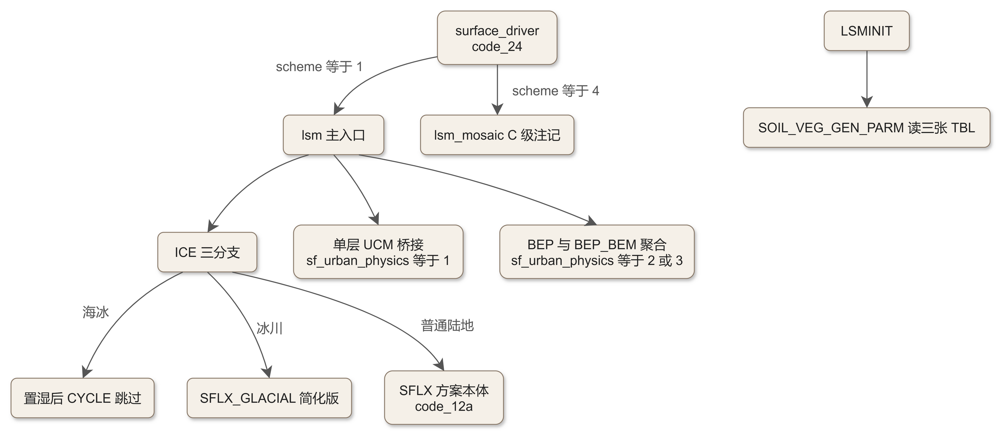
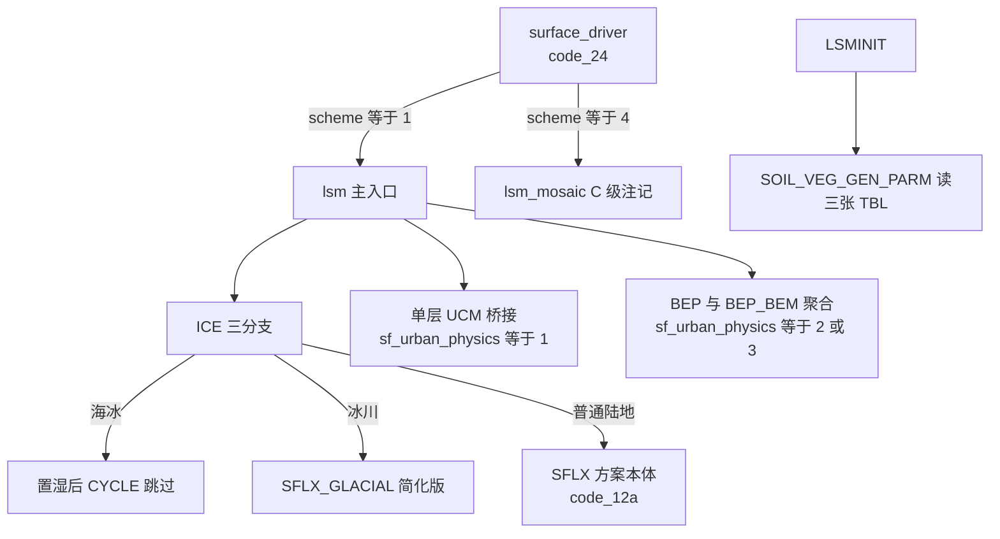

# code_13 — Noah 驱动外壳（module_sf_noahdrv.F：格点循环、海冰/冰川分派与 TBL 读取）

## 一、版本指纹

| 源文件 | 行数 | md5（整文件，按字节） |
|---|---|---|
| phys/module_sf_noahdrv.F | 5447 | e0b6ac00686774a44b7fd04d1d28d249 |

- 抽取工具：workspace/scripts/code_extract.py v1.2，2026-10-12；块首指纹注释自带 range_md5。
- 收录分级（B+C）：B 级节选——lsm 主入口九段、LSMINIT 两段、SOIL_VEG_GEN_PARM 一段；C 级注记——lsm_mosaic 接口索引、lsm_mosaic_init 全文不录。方案本体见 [code_12a_module_sf_noahlsm.md](code_12a_module_sf_noahlsm.md) 与 [code_12b_module_sf_noahlsm.md](code_12b_module_sf_noahlsm.md)。

## 二、定位

一句话：surface_driver 与 Noah 方案本体之间的**逐格点驱动外壳**——把 Registry 三维场切成格点标量、完成能量/水分单位换算、按海冰/冰川/普通陆地三分支分派、桥接三类城市方案（单层 UCM、BEP、BEP+BEM）、把结果回写并聚合。

**谁在调它**：module_surface_driver.F 按 sf_surface_scheme 分派（Noah=1 调 lsm、mosaic=4 调 lsm_mosaic），见 [code_24_module_surface_driver.md](code_24_module_surface_driver.md)。教材锚点：[ch16_land_surface_family.md](../ch16_land_surface_family.md)（驱动链与 TBL 机制）、[ch17_urban_canopy.md](../ch17_urban_canopy.md)（城市桥接）、[ch20_modifying_wrf.md](../ch20_modifying_wrf.md)（灌溉与海冰改造）。

**5 单元地图**（lsm 1780 行 / LSMINIT 206 行 / SOIL_VEG_GEN_PARM 342 行 / lsm_mosaic 2647 行 / lsm_mosaic_init 403 行）：



<details><summary>原始 Mermaid 源码（可点击展开）</summary>

<!--

-->

</details>

## 三、文件头：依赖清单

<!-- code_extract code_extract.py v1.2
source: phys/module_sf_noahdrv.F
ranges: L1-L33
file_lines: 5447
file_md5: e0b6ac00686774a44b7fd04d1d28d249
display: line-numbered (strip L-prefix and !file: line to restore)
range_md5: 923921993bb03f201df3b871cfe9bdef
seg_lines: 33
-->

```fortran
!file: phys/module_sf_noahdrv.F    L1-L33
L00001  MODULE module_sf_noahdrv
L00002  
L00003  !-------------------------------
L00004    USE module_sf_noahlsm,  only: SFLX, XLF, XLV, CP, R_D, RHOWATER, NATURAL, SHDTBL, LUTYPE, SLTYPE, STBOLT, &
L00005        &                         KARMAN, LUCATS, NROTBL, RSTBL, RGLTBL, HSTBL, SNUPTBL, MAXALB, LAIMINTBL,   &
L00006        &                         LAIMAXTBL, Z0MINTBL, Z0MAXTBL, ALBEDOMINTBL, ALBEDOMAXTBL, EMISSMINTBL,     &
L00007        &                         EMISSMAXTBL, TOPT_DATA, CMCMAX_DATA, CFACTR_DATA, RSMAX_DATA, BARE, NLUS,   &
L00008        &                         SLCATS, BB, DRYSMC, F11, MAXSMC, REFSMC, SATPSI, SATDK, SATDW, WLTSMC, QTZ, &
L00009        &                         NSLTYPE, SLPCATS, SLOPE_DATA, SBETA_DATA, FXEXP_DATA, CSOIL_DATA,           &
L00010        &                         SALP_DATA, REFDK_DATA, REFKDT_DATA, FRZK_DATA, ZBOT_DATA, CZIL_DATA,        &
L00011        &                         SMLOW_DATA, SMHIGH_DATA, LVCOEF_DATA, NSLOPE, &
L00012        &                         FRH2O,ZTOPVTBL,ZBOTVTBL, &
L00013        &                         LCZ_1,LCZ_2,LCZ_3,LCZ_4,LCZ_5,LCZ_6,LCZ_7,LCZ_8,LCZ_9,LCZ_10,LCZ_11
L00014    USE module_sf_urban,    only: urban, oasis, IRI_SCHEME
L00015    USE module_sf_noahlsm_glacial_only, only: sflx_glacial
L00016    USE module_sf_bep,      only: bep
L00017    USE module_sf_bep_bem,  only: bep_bem
L00018  #if defined(mpas)
L00019  use mpas_atmphys_date_time, only: cal_mon_day
L00020  use mpas_atmphys_utilities, only: physics_error_fatal
L00021  #define FATAL_ERROR(M) call physics_error_fatal( M )
L00022  #else
L00023   use module_ra_gfdleta,  only: cal_mon_day
L00024   use module_wrf_error
L00025  #define FATAL_ERROR(M) call wrf_error_fatal( M )
L00026  #endif
L00027  #if ( WRF_CHEM == 1 )
L00028    USE module_data_gocart_dust
L00029  #endif
L00030  !-------------------------------
L00031  
L00032  !
L00033  CONTAINS
```

> 讲解：USE 全家福交代了本模块的三重身份。①从 noahlsm 进来的不只是 SFLX，还有**三张参数表的全部存储数组**（BB/MAXSMC/SATDK 等 + SHDTBL/LUTYPE/BARE/NATURAL/LCZ_1 至 LCZ_11）——noahdrv 负责把 TBL 读进这些模块级数组（§六），noahlsm 只查表；②城市侧：module_sf_urban 的 urban（单层 UCM 主入口）、oasis（绿洲系数）、IRI_SCHEME（灌溉方案开关），以及 bep/bep_bem 多层城市方案；③冰川：SFLX_GLACIAL 来自独立文件 module_sf_noahlsm_glacial_only.F——冰川不需要土壤水，走精简方案。另有 MPAS/WRF 双框架宏（cal_mon_day 的来源切换）与 WRF_CHEM 的 gocart 沙尘依赖。lsm 主入口的完整签名（L38–L129）带约 150 个城市专用 OPTIONAL 参数——单层 UCM 的全部状态量都在这里过手。

## 四、lsm 主入口（B 级节选）

### 4.1 分层设置与首步初始化

<!-- code_extract code_extract.py v1.2
source: phys/module_sf_noahdrv.F
ranges: L757-L808
file_lines: 5447
file_md5: e0b6ac00686774a44b7fd04d1d28d249
display: line-numbered (strip L-prefix and !file: line to restore)
range_md5: 3070d2a03ab239d33c18cc27ff25807f
seg_lines: 52
-->

```fortran
!file: phys/module_sf_noahdrv.F    L757-L808
L00757        SLOPETYP=1
L00758  !      SHDMIN=0.00
L00759  
L00760  
L00761        NSOIL=num_soil_layers
L00762  
L00763       DO NS=1,NSOIL
L00764       SLDPTH(NS)=DZS(NS)
L00765       ENDDO
L00766  
L00767       JLOOP : DO J=jts,jte
L00768  
L00769        IF(ITIMESTEP.EQ.1)THEN
L00770          DO 50 I=its,ite
L00771  !*** initialize soil conditions for IHOP 31 May case
L00772  !         IF((XLAND(I,J)-1.5) < 0.)THEN
L00773  !            if (I==108.and.j==85) then
L00774  !                  DO NS=1,NSOIL
L00775  !                      SMOIS(I,NS,J)=0.10
L00776  !                      SH2O(I,NS,J)=0.10
L00777  !                  enddo
L00778  !             endif
L00779  !         ENDIF
L00780  
L00781  !*** SET ZERO-VALUE FOR SOME OUTPUT DIAGNOSTIC ARRAYS
L00782            IF((XLAND(I,J)-1.5).GE.0.)THEN
L00783  ! check sea-ice point
L00784  #if 0
L00785              IF( XICE(I,J).GE. XICE_THRESHOLD .and. IPRINT ) PRINT*, ' sea-ice at water point, I=',I,'J=',J
L00786  #endif
L00787  !***   Open Water Case
L00788              SMSTAV(I,J)=1.0
L00789              SMSTOT(I,J)=1.0
L00790              DO NS=1,NSOIL
L00791                SMOIS(I,NS,J)=1.0
L00792                TSLB(I,NS,J)=273.16                                          !STEMP
L00793                SMCREL(I,NS,J)=1.0
L00794              ENDDO
L00795            ELSE
L00796              IF ( XICE(I,J) .GE. XICE_THRESHOLD ) THEN
L00797  !***        SEA-ICE CASE
L00798                SMSTAV(I,J)=1.0
L00799                SMSTOT(I,J)=1.0
L00800                DO NS=1,NSOIL
L00801                  SMOIS(I,NS,J)=1.0
L00802                  SMCREL(I,NS,J)=1.0
L00803                ENDDO
L00804              ENDIF
L00805            ENDIF
L00806  !
L00807     50   CONTINUE
L00808        ENDIF                                                               ! end of initialization over ocean
```

> 讲解：①SLOPETYP=1 硬编码（坡度类固定，老版曾为 2）——Noah 在 WRF 中不做地形坡度分异；②SLDPTH 从 DZS 逐层拷贝——DZS 是 Registry 态、SLDPTH 是 Noah 的本地语言；③ITIMESTEP=1 时对**水面点**（XLAND−1.5≥0）初始化 SMOIS=1/TSLB=273.16/SMCREL=1；**海冰点**（XICE≥XICE_THRESHOLD）同样 SMOIS=1 但不动 TSLB——土壤水满是海冰点跳过 LSM 的配合条件（§4.4）。

### 4.2 格点预处理：单位换算与强迫量

<!-- code_extract code_extract.py v1.2
source: phys/module_sf_noahdrv.F
ranges: L811-L948
file_lines: 5447
file_md5: e0b6ac00686774a44b7fd04d1d28d249
display: line-numbered (strip L-prefix and !file: line to restore)
range_md5: 5ffefc783bebbb89bbb8c26e722dba66
seg_lines: 138
-->

```fortran
!file: phys/module_sf_noahdrv.F    L811-L948
L00811        ILOOP : DO I=its,ite
L00812  ! surface pressure
L00813          PSFC=P8w3D(i,1,j)
L00814  ! pressure in middle of lowest layer
L00815          SFCPRS=(P8W3D(I,KTS+1,j)+P8W3D(i,KTS,j))*0.5
L00816  ! convert from mixing ratio to specific humidity
L00817           Q2K=QV3D(i,1,j)/(1.0+QV3D(i,1,j))
L00818  ! initializing local variables
L00819          SOILW=0.
L00820          FLX4=0.
L00821          FVB=0.
L00822          FBUR=0.
L00823          FGSN=0.
L00824  !
L00825  !         Q2SAT=QGH(I,j)
L00826           Q2SAT=QGH(I,J)/(1.0+QGH(I,J))        ! Q2SAT is sp humidity
L00827  ! add check on myj=.true.
L00828  !        IF((Q2K.GE.Q2SAT*TRESH).AND.Q2K.LT.QZ0(I,J))THEN
L00829          IF((myj).AND.(Q2K.GE.Q2SAT*TRESH).AND.Q2K.LT.QZ0(I,J))THEN
L00830            SATFLG=0.
L00831            CHKLOWQ(I,J)=0.
L00832          ELSE
L00833            SATFLG=1.0
L00834            CHKLOWQ(I,J)=1.
L00835          ENDIF
L00836  
L00837          SFCTMP=T3D(i,1,j)
L00838          ZLVL=0.5*DZ8W(i,1,j)
L00839  
L00840  !        TH2=SFCTMP+(0.0097545*ZLVL)
L00841  ! calculate SFCTH2 via Exner function vs lapse-rate (above)
L00842           APES=(1.E5/PSFC)**CAPA
L00843           APELM=(1.E5/SFCPRS)**CAPA
L00844           SFCTH2=SFCTMP*APELM
L00845           TH2=SFCTH2/APES
L00846  !
L00847           EMISSI = EMISS(I,J)
L00848           LWDN=GLW(I,J)*EMISSI
L00849  ! SOLDN is total incoming solar
L00850          SOLDN=SWDOWN(I,J)
L00851  ! GSW is net downward solar
L00852  !        SOLNET=GSW(I,J)
L00853  ! use mid-day albedo to determine net downward solar (no solar zenith angle correction)
L00854          SOLNET=SOLDN*(1.-ALBEDO(I,J))
L00855          PRCP=RAINBL(i,j)/DT
L00856          IF(PRESENT(IRR_CHAN)) THEN
L00857           IF(IRR_CHAN(i,j).NE.0) THEN
L00858             IRRIGATION_CHANNEL=IRR_CHAN(i,j)/DT
L00859           ELSE
L00860             IRRIGATION_CHANNEL=0.
L00861           END IF
L00862          ENDIF
L00863          VEGTYP=IVGTYP(I,J)
L00864          SOILTYP=ISLTYP(I,J)
L00865          SHDFAC=VEGFRA(I,J)/100.
L00866          T1=TSK(I,J)
L00867          CHK=CHS(I,J)
L00868          SHMIN=SHDMIN(I,J)/100. !NEW
L00869          SHMAX=SHDMAX(I,J)/100. !NEW
L00870  ! convert snow water equivalent from mm to meter
L00871          SNEQV=SNOW(I,J)*0.001
L00872  ! snow depth in meters
L00873          SNOWHK=SNOWH(I,J)
L00874          SNCOVR=SNOWC(I,J)
L00875  
L00876  ! if "SR" present, set frac of frozen precip ("FFROZP") = snow-ratio ("SR", range:0-1)
L00877  ! SR from e.g. Ferrier microphysics
L00878  ! otherwise define from 1st atmos level temperature
L00879         IF(FRPCPN) THEN
L00880            FFROZP=SR(I,J)
L00881          ELSE
L00882            IF (SFCTMP <=  273.15) THEN
L00883              FFROZP = 1.0
L00884  	  ELSE
L00885  	    FFROZP = 0.0
L00886  	  ENDIF
L00887          ENDIF
L00888  !***
L00889          IF((XLAND(I,J)-1.5).GE.0.)THEN                                  ! begining of land/sea if block
L00890  ! Open water points
L00891            TSK_RURAL(I,J)=TSK(I,J)
L00892            HFX_RURAL(I,J)=HFX(I,J)
L00893            QFX_RURAL(I,J)=QFX(I,J)
L00894            LH_RURAL(I,J)=LH(I,J)
L00895            EMISS_RURAL(I,J)=EMISS(I,J)
L00896            GRDFLX_RURAL(I,J)=GRDFLX(I,J)
L00897  
L00898          ELSE
L00899  ! Land or sea-ice case
L00900  
L00901            IF (XICE(I,J) >= XICE_THRESHOLD) THEN
L00902               ! Sea-ice point
L00903               ICE = 1
L00904            ELSE IF ( VEGTYP == ISICE ) THEN
L00905               ! Land-ice point
L00906               ICE = -1
L00907            ELSE
L00908               ! Neither sea ice or land ice.
L00909               ICE=0
L00910            ENDIF
L00911            DQSDT2=Q2SAT*A23M4/(SFCTMP-A4)**2
L00912  
L00913            IF(SNOW(I,J).GT.0.0)THEN
L00914  ! snow on surface (use ice saturation properties)
L00915              SFCTSNO=SFCTMP
L00916              E2SAT=611.2*EXP(6174.*(1./273.15 - 1./SFCTSNO))
L00917              Q2SATI=0.622*E2SAT/(SFCPRS-E2SAT)
L00918              Q2SATI=Q2SATI/(1.0+Q2SATI)    ! spec. hum.
L00919              IF (T1 .GT. 273.14) THEN
L00920  ! warm ground temps, weight the saturation between ice and water according to SNOWC
L00921                Q2SAT=Q2SAT*(1.-SNOWC(I,J)) + Q2SATI*SNOWC(I,J)
L00922                DQSDT2=DQSDT2*(1.-SNOWC(I,J)) + Q2SATI*6174./(SFCTSNO**2)*SNOWC(I,J)
L00923              ELSE
L00924  ! cold ground temps, use ice saturation only
L00925                Q2SAT=Q2SATI
L00926                DQSDT2=Q2SATI*6174./(SFCTSNO**2)
L00927              ENDIF
L00928  ! for snow cover fraction at 0 C, ground temp will not change, so DQSDT2 effectively zero
L00929  ! V3.8 add condition for SWDOWN to restrict condition to positive forcing (JD)
L00930              IF(T1 .GT. 273. .AND. SNOWC(I,J) .GT. 0. .AND. SWDOWN(I,J) .GT. 10.)DQSDT2=DQSDT2*(1.-SNOWC(I,J))
L00931            ENDIF
L00932  
L00933            ! Land-ice or land points use the usual deep-soil temperature.
L00934            TBOT=TMN(I,J)
L00935  
L00936            IF(ISURBAN.EQ.1) THEN
L00937  ! assumes these only need to be set for USGS land data
L00938            IF(VEGTYP.EQ.25) SHDFAC=0.0000
L00939            IF(VEGTYP.EQ.26) SHDFAC=0.0000
L00940            IF(VEGTYP.EQ.27) SHDFAC=0.0000
L00941            ENDIF
L00942            IF(SOILTYP.EQ.14.AND.XICE(I,J).EQ.0.)THEN
L00943  #if 0
L00944           IF(IPRINT)PRINT*,' SOIL TYPE FOUND TO BE WATER AT A LAND-POINT'
L00945           IF(IPRINT)PRINT*,i,j,'RESET SOIL in surfce.F'
L00946  #endif
L00947              SOILTYP=7
L00948            ENDIF
```

> 讲解：逐格点八件事。①PSFC 取最底层气压、SFCPRS 取最底两层平均——Noah 的「第一层大气」是半层高；Q2K 由混合比换比湿。②SATFLG/CHKLOWQ 近饱和标记只在 myj（MYJ 面层）路径生效（TRESH=0.95、QZ0 上限）——其他面层方案恒为 1。③ZLVL=0.5·DZ8W(1)；TH2 用两层 Exner 函数换算（旧式 0.0097545·ZLVL 气温直减率近似被注释）。④LWDN=GLW·EMISSI（长波按发射率折算）；**SOLNET=SOLDN·(1−ALBEDO)**——用当前时变反照率算净短波（GSW 老口径注释掉）。⑤PRCP=RAINBL/DT（mm/step 到 kg/(m²s)）；灌溉通道 IRR_CHAN/DT 透传。⑥SHDFAC=VEGFRA/100、SNEQV=SNOW·0.001（mm 到 m）。⑦**FFROZP 冻水比例**：frpcpn（Ferrier 微物理开关）时直接用 SR 场（0–1 连续值），否则按第一层气温 0°C 二值判——SFLX 里以 >0.5 判雪。⑧**雪面强迫换冰面饱和**：SNOW>0 时由冰面饱和蒸汽压式算 Q2SATI，T1>273.14（暖地面）按 SNOWC 加权水/冰饱和，DQSDT2 同步换冰温斜率（V3.8 加 SWDOWN>10 条件限制在白昼有辐射强迫时生效）。杂项：USGS 口径（ISURBAN=1）下三类城市（25 低密/26 高密/27 工业）SHDFAC 强制 0；土壤类 14（水体）误落在陆地改 7；SNOWHK 兜底——雪深状态缺失或小于水当量时按密度 0.2 反推 SNOWHK=5·SNEQV。

### 4.3 城市前处理与单层 UCM 的灌溉/绿洲挂点

<!-- code_extract code_extract.py v1.2
source: phys/module_sf_noahdrv.F
ranges: L982-L1054
file_lines: 5447
file_md5: e0b6ac00686774a44b7fd04d1d28d249
display: line-numbered (strip L-prefix and !file: line to restore)
range_md5: 5c281ac9d495280053568604ea10ba05
seg_lines: 73
-->

```fortran
!file: phys/module_sf_noahdrv.F    L982-L1054
L00982  !Fei: urban. for urban surface, if calling UCM, redefine the natural surface in cities as
L00983  ! the "NATURAL" category in the VEGPARM.TBL
L00984                    IF(SF_URBAN_PHYSICS == 1.OR. SF_URBAN_PHYSICS==2.OR.SF_URBAN_PHYSICS==3 ) THEN
L00985                    IF( IVGTYP(I,J) == ISURBAN    .or. IVGTYP(I,J) == LCZ_1 .or. IVGTYP(I,J) == LCZ_2 .or. &
L00986                        IVGTYP(I,J) == LCZ_3      .or. IVGTYP(I,J) == LCZ_4 .or. IVGTYP(I,J) == LCZ_5 .or. &
L00987                        IVGTYP(I,J) == LCZ_6      .or. IVGTYP(I,J) == LCZ_7 .or. IVGTYP(I,J) == LCZ_8 .or. &
L00988                        IVGTYP(I,J) == LCZ_9      .or. IVGTYP(I,J) == LCZ_10 .or. IVGTYP(I,J) == LCZ_11 ) THEN
L00989  	
L00990  		 VEGTYP = NATURAL
L00991                   SHDFAC = SHDTBL(NATURAL)
L00992                   ALBEDOK =0.2         !  0.2
L00993                   ALBBRD  =0.2         !0.2
L00994                   EMISSI = 0.98                                 !for VEGTYP=5
L00995                   LWDN   = GLW(I,J) * EMISSI
L00996                   SOLNET = SOLDN * (1.0 - ALBEDOK)
L00997  
L00998  		 IF ( FRC_URB2D(I,J) < 0.99 ) THEN
L00999                     if(sf_urban_physics.eq.1)then
L01000                       T1= ( TSK(I,J) -FRC_URB2D(I,J) * TS_URB2D (I,J) )/ (1-FRC_URB2D(I,J))
L01001                     elseif((sf_urban_physics.eq.2).OR.(sf_urban_physics.eq.3))then
L01002                       T1=tsk_rural_bep(i,j)
L01003                     endif
L01004  	         ELSE
L01005  		 T1 = TSK(I,J)
L01006                   ENDIF
L01007                  ENDIF
L01008             ELSE
L01009              IF( IVGTYP(I,J) == ISURBAN    .or. IVGTYP(I,J) == LCZ_1 .or. IVGTYP(I,J) == LCZ_2 .or. &
L01010                  IVGTYP(I,J) == LCZ_3      .or. IVGTYP(I,J) == LCZ_4 .or. IVGTYP(I,J) == LCZ_5 .or. &
L01011                  IVGTYP(I,J) == LCZ_6      .or. IVGTYP(I,J) == LCZ_7 .or. IVGTYP(I,J) == LCZ_8 .or. &
L01012                  IVGTYP(I,J) == LCZ_9      .or. IVGTYP(I,J) == LCZ_10 .or. IVGTYP(I,J) == LCZ_11 ) THEN
L01013                    VEGTYP = ISURBAN
L01014                   ENDIF
L01015  
L01016             ENDIF
L01017  
L01018  !===Yang, 2014/10/08, hydrological processes for urban vegetation in single layer UCM===
L01019             AOASIS = 1.0
L01020             USOIL = 1
L01021             DSOIL = 2
L01022             IRIOPTION=IRI_SCHEME
L01023  	  IF(SF_URBAN_PHYSICS == 1) THEN
L01024             OMG= OMG_URB2D(I,J)   
L01025             tloc=mod(int(OMG/3.14159*180./15.+12.+0.5 ),24)
L01026             if (tloc.lt.0) tloc=tloc+24
L01027             if (tloc==0) tloc=24
L01028             CALL cal_mon_day(julian,julyr,jmonth,jday) 
L01029               IF( IVGTYP(I,J) == ISURBAN    .or. IVGTYP(I,J) == LCZ_1 .or. IVGTYP(I,J) == LCZ_2 .or. &
L01030                   IVGTYP(I,J) == LCZ_3      .or. IVGTYP(I,J) == LCZ_4 .or. IVGTYP(I,J) == LCZ_5 .or. &
L01031                   IVGTYP(I,J) == LCZ_6      .or. IVGTYP(I,J) == LCZ_7 .or. IVGTYP(I,J) == LCZ_8 .or. &
L01032                   IVGTYP(I,J) == LCZ_9      .or. IVGTYP(I,J) == LCZ_10 .or. IVGTYP(I,J) == LCZ_11 ) THEN
L01033                  AOASIS = oasis  ! urban oasis effect
L01034                     IF (IRIOPTION ==1) THEN
L01035                     IF (tloc==21 .or. tloc==22) THEN  !irrigation on vegetaion in urban area, MAY-SEP, 9-10pm
L01036                     IF (jmonth==5 .or. jmonth==6 .or. jmonth==7 .or. jmonth==8 .or. jmonth==9) THEN
L01037  !                      IF (SMC(USOIL) .LT. SMCREF) SMC(USOIL)= SMCREF
L01038  !                      IF (SMC(DSOIL) .LT. SMCREF) SMC(DSOIL)= SMCREF
L01039                        IF (SMC(USOIL) .LT. SMCREF) SMC(USOIL)= REFSMC(ISLTYP(I,J))                      
L01040                        IF (SMC(DSOIL) .LT. SMCREF) SMC(DSOIL)= REFSMC(ISLTYP(I,J))                    
L01041                     ENDIF
L01042                     ENDIF
L01043                     ENDIF
L01044                  ENDIF
L01045             ENDIF
L01046  
L01047  	  IF(SF_URBAN_PHYSICS == 2 .or. SF_URBAN_PHYSICS == 3) THEN
L01048            IF(AOASIS > 1.0) THEN
L01049            FATAL_ERROR('Urban oasis option is for SF_URBAN_PHYSICS == 1 only')
L01050            ENDIF
L01051            IF(IRIOPTION == 1) THEN
L01052            FATAL_ERROR('Urban irrigation option is for SF_URBAN_PHYSICS == 1 only')
L01053            ENDIF
L01054            ENDIF
```

> 讲解：①SF_URBAN_PHYSICS=1/2/3 时城市类格点（ISURBAN 或 LCZ_1 至 LCZ_11）的「自然下垫面」被重定义：**UCM 路径** VEGTYP=NATURAL、SHDFAC=SHDTBL(NATURAL)、ALBBRD=ALBEDOK=0.2、EMISSI=0.98——城市里的「自然部分」按植被表 NATURAL 类取参数；**BEP/BEM 路径** VEGTYP=ISURBAN（进 SFLX 后触发 12a §四的 urban 硬参数）。②FRC_URB2D<0.99（非纯城市）时 T1 做 rural 重建：UCM 从 (TSK−FRC·TS_URB2D)/(1−FRC) 反推、BEP/BEM 直接用 tsk_rural_bep——皮肤温度的城市/乡村解耦。③**Yang 2014 水文挂点**：AOASIS=1 默认（城市格点换 oasis 系数进 PENMAN，12a §十）；IRI_SCHEME=1 时城市格点 5–9 月每日 21–22 时把上两层 SMC 补到该土壤类的田间持水量 REFSMC——「定时灌溉」的最粗颗粒实现，直接改 SMC 数组。④oasis/IRI 与 BEP/BEM 组合直接 FATAL_ERROR——挂点只接单层 UCM，想移植到 BEP 路径就得自己接 IRRIGATION_CHANNEL 通道。

### 4.4 ICE 三分支：海冰、普通陆地、冰川

<!-- code_extract code_extract.py v1.2
source: phys/module_sf_noahdrv.F
ranges: L1082-L1205
file_lines: 5447
file_md5: e0b6ac00686774a44b7fd04d1d28d249
display: line-numbered (strip L-prefix and !file: line to restore)
range_md5: c8076ed966ee56f1a3ae2487cf854243
seg_lines: 124
-->

```fortran
!file: phys/module_sf_noahdrv.F    L1082-L1205
L01082            IF (rdlai2d) THEN
L01083               IF (SHDFAC > 0.0 .AND. LAI(I,J) <= 0.0) LAI(I,J) = 0.01
L01084               xlai = lai(i,j)
L01085            endif
L01086  
L01087      IF ( ICE == 1 ) THEN
L01088  
L01089         ! Sea-ice case
L01090  
L01091         DO NS = 1, NSOIL
L01092            SH2O(I,NS,J) = 1.0
L01093         ENDDO
L01094         LAI(I,J) = 0.01
L01095  
L01096         CYCLE ILOOP
L01097  
L01098      ELSEIF (ICE == 0) THEN
L01099  
L01100         ! Non-glacial land
L01101  !
L01102  !  FASDAS
L01103  !
L01104         IF( fasdas == 1 ) THEN
L01105  
L01106           DZQ = DZ8W(I,1,J)
L01107           XSDA_HFX= SDA_HFX(I,J)*RHO(I,1,J)*CPM(I,J)*DZQ  ! W/m^2
L01108           ! TWG2015 Bugfix remove factor of 1000.0 for correct units
L01109           XSDA_QFX= SDA_QFX(I,J)*RHO(I,1,J)*DZQ          ! Kg/m2/s of water
L01110           XQNORM = QNORM(I,J)
L01111  
L01112         ENDIF
L01113  !
L01114  !  END FASDAS
L01115  !
L01116  #ifdef WRF_HYDRO
L01117         etpnd1_hydro = 0.
L01118         sfcheadrt_hydro = sfcheadrt(i,j)
L01119         infxsrt_hydro = infxsrt(i,j)
L01120  #else
L01121         etpnd1_hydro = 0.
L01122         sfcheadrt_hydro = 0.
L01123         infxsrt_hydro = 0.
L01124  #endif
L01125         CALL SFLX (I,J,FFROZP, ISURBAN, DT,ZLVL,NSOIL,SLDPTH,       &    !C
L01126                   LOCAL,                                            &    !L
L01127                   LUTYPE, SLTYPE,                                   &    !CL
L01128                   LWDN,SOLDN,SOLNET,SFCPRS,PRCP,SFCTMP,Q2K,DUMMY,   &    !F
L01129                   DUMMY,DUMMY, DUMMY,                               &    !F PRCPRAIN not used
L01130                   TH2,Q2SAT,DQSDT2,                                 &    !I
L01131                   VEGTYP,SOILTYP,SLOPETYP,SHDFAC,SHMIN,SHMAX,       &    !I
L01132                   ALBBRD, SNOALB1,TBOT, Z0BRD, Z0K, EMISSI, EMBRD,  &    !S
L01133                   CMC,T1,STC,SMC,SWC,SNOWHK,SNEQV,ALBEDOK,CHK,dummy,&    !H
L01134                   ETA,SHEAT, ETA_KINEMATIC,FDOWN,                   &    !O
L01135                   EC,EDIR,ET,ETT,ESNOW,DRIP,DEW,                    &    !O
L01136                   BETA,ETP,SSOIL,                                   &    !O
L01137                   FLX1,FLX2,FLX3,                                   &    !O
L01138  		 FLX4,FVB,FBUR,FGSN,UA_PHYS,                       &    !UA 
L01139                   SNOMLT,SNCOVR,                                    &    !O
L01140                   RUNOFF1,RUNOFF2,RUNOFF3,                          &    !O
L01141                   RC,PC,RSMIN,XLAI,RCS,RCT,RCQ,RCSOIL,              &    !O
L01142                   SOILW,SOILM,Q1,SMAV,                              &    !D
L01143                   RDLAI2D,USEMONALB,                                &
L01144                   SNOTIME1,                                         &
L01145                   RIBB,                                             &
L01146                   SMCWLT,SMCDRY,SMCREF,SMCMAX,NROOT,                &
L01147  ! WRF_HYDRO vars
L01148                   sfcheadrt_hydro,                                  &    !I
L01149                   INFXSRT_hydro,ETPND1_hydro                        &    !O
L01150                  ,OPT_THCND,AOASIS                                  &    !O
L01151                  ,XSDA_QFX, HFX_PHY, QFX_PHY, XQNORM, fasdas, HCPCT_FASDAS    &   ! fasdas
L01152                  ,IRRIGATION_CHANNEL)
L01153  
L01154  #ifdef WRF_HYDRO
L01155                   soldrain(i,j) = RUNOFF2*DT*1000.0
L01156                   sfcheadrt(i,j) = sfcheadrt_hydro
L01157                   infxsrt(i,j) = INFXSRT_hydro
L01158                   etpnd1 = etpnd1_hydro
L01159  #endif
L01160      ELSEIF (ICE == -1) THEN
L01161  
L01162         !
L01163         ! Set values that the LSM is expected to update,
L01164         ! but don't get updated for glacial points.
L01165         !
L01166         SOILM = 0.0 !BSINGH(PNNL)- SOILM is undefined for this case, it is used for diagnostics so setting it to zero
L01167         XLAI = 0.01 ! KWM Should this be Zero over land ice?  Does this value matter?
L01168         RUNOFF2 = 0.0
L01169         RUNOFF3 = 0.0
L01170         DO NS = 1, NSOIL
L01171            SWC(NS) = 1.0
L01172            SMC(NS) = 1.0
L01173            SMAV(NS) = 1.0
L01174         ENDDO
L01175  !
L01176  !  FASDAS
L01177  !
L01178         IF( fasdas == 1 ) THEN
L01179  
L01180           DZQ = DZ8W(I,1,J)
L01181           XSDA_HFX= SDA_HFX(I,J)*RHO(I,1,J)*CPM(I,J)*DZQ  ! W/m^2
L01182           XSDA_QFX= 0.0          ! Kg/m2/s of water
L01183           XQNORM = 0.0
L01184  
L01185         ENDIF
L01186  !
L01187  !  END FASDAS
L01188  !
L01189  
L01190         CALL SFLX_GLACIAL(I,J,ISICE,FFROZP,DT,ZLVL,NSOIL,SLDPTH,   &    !C
L01191              &    LWDN,SOLNET,SFCPRS,PRCP,SFCTMP,Q2K,              &    !F
L01192              &    TH2,Q2SAT,DQSDT2,                                &    !I
L01193              &    ALBBRD, SNOALB1,TBOT, Z0BRD, Z0K, EMISSI, EMBRD, &    !S
L01194              &    T1,STC(1:NSOIL),SNOWHK,SNEQV,ALBEDOK,CHK,        &    !H
L01195              &    ETA,SHEAT,ETA_KINEMATIC,FDOWN,                   &    !O
L01196              &    ESNOW,DEW,                                       &    !O
L01197              &    ETP,SSOIL,                                       &    !O
L01198              &    FLX1,FLX2,FLX3,                                  &    !O
L01199              &    SNOMLT,SNCOVR,                                   &    !O
L01200              &    RUNOFF1,                                         &    !O
L01201              &    Q1,                                              &    !D
L01202              &    SNOTIME1,                                        &
L01203              &    RIBB)
L01204  
L01205      ENDIF
```

> 讲解：rdlai2d 路径把外场 LAI 传给 xlai（下限 0.01）。随后按 ICE 三分派：**ICE=1（海冰）**——SH2O 全层置 1、LAI=0.01 后 CYCLE ILOOP **直接跳过 LSM**：海冰点的感热/潜热全部由面层方案（PBL 的 sfclay 系）按 TSK 计算，Noah 只负责把土壤湿置满（§4.1 配合）；**ICE=−1（陆地冰川，VEGTYP==ISICE）**——SWC/SMC/SMAV 全置 1、RUNOFF2/3 清零后调 SFLX_GLACIAL（冰川简化版：无土壤水、无蒸腾，只算雪/冰面能量平衡、升华与 RUNOFF1，签名见调用处实参）；**ICE=0（普通陆地）**——fasdas=1 时把同化增量换算成格点通量（XSDA_HFX=SDA_HFX·ρ·CPM·DZQ，XSDA_QFX 同理），WRF_HYDRO 的 sfcheadrt/infxsrt 经 _hydro 本地变量桥接，然后 **SFLX 全参调用**——实参顺序即 12a §四的九类接口合同；注意 CH 位传的是 CHK=CHS(I,J)——面层方案给的交换系数，CM 位传 DUMMY，印证 SFCDIF_off 在 WRF 主线的休眠（12b §十四）。

### 4.5 状态回写、fasdas 皮肤温度与能量残差

<!-- code_extract code_extract.py v1.2
source: phys/module_sf_noahdrv.F
ranges: L1239-L1334
file_lines: 5447
file_md5: e0b6ac00686774a44b7fd04d1d28d249
display: line-numbered (strip L-prefix and !file: line to restore)
range_md5: 747d6ea82d3ca23f6dd310cbf01dd0a2
seg_lines: 96
-->

```fortran
!file: phys/module_sf_noahdrv.F    L1239-L1334
L01239  !***  UPDATE STATE VARIABLES
L01240            CANWAT(I,J)=CMC*1000.
L01241            SNOW(I,J)=SNEQV*1000.
L01242  !          SNOWH(I,J)=SNOWHK*1000.
L01243            SNOWH(I,J)=SNOWHK                   ! SNOWHK in meters
L01244            ALBEDO(I,J)=ALBEDOK
L01245            ALB_RURAL(I,J)=ALBEDOK
L01246            ALBBCK(I,J)=ALBBRD
L01247            Z0(I,J)=Z0BRD
L01248            EMISS(I,J) = EMISSI
L01249            EMISS_RURAL(I,J) = EMISSI
L01250  ! Noah: activate time-varying roughness length (V3.3 Feb 2011)
L01251            ZNT(I,J)=Z0K
L01252  !
L01253  ! FASDAS
L01254  !
L01255  ! Update Skin Temperature
L01256         IF( fasdas == 1 ) THEN
L01257             XSDA_QFX= XSDA_QFX*ELWV*XQNORM
L01258  
L01259          !TWG2015 Bugfix to multiply Heat Capacity by Soil Depth for correct
L01260          !units 
L01261  
L01262             T1 = T1 + (XSDA_HFX-XSDA_QFX)*DT/(HCPCT_FASDAS*DZS(1))
L01263  
L01264         END IF
L01265  !
L01266  ! END FASDAS
L01267  !
L01268            TSK(I,J)=T1
L01269            TSK_RURAL(I,J)=T1
L01270            if (present(tsk_rural_bep)) then
L01271               IF(SF_URBAN_PHYSICS == 2 .or. SF_URBAN_PHYSICS == 3) THEN
L01272                 TSK_RURAL_BEP(I,J)=T1
L01273               END IF
L01274            endif
L01275            HFX(I,J)=SHEAT
L01276            HFX_RURAL(I,J)=SHEAT
L01277  ! MEk Jul07 add potential evap accum
L01278          POTEVP(I,J)=POTEVP(I,J)+ETP*FDTW
L01279            QFX(I,J)=ETA_KINEMATIC
L01280            QFX_RURAL(I,J)=ETA_KINEMATIC
L01281  
L01282  #ifdef WRF_HYDRO
L01283  !added by Wei Yu
L01284  !         QFX(I,J) = QFX(I,J) + ETPND1
L01285  !         ETA = ETA + ETPND1/2.501E6*dt
L01286  !end added by Wei Yu
L01287  #endif
L01288  
L01289  
L01290            LH(I,J)=ETA
L01291            LH_RURAL(I,J)=ETA
L01292            GRDFLX(I,J)=SSOIL
L01293            GRDFLX_RURAL(I,J)=SSOIL
L01294            SNOWC(I,J)=SNCOVR
L01295            CHS2(I,J)=CQS2(I,J)
L01296            SNOTIME(I,J) = SNOTIME1
L01297  !      prevent diagnostic ground q (q1) from being greater than qsat(tsk)
L01298  !      as happens over snow cover where the cqs2 value also becomes irrelevant
L01299  !      by setting cqs2=chs in this situation the 2m q should become just qv(k=1)
L01300  ! ww: comment out this change to avoid Q2 drop due to change of radiative flux
L01301  !         IF (Q1 .GT. QSFC(I,J)) THEN
L01302  !           CQS2(I,J) = CHS(I,J)
L01303  !         ENDIF
L01304  !          QSFC(I,J)=Q1
L01305  ! Convert QSFC back to mixing ratio
L01306             QSFC(I,J)= Q1/(1.0-Q1)
L01307  !
L01308             ! QSFC_RURAL(I,J)= Q1/(1.0-Q1)
L01309  ! Calculate momentum flux from rural surface for use with multi-layer UCM (Martilli et al. 2002)
L01310  
L01311            DO 80 NS=1,NSOIL
L01312             SMOIS(I,NS,J)=SMC(NS)
L01313             TSLB(I,NS,J)=STC(NS)                                        !  STEMP
L01314             SH2O(I,NS,J)=SWC(NS)
L01315     80     CONTINUE
L01316  !       ENDIF
L01317  
L01318          FLX4_2D(I,J)  = FLX4
L01319  	FVB_2D(I,J)   = FVB
L01320  	FBUR_2D(I,J)  = FBUR
L01321  	FGSN_2D(I,J)  = FGSN
L01322  
L01323       !
L01324       ! Residual of surface energy balance equation terms
L01325       !
L01326  
L01327       IF ( UA_PHYS ) THEN
L01328           noahres(i,j) = ( solnet + lwdn ) - sheat + ssoil - eta &
L01329                - ( emissi * STBOLT * (t1**4) ) - flx1 - flx2 - flx3 - flx4
L01330  
L01331       ELSE
L01332           noahres(i,j) = ( solnet + lwdn ) - sheat + ssoil - eta &
L01333                - ( emissi * STBOLT * (t1**4) ) - flx1 - flx2 - flx3
L01334       ENDIF
```

> 讲解：①CANWAT/SNOW/SNOWH/ALBEDO/ALBBCK/Z0/EMISS 逐项回写；ZNT=Z0K 激活时变粗糙度（V3.3 起——PBL 面层的粗糙度从这里来）。②**fasdas=1 的皮肤温度增量**：XSDA_QFX·ELWV·XQNORM 换成能量单位，与 XSDA_HFX 一起按 HCPCT·DZS(1)（表层热容×层厚）直接加热 T1——同化增量的「温度形式」实现。③TSK=T1/HFX=SHEAT/QFX=ETA_KINEMATIC/LH=ETA/GRDFLX=SSOIL 回写，rural 副本（*_RURAL 数组）同步维护供 BEP 聚合；POTEVP 累计 ETP·FDTW（FDTW=DT/(XLV·ρwater)）；QSFC=Q1/(1−Q1) 由比湿换回混合比。④**NOAHRES 能量残差**：(SOLNET+LWDN)−SHEAT+SSOIL−ETA−EMISSI·σ·T1⁴−FLX1−FLX2−FLX3（UA 再减 FLX4）——注意 +SSOIL 的符号约定（SFLX 已把 SSOIL 变号为向下正），残差理论为零，是 Noah 能量不闭合排错的第一现场。

### 4.6 单层 UCM 桥接与 FRC 加权

<!-- code_extract code_extract.py v1.2
source: phys/module_sf_noahdrv.F
ranges: L1337-L1348
file_lines: 5447
file_md5: e0b6ac00686774a44b7fd04d1d28d249
display: line-numbered (strip L-prefix and !file: line to restore)
range_md5: de27d89aa1a6d1584ce576f76e238773
seg_lines: 12
-->

```fortran
!file: phys/module_sf_noahdrv.F    L1337-L1348
L01337          IF (SF_URBAN_PHYSICS == 1 ) THEN                                              ! Beginning of UCM CALL if block
L01338  !--------------------------------------
L01339  ! URBAN CANOPY MODEL START - urban
L01340  !--------------------------------------
L01341  ! Input variables lsm --> urban
L01342  
L01343             IF( IVGTYP(I,J) == ISURBAN    .or. IVGTYP(I,J) == LCZ_1 .or. IVGTYP(I,J) == LCZ_2 .or. &
L01344                 IVGTYP(I,J) == LCZ_3      .or. IVGTYP(I,J) == LCZ_4 .or. IVGTYP(I,J) == LCZ_5 .or. &
L01345                 IVGTYP(I,J) == LCZ_6      .or. IVGTYP(I,J) == LCZ_7 .or. IVGTYP(I,J) == LCZ_8 .or. &
L01346                 IVGTYP(I,J) == LCZ_9      .or. IVGTYP(I,J) == LCZ_10 .or. IVGTYP(I,J) == LCZ_11 ) THEN
L01347  
L01348  
```

<!-- code_extract code_extract.py v1.2
source: phys/module_sf_noahdrv.F
ranges: L1513-L1525
file_lines: 5447
file_md5: e0b6ac00686774a44b7fd04d1d28d249
display: line-numbered (strip L-prefix and !file: line to restore)
range_md5: 7f5e46ea6fbc0e1fd9b53bdb6f3d802f
seg_lines: 13
-->

```fortran
!file: phys/module_sf_noahdrv.F    L1513-L1525
L01513              TS_URB2D(I,J) = TS_URB
L01514  
L01515              ALBEDO(I,J) = FRC_URB2D(I,J)*ALB_URB+(1-FRC_URB2D(I,J))*ALBEDOK   ![-]
L01516              HFX(I,J) = FRC_URB2D(I,J)*SH_URB+(1-FRC_URB2D(I,J))*SHEAT         ![W/m/m]
L01517              QFX(I,J) = FRC_URB2D(I,J)*LH_KINEMATIC_URB &
L01518                       + (1-FRC_URB2D(I,J))*ETA_KINEMATIC                ![kg/m/m/s]
L01519              LH(I,J) = FRC_URB2D(I,J)*LH_URB+(1-FRC_URB2D(I,J))*ETA            ![W/m/m]
L01520              GRDFLX(I,J) = FRC_URB2D(I,J)*G_URB+(1-FRC_URB2D(I,J))*SSOIL       ![W/m/m]
L01521              TSK(I,J) = FRC_URB2D(I,J)*TS_URB+(1-FRC_URB2D(I,J))*T1            ![K]
L01522              Q1 = FRC_URB2D(I,J)*QS_URB+(1-FRC_URB2D(I,J))*Q1            ![-]
L01523  ! Convert QSFC back to mixing ratio
L01524              QSFC(I,J)= Q1/(1.0-Q1)
L01525              UST(I,J)= FRC_URB2D(I,J)*UST_URB+(1-FRC_URB2D(I,J))*UST(I,J)      ![m/s]
```

> 讲解：UCM 调用块（L1337–L1610，约 270 行不整录）：入口条件 L1343 的城市类判断；实参装配把 20 余个局地大气量（TA/QA/UA/SSG/SSGD/LLG/RAIN/RHOO/ZA…）与 30 余个状态量（屋顶/墙体/路面温度层、XXX 系列倾向、水文 DREL/FLXHUM 系列）打包给 urban，返回后逐项写回 2D/3D 状态数组。**出口混合公式**（第二块）：ALBEDO/HFX/QFX/LH/GRDFLX/TSK/Q1/UST = 城市值×FRC_URB2D + 自然值×(1−FRC_URB2D)——单层 UCM「城市—乡村两份通量按城市面积比线性混合」的核心思想全在这几行；QSFC 随 Q1 重新换算。

### 4.7 诊断累积

<!-- code_extract code_extract.py v1.2
source: phys/module_sf_noahdrv.F
ranges: L1615-L1634
file_lines: 5447
file_md5: e0b6ac00686774a44b7fd04d1d28d249
display: line-numbered (strip L-prefix and !file: line to restore)
range_md5: a0678d3b61970b713e667e89ae43ec7a
seg_lines: 20
-->

```fortran
!file: phys/module_sf_noahdrv.F    L1615-L1634
L01615  !***  DIAGNOSTICS
L01616            SMSTAV(I,J)=SOILW
L01617            SMSTOT(I,J)=SOILM*1000.
L01618            DO NS=1,NSOIL
L01619            SMCREL(I,NS,J)=SMAV(NS)
L01620            ENDDO
L01621  
L01622  
L01623  !         Convert the water unit into mm
L01624            SFCRUNOFF(I,J)=SFCRUNOFF(I,J)+RUNOFF1*DT*1000.0
L01625            UDRUNOFF(I,J)=UDRUNOFF(I,J)+RUNOFF2*DT*1000.0
L01626  ! snow defined when fraction of frozen precip (FFROZP) > 0.5,
L01627            IF(FFROZP.GT.0.5)THEN
L01628              ACSNOW(I,J)=ACSNOW(I,J)+PRCP*DT
L01629            ENDIF
L01630            IF(SNOW(I,J).GT.0.)THEN
L01631              ACSNOM(I,J)=ACSNOM(I,J)+SNOMLT*1000.
L01632  ! accumulated snow-melt energy
L01633              SNOPCX(I,J)=SNOPCX(I,J)-SNOMLT/FDTLIW
L01634            ENDIF
```

> 讲解：SMSTAV=SOILW（根区有效水）、SMSTOT=SOILM·1000（m 到 mm）、SMCREL=SMAV（逐层有效性）；SFCRUNOFF/UDRUNOFF 按 RUNOFF1/RUNOFF2·DT·1000 累积（速率到 mm 累计量）；ACSNOW 按 FFROZP>0.5 累计降雪；ACSNOM 累计 SNOMLT·1000；**SNOPCX 累计融雪能耗 −SNOMLT/FDTLIW**（FDTLIW=DT/(ρ·Lf)——融雪水当量换 W/m² 的负号口径）。

### 4.8 BEP/BEM 聚合

<!-- code_extract code_extract.py v1.2
source: phys/module_sf_noahdrv.F
ranges: L1717-L1814
file_lines: 5447
file_md5: e0b6ac00686774a44b7fd04d1d28d249
display: line-numbered (strip L-prefix and !file: line to restore)
range_md5: a039c57b0432abd431347dc07969c9eb
seg_lines: 98
-->

```fortran
!file: phys/module_sf_noahdrv.F    L1717-L1814
L01717      if((sf_urban_physics.eq.2).OR.(sf_urban_physics.eq.3))then         !Bep begin
L01718           do j=jts,jte
L01719           do i=its,ite
L01720              UMOM_URB(I,J)=0.
L01721              VMOM_URB(I,J)=0.
L01722              HFX_URB(I,J)=0.
L01723              QFX_URB(I,J)=0.
L01724           do k=kts,kte
L01725              a_u_bep(i,k,j)=a_u_bep(i,k,j)*frc_urb2d(i,j)
L01726              a_v_bep(i,k,j)=a_v_bep(i,k,j)*frc_urb2d(i,j)
L01727              a_t_bep(i,k,j)=a_t_bep(i,k,j)*frc_urb2d(i,j)
L01728              a_q_bep(i,k,j)=0.        
L01729              a_e_bep(i,k,j)=0.
L01730              b_u_bep(i,k,j)=b_u_bep(i,k,j)*frc_urb2d(i,j)
L01731              b_v_bep(i,k,j)=b_v_bep(i,k,j)*frc_urb2d(i,j)
L01732              b_t_bep(i,k,j)=b_t_bep(i,k,j)*frc_urb2d(i,j)
L01733              b_q_bep(i,k,j)=b_q_bep(i,k,j)*frc_urb2d(i,j)
L01734              b_e_bep(i,k,j)=b_e_bep(i,k,j)*frc_urb2d(i,j)
L01735              HFX_URB(I,J)=HFX_URB(I,J)+B_T_BEP(I,K,J)*RHO(I,K,J)*CP*                &
L01736                            DZ8W(I,K,J)*VL_BEP(I,K,J)
L01737              QFX_URB(I,J)=QFX_URB(I,J)+B_Q_BEP(I,K,J)*               &
L01738                            DZ8W(I,K,J)*VL_BEP(I,K,J)
L01739              UMOM_URB(I,J)=UMOM_URB(I,J)+ (A_U_BEP(I,K,J)*U_PHY(I,K,J)+             &
L01740                            B_U_BEP(I,K,J))*DZ8W(I,K,J)*VL_BEP(I,K,J)
L01741              VMOM_URB(I,J)=VMOM_URB(I,J)+ (A_V_BEP(I,K,J)*V_PHY(I,K,J)+             &
L01742                            B_V_BEP(I,K,J))*DZ8W(I,K,J)*VL_BEP(I,K,J)
L01743              vl_bep(i,k,j)=(1.-frc_urb2d(i,j))+vl_bep(i,k,j)*frc_urb2d(i,j)
L01744              sf_bep(i,k,j)=(1.-frc_urb2d(i,j))+sf_bep(i,k,j)*frc_urb2d(i,j)
L01745           end do
L01746              a_u_bep(i,1,j)=(1.-frc_urb2d(i,j))*(-ust(I,J)*ust(I,J))/dz8w(i,1,j)/   &
L01747                             ((u_phy(i,1,j)**2+v_phy(i,1,j)**2.)**.5)+a_u_bep(i,1,j)
L01748              a_v_bep(i,1,j)=(1.-frc_urb2d(i,j))*(-ust(I,J)*ust(I,J))/dz8w(i,1,j)/   &
L01749                             ((u_phy(i,1,j)**2+v_phy(i,1,j)**2.)**.5)+a_v_bep(i,1,j)
L01750              b_t_bep(i,1,j)=(1.-frc_urb2d(i,j))*hfx_rural(i,j)/dz8w(i,1,j)/rho(i,1,j)/CP+ &
L01751                              b_t_bep(i,1,j)
L01752              b_q_bep(i,1,j)=(1.-frc_urb2d(i,j))*qfx_rural(i,j)/dz8w(i,1,j)/rho(i,1,j)+b_q_bep(i,1,j)
L01753              umom=(1.-frc_urb2d(i,j))*ust(i,j)*ust(i,j)*u_phy(i,1,j)/               &
L01754                           ((u_phy(i,1,j)**2+v_phy(i,1,j)**2.)**.5)+umom_urb(i,j)
L01755              vmom=(1.-frc_urb2d(i,j))*ust(i,j)*ust(i,j)*v_phy(i,1,j)/               &
L01756                           ((u_phy(i,1,j)**2+v_phy(i,1,j)**2.)**.5)+vmom_urb(i,j)
L01757              sf_bep(i,1,j)=1.
L01758             
L01759  ! compute upward longwave radiation from the rural part and total
L01760  !           rl_up_rural=-emiss_rural(i,j)*sigma_sb*(tsk_rural(i,j)**4.)-(1.-emiss_rural(i,j))*glw(i,j)
L01761  !           rl_up_tot=(1.-frc_urb2d(i,j))*rl_up_rural+frc_urb2d(i,j)*rl_up_urb(i,j)   
L01762  !           emiss(i,j)=(1.-frc_urb2d(i,j))*emiss_rural(i,j)+frc_urb2d(i,j)*emiss_urb(i,j)
L01763  ! using the emissivity and the total longwave upward radiation estimate the averaged skin temperature
L01764             IF (FRC_URB2D(I,J).GT.0.) THEN
L01765                rl_up_rural=-emiss_rural(i,j)*sigma_sb*(tsk_rural(i,j)**4.)-(1.-emiss_rural(i,j))*glw(i,j)
L01766                rl_up_tot=(1.-frc_urb2d(i,j))*rl_up_rural+frc_urb2d(i,j)*rl_up_urb(i,j)   
L01767                emiss(i,j)=(1.-frc_urb2d(i,j))*emiss_rural(i,j)+frc_urb2d(i,j)*emiss_urb(i,j)
L01768                ts_urb2d(i,j)=(max(0.,(-rl_up_urb(i,j)-(1.-emiss_urb(i,j))*glw(i,j))/emiss_urb(i,j)/sigma_sb))**0.25
L01769                tsk(i,j)=(max(0., (-1.*rl_up_tot-(1.-emiss(i,j))*glw(i,j) )/emiss(i,j)/sigma_sb))**.25
L01770             rs_abs_tot=(1.-frc_urb2d(i,j))*swdown(i,j)*(1.-albedo(i,j))+frc_urb2d(i,j)*rs_abs_urb(i,j)  
L01771            if(swdown(i,j).gt.0.)then
L01772             albedo(i,j)=1.-rs_abs_tot/swdown(i,j)
L01773            else
L01774             albedo(i,j)=alb_rural(i,j)
L01775            endif
L01776  ! rename *_urb to sh_urb2d,lh_urb2d,g_urb2d,rn_urb2d
L01777           grdflx(i,j)= (1.-frc_urb2d(i,j))*grdflx_rural(i,j)+frc_urb2d(i,j)*grdflx_urb(i,j) 
L01778           qfx(i,j)=(1.-frc_urb2d(i,j))*qfx_rural(i,j)+qfx_urb(i,j)
L01779  !        lh(i,j)=(1.-frc_urb2d(i,j))*qfx_rural(i,j)*xlv
L01780           lh(i,j)=qfx(i,j)*xlv
L01781           HFX(I,J) = HFX_URB(I,J)+(1-FRC_URB2D(I,J))*HFX_RURAL(I,J)         ![W/m/m]
L01782              SH_URB2D(I,J)    = HFX_URB(I,J)/FRC_URB2D(I,J)
L01783              LH_URB2D(I,J)    = qfx_urb(i,j)*xlv
L01784              G_URB2D(I,J)     = grdflx_urb(i,j)
L01785              RN_URB2D(I,J)    = rs_abs_urb(i,j)+emiss_urb(i,j)*glw(i,j)-rl_up_urb(i,j)
L01786              ust(i,j)=(umom**2.+vmom**2.)**.25
L01787  !          if(tsk(i,j).gt.350)write(*,*)'tsk too big!',i,j,tsk(i,j)
L01788  !          if(tsk(i,j).lt.260)write(*,*)'tsk too small!',i,j,tsk(i,j),rl_up_tot,rl_up_urb(i,j),rl_up_rural
L01789  !                    print*,'ivgtyp,i,j,sigma_sb',ivgtyp(i,j),i,j,sigma_sb
L01790  !                    print*,'hfx,lh,qfx,grdflx,ts_urb2d',hfx(i,j),lh(i,j),qfx(i,j),grdflx(i,j),ts_urb2d(i,j)
L01791  !                    print*,'tsk,albedo,emiss',tsk(i,j),albedo(i,j),emiss(i,j)
L01792  !                if(i.eq.56.and.j.eq.29)then
L01793  !                    print*,'ivgtyp, qfx, hfx',ivgtyp(i,j),hfx_rural(i,j),qfx_rural(i,j)
L01794  !                    print*,'emiss_rural,emiss_urb',emiss_rural(i,j),emiss_urb(i,j)
L01795  !                    print*,'rl_up_rural,rl_up_urb(i,j)',rl_up_rural,rl_up_urb(i,j)
L01796  !                    print*,'tsk_rural,ts_urb2d(i,j),tsk',tsk_rural(i,j),ts_urb2d(i,j),tsk(i,j)
L01797  !                    print*,'reconstruction fei',((emiss(i,j)*tsk(i,j)**4.-frc_urb2d(i,j)*emiss_urb(i,j)*ts_urb2d(i,j)**4.)/(emiss_rural(i,j)*(1.-frc_urb2d(i,j))))**.25
L01798  !                    print*,'ivgtyp,hfx,hfx_urb,hfx_rural',hfx(i,j),hfx_urb(i,j),hfx_rural(i,j)
L01799  !                    print*,'lh,lh_rural',lh(i,j),lh_rural(i,j)
L01800  !                    print*,'qfx',qfx(i,j)
L01801  !                    print*,'ts_urb2d',ts_urb2d(i,j)
L01802  !                    print*,'ust',ust(i,j)
L01803  !                    print*,'swdown,glw',swdown(i,j),glw(i,j)
L01804  !                endif
L01805              else
L01806                SH_URB2D(I,J)    = 0.
L01807                LH_URB2D(I,J)    = 0.
L01808                G_URB2D(I,J)     = 0.
L01809                RN_URB2D(I,J)    = 0.
L01810              endif
L01811          enddo
L01812          enddo
L01813  
L01814         endif                                                           !Bep end
```

> 讲解：SF_URBAN_PHYSICS=2/3 时 J/I 循环结束后**整片 tile 调一次** BEP/BEM（三维城市网格上算出 A/B 源项），再逐点聚合四步：①a_*/b_* 全乘 FRC_URB2D（城市份额缩放，a_q/a_e 置零——BEP 不给水汽/TKE 的隐式分量）；②第一层补回乡村份额 (1−FRC) 的 ust²/hfx/qfx 源项——非城市部分由乡村面层补全，保证净源项守恒；③HFX_URB=Σ B_T·ρ·cp·DZ·VL（显式源项按「层厚×空气体积分数」聚合）、UMOM/VMOM 同法，UST=(umom²+vmom²)^0.25 反演；④长波侧由 RL_UP_RURAL/RL_UP_URB 按面积比加权后**四次方根反演**总 TSK 与城市冠层 TS，反照率由吸收短波反解 rs_abs_tot/swdown。这是 ch17 与论文 2 的关键先例：**多层城市方案的输出不是直接写状态量，而是以源项+面积比聚合进动力倾向**。

## 五、LSMINIT：状态初始化与 TBL 读取入口

<!-- code_extract code_extract.py v1.2
source: phys/module_sf_noahdrv.F
ranges: L1892-L1953
file_lines: 5447
file_md5: e0b6ac00686774a44b7fd04d1d28d249
display: line-numbered (strip L-prefix and !file: line to restore)
range_md5: 241e6cdc4e66b1ed89b0d24c3176ba42
seg_lines: 62
-->

```fortran
!file: phys/module_sf_noahdrv.F    L1892-L1953
L01892  ! initialize three Noah LSM related tables
L01893     IF ( allowed_to_read ) THEN
L01894       CALL wrf_message( 'INITIALIZE THREE Noah LSM RELATED TABLES' )
L01895       CALL  SOIL_VEG_GEN_PARM( MMINLU, MMINSL )
L01896     ENDIF
L01897  
L01898  ! GAC-->
L01899  ! 20130219 - No longer need these - see module_data_gocart_dust
L01900  !#if ( WRF_CHEM == 1 )
L01901  !!
L01902  !! need this parameter for dust parameterization in wrf/chem
L01903  !!
L01904  !   do I=1,NSLTYPE
L01905  !      porosity(i)=maxsmc(i)
L01906  !      drypoint(i)=drysmc(i)
L01907  !   enddo
L01908  !#endif
L01909  ! <--GAC
L01910  
L01911     IF(.not.restart)THEN
L01912     
L01913  #if ( EM_CORE==1 )
L01914     IF (irr_ph.NE.0)THEN
L01915     DO i = its,ite
L01916      DO j=jts,jte
L01917        my_seeds(j) =sqrt(ide*(real(j-1)**2))+sqrt(real(jde*i))
L01918  !      PRINT*,'myseed', my_seeds(j),j,jts,jds
L01919      END DO
L01920        CALL RANDOM_SEED ( PUT = my_seeds )
L01921        CALL RANDOM_NUMBER ( rand_tmp(i,:) )
L01922        CALL RANDOM_SEED ( GET = my_seeds )
L01923        CALL RANDOM_NUMBER ( rand_tmp(i,:) )
L01924        irr_rand_field(i,:)=int(modulo(rand_tmp(i,:)*100,real(irr_freq)))
L01925     END DO
L01926     END IF
L01927  #endif
L01928  
L01929     itf=min0(ite,ide-1)
L01930     jtf=min0(jte,jde-1)
L01931  
L01932     errflag = 0
L01933     DO j = jts,jtf
L01934       DO i = its,itf
L01935         IF ( ISLTYP( i,j ) .LT. 1 ) THEN
L01936           errflag = 1
L01937           WRITE(err_message,*)"module_sf_noahdrv.F: lsminit: out of range ISLTYP ",i,j,ISLTYP( i,j )
L01938           CALL wrf_message(err_message)
L01939         ENDIF
L01940         IF(.not.RDMAXALB) THEN
L01941            SNOALB(i,j)=MAXALB(IVGTYP(i,j))*0.01
L01942         ENDIF
L01943       ENDDO
L01944     ENDDO
L01945     IF ( errflag .EQ. 1 ) THEN
L01946  #if ( HWRF == 1 ) 
L01947        CALL wrf_message( "WARNING: message only; was fatal. module_sf_noahdrv.F: lsminit: out of range value "// &
L01948                              "of ISLTYP. Is this field in the input?" )
L01949  #else
L01950        CALL wrf_error_fatal( "module_sf_noahdrv.F: lsminit: out of range value "// &
L01951                              "of ISLTYP. Is this field in the input?" )
L01952  #endif
L01953     ENDIF
```

<!-- code_extract code_extract.py v1.2
source: phys/module_sf_noahdrv.F
ranges: L1955-L2016
file_lines: 5447
file_md5: e0b6ac00686774a44b7fd04d1d28d249
display: line-numbered (strip L-prefix and !file: line to restore)
range_md5: 86da3cc70776540736826016a8959736
seg_lines: 62
-->

```fortran
!file: phys/module_sf_noahdrv.F    L1955-L2016
L01955  ! initialize soil liquid water content SH2O
L01956  
L01957  !  IF(.NOT.FNDSOILW) THEN
L01958  
L01959  ! If no SWC, do the following
L01960  !         PRINT *,'SOIL WATER NOT FOUND - VALUE SET IN LSMINIT'
L01961          DO J = jts,jtf
L01962          DO I = its,itf
L01963            BX = BB(ISLTYP(I,J))
L01964            SMCMAX = MAXSMC(ISLTYP(I,J))
L01965            PSISAT = SATPSI(ISLTYP(I,J))
L01966           if ((bx > 0.0).and.(smcmax > 0.0).and.(psisat > 0.0)) then
L01967            DO NS=1, num_soil_layers
L01968  ! ----------------------------------------------------------------------
L01969  !SH2O  <= SMOIS for T < 273.149K (-0.001C)
L01970               IF (TSLB(I,NS,J) < 273.149) THEN
L01971  ! ----------------------------------------------------------------------
L01972  ! first guess following explicit solution for Flerchinger Eqn from Koren
L01973  ! et al, JGR, 1999, Eqn 17 (KCOUNT=0 in FUNCTION FRH2O).
L01974  ! ISLTPK is soil type
L01975                BX = BB(ISLTYP(I,J))
L01976                SMCMAX = MAXSMC(ISLTYP(I,J))
L01977                PSISAT = SATPSI(ISLTYP(I,J))
L01978                IF ( BX >  BLIM ) BX = BLIM
L01979                FK=(( (HLICE/(GRAV*(-PSISAT))) *                              &
L01980                   ((TSLB(I,NS,J)-T0)/TSLB(I,NS,J)) )**(-1/BX) )*SMCMAX
L01981                IF (FK < 0.02) FK = 0.02
L01982                SH2O(I,NS,J) = MIN( FK, SMOIS(I,NS,J) )
L01983  ! ----------------------------------------------------------------------
L01984  ! now use iterative solution for liquid soil water content using
L01985  ! FUNCTION FRH2O with the initial guess for SH2O from above explicit
L01986  ! first guess.
L01987                CALL FRH2O (FREE,TSLB(I,NS,J),SMOIS(I,NS,J),SH2O(I,NS,J),    &
L01988                   SMCMAX,BX,PSISAT)
L01989                SH2O(I,NS,J) = FREE
L01990               ELSE             ! of IF (TSLB(I,NS,J)
L01991  ! ----------------------------------------------------------------------
L01992  ! SH2O = SMOIS ( for T => 273.149K (-0.001C)
L01993                SH2O(I,NS,J)=SMOIS(I,NS,J)
L01994  ! ----------------------------------------------------------------------
L01995               ENDIF            ! of IF (TSLB(I,NS,J)
L01996            END DO              ! of DO NS=1, num_soil_layers
L01997           else                 ! of if ((bx > 0.0)
L01998            DO NS=1, num_soil_layers
L01999             SH2O(I,NS,J)=SMOIS(I,NS,J)
L02000            END DO
L02001           endif                ! of if ((bx > 0.0)
L02002          ENDDO                 ! DO I = its,itf
L02003          ENDDO                 ! DO J = jts,jtf
L02004  !  ENDIF                       ! of IF(.NOT.FNDSOILW)THEN
L02005  
L02006  ! initialize physical snow height SNOWH
L02007  
L02008          IF(.NOT.FNDSNOWH)THEN
L02009  ! If no SNOWH do the following
L02010            CALL wrf_message( 'SNOW HEIGHT NOT FOUND - VALUE DEFINED IN LSMINIT' )
L02011            DO J = jts,jtf
L02012            DO I = its,itf
L02013              SNOWH(I,J)=SNOW(I,J)*0.005               ! SNOW in mm and SNOWH in m
L02014            ENDDO
L02015            ENDDO
L02016          ENDIF
```

> 讲解：allowed_to_read 时才调 SOIL_VEG_GEN_PARM（restart 不重读 TBL）；非 restart 时：ISLTYP<1 报错（HWRF 编译只警告——分值差异点）、RDMAXALB=false 时 SNOALB 按 VEGTYP 查 MAXALB 表。**SH2O 初值化**是本单元精华：T<273.149K 的层先用 Flerchinger 显式式给初猜 FK（KCOUNT=0 路径，12a §七），再调 **FRH2O**（从 noahlsm USE 进来）牛顿迭代精化——冻土液态水的初始化与运行时用同一套物理，restart 重启后 SH2O 态直接可用；SNOWH 缺失时按 SNOW·0.005（密度 0.2 g/cm³ 假设）反推；CANWAT 清零。irr_rand_field 是随机灌溉实验的种子场（仅 EM_CORE）。

## 六、SOIL_VEG_GEN_PARM：三张 TBL 的读取

<!-- code_extract code_extract.py v1.2
source: phys/module_sf_noahdrv.F
ranges: L2079-L2144
file_lines: 5447
file_md5: e0b6ac00686774a44b7fd04d1d28d249
display: line-numbered (strip L-prefix and !file: line to restore)
range_md5: 5c50f2d268b30aadaa91ed2f793568f9
seg_lines: 66
-->

```fortran
!file: phys/module_sf_noahdrv.F    L2079-L2144
L02079         IF ( wrf_dm_on_monitor() ) THEN
L02080  
L02081          OPEN(19, FILE='VEGPARM.TBL',FORM='FORMATTED',STATUS='OLD',IOSTAT=ierr)
L02082          IF(ierr .NE. OPEN_OK ) THEN
L02083            WRITE(message,FMT='(A)') &
L02084            'module_sf_noahlsm.F: soil_veg_gen_parm: failure opening VEGPARM.TBL'
L02085            CALL wrf_error_fatal ( message )
L02086          END IF
L02087  
L02088  
L02089          LUMATCH=0
L02090  
L02091          loop_count = 0
L02092          READ (19,FMT='(A)',END=2002) a_string
L02093          FIND_LUTYPE : DO WHILE (LUMATCH == 0)
L02094             READ (19,*,END=2002)LUTYPE
L02095             READ (19,*)LUCATS,IINDEX
L02096  
L02097             IF(LUTYPE.EQ.MMINLU)THEN
L02098                WRITE( mess , * ) 'LANDUSE TYPE = ' // TRIM ( LUTYPE ) // ' FOUND', LUCATS,' CATEGORIES'
L02099                CALL wrf_message( mess )
L02100                LUMATCH=1
L02101             ELSE
L02102                loop_count = loop_count+1
L02103                call wrf_message ( "Skipping over LUTYPE = " // TRIM ( LUTYPE ) )
L02104                FIND_VEGETATION_PARAMETER_FLAG : DO
L02105                   READ (19,FMT='(A)', END=2002) a_string
L02106                   IF ( a_string(1:21) .EQ. 'Vegetation Parameters' ) THEN
L02107                      EXIT FIND_VEGETATION_PARAMETER_FLAG
L02108                   ELSE IF ( loop_count .GE. loop_max ) THEN
L02109                      CALL wrf_error_fatal ( 'Too many loops in VEGPARM.TBL')
L02110                   ENDIF
L02111                ENDDO FIND_VEGETATION_PARAMETER_FLAG
L02112             ENDIF
L02113          ENDDO FIND_LUTYPE
L02114  ! prevent possible array overwrite, Bill Bovermann, IBM, May 6, 2008
L02115          IF ( SIZE(SHDTBL)       < LUCATS .OR. &
L02116               SIZE(NROTBL)       < LUCATS .OR. &
L02117               SIZE(RSTBL)        < LUCATS .OR. &
L02118               SIZE(RGLTBL)       < LUCATS .OR. &
L02119               SIZE(HSTBL)        < LUCATS .OR. &
L02120               SIZE(SNUPTBL)      < LUCATS .OR. &
L02121               SIZE(MAXALB)       < LUCATS .OR. &
L02122               SIZE(LAIMINTBL)    < LUCATS .OR. &
L02123               SIZE(LAIMAXTBL)    < LUCATS .OR. &
L02124               SIZE(Z0MINTBL)     < LUCATS .OR. &
L02125               SIZE(Z0MAXTBL)     < LUCATS .OR. &
L02126               SIZE(ALBEDOMINTBL) < LUCATS .OR. &
L02127               SIZE(ALBEDOMAXTBL) < LUCATS .OR. &
L02128               SIZE(ZTOPVTBL) < LUCATS .OR. &
L02129               SIZE(ZBOTVTBL) < LUCATS .OR. &
L02130               SIZE(EMISSMINTBL ) < LUCATS .OR. &
L02131               SIZE(EMISSMAXTBL ) < LUCATS ) THEN
L02132             CALL wrf_error_fatal('Table sizes too small for value of LUCATS in module_sf_noahdrv.F')
L02133          ENDIF
L02134  
L02135          IF(LUTYPE.EQ.MMINLU)THEN
L02136            DO LC=1,LUCATS
L02137                READ (19,*)IINDEX,SHDTBL(LC),                        &
L02138                          NROTBL(LC),RSTBL(LC),RGLTBL(LC),HSTBL(LC), &
L02139                          SNUPTBL(LC),MAXALB(LC), LAIMINTBL(LC),     &
L02140                          LAIMAXTBL(LC),EMISSMINTBL(LC),             &
L02141                          EMISSMAXTBL(LC), ALBEDOMINTBL(LC),         &
L02142                          ALBEDOMAXTBL(LC), Z0MINTBL(LC), Z0MAXTBL(LC),&
L02143  			ZTOPVTBL(LC), ZBOTVTBL(LC)
L02144            ENDDO
```

> 讲解：VEGPARM.TBL 读取的标准双段式：wrf_dm_on_monitor 上单进程读、wrf_dm_bcast_* 向全组广播。按 MMINLU（namelist 地表数据类型串，如 USGS/MODIFIED_IGBP_MODIS_NOAH）逐块扫 LUTYPE，匹配后一次读入 LUCATS 行×17 列（SHD/NROOT/RS/RGL/HS/SNUP/MAXALB/LAI 与 EMISS/Z0/ALBEDO 的 min-max 对/ZTOPV/ZBOTV）；防越界检查（SIZE 小于 LUCATS 即 FATAL，Bill Bovermann 2008 补丁）；全局段读 TOPT/CMCMAX/CFACTR/RSMAX/BARE/NATURAL，末尾**强制校验 LCZ_1 至 LCZ_11 字段存在**——老版 TBL 缺这 11 行会明确报「老 TBL 配新代码」（WUDAPT LCZ 支持的门槛）。
>
> 差异注记（SOILPARM.TBL/GENPARM.TBL 段，L2237–L2306 与 L2311–L2357，回指原文不重录）：SOILPARM 按 MMINSL='STAS' 硬编码匹配 SLTYPE、读 SLCATS 行×10 列；GENPARM 无类匹配，直接读 NUM_SLOPE 条 SLOPE_DATA 与 SBETA/FXEXP/CSOIL/SALP/REFDK/REFKDT/FRZK/ZBOT/CZIL/SMLOW/SMHIGH/LVCOEF 十二个标量。**换土壤/植被数据集的实际操作 = 改 TBL 内容或加 LUTYPE 块，代码不动**；加新列才需要同步改 READ 行与 noahlsm 的数组声明（12a §三）。

## 七、mosaic 双件（C 级注记）

### 7.1 lsm_mosaic 接口索引

<!-- code_extract code_extract.py v1.2
source: phys/module_sf_noahdrv.F
ranges: L2387-L2499
file_lines: 5447
file_md5: e0b6ac00686774a44b7fd04d1d28d249
display: line-numbered (strip L-prefix and !file: line to restore)
range_md5: 13e5775c901d5eb9ff256a056b053627
seg_lines: 113
-->

```fortran
!file: phys/module_sf_noahdrv.F    L2387-L2499
L02387  SUBROUTINE lsm_mosaic(DZ8W,QV3D,P8W3D,T3D,TSK,                      &
L02388                    HFX,QFX,LH,GRDFLX, QGH,GSW,SWDOWN,GLW,SMSTAV,SMSTOT, &
L02389                    SFCRUNOFF, UDRUNOFF,IVGTYP,ISLTYP,ISURBAN,ISICE,VEGFRA,    &
L02390                    ALBEDO,ALBBCK,ZNT,Z0,TMN,XLAND,XICE,EMISS,EMBCK,   &
L02391                    SNOWC,QSFC,RAINBL,MMINLU,                     &
L02392                    num_soil_layers,DT,DZS,ITIMESTEP,             &
L02393                    SMOIS,TSLB,SNOW,CANWAT,                       &
L02394                    CHS,CHS2,CQS2,CPM,ROVCP,SR,chklowq,lai,qz0,   & !H
L02395                    myj,frpcpn,                                   &
L02396                    SH2O,SNOWH,                                   & !H
L02397                    U_PHY,V_PHY,                                  & !I
L02398                    SNOALB,SHDMIN,SHDMAX,SHDAVG,                  & !I
L02399                    SNOTIME,                                      & !?
L02400                    ACSNOM,ACSNOW,                                & !O
L02401                    SNOPCX,                                       & !O
L02402                    POTEVP,                                       & !O
L02403                    SMCREL,                                       & !O
L02404                    XICE_THRESHOLD,                               &
L02405                    RDLAI2D,USEMONALB,                            &
L02406                    RIB,                                          & !?
L02407                    NOAHRES,OPT_THCND,                            &
L02408                   NLCAT,landusef,landusef2,                       & ! danli mosaic
L02409                   sf_surface_mosaic,mosaic_cat,mosaic_cat_index,  & ! danli mosaic 
L02410                   TSK_mosaic,QSFC_mosaic,                         & ! danli mosaic 
L02411                   TSLB_mosaic,SMOIS_mosaic,SH2O_mosaic,           & ! danli mosaic 
L02412                   CANWAT_mosaic,SNOW_mosaic,                      & ! danli mosaic
L02413                   SNOWH_mosaic,SNOWC_mosaic,                      & ! danli mosaic 
L02414                   ALBEDO_mosaic,ALBBCK_mosaic,                    & ! danli mosaic
L02415                   EMISS_mosaic, EMBCK_mosaic,                     & ! danli mosaic
L02416                   ZNT_mosaic, Z0_mosaic,                          & ! danli mosaic 
L02417                   HFX_mosaic,QFX_mosaic,                          & ! danli mosaic
L02418                   LH_mosaic, GRDFLX_mosaic, SNOTIME_mosaic,       & ! danli mosaic                   
L02419                   RC_mosaic, LAI_mosaic,                          &
L02420  ! Noah UA changes
L02421                    ua_phys,flx4_2d,fvb_2d,fbur_2d,fgsn_2d,       &
L02422                    ids,ide, jds,jde, kds,kde,                    &
L02423                    ims,ime, jms,jme, kms,kme,                    &
L02424                    its,ite, jts,jte, kts,kte,                    &
L02425                    sf_urban_physics,                             &
L02426                    CMR_SFCDIF,CHR_SFCDIF,CMC_SFCDIF,CHC_SFCDIF,  &
L02427                    CMGR_SFCDIF,CHGR_SFCDIF,                      &
L02428  !Optional Urban
L02429                    TR_URB2D,TB_URB2D,TG_URB2D,TC_URB2D,QC_URB2D, & !H urban
L02430                    UC_URB2D,                                     & !H urban
L02431                    XXXR_URB2D,XXXB_URB2D,XXXG_URB2D,XXXC_URB2D,  & !H urban
L02432                    TRL_URB3D,TBL_URB3D,TGL_URB3D,                & !H urban
L02433                    SH_URB2D,LH_URB2D,G_URB2D,RN_URB2D,TS_URB2D,  & !H urban
L02434                    TR_URB2D_mosaic,TB_URB2D_mosaic,              & !H urban  danli mosaic
L02435                    TG_URB2D_mosaic,TC_URB2D_mosaic,              & !H urban  danli mosaic
L02436                    QC_URB2D_mosaic,UC_URB2D_mosaic,              & !H urban  danli mosaic                  
L02437                    TRL_URB3D_mosaic,TBL_URB3D_mosaic,            & !H urban  danli mosaic
L02438                    TGL_URB3D_mosaic,                             & !H urban  danli mosaic
L02439                    SH_URB2D_mosaic,LH_URB2D_mosaic,              & !H urban  danli mosaic
L02440                    G_URB2D_mosaic,RN_URB2D_mosaic,               & !H urban  danli mosaic
L02441                    TS_URB2D_mosaic,                              & !H urban  danli mosaic
L02442                    TS_RUL2D_mosaic,                              & !H urban  danli mosaic                  
L02443                    PSIM_URB2D,PSIH_URB2D,U10_URB2D,V10_URB2D,    & !O urban
L02444                    GZ1OZ0_URB2D,  AKMS_URB2D,                    & !O urban
L02445                    TH2_URB2D,Q2_URB2D, UST_URB2D,                & !O urban
L02446                    DECLIN_URB,COSZ_URB2D,OMG_URB2D,              & !I urban
L02447                    XLAT_URB2D,                                   & !I urban
L02448                    num_roof_layers, num_wall_layers,             & !I urban
L02449                    num_road_layers, DZR, DZB, DZG,               & !I urban
L02450                    CMCR_URB2D,TGR_URB2D,TGRL_URB3D,SMR_URB3D,    & !H urban
L02451                    julian,julyr,                                 & !H urban
L02452                    DRELR_URB2D,DRELB_URB2D,DRELG_URB2D,          & !H urban
L02453                    FLXHUMR_URB2D,FLXHUMB_URB2D,FLXHUMG_URB2D,    & !H urban
L02454                    TVG_URB2D,XXXVG_URB2D,TVGL_URB3D,SMG_URB3D,TT_URB2D,CMCG_URB2D, & !H urban
L02455                    FLXHUMVG_URB2D,FLXHUMT_URB2D,                 & !H urban
L02456                    FRC_URB2D,UTYPE_URB2D,                        & !O
L02457                    num_urban_ndm,                                & !I multi-layer urban
L02458                    urban_map_zrd,                                & !I multi-layer urban
L02459                    urban_map_zwd,                                & !I multi-layer urban
L02460                    urban_map_gd,                                 & !I multi-layer urban
L02461                    urban_map_zd,                                 & !I multi-layer urban
L02462                    urban_map_zdf,                                & !I multi-layer urban
L02463                    urban_map_bd,                                 & !I multi-layer urban
L02464                    urban_map_wd,                                 & !I multi-layer urban
L02465                    urban_map_gbd,                                & !I multi-layer urban
L02466                    urban_map_fbd,                                & !I multi-layer urban
L02467                    urban_map_zgrd,                               & !I multi-layer urban
L02468                    num_urban_hi,                                 & !I multi-layer urban
L02469                    use_wudapt_lcz,                               & !I wudapt
L02470                    slucm_distributed_drag,                 & !I slucm
L02471                    tsk_rural_bep,                                & !H multi-layer urban
L02472                    trb_urb4d,tw1_urb4d,tw2_urb4d,tgb_urb4d,      & !H multi-layer urban
L02473                    tlev_urb3d,qlev_urb3d,                        & !H multi-layer urban
L02474                    tw1lev_urb3d,tw2lev_urb3d,                    & !H multi-layer urban
L02475                    tglev_urb3d,tflev_urb3d,                      & !H multi-layer urban
L02476                    sf_ac_urb3d,lf_ac_urb3d,cm_ac_urb3d,          & !H multi-layer urban
L02477                    sfvent_urb3d,lfvent_urb3d,                    & !H multi-layer urban
L02478                    sfwin1_urb3d,sfwin2_urb3d,                    & !H multi-layer urban
L02479                    sfw1_urb3d,sfw2_urb3d,sfr_urb3d,sfg_urb3d,    & !H multi-layer urban
L02480                    ep_pv_urb3d,t_pv_urb3d,                         & !RMS
L02481                    trv_urb4d,qr_urb4d,qgr_urb3d,tgr_urb3d,         & !RMS
L02482                    drain_urb4d,draingr_urb3d,sfrv_urb3d,           & !RMS
L02483                    lfrv_urb3d,dgr_urb3d,dg_urb3d,lfr_urb3d,lfg_urb3d,& !RMS
L02484                    lp_urb2d,hi_urb2d,lb_urb2d,hgt_urb2d,         & !H multi-layer urban
L02485                    mh_urb2d,stdh_urb2d,lf_urb2d,                 & !SLUCM
L02486                    lf_urb2d_s, z0_urb2d,                         & !SLUCM
L02487                    th_phy,rho,p_phy,ust,                         & !I multi-layer urban
L02488                    gmt,julday,xlong,xlat,                        & !I multi-layer urban
L02489                    a_u_bep,a_v_bep,a_t_bep,a_q_bep,              & !O multi-layer urban
L02490                    a_e_bep,b_u_bep,b_v_bep,                      & !O multi-layer urban
L02491                    b_t_bep,b_q_bep,b_e_bep,dlg_bep,              & !O multi-layer urban
L02492                    dl_u_bep,sf_bep,vl_bep                        & !O multi-layer urban
L02493  #ifdef WRF_HYDRO
L02494                   ,sfcheadrt,INFXSRT, soldrain                   & !hydro
L02495  #endif
L02496                   ,SDA_HFX, SDA_QFX, HFX_BOTH, QFX_BOTH, QNORM, fasdas     &   !fasdas
L02497                   ,RC2,XLAI2                                     & !O
L02498                   ,IRR_CHAN                                      &
L02499                    )
```

> 讲解：sf_surface_mosaic=1 时的多斑块版（danli mosaic）：每个模式格点拆 mosaic_cat 个土地斑块——NLCAT 类土地利用比例 landusef 归一为 landusef2、mosaic_cat_index 记录斑块类别映射；全部状态与通量带 _mosaic 后缀做并行副本，其中土壤三维量 TSLB_mosaic/SMOIS_mosaic/SH2O_mosaic 维度是 num_soil_layers·mosaic_cat 的**折叠存储**（与 BEP 的 ind_* 索引折叠同一思路，code_14a §四①）；UCM/BEP 的 mosaic 副本也在参列表里。逐斑块调 SFLX 后按斑块面积加权聚合回格点（聚合段体例与 §4.5 相同，不重收）。教学价值：子网格地表异质性（ch16）的最简实现样本。

### 7.2 lsm_mosaic_init

> C 注（L5041–L5443，403 行，全文不录）：非 restart 时选斑块——把 landusef 各类按占比排序（Temp*/NumPairs 的交换逻辑）取前 mosaic_cat 类并归一占比；海冰阈值 xice_threshold 由 fractional_seaice 决定（0 时 0.5、1 时 0.02——分值海冰开关）；把格点状态（TSK/SMOIS/TSLB/SNOW/CANWAT 与 ALBEDO/EMISS/Z0 及城市状态组）复制到 _mosaic 副本并按类别初值化。namelist 对应 sf_surface_mosaic/mosaic_cat。

## 八、改造入口

1. **海冰能量平衡改造**（如引入冰内传导/厚冰分类）：ICE=1 分支的 CYCLE 是替换点——现状海冰完全依赖面层方案。
2. **灌溉实验两级挂点**：粗——本模块 IRI_SCHEME 定时补湿（改 SMC 数组）；细——SMFLX 的 IRRIGATION_CHANNEL 通道（12b §六，逐时间步加水当量）；论文 2/城市灌溉实验用后者。
3. **UCM 城市背景参数**：L982 起的 NATURAL 重定义、ALBEDOK=0.2、EMISSI=0.98。
4. **TBL 数据集更换**：§六的双段式与 LCZ 校验。
5. **能量闭合排错**：NOAHRES 定义式（§4.5④）——残差非零先查 FLX1/2/3 与 SSOIL 符号。
6. **fasdas 同化扩展**：XSDA_HFX/XSDA_QFX 的格点换算与 T1 直加热模式（§4.5②）。

## 九、上下游链接

- 方案本体：[code_12a_module_sf_noahlsm.md](code_12a_module_sf_noahlsm.md)、[code_12b_module_sf_noahlsm.md](code_12b_module_sf_noahlsm.md)
- 调用链上游：[code_24_module_surface_driver.md](code_24_module_surface_driver.md)；城市方案：[code_14a_module_sf_bep_bem.md](code_14a_module_sf_bep_bem.md)、[code_16_module_sf_bem.md](code_16_module_sf_bem.md)
- 冰川简化版 module_sf_noahlsm_glacial_only.F（SFLX_GLACIAL，暂不单列成篇，C 级备选）
- 教材正文：[ch16_land_surface_family.md](../ch16_land_surface_family.md)、[ch17_urban_canopy.md](../ch17_urban_canopy.md)、[ch19_lanzhou_heatwave.md](../ch19_lanzhou_heatwave.md)、[ch20_modifying_wrf.md](../ch20_modifying_wrf.md)
