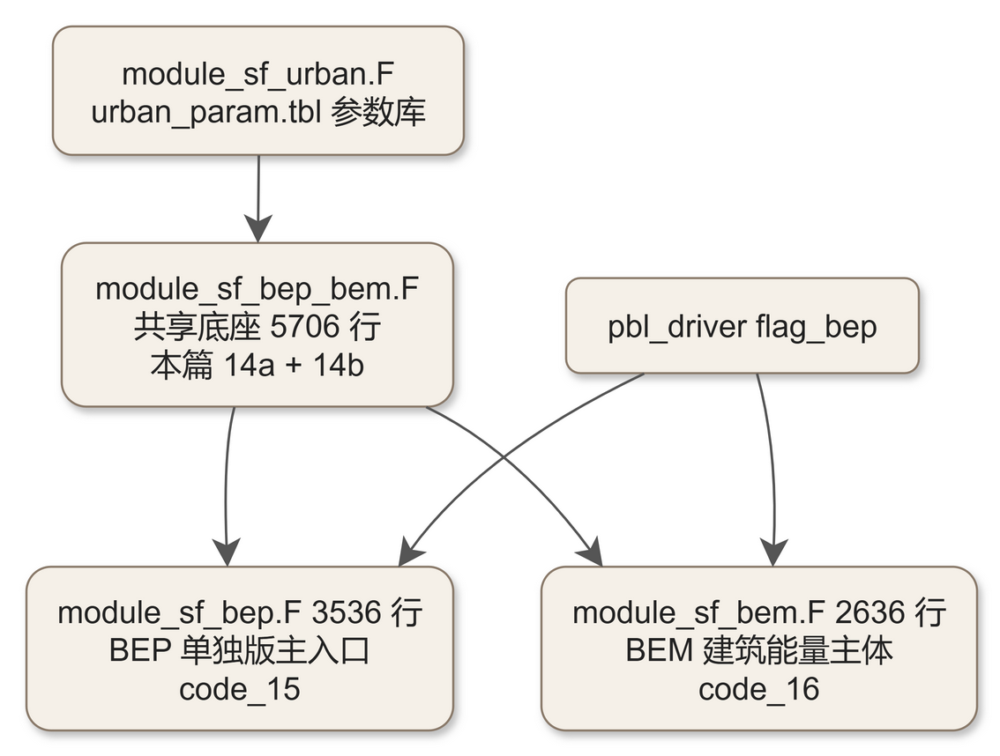
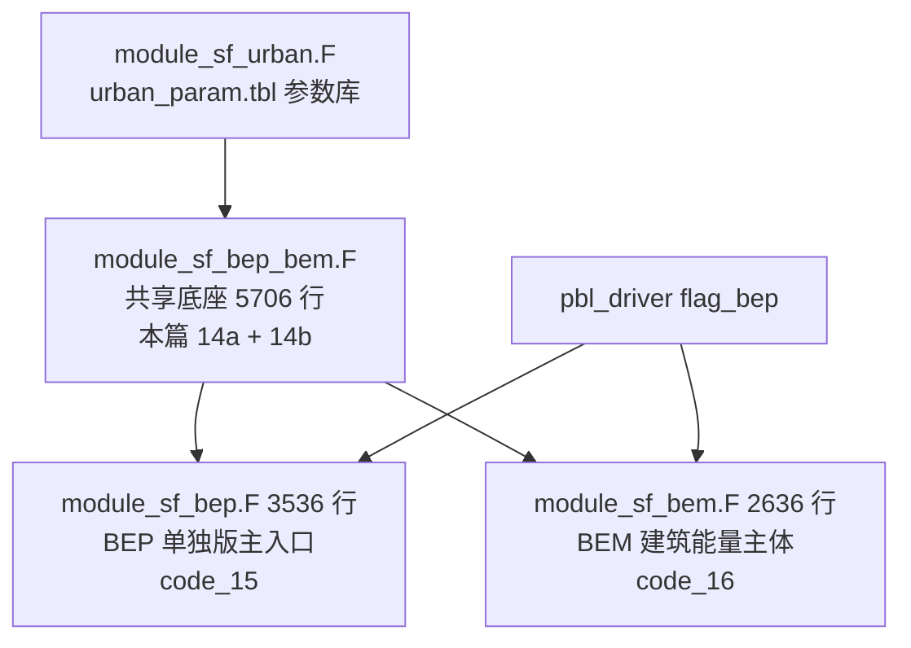

# code_14a — BEP/BEM 共享底座·上半（module_sf_bep_bem.F：主入口与柱求解器）

## 一、版本指纹

| 源文件 | 行数 | md5（整文件，按字节） |
|---|---|---|
| phys/module_sf_bep_bem.F | 5706 | 8d13861f088e806d2558dd37e31126f2 |

- 抽取工具：workspace/scripts/code_extract.py v1.2，2026-10-12；块首指纹注释自带 range_md5。
- 本篇 A 级全文拆两：14a = 文件头 + BEP_BEM（主入口）+ BEP1D（柱求解器）+ param…buildings（L1–L2891）；14b = urban_meso 起的全部辐射/导热/通量/初始化单元（L2892–L5705），见 [code_14b_module_sf_bep_bem.md](code_14b_module_sf_bep_bem.md)。

## 二、定位

一句话：BEP（城市冠层参数化，Martilli–Clappier–Rotach 2002 BLM）与 BEM（建筑能量模型，Salamanca–Martilli 2009/2010）的**共享底座模块**——双网格（模式网格 ↔ 5 m 城市网格）、概率化建筑高度分布、多方向街道峡谷辐射、以及「方案源项 A/B 分解」的完整实现；module_sf_bep.F（BEP 单独版）与 module_sf_bem.F（BEM 主体）都建立在本模块之上。

**谁在调它**：module_sf_bep.F 与 module_sf_bem.F 在其主入口内调用本模块的 param/view_factors/flux_flat 等单元；直接驱动来自 pbl_driver 的 BEP/BEM 感知路径（flag_bep，见 [code_22_module_pbl_driver.md](code_22_module_pbl_driver.md) §3.2/3.4——a_u_bep/a_t_bep 等源项数组经 diff3d 或各 PBL 方案的多城市分支进入动力倾向）。教材锚点：[ch17_urban_canopy.md](../ch17_urban_canopy.md) 全章；论文 2（BEM 标量→逐格场改造）的改造对象与先例机制都在本文件。

**三文件分工**（源码普查）：



<details><summary>原始 Mermaid 源码（可点击展开）</summary>

<!--

-->

</details>

## 三、文件头：维度常数与物理常数

<!-- code_extract code_extract.py v1.2
source: phys/module_sf_bep_bem.F
ranges: L1-L94
file_lines: 5706
file_md5: 8d13861f088e806d2558dd37e31126f2
display: line-numbered (strip L-prefix and !file: line to restore)
range_md5: 7e90011edf89716492636ecfceb85171
seg_lines: 94
-->

```fortran
!file: phys/module_sf_bep_bem.F    L1-L94
L00001  MODULE module_sf_bep_bem
L00002  #if defined(mpas)
L00003  use mpas_atmphys_utilities, only: physics_error_fatal
L00004  #define FATAL_ERROR(M) call physics_error_fatal( M )
L00005  #else
L00006  use module_wrf_error
L00007  #define FATAL_ERROR(M) call wrf_error_fatal( M )
L00008  !USE module_model_constants
L00009  #endif
L00010   USE module_sf_urban
L00011   USE module_sf_bem
L00012   USE module_bep_bem_helper, ONLY: nurbm
L00013  
L00014  ! SGClarke 09/11/2008
L00015  ! Access urban_param.tbl values through calling urban_param_init in module_physics_init
L00016  ! for CASE (BEPSCHEME) select sf_urban_physics
L00017  !
L00018  ! -----------------------------------------------------------------------
L00019  !  Dimension for the array used in the BEP module
L00020  ! -----------------------------------------------------------------------
L00021  
L00022        integer nurbmax         ! Maximum number of urban classes    
L00023        parameter (nurbmax=11)
L00024  
L00025        integer ndm             ! Maximum number of street directions 
L00026        parameter (ndm=2)
L00027  
L00028        integer nz_um           ! Maximum number of vertical levels in the urban grid
L00029        parameter(nz_um=18)
L00030  
L00031        integer ng_u            ! Number of grid levels in the ground
L00032        parameter (ng_u=10)
L00033   
L00034        integer ngr_u            ! Number of grid levels in green roof
L00035        parameter (ngr_u=10)
L00036  
L00037        integer nwr_u            ! Number of grid levels in the walls or roofs
L00038        parameter (nwr_u=10)
L00039  
L00040        integer nf_u             !Number of grid levels in the floors (BEM)
L00041        parameter (nf_u=10)
L00042  
L00043        integer ngb_u            !Number of grid levels in the ground below building (BEM)
L00044        parameter (ngb_u=10)
L00045  
L00046        real dz_u                ! Urban grid resolution
L00047        parameter (dz_u=5.)
L00048  
L00049        integer nbui_max         !maximum number of types of buildings in an urban class
L00050        parameter (nbui_max=15)   !must be less or equal than nz_um 
L00051  
L00052  
L00053        real h_water
L00054        parameter(h_water=0.0009722) !mm of irrigation per hour
L00055  
L00056  !---------------------------------------------------------------------------------
L00057  !Parameters of the windows. The glasses of windows are considered without films  -
L00058  !Read the paper of J.Karlsson and A.Roos(2000):"modelling the angular behaviour  -
L00059  !of the total solar energy transmittance of windows".Solar Energy Vol.69,No.4,   -
L00060  !pp. 321-329, for more details.                                                  -
L00061  !---------------------------------------------------------------------------------
L00062        integer p_num            !number of panes in the windows (1,2 or 3)
L00063        parameter (p_num=2)
L00064        integer q_num            !category number for the windows (q_num= 4, standard glasses)
L00065        parameter(q_num=4)       !Possible values 1,2,...,10
L00066  
L00067  ! The change of ng_u, nwr_u should be done in agreement with the block data
L00068  !  in the routine "surf_temp" 
L00069  ! -----------------------------------------------------------------------
L00070  !  Constant used in the BEP module
L00071  ! -----------------------------------------------------------------------
L00072             
L00073        real vk                 ! von Karman constant
L00074        real g_u                ! Gravity acceleration
L00075        real pi                 !
L00076        real r                  ! Perfect gas constant
L00077        real cp_u               ! Specific heat at constant pressure
L00078        real rcp_u              !
L00079        real sigma              !
L00080        real p0                 ! Reference pressure at the sea level
L00081        real latent             ! Latent heat of vaporization [J/kg] (used in BEM)
L00082        real dgmax              ! Maximum ground water holding capacity (mm)
L00083        real drmax              ! Maximum ground roof holding capacity (mm)
L00084  
L00085        parameter(vk=0.40,g_u=9.81,pi=3.141592653,r=287.,cp_u=1004.)        
L00086        parameter(rcp_u=r/cp_u,sigma=5.67e-08,p0=1.e+5,latent=2.45e+06,dgmax=1.,drmax=1.)
L00087  
L00088  ! -----------------------------------------------------------------------     
L00089  
L00090  
L00091  
L00092  
L00093     CONTAINS
L00094   
```

> 讲解：①本模块**不用** module_model_constants——自带 vk/g_u/cp_u=1004/sigma/p0/latent=2.45e6 一套常数（MPAS/WRF 双框架编译，头两行宏切换错误出口）；②城市网格维度全在此定死：nurbmax=11 城市类、ndm=2 街道方向、nz_um=18 城市层、dz_u=5 m（城市网格顶 85 m）、ng_u/ngr_u/nwr_u/nf_u/ngb_u=10（地面/绿屋顶/墙或屋顶/楼板/楼下地基各 10 层）、nbui_max=15 每类最多建筑型；③nurbm（实际城市类数）不在本文件——来自 module_bep_bem_helper，是「编译上限 vs 运行时类数」的解耦；④窗口参数 p_num=2 层玻璃、q_num=4 标准类别，对应 Karlsson–Roos 2000 角向透射模型（albwindow 用，14b）；⑤dgmax/drmax=1 mm 是路面/屋顶积水容量；⑥h_water=0.0009722 mm/h 灌溉率（绿屋顶灌溉调度用，BEP1D）。

## 四、主入口 BEP_BEM（全文）

<!-- code_extract code_extract.py v1.2
source: phys/module_sf_bep_bem.F
ranges: L95-L1162
file_lines: 5706
file_md5: 8d13861f088e806d2558dd37e31126f2
display: line-numbered (strip L-prefix and !file: line to restore)
range_md5: bcd6e8ccfa8bc841f17e422326b6b849
seg_lines: 1068
label: subroutine BEP_BEM
-->

```fortran
!file: phys/module_sf_bep_bem.F    L95-L1162    (subroutine BEP_BEM)
L00095        subroutine BEP_BEM(FRC_URB2D,UTYPE_URB2D,itimestep,dz8w,dt,u_phy,v_phy,      &
L00096                        th_phy,rho,p_phy,swdown,glw,                    &
L00097                        gmt,julday,xlong,xlat,                                       &
L00098                        declin_urb,cosz_urb2d,omg_urb2d,                             &
L00099                        num_urban_ndm,  urban_map_zrd,  urban_map_zwd, urban_map_gd, &
L00100                        urban_map_zd,  urban_map_zdf,   urban_map_bd, urban_map_wd,  &
L00101                        urban_map_gbd,  urban_map_fbd,                               &
L00102                        urban_map_zgrd,  num_urban_hi,                               &
L00103                        trb_urb4d,tw1_urb4d,tw2_urb4d,tgb_urb4d,                     &
L00104                        tlev_urb3d,qlev_urb3d,tw1lev_urb3d,tw2lev_urb3d,             &
L00105                        tglev_urb3d,tflev_urb3d,sf_ac_urb3d,lf_ac_urb3d,             &        
L00106                        cm_ac_urb3d,                                                 & 
L00107                        sfvent_urb3d,lfvent_urb3d,                                   &
L00108                        sfwin1_urb3d,sfwin2_urb3d,                                   &
L00109                        sfw1_urb3d,sfw2_urb3d,sfr_urb3d,sfg_urb3d,                   &
L00110  		      ep_pv_urb3d,t_pv_urb3d,                                      &
L00111  		      trv_urb4d,qr_urb4d,qgr_urb3d,tgr_urb3d,                      &
L00112                        drain_urb4d,draingr_urb3d,                                   &
L00113  		      sfrv_urb3d,lfrv_urb3d,                                       &
L00114                        dgr_urb3d,dg_urb3d,                                          &
L00115                        lfr_urb3d,lfg_urb3d,rainbl,swddir,swddif,                    &
L00116                        lp_urb2d,hi_urb2d,lb_urb2d,hgt_urb2d,                        &
L00117                        a_u,a_v,a_t,a_e,b_u,b_v,                                     &
L00118                        b_t,b_e,b_q,dlg,dl_u,sf,vl,                                  &
L00119                        rl_up,rs_abs,emiss,grdflx_urb,qv_phy,                        &
L00120                        ids,ide, jds,jde, kds,kde,                                   &
L00121                        ims,ime, jms,jme, kms,kme,                                   &
L00122                        its,ite, jts,jte, kts,kte)                    
L00123  
L00124        implicit none
L00125  
L00126  !------------------------------------------------------------------------
L00127  !     Input
L00128  !------------------------------------------------------------------------
L00129     INTEGER ::                       ids,ide, jds,jde, kds,kde,  &
L00130                                      ims,ime, jms,jme, kms,kme,  &
L00131                                      its,ite, jts,jte, kts,kte,  &
L00132                                      itimestep
L00133   
L00134  
L00135     REAL, DIMENSION( ims:ime, kms:kme, jms:jme )::   DZ8W
L00136     REAL, DIMENSION( ims:ime, kms:kme, jms:jme )::   P_PHY
L00137     REAL, DIMENSION( ims:ime, kms:kme, jms:jme )::   RHO
L00138     REAL, DIMENSION( ims:ime, kms:kme, jms:jme )::   TH_PHY
L00139     REAL, DIMENSION( ims:ime, kms:kme, jms:jme )::   T_PHY
L00140     REAL, DIMENSION( ims:ime, kms:kme, jms:jme )::   U_PHY
L00141     REAL, DIMENSION( ims:ime, kms:kme, jms:jme )::   V_PHY
L00142     REAL, DIMENSION( ims:ime, kms:kme, jms:jme )::   U
L00143     REAL, DIMENSION( ims:ime, kms:kme, jms:jme )::   V
L00144     REAL, DIMENSION( ims:ime , jms:jme )        ::   GLW
L00145     REAL, DIMENSION( ims:ime , jms:jme )        ::   swdown
L00146     REAL, DIMENSION( ims:ime , jms:jme )        ::   swddir
L00147     REAL, DIMENSION( ims:ime , jms:jme )        ::   swddif
L00148      REAL, DIMENSION( ims:ime, jms:jme )         ::   UST
L00149     INTEGER, DIMENSION( ims:ime , jms:jme ), INTENT(IN )::   UTYPE_URB2D
L00150     REAL, DIMENSION( ims:ime , jms:jme ), INTENT(IN )::   FRC_URB2D
L00151     REAL, INTENT(IN  )   ::                                   GMT 
L00152     INTEGER, INTENT(IN  ) ::                               JULDAY
L00153     REAL, DIMENSION( ims:ime, jms:jme ),                           &
L00154           INTENT(IN   )  ::                           XLAT, XLONG
L00155     REAL, INTENT(IN) :: DECLIN_URB
L00156     REAL, DIMENSION( ims:ime, jms:jme ), INTENT(IN) :: COSZ_URB2D
L00157     REAL, DIMENSION( ims:ime, jms:jme ), INTENT(IN) :: OMG_URB2D
L00158     INTEGER, INTENT(IN  ) :: urban_map_zrd
L00159     INTEGER, INTENT(IN  ) :: urban_map_zwd
L00160     INTEGER, INTENT(IN  ) :: urban_map_gd
L00161     INTEGER, INTENT(IN  ) :: urban_map_zd
L00162     INTEGER, INTENT(IN  ) :: urban_map_zdf
L00163     INTEGER, INTENT(IN  ) :: urban_map_bd
L00164     INTEGER, INTENT(IN  ) :: urban_map_wd
L00165     INTEGER, INTENT(IN  ) :: urban_map_gbd
L00166     INTEGER, INTENT(IN  ) :: urban_map_fbd
L00167     INTEGER, INTENT(IN  ) :: num_urban_ndm
L00168     INTEGER, INTENT(IN) :: num_urban_hi
L00169     INTEGER , INTENT(IN)        ::     urban_map_zgrd
L00170     REAL, DIMENSION( ims:ime, 1:urban_map_zrd, jms:jme ), INTENT(INOUT) :: trb_urb4d
L00171     REAL, DIMENSION( ims:ime, 1:urban_map_zwd, jms:jme ), INTENT(INOUT) :: tw1_urb4d
L00172     REAL, DIMENSION( ims:ime, 1:urban_map_zwd, jms:jme ), INTENT(INOUT) :: tw2_urb4d
L00173     REAL, DIMENSION( ims:ime, 1:urban_map_gd , jms:jme ), INTENT(INOUT) :: tgb_urb4d
L00174     REAL, DIMENSION( ims:ime, 1:urban_map_zgrd, jms:jme ), INTENT(INOUT) :: trv_urb4d
L00175     REAL, DIMENSION( ims:ime, 1:urban_map_zgrd, jms:jme ), INTENT(INOUT) :: qr_urb4d
L00176     REAL, DIMENSION( ims:ime, jms:jme ), INTENT(INOUT) :: qgr_urb3d
L00177     REAL, DIMENSION( ims:ime, jms:jme ), INTENT(INOUT) :: tgr_urb3d
L00178     REAL, DIMENSION( ims:ime, 1:urban_map_zdf, jms:jme ), INTENT(INOUT) :: drain_urb4d
L00179     REAL, DIMENSION( ims:ime, jms:jme ), INTENT(IN) :: rainbl
L00180     REAL, DIMENSION( ims:ime, jms:jme ), INTENT(INOUT) :: draingr_urb3d
L00181  !New variables used for BEM
L00182     REAL, DIMENSION( ims:ime, kms:kme, jms:jme ):: qv_phy
L00183     REAL, DIMENSION( ims:ime, 1:urban_map_bd, jms:jme ), INTENT(INOUT) :: tlev_urb3d
L00184     REAL, DIMENSION( ims:ime, 1:urban_map_bd , jms:jme ), INTENT(INOUT) :: qlev_urb3d
L00185     REAL, DIMENSION( ims:ime, 1:urban_map_wd , jms:jme ), INTENT(INOUT) :: tw1lev_urb3d
L00186     REAL, DIMENSION( ims:ime, 1:urban_map_wd , jms:jme ), INTENT(INOUT) :: tw2lev_urb3d
L00187     REAL, DIMENSION( ims:ime, 1:urban_map_gbd, jms:jme ), INTENT(INOUT) :: tglev_urb3d
L00188     REAL, DIMENSION( ims:ime, 1:urban_map_fbd, jms:jme ), INTENT(INOUT) :: tflev_urb3d
L00189     REAL, DIMENSION( ims:ime, jms:jme ), INTENT(INOUT) :: lf_ac_urb3d
L00190     REAL, DIMENSION( ims:ime, jms:jme ), INTENT(INOUT) :: sf_ac_urb3d
L00191     REAL, DIMENSION( ims:ime, jms:jme ), INTENT(INOUT) :: cm_ac_urb3d
L00192     REAL, DIMENSION( ims:ime, jms:jme ), INTENT(INOUT) :: ep_pv_urb3d
L00193     REAL, DIMENSION( ims:ime, 1:urban_map_zdf, jms:jme ), INTENT(INOUT) :: t_pv_urb3d
L00194     REAL, DIMENSION( ims:ime, jms:jme ), INTENT(INOUT) :: sfvent_urb3d
L00195     REAL, DIMENSION( ims:ime, jms:jme ), INTENT(INOUT) :: lfvent_urb3d
L00196     REAL, DIMENSION( ims:ime, 1:urban_map_wd , jms:jme ), INTENT(INOUT) :: sfwin1_urb3d
L00197     REAL, DIMENSION( ims:ime, 1:urban_map_wd , jms:jme ), INTENT(INOUT) :: sfwin2_urb3d
L00198  
L00199  !End variables
L00200     REAL, DIMENSION( ims:ime, 1:urban_map_zd , jms:jme ), INTENT(INOUT) :: sfw1_urb3d
L00201     REAL, DIMENSION( ims:ime, 1:urban_map_zd , jms:jme ), INTENT(INOUT) :: sfw2_urb3d
L00202     REAL, DIMENSION( ims:ime, 1:urban_map_zdf, jms:jme ), INTENT(INOUT) :: sfr_urb3d
L00203     REAL, DIMENSION( ims:ime, 1:num_urban_ndm, jms:jme ), INTENT(INOUT) :: sfg_urb3d
L00204     REAL, DIMENSION( ims:ime, 1:urban_map_zdf, jms:jme ), INTENT(INOUT) :: sfrv_urb3d
L00205     REAL, DIMENSION( ims:ime, 1:urban_map_zdf, jms:jme ), INTENT(INOUT) :: lfrv_urb3d
L00206     REAL, OPTIONAL, DIMENSION( ims:ime, 1:urban_map_zdf, jms:jme ),INTENT(INOUT) :: dgr_urb3d !GRZ
L00207     REAL, OPTIONAL, DIMENSION( ims:ime, 1:num_urban_ndm, jms:jme ),INTENT(INOUT) :: dg_urb3d !GRZ
L00208     REAL, OPTIONAL, DIMENSION( ims:ime, 1:urban_map_zdf, jms:jme ),INTENT(INOUT) :: lfr_urb3d !GRZ
L00209     REAL, OPTIONAL, DIMENSION( ims:ime, 1:num_urban_ndm, jms:jme ),INTENT(INOUT) :: lfg_urb3d !G
L00210  
L00211     REAL, DIMENSION( ims:ime, 1:num_urban_hi, jms:jme ), INTENT(IN) :: hi_urb2d
L00212     REAL, DIMENSION( ims:ime,jms:jme), INTENT(IN) :: lp_urb2d
L00213     REAL, DIMENSION( ims:ime,jms:jme), INTENT(IN) :: lb_urb2d
L00214     REAL, DIMENSION( ims:ime,jms:jme), INTENT(IN) :: hgt_urb2d
L00215  
L00216     real z(ims:ime,kms:kme,jms:jme)            ! Vertical coordinates
L00217     REAL, INTENT(IN )::   DT      ! Time step
L00218  
L00219  !------------------------------------------------------------------------
L00220  !     Output
L00221  !------------------------------------------------------------------------ 
L00222  !
L00223  !    Implicit and explicit components of the source and sink terms at each levels,
L00224  !     the fluxes can be computed as follow: FX = A*X + B   example: t_fluxes = a_t * pt + b_t
L00225        real a_u(ims:ime,kms:kme,jms:jme)         ! Implicit component for the momemtum in X-direction (center)
L00226        real a_v(ims:ime,kms:kme,jms:jme)         ! Implicit component for the momemtum in Y-direction (center)
L00227        real a_t(ims:ime,kms:kme,jms:jme)         ! Implicit component for the temperature
L00228        real a_e(ims:ime,kms:kme,jms:jme)         ! Implicit component for the TKE
L00229        real b_u(ims:ime,kms:kme,jms:jme)         ! Explicit component for the momemtum in X-direction (center)
L00230        real b_v(ims:ime,kms:kme,jms:jme)         ! Explicit component for the momemtum in Y-direction (center)
L00231        real b_t(ims:ime,kms:kme,jms:jme)         ! Explicit component for the temperature
L00232        real b_e(ims:ime,kms:kme,jms:jme)         ! Explicit component for the TKE
L00233        real b_q(ims:ime,kms:kme,jms:jme)         ! Explicit component for the Humidity
L00234        real dlg(ims:ime,kms:kme,jms:jme)         ! Height above ground (L_ground in formula (24) of the BLM paper). 
L00235        real dl_u(ims:ime,kms:kme,jms:jme)        ! Length scale (lb in formula (22) ofthe BLM paper).
L00236  ! urban surface and volumes        
L00237        real sf(ims:ime,kms:kme,jms:jme)           ! surface of the urban grid cells
L00238        real vl(ims:ime,kms:kme,jms:jme)             ! volume of the urban grid cells
L00239  ! urban fluxes
L00240        real rl_up(its:ite,jts:jte) ! upward long wave radiation
L00241        real rs_abs(its:ite,jts:jte) ! absorbed short wave radiation
L00242        real emiss(its:ite,jts:jte)  ! emissivity averaged for urban surfaces
L00243        real grdflx_urb(its:ite,jts:jte)  ! ground heat flux for urban areas
L00244  !------------------------------------------------------------------------
L00245  !     Local
L00246  !------------------------------------------------------------------------
L00247        real hi_urb(its:ite,1:nz_um,jts:jte) ! Height histograms of buildings
L00248        real hi_urb1D(nz_um)                 ! Height histograms of buildings
L00249        real ss_urb(nz_um,nurbmax)           ! Probability that a building has an height equal to z
L00250        real pb_urb(nz_um)                   ! Probability that a building has an height greater or equal to z
L00251        real hb_u(nz_um)                     ! Bulding's heights
L00252        integer nz_urb(nurbmax)              ! Number of layer in the urban grid
L00253        integer nzurban(nurbmax)
L00254  
L00255  !    Building parameters      
L00256        real alag_u(nurbmax)                    ! Ground thermal diffusivity [m^2 s^-1]
L00257        real alaw_u(nurbmax)                    ! Wall thermal diffusivity [m^2 s^-1]
L00258        real alar_u(nurbmax)                    ! Roof thermal diffusivity [m^2 s^-1]
L00259        real csg_u(nurbmax)                     ! Specific heat of the ground material [J m^3 K^-1]
L00260        real csw_u(nurbmax)                     ! Specific heat of the wall material [J m^3 K^-1]
L00261        real csr_u(nurbmax)                     ! Specific heat of the roof material [J m^3 K^-1]
L00262        real twini_u(nurbmax)                   ! Initial temperature inside the building's wall [K]
L00263        real trini_u(nurbmax)                   ! Initial temperature inside the building's roof [K]
L00264        real tgini_u(nurbmax)                   ! Initial road temperature
L00265  
L00266  !
L00267  !   Building materials
L00268  !
L00269  
L00270        real csg(ng_u)           ! Specific heat of the ground material [J m^3 K^-1]
L00271        real csw(nwr_u)          ! Specific heat of the wall material for the current urban class [J m^3 K^-1]
L00272        real csr(nwr_u)          ! Specific heat of the roof material for the current urban class [J m^3 K^-1]
L00273        real csgb(ngb_u)         ! Specific heat of the ground material below the buildings at each ground levels[J m^3 K^-1]
L00274        real csf(nf_u)           ! Specific heat of the floors materials in the buildings at each levels[J m^3 K^-1]
L00275        real alar(nwr_u+1)       ! Roof thermal diffusivity for the current urban class [W/m K]
L00276        real alaw(nwr_u+1)       ! Walls thermal diffusivity for the current urban class [W/m K]
L00277        real alag(ng_u)          ! Ground thermal diffusivity for the current urban class [m^2 s^-1] 
L00278        real alagb(ngb_u+1)      ! Ground thermal diffusivity below the building at each wall layer [W/m K]
L00279        real alaf(nf_u+1)        ! Floor thermal diffusivity at each wall layers [W/m K]  
L00280        real dzr(nwr_u)          ! Layer sizes in the roofs [m]
L00281        real dzf(nf_u)           ! Layer sizes in the floors[m]
L00282        real dzw(nwr_u)          ! Layer sizes in the walls [m]
L00283        real dzgb(ngb_u)         ! Layer sizes in the ground below the buildings [m]
L00284  
L00285  !
L00286  !New street and radiation parameters
L00287  
L00288  
L00289        real bs(ndm)              ! Building width for the current urban class
L00290        real ws(ndm)              ! Street widths of the current urban class
L00291        real strd(ndm)            ! Street lengths for the current urban class
L00292        real drst(ndm)            ! street directions for the current urban class
L00293        real ss(nz_um)            ! Probability to have a building with height h
L00294        real pb(nz_um)            ! Probability to have a building with an height equal
L00295        real HFGR_D(nz_um)
L00296  !New roughness and buildings parameters
L00297  !
L00298        real z0(ndm,nz_um)        ! Roughness lengths "profiles"
L00299        real bs_urb(ndm,nurbmax)  ! Building width
L00300        real ws_urb(ndm,nurbmax)  ! Street width
L00301  
L00302  !
L00303  ! for twini_u, and trini_u the initial value at the deepest level is kept constant during the simulation
L00304  !
L00305  !    Radiation paramters
L00306        real albg_u(nurbmax)                    ! Albedo of the ground
L00307        real albw_u(nurbmax)                    ! Albedo of the wall
L00308        real albr_u(nurbmax)                    ! Albedo of the roof
L00309        real albwin_u(nurbmax)                  ! Albedo of the windows
L00310        real emwind_u(nurbmax)                  ! Emissivity of windows
L00311        real emg_u(nurbmax)                     ! Emissivity of ground
L00312        real emw_u(nurbmax)                     ! Emissivity of wall
L00313        real emr_u(nurbmax)                     ! Emissivity of roof
L00314        real gr_frac_roof_u(nurbmax)
L00315        real pv_frac_roof_u(nurbmax)
L00316        integer gr_flag_u
L00317        integer gr_type_u
L00318  
L00319  !   fww_u,fwg_u,fgw_u,fsw_u,fsg_u are the view factors used to compute the long wave
L00320  !   and the short wave radiation. 
L00321        real fww_u(nz_um,nz_um,ndm,nurbmax)       !  from wall to wall
L00322        real fwg_u(nz_um,ndm,nurbmax)             !  from wall to ground
L00323        real fgw_u(nz_um,ndm,nurbmax)             !  from ground to wall
L00324        real fsw_u(nz_um,ndm,nurbmax)             !  from sky to wall
L00325        real fws_u(nz_um,ndm,nurbmax)             !  from sky to wall
L00326        real fsg_u(ndm,nurbmax)                   !  from sky to ground
L00327  
L00328  !    Roughness parameters
L00329        real z0g_u(nurbmax)       ! The ground's roughness length
L00330        real z0r_u(nurbmax)       ! The roof's roughness length
L00331  
L00332  !    Street parameters
L00333        integer nd_u(nurbmax)     ! Number of street direction for each urban class 
L00334        real strd_u(ndm,nurbmax)  ! Street length (fix to greater value to the horizontal length of the cells)
L00335        real drst_u(ndm,nurbmax)  ! Street direction
L00336        real ws_u(ndm,nurbmax)    ! Street width
L00337        real bs_u(ndm,nurbmax)    ! Building width
L00338        real h_b(nz_um,nurbmax)   ! Bulding's heights
L00339        real d_b(nz_um,nurbmax)   ! Probability that a building has an height h_b
L00340        real ss_u(nz_um,nurbmax)! Probability that a building has an height equal to z
L00341        real pb_u(nz_um,nurbmax)! Probability that a building has an height greater or equal to z
L00342  
L00343  
L00344  !    Grid parameters
L00345        integer nz_u(nurbmax)     ! Number of layer in the urban grid
L00346        
L00347        real z_u(nz_um)         ! Height of the urban grid levels
L00348  !FS
L00349        real cop_u(nurbmax)
L00350        real bldac_frc_u(nurbmax)
L00351        real cooled_frc_u(nurbmax)
L00352        real pwin_u(nurbmax)
L00353        real beta_u(nurbmax)
L00354        integer sw_cond_u(nurbmax)
L00355        real time_on_u(nurbmax)
L00356        real time_off_u(nurbmax)
L00357        real targtemp_u(nurbmax)
L00358        real gaptemp_u(nurbmax)
L00359        real targhum_u(nurbmax)
L00360        real gaphum_u(nurbmax)
L00361        real perflo_u(nurbmax)
L00362        real hsesf_u(nurbmax)
L00363        real hsequip(24)
L00364        real irho(24)
L00365  ! 1D array used for the input and output of the routine "urban"
L00366  
L00367        real z1D(kms:kme)               ! vertical coordinates
L00368        real ua1D(kms:kme)                ! wind speed in the x directions
L00369        real va1D(kms:kme)                ! wind speed in the y directions
L00370        real pt1D(kms:kme)                ! potential temperature
L00371        real da1D(kms:kme)                ! air density
L00372        real pr1D(kms:kme)                ! air pressure
L00373        real pt01D(kms:kme)               ! reference potential temperature
L00374        real zr1D                    ! zenith angle
L00375        real deltar1D                ! declination of the sun
L00376        real ah1D                    ! hour angle (it should come from the radiation routine)
L00377        real rs1D                    ! solar radiation
L00378        real rld1D                   ! downward flux of the longwave radiation
L00379        real swddir1D
L00380        real swddif1D                ! short wave diffuse solar radiation _gl
L00381  
L00382  
L00383  
L00384        real tw1D(2*ndm,nz_um,nwr_u,nbui_max) ! temperature in each layer of the wall
L00385        real tg1D(ndm,ng_u)                   ! temperature in each layer of the ground
L00386        real tr1D(ndm,nz_um,nwr_u)   ! temperature in each layer of the roof
L00387        real trv1D(ndm,nz_um,ngr_u)   ! temperature in each layer of the GREEN roof
L00388        real qr1D(ndm,nz_um,ngr_u)   ! humidity in each layer of the GREEN roof
L00389  
L00390  !
L00391  !New variable for BEM
L00392  !
L00393        real tlev1D(nz_um,nbui_max)            ! temperature in each floor and in each different type of building
L00394        real qlev1D(nz_um,nbui_max)            ! specific humidity in each floor and in each different type of building
L00395        real twlev1D(2*ndm,nz_um,nbui_max)     ! temperature in each window in each floor in each different type of building
L00396        real tglev1D(ndm,ngb_u,nbui_max)       ! temperature in each layer of the ground below of a type of building
L00397        real tflev1D(ndm,nf_u,nz_um-1,nbui_max)! temperature in each layer of the floors in each building
L00398        real lflev1D(nz_um,nz_um)           ! latent heat flux due to the air conditioning systems
L00399        real sflev1D(nz_um,nz_um)           ! sensible heat flux due to the air conditioning systems
L00400        real lfvlev1D(nz_um,nz_um)          ! latent heat flux due to ventilation
L00401        real sfvlev1D(nz_um,nz_um)          ! sensible heat flux due to ventilation
L00402        real sfwin1D(2*ndm,nz_um,nbui_max)     ! sensible heat flux from windows
L00403        real consumlev1D(nz_um,nz_um)       ! consumption due to the air conditioning systems
L00404        real eppvlev1D(nz_um)               ! electricity production of PV panels 
L00405        real tair1D(nz_um)
L00406        real tpvlev1D(ndm,nz_um)
L00407        real qv1D(kms:kme)                  ! specific humidity
L00408        real meso_urb                       ! constant to link meso and urban scales [m-2]
L00409        real meso_urb_ac
L00410        real roof_frac                       ! Surface fraction occupied by roof 
L00411        real d_urb(nz_um)    
L00412        real sf_ac
L00413        integer ibui,nbui
L00414        integer nlev(nz_um)
L00415   
L00416  !
L00417  !End new variables
L00418  !
L00419  
L00420        real sfw1D(2*ndm,nz_um,nbui_max)      ! sensible heat flux from walls
L00421        real sfg1D(ndm)              ! sensible heat flux from ground (road)
L00422        real sfr1D(ndm,nz_um)      ! sensible heat flux from roofs
L00423        real sfrpv1D(ndm,nz_um)
L00424  
L00425        real tpv1D(nbui_max)
L00426        real sfr_indoor1D(nbui_max) 
L00427        real sfrv1D(ndm,nz_um)      ! sensible heat flux from roofs
L00428        real lfrv1D(ndm,nz_um)      ! latent heat flux from roofs
L00429        real dg1D(ndm)              ! water depth from ground
L00430        real dgr1D(ndm,nz_um)      ! water depth from roofs
L00431        real lfg1D(ndm)              ! latent heat flux from ground (road)
L00432        real lfr1D(ndm,nz_um)      ! latent heat flux from roofs
L00433        real drain1D(ndm,nz_um)      ! sensible heat flux from roofs
L00434        real sf1D(kms:kme)              ! surface of the urban grid cells
L00435        real vl1D(kms:kme)                ! volume of the urban grid cells
L00436        real a_u1D(kms:kme)               ! Implicit component of the momentum sources or sinks in the X-direction
L00437        real a_v1D(kms:kme)               ! Implicit component of the momentum sources or sinks in the Y-direction
L00438        real a_t1D(kms:kme)               ! Implicit component of the heat sources or sinks
L00439        real a_e1D(kms:kme)               ! Implicit component of the TKE sources or sinks
L00440        real b_u1D(kms:kme)               ! Explicit component of the momentum sources or sinks in the X-direction
L00441        real b_v1D(kms:kme)               ! Explicit component of the momentum sources or sinks in the Y-direction
L00442        real b_t1D(kms:kme)               ! Explicit component of the heat sources or sinks
L00443        real b_ac1D(kms:kme)
L00444        real b_e1D(kms:kme)               ! Explicit component of the TKE sources or sinks
L00445        real b_q1D(kms:kme)               ! Explicit component of the Humidity sources or sinks
L00446        real dlg1D(kms:kme)               ! Height above ground (L_ground in formula (24) of the BLM paper). 
L00447        real dl_u1D(kms:kme)              ! Length scale (lb in formula (22) ofthe BLM paper)
L00448        real gfr1D(ndm,nz_um)
L00449        real time_bep
L00450  ! arrays used to collapse indexes
L00451        integer ind_zwd(nbui_max,nz_um,nwr_u,ndm)
L00452        integer ind_gd(ng_u,ndm)
L00453        integer ind_zd(nbui_max,nz_um,ndm)
L00454        integer ind_zdf(nz_um,ndm)
L00455        integer ind_zrd(nz_um,nwr_u,ndm)
L00456        integer ind_grd(nz_um,ngr_u,ndm)
L00457  !
L00458        integer ind_bd(nbui_max,nz_um)
L00459        integer ind_wd(nbui_max,nz_um,ndm)
L00460        integer ind_gbd(nbui_max,ngb_u,ndm)  
L00461        integer ind_fbd(nbui_max,nf_u,nz_um-1,ndm)
L00462  
L00463        integer ix,iy,iz,iurb,id,iz_u,iw,ig,ir,ix1,iy1,k
L00464        integer it, nint
L00465        integer iii
L00466        logical first
L00467        character(len=80) :: text
L00468        data first/.true./
L00469        save first,time_bep
L00470         
L00471        save alag_u,alaw_u,alar_u,csg_u,csw_u,csr_u,                       &
L00472             albg_u,albw_u,albr_u,emg_u,emw_u,emr_u,                       &
L00473             z0g_u,z0r_u, nd_u,strd_u,drst_u,ws_u,bs_u,h_b,d_b,ss_u,pb_u,  &
L00474             nz_u,z_u,albwin_u,emwind_u,cop_u,pwin_u,beta_u,sw_cond_u,     &
L00475             bldac_frc_u,cooled_frc_u,                                     &
L00476             time_on_u,time_off_u,targtemp_u,gaptemp_u,targhum_u,gaphum_u, &
L00477             perflo_u,gr_frac_roof_u,                    &
L00478             pv_frac_roof_u,hsesf_u,hsequip,irho,gr_flag_u,gr_type_u
L00479  
L00480  !------------------------------------------------------------------------
L00481  !    Calculation of the momentum, heat and turbulent kinetic fluxes
L00482  !     produced by buildings
L00483  !
L00484  ! References:
L00485  ! Martilli, A., Clappier, A., Rotach, M.W.:2002, 'AN URBAN SURFACE EXCHANGE
L00486  ! PARAMETERISATION FOR MESOSCALE MODELS', Boundary-Layer Meteorolgy 104:
L00487  ! 261-304
L00488  !
L00489  ! F. Salamanca and A. Martilli, 2009: 'A new Building Energy Model coupled 
L00490  ! with an Urban Canopy Parameterization for urban climate simulations - part II. 
L00491  ! Validation with one dimension off-line simulations'. Theor Appl Climatol
L00492  ! DOI 10.1007/s00704-009-0143-8 
L00493  !------------------------------------------------------------------------
L00494  !
L00495  !prepare the arrays to collapse indexes
L00496  
L00497  
L00498  !
L00499       if(urban_map_zwd.lt.nbui_max*nz_um*ndm*max(nwr_u,ng_u))then
L00500          write(*,*)'urban_map_zwd too small, please increase to at least ', nbui_max*nz_um*ndm*max(nwr_u,ng_u)
L00501          stop
L00502        endif
L00503  !
L00504  !New conditions for BEM
L00505  !
L00506        if(urban_map_bd.lt.nbui_max*nz_um)then !limit for indoor temperature and indoor humidity
L00507          write(*,*)'urban_map_bd too small, please increase to at least ', nbui_max*nz_um
L00508          stop
L00509        endif
L00510  
L00511        if(urban_map_wd.lt.nbui_max*nz_um*ndm)then !limit for window temperature
L00512          write(*,*)'urban_map_wd too small, please increase to at least ', nbui_max*nz_um*ndm
L00513          stop
L00514        endif
L00515  
L00516        if(urban_map_gbd.lt.nbui_max*ndm*ngb_u)then !limit for ground temperature below a building
L00517          write(*,*)'urban_map_gbd too small, please increase to at least ', nbui_max*ndm*ngb_u
L00518          stop
L00519        endif
L00520  
L00521        if(urban_map_fbd.lt.(nz_um-1)*nbui_max*ndm*nf_u)then !limit for floor temperature
L00522          write(*,*)'urban_map_fbd too small, please increase to at least ', nbui_max*ndm*nf_u*(nz_um-1)
L00523          stop
L00524        endif
L00525  
L00526        if (ndm.ne.2)then
L00527           write(*,*) 'number of directions is not correct',ndm
L00528           stop
L00529        endif
L00530  
L00531  !End of new conditions
L00532  !
L00533  !
L00534  !Initialize collapse indexes
L00535  !
L00536        ind_zwd=0       
L00537        ind_gd=0
L00538        ind_zd=0
L00539        ind_zdf=0
L00540        ind_zrd=0
L00541        ind_grd=0
L00542        ind_bd=0
L00543        ind_wd=0
L00544        ind_gbd=0
L00545        ind_fbd=0
L00546  !
L00547  !End initialization indexes
L00548  !
L00549  
L00550        iii=0
L00551        do ibui=1,nbui_max
L00552        do iz_u=1,nz_um
L00553        do iw=1,nwr_u
L00554        do id=1,ndm
L00555         iii=iii+1
L00556         ind_zwd(ibui,iz_u,iw,id)=iii
L00557        enddo
L00558        enddo
L00559        enddo
L00560        enddo
L00561  
L00562        iii=0
L00563        do ig=1,ng_u
L00564        do id=1,ndm
L00565         iii=iii+1
L00566         ind_gd(ig,id)=iii
L00567        enddo
L00568        enddo
L00569  
L00570        iii=0
L00571        do ibui=1,nbui_max
L00572        do iz_u=1,nz_um
L00573        do id=1,ndm
L00574         iii=iii+1
L00575         ind_zd(ibui,iz_u,id)=iii
L00576        enddo
L00577        enddo
L00578        enddo
L00579    
L00580        iii=0
L00581        do iz_u=1,nz_um
L00582        do iw=1,nwr_u
L00583        do id=1,ndm
L00584         iii=iii+1
L00585         ind_zrd(iz_u,iw,id)=iii
L00586        enddo
L00587        enddo
L00588        enddo
L00589  
L00590       iii=0
L00591        do iz_u=1,nz_um
L00592        do iw=1,ngr_u
L00593        do id=1,ndm
L00594         iii=iii+1
L00595         ind_grd(iz_u,iw,id)=iii
L00596        enddo
L00597        enddo
L00598        enddo
L00599       
L00600  !
L00601  !New indexes for BEM
L00602        
L00603        iii=0
L00604        do iz_u=1,nz_um
L00605        do id=1,ndm
L00606           iii=iii+1
L00607           ind_zdf(iz_u,id)=iii
L00608        enddo ! id
L00609        enddo ! iz_u
L00610  
L00611        iii=0
L00612        do ibui=1,nbui_max  !Type of building
L00613        do iz_u=1,nz_um     !vertical levels
L00614           iii=iii+1
L00615           ind_bd(ibui,iz_u)=iii
L00616        enddo !iz_u
L00617        enddo !ibui
L00618  
L00619  
L00620  
L00621        iii=0
L00622        do ibui=1,nbui_max !type of building
L00623        do iz_u=1,nz_um !vertical levels
L00624        do id=1,ndm !direction
L00625           iii=iii+1
L00626           ind_wd(ibui,iz_u,id)=iii
L00627        enddo !id
L00628        enddo !iz_u
L00629        enddo !ibui
L00630  
L00631        iii=0
L00632        do ibui=1,nbui_max!type of building
L00633        do iw=1,ngb_u !layers in the wall (ground below a building)
L00634        do id=1,ndm !direction
L00635           iii=iii+1
L00636           ind_gbd(ibui,iw,id)=iii  
L00637        enddo !id
L00638        enddo !iw 
L00639        enddo !ibui    
L00640  
L00641        iii=0
L00642        do ibui=1,nbui_max !type of building
L00643        do iw=1,nf_u !layers in the wall (floor)
L00644        do iz_u=1,nz_um-1 !vertical levels
L00645        do id=1,ndm  !direction
L00646           iii=iii+1
L00647           ind_fbd(ibui,iw,iz_u,id)=iii
L00648        enddo !id
L00649        enddo !iz_u
L00650        enddo !iw
L00651        enddo !ibui
L00652  
L00653  
L00654        !End of new indexes
L00655     
L00656        if (num_urban_hi.ge.nz_um)then
L00657            write(*,*)'nz_um too small, please increase to at least ', num_urban_hi+1
L00658            stop         
L00659        endif
L00660     
L00661        do ix=its,ite
L00662        do iy=jts,jte
L00663        do iz_u=1,nz_um
L00664            hi_urb(ix,iz_u,iy)=0.
L00665        enddo
L00666        enddo
L00667        enddo
L00668  
L00669        do ix=its,ite
L00670        do iy=jts,jte
L00671         z(ix,kts,iy)=0.
L00672         do iz=kts+1,kte+1
L00673          z(ix,iz,iy)=z(ix,iz-1,iy)+dz8w(ix,iz-1,iy)
L00674         enddo
L00675         iii=0
L00676         do iz_u=1,num_urban_hi
L00677            hi_urb(ix,iz_u,iy)= hi_urb2d(ix,iz_u,iy)
L00678            if (hi_urb(ix,iz_u,iy)/=0.) then
L00679               iii=iii+1
L00680            endif
L00681         enddo !iz_u
L00682         if (iii.gt.nbui_max) then
L00683            write(*,*) 'nbui_max too small, please increase to at least ',iii
L00684            stop
L00685         endif
L00686        enddo
L00687        enddo
L00688  
L00689  
L00690        if (first) then                           ! True only on first call
L00691  
L00692           call init_para(alag_u,alaw_u,alar_u,csg_u,csw_u,csr_u,&
L00693                  twini_u,trini_u,tgini_u,albg_u,albw_u,albr_u,albwin_u,emg_u,emw_u,&
L00694                  emr_u,emwind_u,z0g_u,z0r_u,nd_u,strd_u,drst_u,ws_u,bs_u,h_b,d_b,  &
L00695                  cop_u,pwin_u,beta_u,sw_cond_u,time_on_u,time_off_u,targtemp_u,    &
L00696                  bldac_frc_u,cooled_frc_u,                                         &
L00697                  gaptemp_u,targhum_u,gaphum_u,perflo_u,                            &
L00698                  gr_frac_roof_u,pv_frac_roof_u,                   & 
L00699                  hsesf_u,hsequip,irho,gr_flag_u,gr_type_u)
L00700   
L00701  !Initialisation of the urban parameters and calculation of the view factor
L00702          call icBEP(nd_u,h_b,d_b,ss_u,pb_u,nz_u,z_u)
L00703     
L00704        first=.false.
L00705  
L00706        endif ! first
L00707  
L00708  do ix=its,ite
L00709        do iy=jts,jte
L00710          if (FRC_URB2D(ix,iy).gt.0.) then    ! Calling BEP only for existing urban classes.
L00711  	
L00712           iurb=UTYPE_URB2D(ix,iy)
L00713  
L00714           hi_urb1D=0.
L00715           do iz_u=1,nz_um
L00716              hi_urb1D(iz_u)=hi_urb(ix,iz_u,iy)
L00717             
L00718           enddo
L00719  
L00720           call icBEPHI_XY(iurb,hb_u,hi_urb1D,ss_urb,pb_urb,    &
L00721                           nz_urb(iurb),z_u)
L00722  
L00723           call param(iurb,nz_u(iurb),nz_urb(iurb),nzurban(iurb),      &
L00724                      nd_u(iurb),csg_u,csg,alag_u,alag,csr_u,csr,      &
L00725                      alar_u,alar,csw_u,csw,alaw_u,alaw,               &
L00726                      ws_u,ws_urb,ws,bs_u,bs_urb,bs,z0g_u,z0r_u,z0,    &
L00727                      strd_u,strd,drst_u,drst,ss_u,ss_urb,ss,pb_u,     &
L00728                      pb_urb,pb,dzw,dzr,dzf,csf,alaf,dzgb,csgb,alagb,  &
L00729                      lp_urb2d(ix,iy),lb_urb2d(ix,iy),                 &
L00730                      hgt_urb2d(ix,iy),FRC_URB2D(ix,iy))
L00731           
L00732  !
L00733  !We compute the view factors in the icBEP_XY routine
L00734  !  
L00735  
L00736           call icBEP_XY(iurb,fww_u,fwg_u,fgw_u,fsw_u,fws_u,fsg_u,   &
L00737                           nd_u(iurb),strd,ws,nzurban(iurb),z_u)   
L00738  
L00739           ibui=0
L00740           nlev=0
L00741           nbui=0
L00742           d_urb=0.
L00743           do iz=1,nz_um		   
L00744           if(ss_urb(iz,iurb).gt.0) then		
L00745             ibui=ibui+1		                
L00746             nlev(ibui)=iz-1
L00747             d_urb(ibui)=ss_urb(iz,iurb)
L00748             nbui=ibui
L00749  	 endif	  
L00750           end do  !iz
L00751  
L00752           if (nbui.gt.nbui_max) then
L00753              write (*,*) 'nbui_max must be increased to',nbui
L00754              stop
L00755           endif
L00756  
L00757  
L00758  
L00759  do iz= kts,kte
L00760            ua1D(iz)=u_phy(ix,iz,iy)
L00761            va1D(iz)=v_phy(ix,iz,iy)
L00762  	  pt1D(iz)=th_phy(ix,iz,iy)
L00763  	  da1D(iz)=rho(ix,iz,iy)
L00764  	  pr1D(iz)=p_phy(ix,iz,iy)
L00765  	  pt01D(iz)=300.
L00766  	  z1D(iz)=z(ix,iz,iy)
L00767            qv1D(iz)=qv_phy(ix,iz,iy)
L00768            a_u1D(iz)=0.
L00769            a_v1D(iz)=0.
L00770            a_t1D(iz)=0.
L00771            a_e1D(iz)=0.
L00772            b_u1D(iz)=0.
L00773            b_v1D(iz)=0.
L00774            b_t1D(iz)=0.
L00775            b_ac1D(iz)=0.
L00776            b_e1D(iz)=0.           
L00777           enddo
L00778  	 z1D(kte+1)=z(ix,kte+1,iy)
L00779  
L00780  
L00781  
L00782           do id=1,ndm
L00783           do iz_u=1,nz_um
L00784           do iw=1,nwr_u
L00785           do ibui=1,nbui_max
L00786            tw1D(2*id-1,iz_u,iw,ibui)=tw1_urb4d(ix,ind_zwd(ibui,iz_u,iw,id),iy)
L00787            tw1D(2*id,iz_u,iw,ibui)=tw2_urb4d(ix,ind_zwd(ibui,iz_u,iw,id),iy)
L00788           enddo
L00789           enddo
L00790           enddo
L00791           enddo
L00792  	
L00793           do id=1,ndm
L00794             do ig=1,ng_u
L00795              tg1D(id,ig)=tgb_urb4d(ix,ind_gd(ig,id),iy)
L00796             enddo
L00797           
L00798             do iz_u=1,nz_um
L00799               do ir=1,nwr_u
L00800                 tr1D(id,iz_u,ir)=trb_urb4d(ix,ind_zrd(iz_u,ir,id),iy)
L00801               enddo
L00802               do ir=1,ngr_u
L00803                 if(gr_flag_u.eq.1)then
L00804                   trv1D(id,iz_u,ir)=trv_urb4d(ix,ind_grd(iz_u,ir,id),iy)
L00805                   qr1D(id,iz_u,ir)=qr_urb4d(ix,ind_grd(iz_u,ir,id),iy)
L00806                 else
L00807                   trv1D(id,iz_u,ir)=0.
L00808                   qr1D(id,iz_u,ir)=0.
L00809                 endif
L00810               enddo
L00811             enddo
L00812          enddo
L00813  
L00814  
L00815  
L00816  !Initialize variables for BEM
L00817  
L00818           tlev1D=0.  !Indoor temperature
L00819           qlev1D=0.  !Indoor humidity
L00820  
L00821           twlev1D=0. !Window temperature
L00822           tglev1D=0. !Ground temperature
L00823           tflev1D=0. !Floor temperature
L00824  
L00825           sflev1D=0.    !Sensible heat flux from the a.c.
L00826           lflev1D=0.    !latent heat flux from the a.c.
L00827           consumlev1D=0.!consumption of the a.c.
L00828           eppvlev1D=0.  !electricity production of PV panels
L00829           tpvlev1D=0.
L00830           sfvlev1D=0.   !Sensible heat flux from natural ventilation
L00831           lfvlev1D=0.   !Latent heat flux from natural ventilation
L00832           sfwin1D=0.    !Sensible heat flux from windows
L00833           sfw1D=0.      !Sensible heat flux from walls         
L00834  
L00835           do iz_u=1,nz_um    !vertical levels
L00836           do ibui=1,nbui_max !Type of building
L00837              tlev1D(iz_u,ibui)= tlev_urb3d(ix,ind_bd(ibui,iz_u),iy)  
L00838              qlev1D(iz_u,ibui)= qlev_urb3d(ix,ind_bd(ibui,iz_u),iy)  
L00839           enddo !ibui
L00840           enddo !iz_u
L00841  
L00842  
L00843  
L00844           do id=1,ndm  !direction
L00845              do iz_u=1,nz_um !vertical levels
L00846                 do ibui=1,nbui_max !type of building
L00847                    twlev1D(2*id-1,iz_u,ibui)=tw1lev_urb3d(ix,ind_wd(ibui,iz_u,id),iy)
L00848                    twlev1D(2*id,iz_u,ibui)=tw2lev_urb3d(ix,ind_wd(ibui,iz_u,id),iy)
L00849                    sfwin1D(2*id-1,iz_u,ibui)=sfwin1_urb3d(ix,ind_wd(ibui,iz_u,id),iy)
L00850                    sfwin1D(2*id,iz_u,ibui)=sfwin2_urb3d(ix,ind_wd(ibui,iz_u,id),iy)
L00851                 enddo !ibui  
L00852              enddo !iz_u
L00853           enddo !id
L00854  
L00855           do id=1,ndm !direction
L00856              do iw=1,ngb_u !layer in the wall
L00857                 do ibui=1,nbui_max !type of building
L00858                    tglev1D(id,iw,ibui)=tglev_urb3d(ix,ind_gbd(ibui,iw,id),iy)
L00859                 enddo !ibui
L00860              enddo !iw
L00861           enddo !id
L00862         
L00863           do id=1,ndm !direction
L00864              do iw=1,nf_u !layer in the walls
L00865                 do iz_u=1,nz_um-1 !verticals levels
L00866                    do ibui=1,nbui_max !type of building
L00867                       tflev1D(id,iw,iz_u,ibui)=tflev_urb3d(ix,ind_fbd(ibui,iw,iz_u,id),iy)
L00868                       
L00869                    enddo !ibui
L00870                 enddo ! iz_u
L00871               enddo !iw
L00872           enddo !id
L00873  
L00874  !
L00875  !End initialization for BEM
L00876  !   
L00877  
L00878          do id=1,ndm
L00879            do iz=1,nz_um
L00880              do ibui=1,nbui_max !type of building
L00881            !!  sfw1D(2*id-1,iz)=sfw1(ix,iy,ind_zd(iz,id))
L00882            !!  sfw1D(2*id,iz)=sfw2(ix,iy,ind_zd(iz,id))
L00883                sfw1D(2*id-1,iz,ibui)=sfw1_urb3d(ix,ind_zd(ibui,iz,id),iy)
L00884                sfw1D(2*id,iz,ibui)=sfw2_urb3d(ix,ind_zd(ibui,iz,id),iy)
L00885              enddo
L00886            enddo
L00887          enddo
L00888   
L00889          do id=1,ndm
L00890            sfg1D(id)=sfg_urb3d(ix,id,iy)
L00891            lfg1D(id)=lfg_urb3d(ix,id,iy)
L00892            dg1D(id)=dg_urb3d(ix,id,iy)
L00893  
L00894          enddo
L00895  
L00896  	 do id=1,ndm
L00897  	 do iz=1,nz_um
L00898  	  tpvlev1D(id,iz)=t_pv_urb3d(ix,ind_zdf(iz,id),iy)
L00899  	  sfr1D(id,iz)=sfr_urb3d(ix,ind_zdf(iz,id),iy)
L00900            lfr1D(id,iz)=lfr_urb3d(ix,ind_zdf(iz,id),iy)          
L00901            dgr1D(id,iz)=dgr_urb3d(ix,ind_zdf(iz,id),iy)
L00902            if(gr_flag_u.eq.1)then
L00903            sfrv1D(id,iz)=sfrv_urb3d(ix,ind_zdf(iz,id),iy)
L00904            lfrv1D(id,iz)=lfrv_urb3d(ix,ind_zdf(iz,id),iy)
L00905            drain1D(id,iz)=drain_urb4d(ix,ind_zdf(iz,id),iy)
L00906            else
L00907            sfrv1D(id,iz)=0.
L00908            lfrv1D(id,iz)=0.
L00909            drain1D(id,iz)=0.
L00910            endif
L00911  	 enddo
L00912  	 enddo
L00913  
L00914  
L00915  
L00916           rs1D=swdown(ix,iy)
L00917           rld1D=glw(ix,iy)
L00918           swddir1D=swddir(ix,iy)         !_gl
L00919           swddif1D=swddif(ix,iy)         !_gl
L00920           zr1D=acos(COSZ_URB2D(ix,iy))
L00921           deltar1D=DECLIN_URB
L00922           ah1D=OMG_URB2D(ix,iy)
L00923           
L00924  
L00925           call BEP1D(itimestep,ix,iy,iurb,kms,kme,kts,kte,z1D,dt,ua1D,va1D,pt1D,da1D,pr1D,pt01D,  &
L00926                     zr1D,deltar1D,ah1D,rs1D,rld1D,alagb,             & 
L00927                     alag,alaw,alar,alaf,csgb,csg,csw,csr,csf,        & 
L00928                     dzr,dzf,dzw,dzgb,xlat(ix,iy),swddir1D,swddif1D, &
L00929                     albg_u(iurb),albw_u(iurb),albr_u(iurb),          &
L00930                     albwin_u(iurb),emg_u(iurb),emw_u(iurb),          &
L00931                     emr_u(iurb),emwind_u(iurb),fww_u,fwg_u,          &
L00932                     fgw_u,fsw_u,fws_u,fsg_u,z0,                      & 
L00933                     nd_u(iurb),strd,drst,ws,bs_urb,bs,ss,pb,         & 
L00934                     nzurban(iurb),z_u,cop_u,pwin_u,beta_u,           & 
L00935                     sw_cond_u,time_on_u,time_off_u,targtemp_u,       &
L00936                     gaptemp_u,targhum_u,gaphum_u,perflo_u,           &
L00937                     gr_frac_roof_u(iurb),pv_frac_roof_u(iurb),  & 
L00938                     hsesf_u,hsequip,irho,gr_flag_u,gr_type_u,        &
L00939                     tw1D,tg1D,tr1D,trv1D,sfw1D,sfg1D,sfr1D,    &
L00940                     sfrv1D,lfrv1D,    &
L00941                     dgr1D,dg1D,lfr1D,lfg1D,                       &
L00942                     drain1D,rainbl(ix,iy),qr1D,                   &
L00943                     a_u1D,a_v1D,a_t1D,a_e1D,                         & 
L00944                     b_u1D,b_v1D,b_t1D,b_ac1D,b_e1D,b_q1D,            & 
L00945                     dlg1D,dl_u1D,sf1D,vl1D,rl_up(ix,iy),             &
L00946                     rs_abs(ix,iy),emiss(ix,iy),grdflx_urb(ix,iy),    &
L00947                     qv1D,tlev1D,qlev1D,sflev1D,lflev1D,consumlev1D,  &
L00948                     eppvlev1D,tpvlev1D,sfvlev1D,lfvlev1D,twlev1D,tglev1D,tflev1D,sfwin1D,tair1D,sfr_indoor1D,sfrpv1D,gfr1D) 
L00949             
L00950            do ibui=1,nbui_max !type of building
L00951  	    do iz=1,nz_um   !vertical levels
L00952                 do id=1,ndm ! direction
L00953  	          sfw1_urb3d(ix,ind_zd(ibui,iz,id),iy)=sfw1D(2*id-1,iz,ibui) 
L00954  	          sfw2_urb3d(ix,ind_zd(ibui,iz,id),iy)=sfw1D(2*id,iz,ibui) 
L00955  	       enddo
L00956  	    enddo
L00957           enddo
L00958   
L00959  	 do id=1,ndm
L00960  	  sfg_urb3d(ix,id,iy)=sfg1D(id)
L00961            lfg_urb3d(ix,id,iy)=lfg1D(id)
L00962            dg_urb3d(ix,id,iy)=dg1D(id) 
L00963  	 enddo
L00964           
L00965  	 do id=1,ndm
L00966  	 do iz=1,nz_um
L00967            t_pv_urb3d(ix,ind_zdf(iz,id),iy)=tpvlev1D(id,iz) 
L00968  	  sfr_urb3d(ix,ind_zdf(iz,id),iy)=sfr1D(id,iz)
L00969            dgr_urb3d(ix,ind_zdf(iz,id),iy)=dgr1D(id,iz)
L00970            lfr_urb3d(ix,ind_zdf(iz,id),iy)=lfr1D(id,iz)
L00971            if(gr_flag_u.eq.1)then 
L00972            sfrv_urb3d(ix,ind_zdf(iz,id),iy)=sfrv1D(id,iz)
L00973            lfrv_urb3d(ix,ind_zdf(iz,id),iy)=lfrv1D(id,iz)
L00974            drain_urb4d(ix,ind_zdf(iz,id),iy)=drain1D(id,iz)
L00975            endif
L00976  	 enddo
L00977  	 enddo
L00978           
L00979          do ibui=1,nbui_max
L00980           do iz_u=1,nz_um
L00981           do iw=1,nwr_u
L00982           do id=1,ndm
L00983            tw1_urb4d(ix,ind_zwd(ibui,iz_u,iw,id),iy)=tw1D(2*id-1,iz_u,iw,ibui)
L00984            tw2_urb4d(ix,ind_zwd(ibui,iz_u,iw,id),iy)=tw1D(2*id,iz_u,iw,ibui)
L00985           enddo
L00986           enddo
L00987           enddo
L00988           enddo
L00989  
L00990  
L00991            do id=1,ndm
L00992              do ig=1,ng_u
L00993                
L00994                 tgb_urb4d(ix,ind_gd(ig,id),iy)=tg1D(id,ig)
L00995              enddo
L00996              do iz_u=1,nz_um
L00997                 do ir=1,nwr_u
L00998                    trb_urb4d(ix,ind_zrd(iz_u,ir,id),iy)=tr1D(id,iz_u,ir)
L00999                 enddo
L01000                  if(gr_flag_u.eq.1)then
L01001                 do ir=1,ngr_u
L01002                    trv_urb4d(ix,ind_grd(iz_u,ir,id),iy)=trv1D(id,iz_u,ir)
L01003                    qr_urb4d(ix,ind_grd(iz_u,ir,id),iy)=qr1D(id,iz_u,ir)
L01004                 enddo
L01005                  endif
L01006              enddo
L01007            enddo
L01008  !
L01009           
L01010  !
L01011  !Outputs of BEM
L01012  !
L01013          
L01014           do ibui=1,nbui_max !type of building
L01015           do iz_u=1,nz_um !vertical levels
L01016              tlev_urb3d(ix,ind_bd(ibui,iz_u),iy)=tlev1D(iz_u,ibui)  
L01017              qlev_urb3d(ix,ind_bd(ibui,iz_u),iy)=qlev1D(iz_u,ibui)  
L01018           enddo !iz_u
L01019           enddo !ibui
L01020   
L01021           do ibui=1,nbui_max !type of building
L01022           do iz_u=1,nz_um !vertical levels
L01023              do id=1,ndm !direction
L01024                 tw1lev_urb3d(ix,ind_wd(ibui,iz_u,id),iy)=twlev1D(2*id-1,iz_u,ibui)
L01025                 tw2lev_urb3d(ix,ind_wd(ibui,iz_u,id),iy)=twlev1D(2*id,iz_u,ibui)
L01026                 sfwin1_urb3d(ix,ind_wd(ibui,iz_u,id),iy)=sfwin1D(2*id-1,iz_u,ibui)
L01027                 sfwin2_urb3d(ix,ind_wd(ibui,iz_u,id),iy)=sfwin1D(2*id,iz_u,ibui)
L01028              enddo !id  
L01029           enddo !iz_u
L01030           enddo !ibui
L01031          
L01032           do ibui=1,nbui_max  !type of building
L01033              do iw=1,ngb_u !layers in the walls
L01034                 do id=1,ndm !direction
L01035                    tglev_urb3d(ix,ind_gbd(ibui,iw,id),iy)=tglev1D(id,iw,ibui)
L01036                 enddo !id
L01037              enddo !iw
L01038           enddo !ibui
L01039  
L01040          do ibui=1,nbui_max !type of building 
L01041          do iw=1,nf_u !layer in the walls
L01042                 do iz_u=1,nz_um-1 !verticals levels
L01043                   do  id=1,ndm
L01044                      tflev_urb3d(ix,ind_fbd(ibui,iw,iz_u,id),iy)=tflev1D(id,iw,iz_u,ibui)
L01045                    enddo !ibui
L01046                 enddo ! iz_u
L01047               enddo !iw
L01048           enddo !id
L01049  
L01050  
L01051  
L01052           sf_ac_urb3d(ix,iy)=0.
L01053           lf_ac_urb3d(ix,iy)=0.
L01054           cm_ac_urb3d(ix,iy)=0.
L01055           ep_pv_urb3d(ix,iy)=0.
L01056           sfvent_urb3d(ix,iy)=0.
L01057           lfvent_urb3d(ix,iy)=0.
L01058           draingr_urb3d(ix,iy)=0.
L01059           qgr_urb3d(ix,iy)=0.
L01060           tgr_urb3d(ix,iy)=0.
L01061           meso_urb=(1./4.)*FRC_URB2D(ix,iy)/((bs_urb(1,iurb)+ws_urb(1,iurb))*bs_urb(2,iurb))+ &
L01062                    (1./4.)*FRC_URB2D(ix,iy)/((bs_urb(2,iurb)+ws_urb(2,iurb))*bs_urb(1,iurb))
L01063            meso_urb_ac=meso_urb*bldac_frc_u(iurb)*cooled_frc_u(iurb)
L01064            roof_frac=FRC_URB2D(ix,iy)*bs_urb(1,iurb)/(bs_urb(1,iurb)+ws_urb(1,iurb))
L01065           ibui=0
L01066           nlev=0
L01067           nbui=0
L01068           d_urb=0.
L01069           do iz=1,nz_um		   
L01070           if(ss_urb(iz,iurb).gt.0) then		
L01071             ibui=ibui+1		                
L01072             nlev(ibui)=iz-1
L01073             d_urb(ibui)=ss_urb(iz,iurb)
L01074             nbui=ibui
L01075  	 endif	  
L01076           end do  !iz
L01077  
L01078         
L01079  
L01080  
L01081          do ibui=1,nbui       !type of building
L01082              ep_pv_urb3d(ix,iy)=ep_pv_urb3d(ix,iy)+meso_urb_ac*d_urb(ibui)*eppvlev1D(ibui)
L01083           do iz_u=1,nlev(ibui) !vertical levels
L01084                 sf_ac_urb3d(ix,iy)=sf_ac_urb3d(ix,iy)+meso_urb_ac*d_urb(ibui)*sflev1D(iz_u,ibui)
L01085                 lf_ac_urb3d(ix,iy)=lf_ac_urb3d(ix,iy)+meso_urb_ac*d_urb(ibui)*lflev1D(iz_u,ibui)
L01086                 cm_ac_urb3d(ix,iy)=cm_ac_urb3d(ix,iy)+meso_urb_ac*d_urb(ibui)*consumlev1D(iz_u,ibui)
L01087          !if(consumlev1D(iz_u,ibui).gt.0.)then
L01088          !print*,'IX',ix,'IY',iy,'IZ_U',iz_u,'IBUI',ibui,'CONSUM',consumlev1D(iz_u,ibui),'D_URB',d_urb(ibui),'MESO_URB',meso_urb_ac
L01089  
L01090          !endif
L01091                 sfvent_urb3d(ix,iy)=sfvent_urb3d(ix,iy)+meso_urb_ac*d_urb(ibui)*sfvlev1D(iz_u,ibui)
L01092                 lfvent_urb3d(ix,iy)=lfvent_urb3d(ix,iy)+meso_urb_ac*d_urb(ibui)*lfvlev1D(iz_u,ibui)
L01093           enddo !iz_u
L01094           enddo !ibui
L01095         
L01096  
L01097  
L01098         if(gr_flag_u.eq.1)then 
L01099         do id=1,ndm
L01100         do iz=2,nz_um-1
L01101          draingr_urb3d(ix,iy)=draingr_urb3d(ix,iy)+d_urb(iz-1)*roof_frac*drain1D(id,iz)*1000
L01102         do ig=1,ngr_u
L01103          qgr_urb3d(ix,iy)=qgr_urb3d(ix,iy)+qr1D(id,iz,ig)/ndm/(nz_um-2)/ngr_u
L01104          tgr_urb3d(ix,iy)=tgr_urb3d(ix,iy)+trv1D(id,iz,ig)/ndm/(nz_um-2)/ngr_u
L01105          
L01106         enddo
L01107         enddo
L01108         enddo
L01109         endif
L01110  !End outputs of bem
L01111  !
L01112           
L01113          sf_ac=0.
L01114          sf(ix,kts:kte,iy)=0.
L01115          vl(ix,kts:kte,iy)=0.
L01116          a_u(ix,kts:kte,iy)=0.
L01117          a_v(ix,kts:kte,iy)=0.
L01118          a_t(ix,kts:kte,iy)=0.
L01119          a_e(ix,kts:kte,iy)=0.
L01120          b_u(ix,kts:kte,iy)=0.
L01121          b_v(ix,kts:kte,iy)=0.
L01122          b_t(ix,kts:kte,iy)=0.
L01123          b_e(ix,kts:kte,iy)=0.
L01124          b_q(ix,kts:kte,iy)=0.
L01125          dlg(ix,kts:kte,iy)=0.
L01126          dl_u(ix,kts:kte,iy)=0.
L01127  
L01128          do iz= kts,kte
L01129            sf(ix,iz,iy)=sf1D(iz)
L01130            vl(ix,iz,iy)=vl1D(iz)
L01131            a_u(ix,iz,iy)=a_u1D(iz)
L01132            a_v(ix,iz,iy)=a_v1D(iz)
L01133            a_t(ix,iz,iy)=a_t1D(iz)
L01134            a_e(ix,iz,iy)=a_e1D(iz)
L01135            b_u(ix,iz,iy)=b_u1D(iz)
L01136            b_v(ix,iz,iy)=b_v1D(iz)
L01137            b_t(ix,iz,iy)=b_t1D(iz)
L01138            sf_ac=sf_ac+b_ac1D(iz)*da1D(iz)*cp_u*dz8w(ix,iz,iy)*vl1D(iz)*FRC_URB2D(ix,iy)
L01139            b_e(ix,iz,iy)=b_e1D(iz)
L01140            b_q(ix,iz,iy)=b_q1D(iz)
L01141            dlg(ix,iz,iy)=dlg1D(iz)
L01142            dl_u(ix,iz,iy)=dl_u1D(iz)
L01143          enddo
L01144          sf(ix,kte+1,iy)=sf1D(kte+1)
L01145  
L01146           endif ! FRC_URB2D
L01147  
L01148  
L01149        enddo  ! iy
L01150        enddo  ! ix
L01151  
L01152  
L01153          time_bep=time_bep+dt
L01154  
L01155  !      print*, 'ss_urb', ss_urb
L01156  !      print*, 'pb_urb', pb_urb
L01157  !      print*, 'nz_urb', nz_urb
L01158  !      print*, 'd_urb',  d_urb
L01159           
L01160    
L01161        return
L01162        end subroutine BEP_BEM
```

> 讲解：结构分五段。**①索引折叠表**（L499–654）：ind_zwd/ind_gd/ind_zd/ind_zrd/ind_grd/ind_bd/ind_wd/ind_gbd/ind_fbd 十张整数表把「建筑型×层×墙层×方向」的物理四维折叠进 urban_map_zwd 等一维 Registry 维度——这是 WRF 里**高维状态量过 Registry 的标准先例**（论文 2 把 BEM 标量改逐格场时用的 vbs/br 列表变量机制与此同源；ind_* 在每次调用时重建，内容固定，属可移出热循环的冗余）。**②首调用初始化**（L690–706）：first 旗标下 init_para（读 urban_param.tbl，14b）+ icBEP（类级高度谱初始化，14b）。**③逐点循环**（L708 起）：仅 FRC_URB2D>0 的点进入；icBEPHI_XY 用**该格点自己的建筑高度直方图**（hi_urb2d）重算 ss/pb——BEF（建筑高度分布）是逐格的，不是类级的；param 用 lp/lb/hgt 三个形态参数反解街道几何；icBEP_XY 按点重算视野因子。**④折叠→BEP1D→写回**：把 tw1_urb4d/trb_urb4d/tlev_urb3d 等状态按 ind_* 折进 1D 数组调 BEP1D，返回后原路写回。**⑤BEM 输出聚合**（L1052–1109）：meso_urb=¼·FRC/(bs+ws)·bs 的几何换算把单建筑型 AC 冷凝热/耗电/PV 发电聚合到格点（meso_urb_ac 乘 bldac_frc·cooled_frc 两个开机率参数）；绿屋顶排水 draingr 与屋顶含水量/温度均值也在此聚合。最后 sf/vl/a_*/b_* 十三个源项数组写回给 pbl_driver。

## 五、柱求解器 BEP1D（全文）

<!-- code_extract code_extract.py v1.2
source: phys/module_sf_bep_bem.F
ranges: L1167-L1870
file_lines: 5706
file_md5: 8d13861f088e806d2558dd37e31126f2
display: line-numbered (strip L-prefix and !file: line to restore)
range_md5: 5c7638e3e9538b18a7661d62353f161f
seg_lines: 704
label: subroutine BEP1D
-->

```fortran
!file: phys/module_sf_bep_bem.F    L1167-L1870    (subroutine BEP1D)
L01167        subroutine BEP1D(itimestep,ix,iy,iurb,kms,kme,kts,kte,z,dt,ua,va,pt,da,pr,pt0,   &  
L01168                        zr,deltar,ah,rs,rld,alagb,                       & 
L01169                        alag,alaw,alar,alaf,csgb,csg,csw,csr,csf,        & 
L01170                        dzr,dzf,dzw,dzgb,xlat,swddir,swddif,             &
L01171                        albg,albw,albr,albwin,emg,emw,emr,               & 
L01172                        emwind,fww,fwg,fgw,fsw,fws,fsg,z0,               & 
L01173                        ndu,strd,drst,ws,bs_u,bs,ss,pb,                  & 
L01174                        nzu,z_u,cop_u,pwin_u,beta_u,sw_cond_u,           & 
L01175                        time_on_u,time_off_u,targtemp_u,                 &
L01176                        gaptemp_u,targhum_u,gaphum_u,perflo_u,           &
L01177                        gr_frac_roof,pv_frac_roof,        & 
L01178                        hsesf_u,hsequip,irho,gr_flag,gr_type,                    &
L01179                        tw,tg,tr,trv,sfw,sfg,sfr,            &
L01180                        sfrv,lfrv,dgr,dg,lfr,lfg,drain,rainbl,qr,      & 
L01181                        a_u,a_v,a_t,a_e,                                 &
L01182                        b_u,b_v,b_t,b_ac,b_e,b_q,                        & 
L01183                        dlg,dl_u,sf,vl,rl_up,rs_abs,emiss,grdflx_urb,    &
L01184                        qv,tlev,qlev,sflev,lflev,consumlev,              &
L01185                        eppvlev,tpvlev,sfvlev,lfvlev,twlev,tglev,tflev,sfwin,tmp_u,sfr_indoor,sfrpv,gfr)    
L01186          ! print*,'SFR_AFT',sfr(id,iz)
L01187  
L01188  
L01189  
L01190        implicit none
L01191  
L01192  ! ----------------------------------------------------------------------
L01193  ! INPUT:
L01194  ! ----------------------------------------------------------------------
L01195  
L01196  ! Data relative to the "mesoscale grid"
L01197  
L01198  !!    integer nz                 ! Number of vertical levels
L01199        integer kms,kme,kts,kte,ix,iy,itimestep
L01200        real z(kms:kme)               ! Altitude above the ground of the cell interfaces.
L01201        real ua(kms:kme)                ! Wind speed in the x direction
L01202        real va(kms:kme)                ! Wind speed in the y direction
L01203        real pt(kms:kme)                ! Potential temperature
L01204        real da(kms:kme)                ! Air density
L01205        real pr(kms:kme)                ! Air pressure
L01206        real pt0(kms:kme)               ! Reference potential temperature (could be equal to "pt")
L01207        real qv(kms:kme)              ! Specific humidity
L01208        real dt                    ! Time step
L01209        real zr                    ! Zenith angle
L01210        real deltar                ! Declination of the sun
L01211        real ah                    ! Hour angle
L01212        real rs                    ! Solar radiation
L01213        real rld                   ! Downward flux of the longwave radiation
L01214        real xlat                  ! Latitude
L01215        real swddir                ! short wave direct solar radiation   !_gl
L01216        real swddif                ! short wave diffuse solar radiation  !_gl
L01217  
L01218  ! Data relative to the "urban grid"
L01219  
L01220        integer iurb               ! Current urban class
L01221  
L01222  !    Radiation parameters
L01223        real albg                  ! Albedo of the ground
L01224        real albw                  ! Albedo of the wall
L01225        real albr                  ! Albedo of the roof
L01226        real albwin                ! Albedo of the windows
L01227        real emwind                ! Emissivity of windows
L01228        real emg                   ! Emissivity of ground
L01229        real emw                   ! Emissivity of wall
L01230        real emr                   ! Emissivity of roof
L01231  
L01232  
L01233  !    fww,fwg,fgw,fsw,fsg are the view factors used to compute the long and 
L01234  !    short wave radation. 
L01235  !    The calculation of these factor is explained in the Appendix A of the BLM paper
L01236        real fww(nz_um,nz_um,ndm,nurbm)  !  from wall to wall
L01237        real fwg(nz_um,ndm,nurbm)        !  from wall to ground
L01238        real fgw(nz_um,ndm,nurbm)        !  from ground to wall
L01239        real fsw(nz_um,ndm,nurbm)        !  from sky to wall
L01240        real fws(nz_um,ndm,nurbm)        !  from wall to sky
L01241        real fsg(ndm,nurbm)              !  from sky to ground
L01242        
L01243  !    Street parameters
L01244        integer ndu                  ! Number of street direction for each urban class 
L01245        real bs_u(ndm,nurbm)         ! Building width
L01246          
L01247  !    Grid parameters
L01248        integer nzu           ! Number of layer in the urban grid
L01249        real z_u(nz_um)       ! Height of the urban grid levels
L01250  !FS
L01251        real cop_u(nurbm)
L01252        real pwin_u(nurbm)
L01253        real beta_u(nurbm)
L01254        integer sw_cond_u(nurbm)
L01255        real time_on_u(nurbm)
L01256        real time_off_u(nurbm)
L01257        real targtemp_u(nurbm)
L01258        real gaptemp_u(nurbm)
L01259        real targhum_u(nurbm)
L01260        real gaphum_u(nurbm)
L01261        real perflo_u(nurbm)
L01262        real hsesf_u(nurbm)
L01263        real hsequip(24)
L01264        real irho(24)
L01265        real gr_frac_roof
L01266        real pv_frac_roof
L01267        integer gr_flag
L01268        integer gr_type
L01269        real tpv(nbui_max)
L01270       real  sfpv(nbui_max)
L01271       real sfr_indoor(nbui_max)
L01272  ! ----------------------------------------------------------------------
L01273  ! INPUT-OUTPUT
L01274  ! ----------------------------------------------------------------------
L01275  
L01276  ! Data relative to the "urban grid" which should be stored from the current time step to the next one
L01277  
L01278        real tw(2*ndm,nz_um,nwr_u,nbui_max)  ! Temperature in each layer of the wall [K]
L01279        real tr(ndm,nz_um,nwr_u)  ! Temperature in each layer of the roof [K]
L01280        real tg(ndm,ng_u)          ! Temperature in each layer of the ground [K]
L01281        real trv(ndm,nz_um,ngr_u)  ! Temperature in each layer of the green roof [K]
L01282        real sfw(2*ndm,nz_um,nbui_max)      ! Sensible heat flux from walls
L01283        real sfg(ndm)              ! Sensible heat flux from ground (road)
L01284        real sfr(ndm,nz_um)      ! Sensible heat flux from roofs
L01285        real sfrv(ndm,nz_um)      ! Sensible heat flux from green roofs
L01286        real lfrv(ndm,nz_um)      ! Latent heat flux from green roofs
L01287        real dg(ndm)              ! water depth ground (road)
L01288        real dgr(ndm,nz_um)      ! water depth roofs
L01289        real lfr(ndm,nz_um)      ! Latent heat flux from roofs
L01290        real lfg(ndm)              ! Latent heat flux from ground (road)
L01291        real drain(ndm,nz_um)        ! Green roof drainage
L01292        real rainbl              ! Rainfall 
L01293        real gfg(ndm)             ! Heat flux transferred from the surface of the ground (road) towards the interior
L01294        real gfr(ndm,nz_um)     ! Heat flux transferred from the surface of the roof towards the interior
L01295        real gfw(2*ndm,nz_um,nbui_max)     ! Heat flux transfered from the surface of the walls towards the interior
L01296        real qr(ndm,nz_um,ngr_u)  ! Green Roof soil moisture
L01297  
L01298  ! ----------------------------------------------------------------------
L01299  ! OUTPUT:
L01300  ! ----------------------------------------------------------------------
L01301                           
L01302  
L01303  ! Data relative to the "mesoscale grid"
L01304  
L01305        real sf(kms:kme)             ! Surface of the "mesoscale grid" cells taking into account the buildings
L01306        real vl(kms:kme)               ! Volume of the "mesoscale grid" cells taking into account the buildings
L01307       
L01308  !    Implicit and explicit components of the source and sink terms at each levels,
L01309  !     the fluxes can be computed as follow: FX = A*X + B   example: Heat fluxes = a_t * pt + b_t
L01310        real a_u(kms:kme)              ! Implicit component of the momentum sources or sinks in the X-direction
L01311        real a_v(kms:kme)              ! Implicit component of the momentum sources or sinks in the Y-direction
L01312        real a_t(kms:kme)              ! Implicit component of the heat sources or sinks
L01313        real a_e(kms:kme)              ! Implicit component of the TKE sources or sinks
L01314        real b_u(kms:kme)              ! Explicit component of the momentum sources or sinks in the X-direction
L01315        real b_v(kms:kme)              ! Explicit component of the momentum sources or sinks in the Y-direction
L01316        real b_t(kms:kme)              ! Explicit component of the heat sources or sinks
L01317        real b_ac(kms:kme)
L01318        real b_e(kms:kme)              ! Explicit component of the TKE sources or sinks
L01319        real b_q(kms:kme)              ! Explicit component of the humidity sources or sinks
L01320        real dlg(kms:kme)              ! Height above ground (L_ground in formula (24) of the BLM paper). 
L01321        real dl_u(kms:kme)             ! Length scale (lb in formula (22) ofthe BLM paper).
L01322  ! ----------------------------------------------------------------------
L01323  ! LOCAL:
L01324  ! ----------------------------------------------------------------------
L01325  
L01326        real dz(kms:kme)               ! vertical space steps of the "mesoscale grid"
L01327  ! Data interpolated from the "mesoscale grid" to the "urban grid"
L01328  
L01329        real ua_u(nz_um)          ! Wind speed in the x direction
L01330        real va_u(nz_um)          ! Wind speed in the y direction
L01331        real pt_u(nz_um)          ! Potential temperature
L01332        real da_u(nz_um)          ! Air density
L01333        real pt0_u(nz_um)         ! Reference potential temperature
L01334        real pr_u(nz_um)          ! Air pressure
L01335        real qv_u(nz_um)          !Specific humidity
L01336  
L01337  ! Data defining the building and street charateristics
L01338  
L01339        real alag(ng_u)           ! Ground thermal diffusivity for the current urban class [m^2 s^-1] 
L01340        
L01341        real csg(ng_u)            ! Specific heat of the ground material of the current urban class [J m^3 K^-1]
L01342        real csr(nwr_u)            ! Specific heat of the roof material for the current urban class [J m^3 K^-1]
L01343        real csw(nwr_u)            ! Specific heat of the wall material for the current urban class [J m^3 K^-1]
L01344  
L01345        real z0(ndm,nz_um)      ! Roughness lengths "profiles"
L01346        real ws(ndm)              ! Street widths of the current urban class
L01347        real bs(ndm)              ! Building widths of the current urban class
L01348        real strd(ndm)            ! Street lengths for the current urban class
L01349        real drst(ndm)            ! Street directions for the current urban class
L01350        real ss(nz_um)          ! Probability to have a building with height h
L01351        real pb(nz_um)          ! Probability to have a building with an height equal
L01352        real cdrag(nz_um)
L01353        real alp
L01354  
L01355  ! Solar radiation at each level of the "urban grid"
L01356  
L01357       real rsg(ndm)             ! Short wave radiation from the ground
L01358        real rsw(2*ndm,nz_um)     ! Short wave radiation from the walls
L01359        real rsd(2*ndm,nz_um)     ! Direct Short wave radiation received by the walls
L01360        real rlg(ndm)             ! Long wave radiation from the ground
L01361        real rlw(2*ndm,nz_um)     ! Long wave radiation from the walls
L01362  
L01363  ! Potential temperature of the surfaces at each level of the "urban grid"
L01364  
L01365        real ptg(ndm)             ! Ground potential temperatures 
L01366        real ptr(ndm,nz_um)     ! Roof potential temperatures 
L01367        real ptrv(ndm,nz_um)     ! Roof potential temperatures 
L01368        real ptw(2*ndm,nz_um,nbui_max)     ! Walls potential temperatures 
L01369  
L01370        real tg_av(ndm) 
L01371  ! Explicit and implicit component of the momentum, temperature and TKE sources or sinks on
L01372  ! vertical surfaces (walls) ans horizontal surfaces (roofs and street)
L01373  ! The fluxes can be computed as follow: Fluxes of X = A*X + B
L01374  ! Example: Momentum fluxes on vertical surfaces = uva_u * ua_u + uvb_u
L01375  
L01376        real uhb_u(ndm,nz_um)   ! U (wind component) Horizontal surfaces, B (explicit) term
L01377        real uva_u(2*ndm,nz_um)   ! U (wind component)   Vertical surfaces, A (implicit) term
L01378        real uvb_u(2*ndm,nz_um)   ! U (wind component)   Vertical surfaces, B (explicit) term
L01379        real vhb_u(ndm,nz_um)   ! V (wind component) Horizontal surfaces, B (explicit) term
L01380        real vva_u(2*ndm,nz_um)   ! V (wind component)   Vertical surfaces, A (implicit) term
L01381        real vvb_u(2*ndm,nz_um)   ! V (wind component)   Vertical surfaces, B (explicit) term
L01382        real thb_u(ndm,nz_um)   ! Temperature        Horizontal surfaces, B (explicit) term
L01383        real tva_u(2*ndm,nz_um)   ! Temperature          Vertical surfaces, A (implicit) term
L01384        real tvb_u(2*ndm,nz_um)   ! Temperature          Vertical surfaces, B (explicit) term
L01385  
L01386  
L01387   real tvb_ac(2*ndm,nz_um)
L01388        real ehb_u(ndm,nz_um)   ! Energy (TKE)       Horizontal surfaces, B (explicit) term
L01389        real evb_u(2*ndm,nz_um)   ! Energy (TKE)         Vertical surfaces, B (explicit) term
L01390        real qhb_u(ndm,nz_um)     ! Humidity      Horizontal surfaces, B (explicit) term
L01391        real qvb_u(2*ndm,nz_um)   ! Humidity      Vertical surfaces, B (explicit) term      
L01392  !
L01393        real rs_abs ! solar radiation absorbed by urban surfaces 
L01394        real rl_up ! longwave radiation emitted by urban surface to the atmosphere 
L01395        real emiss ! mean emissivity of the urban surface
L01396        real grdflx_urb ! ground heat flux
L01397        real dt_int ! internal time step
L01398        integer nt_int ! number of internal time step
L01399        integer iz,id, it_int,it
L01400        integer iw
L01401  
L01402  !---------------------------------------
L01403  !New variables uses in BEM
L01404  !----------------------------------------
L01405     
L01406        real tmp_u(nz_um)     !Air Temperature [K]
L01407  
L01408        real dzw(nwr_u)       !Layer sizes in the walls
L01409        real dzr(nwr_u)       !Layer sizes in the roofs
L01410        real dzf(nf_u)        !Layer sizes in the floors
L01411        real dzgb(ngb_u)      !Layer sizes in the ground below the buildings
L01412  
L01413        real csgb(ngb_u)      !Specific heat of the ground material below the buildings 
L01414  
L01415        real csf(nf_u)        !Specific heat of the floors materials in the buildings 
L01416                              !of the current urban class at each levels[J m^3 K^-1]
L01417        real alar(nwr_u+1)    ! Roof thermal diffusivity for the current urban class [W/m K]
L01418        real alaw(nwr_u+1)    ! Walls thermal diffusivity for the current urban class [W/m K] 
L01419        real alaf(nf_u+1)     ! Floor thermal diffusivity at each wall layers [W/m K]     
L01420        real alagb(ngb_u+1)   ! Ground thermal diffusivity below the building at each wall layer [W/m K] 
L01421  
L01422        real sfrb(ndm,nbui_max)        ! Sensible heat flux from roofs [W/m2]
L01423        real sfrbpv(ndm,nbui_max)      ! Sensible heat flux from PV panels [W/m2]
L01424        real sfrpv(ndm,nz_um)          ! Sensible heat flux from PV panels [W/m2]
L01425        real sfrvb(ndm,nbui_max)        ! Sensible heat flux from roofs [W/m2]
L01426        real lfrvb(ndm,nbui_max)        ! Sensible heat flux from roofs [W/m2]
L01427        real lfrb(ndm,nbui_max)        ! Sensible heat flux from roofs [W/m2]
L01428    
L01429        real gfrb(ndm,nbui_max)        ! Heat flux flowing inside the roofs [W/m2]
L01430        real sfwb1D(2*ndm,nz_um)    !Sensible heat flux from the walls [W/m2] 
L01431        real sfwin(2*ndm,nz_um,nbui_max)!Sensible heat flux from windows [W/m2]
L01432        real sfwinb1D(2*ndm,nz_um)  !Sensible heat flux from windows [W/m2]
L01433        real gfwb1D(2*ndm,nz_um)    !Heat flux flowing inside the walls [W/m2]
L01434  
L01435        real qlev(nz_um,nbui_max)      !specific humidity [kg/kg]
L01436        real qlevb1D(nz_um)         !specific humidity [kg/kg] 
L01437        real tlev(nz_um,nbui_max)      !Indoor temperature [K]
L01438        real tlevb1D(nz_um)         !Indoor temperature [K]
L01439        real twb1D(2*ndm,nwr_u,nz_um)     !Wall temperature in BEM [K]      
L01440        real twlev(2*ndm,nz_um,nbui_max)     !Window temperature in BEM [K]
L01441        real twlevb1D(2*ndm,nz_um)        !Window temperature in BEM [K]
L01442        real tglev(ndm,ngb_u,nbui_max)        !Ground temperature below a building in BEM [K]
L01443        real tglevb1D(ngb_u)               !Ground temperature below a building in BEM [K]
L01444        real tflev(ndm,nf_u,nz_um-1,nbui_max)!Floor temperature in BEM[K]
L01445        real tflevb1D(nf_u,nz_um-1)       !Floor temperature in BEM[K]
L01446        real trb(ndm,nwr_u,nbui_max)         !Roof temperature in BEM [K]
L01447        real trvb(ndm,ngr_u,nbui_max)         !Roof temperature in BEM [K]
L01448        real trb1D(nwr_u) 
L01449  
L01450        real sflev(nz_um,nz_um)     ! sensible heat flux due to the air conditioning systems [W]
L01451        real lflev(nz_um,nz_um)     ! latent heat flux due to the air conditioning systems  [W]
L01452        real consumlev(nz_um,nz_um) ! consumption due to the air conditioning systems [W]
L01453        real sflev1D(nz_um)         ! sensible heat flux due to the air conditioning systems [W]
L01454        real lflev1D(nz_um)         ! latent heat flux due to the air conditioning systems  [W]
L01455        real consumlev1D(nz_um)     ! consumption due to the air conditioning systems [W]
L01456        real eppvlev(nz_um)         ! Electricity production of PV panels [W]
L01457  	   real tpvlev(ndm,nz_um)
L01458        real tpvlevb(ndm,nbui_max)        ! Sensible heat flux from roofs [W/m2]
L01459        real sfvlev(nz_um,nz_um)    ! sensible heat flux due to ventilation [W]
L01460        real lfvlev(nz_um,nz_um)    ! latent heat flux due to ventilation [W]
L01461        real sfvlev1D(nz_um)        ! sensible heat flux due to ventilation [W]
L01462        real lfvlev1D(nz_um)        ! Latent heat flux due to ventilation [W]
L01463  
L01464        real ptwin(2*ndm,nz_um,nbui_max)  ! window potential temperature
L01465        real tw_av(2*ndm,nz_um)        ! Averaged temperature of the wall surfaces
L01466        real twlev_av(2*ndm,nz_um)     ! Averaged temperature of the windows
L01467        real sfw_av(2*ndm,nz_um)       ! Averaged sensible heat from walls
L01468        real sfwind_av(2*ndm,nz_um)    ! Averaged sensible heat from windows
L01469        integer flag_pvp
L01470        integer nbui                !Total number of different type of buildings in an urban class
L01471        integer nlev(nz_um)         !Number of levels in each different type of buildings in an urban class
L01472        integer ibui,ily  
L01473        real :: nhourday   ! Number of hours from midnight, local time
L01474        real :: st4,gamma,fp,lmr,smr,prova
L01475        real hfgr(ndm,nz_um)!heat flux green roof
L01476        real hfgrb(ndm,nbui_max)
L01477        real irri_per_ts
L01478        real irri_now 
L01479        real tr_av(ndm,nz_um)
L01480        real tr_avb(ndm,nbui_max)
L01481        real sfr_avb(ndm,nbui_max)
L01482  ! ----------------------------------------------------------------------
L01483  ! END VARIABLES DEFINITIONS
L01484  ! ----------------------------------------------------------------------
L01485      
L01486  ! Fix some usefull parameters for the computation of the sources or sinks
L01487  !
L01488  !initialize the variables inside the param routine
L01489  
L01490          nhourday=ah/PI*180./15.+12.
L01491          if (nhourday >= 24) nhourday = nhourday - 24
L01492          if (nhourday < 0)  nhourday = nhourday + 24
L01493  
L01494  
L01495        if(sum(irho).gt.0)then
L01496          irri_per_ts=h_water/sum(irho)
L01497         else
L01498          irri_per_ts=0.
L01499         endif
L01500         
L01501       if(irho(int(nhourday)+1).ne.0)then
L01502         irri_now=irri_per_ts
L01503       else
L01504         irri_now=0.
L01505       endif
L01506        
L01507        do iz=kts,kte
L01508           dz(iz)=z(iz+1)-z(iz)
L01509        end do
L01510  ! Interpolation on the "urban grid"
L01511        call interpol(kms,kme,kts,kte,nzu,z,z_u,ua,ua_u)
L01512        call interpol(kms,kme,kts,kte,nzu,z,z_u,va,va_u)
L01513        call interpol(kms,kme,kts,kte,nzu,z,z_u,pt,pt_u)
L01514        call interpol(kms,kme,kts,kte,nzu,z,z_u,pt0,pt0_u)
L01515        call interpol(kms,kme,kts,kte,nzu,z,z_u,pr,pr_u)
L01516        call interpol(kms,kme,kts,kte,nzu,z,z_u,da,da_u)
L01517        call interpol(kms,kme,kts,kte,nzu,z,z_u,qv,qv_u)
L01518  ! Compute the modification of the radiation due to the buildings
L01519        
L01520  
L01521        call averaging_temp(tw,twlev,ss,pb,tw_av,twlev_av, &
L01522                             sfw_av,sfwind_av,sfw,sfwin)
L01523                             
L01524       do id=1,ndu
L01525         tg_av(id)=tg(id,ng_u)
L01526       do iz=1,nz_um
L01527  
L01528         tr_av(id,iz)=((1-gr_frac_roof)*tr(id,iz,nwr_u)**4.+   &
L01529         gr_frac_roof*trv(id,iz,ngr_u)**4.)**(1./4.)
L01530  
L01531       enddo
L01532       enddo
L01533       
L01534       
L01535  
L01536  
L01537     
L01538       call modif_rad(iurb,ndu,nzu,z_u,ws,           &
L01539                      drst,strd,ss,pb,                &
L01540                      tw_av,tg_av,twlev_av,albg,albw,    &
L01541                      emw,emg,pwin_u(iurb),albwin,    &
L01542                      emwind,fww,fwg,fgw,fsw,fsg,     &
L01543                      zr,deltar,ah,xlat,swddir,swddif,      &  !_gl  
L01544                      rs,rld,rsw,rsd,rsg,rlw,rlg)  
L01545  
L01546  
L01547   
L01548  
L01549  ! calculation of the urban albedo and the upward long wave radiation
L01550  
L01551  
L01552         call upward_rad(ndu,nzu,ws,bs,sigma,pb,ss,                 &
L01553                         tg_av,emg,albg,rlg,rsg,sfg,lfg,                   & 
L01554                         tw_av,emw,albw,rlw,rsw,sfw_av,             & 
L01555                         tr_av,emr,albr,emwind,                        &
L01556                         albwin,twlev_av,pwin_u(iurb),sfwind_av,rld,rs,sfr,sfrv,lfr,lfrv, & 
L01557                         rs_abs,rl_up,emiss,grdflx_urb,gr_frac_roof,tpvlev,pv_frac_roof)          
L01558     
L01559      do id=1,ndu
L01560      if(dg(id).le.dgmax) then
L01561        dg(id)=dg(id)+(rainbl+(lfg(id)*dt)/latent)
L01562       endif
L01563      if (dg(id).lt.0) then
L01564        dg(id)=0
L01565      endif
L01566      if (dg(id).gt.dgmax) then
L01567        dg(id)=dgmax
L01568      endif
L01569     do iz=2,nz_um
L01570      if(dgr(id,iz).le.drmax) then
L01571       dgr(id,iz)=dgr(id,iz)+(rainbl+(lfr(id,iz)*dt)/latent)
L01572      endif 
L01573      if (dgr(id,iz).lt.0) then
L01574       dgr(id,iz)=0
L01575      endif
L01576      if (dgr(id,iz).gt.drmax) then
L01577       dgr(id,iz)=drmax
L01578      endif
L01579     enddo
L01580    enddo !id 
L01581   
L01582    
L01583  
L01584  
L01585       call surf_temp(ndu,pr_u,dt,                   & 
L01586                      rld,rsg,rlg,                    &
L01587                      tg,alag,csg,emg,albg,ptg,sfg,lfg,gfg)
L01588       if(gr_flag.eq.1)then
L01589       if(gr_frac_roof.gt.0.)then
L01590       hfgr=0.
L01591       call roof_temp_veg(ndu,pr_u,dt,                   &
L01592                      rld,rs,                    &
L01593                      trv,ptrv,sfrv,lfrv,gfr,qr,rainbl,drain,hfgr,tr,alar(5),dzr(5),csr(5),nzu,irri_now,gr_type,pv_frac_roof,tpvlev)
L01594      
L01595       endif
L01596       endif
L01597  
L01598  
L01599         
L01600         do iz=1,nzu !Compute the outdoor temperature 
L01601  	 tmp_u(iz)=pt_u(iz)*(pr_u(iz)/p0)**(rcp_u) 
L01602         end do
L01603  
L01604         ibui=0
L01605         nlev=0
L01606         nbui=0
L01607         hfgrb=0. 
L01608         sfrb=0.     !Sensible heat flux from roof
L01609         sfrbpv=0.   !Sensible heat flux from PV panels
L01610         sfrpv=0.    !Sensible heat flux from PV panels
L01611         lfrvb=0.
L01612         lfrb=0.
L01613         sfrvb=0.
L01614         gfrb=0.     !Heat flux flowing inside the roof
L01615         sfwb1D=0.   !Sensible heat flux from walls
L01616         sfwinb1D=0. !Sensible heat flux from windows
L01617         gfwb1D=0.   !Heat flux flowing inside the walls[W/m2]
L01618  
L01619  
L01620         twb1D=0.    !Wall temperature
L01621         twlevb1D=0. !Window temperature
L01622         tglevb1D=0. !Ground temperature below a building
L01623         tflevb1D=0. !Floor temperature
L01624         trvb=0.     
L01625         trb=0.      !Roof temperature
L01626         trb1D=0.    !Roof temperature
L01627         tr_avb=0.
L01628         qlevb1D=0. !Indoor humidity
L01629         tlevb1D=0. !indoor temperature
L01630  
L01631         sflev1D=0.    !Sensible heat flux from the a.c.
L01632         lflev1D=0.    !Latent heat flux from the a.c.
L01633         consumlev1D=0.!Consumption from the a.c.
L01634         tpvlevb=0.
L01635         eppvlev=0.
L01636         sfvlev1D=0.   !Sensible heat flux from the natural ventilation
L01637         lfvlev1D=0.   !Latent heat flux from natural ventilation
L01638         ptw=0.        !Wall potential temperature
L01639         ptwin=0.      !Window potential temperature
L01640         ptr=0.        !Roof potential temperature
L01641  
L01642         do iz=1,nz_um		   
L01643           if(ss(iz).gt.0) then		
L01644             ibui=ibui+1		                
L01645             nlev(ibui)=iz-1
L01646             nbui=ibui
L01647             do id=1,ndm
L01648                tr_avb(id,ibui)=tr_av(id,iz)
L01649  	      tpvlevb(id,ibui)=tpvlev(id,iz)
L01650                hfgrb(id,ibui)=hfgr(id,iz)
L01651                sfrb(id,ibui)=sfr(id,iz)
L01652                 sfrvb(id,ibui)=sfrv(id,iz)
L01653                lfrvb(id,ibui)=lfrv(id,iz)
L01654                lfrb(id,ibui)=lfr(id,iz)
L01655                sfr_avb(id,ibui)=(1-gr_frac_roof)*sfr(id,iz)+gr_frac_roof*(sfrv(id,iz))
L01656                do ily=1,nwr_u
L01657                   trb(id,ily,ibui)=tr(id,iz,ily)
L01658                enddo
L01659                do ily=1,ngr_u
L01660                   trvb(id,ily,ibui)=trv(id,iz,ily)
L01661                enddo
L01662  
L01663             enddo
L01664  	 endif	  
L01665         end do  !iz
L01666       
L01667  !--------------------------------------------------------------------------------
L01668  !Loop over BEM  -----------------------------------------------------------------
L01669  !--------------------------------------------------------------------------------
L01670  !--------------------------------------------------------------------------------
L01671  
L01672         do ibui=1,nbui
L01673            do iz=1,nz_um
L01674               qlevb1D(iz)=qlev(iz,ibui)
L01675               tlevb1D(iz)=tlev(iz,ibui) 
L01676            enddo
L01677            
L01678            do id=1,ndm
L01679  
L01680               do ily=1,nwr_u
L01681                  trb1D(ily)=trb(id,ily,ibui)
L01682               enddo
L01683               do ily=1,ngb_u
L01684                  tglevb1D(ily)=tglev(id,ily,ibui) 
L01685               enddo
L01686  
L01687               do ily=1,nf_u
L01688                  do iz=1,nz_um-1
L01689                    tflevb1D(ily,iz)=tflev(id,ily,iz,ibui)
L01690                  enddo
L01691               enddo
L01692  
L01693               do iz=1,nz_um
L01694                  sfwinb1D(2*id-1,iz)=sfwin(2*id-1,iz,ibui)
L01695                  sfwinb1D(2*id,iz)=sfwin(2*id,iz,ibui)
L01696               enddo
L01697  
L01698               do iz=1,nz_um
L01699                  do ily=1,nwr_u
L01700                     twb1D(2*id-1,ily,iz)=tw(2*id-1,iz,ily,ibui)
L01701                     twb1D(2*id,ily,iz)=tw(2*id,iz,ily,ibui)
L01702                  enddo
L01703                  sfwb1D(2*id-1,iz)=sfw(2*id-1,iz,ibui)
L01704                  sfwb1D(2*id,iz)=sfw(2*id,iz,ibui)
L01705                  twlevb1D(2*id-1,iz)=twlev(2*id-1,iz,ibui)
L01706                  twlevb1D(2*id,iz)=twlev(2*id,iz,ibui)
L01707               enddo
L01708            enddo
L01709  
L01710      !print*,'HFGR_BEFORE_CALLING_BEM',hfgr(nlev(ibui))
L01711  
L01712            call BEM(nz_um,nlev(ibui),nhourday,dt,bs_u(1,iurb),                &
L01713                     bs_u(2,iurb),dz_u,nwr_u,nf_u,nwr_u,ngb_u,sfwb1D,gfwb1D,   &
L01714                     sfwinb1D,sfr_avb(1,ibui),lfrb(1,ibui),gfrb(1,ibui),       &
L01715                     sfrbpv(1,ibui),                                           &
L01716                     latent,sigma,albw,albwin,albr,                            &
L01717                     emr,emw,emwind,rsw,rlw,r,cp_u,                            &
L01718                     da_u,tmp_u,qv_u,pr_u,rs,swddif,rld,dzw,csw,alaw,pwin_u(iurb),    &
L01719                     cop_u(iurb),beta_u(iurb),sw_cond_u(iurb),time_on_u(iurb), &
L01720                     time_off_u(iurb),targtemp_u(iurb),gaptemp_u(iurb),        &
L01721                     targhum_u(iurb),gaphum_u(iurb),perflo_u(iurb),            &
L01722                     gr_frac_roof,pv_frac_roof,gr_flag,                        & 
L01723                     ua_u,va_u,                                                &
L01724                     hsesf_u(iurb),hsequip,                                    &
L01725                     dzf,csf,alaf,dzgb,csgb,alagb,dzr,csr,                     &
L01726                     alar,tlevb1D,qlevb1D,twb1D,twlevb1D,tflevb1D,tglevb1D,    &
L01727                     trb1D,sflev1D,lflev1D,consumlev1D,eppvlev(ibui),          &
L01728                     tpvlevb(1,ibui),                                          &
L01729                     sfvlev1D,lfvlev1D,hfgrb(1,ibui),tr_avb(1,ibui),           &
L01730                     tpv(ibui),sfpv(ibui),sfr_indoor(ibui))
L01731            
L01732  
L01733  !
L01734  !Temporal modifications
L01735  !        
L01736           tpvlevb(2,ibui)=tpvlevb(1,ibui)
L01737           sfrb(2,ibui)=sfrb(1,ibui)
L01738           sfrvb(2,ibui)=sfrvb(1,ibui)
L01739           lfrvb(2,ibui)=lfrvb(1,ibui)
L01740           lfrb(2,ibui)=lfrb(1,ibui)
L01741           sfrbpv(2,ibui)=sfrbpv(1,ibui)
L01742           gfrb(2,ibui)=gfrb(1,ibui)
L01743           hfgrb(2,ibui)=hfgrb(1,ibui)
L01744  !End temporal modifications  
L01745  !        
L01746             do iz=1,nz_um
L01747               qlev(iz,ibui)=qlevb1D(iz)
L01748               tlev(iz,ibui)=tlevb1D(iz)
L01749               sflev(iz,ibui)=sflev1D(iz)
L01750               lflev(iz,ibui)=lflev1D(iz)
L01751               consumlev(iz,ibui)=consumlev1D(iz)
L01752               sfvlev(iz,ibui)=sfvlev1D(iz)
L01753               lfvlev(iz,ibui)=lfvlev1D(iz)
L01754             enddo
L01755   
L01756             do id=1,ndm
L01757                do ily=1,nwr_u
L01758                   trb(id,ily,ibui)=trb1D(ily)
L01759                enddo   
L01760                do ily=1,ngb_u
L01761                   tglev(id,ily,ibui)=tglevb1D(ily) 
L01762                enddo
L01763  
L01764                do ily=1,nf_u
L01765                do iz=1,nz_um-1
L01766                   tflev(id,ily,iz,ibui)=tflevb1D(ily,iz)
L01767                enddo
L01768                enddo
L01769             
L01770  
L01771               do iz=1,nz_um
L01772                  do ily=1,nwr_u
L01773                     tw(2*id-1,iz,ily,ibui)=twb1D(2*id-1,ily,iz)
L01774                     tw(2*id,iz,ily,ibui)=twb1D(2*id,ily,iz)
L01775                  enddo
L01776                  gfw(2*id-1,iz,ibui)=gfwb1D(2*id-1,iz)
L01777                  gfw(2*id,iz,ibui)=gfwb1D(2*id,iz)
L01778                  twlev(2*id-1,iz,ibui)=twlevb1D(2*id-1,iz)
L01779                  twlev(2*id,iz,ibui)=twlevb1D(2*id,iz)
L01780               enddo
L01781             enddo       
L01782  
L01783          enddo !ibui   
L01784     
L01785  !-----------------------------------------------------------------------------
L01786  !End loop over BEM -----------------------------------------------------------
L01787  !-----------------------------------------------------------------------------
L01788  !-----------------------------------------------------------------------------
L01789  
L01790         ibui=0
L01791  
L01792          do iz=1,nzu!nz_um	
L01793  	   
L01794           if(ss(iz).gt.0) then		
L01795             ibui=ibui+1	
L01796             do id=1,ndm	
L01797                gfr(id,iz)=gfrb(id,ibui)
L01798  	      tpvlev(id,iz)=tpvlevb(id,ibui)
L01799                sfr(id,iz)=sfrb(id,ibui)
L01800                hfgr(id,iz)=hfgrb(id,ibui)
L01801                sfrpv(id,iz)=-sfrbpv(id,ibui)
L01802                lfr(id,iz)=lfrb(id,ibui)
L01803                do ily=1,nwr_u
L01804                   tr(id,iz,ily)=trb(id,ily,ibui)
L01805                enddo
L01806                ptr(id,iz)=tr(id,iz,nwr_u)*(pr_u(iz)/p0)**(-rcp_u)
L01807             enddo
L01808           endif
L01809          enddo !iz
L01810  
L01811  !Compute the potential temperature for the vertical surfaces of the buildings
L01812  
L01813         do id=1,ndm
L01814            do iz=1,nzu!nz_um
L01815               do ibui=1,nbui
L01816                  ptw(2*id-1,iz,ibui)=tw(2*id-1,iz,nwr_u,ibui)*(pr_u(iz)/p0)**(-rcp_u) 
L01817                  ptw(2*id,iz,ibui)=tw(2*id,iz,nwr_u,ibui)*(pr_u(iz)/p0)**(-rcp_u) 
L01818                  ptwin(2*id-1,iz,ibui)=twlev(2*id-1,iz,ibui)*(pr_u(iz)/p0)**(-rcp_u) 
L01819                  ptwin(2*id,iz,ibui)=twlev(2*id,iz,ibui)*(pr_u(iz)/p0)**(-rcp_u) 
L01820                
L01821               enddo
L01822            enddo
L01823         enddo
L01824  !NEW CDRAG!
L01825       do iz=1,nz_um
L01826         alp=0.
L01827         do id=1,ndu
L01828          alp=alp+bs(id)/(ws(id)+bs(id))*pb(iz)
L01829         enddo
L01830         alp=alp/ndu
L01831         if(alp.lt.0.29)then
L01832          cdrag(iz)=3.32*alp**0.47
L01833         else
L01834          cdrag(iz)=1.85
L01835         endif
L01836       enddo
L01837  
L01838               
L01839          
L01840  ! Compute the implicit and explicit components of the sources or sinks on the "urban grid"
L01841  
L01842        call buildings(iurb,ndu,nzu,z0,cdrag,ua_u,va_u,                               & 
L01843                       pt_u,pt0_u,ptg,ptr,ptrv,da_u,qv_u,pr_u,tmp_u,ptw,ptwin,pwin_u(iurb),drst,     &                      
L01844                       uva_u,vva_u,uvb_u,vvb_u,tva_u,tvb_u,evb_u,qvb_u,qhb_u,   & 
L01845                       uhb_u,vhb_u,thb_u,ehb_u,ss,dt,sfw,sfg,sfr,sfrpv,sfrv,lfrv,   &
L01846                       dgr,dg,lfr,lfg,                                                                    &
L01847                       sfwin,pb,bs_u,dz_u,sflev,lflev,sfvlev,lfvlev,tvb_ac,ix,iy,rsg,rs,qr,gr_frac_roof,  &
L01848                       pv_frac_roof,gr_flag,gr_type)  
L01849        
L01850  
L01851  
L01852  
L01853  ! Calculation of the sensible heat fluxes for the ground, the wall and roof
L01854  ! Sensible Heat Flux = density * Cp_U * ( A* potential temperature + B )
L01855  ! where A and B are the implicit and explicit components of the heat sources or sinks.
L01856        
L01857  ! Interpolation on the "mesoscale grid"
L01858  
L01859        call urban_meso(ndu,kms,kme,kts,kte,nzu,z,dz,z_u,pb,ss,bs,ws,sf, & 
L01860                       vl,uva_u,vva_u,uvb_u,vvb_u,tva_u,tvb_u,evb_u,     &
L01861                       uhb_u,vhb_u,thb_u,ehb_u,qhb_u,qvb_u,              &
L01862                       a_u,a_v,a_t,a_e,b_u,b_v,b_t,b_e,b_q,tvb_ac,b_ac)                    
L01863         
L01864  
L01865  ! Calculation of the length scale taking into account the buildings effects
L01866  
L01867        call interp_length(ndu,kms,kme,kts,kte,nzu,z_u,z,ss,ws,bs,dlg,dl_u)
L01868        
L01869        return
L01870        end subroutine BEP1D
```

> 讲解：单点单类一柱完成「辐射→表面温度→BEM→源项」全链，九步：①小时角换算 nhourday 与灌溉窗口判断（irho 24 元素小时表，非零才灌 irri_per_ts=h_water/Σirho）；②interpol 七个量从模式网格到城市网格（质量守恒的重叠体积平均，BLM 论文附录 B.1）；③averaging_temp 按建筑型概率 ss/pb 求**四次幂加权**的墙面/窗面均温（辐射计算要 T⁴，先平均 T⁴ 再开四次方）；④tr_av 绿屋顶混合：((1−gr_frac)·tr⁴+gr_frac·trv⁴)^(1/4)——绿屋顶与普通屋顶按面积比在辐射意义下混合；⑤modif_rad：阴影+多次反射（14b）；⑥upward_rad：给辐射方案的城市有效反照率/发射率/上行长波/吸收短波/地面热通量（14b）；⑦水量收支：dg/dgr += 降雨+蒸发凝结，钳位 [0,1 mm]；⑧surf_temp（路面导热）与 roof_temp_veg（绿屋顶土壤-植被，14a 本篇）；⑨**BEM 循环**（L1671–1782）：对每个建筑型 ibui 折叠出 1D 调 module_sf_bem.BEM——室内温度/湿度、空调冷热、通风、窗户热流全在那边算；返回后展开；「Temporal modifications」块把方向 2 的屋顶量复制方向 1（BEM 只算一个方向的屋顶）。⑩**NEW CDRAG**（L1823–1835）：街道拖曳系数 cdrag=3.32·alp^0.47（alp<0.29）否则 1.85，alp=各方向 bs/(bs+ws)·pb 的平均——建筑密度越高拖曳越强，饱和值 1.85。⑪buildings（源项 A/B，14a）→ urban_meso（城市网格→模式网格，14b）→ interp_length（混合长，14b）。

## 六、几何与材料参数 param（全文）

<!-- code_extract code_extract.py v1.2
source: phys/module_sf_bep_bem.F
ranges: L1875-L2095
file_lines: 5706
file_md5: 8d13861f088e806d2558dd37e31126f2
display: line-numbered (strip L-prefix and !file: line to restore)
range_md5: 244af8c58daa59400ca823ac6e326535
seg_lines: 221
label: subroutine param
-->

```fortran
!file: phys/module_sf_bep_bem.F    L1875-L2095    (subroutine param)
L01875         subroutine param(iurb,nzu,nzurb,nzurban,ndu,                   &
L01876                         csg_u,csg,alag_u,alag,csr_u,csr,               &
L01877                         alar_u,alar,csw_u,csw,alaw_u,alaw,             &
L01878                         ws_u,ws_urb,ws,bs_u,bs_urb,bs,z0g_u,z0r_u,z0,  &  
L01879                         strd_u,strd,drst_u,drst,ss_u,ss_urb,ss,pb_u,   &
L01880                         pb_urb,pb,dzw,dzr,dzf,csf,alaf,dzgb,csgb,alagb,&
L01881                         lp_urb,lb_urb,hgt_urb,frc_urb)        
L01882  
L01883  ! ----------------------------------------------------------------------
L01884  !    This routine prepare some usefull parameters       
L01885  ! ----------------------------------------------------------------------
L01886  
L01887        implicit none
L01888  
L01889    
L01890  ! ----------------------------------------------------------------------
L01891  ! INPUT:
L01892  ! ----------------------------------------------------------------------
L01893        integer iurb                 ! Current urban class
L01894        integer nzu                  ! Number of vertical urban levels in the current class
L01895        integer ndu                  ! Number of street direction for the current urban class
L01896        integer nzurb                ! Number of vertical urban levels in the current class
L01897        real alag_u(nurbm)           ! Ground thermal diffusivity [m^2 s^-1]
L01898        real alar_u(nurbm)           ! Roof thermal diffusivity [m^2 s^-1]
L01899        real alaw_u(nurbm)           ! Wall thermal diffusivity [m^2 s^-1]
L01900        real bs_u(ndm,nurbm)         ! Building width
L01901        real csg_u(nurbm)            ! Specific heat of the ground material [J m^3 K^-1]
L01902        real csr_u(nurbm)            ! Specific heat of the roof material [J m^3 K^-1]
L01903        real csw_u(nurbm)            ! Specific heat of the wall material [J m^3 K^-1]
L01904        real drst_u(ndm,nurbm)       ! Street direction
L01905        real strd_u(ndm,nurbm)       ! Street length 
L01906        real ws_u(ndm,nurbm)         ! Street width
L01907        real z0g_u(nurbm)            ! The ground's roughness length
L01908        real z0r_u(nurbm)            ! The roof's roughness length
L01909        real ss_u(nz_um,nurbm)       ! The probability that a building has an height equal to "z"
L01910        real pb_u(nz_um,nurbm)       ! The probability that a building has an height greater or equal to "z"
L01911        real lp_urb                ! Building plan area density
L01912        real lb_urb                ! Building surface area to plan area ratio
L01913        real hgt_urb               ! Average building height weighted by building plan area [m]
L01914        real frc_urb               ! Urban fraction
L01915  
L01916  ! ----------------------------------------------------------------------
L01917  ! OUTPUT:
L01918  ! ----------------------------------------------------------------------
L01919        real alag(ng_u)           ! Ground thermal diffusivity at each ground levels
L01920        real csg(ng_u)            ! Specific heat of the ground material at each ground levels
L01921        real bs(ndm)              ! Building width for the current urban class
L01922        real drst(ndm)            ! street directions for the current urban class
L01923        real strd(ndm)            ! Street lengths for the current urban class
L01924        real ws(ndm)              ! Street widths of the current urban class
L01925        real z0(ndm,nz_um)      ! Roughness lengths "profiles"
L01926        real ss(nz_um)          ! Probability to have a building with height h
L01927        real pb(nz_um)          ! Probability to have a building with an height greater or equal to "z"
L01928        integer nzurban
L01929  
L01930  !-----------------------------------------------------------------------------
L01931  !INPUT/OUTPUT
L01932  !-----------------------------------------------------------------------------
L01933  
L01934        real dzw(nwr_u)       !Layer sizes in the walls [m]
L01935        real dzr(nwr_u)       !Layer sizes in the roofs [m]
L01936        real dzf(nf_u)        !Layer sizes in the floors [m]
L01937        real dzgb(ngb_u)      !layer sizes in the ground below the buildings [m]
L01938  
L01939        real csr(nwr_u)       ! Specific heat of the roof material at each roof levels
L01940        real csw(nwr_u)       ! Specific heat of the wall material at each wall levels
L01941  
L01942        real csf(nf_u)        !Specific heat of the floors materials in the buildings 
L01943                              !of the current urban class [J m^3 K^-1]
L01944        real csgb(ngb_u)      !Specific heat of the ground material below the buildings 
L01945                              !of the current urban class [J m^3 K^-1]
L01946        real alar(nwr_u+1)    ! Roof thermal diffusivity at each roof levels [W/ m K]
L01947        real alaw(nwr_u+1)    ! Wall thermal diffusivity at each wall levels [W/ m K]
L01948        real alaf(nf_u+1)     ! Floor thermal diffusivity at each wall levels [W/m K]
L01949        real alagb(ngb_u+1)   ! Ground thermal diffusivity below the building at each wall levels [W/m K]
L01950        real bs_urb(ndm,nurbm)         ! Building width
L01951        real ws_urb(ndm,nurbm)         ! Street width
L01952        real ss_urb(nz_um,nurbm)       ! The probability that a building has an height equal to "z"
L01953        real pb_urb(nz_um)             ! Probability that a building has an height greater or equal to z
L01954  ! ----------------------------------------------------------------------
L01955  ! LOCAL:
L01956  ! ----------------------------------------------------------------------
L01957        integer id,ig,ir,iw,iz,iflo,ihu
L01958  ! ----------------------------------------------------------------------
L01959  ! END VARIABLES DEFINITIONS
L01960  ! ----------------------------------------------------------------------  
L01961  !
L01962  !Initialize variables
L01963  !
L01964        ss=0.
L01965        pb=0.
L01966        csg=0.
L01967        alag=0.
L01968        csgb=0.
L01969        alagb=0.
L01970        csf=0.
L01971        alaf=0.
L01972        csr=0.
L01973        alar=0.
L01974        csw=0.
L01975        alaw=0.
L01976        z0=0.
L01977        ws=0.
L01978        bs=0.
L01979        bs_urb=0.
L01980        ws_urb=0.
L01981        strd=0.
L01982        drst=0.
L01983        nzurban=0
L01984  
L01985  !Define the layer sizes in the walls
L01986  
L01987        dzgb=(/0.2,0.12,0.08,0.05,0.03,0.02,0.02,0.01,0.005,0.0025/)
L01988        dzr=(/0.02,0.02,0.02,0.02,0.02,0.02,0.02,0.01,0.005,0.0025/)   
L01989        dzw=(/0.02,0.02,0.02,0.02,0.02,0.02,0.02,0.01,0.005,0.0025/)
L01990        dzf=(/0.02,0.02,0.02,0.02,0.02,0.02,0.02,0.02,0.02,0.02/) 
L01991    
L01992         ihu=0
L01993  
L01994         do iz=1,nz_um
L01995            if (ss_urb(iz,iurb)/=0.) then
L01996               ihu=1
L01997               exit
L01998            else
L01999               continue
L02000            endif
L02001         enddo
L02002  
L02003         if (ihu==1) then
L02004            do iz=1,nzurb+1
L02005               ss(iz)=ss_urb(iz,iurb)
L02006               pb(iz)=pb_urb(iz)
L02007            enddo
L02008            nzurban=nzurb
L02009         else
L02010            do iz=1,nzu+1
L02011               ss(iz)=ss_u(iz,iurb)
L02012               pb(iz)=pb_u(iz,iurb)
L02013               ss_urb(iz,iurb)=ss_u(iz,iurb)
L02014               pb_urb(iz)=pb_u(iz,iurb)
L02015            end do 
L02016            nzurban=nzu
L02017         endif
L02018        
L02019        do ig=1,ngb_u
L02020          csgb(ig) = csg_u(iurb)
L02021          alagb(ig)= csg_u(iurb)*alag_u(iurb)
L02022        enddo
L02023        alagb(ngb_u+1)= csg_u(iurb)*alag_u(iurb)
L02024  
L02025        do iflo=1,nf_u
L02026          csf(iflo) = csw_u(iurb)
L02027          alaf(iflo)= csw_u(iurb)*alaw_u(iurb) 
L02028        enddo
L02029        alaf(nf_u+1)= csw_u(iurb)*alaw_u(iurb) 
L02030       
L02031        do ir=1,nwr_u
L02032          csr(ir) = csr_u(iurb)
L02033          alar(ir)= csr_u(iurb)*alar_u(iurb)
L02034        enddo
L02035        alar(nwr_u+1)= csr_u(iurb)*alar_u(iurb)
L02036  
L02037        do iw=1,nwr_u
L02038          csw(iw) = csw_u(iurb)
L02039          alaw(iw)= csw_u(iurb)*alaw_u(iurb)
L02040        enddo
L02041        alaw(nwr_u+1)=csw_u(iurb)*alaw_u(iurb) 
L02042  
L02043  !------------------------------------------------------------------------  
L02044                   
L02045         do ig=1,ng_u
L02046          csg(ig)=csg_u(iurb)
L02047          alag(ig)=alag_u(iurb)
L02048         enddo
L02049         
L02050         do id=1,ndu
L02051            z0(id,1)=z0g_u(iurb)
L02052          do iz=2,nzurban+1
L02053             z0(id,iz)=z0r_u(iurb)
L02054          enddo
L02055         enddo
L02056        
L02057         do id=1,ndu
L02058            strd(id)=strd_u(id,iurb)
L02059            drst(id)=drst_u(id,iurb)     
L02060         enddo
L02061  
L02062         do id=1,ndu
L02063            if ((hgt_urb<=0.).OR.(lp_urb<=0.).OR.(lb_urb<=0.)) then
L02064                ws(id)=ws_u(id,iurb)
L02065                bs(id)=bs_u(id,iurb)
L02066                bs_urb(id,iurb)=bs_u(id,iurb)
L02067                ws_urb(id,iurb)=ws_u(id,iurb)
L02068            else if ((lp_urb/frc_urb<1.).and.(lp_urb<lb_urb)) then
L02069                    bs(id)=2.*hgt_urb*lp_urb/(lb_urb-lp_urb)
L02070                    ws(id)=2.*hgt_urb*lp_urb*((frc_urb/lp_urb)-1.)/(lb_urb-lp_urb)
L02071                    bs_urb(id,iurb)=bs(id)
L02072                    ws_urb(id,iurb)=ws(id)
L02073                 else
L02074                    ws(id)=ws_u(id,iurb)
L02075                    bs(id)=bs_u(id,iurb)
L02076                    bs_urb(id,iurb)=bs_u(id,iurb)
L02077                    ws_urb(id,iurb)=ws_u(id,iurb)
L02078            endif
L02079         enddo
L02080         do id=1,ndu
L02081            if ((bs(id)<=1.).OR.(bs(id)>=150.)) then
L02082               bs(id)=bs_u(id,iurb)
L02083               ws(id)=ws_u(id,iurb)
L02084               bs_urb(id,iurb)=bs_u(id,iurb)
L02085               ws_urb(id,iurb)=ws_u(id,iurb)
L02086            endif
L02087            if ((ws(id)<=1.).OR.(ws(id)>=150.)) then
L02088               ws(id)=ws_u(id,iurb)
L02089               bs(id)=bs_u(id,iurb)
L02090               bs_urb(id,iurb)=bs_u(id,iurb)
L02091               ws_urb(id,iurb)=ws_u(id,iurb)
L02092            endif
L02093         enddo
L02094         return
L02095         end subroutine param
```

> 讲解：①墙/屋顶/楼板/楼下地基十层厚度数组在此定死：dzgb 从 0.2 m 递减到 0.0025 m（几何级数式浅表加密）、dzr/dzw=0.02 m 前七层+0.01/0.005/0.0025、dzf 全 0.02——**想改墙体分层结构就改这四个数组**（与 14b surf_temp 的 dzg_u、roof_temp_veg 的 dzgr_u 同值不同源，三处必须一致）；②ss/pb 双来源：有格点直方图（ihu=1）用类谱 ss_urb，否则用 TBL 类谱 ss_u 并**反写**回 ss_urb；③材料热性质从类参数展开到各层（alagb=alag_u·csg_u 的热扩散率=导热率/热容口径）；④**街道几何反解**（L2062–2093）：给定 lp（规划面积密度）、lb（建筑表面积/规划面积）、hgt（平均高）、frc（城市面积比）时，bs=2·hgt·lp/(lb−lp)、ws=2·hgt·lp·(frc/lp−1)/(lb−lp)——论文 2 域设计里「FRC_URB2D+建筑高度场」自动生成峡谷几何走的就是这条；越界（<1 m 或 >150 m）回退 TBL 表值。

## 七、插值与平均单元

<!-- code_extract code_extract.py v1.2
source: phys/module_sf_bep_bem.F
ranges: L2100-L2148
file_lines: 5706
file_md5: 8d13861f088e806d2558dd37e31126f2
display: line-numbered (strip L-prefix and !file: line to restore)
range_md5: ec6c355befe42372b6a9cae1f3c1899d
seg_lines: 49
label: subroutine interpol
-->

```fortran
!file: phys/module_sf_bep_bem.F    L2100-L2148    (subroutine interpol)
L02100        subroutine interpol(kms,kme,kts,kte,nz_u,z,z_u,c,c_u)
L02101  
L02102  ! ----------------------------------------------------------------------
L02103  !  This routine interpolate para
L02104  !  meters from the "mesoscale grid" to
L02105  !  the "urban grid".
L02106  !  See p300 Appendix B.1 of the BLM paper.
L02107  ! ----------------------------------------------------------------------
L02108  
L02109        implicit none
L02110  
L02111  ! ----------------------------------------------------------------------
L02112  ! INPUT:
L02113  ! ----------------------------------------------------------------------
L02114  ! Data relative to the "mesoscale grid"
L02115        integer kts,kte,kms,kme            
L02116        real z(kms:kme)          ! Altitude of the cell interface
L02117        real c(kms:kme)            ! Parameter which has to be interpolated
L02118  ! Data relative to the "urban grid"
L02119        integer nz_u          ! Number of levels
L02120  !!    real z_u(nz_u+1)      ! Altitude of the cell interface
L02121        real z_u(nz_um)      ! Altitude of the cell interface
L02122  
L02123  ! ----------------------------------------------------------------------
L02124  ! OUTPUT:
L02125  ! ----------------------------------------------------------------------
L02126  !!    real c_u(nz_u)        ! Interpolated paramters in the "urban grid"
L02127        real c_u(nz_um)        ! Interpolated paramters in the "urban grid"      
L02128   
L02129  ! LOCAL:
L02130  ! ----------------------------------------------------------------------
L02131        integer iz_u,iz
L02132        real ctot,dz
L02133  
L02134  ! ----------------------------------------------------------------------
L02135  ! END VARIABLES DEFINITIONS
L02136  ! ----------------------------------------------------------------------
L02137  
L02138         do iz_u=1,nz_u
L02139          ctot=0.
L02140          do iz=kts,kte
L02141           dz=max(min(z(iz+1),z_u(iz_u+1))-max(z(iz),z_u(iz_u)),0.)
L02142           ctot=ctot+c(iz)*dz
L02143          enddo
L02144          c_u(iz_u)=ctot/(z_u(iz_u+1)-z_u(iz_u))
L02145         enddo
L02146         
L02147         return
L02148         end subroutine interpol
```

> 讲解：模式网格→城市网格的质量守恒插值：对每个城市层，按两套网格的**重叠高度**加权平均（dz=max(min(z上,z_u上)−max(z下,z_u下),0)）——不是线性插值而是体积平均，保证薄模式层不会丢失城市层的物理。

<!-- code_extract code_extract.py v1.2
source: phys/module_sf_bep_bem.F
ranges: L2153-L2228
file_lines: 5706
file_md5: 8d13861f088e806d2558dd37e31126f2
display: line-numbered (strip L-prefix and !file: line to restore)
range_md5: 5bfc8d74a990d29a660c4377099c04cd
seg_lines: 76
label: subroutine averaging_temp
-->

```fortran
!file: phys/module_sf_bep_bem.F    L2153-L2228    (subroutine averaging_temp)
L02153        subroutine  averaging_temp(tw,twlev,ss,pb,tw_av,twlev_av,       &
L02154                                   sfw_av,sfwind_av,sfw,sfwin) 
L02155  
L02156        implicit none
L02157  !
L02158  !INPUT VARIABLES
L02159  !
L02160        real tw(2*ndm,nz_um,nwr_u,nbui_max)        ! Temperature in each layer of the wall [K]
L02161        real twlev(2*ndm,nz_um,nbui_max)     ! Window temperature in BEM [K]
L02162        real pb(nz_um)                    ! Probability to have a building with an height equal or greater h
L02163        real ss(nz_um)                    ! Probability to have a building with height h
L02164        real sfw(2*ndm,nz_um,nbui_max)             ! Surface fluxes from the walls
L02165        real sfwin(2*ndm,nz_um,nbui_max)     ! Surface fluxes from the windows
L02166  !
L02167  !OUTPUT VARIABLES
L02168  !
L02169        real tw_av(2*ndm,nz_um)           ! Averaged temperature of the wall surfaces
L02170        real twlev_av(2*ndm,nz_um)        ! Averaged temperature of the windows
L02171        real sfw_av(2*ndm,nz_um)          ! Averaged sensible heat from walls
L02172        real sfwind_av(2*ndm,nz_um)       ! Averaged sensible heat from windows
L02173  !
L02174  !LOCAL VARIABLES
L02175  !
L02176        real d_urb(nz_um)    
L02177        integer nlev(nz_um)            
L02178        integer id,iz
L02179        integer nbui,ibui
L02180  !
L02181  !Initialize Variables
L02182  !
L02183        tw_av=0.
L02184        twlev_av=0.
L02185        sfw_av=0.
L02186        sfwind_av=0.
L02187        ibui=0
L02188        nbui=0
L02189        nlev=0
L02190        d_urb=0.
L02191  
L02192        do iz=1,nz_um		   
L02193           if(ss(iz).gt.0) then		
L02194             ibui=ibui+1
L02195             d_urb(ibui)=ss(iz)
L02196             nlev(ibui)=iz-1
L02197             nbui=ibui		               
L02198           endif
L02199        enddo
L02200        
L02201        do id=1,ndm
L02202           do iz=1,nz_um-1
L02203              if (pb(iz+1).gt.0) then
L02204                  do ibui=1,nbui
L02205                     if (iz.le.nlev(ibui)) then
L02206                        tw_av(2*id-1,iz)=tw_av(2*id-1,iz)+(d_urb(ibui)/pb(iz+1))*&
L02207                                         tw(2*id-1,iz,nwr_u,ibui)**4
L02208                        tw_av(2*id,iz)=tw_av(2*id,iz)+(d_urb(ibui)/pb(iz+1))*&
L02209                                       tw(2*id,iz,nwr_u,ibui)**4
L02210                        twlev_av(2*id-1,iz)=twlev_av(2*id-1,iz)+(d_urb(ibui)/pb(iz+1))*&
L02211                                            twlev(2*id-1,iz,ibui)**4
L02212                        twlev_av(2*id,iz)=twlev_av(2*id,iz)+(d_urb(ibui)/pb(iz+1))*&
L02213                                          twlev(2*id,iz,ibui)**4
L02214                        sfw_av(2*id-1,iz)=sfw_av(2*id-1,iz)+(d_urb(ibui)/pb(iz+1))*sfw(2*id-1,iz,ibui)
L02215                        sfw_av(2*id,iz)=sfw_av(2*id,iz)+(d_urb(ibui)/pb(iz+1))*sfw(2*id,iz,ibui)
L02216                        sfwind_av(2*id-1,iz)=sfwind_av(2*id-1,iz)+(d_urb(ibui)/pb(iz+1))*sfwin(2*id-1,iz,ibui)
L02217                        sfwind_av(2*id,iz)=sfwind_av(2*id,iz)+(d_urb(ibui)/pb(iz+1))*sfwin(2*id,iz,ibui)
L02218                     endif
L02219                  enddo
L02220                  tw_av(2*id-1,iz)=tw_av(2*id-1,iz)**(1./4.)
L02221                  tw_av(2*id,iz)=tw_av(2*id,iz)**(1./4.)
L02222                  twlev_av(2*id-1,iz)=twlev_av(2*id-1,iz)**(1./4.)
L02223                  twlev_av(2*id,iz)=twlev_av(2*id,iz)**(1./4.)
L02224              endif
L02225           enddo !iz         
L02226        enddo !id
L02227        return
L02228        end subroutine averaging_temp
```

> 讲解：多建筑型的墙面状态平均：每个高度层按 d_urb/pb 加权累加 T⁴ 与热流，最后开四次方还原温度——「先辐射量平均再还原」的物理正确做法；pb(iz+1)=0（该层无墙）时跳过，tw_av 保持 0（上游不使用）。

## 八、辐射调制与表面温度

<!-- code_extract code_extract.py v1.2
source: phys/module_sf_bep_bem.F
ranges: L2232-L2321
file_lines: 5706
file_md5: 8d13861f088e806d2558dd37e31126f2
display: line-numbered (strip L-prefix and !file: line to restore)
range_md5: 32fd3e2724295eeec500d7f2dc17ad1d
seg_lines: 90
label: subroutine modif_rad
-->

```fortran
!file: phys/module_sf_bep_bem.F    L2232-L2321    (subroutine modif_rad)
L02232        subroutine modif_rad(iurb,nd,nz_u,z,ws,drst,strd,ss,pb,    &
L02233                            tw,tg_av,twlev,albg,albw,emw,emg,pwin,albwin,   &
L02234                            emwin,fww,fwg,fgw,fsw,fsg,             &
L02235                            zr,deltar,ah,xlat,swddir,swddif,           &    
L02236                            rs,rl,rsw,rsd,rsg,rlw,rlg)                       
L02237   
L02238  ! ----------------------------------------------------------------------
L02239  ! This routine computes the modification of the short wave and 
L02240  !  long wave radiation due to the buildings.
L02241  ! ----------------------------------------------------------------------
L02242  
L02243        implicit none
L02244   
L02245   
L02246  ! ----------------------------------------------------------------------
L02247  ! INPUT:
L02248  ! ----------------------------------------------------------------------
L02249        integer iurb              ! current urban class
L02250        integer nd                ! Number of street direction for the current urban class
L02251        integer nz_u              ! Number of layer in the urban grid
L02252        real z(nz_um)           ! Height of the urban grid levels
L02253        real ws(ndm)              ! Street widths of the current urban class
L02254        real drst(ndm)            ! street directions for the current urban class
L02255        real strd(ndm)            ! Street lengths for the current urban class
L02256        real ss(nz_um)          ! probability to have a building with height h
L02257        real pb(nz_um)          ! probability to have a building with an height equal
L02258        real tw(2*ndm,nz_um)    ! Temperature in each layer of the wall [K]
L02259        real tg_av(ndm)         ! Temperature in each layer of the ground [K]
L02260        real albg                 ! Albedo of the ground for the current urban class
L02261        real albw                 ! Albedo of the wall for the current urban class
L02262        real emg                  ! Emissivity of ground for the current urban class
L02263        real emw                  ! Emissivity of wall for the current urban class
L02264        real fgw(nz_um,ndm,nurbm)       ! View factors from ground to wall
L02265        real fsg(ndm,nurbm)             ! View factors from sky to ground
L02266        real fsw(nz_um,ndm,nurbm)       ! View factors from sky to wall
L02267        real fws(nz_um,ndm,nurbm)       ! View factors from wall to sky
L02268        real fwg(nz_um,ndm,nurbm)       ! View factors from wall to ground
L02269        real fww(nz_um,nz_um,ndm,nurbm) ! View factors from wall to wall
L02270        real ah                   ! Hour angle (it should come from the radiation routine)
L02271        real zr                   ! zenith angle
L02272        real deltar               ! Declination of the sun
L02273        real rs                   ! solar radiation
L02274        real rl                   ! downward flux of the longwave radiation
L02275        real xlat                 ! latitudine
L02276        real swddir               ! short wave direct solar radiation  _gl
L02277        real swddif               ! short wave diffuse solar radiation _gl
L02278  
L02279  !
L02280  !New variables BEM
L02281  !
L02282        real twlev(2*ndm,nz_um)         ! Window temperature in BEM [K]
L02283        real pwin                       ! Coverage area fraction of windows in the walls of the buildings 
L02284        real albwin                     ! Albedo of the windows for the current urban class
L02285        real emwin                      ! Emissivity of the windows for the current urban class
L02286        real alb_av                     ! Averaged albedo (window and wall)
L02287  ! ----------------------------------------------------------------------
L02288  ! OUTPUT:
L02289  ! ----------------------------------------------------------------------
L02290        real rlg(ndm)             ! Long wave radiation at the ground
L02291        real rlw(2*ndm,nz_um)     ! Long wave radiation at the walls
L02292        real rsg(ndm)             ! Short wave radiation at the ground
L02293        real rsw(2*ndm,nz_um)     ! Short wave radiation at the walls
L02294        real rsd(2*ndm,nz_um)     ! Direct Short wave radiation at the walls
L02295  
L02296  ! ----------------------------------------------------------------------
L02297  ! LOCAL:
L02298  ! ----------------------------------------------------------------------
L02299  
L02300        integer id,iz
L02301  
L02302  !  Calculation of the shadow effects
L02303  
L02304        call shadow_mas(nd,nz_u,zr,deltar,ah,drst,ws,ss,pb,z,        &
L02305                       swddir,rsw,rsg,xlat)
L02306        rsd=rsw
L02307  
L02308  ! Calculation of the reflection effects          
L02309        do id=1,nd
L02310           call long_rad(iurb,nz_u,id,emw,emg,emwin,pwin,twlev,      &
L02311                        fwg,fww,fgw,fsw,fsg,tg_av,tw,rlg,rlw,rl,pb)
L02312  
L02313           alb_av=pwin*albwin+(1.-pwin)*albw
L02314           
L02315          call short_rad_dd(iurb,nz_u,id,alb_av,                        &
L02316                             albg,swddif,fwg,fww,fgw,fsw,fsg,rsg,rsw,pb)
L02317   
L02318   
L02319        enddo
L02320        return
L02321        end subroutine modif_rad
```

> 讲解：辐射调制总调度：先 shadow_mas（直射阴影，14b）得各方向墙面/地面直射；rsd=rsw 存副本；再逐方向调 long_rad（长波多次反射线性系统）与 short_rad_dd（短波多次反射），墙的反射率/发射率按窗户占比混合 alb_av=pwin·albwin+(1−pwin)·albw。

<!-- code_extract code_extract.py v1.2
source: phys/module_sf_bep_bem.F
ranges: L2328-L2412
file_lines: 5706
file_md5: 8d13861f088e806d2558dd37e31126f2
display: line-numbered (strip L-prefix and !file: line to restore)
range_md5: f3d2d4e42b18555ac2a877aeb3833f60
seg_lines: 85
label: subroutine surf_temp
-->

```fortran
!file: phys/module_sf_bep_bem.F    L2328-L2412    (subroutine surf_temp)
L02328        subroutine surf_temp(nd,pr,dt,rl,rsg,rlg,              &
L02329                             tg,alag,csg,emg,albg,ptg,sfg,lfg,gfg) 
L02330  
L02331  ! ----------------------------------------------------------------------
L02332  ! Computation of the surface temperatures for walls, ground and roofs 
L02333  ! ----------------------------------------------------------------------
L02334  
L02335        implicit none
L02336                    
L02337  ! ----------------------------------------------------------------------
L02338  ! INPUT:
L02339  ! ----------------------------------------------------------------------
L02340  
L02341        integer nd                ! Number of street direction for the current urban class
L02342        real alag(ng_u)           ! Ground thermal diffusivity for the current urban class [m^2 s^-1] 
L02343  
L02344        real albg                 ! Albedo of the ground for the current urban class
L02345  
L02346        real csg(ng_u)            ! Specific heat of the ground material of the current urban class [J m^3 K^-1]
L02347  
L02348        real dt                   ! Time step
L02349        real emg                  ! Emissivity of ground for the current urban class
L02350  
L02351        real pr(nz_um)            ! Air pressure
L02352        
L02353        real rl                   ! Downward flux of the longwave radiation
L02354        real rlg(ndm)             ! Long wave radiation at the ground
L02355       
L02356        real rsg(ndm)             ! Short wave radiation at the ground
L02357        
L02358        real sfg(ndm)             ! Sensible heat flux from ground (road)
L02359  
L02360        real lfg(ndm)             ! Latent heat flux from ground (road)
L02361  
L02362        real gfg(ndm)             ! Heat flux transferred from the surface of the ground (road) toward the interior
L02363  
L02364        real tg(ndm,ng_u)         ! Temperature in each layer of the ground [K]
L02365  
L02366  ! ----------------------------------------------------------------------
L02367  ! OUTPUT:
L02368  ! ----------------------------------------------------------------------
L02369        real ptg(ndm)             ! Ground potential temperatures 
L02370  
L02371  ! ----------------------------------------------------------------------
L02372  ! LOCAL:
L02373  ! ----------------------------------------------------------------------
L02374        integer id,ig,ir,iw,iz
L02375  
L02376        real rtg(ndm)             ! Total radiation at ground(road) surface (solar+incoming long+outgoing long)
L02377  
L02378        real tg_tmp(ng_u)
L02379  
L02380        real dzg_u(ng_u)          ! Layer sizes in the ground
L02381        
L02382        data dzg_u /0.2,0.12,0.08,0.05,0.03,0.02,0.02,0.01,0.005,0.0025/
L02383  
L02384       
L02385  ! ----------------------------------------------------------------------
L02386  ! END VARIABLES DEFINITIONS
L02387  ! ----------------------------------------------------------------------
L02388  
L02389          
L02390     
L02391        do id=1,nd
L02392  
L02393  !      Calculation for the ground surfaces
L02394         do ig=1,ng_u
L02395          tg_tmp(ig)=tg(id,ig)
L02396         end do
L02397  !	        
L02398  !       print*,'alag','cs',alag(1),csg(1)
L02399  
L02400         call soil_temp(ng_u,dzg_u,tg_tmp,ptg(id),alag,csg,      &
L02401                       rsg(id),rlg(id),pr(1),                    &
L02402                       dt,emg,albg,                              &
L02403                       rtg(id),sfg(id),lfg(id),gfg(id))    
L02404  
L02405         do ig=1,ng_u
L02406          tg(id,ig)=tg_tmp(ig)
L02407         end do
L02408  	
L02409        end do !id
L02410        
L02411        return
L02412        end subroutine surf_temp
```

> 讲解：路面温度：逐方向调 soil_temp（14b 的通用一维导热求解器），dzg_u 十层几何分层（0.2→0.0025 m，与 param 的 dzgb 同值）；返回路面位温 ptg 与感热/潜热/向内热通量。

<!-- code_extract code_extract.py v1.2
source: phys/module_sf_bep_bem.F
ranges: L2419-L2592
file_lines: 5706
file_md5: 8d13861f088e806d2558dd37e31126f2
display: line-numbered (strip L-prefix and !file: line to restore)
range_md5: 32ec233f7b002fd1c1816d2dc386e88e
seg_lines: 174
label: subroutine roof_temp_veg
-->

```fortran
!file: phys/module_sf_bep_bem.F    L2419-L2592    (subroutine roof_temp_veg)
L02419        subroutine roof_temp_veg(nd,pr,dt,rl,rsr,              &
L02420                             trv,ptrv,sfrv,lfrv,gfr,qr,rainbl,drain,hfgroof,tr,alar,dzr,csr,nzu,irri_now,gr_type,pv_frac_roof,tpvlev)
L02421  
L02422  ! ----------------------------------------------------------------------
L02423  ! Computation of the surface temperatures for walls, ground and roofs 
L02424  ! ----------------------------------------------------------------------
L02425  
L02426        implicit none
L02427  
L02428  ! ----------------------------------------------------------------------
L02429  ! INPUT:
L02430  ! ----------------------------------------------------------------------
L02431        real rainbl
L02432        integer nd                ! Number of street direction for the current urban class
L02433  
L02434        integer nzu                ! Number of urban layers
L02435        real irho(24)                ! Which hour of irrigation\
L02436  
L02437  
L02438        real alar           ! Roof thermal diffusivity for the current urban class [m^2 s^-1] 
L02439        real pv_frac_roof
L02440        real csr
L02441  
L02442        real dzr          ! Layer sizes in the roofs [m]
L02443  
L02444        real dt                   ! Time step
L02445  
L02446        real pr(nz_um)            ! Air pressure
L02447  
L02448        real rl                   ! Downward flux of the longwave radiation
L02449  
L02450        real rsr                 ! Short wave radiation at the ground
L02451  
L02452       real tpvlev(ndm,nz_um)      
L02453  
L02454        real sfrv(ndm,nz_um)             ! Sensible heat flux from ground (road)
L02455  
L02456        real lfrv(ndm,nz_um)             ! Latent heat flux from ground (road)
L02457  
L02458        real gfr(ndm,nz_um)             ! Heat flux transferred from the surface of the ground (road) toward the interior
L02459  
L02460        real trv(ndm,nz_um,ngr_u)         ! Temperature in each layer of the green roof [K]
L02461  
L02462        real qr(ndm,nz_um,ngr_u)         ! Humidity in each layer of the green roof
L02463  
L02464        real tr(ndm,nz_um,nwr_u)         !Roof temperature in BEM [K]
L02465   
L02466  ! ----------------------------------------------------------------------
L02467  ! OUTPUT:
L02468  ! ----------------------------------------------------------------------
L02469        real ptrv(ndm,nz_um)             ! Ground potential temperatures 
L02470        
L02471        real hfgroof(ndm,nz_um)
L02472  ! ----------------------------------------------------------------------
L02473  ! LOCAL:
L02474  ! ----------------------------------------------------------------------
L02475        integer id,ig,ir,iw,iz
L02476  
L02477        real alagr(ngr_u)           ! Green Roof thermal diffusivity for the current urban class [m^2 s^-1] 
L02478  
L02479        real rtr(ndm,nz_um)             ! Total radiation at ground(road) surface (solar+incoming long+outgoing long)
L02480  
L02481        real tr_tmp(ngr_u)
L02482  
L02483        real qr_tmp(ngr_u)
L02484        real qr_tmp_old(ngr_u)
L02485        real dzgr_u(ngr_u)          ! Layer sizes in the green roof
L02486  !MODIFICA
L02487        data dzgr_u /0.1,0.003,0.06,0.003,0.05,0.04,0.02,0.0125,0.005,0.0025/
L02488        real cs(ngr_u)  ! Specific heat of the ground material
L02489        real cw
L02490        parameter(cw=4.295e6)
L02491        real s(ngr_u)
L02492        real d(ngr_u)
L02493        real k(ngr_u)
L02494        real qr_m     ! mean soil moisture between layers
L02495        real qrmax(ngr_u)
L02496        real smax(ngr_u)
L02497        real kmax(ngr_u)
L02498        real b(ngr_u)
L02499        real cd(ngr_u)
L02500        real csa(4)
L02501        real ka(4)
L02502        real qref
L02503        parameter(qref=0.37)
L02504        data qrmax /0.0,0.0,0.0,0.0,0.439,0.37,0.37,0.37,0.37,0.37/
L02505        data smax /0,0,0,0,-0.01,-0.1,-0.1,-0.1,-0.1,-0.1/
L02506        data kmax /0,0,0,0,3.32e-3,2.162e-3,2.162e-3,2.162e-3,2.162e-3,2.162e-3/
L02507        data b /0,0,0,0,2.7,3.9,3.9,3.9,3.9,3.9/
L02508        data cd /0,0,0,0,331500,1.342e6,1.342e6,1.342e6,1.342e6,1.342e6/
L02509        data csa /7.5e4,2.1e6,4.48e4,2.1e6/
L02510        data ka /0.035,0.7,0.024,0.7/
L02511        real em_gr(1)
L02512        real alb_gr(1)
L02513        real irri_now
L02514        integer gr_type
L02515        real drain(ndm,nz_um)
L02516  ! ----------------------------------------------------------------------
L02517  ! END VARIABLES DEFINITIONS
L02518  
L02519        if(gr_type.eq.1)then
L02520        em_gr=0.95
L02521        alb_gr=0.3
L02522        elseif(gr_type.eq.2)then
L02523         em_gr=0.83
L02524         alb_gr=0.154
L02525        endif
L02526  
L02527  
L02528        do iz=2,nzu
L02529  
L02530        do id=1,nd
L02531  
L02532  
L02533  
L02534  
L02535  !      Calculation for the ground surfaces
L02536  
L02537         do ig=1,ngr_u
L02538          tr_tmp(ig)=trv(id,iz,ig)
L02539          qr(id,iz,ig) = max(qr(id,iz,ig),1e-6) !cenlin, 11/4/2020
L02540          qr_tmp(ig)=qr(id,iz,ig)
L02541          qr_tmp_old(ig)=qr(id,iz,ig) 
L02542  
L02543        if(ig.le.4) then
L02544   
L02545         cs(ig)=csa(ig)
L02546         alagr(ig)=ka(ig)/csa(ig)
L02547  
L02548        else
L02549   
L02550   
L02551          if (ig.gt.5) then
L02552          qr_m=(qr(id,iz,ig)*dzgr_u(ig-1)+qr(id,iz,ig-1)*dzgr_u(ig))/(dzgr_u(ig)+dzgr_u(ig-1))
L02553          else
L02554          qr_m=qr(id,iz,ig)
L02555          endif
L02556          cs(ig)=(1-qr_m)*cd(ig)+qr_m*cw
L02557          s(ig)=smax(ig)*(qrmax(ig)/qr_m)**b(ig)
L02558          k(ig)=kmax(ig)*(qr_m/qrmax(ig))**(2*b(ig)+3)
L02559          d(ig)=-b(ig)*kmax(ig)*smax(ig)*((qr_m/qrmax(ig))**(b(ig)+3))/qr_m
L02560          if (log10(abs(s(ig))).le.5.1) then
L02561            alagr(ig)=exp(-(log10(abs(s(ig)))+2.7))*4.186e2/cs(ig)
L02562          endif
L02563          if (log10(abs(s(ig))).gt.5.1) then
L02564            alagr(ig)=0.00041*4.186e2/cs(ig)
L02565          endif
L02566  
L02567         endif
L02568  
L02569          end do
L02570          hfgroof(id,iz)=(alar/csr+alagr(1))*(tr_tmp(1)-tr(id,iz,5))/(dzr+dzgr_u(1))
L02571   
L02572         call soil_temp_veg(hfgroof(id,iz),ngr_u,dzgr_u,tr_tmp,ptrv(id,iz),alagr,cs,      &
L02573                       rsr,rl,pr(iz),                    &
L02574                       dt,em_gr(1),alb_gr(1),                              &
L02575                       rtr(id,iz),sfrv(id,iz),lfrv(id,iz),gfr(id,iz),pv_frac_roof,tpvlev(id,iz))
L02576         do ig=1,ngr_u
L02577          trv(id,iz,ig)=tr_tmp(ig)
L02578         end do
L02579          drain(id,iz)=kmax(5)*(qr(id,iz,5)/qrmax(5))**(2*b(5)+3)
L02580          call soil_moist(ngr_u,dzgr_u,qr_tmp,dt,lfrv(id,iz),d,k,rainbl,drain(id,iz),irri_now)
L02581   
L02582       
L02583          do ig=1,ngr_u
L02584            ! qr(id,iz,ig)=min(qr_tmp(ig),qrmax(ig))
L02585             qr(id,iz,ig)=max(min(qr_tmp(ig),qrmax(ig)),1e-6) !cenlin,11/4/2020
L02586           end do
L02587     
L02588        end do !id
L02589        end do !iz
L02590  
L02591        return
L02592        end subroutine roof_temp_veg
```

> 讲解：**绿屋顶土壤-植被耦合**（gr_flag=1 且 gr_frac_roof>0 才调用）：①十层结构前 4 层是屋顶建材（csa/ka 四组值），5 层起是土壤（qrmax/smax/kmax/b/cd 五组 van Genucht 型水力参数）；②土壤导热率含水量依赖：cs=(1−qr)·cd+qr·cw（cw=4.295e6 水的热容），热扩散率由吸力 s 的对数分区给出；③与下层普通屋顶的界面热交换 hfgroof=(alar/csr+alagr(1))·(tr_tmp(1)−tr(...,5))/(dzr+dzgr_u(1))——绿屋顶与结构屋顶的耦合项；④调 soil_temp_veg（含 PV 面积调整的辐射，14b）更新温度，soil_moist（Richards 型含水量扩散+降雨+灌溉+排水，14b）更新含水量，drain=kmax(5)·(qr/qrmax)^(2b+3) 是底部排水；⑤qr 下限 1e-6（cenlin 2020-11-04 补丁，防对数发散）。gr_type=1/2 两套植被参数（发射率 0.95/0.83、反照率 0.3/0.154、rsmin 40/150、LAI 2/3）——**改绿屋顶参数改这里**。

## 九、源项组装 buildings（全文）

<!-- code_extract code_extract.py v1.2
source: phys/module_sf_bep_bem.F
ranges: L2597-L2891
file_lines: 5706
file_md5: 8d13861f088e806d2558dd37e31126f2
display: line-numbered (strip L-prefix and !file: line to restore)
range_md5: f26ca7e8b4332f34a6b5328643cba6d6
seg_lines: 295
label: subroutine buildings
-->

```fortran
!file: phys/module_sf_bep_bem.F    L2597-L2891    (subroutine buildings)
L02597        subroutine buildings(iurb,nd,nz,z0,cdrag,ua_u,va_u,pt_u,pt0_u,       &
L02598                          ptg,ptr,ptrv,da_u,qv_u,pr_u,tmp_u,ptw,ptwin,pwin,                 &
L02599                          drst,uva_u,vva_u,uvb_u,vvb_u,                &
L02600                          tva_u,tvb_u,evb_u,qvb_u,qhb_u,               &
L02601                          uhb_u,vhb_u,thb_u,ehb_u,ss,dt,sfw,sfg,sfr,sfrpv,sfrv,lfrv,   &
L02602                          dgr,dg,lfr,lfg,                                               &
L02603                          sfwin,pb,bs_u,dz_u,sflev,lflev,sfvlev,lfvlev,tvb_ac,ix,iy,rsg,rs,qr,gr_frac_roof,  &
L02604                          pv_frac_roof,gr_flag,gr_type)                  
L02605  
L02606  ! ----------------------------------------------------------------------
L02607  ! This routine computes the sources or sinks of the different quantities 
L02608  ! on the urban grid. The actual calculation is done in the subroutines 
L02609  ! called flux_wall, and flux_flat.
L02610  ! ----------------------------------------------------------------------
L02611  
L02612        implicit none
L02613  
L02614          
L02615  ! ----------------------------------------------------------------------
L02616  ! INPUT:
L02617  ! ----------------------------------------------------------------------
L02618        integer nd                ! Number of street direction for the current urban class
L02619        integer ix,iy
L02620        integer nz                ! number of vertical space steps
L02621        real ua_u(nz_um)          ! Wind speed in the x direction on the urban grid
L02622        real va_u(nz_um)          ! Wind speed in the y direction on the urban grid
L02623        real da_u(nz_um)          ! air density on the urban grid
L02624        real qv_u(nz_um)          ! specific humidity on the urban grid
L02625        real pr_u(nz_um)          ! pressure on the urban grid
L02626        real tmp_u(nz_um)         ! temperaure on the urban grid
L02627        real drst(ndm)            ! Street directions for the current urban class
L02628        real dz
L02629        real pt_u(nz_um)          ! Potential temperature on the urban grid
L02630        real pt0_u(nz_um)         ! reference potential temperature on the urban grid
L02631        real ptg(ndm)             ! Ground potential temperatures 
L02632        real ptr(ndm,nz_um)       ! Roof potential temperatures 
L02633        real ptrv(ndm,nz_um)      ! Green Roof potential temperatures 
L02634        real ptw(2*ndm,nz_um,nbui_max)     ! Walls potential temperatures 
L02635        real ss(nz_um)            ! probability to have a building with height h
L02636        real pb(nz_um)
L02637        real cdrag(nz_um)
L02638        real z0(ndm,nz_um)        ! Roughness lengths "profiles"
L02639        real dt ! time step
L02640        integer iurb              !Urban class
L02641        real rsg(ndm)             ! Solar Radiation
L02642        real rs                  ! Solar Radiation
L02643        real qr(ndm,nz_um,ngr_u)         ! Ground Soil Moisture
L02644        real trv(ndm,nz_um,ngr_u)         ! Ground Soil Moisture
L02645        real roof_frac
L02646        real road_frac
L02647  !
L02648  !New variables (BEM)
L02649  !
L02650        real bs_u(ndm,nurbm)    ! Building width [m]
L02651        real dz_u               ! Urban grid resolution
L02652        real sflev(nz_um,nz_um)     ! sensible heat flux due to the air conditioning systems  [W]
L02653        real lflev(nz_um,nz_um)     ! latent heat flux due to the air conditioning systems  [W]
L02654        real sfvlev(nz_um,nz_um)    ! sensible heat flux due to ventilation [W]
L02655        real lfvlev(nz_um,nz_um)    ! latent heat flux due to ventilation [W]
L02656        real qvb_u(2*ndm,nz_um)
L02657        real qhb_u(ndm,nz_um)
L02658        real ptwin(2*ndm,nz_um,nbui_max)  ! window potential temperature
L02659        real pwin
L02660        real tvb_ac(2*ndm,nz_um)
L02661        real gr_frac_roof
L02662        real pv_frac_roof
L02663        integer gr_flag,gr_type
L02664  
L02665  ! ----------------------------------------------------------------------
L02666  ! OUTPUT:
L02667  ! ----------------------------------------------------------------------
L02668  ! Explicit and implicit component of the momentum, temperature and TKE sources or sinks on
L02669  ! vertical surfaces (walls) and horizontal surfaces (roofs and street)
L02670  ! The fluxes can be computed as follow: Fluxes of X = A*X + B
L02671  !  Example: Momentum fluxes on vertical surfaces = uva_u * ua_u + uvb_u
L02672  
L02673        real uhb_u(ndm,nz_um)   ! U (wind component) Horizontal surfaces, B (explicit) term
L02674        real uva_u(2*ndm,nz_um)   ! U (wind component)   Vertical surfaces, A (implicit) term
L02675        real uvb_u(2*ndm,nz_um)   ! U (wind component)   Vertical surfaces, B (explicit) term
L02676        real vhb_u(ndm,nz_um)   ! V (wind component) Horizontal surfaces, B (explicit) term
L02677        real vva_u(2*ndm,nz_um)   ! V (wind component)   Vertical surfaces, A (implicit) term
L02678        real vvb_u(2*ndm,nz_um)   ! V (wind component)   Vertical surfaces, B (explicit) term
L02679        real thb_u(ndm,nz_um)   ! Temperature        Horizontal surfaces, B (explicit) term
L02680        real tva_u(2*ndm,nz_um)   ! Temperature          Vertical surfaces, A (implicit) term
L02681        real tvb_u(2*ndm,nz_um)   ! Temperature          Vertical surfaces, B (explicit) term
L02682        real ehb_u(ndm,nz_um)   ! Energy (TKE)       Horizontal surfaces, B (explicit) term
L02683        real evb_u(2*ndm,nz_um)   ! Energy (TKE)         Vertical surfaces, B (explicit) term
L02684        real uhb(2*ndm,nz_um)
L02685        real vhb(2*ndm,nz_um)
L02686        real ehb(2*ndm,nz_um)
L02687        real sfw(2*ndm,nz_um,nbui_max)   ! sensible heat flux from walls
L02688        real sfwin(2*ndm,nz_um,nbui_max) ! sensible heat flux form windows
L02689        real sfr(ndm,nz_um)           ! sensible heat flux from roof
L02690        real sfrv(ndm,nz_um)           ! sensible heat flux from roof
L02691        real lfrv(ndm,nz_um)           ! Latent heat flux from roof
L02692        real dgr(ndm,nz_um)           ! sensible heat flux from roof
L02693        real dg(ndm)
L02694        real lfr(ndm,nz_um)           ! Latent heat flux from roof
L02695        real lfg(ndm)                 ! Latent heat flux from street
L02696        real sfrpv(ndm,nz_um)         ! sensible heat flux from PV panels
L02697        real sfg(ndm)                 ! sensible heat flux from street
L02698  
L02699  
L02700  ! ----------------------------------------------------------------------
L02701  ! LOCAL:
L02702  ! ----------------------------------------------------------------------
L02703        real d_urb(nz_um)
L02704        real uva_tmp
L02705        real vva_tmp
L02706        real uvb_tmp
L02707        real vvb_tmp 
L02708        real evb_tmp     
L02709        integer nlev(nz_um)
L02710        integer id,iz,ibui,nbui,il
L02711        real wfg     !Ground water pool fraction
L02712        real wfr     !Roof water pool fraction 
L02713        real uhbv(2*ndm,nz_um)
L02714        real vhbv(2*ndm,nz_um)
L02715        real ehbv(2*ndm,nz_um)
L02716        real z0v     !Vegetation roughness
L02717        parameter(z0v=0.01)
L02718        real resg
L02719        real rsveg
L02720        real f1,f2,f3,f4
L02721        integer rsv(2)
L02722        real qr_tmp(ngr_u)
L02723        data rsv /0,1/
L02724        real fh,ric,utot
L02725  !------------------------------------------------------------------
L02726  ! END VARIABLES DEFINITIONS
L02727  ! ----------------------------------------------------------------------
L02728        dz=dz_u
L02729        ibui=0
L02730        nbui=0
L02731        nlev=0
L02732        d_urb=0.
L02733        
L02734        uva_u=0.
L02735        uvb_u=0.
L02736        vhb_u=0.
L02737        vva_u=0.
L02738        vvb_u=0.
L02739        thb_u=0.
L02740        tva_u=0.
L02741        tvb_u=0.
L02742        tvb_ac=0.
L02743        ehb_u=0.
L02744        evb_u=0.
L02745        qvb_u=0.
L02746        qhb_u=0.
L02747        
L02748        uhb=0.
L02749        vhb=0.
L02750        ehb=0.
L02751        uhbv=0.
L02752        vhbv=0.
L02753        ehbv=0.
L02754  
L02755  
L02756        do iz=1,nz_um		   
L02757           if(ss(iz).gt.0)then		
L02758             ibui=ibui+1
L02759             d_urb(ibui)=ss(iz)
L02760             nlev(ibui)=iz-1
L02761             nbui=ibui		               
L02762           endif
L02763        enddo
L02764  
L02765  !        Calculation at the ground surfaces
L02766        do id=1,nd
L02767        
L02768            call flux_flat(dz,z0(id,1),ua_u(1),va_u(1),pt_u(1),pt0_u(1),  &
L02769                         ptg(id),qv_u(1),uhb(id,1),                            & 
L02770                         vhb(id,1),sfg(id),lfg(id),ehb(id,1),da_u(1),pr_u(1))        
L02771            if(dg(id).gt.0)then
L02772             wfg=dg(id)/dgmax
L02773             lfg(id)=-da_u(1)*latent*(-(wfg*lfg(id))/(da_u(1)*latent))
L02774            else
L02775             qhb_u(id,1)=0.
L02776             lfg(id)=0.
L02777            endif   
L02778           thb_u(id,1)=-(sfg(id))/(da_u(1)*cp_u)
L02779           vhb_u(id,1)=vhb(id,1)
L02780           uhb_u(id,1)=uhb(id,1)
L02781           ehb_u(id,1)=ehb(id,1)
L02782           qhb_u(id,1)=-lfg(id)/(da_u(1)*latent)
L02783           do iz=2,nz
L02784              if(ss(iz).gt.0)then
L02785              
L02786                 call flux_flat(dz,z0(id,iz),ua_u(iz),&
L02787                         va_u(iz),pt_u(iz),pt0_u(iz), &
L02788                         ptr(id,iz),qv_u(iz),uhb(id,iz),       &
L02789                         vhb(id,iz),sfr(id,iz),lfr(id,iz),ehb(id,iz),da_u(iz),pr_u(iz))
L02790           if(dgr(id,iz).gt.0)then
L02791            wfr=dgr(id,iz)/drmax
L02792            lfr(id,iz)=-da_u(iz)*latent*(-(wfr*lfr(id,iz))/(da_u(iz)*latent))
L02793           else
L02794            lfr(id,iz)=0.
L02795           endif
L02796           if(gr_flag.eq.1.and.gr_frac_roof.gt.0.)then  
L02797           do il=1,ngr_u
L02798             qr_tmp(il)=qr(id,iz,il)
L02799           enddo
L02800                 call flux_flat_roof(dz,z0v,ua_u(iz),va_u(iz),pt_u(iz),pt0_u(iz),  &
L02801                         ptrv(id,iz),uhbv(id,iz),                            &
L02802                         vhbv(id,iz),sfrv(id,iz),lfrv(id,iz),ehbv(id,iz),da_u(iz),qv_u(iz),pr_u(iz),rs,qr_tmp,resg,rsveg,f1,f2,f3,f4,gr_type,pv_frac_roof)
L02803           sfr(id,iz)=sfr(id,iz)+pv_frac_roof*sfrpv(id,iz) 
L02804           thb_u(id,iz)=-((1.-gr_frac_roof)*sfr(id,iz)+gr_frac_roof*sfrv(id,iz))/(da_u(iz)*cp_u)
L02805           vhb_u(id,iz)=(1.-gr_frac_roof)*vhb(id,iz)+gr_frac_roof*vhbv(id,iz)
L02806           uhb_u(id,iz)=(1.-gr_frac_roof)*uhb(id,iz)+gr_frac_roof*uhbv(id,iz)
L02807           ehb_u(id,iz)=(1.-gr_frac_roof)*ehb(id,iz)+gr_frac_roof*ehbv(id,iz)
L02808           qhb_u(id,iz)=-(gr_frac_roof*lfrv(id,iz)+(1.-gr_frac_roof)*lfr(id,iz))/(da_u(iz)*latent)
L02809           sfr(id,iz)=sfr(id,iz)-pv_frac_roof*sfrpv(id,iz)
L02810           else
L02811           sfr(id,iz)=sfr(id,iz)+pv_frac_roof*sfrpv(id,iz)
L02812           thb_u(id,iz)=-sfr(id,iz)/(da_u(iz)*cp_u)
L02813           vhb_u(id,iz)=vhb(id,iz)
L02814           uhb_u(id,iz)=uhb(id,iz)
L02815           ehb_u(id,iz)=ehb(id,iz)
L02816           qhb_u(id,iz)=-lfr(id,iz)/(da_u(iz)*latent)
L02817           sfr(id,iz)=sfr(id,iz)-pv_frac_roof*sfrpv(id,iz)
L02818           endif
L02819              else
L02820                 uhb_u(id,iz) = 0.0
L02821                 vhb_u(id,iz) = 0.0
L02822                 thb_u(id,iz) = 0.0
L02823                 ehb_u(id,iz) = 0.0
L02824                 qhb_u(id,iz) = 0.0
L02825              endif
L02826           enddo
L02827           
L02828           
L02829  
L02830  !        Calculation at the wall surfaces        
L02831   
L02832           do ibui=1,nbui
L02833           do iz=1,nlev(ibui)  
L02834                     
L02835              call flux_wall(ua_u(iz),va_u(iz),pt_u(iz),da_u(iz),             &  
L02836                          ptw(2*id-1,iz,ibui),ptwin(2*id-1,iz,ibui),          &   
L02837                          uva_tmp,vva_tmp,                                    &   
L02838                          uvb_tmp,vvb_tmp,                                    &   
L02839                          sfw(2*id-1,iz,ibui),sfwin(2*id-1,iz,ibui),          &   
L02840                          evb_tmp,drst(id),dt,cdrag(iz))      
L02841     
L02842              if (pb(iz+1).gt.0.) then
L02843  
L02844                      uva_u(2*id-1,iz)=uva_u(2*id-1,iz)+d_urb(ibui)/pb(iz+1)*uva_tmp
L02845                      vva_u(2*id-1,iz)=vva_u(2*id-1,iz)+d_urb(ibui)/pb(iz+1)*vva_tmp
L02846                      uvb_u(2*id-1,iz)=uvb_u(2*id-1,iz)+d_urb(ibui)/pb(iz+1)*uvb_tmp
L02847                      vvb_u(2*id-1,iz)=vvb_u(2*id-1,iz)+d_urb(ibui)/pb(iz+1)*vvb_tmp
L02848                      evb_u(2*id-1,iz)=evb_u(2*id-1,iz)+d_urb(ibui)/pb(iz+1)*evb_tmp
L02849                      tvb_u(2*id-1,iz)=tvb_u(2*id-1,iz)-(d_urb(ibui)/pb(iz+1))*                       &
L02850                                      (sfw(2*id-1,iz,ibui)*(1.-pwin)+sfwin(2*id-1,iz,ibui)*pwin)/     &
L02851                                      da_u(iz)/cp_u-(1./4.)*(d_urb(ibui)/pb(iz+1))*(sfvlev(iz,ibui)-sflev(iz,ibui))/&
L02852                                      (dz*bs_u(id,iurb))/da_u(iz)/cp_u
L02853                      tvb_ac(2*id-1,iz)=tvb_ac(2*id-1,iz)-(1./4.)*(d_urb(ibui)/pb(iz+1))*(-sflev(iz,ibui))/&
L02854                                      (dz*bs_u(id,iurb))/da_u(iz)/cp_u
L02855                      qvb_u(2*id-1,iz)=qvb_u(2*id-1,iz)-(1./4.)*(d_urb(ibui)/pb(iz+1))*(lfvlev(iz,ibui)-lflev(iz,ibui))/&
L02856                                      (dz*bs_u(id,iurb))/da_u(iz)/latent
L02857                                       
L02858              endif
L02859  
L02860              call flux_wall(ua_u(iz),va_u(iz),pt_u(iz),da_u(iz),    &   
L02861                          ptw(2*id,iz,ibui),ptwin(2*id,iz,ibui),     &    
L02862                          uva_tmp,vva_tmp,                           &    
L02863                          uvb_tmp,vvb_tmp,                           &    
L02864                          sfw(2*id,iz,ibui),sfwin(2*id,iz,ibui),     &   
L02865                          evb_tmp,drst(id),dt,cdrag(iz)) 
L02866  
L02867              if (pb(iz+1).gt.0.) then
L02868  
L02869                      uva_u(2*id,iz)=uva_u(2*id,iz)+d_urb(ibui)/pb(iz+1)*uva_tmp
L02870                      vva_u(2*id,iz)=vva_u(2*id,iz)+d_urb(ibui)/pb(iz+1)*vva_tmp
L02871                      uvb_u(2*id,iz)=uvb_u(2*id,iz)+d_urb(ibui)/pb(iz+1)*uvb_tmp
L02872                      vvb_u(2*id,iz)=vvb_u(2*id,iz)+d_urb(ibui)/pb(iz+1)*vvb_tmp
L02873                      evb_u(2*id,iz)=evb_u(2*id,iz)+d_urb(ibui)/pb(iz+1)*evb_tmp
L02874                      tvb_u(2*id,iz)=tvb_u(2*id,iz)-(d_urb(ibui)/pb(iz+1))*                    &
L02875                                      (sfw(2*id,iz,ibui)*(1.-pwin)+sfwin(2*id,iz,ibui)*pwin)/  &
L02876                                       da_u(iz)/cp_u-(1./4.)*(d_urb(ibui)/pb(iz+1))*(sfvlev(iz,ibui)-sflev(iz,ibui))/&
L02877                                      (dz*bs_u(id,iurb))/da_u(iz)/cp_u
L02878                      tvb_ac(2*id,iz)=tvb_ac(2*id,iz)-(1./4.)*(d_urb(ibui)/pb(iz+1))*(-sflev(iz,ibui))/&
L02879                                      (dz*bs_u(id,iurb))/da_u(iz)/cp_u
L02880                      qvb_u(2*id,iz)=qvb_u(2*id,iz)-(1./4.)*(d_urb(ibui)/pb(iz+1))*(lfvlev(iz,ibui)-lflev(iz,ibui))/&
L02881                                      (dz*bs_u(id,iurb))/da_u(iz)/latent
L02882  
L02883              endif
L02884  !
L02885            enddo !iz
L02886           enddo !ibui
L02887           
L02888        end do !id
L02889                  
L02890        return
L02891        end subroutine buildings
```

> 讲解：把各表面的通量转成城市网格上的 A/B 源项。①**地面**（iz=1）：flux_flat（Louis 1979 局地相似性，14b）出动量/感热/潜热/TKE 的显式项；有积水时潜热按**水池占比** wfg=dg/dgmax 重缩放（lfg=−ρ·L·(−wfg·lfg)/(ρ·L) 的绕行写法等效于乘 wfg）；感热进 thb_u=−sfg/(ρ·cp)。②**屋顶**（iz≥2 且 ss>0）：普通屋顶 flux_flat；gr_flag=1 时再加 flux_flat_roof（绿屋顶，带气孔阻抗），两组按 gr_frac_roof 权重混合，PV 面板部分以 sfrpv 单列后并入 sfr 再减回（「先加后减」保持收支账目清晰——PV 的净效应只进 thb_u）。③**墙面**（逐方向逐建筑型）：flux_wall（14b，动量拖曳+对流换热 hc）产出 uva/uvb 等；按 d_urb/pb 加权累加；tvb_u 里除墙面感热外还加了 **AC 与自然通风的室内源项**（sfvlev−sflev 的 ¼ 因子除以 dz·bs 的体积归一）——tvb_ac 单独记录 AC 部分供 urban_meso 分账 b_ac。④所有源项输出格式统一为 Flux=A·X+B（A 隐式、B 显式），与 pbl_driver 的 diff3d/各方案隐式求解器对接。

## 十、改造入口

1. **改建筑分层/材料**：param 的四组厚度数组 + init_para 的 TBL 换算（14b）；三处厚度数组（param/surf_temp/roof_temp_veg）必须一致。
2. **改绿屋顶**：roof_temp_veg 的五组水力参数与 gr_type 分支；灌溉计划在 BEP1D 的 irho 窗口。
3. **改峡谷几何**：param 的 lp/lb/hgt 反解式与 1–150 m 钳位；FRC_URB2D 进场路径在 module_sf_urban（ch17）。
4. **逐格参数场改造**（论文 2 路线）：BEM 内部标量→场的先例机制与索引折叠表见 BEP_BEM §四①；BEM 主体改造点在 code_16。
5. **拖曳系数**：BEP1D 的 NEW CDRAG 两式（3.32·alp^0.47 / 1.85）。

## 十一、上下游链接

- 下半（辐射、导热、通量、初始化单元全解）：[code_14b_module_sf_bep_bem.md](code_14b_module_sf_bep_bem.md)
- 同族：[code_15_module_sf_bep.md](code_15_module_sf_bep.md)（BEP 单独版主入口）、[code_16_module_sf_bem.md](code_16_module_sf_bem.md)（BEM 主体——本篇 BEP1D §五⑨ 的被调方）
- 驱动链：[code_22_module_pbl_driver.md](code_22_module_pbl_driver.md)（flag_bep 与 a_*_bep 数组消费）；面层侧 [code_10_module_sf_mynnsfc.md](code_10_module_sf_mynnsfc.md)
- 教材正文：[ch17_urban_canopy.md](../ch17_urban_canopy.md)、[ch14_pbl_family.md](../ch14_pbl_family.md)、[ch19_lanzhou_heatwave.md](../ch19_lanzhou_heatwave.md)、[ch20_modifying_wrf.md](../ch20_modifying_wrf.md)
