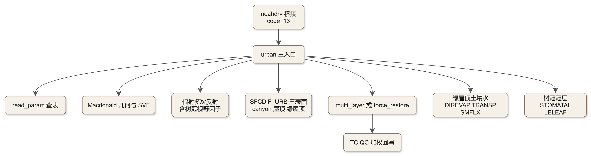
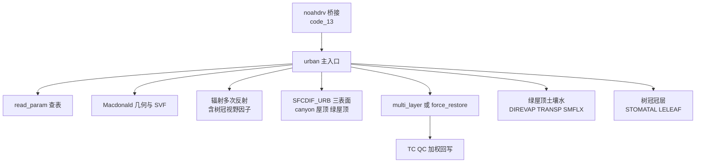

# code_17 — 单层城市冠层模式 SLUCM（module_sf_urban.F：主入口选段与参数表）

## 一、版本指纹

| 源文件 | 行数 | md5（整文件，按字节） |
|---|---|---|
| phys/module_sf_urban.F | 5620 | ad16e13c8f24b30c9fa815fe10702db1 |

- 抽取工具：workspace/scripts/code_extract.py v1.2，2026-10-12；块首指纹注释自带 range_md5。
- 收录分级（B，节选）：文件头 + 主入口五段 + SFCDIF_URB 头段 + 树冠两件；**教材 [ch17_urban_canopy.md](../ch17_urban_canopy.md) 已对 SLUCM 做逐段精读，本篇给完整源码上下文与总表**。
- **版本警示**：本地副本含 **urban-nbs 扩展**——TREEOPTION 树冠方案、GROPTION 绿屋顶、vegetated ground、人为潜热 alhoption 等带 `urban-nbs` 标签，且有 2026-01 的活注释（Chenghao/Yuqi）。与官方 tarball 的差异未逐行对照，讲解按本地副本为准。

## 二、定位

一句话：Kusaka 2002 单层城市冠层模式（SLUCM）的 WRF 版（Fei Chen/Tewari 2006 维护）——一个峡谷单元（屋顶/墙/路面三表面+峡谷空气）算城市能量收支，30 个子程序；本地副本叠加了 urban-nbs 的树冠与绿屋顶物理。

**谁在调它**：noahdrv 的 urban 前处理与 UCM 桥接（[code_13_module_sf_noahdrv.md](code_13_module_sf_noahdrv.md) §4.3/§4.6——FRC 加权混合公式在那里）；参数表由 urban_param_init 从 urban_param.tbl 读入。**三方案分工**：单层 UCM（本篇）/BEP（[code_15_module_sf_bep.md](code_15_module_sf_bep.md)）/BEP+BEM（[code_14a_module_sf_bep_bem.md](code_14a_module_sf_bep_bem.md)）。

**30 单元分组总表**：

| 组 | 单元 | 行段 | 说明 |
|---|---|---|---|
| 主链 | urban | L323–L2539 | SLUCM 主入口（2217 行单体） |
| 交换 | mos / louis79 / louis82 / SFCDIF_URB | L2545–L2816, L4108–L4312 | 峡谷内壁面交换三式+城市面层 |
| 参数 | read_param / urban_param_init / urban_var_init | L2822–L4044 | urban_param.tbl 读取与 Registry 装载 |
| 复用 Noah 副本 | DIREVAP/TRANSP/SMFLX/SRT/SSTEP/WDFCND/ROSR12/SHFLX/HRT/HSTEP/TBND/TDFCND | L4318–L5083 | 绿屋顶/植被地土壤水热的本地裁剪版 |
| 表面温度 | force_restore / bisection / multi_layer | L4050–L4105, L2741–L2816 | 力恢复（含二分迭代）vs 多层热传导 |
| 树冠（urban-nbs） | SHADOW_TREE / STOMATAL / LELEAF / force_restore_tree / ROOT_UPTAKE / VF_TREE_ANALYTICAL / kanda_kawai_svf | L5165–L5617 | 阴影/气孔/叶面/树冠热储/根吸水/视野因子 |



<details><summary>原始 Mermaid 源码（可点击展开）</summary>

<!--

-->

</details>

## 三、文件头：参数表存储与三套扩展开关

<!-- code_extract code_extract.py v1.2
source: phys/module_sf_urban.F
ranges: L1-L129
file_lines: 5620
file_md5: ad16e13c8f24b30c9fa815fe10702db1
display: line-numbered (strip L-prefix and !file: line to restore)
range_md5: 9c5741f740fb0609125146f54b4f1b1e
seg_lines: 129
-->

```fortran
!file: phys/module_sf_urban.F    L1-L129
L00001  MODULE module_sf_urban
L00002  #if defined(mpas)
L00003  use mpas_atmphys_utilities, only: physics_message,physics_error_fatal
L00004  #define FATAL_ERROR(M) call physics_error_fatal( M )
L00005  #define WRITE_MESSAGE(M) call physics_message( M )
L00006  #else
L00007  use module_wrf_error
L00008  #define FATAL_ERROR(M) call wrf_error_fatal( M )
L00009  #define WRITE_MESSAGE(M) call wrf_message( M )
L00010  #endif
L00011  use module_model_constants, only :  piconst
L00012  !===============================================================================
L00013  !     Single-Layer Urban Canopy Model for WRF Noah-LSM
L00014  !     Original Version: 2002/11/06 by Hiroyuki Kusaka
L00015  !     Last Update:      2006/08/24 by Fei Chen and Mukul Tewari (NCAR/RAL)  
L00016  !===============================================================================
L00017  
L00018     CHARACTER(LEN=4)                :: LU_DATA_TYPE
L00019  
L00020     INTEGER                         :: ICATE
L00021  
L00022     REAL, ALLOCATABLE, DIMENSION(:) :: ZR_TBL
L00023     REAL, ALLOCATABLE, DIMENSION(:) :: Z0C_TBL
L00024     REAL, ALLOCATABLE, DIMENSION(:) :: Z0HC_TBL
L00025     REAL, ALLOCATABLE, DIMENSION(:) :: ZDC_TBL
L00026     REAL, ALLOCATABLE, DIMENSION(:) :: SVF_TBL
L00027     REAL, ALLOCATABLE, DIMENSION(:) :: R_TBL
L00028     REAL, ALLOCATABLE, DIMENSION(:) :: RW_TBL
L00029     REAL, ALLOCATABLE, DIMENSION(:) :: HGT_TBL
L00030     REAL, ALLOCATABLE, DIMENSION(:) :: AH_TBL
L00031     REAL, ALLOCATABLE, DIMENSION(:) :: ALH_TBL
L00032     REAL, ALLOCATABLE, DIMENSION(:) :: BETR_TBL
L00033     REAL, ALLOCATABLE, DIMENSION(:) :: BETB_TBL
L00034     REAL, ALLOCATABLE, DIMENSION(:) :: BETG_TBL
L00035     REAL, ALLOCATABLE, DIMENSION(:) :: FRC_URB_TBL
L00036  
L00037     REAL, ALLOCATABLE, DIMENSION(:) :: COP_TBL
L00038     REAL, ALLOCATABLE, DIMENSION(:) :: BLDAC_FRC_TBL
L00039     REAL, ALLOCATABLE, DIMENSION(:) :: COOLED_FRC_TBL
L00040     REAL, ALLOCATABLE, DIMENSION(:) :: PWIN_TBL
L00041     REAL, ALLOCATABLE, DIMENSION(:) :: BETA_TBL
L00042     INTEGER, ALLOCATABLE, DIMENSION(:) :: SW_COND_TBL
L00043     REAL, ALLOCATABLE, DIMENSION(:) :: TIME_ON_TBL
L00044     REAL, ALLOCATABLE, DIMENSION(:) :: TIME_OFF_TBL
L00045     REAL, ALLOCATABLE, DIMENSION(:) :: TARGTEMP_TBL
L00046     REAL, ALLOCATABLE, DIMENSION(:) :: GAPTEMP_TBL
L00047     REAL, ALLOCATABLE, DIMENSION(:) :: TARGHUM_TBL
L00048     REAL, ALLOCATABLE, DIMENSION(:) :: GAPHUM_TBL
L00049     REAL, ALLOCATABLE, DIMENSION(:) :: PERFLO_TBL
L00050     REAL, ALLOCATABLE, DIMENSION(:) :: PV_FRAC_ROOF_TBL !GRZ
L00051     REAL, ALLOCATABLE, DIMENSION(:) :: GR_FRAC_ROOF_TBL !GRZ
L00052     INTEGER :: GR_FLAG_TBL !GRZ
L00053     INTEGER :: GR_TYPE_TBL !GRZ
L00054     REAL, DIMENSION(1:24)           :: IRHO_TBL
L00055     REAL, ALLOCATABLE, DIMENSION(:) :: HSESF_TBL
L00056  
L00057     REAL, ALLOCATABLE, DIMENSION(:) :: CAPR_TBL, CAPB_TBL, CAPG_TBL
L00058     REAL, ALLOCATABLE, DIMENSION(:) :: AKSR_TBL, AKSB_TBL, AKSG_TBL
L00059     REAL, ALLOCATABLE, DIMENSION(:) :: ALBR_TBL, ALBB_TBL, ALBG_TBL
L00060     REAL, ALLOCATABLE, DIMENSION(:) :: EPSR_TBL, EPSB_TBL, EPSG_TBL
L00061     REAL, ALLOCATABLE, DIMENSION(:) :: Z0R_TBL,  Z0B_TBL,  Z0G_TBL
L00062     REAL, ALLOCATABLE, DIMENSION(:) :: SIGMA_ZED_TBL
L00063     REAL, ALLOCATABLE, DIMENSION(:) :: Z0HB_TBL, Z0HG_TBL
L00064     REAL, ALLOCATABLE, DIMENSION(:) :: TRLEND_TBL, TBLEND_TBL, TGLEND_TBL
L00065     REAL, ALLOCATABLE, DIMENSION(:) :: AKANDA_URBAN_TBL
L00066                    
L00067  !for BEP
L00068  
L00069     ! MAXDIRS :: The maximum number of street directions we're allowed to define
L00070     INTEGER, PARAMETER :: MAXDIRS = 3
L00071     ! MAXHGTS :: The maximum number of building height bins we're allowed to define
L00072     INTEGER, PARAMETER :: MAXHGTS = 50
L00073  
L00074     INTEGER, ALLOCATABLE, DIMENSION(:)   :: NUMDIR_TBL
L00075     REAL,    ALLOCATABLE, DIMENSION(:,:) :: STREET_DIRECTION_TBL
L00076     REAL,    ALLOCATABLE, DIMENSION(:,:) :: STREET_WIDTH_TBL
L00077     REAL,    ALLOCATABLE, DIMENSION(:,:) :: BUILDING_WIDTH_TBL
L00078     INTEGER, ALLOCATABLE, DIMENSION(:)   :: NUMHGT_TBL
L00079     REAL,    ALLOCATABLE, DIMENSION(:,:) :: HEIGHT_BIN_TBL
L00080     REAL,    ALLOCATABLE, DIMENSION(:,:) :: HPERCENT_BIN_TBL
L00081  !end BEP
L00082     INTEGER                         :: BOUNDR_DATA,BOUNDB_DATA,BOUNDG_DATA
L00083     INTEGER                         :: CH_SCHEME_DATA, TS_SCHEME_DATA
L00084     INTEGER                         :: ahoption        ! Miao, 2007/01/17, cal. ah
L00085     REAL, DIMENSION(1:24)           :: ahdiuprf        ! ah diurnal profile, tloc: 1-24
L00086     REAL, DIMENSION(1:24)           :: hsequip_tbl
L00087  
L00088  !===Yang, 2014/10/08, urban hydrological processes for single layer UCM===
L00089     INTEGER                         :: IMP_SCHEME, IRI_SCHEME
L00090     INTEGER                         :: alhoption       ! anthropogenic latent heat option
L00091     INTEGER                         :: groption        ! anthropogenic latent heat option
L00092     LOGICAL                         :: distributed_aerodynamics_option
L00093     REAL                            :: fgr             ! green roof fraction
L00094     REAL                            :: oasis           ! urban oasis parameter
L00095     REAL, DIMENSION(1:4)            :: DZGR            ! Layer depth of green roof 
L00096     REAL, DIMENSION(1:4)            :: alhseason       ! seasonal variation of alh
L00097     REAL, DIMENSION(1:48)           :: alhdiuprf       ! alh diurnal profile, tloc2: 1-48
L00098     REAL, DIMENSION(1:3)            :: porimp          ! porosity of pavement over impervious surface
L00099     REAL, DIMENSION(1:3)            :: dengimp         ! maximum water-holding depth of pavement
L00100  
L00101  !===end hydrological processes===
L00102  
L00103  !
L00104  
L00105  !===Huang and Wang, 2025/12/28, urban nature-based solutions for single layer UCM (including trees)===
L00106     INTEGER                         :: TREEOPTION      ! Urban Tree&Vegetation Option ! urban-nbs
L00107     INTEGER                         :: TTscheme        ! Tree temperature solution   [0: diagnostic, 1: prognostic]
L00108     REAL, ALLOCATABLE, DIMENSION(:) :: FVG_TBL         ! vegetated ground fraction from URBPARM
L00109     REAL, ALLOCATABLE, DIMENSION(:) :: RTREE_TBL       ! Tree crown radius [normalized]
L00110     REAL, ALLOCATABLE, DIMENSION(:) :: RTREE_M_TBL     ! Tree crown radius in meter
L00111     REAL, ALLOCATABLE, DIMENSION(:) :: RW_M_TBL        ! Road width in meter																		   
L00112     REAL, ALLOCATABLE, DIMENSION(:) :: HTREE_TBL       ! Tree crown center height [normalized]
L00113     REAL, ALLOCATABLE, DIMENSION(:) :: DTREE_TBL       ! Tree crown center distance from wall (half canyon width currently) [normalized]
L00114     REAL, ALLOCATABLE, DIMENSION(:) :: LAI_TREE_TBL    ! Tree leaf area index
L00115     REAL, ALLOCATABLE, DIMENSION(:) :: LAI_VEG_TBL     ! Vegetated ground leaf area index
L00116     REAL, ALLOCATABLE, DIMENSION(:) :: Z0VG_TBL        ! Roughness length for momentum of vegetated ground
L00117     REAL, ALLOCATABLE, DIMENSION(:) :: Z0HVG_TBL       ! Roughness length for heat of vegetated ground
L00118     REAL, ALLOCATABLE, DIMENSION(:) :: CAPVG_TBL       ! Heat capacity of vegetated ground
L00119     REAL, ALLOCATABLE, DIMENSION(:) :: EPSVG_TBL       ! Emissivity of vegetated ground
L00120     REAL, ALLOCATABLE, DIMENSION(:) :: EPST_TBL        ! Emissivity of tree canopy
L00121     REAL, ALLOCATABLE, DIMENSION(:) :: ALBVG_TBL       ! Emissivity of vegetated ground
L00122     REAL, ALLOCATABLE, DIMENSION(:) :: ALBT_TBL        ! Emissivity of tree canopy																						   
L00123  !===end urban nature-based solutions processes===
L00124  
L00125     CHARACTER (LEN=256) , PRIVATE   :: mesg
L00126  
L00127     CONTAINS
L00128  
L00129  !===============================================================================
```

> 讲解：①**模块级 TBL 数组即 SLUCM 的全部可调参数**：峡谷形态表（ZR/Z0C/Z0HC/ZDC/SVF/R/RW/HGT——屋顶宽/路宽/楼高/峡谷高宽比/天空视野因子）、人为热（AH/ALH——W/m² 表值内部换 cgs）、反照率三表面（BETR/BETB/BETG）、空调三件（COP/BLDAC_FRC/COOLED_FRC）、窗户组（PWIN/BETA/SW_COND/TIME_ON/TIME_OFF/TARGTEMP/GAPTEMP/TARGHUM/GAPHUM/PERFLO——空调调度全表）、材料与热力（CAPR/AKSR/ALBR/EPSR/Z0R 及 B/G 对、SIGMA_ZED、TRLEND/TBLEND/TGLEND 终温、AKANDA_URBAN_TBL）；②**BEP 共享段**（L67–L81）：MAXDIRS=3/MAXHGTS=50 与街道方向/宽度、楼高 bin 表——BE 路线的形态参数也存这张表（三方案共用 urban_param.tbl 的入口面）；③**Yang 2014 水文开关**（IMP_SCHEME/IRI_SCHEME/alhoption/groption/oasis/fgr/DZGR）与 **urban-nbs 树冠段**（TREEOPTION、DTREE/HTREE/LAI_TREE/RTREE_M 等）——两代扩展在此叠加；④文件头自注版本史：Kusaka 2002 原版、Chen/Tewari 2006-08 最后更新——**2006 之后的一切（含 urban-nbs）都是社区叠加**。

## 四、主入口选段五处

### 4.1 Macdonald 峡谷几何与 NUDAPT SVF

<!-- code_extract code_extract.py v1.2
source: phys/module_sf_urban.F
ranges: L854-L905
file_lines: 5620
file_md5: ad16e13c8f24b30c9fa815fe10702db1
display: line-numbered (strip L-prefix and !file: line to restore)
range_md5: d0a31a07cb6f012572abc7b37f186a4b
seg_lines: 52
-->

```fortran
!file: phys/module_sf_urban.F    L854-L905
L00854    !Calculate the following urban canyon geometry parameters following Macdonald's (1998) formulations
L00855        Cd         = 1.2
L00856        alpha_macd = 4.43
L00857        beta_macd  = 1.0
L00858  
L00859  
L00860        ZDC = ZR * ( 1.0 + ( alpha_macd ** ( -R ) )  * ( R - 1.0 ) )             ! e.q 23 in Macdonald's (1998)
L00861  
L00862        Z0C = ZR * ( 1.0 - ZDC/ZR ) * &
L00863             exp (-(0.5 * beta_macd * Cd / (VonK**2) * ( 1.0-ZDC/ZR) * lambda_f )**(-0.5))         ! e.q 26 in Macdonald's (1998)
L00864       
L00865        if(zo_check.eq.1)THEN
L00866          write(mesg,*) 'Roughness Length NUDAPT',Z0C
L00867          WRITE_MESSAGE(mesg)
L00868        end if
L00869  
L00870        lambda_fr  = stdh_urb/(SW + BW)
L00871  
L00872         Z0R = ZR * ( 1.0 - ZDC/ZR) &
L00873               * exp ( -(0.5 * beta_macd * Cd / (VonK**2) &
L00874                * ( 1.0-ZDC/ZR) * lambda_fr )**(-0.5))
L00875  
L00876      
L00877  
L00878         Z0HC = 0.1 * Z0C
L00879  
L00880    ! Calculate Sky View Factor
L00881  
L00882       DHGT=HGT/100.
L00883       HGT2=0.
L00884       VFWS=0.
L00885       HGT2=HGT-DHGT/2.
L00886        do NUDAPT=1,99
L00887           HGT2=HGT2-DHGT
L00888           VFWS=VFWS+0.25*(1.-HGT2/SQRT(HGT2**2.+RW**2.))
L00889        end do
L00890  
L00891       VFWS=VFWS/99.
L00892       VFWS=VFWS*2.
L00893  
L00894       VFGS=1.-2.*VFWS*HGT/RW
L00895       SVF=VFGS
L00896  
L00897      if(zo_check.eq.1)THEN
L00898        write(mesg,*) 'Roof Roughness Length NUDAPT',Z0R
L00899        WRITE_MESSAGE(mesg)
L00900        write(mesg,*) 'Sky View Factor NUDAPT',SVF
L00901        WRITE_MESSAGE(mesg)
L00902        write(mesg,*) 'normalized Height NUDAPT', HGT
L00903        WRITE_MESSAGE(mesg)
L00904      end if
L00905  
```

> 讲解：①**Macdonald 1998 亲本构公式**：零平面位移 ZDC=ZR·(1+α^(−R)·(R−1))（式 23）、峡谷粗糙度 Z0C=ZR·(1−ZDC/ZR)·exp(−[0.5βCd·(1−ZDC/ZR)·λ_f/k²]^(1/2))（式 26）——λ_f 是**迎风面密度且按风向分档**（WDR 八向查 lf_urb，L841–852 的四象限二分）；屋顶粗糙度 Z0R 用 λ_fr=stdh/(SW+BW) 另算、Z0HC=0.1·Z0C（热粗糙度十分之一律）；②**SVF 的 NUDAPT 数值积分**：把墙面按 DHGT=HGT/100 切 99 段，逐段 VF=0.25·(1−H/√(H²+RW²)) 取平均乘 2 得墙面 SVF，路面 VFGS=1−2·VFWS·HGT/RW——99 段足够收敛且每步重算（ canyon 几何随 morph 查表固定，但这段在主循环里）；③zo_check 诊断打印是调试开关痕迹。

### 4.2 屋顶温度：二分迭代与双方案分派

<!-- code_extract code_extract.py v1.2
source: phys/module_sf_urban.F
ranges: L1296-L1325
file_lines: 5620
file_md5: ad16e13c8f24b30c9fa815fe10702db1
display: line-numbered (strip L-prefix and !file: line to restore)
range_md5: 9b71522a71430c34fb9043f5b743f8aa
seg_lines: 30
-->

```fortran
!file: phys/module_sf_urban.F    L1296-L1325
L01296         DTR = F/DFDT
L01297  
L01298         TR = TRP - DTR
L01299         TRP = TR
L01300  
L01301         IF( ABS(F) < 0.000001 .AND. ABS(DTR) < 0.000001 ) EXIT
L01302  
L01303       END DO
L01304  
L01305  ! multi-layer heat equation model
L01306  
L01307       CALL multi_layer(num_roof_layers,BOUNDR,G0R,CAPR,AKSR,TRL,DZR,DELT,TRLEND)
L01308  
L01309     ELSE
L01310  
L01311       ES=6.11*EXP( (2.5*10.**6./461.51)*(TRP-273.15)/(273.15*TRP) )
L01312       QS0R=0.622*ES/(PS-0.378*ES)        
L01313  
L01314       RR=EPSR*(RX-SIG*(TRP**4.)/60.)
L01315       HR=RHO*CP*CHR*UA*(TRP-TA)*100.
L01316       ELER=RHO*EL*CHR*UA*BETR*(QS0R-QA)*100.
L01317       G0R=SR+RR-HR-ELER
L01318  
L01319       CALL force_restore(CAPR,AKSR,DELT,SR,RR,HR,ELER,TRLEND,TRP,TR)
L01320  
L01321       TRP=TR
L01322  
L01323     END IF
L01324  
L01325     FLXTHR=HR/RHO/CP/100.
```

> 讲解：①TS_SCHEME 分派——**=1 走 multi_layer**（num_roof_layers 层热传导推进，CAPR/AKSR 热容与导热率来自 TBL）；**否则力恢复法**：先由表面饱和比湿 ES=6.11·exp(Lv(T)/(Rv·T)·(T−273.15)/(273.15·T))（Clausius–Clapeyron 积分式）、长波残差 RR=EPSR·(RX−σT⁴/60)、感热 HR 与潜热 ELER 组装净通量 G0R（**全 cgs 制**——HR=RHO·CP·CHR·UA·ΔT·100 的 ×100 是 W 到 cal/(cm²s) 的换算），再调 force_restore；其上方的循环（L1290–L1302）是 TR 的**牛顿/二分混合迭代**（|F|与|DTR| 双容限 EXIT）；②FLXTHR/FLXHUMR 除回 RHO·CP·100 把 cgs 通量转回模式语言——SLUCM 全程 cgs 与 SI 双制并行的换算点就在这些 ×100 与 /60（σT⁴ 的 /60 是 cal/(cm²·min) 老口径）。

### 4.3 绿屋顶段（urban-nbs）

<!-- code_extract code_extract.py v1.2
source: phys/module_sf_urban.F
ranges: L1327-L1355
file_lines: 5620
file_md5: ad16e13c8f24b30c9fa815fe10702db1
display: line-numbered (strip L-prefix and !file: line to restore)
range_md5: 16bb2d2f406134706da56e380c05b7e5
seg_lines: 29
-->

```fortran
!file: phys/module_sf_urban.F    L1327-L1355
L01327  
L01328  !-------------------------------------------------------------------------------
L01329  ! Green Roof
L01330  ! Must use multiple layers scheme (TS_SCHEME=1)
L01331  !-------------------------------------------------------------------------------     
L01332     IF (GROPTION == 1) THEN
L01333     T1VGR = TGRP* (1.0+ 0.61 * QA) 
L01334     RLMO_URB=0.0
L01335     CALL SFCDIF_URB (ZA,Z0R,T1VGR,TH2V,UA,AKANDA_URBAN,CMGR_URB,CHGR_URB,RLMO_URB,CDGR)
L01336     ALPHAGR =  RHO*CP*CHGR_URB
L01337     CHGR=ALPHAGR/RHO/CP/UA
L01338     RUNOFF1 = 0.0
L01339     RUNOFF2 = 0.0
L01340     RUNOFF3 = 0.0
L01341     SROOT   = 0.0			
L01342  
L01343     KZ = 1
L01344     ZSOILR (KZ) = - DZGR (KZ) 
L01345     DO KZ = 2,NGR
L01346        ZSOILR (KZ) = - DZGR(KZ) + ZSOILR (KZ -1)
L01347     END DO
L01348  
L01349     DO ITERATION=1,100
L01350         KZ=1     
L01351         ES=6.11*EXP( (2.5*10.**6./461.51)*(TGRP-273.15)/(273.15*TGRP) )
L01352         DESDT=(2.5*10.**6./461.51)*ES/(TGRP**2.)
L01353         QS0GR=0.622*ES/(PS-0.378*ES) 
L01354         DQS0GRDTGR = DESDT*0.622*PS/((PS-0.378*ES)**2.) 
L01355         EPGR=RHOO*CHGR*UA*(QS0GR-QA)   ! Potential evaporation [kg/m2/s]
```

> 讲解：GROPTION==1 的绿屋顶链：①强制注释「Must use multiple layers scheme」——绿屋顶依赖多层热传导；②T1VGR 虚温 + SFCDIF_URB 独立算绿屋顶交换系数（CHGR）；③**ZSOILR 负深累计**——与 noahlsm 完全同款的层深约定（code_12a §四①）；④后续（L1356–L1400）直接调 **DIREVAP/TRANSP/SMFLX**——注意这三个是**本文件 L4318 起的本地副本**（noahlsm 同名单元的裁剪版），绿屋顶土壤水走 Noah 型四层收支——**单层 UCM 的绿屋顶=把 Noah 的土壤水模块塞进 SLUCM**，是 ch20「方案杂交」的现成案例。

### 4.4 峡谷交换与 CH_SCHEME

<!-- code_extract code_extract.py v1.2
source: phys/module_sf_urban.F
ranges: L1451-L1467
file_lines: 5620
file_md5: ad16e13c8f24b30c9fa815fe10702db1
display: line-numbered (strip L-prefix and !file: line to restore)
range_md5: 750673dddff982c8d09d787985864c40
seg_lines: 17
-->

```fortran
!file: phys/module_sf_urban.F    L1451-L1467
L01451     IF (.not. distributed_aerodynamics_option) THEN
L01452  
L01453     T1VC = TCP* (1.0+ 0.61 * QA) 
L01454     RLMO_URB=0.0
L01455     CALL SFCDIF_URB(ZA,Z0C,T1VC,TH2V,UA,AKANDA_URBAN,CMC_URB,CHC_URB,RLMO_URB,CDC)      ! CDC: momentum exchange coefficient for canopy
L01456     ALPHAC =  RHO*CP*CHC_URB
L01457  
L01458     IF (CH_SCHEME == 1) THEN 
L01459  
L01460       Z=ZDC
L01461       BHB=LOG(Z0B/Z0HB)/0.4
L01462       BHG=LOG(Z0G/Z0HG)/0.4
L01463       RIBB=(9.8*2./(TCP+TBP))*(TCP-TBP)*(Z+Z0B)/(UC*UC)
L01464       RIBG=(9.8*2./(TCP+TGP))*(TCP-TGP)*(Z+Z0G)/(UC*UC)
L01465  
L01466       CALL mos(XXXB,ALPHAB,CDB,BHB,RIBB,Z,Z0B,UC,TCP,TBP,RHO)
L01467       CALL mos(XXXG,ALPHAG,CDG,BHG,RIBG,Z,Z0G,UC,TCP,TGP,RHO)
```

> 讲解：①**distributed_aerodynamics_option 为假**才走 SLUCM 自身的峡谷面层（真值时由外部分布拖曳接管——与 BEP 的 a_u/b_u 源项思想衔接的实验开关）；②SFCDIF_URB 三连调的第一次（峡谷 CDC/CHC_URB）；③**CH_SCHEME=1 走 mos**（Monin–Obukhov 的壁面/路面内层交换：BHB=ln(Z0B/Z0HB)/0.4、RIBB 峡谷 Richardson 数、调 mos 解 XXXB/ALPHAB）——否则走 louis79/louis82 幂律方案；峡谷空气温度 TCP 是三表面交换的共同枢纽。

### 4.5 收尾：多次反射、树冠与 TC/QC 加权

<!-- code_extract code_extract.py v1.2
source: phys/module_sf_urban.F
ranges: L2182-L2290
file_lines: 5620
file_md5: ad16e13c8f24b30c9fa815fe10702db1
display: line-numbered (strip L-prefix and !file: line to restore)
range_md5: 8d5c9884b159f9a9e2e4b9ab2979cf78
seg_lines: 109
-->

```fortran
!file: phys/module_sf_urban.F    L2182-L2290
L02182        CALL multi_layer(num_wall_layers,BOUNDB,G0B,CAPB,AKSB,TBL,DZB,DELT,TBLEND)
L02183        CALL multi_layer(num_road_layers,BOUNDG,G0G,CAPG,AKSG,TGL,DZG,DELT,TGLEND)
L02184        ! CALL multi_layer(num_road_layers,BOUNDG,G0VG,CAPVG,KVG/697.7/60,TVGL,DZVG*0.01,DELT,TGLEND) ! DZVG unit ([m] as input, needed to convert to[cm]) (Chenghao 2026/01/20)
L02185  	  CALL SHFLX (SSOILG,TVGL,SMG,SMCMAX,NVG,TVGP,DELT,YY,ZZ1,ZSOILG,TGLEND,ZBOT,SMCWLT,KVG,QUARTZ,CSOIL,CAPVG)   ! Update temperature in vegetated ground soil layer (urban-nbs)
L02186  
L02187      
L02188      ELSE
L02189         !-------------------------------------------------------------------------------
L02190         !  TB, TG  by Force-Restore Method 
L02191         !  Note, Conflict With Vegetated Ground Scheme (urban-nbs)
L02192         !-------------------------------------------------------------------------------
L02193    
L02194         ES=6.11*EXP( (2.5*10**6/461.51)*(TBP-273.15)/(273.15*TBP) ) 
L02195         QS0B=0.622*ES/(PS-0.378*ES) 
L02196  
L02197         ES=6.11*EXP( (2.5*10**6/461.51)*(TGP-273.15)/(273.15*TGP) ) 
L02198         QS0G=0.622*ES/(PS-0.378*ES)        
L02199  
L02200         ES=6.11*EXP( (2.5*10**6/461.51)*(TTP-273.15)/(273.15*TTP) )        
L02201         QS0T=0.622*ES/(PS-0.378*ES)        
L02202  
L02203         ES=6.11*EXP( (2.5*10**6/461.51)*(TVGP-273.15)/(273.15*TVGP) )   ! following green roof scheme (urban-nbs)
L02204         QS0VG=0.622*ES/(PS-0.378*ES) 
L02205  
L02206         EPSGE   = (1 - FVG) * EPSG + FVG * EPSVG           ! DEFINE NEW EPSVG HERE (urban-nbs)
L02207         TGEP    = (1 - FVG) * TGP  + FVG * TVGP 
L02208         QS0GE   = (1 - FVG) * QS0G + FVG * QS0VG
L02209         ALPHAGE = (1 - FVG) * ALPHAG + FVG * ALPHAVG
L02210  
L02211         EMITW = EPSB * SIG * TBP**4/60
L02212         EMITG = EPSGE * SIG * TGEP**4/60
L02213         EMITT = EPST * SIG * TTP**4/60
L02214  
L02215         RG1 = EPSG * (RX * VFGS_TREE + 2 * EMITW * VFGW_TREE + &
L02216               EMITT * VFGT_TREE -  &
L02217               SIG * TGP**4/60)
L02218  
L02219         RVG1= EPSVG * (RX * VFGS_TREE + 2 * EMITW * VFGW_TREE + &
L02220               EMITT * VFGT_TREE - &
L02221               SIG * TVGP**4/60)
L02222  
L02223         RB1 = EPSB * (RX * VFWS_TREE + EMITW * VFWW_TREE + &
L02224               EMITG * VFWG_TREE + EMITT * VFWT_TREE - &
L02225               SIG * TBP**4/60)
L02226  
L02227         RG2 = EPSG * ((2 * (RX * VFWS_TREE + EMITW * VFWW_TREE + &
L02228               EMITG * VFWG_TREE + EMITT * VFWT_TREE) * (1 - EPSB) * VFGW_TREE) + &
L02229               ((RX * VFTS_TREE + 2 * EMITW * VFTW_TREE + &
L02230               EMITG * VFTG_TREE) * (1 - EPST) * VFGT_TREE))
L02231  
L02232         RVG2= EPSVG * ((2 * (RX * VFWS_TREE + EMITW * VFWW_TREE + &
L02233               EMITG * VFWG_TREE + EMITT * VFWT_TREE) * (1 - EPSB) * VFGW_TREE) + &
L02234               ((RX * VFTS_TREE + 2 * EMITW * VFTW_TREE + &
L02235               EMITG * VFTG_TREE) * (1 - EPST) * VFGT_TREE))
L02236  
L02237         RB2 = EPSB * (((RX * VFGS_TREE + 2 * EMITW * VFGW_TREE + &
L02238               EMITT * VFGT_TREE) * (1 - EPSGE) * VFWG_TREE) + &
L02239               ((RX * VFWS_TREE + EMITW * VFWW_TREE + EMITG * VFWG_TREE + &
L02240               EMITT * VFWT_TREE) * (1 - EPSB) * VFWW_TREE) + &
L02241               ((RX * VFTS_TREE + 2 * EMITW * VFTW_TREE + &
L02242               EMITG * VFTG_TREE) * (1 - EPST) * VFWT_TREE))
L02243  
L02244         RT1 = EPST * (RX * VFTS_TREE + 2 * EMITW * VFTW_TREE + &
L02245               EMITG * VFTG_TREE) - EMITT
L02246  
L02247         RT2 = EPST * ((2 * (RX * VFWS_TREE + EMITW * VFWW_TREE + &
L02248               EMITG * VFWG_TREE + EMITT * VFWT_TREE) * (1 - EPSB) * VFTW_TREE) + &
L02249               ((RX * VFGS_TREE + 2 * EMITW * VFGW_TREE + &
L02250               EMITT * VFGT_TREE) * (1 - EPSGE) * VFTG_TREE))
L02251  
L02252         RG = RG1 + RG2
L02253         RB = RB1 + RB2
L02254         RVG= RVG1+RVG2
L02255         RT = RT1 + RT2
L02256  
L02257         HB=RHO*CP*CHB*UC*(TBP-TCP)*100
L02258         ELEB=RHO*EL*CHB*UC*BETB*(QS0B-QCP)*100
L02259         G0B=SB+RB-HB-ELEB    ! unit: cal/cm2/s
L02260  
L02261         HG=RHO*CP*CHG*UC*(TGP-TCP)*100
L02262         ELEG=RHO*EL*CHG*UC*BETG*(QS0G-QCP)*100
L02263         G0G=SG+RG-HG-ELEG    ! unit: cal/cm2/s
L02264  
L02265         RA_LEAF = 58 * (LAI_TREE**0.56) * SQRT(DLEAF/UC)             
L02266         HT = (SLEAF + RLEAF - ELET - (TT - TTP)/DELT*640)/697.7/60. ! HT in unit of cal/cm2/s (unit consistent with HB and HG)
L02267         W2 = 0.5 * (SMGP(NVG/2-1) + SMGP(NVG/2))    ! POTENTIAL ERROR (Yuqi urban-nbs)
L02268         CALL STOMATAL(RS_LEAF, RSMIN, SLEAF, LAI_TREE, W2, SMCREF, SMCMAX, TC, TT, QC, QS0T) 
L02269         CALL LELEAF(ELET, SLEAF, RLEAF, RA_LEAF, RS_LEAF, RHOO, TC, QC, QS0T)
L02270  
L02271  
L02272         CALL force_restore(CAPB,AKSB,DELT,SB,RB,HB,ELEB,TBLEND,TBP,TB)
L02273         CALL force_restore(CAPG,AKSG,DELT,SG,RG,HG,ELEG,TGLEND,TGP,TG)
L02274         CALL force_restore_tree(DELT,ST,RT,HT,ELET/(697.7*60),LAI_TREE,TTP,TT) ! to be fixed (Yuqi 01/21/2026)
L02275  
L02276         TBP=TB
L02277         TGP=TG
L02278         TTP=TT
L02279         TC1 = RW * ALPHAC + RW * FVG * ALPHAVG + RW * (1 - FVG) * ALPHAG + W * ALPHAB
L02280         TC2 = RW * ALPHAC * TA + RW * FVG * ALPHAVG * TVGP + RW * (1 - FVG) * ALPHAG * TGP + W * ALPHAB * TBP + 2 * RTREE * LAI_TREE * (HT/100)
L02281         TC = TC2 / TC1
L02282  	    ! Chenghao: HT unit is cgs, keep it as is [RHO - g/cm3, CP - cal/g/K]
L02283  
L02284         QC1 = W * ALPHAB * BETB + RW * (1 - FVG) * ALPHAG * BETG + RW * ALPHAC
L02285         QC2 = W * ALPHAB * BETB * QS0B + RW * (1 - FVG) * ALPHAG * BETG * QS0G + RW * FVG * ETAG *CP / 1000 + RW * ALPHAC * QA + (2 * RTREE * LAI_TREE * CP * (ELET/697.7/60.)/100/EL)
L02286         QC=QC2/QC1
L02287  	    ! Chenghao: ELET - [W/m2], convert it to cgs to be consistent with all other terms (e.g., ALPHAB)
L02288  		 
L02289         TCP=TC
L02290         QCP=QC
```

> 讲解：force-restore 分支的收尾全景（urban-nbs 版）：①multi_layer 推进墙/路 + **SHFLX 更新植被地土温**（「Conflict With Vegetated Ground Scheme」注释承认与力恢复法不兼容——nbs 的杂交缝）；②**树冠多次反射六项** RG1/RG2/RB1/RB2/RT1/RT2——每个表面先收直射（RX·VF*_TREE）与一次反射（2·EMITW·VFGW_TREE 的 2 是两面墙），二阶项 RG2 等乘 (1−EPS) 反射率与对面 VF——树冠视野因子把原三表面辐射网扩成四节点；③**树冠热储 HT**=(SLEAF+RLEAF−ELET−(TT−TTP)/DELT·640)/697.7/60——640 cal 是树冠比热·生物量假设、697.7 是 W→cal/(cm²·s) 系数，W2 取中层两点均值并自带 **「POTENTIAL ERROR (Yuqi urban-nbs)」**警告；④force_restore_tree 带 **「to be fixed」活注释**——本地副本是实验进行时；⑤**峡谷空气温湿的加权平均**：TC=(RW·αC·TA+RW·FVG·αVG·TVGP+RW·(1−FVG)·αG·TGP+W·αB·TBP+树冠项)/Σα——TC/QC 是各表面按交换系数与面积权重混合的峡谷状态，回写给 surface_driver 的 TS_URB2D 系。

## 五、特色单元三件

<!-- code_extract code_extract.py v1.2
source: phys/module_sf_urban.F
ranges: L5165-L5174
file_lines: 5620
file_md5: ad16e13c8f24b30c9fa815fe10702db1
display: line-numbered (strip L-prefix and !file: line to restore)
range_md5: 90481f1ea6a16431401e5242ee5393af
seg_lines: 10
label: function kanda_kawai_svf
-->

```fortran
!file: phys/module_sf_urban.F    L5165-L5174    (function kanda_kawai_svf)
L05165  FUNCTION kanda_kawai_svf(lp, lf) RESULT (svf)
L05166      IMPLICIT NONE
L05167      real, intent(in) :: lp, lf
L05168      real :: hovl, vloc, vmod, svf
L05169  
L05170      hovl = lf * lp ** (-0.5) / (1. - lp ** 0.5)
L05171      vloc = cos(atan(2. * hovl)) * (2. - 4. / piconst * atan(cos(atan(2. * hovl))))
L05172      vmod = 0.1120 * lp * vloc - 0.4817 * lp + 0.0246 * vloc + 0.9570
L05173      svf = vloc * vmod
L05174    END FUNCTION kanda_kawai_svf
```

> 讲解：Kanda–Kawai 解析天空视野因子（10 行 function）——与 §4.1 的 NUDAPT 数值积分并存的第二口径（urban-nbs 树冠方案的 SVF 需要逐点解析值）。

<!-- code_extract code_extract.py v1.2
source: phys/module_sf_urban.F
ranges: L5182-L5236
file_lines: 5620
file_md5: ad16e13c8f24b30c9fa815fe10702db1
display: line-numbered (strip L-prefix and !file: line to restore)
range_md5: 2e7be996be73afc8704694016a65ee9e
seg_lines: 55
label: subroutine SHADOW_TREE
-->

```fortran
!file: phys/module_sf_urban.F    L5182-L5236    (subroutine SHADOW_TREE)
L05182     SUBROUTINE SHADOW_TREE (XI, H, W, HTREE, RTREE, DTREE, CHI_SHADED, ETA_SHADED, &
L05183                                CHI_SHADED_TREE, ETA_SHADED_TREE)
L05184  
L05185        IMPLICIT NONE
L05186  
L05187        REAL, INTENT(IN)    :: XI , H, W, HTREE, RTREE, DTREE
L05188        REAL, INTENT(OUT)   :: CHI_SHADED, ETA_SHADED, CHI_SHADED_TREE, ETA_SHADED_TREE
L05189        REAL                :: XI_A, XI_B, X0, Y0, X1, X2, Y1, Y2, CHI_TREE, ETA_TREE
L05190        ! CHI: SHADOW ON THE GROUND;        ETA: SHADOW ON THE WALL
L05191  
L05192        XI_A = SQRT(1 + XI**2)
L05193        XI_B = SQRT(1 + XI**(-2))
L05194  
L05195        X0 = MAX(0.0, W - H * XI) 
L05196        Y0 = MAX(0.0, H - W / XI) 
L05197  
L05198        X1 = MAX(0.0, DTREE - HTREE * XI - RTREE * XI_A)
L05199        X2 = MAX(0.0, DTREE - HTREE * XI + RTREE * XI_A)
L05200  
L05201        Y1 = MAX(0.0, HTREE - DTREE / XI - RTREE * XI_B)
L05202        Y2 = MAX(0.0, HTREE - DTREE / XI + RTREE * XI_B)
L05203  
L05204        CHI_TREE = X2 - X1 
L05205        ETA_TREE = Y2 - Y1 
L05206  
L05207        !-----------------------------------------------------------------
L05208        ! SHADOW LENGTH ON THE GROUND BY WALL2 AND TREE
L05209        !-----------------------------------------------------------------
L05210        IF (X2 .le. X0) THEN
L05211           CHI_SHADED = W - X0 + CHI_TREE 
L05212           CHI_SHADED_TREE = CHI_TREE 
L05213        ELSEIF (X1 .le. X0 .and. X0 .lt. X2) THEN 
L05214           CHI_SHADED = W - X0 + CHI_TREE - (X2 - X0) 
L05215           CHI_SHADED_TREE = CHI_TREE - (X2 - X0)
L05216        ELSE
L05217           CHI_SHADED = W - X0    
L05218           CHI_SHADED_TREE = 0 
L05219        END IF
L05220  
L05221        !-----------------------------------------------------------------
L05222        ! SHADOW LENGTH ON THE WALL BY WALL2 AND TREE
L05223        !-----------------------------------------------------------------
L05224        IF (Y2 .le. Y0) THEN 
L05225           ETA_SHADED = Y0         
L05226           ETA_SHADED_TREE = 0
L05227        ELSEIF (Y1 .le. Y0 .and. Y0 .lt. Y2) THEN 
L05228           ETA_SHADED = Y2               
L05229           ETA_SHADED_TREE = Y2 - Y0 
L05230        ELSE
L05231           ETA_SHADED = Y0 + ETA_TREE     
L05232           ETA_SHADED_TREE = ETA_TREE 
L05233        END IF
L05234  
L05235  ! ----------------------------------------------------------------------
L05236     END SUBROUTINE SHADOW_TREE
```

> 讲解：树冠阴影投影（urban-nbs）：给定太阳方位把树冠（高 HTREE、半径 RTREE、冠心距 DTREE）投影到墙面/路面，返回各表面的阴影占比（CHI/ETA_SHADED 及树冠版）——与 code_14a 的 shadow_mas（BEP 三向阴影）同问题不同口径：SLUCM 单峡谷两墙、BEP 多方向多高度 bin。

<!-- code_extract code_extract.py v1.2
source: phys/module_sf_urban.F
ranges: L4108-L4167
file_lines: 5620
file_md5: ad16e13c8f24b30c9fa815fe10702db1
display: line-numbered (strip L-prefix and !file: line to restore)
range_md5: 5f91b1f99b4e5769ce97b0932a42b594
seg_lines: 60
-->

```fortran
!file: phys/module_sf_urban.F    L4108-L4167
L04108  SUBROUTINE SFCDIF_URB (ZLM,Z0,THZ0,THLM,SFCSPD,AKANDA,AKMS,AKHS,RLMO,CD,ZT_OUT,VEGFRAC)
L04109  
L04110  ! ----------------------------------------------------------------------
L04111  ! SUBROUTINE SFCDIF_URB (Urban version of SFCDIF_off)
L04112  ! ----------------------------------------------------------------------
L04113  ! CALCULATE SURFACE LAYER EXCHANGE COEFFICIENTS VIA ITERATIVE PROCESS.
L04114  ! SEE CHEN ET AL (1997, BLM)
L04115  ! ----------------------------------------------------------------------
L04116  
L04117        IMPLICIT NONE
L04118        REAL     WWST, WWST2, G, VKRM, EXCM, BETA, BTG, ELFC, WOLD, WNEW
L04119        REAL     PIHF, EPSU2, EPSUST, EPSIT, EPSA, ZTMIN, ZTMAX, HPBL,     &
L04120       & SQVISC
L04121        REAL     RIC, RRIC, FHNEU, RFC,RLMO_THR, RFAC, ZZ, PSLMU, PSLMS, PSLHU,     &
L04122       & PSLHS
L04123        REAL     XX, PSPMU, YY, PSPMS, PSPHU, PSPHS, ZLM, Z0, THZ0, THLM
L04124        REAL     SFCSPD, AKANDA, AKMS, AKHS, ZU, ZT, RDZ, CXCH
L04125        REAL     DTHV, DU2, BTGH, WSTAR2, USTAR, ZSLU, ZSLT, RLOGU, RLOGT
L04126        REAL     RLMO, ZETALT, ZETALU, ZETAU, ZETAT, XLU4, XLT4, XU4, XT4
L04127        REAL, INTENT(OUT), OPTIONAL :: ZT_OUT
L04128        REAL, INTENT(IN), OPTIONAL :: VEGFRAC
L04129  !CC   ......REAL ZTFC
L04130  
L04131        REAL     XLU, XLT, XU, XT, PSMZ, SIMM, PSHZ, SIMH, USTARK, RLMN,  &
L04132       &         RLMA
L04133  
L04134        INTEGER  ITRMX, ILECH, ITR
L04135        REAL,    INTENT(OUT) :: CD
L04136        PARAMETER                                                         &
L04137       &        (WWST = 1.2,WWST2 = WWST * WWST,G = 9.8,VKRM = 0.40,      &
L04138       &         EXCM = 0.001                                             &
L04139       &        ,BETA = 1./270.,BTG = BETA * G,ELFC = VKRM * BTG          &
L04140       &                  ,WOLD =.15,WNEW = 1. - WOLD,ITRMX = 05,         &
L04141       &                   PIHF = 3.14159265/2.)
L04142        PARAMETER                                                         &
L04143       &         (EPSU2 = 1.E-4,EPSUST = 0.07,EPSIT = 1.E-4,EPSA = 1.E-8  &
L04144       &         ,ZTMIN = -5.,ZTMAX = 1.,HPBL = 1000.0                    &
L04145       &          ,SQVISC = 258.2)
L04146        PARAMETER                                                         &
L04147       &       (RIC = 0.183,RRIC = 1.0/ RIC,FHNEU = 0.8,RFC = 0.191       &
L04148       &        ,RLMO_THR = 0.001,RFAC = RIC / (FHNEU * RFC * RFC))
L04149  
L04150  ! ----------------------------------------------------------------------
L04151  ! NOTE: THE TWO CODE BLOCKS BELOW DEFINE FUNCTIONS
L04152  ! THIS ROUTINE SFCDIF CAN HANDLE BOTH OVER OPEN WATER (SEA, OCEAN) AND
L04153  ! OVER SOLID SURFACE (LAND, SEA-ICE).
L04154  ! ----------------------------------------------------------------------
L04155  ! ----------------------------------------------------------------------
L04156  ! LECH'S SURFACE FUNCTIONS               ! E.q A7&A8
L04157  ! ----------------------------------------------------------------------
L04158        PSLMU (ZZ)= -0.96* log (1.0-4.5* ZZ)
L04159        PSLMS (ZZ)= (ZZ/RFC) -2.076* (1. -1./ (ZZ +1.))
L04160        PSLHU (ZZ)= -0.96* log (1.0-4.5* ZZ)
L04161        PSLHS (ZZ)= ZZ * RFAC -2.076* (1. - exp(-1.2 * ZZ))        ! bug fixed in 4.7.1
L04162  ! ----------------------------------------------------------------------
L04163  ! PAULSON'S SURFACE FUNCTIONS             ! E.q A5&A6
L04164  ! ---------------------------------------------------------------------- 
L04165        PSPMU (XX)= -2.* log ( (XX +1.)*0.5) - log ( (XX * XX +1.)*0.5) +2.* ATAN (XX) - PIHF
L04166        PSPMS (YY)= 5.* YY
L04167        PSPHU (XX)= -2.* log ( (XX * XX +1.)*0.5)
```

> 讲解：**SFCDIF_URB=SFCDIF_off 的城市版**（对照 code_12b §十四）：①同一套 Chen 1997 迭代骨架（ITRMX=5、WOLD=0.15、SQVISC=258.2、EXCM=0.001 下限、WWST=1.2 对流速度）；②Lech 与 Paulson 语句函数并存，**PSLHS 注明「bug fixed in 4.7.1」**（稳定函数的 RFAC 项修正——两版 sfcdif 的实际差异点之一）；③扩展两个 OPTIONAL：ZT_OUT（热粗糙度回传——BEP 链要）与 VEGFRAC（urban-nbs 植被修正）；④AKANDA_URBAN 是城市形态参数化的附加项（Kanda 2007 系），随 TBL 装载。

## 六、改造入口

1. **城市参数表**：urban_param.tbl 全部经 read_param/urban_param_init/urban_var_init 三件装载——换城市形态/材料/空调调度只改表；SIGMA_ZED（NUDAPT 形态标准差）是 BEP 共享。
2. **温度方案**：TS_SCHEME=1 多层 vs 力恢复——绿屋顶强制前者；CH_SCHEME=1 mos vs louis 系。
3. **urban-nbs 实验**：TREEOPTION/GROPTION/IRI_SCHEME/alhoption 全在文件头开关段——树冠「to be fixed」处是参与开发的入口。
4. **面层**：SFCDIF_URB 与 code_12b SFCDIF_off 双向对照——PSLHS 4.7.1 修正是两版唯一函数级差异。
5. **AH 人为热**：ahoption/ahdiuprf 24 小时Profile——论文 2 的 AHE 敏感性实验入口（与 code_22 §六的 distributed_ahe 分值场是两套口径）。

## 七、上下游链接

- 驱动与混合：[code_13_module_sf_noahdrv.md](code_13_module_sf_noahdrv.md)（§4.3 前处理、§4.6 FRC 加权）；城市三方案：[code_14a_module_sf_bep_bem.md](code_14a_module_sf_bep_bem.md)、[code_15_module_sf_bep.md](code_15_module_sf_bep.md)、[code_16_module_sf_bem.md](code_16_module_sf_bem.md)
- 土壤水副本对照：[code_12a_module_sf_noahlsm.md](code_12a_module_sf_noahlsm.md)、[code_12b_module_sf_noahlsm.md](code_12b_module_sf_noahlsm.md)；面层对照：[code_12b_module_sf_noahlsm.md](code_12b_module_sf_noahlsm.md) §十四
- 教材正文：[ch17_urban_canopy.md](../ch17_urban_canopy.md)（SLUCM 逐段精读）、[ch19_lanzhou_heatwave.md](../ch19_lanzhou_heatwave.md)、[ch20_modifying_wrf.md](../ch20_modifying_wrf.md)
