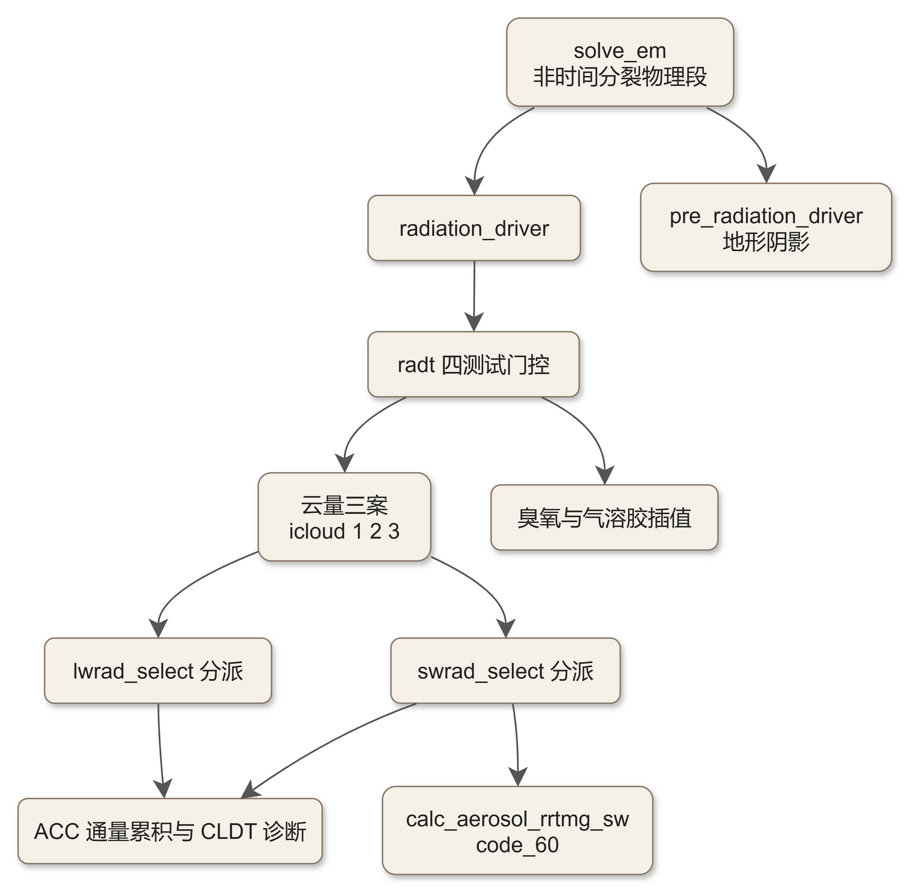
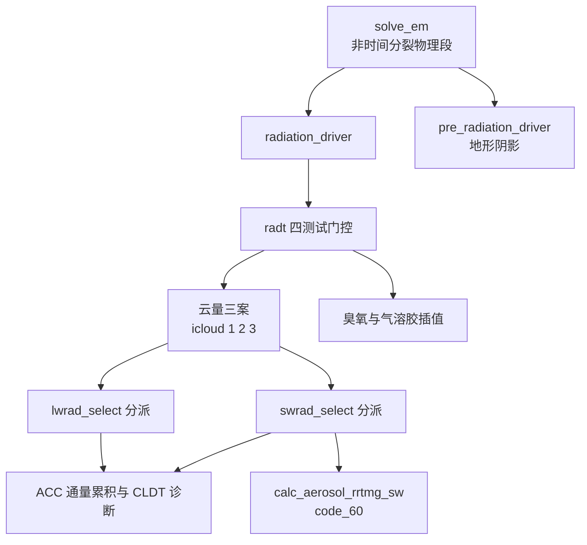

# code_20 — 辐射驱动器（module_radiation_driver.F：节拍门控、云量三案与气溶胶管线）

## 一、版本指纹

| 源文件 | 行数 | md5（整文件，按字节） |
|---|---|---|
| phys/module_radiation_driver.F | 5710 | 405c50cbd9c1841bda3436b86c9808ef |

- 抽取工具：workspace/scripts/code_extract.py v1.2，2026-10-12；块首指纹注释自带 range_md5。
- 收录分级（B）：radiation_driver 主入口节选 15 段 + 伴生小单元 10 件全文/节选；主签名（L11–L986，含 WRF-Solar/FARMs/SPP 与 CuP 全部 OPTIONAL 参数）与声明区引用不录。教材 ch12 已精读节拍与 radconst/calc_coszen——本篇补全分发、云量、气溶胶与收尾上下文。

## 二、定位

一句话：**所有辐射方案的公共调度器**——radt 四测试门控、太阳几何（radconst/calc_coszen）、云量三案（icloud=1/2/3）、臭氧与气溶胶三条通道、按 lw_physics/sw_physics 双 SELECT CASE 分派、通量累积与云顶诊断收尾；另有 pre_radiation_driver 的地形阴影与 swint 短波插值两件独立小器。

**谁在调它**：dyn_em/solve_em.F 非时间分裂物理段之首（调用序辐射→陆面→PBL→积云→浅对流→FDDA，见 [ch21_solve_em_dynamics.md](../ch21_solve_em_dynamics.md)）；pre_radiation_driver 由 first_rk_step_part1 调（阴影场提前算）。教材锚点：[ch12_radiation_family.md](../ch12_radiation_family.md)（节拍/太阳几何已精读）；下游方案本体 [code_05_module_ra_rrtmg_lw.md](code_05_module_ra_rrtmg_lw.md)、[code_06_module_ra_rrtmg_sw.md](code_06_module_ra_rrtmg_sw.md)、气溶胶 [code_60_module_ra_aerosol.md](code_60_module_ra_aerosol.md)。

**22 单元地图**（radiation_driver 3272 行主入口 + 21 个伴生单元）：



<details><summary>原始 Mermaid 源码（可点击展开）</summary>

<!--

-->

</details>

## 三、节拍门控与太阳几何

<!-- code_extract code_extract.py v1.2
source: phys/module_radiation_driver.F
ranges: L1043-L1156
file_lines: 5710
file_md5: 405c50cbd9c1841bda3436b86c9808ef
display: line-numbered (strip L-prefix and !file: line to restore)
range_md5: d79f3e595a65a59f81470107114f8dae
seg_lines: 114
-->

```fortran
!file: phys/module_radiation_driver.F    L1043-L1156
L01043     ! This allows radiation schemes to correctly
L01044     ! interface with the convection scheme when convection is only
L01045     ! enabled in some domains:
L01046     if(present(explicit_convection)) then
L01047        expl_conv=explicit_convection
L01048     else
L01049        expl_conv=.true. ! backward compatibility for ARW
L01050     endif
L01051  
L01052     IF ( ICLOUD == 3 ) THEN
L01053        IF (PRESENT(dxkm)) then
L01054           gridkm = 1.414*SQRT(dxkm*dxkm + dy*0.001*dy*0.001)
L01055        ELSE IF (PRESENT(dx)) then
L01056           gridkm = SQRT(dx*0.001*dx*0.001 + dy*0.001*dy*0.001)
L01057        endif
L01058  
L01059        if (itimestep .LE. 100) then
L01060          WRITE ( wrf_err_message , * ) 'Grid spacing in km ', dx, dy, gridkm
L01061          CALL wrf_debug (100, wrf_err_message)
L01062        endif
L01063     END IF
L01064  
L01065     CALL wrf_debug (1, 'Top of Radiation Driver')
L01066  !  WRITE ( wrf_err_message , * ) 'itimestep = ',itimestep,', dt = ',dt,', lw and sw options = ',lw_physics,sw_physics
L01067  !  CALL wrf_debug (1, wrf_err_message )
L01068     if (lw_physics .eq. 0 .and. sw_physics .eq. 0)         return
L01069  
L01070  ! amontornes-bcodina (2014-05-02) :: improving the namelist settings consistency for the FLG scheme
L01071  !  if (lw_physics .ne. FLGLWSCHEME .and. sw_physics .eq. FLGSWSCHEME)  then
L01072  !      call wrf_error_fatal('SW and LW schemes are in conflict. SW is FLG and LW is a different scheme!')
L01073  !  end if
L01074  !  if (lw_physics .eq. FLGLWSCHEME .and. sw_physics .ne. FLGSWSCHEME) then
L01075  !      call wrf_error_fatal('SW and LW schemes are in conflict. LW is FLG and SW is a different scheme!')
L01076  !  end if
L01077  
L01078  ! ra_call_offset = -1 gives old method where radiation may be called just before output
L01079  ! ra_call_offset =  0 gives new method where radiation may be called just after output
L01080  !                     and is also consistent with removal of offset in new XTIME
L01081  ! also need to account for stepra=1 which always has zero modulo output
L01082  
L01083     doing_adapt_dt = .FALSE.
L01084     IF ( PRESENT(adapt_step_flag) ) THEN
L01085        IF ( adapt_step_flag ) THEN
L01086           doing_adapt_dt = .TRUE.
L01087           IF ( radtacttime .eq. 0. ) THEN
L01088              radtacttime = CURR_SECS + radt*60.
L01089           END IF
L01090        END IF
L01091     END IF
L01092  
L01093  !  Do we run through this scheme or not?
L01094  
L01095  !    Test 1:  If this is the initial model time, then yes.
L01096  !                ITIMESTEP=1
L01097  !    Test 2:  If the user asked for the radiation to be run every time step, then yes.
L01098  !                RADT=0 or STEPRA=1
L01099  !    Test 3:  If not adaptive dt, and this is on the requested radiation frequency, then yes.
L01100  !                MOD(ITIMESTEP,STEPRA)=0 (or 1, depending on the offset setting)
L01101  !    Test 4:  If using adaptive dt and the current time is past the last requested activate radiation time, then yes.
L01102  !                CURR_SECS >= RADTACTTIME
L01103  
L01104  !  If we do run through the scheme, we set the flag run_param to TRUE and we set the decided flag
L01105  !  to TRUE.  The decided flag says that one of these tests was able to say "yes", run the scheme.
L01106  !  We only proceed to other tests if the previous tests all have left decided as FALSE.
L01107  
L01108  !  If we set run_param to TRUE and this is adaptive time stepping, we set the time to the next
L01109  !  radiation run.
L01110  
L01111     run_param = .FALSE.
L01112     decided = .FALSE.
L01113     IF ( ( .NOT. decided ) .AND. &
L01114          ( itimestep .EQ. 1 ) ) THEN
L01115        run_param   = .TRUE.
L01116        decided     = .TRUE.
L01117     END IF
L01118  
L01119     IF ( ( .NOT. decided ) .AND. &
L01120          ( ( radt .EQ. 0. ) .OR. ( stepra .EQ. 1 ) ) ) THEN
L01121        run_param   = .TRUE.
L01122        decided     = .TRUE.
L01123     END IF
L01124  
L01125     IF ( ( .NOT. decided ) .AND. &
L01126          ( .NOT. doing_adapt_dt ) .AND. &
L01127          ( MOD(itimestep,stepra) .EQ. 1+ra_call_offset ) ) THEN
L01128        run_param   = .TRUE.
L01129        decided     = .TRUE.
L01130     END IF
L01131  
L01132     IF ( ( .NOT. decided ) .AND. &
L01133          ( doing_adapt_dt ) .AND. &
L01134          ( curr_secs .GE. radtacttime ) ) THEN
L01135        run_param   = .TRUE.
L01136        decided     = .TRUE.
L01137        radtacttime = curr_secs + radt*60
L01138     END IF
L01139  
L01140     IF ( mp_physics .EQ. nuwrf4icescheme ) THEN
L01141        DO ij = 1 , num_tiles
L01142           its = i_start(ij)
L01143           ite = i_end(ij)
L01144           jts = j_start(ij)
L01145           jte = j_end(ij)
L01146           DO j=jts,jte
L01147           DO k=kts,kte
L01148           DO i=its,ite
L01149              re_cloud(i,k,j) = re_cloud_gsfc(i,k,j) * 1.E-6
L01150              re_ice(i,k,j) = re_ice_gsfc(i,k,j) * 1.E-6
L01151              re_snow(i,k,j) = re_snow_gsfc(i,k,j) * 1.E-6
L01152           ENDDO
L01153           ENDDO
L01154           ENDDO
L01155        ENDDO
L01156     END IF
```

> 讲解：①lw_physics=0 且 sw_physics=0 直接 return；②**radt 四测试**与积云 driver（code_23 §五）逐条同构——itimestep=1 必跑、radt=0 或 stepra=1 每步、MOD(itimestep,stepra)=1+ra_call_offset 按周期、自适应 dt 用 radtacttime 物理时刻推进；**ra_call_offset（±1）是把辐射调用对齐到输出时刻前后**的老/新两种约定；③icloud=3 时 gridkm=√(dx²+dy²)（1.414 因子用于旋转网格）——Thompson 2014 尺度感知云量要吃格距；④NUWRF 专属：微物理为 nuwrf4ice 时把 GSFC 有效半径从 μm 换成 m。

<!-- code_extract code_extract.py v1.2
source: phys/module_radiation_driver.F
ranges: L1158-L1256
file_lines: 5710
file_md5: 405c50cbd9c1841bda3436b86c9808ef
display: line-numbered (strip L-prefix and !file: line to restore)
range_md5: 3fc412aace40af05b52aebd07aa88dd0
seg_lines: 99
-->

```fortran
!file: phys/module_radiation_driver.F    L1158-L1256
L01158     if(swint_opt.eq.1 .or. swint_opt == 2) then
L01159        DO ij = 1 , num_tiles
L01160           its = i_start(ij)
L01161           ite = i_end(ij)
L01162           jts = j_start(ij)
L01163           jte = j_end(ij)
L01164           CALL radconst(XTIME,DECLIN,SOLCON,JULIAN,               &
L01165                         DEGRAD,DPD                                )
L01166           call calc_coszen(ims,ime,jms,jme,its,ite,jts,jte, &
L01167                            julian,xtime,gmt,declin,degrad,  &
L01168                            xlong,xlat,coszen_loc,hrang_loc)
L01169        end do
L01170     end if
L01171  
L01172     solar_opt_local = 0
L01173     IF ( PRESENT(solar_opt) ) THEN
L01174        solar_opt_local = solar_opt
L01175     END IF
L01176     Solar_step: IF (run_param .or. solar_opt_local == 1 .or. swint_opt == 2) THEN
L01177  
L01178       !---------------
L01179       ! Calculate constant for short wave radiation
L01180       ! moved up and out of OMP loop because it only needs to be computed once
L01181       ! and because it is not entirely thread-safe (XT24, TOLOCTM and XXLAT need
L01182       ! their thread-privacy)  JM 20100217
L01183         DO ij = 1 , num_tiles
L01184           its = i_start(ij)
L01185           ite = i_end(ij)
L01186           jts = j_start(ij)
L01187           jte = j_end(ij)
L01188           CALL radconst(XTIME,DECLIN,SOLCON,JULIAN,               &
L01189                         DEGRAD,DPD                                )
L01190  
L01191  ! amontornes-bcodina 2015/09 solar eclipses
L01192  !    Solar eclipse prediction based on the Bessel's method
L01193  !    outputs: obscur, mask, elat_track, elon_track
L01194           CALL solar_eclipse(ims,ime,jms,jme,its,ite,jts,jte,        &
L01195                              julian,gmt,YR,xtime,radt,               &
L01196                              degrad,xlong,xlat,obscur_loc,mask_loc,  &
L01197                              elat_loc,elon_loc,sw_eclipse  )
L01198  
L01199           IF(PRESENT(declinx).AND.PRESENT(solconx))THEN
L01200  ! saved to state arrays used in surface driver
L01201             declinx=declin
L01202             solconx=solcon
L01203           ENDIF
L01204  ! added coszen subroutine : jararias, 2013/08/10
L01205  !   outputs: coszen, hrang
L01206           call calc_coszen(ims,ime,jms,jme,its,ite,jts,jte,  &
L01207                            julian,xtime+radt*0.5,gmt, &
L01208                            declin,degrad,xlong,xlat,coszen,hrang)
L01209  
L01210         ! backup the incoming hydrometeors
L01211  
L01212           IF ( F_QC ) THEN
L01213             DO j=jts,jte
L01214             DO k=kts,kte
L01215             DO i=its,ite
L01216               qc_save(i,k,j) = qc(i,k,j)
L01217             ENDDO
L01218             ENDDO
L01219             ENDDO
L01220           ENDIF
L01221           IF ( F_QI ) THEN
L01222             DO j=jts,jte
L01223             DO k=kts,kte
L01224             DO i=its,ite
L01225               qi_save(i,k,j) = qi(i,k,j)
L01226             ENDDO
L01227             ENDDO
L01228             ENDDO
L01229           ENDIF
L01230  
L01231           IF(aercu_opt.gt.0.0) THEN
L01232             IF ( F_QI ) THEN
L01233               DO j=jts,jte
L01234               DO k=kts,kte
L01235               DO i=its,ite
L01236                 qs_save(i,k,j) = qs(i,k,j)
L01237               ENDDO
L01238               ENDDO
L01239               ENDDO
L01240             ENDIF
L01241           END IF
L01242  
L01243  ! Fill temporary water variable depending on micro package (tgs 25 Apr 2006)
L01244           if( F_QC ) then
L01245             DO j=jts,jte
L01246             DO k=kts,kte
L01247             DO i=its,ite
L01248               qc_temp(I,K,J)=qc(I,K,J)
L01249             ENDDO
L01250             ENDDO
L01251             ENDDO
L01252           else
L01253             DO j=jts,jte
L01254             DO k=kts,kte
L01255             DO i=its,ite
L01256               qc_temp(I,K,J)=0.
```

> 讲解：①swint_opt=1/2 时先算一套 coszen_loc（**不带 radt 半步**）供短波插值用；②Solar_step 块：radconst 算太阳赤纬 DECLIN 与太阳常数 SOLCON（提出 OMP 循环外——XT24/TOLOCTM/XXLAT 的线程私有性注释，JM 20100217）；solar_eclipse 用 Bessel 法算日食遮挡（obscur/mask/轨迹）；**calc_coszen 的调用点用 xtime+radt·0.5——辐射区间中点的太阳几何**（教材 ch12 的核心发现之一）；③DECLINX/SOLCONX 存回状态数组供 surface_driver 复用；④**水物质备份** qc_save/qi_save——云量方案（尤其 icloud=3 的 modify_qvapor）会改水物质，跑完恢复（§八）。

<!-- code_extract code_extract.py v1.2
source: phys/module_radiation_driver.F
ranges: L3469-L3511
file_lines: 5710
file_md5: 405c50cbd9c1841bda3436b86c9808ef
display: line-numbered (strip L-prefix and !file: line to restore)
range_md5: 618126e1f074a6809dd94bc832132b06
seg_lines: 43
label: subroutine radconst
-->

```fortran
!file: phys/module_radiation_driver.F    L3469-L3511    (subroutine radconst)
L03469     SUBROUTINE radconst(XTIME,DECLIN,SOLCON,JULIAN,                   &
L03470                         DEGRAD,DPD                                    )
L03471  !---------------------------------------------------------------------
L03472     USE module_wrf_error
L03473     IMPLICIT NONE
L03474  !---------------------------------------------------------------------
L03475  
L03476  ! !ARGUMENTS:
L03477     REAL, INTENT(IN   )      ::       DEGRAD,DPD,XTIME,JULIAN
L03478     REAL, INTENT(OUT  )      ::       DECLIN,SOLCON
L03479     REAL                     ::       OBECL,SINOB,SXLONG,ARG,  &
L03480                                       DECDEG,DJUL,RJUL,ECCFAC
L03481  !
L03482  ! !DESCRIPTION:
L03483  ! Compute terms used in radiation physics 
L03484  !EOP
L03485  
L03486  ! for short wave radiation
L03487  
L03488     DECLIN=0.
L03489     SOLCON=0.
L03490  
L03491  !-----OBECL : OBLIQUITY = 23.5 DEGREE.
L03492          
L03493     OBECL=23.5*DEGRAD
L03494     SINOB=SIN(OBECL)
L03495          
L03496  !-----CALCULATE LONGITUDE OF THE SUN FROM VERNAL EQUINOX:
L03497          
L03498     IF(JULIAN.GE.80.)SXLONG=DPD*(JULIAN-80.)
L03499     IF(JULIAN.LT.80.)SXLONG=DPD*(JULIAN+285.)
L03500     SXLONG=SXLONG*DEGRAD
L03501     ARG=SINOB*SIN(SXLONG)
L03502     DECLIN=ASIN(ARG)
L03503     DECDEG=DECLIN/DEGRAD
L03504  !----SOLAR CONSTANT ECCENTRICITY FACTOR (PALTRIDGE AND PLATT 1976)
L03505     DJUL=JULIAN*360./365.
L03506     RJUL=DJUL*DEGRAD
L03507     ECCFAC=1.000110+0.034221*COS(RJUL)+0.001280*SIN(RJUL)+0.000719*  &
L03508            COS(2*RJUL)+0.000077*SIN(2*RJUL)
L03509     SOLCON=1370.*ECCFAC
L03510     
L03511     END SUBROUTINE radconst
```

> 讲解：太阳赤纬与太阳常数：黄赤交角 OBECL=23.5°；太阳黄经从春分起算（JULIAN≥80 即 3 月 21 日后），SXLONG=DPD·(JULIAN−80)；DECLIN=asin(sinob·sinSXLONG)；**ECCFAC 是 Paltridge–Platt (1976) 的四项日地距离谐波**（1.000110+0.034221cos+0.001280sin+0.000719cos2+0.000077sin2），SOLCON=1370·ECCFAC——教材 ch12 已逐符号核过。

<!-- code_extract code_extract.py v1.2
source: phys/module_radiation_driver.F
ranges: L3514-L3541
file_lines: 5710
file_md5: 405c50cbd9c1841bda3436b86c9808ef
display: line-numbered (strip L-prefix and !file: line to restore)
range_md5: 55655439b6e7d64b71dd33fd1093becc
seg_lines: 28
label: subroutine calc_coszen
-->

```fortran
!file: phys/module_radiation_driver.F    L3514-L3541    (subroutine calc_coszen)
L03514     SUBROUTINE calc_coszen(ims,ime,jms,jme,its,ite,jts,jte,  &
L03515                            julian,xtime,gmt, &
L03516                            declin,degrad,xlon,xlat,coszen,hrang)
L03517         ! Added Equation of Time correction : jararias, 2013/08/10
L03518         implicit none
L03519         integer, intent(in) :: ims,ime,jms,jme,its,ite,jts,jte
L03520         real, intent(in)    :: julian,declin,xtime,gmt,degrad
L03521         real, dimension(ims:ime,jms:jme), intent(in)    :: xlat,xlon
L03522         real, dimension(ims:ime,jms:jme), intent(inout) :: coszen,hrang
L03523  
L03524         integer :: i,j
L03525         real    :: da,eot,xt24,tloctm,xxlat
L03526  
L03527         da=6.2831853071795862*(julian-0.5)/365.
L03528         eot=(0.000075+0.001868*cos(da)-0.032077*sin(da) &
L03529              -0.014615*cos(2*da)-0.040849*sin(2*da))*(229.18)
L03530         xt24=mod(xtime,1440.)+eot
L03531         do j=jts,jte
L03532            do i=its,ite
L03533               tloctm=gmt+xt24/60.+xlon(i,j)/15.
L03534               hrang(i,j)=15.*(tloctm-12.)*degrad
L03535               xxlat=xlat(i,j)*degrad
L03536               coszen(i,j)=sin(xxlat)*sin(declin) &
L03537                          +cos(xxlat)*cos(declin) *cos(hrang(i,j))
L03538               coszen(i, j) = min (max (coszen(i, j), -1.0), 1.0)
L03539            enddo
L03540         enddo
L03541     END SUBROUTINE calc_coszen
```

> 讲解：太阳天顶角：**均时差修正** eot（Spencer 四项式×229.18 分钟换算）；xt24=mod(xtime,1440)+eot；地方平时 tloctm=GMT+xt24/60+经度/15；时角 hrang=15°·(tloctm−12)；coszen=sinφsinδ+cosφcosδcosH，钳位 [−1,1]——与书 (5.4.3a) 同式。

## 四、云量三案（namelist icloud）

<!-- code_extract code_extract.py v1.2
source: phys/module_radiation_driver.F
ranges: L1308-L1345
file_lines: 5710
file_md5: 405c50cbd9c1841bda3436b86c9808ef
display: line-numbered (strip L-prefix and !file: line to restore)
range_md5: 00259551812ad7b5b63a1cf824cebf16
seg_lines: 38
-->

```fortran
!file: phys/module_radiation_driver.F    L1308-L1345
L01308  ! Choose how to compute cloud fraction (since 3.6)
L01309  ! Initialize to zero
L01310       DO j=jts,jte
L01311       DO k=kts,kte
L01312       DO i=its,ite
L01313          CLDFRA(i,k,j) = 0.
L01314       END DO
L01315       END DO
L01316       END DO
L01317  !---------------
L01318  ! Calculate constant for short wave radiation
L01319  
L01320       IF ( ICLOUD == 1 ) THEN
L01321  
L01322       IF ( F_QC .OR. F_QI ) THEN
L01323  ! Call to cloud fraction routine based on Randall 1994 (Hong Pan 1998)
L01324  
L01325          CALL wrf_debug (1, 'CALL cldfra1')
L01326          CALL cal_cldfra1(CLDFRA,qv,qc,qi,qs,               &
L01327                     F_QV,F_QC,F_QI,F_QS,t,p,                &
L01328                     F_ICE_PHY,F_RAIN_PHY,                   &
L01329                     mp_physics,cldfra1_flag,                &
L01330                     ids,ide, jds,jde, kds,kde,              &
L01331                     ims,ime, jms,jme, kms,kme,              &
L01332                     its,ite, jts,jte, kts,kte               )
L01333          IF ( PRESENT ( CLDFRA_DP ) ) THEN
L01334  ! this is for Kain-Fritsch schemes
L01335            IF ( icloud_cu .EQ. 2 .OR. aercu_opt .GT. 0 ) THEN
L01336               CALL wrf_debug (1, 'use kf cldfra')
L01337               DO j = jts,jte
L01338               DO k = kts,kte
L01339               DO i = its,ite
L01340                  cldfra_cu(i,k,j)=cldfra_dp(i,k,j)+cldfra_sh(i,k,j) ! Cu cloud fraction
L01341                  CLDFRA(i,k,j)=(1.-cldfra_cu(i,k,j))*CLDFRA(i,k,j)  ! Update resolved cloud fraction for Cu punch-through
L01342                  CLDFRA(i,k,j)=CLDFRA(i,k,j)+cldfra_cu(i,k,j)       ! New total cloud fraction
L01343                  CLDFRA(i,k,j)=AMIN1(1.0,CLDFRA(i,k,j))
L01344                  qc(i,k,j) = qc(i,k,j)+qc_cu(i,k,j)*cldfra_cu(i,k,j)
L01345                  qi(i,k,j) = qi(i,k,j)+qi_cu(i,k,j)*cldfra_cu(i,k,j)
```

> 讲解：icloud=1（默认，Randall 1994/Hong-Pan 谱系）：调 cal_cldfra1；**KF 积云云量的 punch-through 混合**——icloud_cu=2 或 aercu_opt>0 时把 cldfra_dp+cldfra_sh（KF 深浅对流云量）按 CLDFRA=(1−cu)·格点云量+cu 的方式并入，并把 KF 云水/云冰按云量比加进 qc/qi（MSKF 场景还要按权重混合有效半径 EFCS/EFIG 系）。

<!-- code_extract code_extract.py v1.2
source: phys/module_radiation_driver.F
ranges: L1449-L1505
file_lines: 5710
file_md5: 405c50cbd9c1841bda3436b86c9808ef
display: line-numbered (strip L-prefix and !file: line to restore)
range_md5: 27af752db26c07cf2e47b543cbae7933
seg_lines: 57
-->

```fortran
!file: phys/module_radiation_driver.F    L1449-L1505
L01449       ELSE IF ( ICLOUD == 2 ) THEN
L01450       IF ( F_QC .OR. F_QI ) THEN
L01451         CALL wrf_debug (1, 'CALL cldfra2')
L01452         CALL cal_cldfra2(CLDFRA,qc,qi,F_QC,F_QI,              &
L01453                         ids,ide, jds,jde, kds,kde,            &
L01454                         ims,ime, jms,jme, kms,kme,            &
L01455                         its,ite, jts,jte, kts,kte             )
L01456       ENDIF
L01457  
L01458  !+---+-----------------------------------------------------------------+
L01459  !..New cloud fraction scheme added by G. Thompson (2014Oct31)
L01460  !+---+-----------------------------------------------------------------+
L01461  
L01462       ELSEIF (ICLOUD == 3) THEN
L01463          IF ( F_QC .AND. F_QI ) THEN
L01464  
L01465             CALL wrf_debug (150, 'DEBUG: using gthompsn cloud fraction scheme')
L01466  
L01467             DO j = jts,jte
L01468             DO i = its,ite
L01469  
L01470               DO k = kts,kte
L01471                  p_1d(k) = p(i,k,j)
L01472                  if (pert_cld3 .and. multi_perturb == 1) then
L01473                    t_1d(k) = (1.0 + perts_th(i, k, j) * pert_cld3_t) * t(i, k, j)
L01474                    qv_1d(k) = max (0.0, (1.0 + perts_qvapor(i, k, j) * pert_cld3_qv) * qv(i, k, j))
L01475                  else
L01476                    t_1d(k) = t(i,k,j)
L01477                    qv_1d(k) = qv(i,k,j)
L01478                  end if
L01479                  qc_1d(k) = qc(i,k,j)
L01480                  qi_1d(k) = qi(i,k,j)
L01481                  qs_1d(k) = qs(i,k,j)
L01482                  Dz_1d(k) = dz8w(i,k,j)
L01483                  cf_1d(k) = cldfra(i,k,j)
L01484               ENDDO
L01485  
L01486               WRITE (wrf_err_message,*) 'DEBUG: calling cal_cldfra3 at (i,j): ', i,j, kms,kme,kts,kte
L01487               CALL wrf_debug (150, wrf_err_message)
L01488  
L01489               CALL cal_cldfra3(cf_1d, qv_1d, qc_1d, qi_1d, qs_1d, Dz_1d, &
L01490       &                          p_1d, t_1d, XLAND(i,j), gridkm,         &
L01491       &                          .false., 1.5, kts, kte, .false.)
L01492  
L01493               DO k = kts,kte
L01494                  qc(i,k,j) = qc_1d(k)
L01495                  qi(i,k,j) = qi_1d(k)
L01496                  qs(i,k,j) = qs_1d(k)
L01497                  cldfra(i,k,j) = cf_1d(k)
L01498               ENDDO
L01499  
L01500             ENDDO
L01501             ENDDO
L01502  
L01503          ELSE
L01504             CALL wrf_error_fatal('Can not use icloud = 3 option, missing QC or QI field.')
L01505          ENDIF
```

> 讲解：icloud=2：cal_cldfra2（qc/qi 阈值二值，见 §四附）；icloud=3：**Thompson 2014 尺度感知云量**——逐列进 cal_cldfra3，SPP（multi_perturb=1）时对 t/qv 先乘扰动；**requirement：F_QC 且 F_QI 同时在场，否则 FATAL**。

<!-- code_extract code_extract.py v1.2
source: phys/module_radiation_driver.F
ranges: L3761-L3986
file_lines: 5710
file_md5: 405c50cbd9c1841bda3436b86c9808ef
display: line-numbered (strip L-prefix and !file: line to restore)
range_md5: 4798b45c2ca5592e28f3842ea71745c4
seg_lines: 226
label: subroutine cal_cldfra1
-->

```fortran
!file: phys/module_radiation_driver.F    L3761-L3986    (subroutine cal_cldfra1)
L03761     SUBROUTINE cal_cldfra1(CLDFRA, QV, QC, QI, QS,                    &
L03762                           F_QV, F_QC, F_QI, F_QS, t_phy, p_phy,       &
L03763                           F_ICE_PHY,F_RAIN_PHY,                       &
L03764                           mp_physics, cldfra1_flag,                   &
L03765            ids,ide, jds,jde, kds,kde,                                 &
L03766            ims,ime, jms,jme, kms,kme,                                 &
L03767            its,ite, jts,jte, kts,kte                                  )
L03768       USE module_state_description, ONLY : KFCUPSCHEME, KFETASCHEME       !wig, CuP 4-Fb-2008 !BSINGH - For WRFCuP scheme
L03769  
L03770     USE module_state_description, ONLY : FER_MP_HIRES, FER_MP_HIRES_ADVECT
L03771  !---------------------------------------------------------------------
L03772     IMPLICIT NONE
L03773  !---------------------------------------------------------------------
L03774     INTEGER,  INTENT(IN   )   ::           ids,ide, jds,jde, kds,kde, &
L03775                                            ims,ime, jms,jme, kms,kme, &
L03776                                            its,ite, jts,jte, kts,kte
L03777  
L03778  !
L03779     INTEGER, DIMENSION( ims:ime, kms:kme, jms:jme ), INTENT(OUT  ) :: cldfra1_flag
L03780     REAL, DIMENSION( ims:ime, kms:kme, jms:jme ), INTENT(OUT  ) ::    &
L03781                                                               CLDFRA
L03782  
L03783     REAL, DIMENSION( ims:ime, kms:kme, jms:jme ), INTENT(IN   ) ::    &
L03784                                                                   QV, &
L03785                                                                   QI, &
L03786                                                                   QC, &
L03787                                                                   QS, &
L03788                                                                t_phy, &
L03789                                                                p_phy
L03790  !                                                              p_phy, &
L03791  !                                                          F_ICE_PHY, &
L03792  !                                                         F_RAIN_PHY
L03793  
L03794     REAL, DIMENSION( ims:ime, kms:kme, jms:jme ),                     &
L03795           OPTIONAL,                                                   &
L03796           INTENT(IN   ) ::                                            &
L03797                                                            F_ICE_PHY, &
L03798                                                           F_RAIN_PHY
L03799     LOGICAL,OPTIONAL,INTENT(IN) :: F_QC,F_QI,F_QV,F_QS
L03800     INTEGER :: mp_physics
L03801  
L03802  !  REAL thresh
L03803     INTEGER:: i,j,k
L03804     REAL    :: RHUM, tc, esw, esi, weight, qvsw, qvsi, qvs_weight, QIMID, QWMID, QCLD, DENOM, ARG, SUBSAT
L03805  
L03806     REAL    ,PARAMETER :: ALPHA0=100., GAMMA=0.49, QCLDMIN=1.E-12,    &
L03807                                          PEXP=0.25, RHGRID=1.0
L03808     REAL    , PARAMETER ::  SVP1=0.61078
L03809     REAL    , PARAMETER ::  SVP2=17.2693882
L03810     REAL    , PARAMETER ::  SVPI2=21.8745584
L03811     REAL    , PARAMETER ::  SVP3=35.86
L03812     REAL    , PARAMETER ::  SVPI3=7.66
L03813     REAL    , PARAMETER ::  SVPT0=273.15
L03814     REAL    , PARAMETER ::  r_d = 287.
L03815     REAL    , PARAMETER ::  r_v = 461.6
L03816     REAL    , PARAMETER ::  ep_2=r_d/r_v
L03817  ! !DESCRIPTION:
L03818  ! Compute cloud fraction from input ice and cloud water fields
L03819  ! if provided.
L03820  !
L03821  ! Whether QI or QC is active or not is determined from the indices of
L03822  ! the fields into the 4D scalar arrays in WRF. These indices are 
L03823  ! P_QI and P_QC, respectively, and they are passed in to the routine
L03824  ! to enable testing to see if QI and QC represent active fields in
L03825  ! the moisture 4D scalar array carried by WRF.
L03826  ! 
L03827  ! If a field is active its index will have a value greater than or
L03828  ! equal to PARAM_FIRST_SCALAR, which is also an input argument to 
L03829  ! this routine.
L03830  !EOP
L03831  
L03832  
L03833  !-----------------------------------------------------------------------
L03834  !---  COMPUTE GRID-SCALE CLOUD COVER FOR RADIATION
L03835  !     (modified by Ferrier, Feb '02)
L03836  !
L03837  !---  Cloud fraction parameterization follows Randall, 1994
L03838  !     (see Hong et al., 1998)
L03839  !-----------------------------------------------------------------------
L03840  ! Note: ep_2=287./461.6 Rd/Rv
L03841  ! Note: R_D=287.
L03842  
L03843  ! Alternative calculation for critical RH for grid saturation
L03844  !     RHGRID=0.90+.08*((100.-DX)/95.)**.5
L03845  
L03846  ! Calculate saturation mixing ratio weighted according to the fractions of
L03847  ! water and ice.
L03848  ! Following:
L03849  ! Murray, F.W. 1966. ``On the computation of Saturation Vapor Pressure''  J. Appl. Meteor.  6 p.204
L03850  !    es (in mb) = 6.1078 . exp[ a . (T-273.16)/ (T-b) ]
L03851  !
L03852  !       over ice        over water
L03853  ! a =   21.8745584      17.2693882
L03854  ! b =   7.66            35.86
L03855  
L03856  !---------------------------------------------------------------------
L03857  
L03858      DO j = jts,jte
L03859      DO k = kts,kte
L03860      DO i = its,ite
L03861        tc         = t_phy(i,k,j) - SVPT0
L03862        esw     = 1000.0 * SVP1 * EXP( SVP2  * tc / ( t_phy(i,k,j) - SVP3  ) )
L03863        esi     = 1000.0 * SVP1 * EXP( SVPI2 * tc / ( t_phy(i,k,j) - SVPI3 ) )
L03864        QVSW = EP_2 * esw / ( p_phy(i,k,j) - esw )
L03865        QVSI = EP_2 * esi / ( p_phy(i,k,j) - esi )
L03866  
L03867        ifouter: IF ( PRESENT(F_QI) .and. PRESENT(F_QC) .and. PRESENT(F_QS) ) THEN
L03868  
L03869  ! mji - For MP options 2, 4, 6, 7, 8, etc. (qc = liquid, qi = ice, qs = snow)
L03870           IF ( F_QI .and. F_QC .and. F_QS) THEN
L03871              QCLD = QI(i,k,j)+QC(i,k,j)+QS(i,k,j)
L03872              IF (QCLD .LT. QCLDMIN) THEN
L03873                 weight = 0.
L03874              ELSE
L03875                 weight = (QI(i,k,j)+QS(i,k,j)) / QCLD
L03876              ENDIF
L03877           ENDIF
L03878  
L03879  ! for P3, mp option 50 or 51
L03880           IF ( F_QI .and. F_QC .and. .not. F_QS) THEN
L03881              QCLD = QI(i,k,j)+QC(i,k,j)
L03882              IF (QCLD .LT. QCLDMIN) THEN
L03883                 weight = 0.
L03884              ELSE
L03885                 weight = (QI(i,k,j)) / QCLD
L03886              ENDIF
L03887           ENDIF
L03888  
L03889  ! mji - For MP options 1 and 3, (qc only)
L03890  !  For MP=1, qc = liquid, for MP=3, qc = liquid or ice depending on temperature
L03891           IF ( F_QC .and. .not. F_QI .and. .not. F_QS ) THEN
L03892              QCLD = QC(i,k,j)
L03893              IF (QCLD .LT. QCLDMIN) THEN
L03894                 weight = 0.
L03895              ELSE
L03896                 if (t_phy(i,k,j) .gt. 273.15) weight = 0.
L03897                 if (t_phy(i,k,j) .le. 273.15) weight = 1.
L03898              ENDIF
L03899           ENDIF
L03900  
L03901  ! mji - For MP option 5; (qc = liquid, qs = ice)
L03902           IF ( F_QC .and. .not. F_QI .and. F_QS .and. PRESENT(F_ICE_PHY) ) THEN
L03903  
L03904  ! Mixing ratios of cloud water & total ice (cloud ice + snow).
L03905  ! Mixing ratios of rain are not considered in this scheme.
L03906  ! F_ICE is fraction of ice
L03907  ! F_RAIN is fraction of rain
L03908  
L03909             QIMID = QS(i,k,j)
L03910             QWMID = QC(i,k,j)
L03911  ! old method
L03912  !           QIMID = QC(i,k,j)*F_ICE_PHY(i,k,j)
L03913  !           QWMID = (QC(i,k,j)-QIMID)*(1.-F_RAIN_PHY(i,k,j))
L03914  !
L03915  !--- Total "cloud" mixing ratio, QCLD.  Rain is not part of cloud,
L03916  !    only cloud water + cloud ice + snow
L03917  !
L03918             QCLD=QWMID+QIMID
L03919             IF (QCLD .LT. QCLDMIN) THEN
L03920                weight = 0.
L03921             ELSE
L03922                weight = F_ICE_PHY(i,k,j)
L03923             ENDIF
L03924           ENDIF
L03925  !         IF ( F_QC .and. F_QI .and. .not. F_QS ) THEN
L03926           IF ( mp_physics .eq. FER_MP_HIRES .or. &
L03927                mp_physics==fer_mp_hires_advect) THEN
L03928             QIMID = QI(i,k,j)     !- total ice (cloud ice + snow)
L03929             QWMID = QC(i,k,j)     !- cloud water
L03930             QCLD=QWMID+QIMID      !- cloud water + total ice
L03931             IF (QCLD .LT. QCLDMIN) THEN
L03932                weight = 0.
L03933             ELSE
L03934                weight = QIMID/QCLD
L03935                if (tc<-40.) weight=1.
L03936             ENDIF
L03937           ENDIF
L03938  
L03939        ELSE
L03940           CLDFRA(i,k,j)=0.
L03941  
L03942        ENDIF ifouter !  IF ( F_QI .and. F_QC .and. F_QS)
L03943  
L03944  
L03945        QVS_WEIGHT = (1-weight)*QVSW + weight*QVSI
L03946        RHUM=QV(i,k,j)/QVS_WEIGHT   !--- Relative humidity
L03947  !
L03948  !--- Determine cloud fraction (modified from original algorithm)
L03949  !
L03950        cldfra1_flag(i,k,j) = 0
L03951        IF (QCLD .LT. QCLDMIN) THEN
L03952  !
L03953  !--- Assume zero cloud fraction if there is no cloud mixing ratio
L03954  !
L03955          CLDFRA(i,k,j)=0.
L03956          cldfra1_flag(i,k,j) = 1
L03957        ELSEIF(RHUM.GE.RHGRID)THEN
L03958  !
L03959  !--- Assume cloud fraction of unity if near saturation and the cloud
L03960  !    mixing ratio is at or above the minimum threshold
L03961  !
L03962          CLDFRA(i,k,j)=1.
L03963          cldfra1_flag(i,k,j) = 2
L03964        ELSE
L03965           cldfra1_flag(i,k,j) = 3
L03966  !
L03967  !--- Adaptation of original algorithm (Randall, 1994; Zhao, 1995)
L03968  !    modified based on assumed grid-scale saturation at RH=RHgrid.
L03969  !
L03970          SUBSAT=MAX(1.E-10,RHGRID*QVS_WEIGHT-QV(i,k,j))
L03971          DENOM=(SUBSAT)**GAMMA
L03972          ARG=MAX(-6.9, -ALPHA0*QCLD/DENOM)    ! <-- EXP(-6.9)=.001
L03973  ! prevent negative values  (new)
L03974          RHUM=MAX(1.E-10, RHUM)
L03975          CLDFRA(i,k,j)=(RHUM/RHGRID)**PEXP*(1.-EXP(ARG))
L03976  !!              ARG=-1000*QCLD/(RHUM-RHGRID)
L03977  !!              ARG=MAX(ARG, ARGMIN)
L03978  !!              CLDFRA(i,k,j)=(RHUM/RHGRID)*(1.-EXP(ARG))
L03979          IF (CLDFRA(i,k,j) .LT. .01) CLDFRA(i,k,j)=0.
L03980             
L03981       ENDIF          !--- End IF (QCLD .LT. QCLDMIN) ...     
L03982      ENDDO          !--- End DO i
L03983      ENDDO          !--- End DO k
L03984      ENDDO          !--- End DO j
L03985  
L03986     END SUBROUTINE cal_cldfra1
```

> 讲解：Randall 型诊断云量全解：①饱和水汽比 QVSW/QVSI 按 Murray 1966 系数（水 17.2693882/35.86、冰 21.8745584/7.66）分别算，**按冰水份额 weight 混合**——weight 的分派按微物理方案四路（qc+qi+qs 三组分=P3 前主流；仅 qc=MP1/3；qc+qs=FICE 份额=MP5；FER_MP_HIRES 用 qi/总并 −40°C 全冰）；②RHUM=QV/QVS_WEIGHT；③三段式：无云水→0（cldfra1_flag=1 诊断标记）、RH≥RHGRID(=1.0)→全盖、否则 **Xu–Randall 1996 式 CLDFRA=(RH/RHGRID)^0.25·(1−exp(−100·QCLD/SUBSAT^0.49))**（ARG 钳位 −6.9 防下溢、结果下限 0.01）；注释头写 Randall 1994、体内注明 Xu and Randall (JAS) 1996——两个引文并存的历史痕迹。

<!-- code_extract code_extract.py v1.2
source: phys/module_radiation_driver.F
ranges: L3676-L3749
file_lines: 5710
file_md5: 405c50cbd9c1841bda3436b86c9808ef
display: line-numbered (strip L-prefix and !file: line to restore)
range_md5: b9bc3dd4d6188687b5c87bf7a925bf67
seg_lines: 74
label: subroutine cal_cldfra2
-->

```fortran
!file: phys/module_radiation_driver.F    L3676-L3749    (subroutine cal_cldfra2)
L03676     SUBROUTINE cal_cldfra2(CLDFRA,QC,QI,F_QC,F_QI,                    &
L03677            ids,ide, jds,jde, kds,kde,                                 &
L03678            ims,ime, jms,jme, kms,kme,                                 &
L03679            its,ite, jts,jte, kts,kte                                  )
L03680       USE module_state_description, ONLY : KFCUPSCHEME, KFETASCHEME       !CuP, wig 5-Oct-2006  !BSINGH - For WRFCuP scheme 
L03681  !---------------------------------------------------------------------
L03682     IMPLICIT NONE
L03683  !---------------------------------------------------------------------
L03684     INTEGER,  INTENT(IN   )   ::           ids,ide, jds,jde, kds,kde, &
L03685                                            ims,ime, jms,jme, kms,kme, &
L03686                                            its,ite, jts,jte, kts,kte
L03687  
L03688  !
L03689     REAL, DIMENSION( ims:ime, kms:kme, jms:jme ), INTENT(OUT  ) ::    &
L03690                                                               CLDFRA
L03691  
L03692     REAL, DIMENSION( ims:ime, kms:kme, jms:jme ), INTENT(IN   ) ::    &
L03693                                                                   QI, &
L03694                                                                   QC
L03695     LOGICAL,INTENT(IN) :: F_QC,F_QI
L03696  
L03697     REAL thresh
L03698     INTEGER:: i,j,k
L03699  ! !DESCRIPTION:
L03700  ! Compute cloud fraction from input ice and cloud water fields
L03701  ! if provided.
L03702  !
L03703  ! Whether QI or QC is active or not is determined from the indices of
L03704  ! the fields into the 4D scalar arrays in WRF. These indices are
L03705  ! P_QI and P_QC, respectively, and they are passed in to the routine
L03706  ! to enable testing to see if QI and QC represent active fields in
L03707  ! the moisture 4D scalar array carried by WRF.
L03708  !
L03709  ! If a field is active its index will have a value greater than or
L03710  ! equal to PARAM_FIRST_SCALAR, which is also an input argument to
L03711  ! this routine.
L03712  !EOP
L03713  !---------------------------------------------------------------------
L03714       thresh=1.0e-6
L03715  
L03716       IF ( f_qi .AND. f_qc ) THEN
L03717          DO j = jts,jte
L03718          DO k = kts,kte
L03719          DO i = its,ite
L03720             IF ( QC(i,k,j)+QI(I,k,j) .gt. thresh) THEN
L03721                CLDFRA(i,k,j)=1.
L03722             ELSE
L03723                CLDFRA(i,k,j)=0.
L03724             ENDIF
L03725          ENDDO
L03726          ENDDO
L03727          ENDDO
L03728       ELSE IF ( f_qc ) THEN
L03729          DO j = jts,jte
L03730          DO k = kts,kte
L03731          DO i = its,ite
L03732             IF ( QC(i,k,j) .gt. thresh) THEN
L03733                CLDFRA(i,k,j)=1.
L03734             ELSE
L03735                CLDFRA(i,k,j)=0.
L03736             ENDIF
L03737          ENDDO
L03738          ENDDO
L03739          ENDDO
L03740       ELSE
L03741          DO j = jts,jte
L03742          DO k = kts,kte
L03743          DO i = its,ite
L03744             CLDFRA(i,k,j)=0.
L03745          ENDDO
L03746          ENDDO
L03747          ENDDO
L03748       ENDIF
L03749     END SUBROUTINE cal_cldfra2
```

> 讲解：极简二值案：qc+qi>1e-6 即全盖（f_qc/f_qi 分别在场时的三路循环）——无部分云量，多为粗网格旧行为或对照实验用。

<!-- code_extract code_extract.py v1.2
source: phys/module_radiation_driver.F
ranges: L4003-L4110
file_lines: 5710
file_md5: 405c50cbd9c1841bda3436b86c9808ef
display: line-numbered (strip L-prefix and !file: line to restore)
range_md5: a28f33699ca7d56a85eb66f2f7d7e65a
seg_lines: 108
-->

```fortran
!file: phys/module_radiation_driver.F    L4003-L4110
L04003        SUBROUTINE cal_cldfra3(CLDFRA, qv, qc, qi, qs, dz,                &
L04004       &                 p, t, XLAND, gridkm,                             &
L04005       &                 modify_qvapor, max_relh,                         &
L04006       &                 kts,kte, debug_flag)
L04007  !
L04008        USE module_mp_thompson   , ONLY : rsif, rslf
L04009        IMPLICIT NONE
L04010  !
L04011        INTEGER, INTENT(IN):: kts, kte
L04012        LOGICAL, INTENT(IN):: modify_qvapor
L04013        REAL, DIMENSION(kts:kte), INTENT(INOUT):: qv, qc, qi, cldfra
L04014        REAL, DIMENSION(kts:kte), INTENT(IN):: p, t, dz, qs
L04015        REAL, INTENT(IN):: gridkm, XLAND, max_relh
L04016        LOGICAL, INTENT(IN):: debug_flag
L04017  
L04018  !..Local vars.
L04019        REAL:: RH_00L, RH_00O, RH_00
L04020        REAL:: entrmnt=0.5
L04021        INTEGER:: k
L04022        REAL:: TC, qvsi, qvsw, RHUM, delz
L04023        REAL, DIMENSION(kts:kte):: qvs, rh, rhoa
L04024  
L04025        character*512 dbg_msg
L04026  
L04027  !+---+
L04028  
L04029  !..Initialize cloud fraction, compute RH, and rho-air.
L04030  
L04031           DO k = kts,kte
L04032              CLDFRA(K) = 0.0
L04033  
L04034              qvsw = rslf(P(k), t(k))
L04035              qvsi = rsif(P(k), t(k))
L04036  
L04037              tc = t(k) - 273.15
L04038              if (tc .ge. -12.0) then
L04039                 qvs(k) = qvsw
L04040              elseif (tc .lt. -35.0) then
L04041                 qvs(k) = qvsi
L04042              else
L04043                 qvs(k) = qvsw - (qvsw-qvsi)*(-12.0-tc)/(-12.0+35.)
L04044              endif
L04045  
L04046              if (modify_qvapor) then
L04047                 if (qc(k).gt.1.E-8) then
L04048                    qv(k) = MAX(qv(k), qvsw)
L04049                    qvs(k) = qvsw
L04050                 endif
L04051                 if (qc(k).le.1.E-8 .and. qi(k).ge.1.E-9) then
L04052                    qv(k) = MAX(qv(k), qvsi*1.005)    !..To ensure a tiny bit ice supersaturation
L04053                    qvs(k) = qvsi
L04054                 endif
L04055              endif
L04056  
L04057              rh(k) = MAX(0.01, qv(k)/qvs(k))
L04058              rhoa(k) = p(k)/(287.0*t(k))
L04059           ENDDO
L04060  
L04061  
L04062  !..First cut scale-aware. Higher resolution should require closer to
L04063  !.. saturated grid box for higher cloud fraction.  Simple functions
L04064  !.. chosen based on Mocko and Cotton (1995) starting point and desire
L04065  !.. to get near 100% RH as grid spacing moves toward 1.0km, but higher
L04066  !.. RH over ocean required as compared to over land.
L04067  
L04068        DO k = kts,kte
L04069  
L04070           delz = MAX(100., dz(k))
L04071           RH_00L = 0.77 + MIN(0.22,SQRT(1./(50.0+gridkm*gridkm*delz*0.01)))
L04072           RH_00O = 0.85 + MIN(0.14,SQRT(1./(50.0+gridkm*gridkm*delz*0.01)))
L04073           RHUM = rh(k)
L04074  
L04075           if (qc(k).gt.1.E-6 .or. qi(k).ge.1.E-7                         &
L04076       &                    .or. (qs(k).gt.1.E-6 .and. t(k).lt.273.)) then
L04077              CLDFRA(K) = 1.0
L04078           elseif (((qc(k)+qi(k)).gt.1.E-10) .and.                        &
L04079       &                                    ((qc(k)+qi(k)).lt.1.E-6)) then
L04080              CLDFRA(K) = MIN(0.99, 0.1*(11.0 + log10(qc(k)+qi(k))))
L04081           else
L04082  
L04083              IF ((XLAND-1.5).GT.0.) THEN                                  !--- Ocean
L04084                 RH_00 = RH_00O
L04085              ELSE                                                         !--- Land
L04086                 RH_00 = RH_00L
L04087              ENDIF
L04088  
L04089              tc = MAX(-80.0, t(k) - 273.15)
L04090              if (tc .lt. -12.0) RH_00 = RH_00L
L04091  
L04092              if (tc .ge. 25.0) then
L04093                 CLDFRA(K) = 0.0
L04094              elseif (tc .ge. -12.0) then
L04095                 RHUM = MIN(rh(k), 1.0)
L04096                 CLDFRA(K) = MAX(0., 1.0-SQRT((1.001-RHUM)/(1.001-RH_00)))
L04097              else
L04098                 if (max_relh.gt.1.12 .or. (.NOT.(modify_qvapor)) ) then
L04099  !..For HRRR model, the following look OK.
L04100                    RHUM = MIN(rh(k), 1.45)
L04101                    RH_00 = RH_00 + (1.45-RH_00)*(-12.0-tc)/(-12.0+85.)
L04102                    CLDFRA(K) = MAX(0., 1.0-SQRT((1.46-RHUM)/(1.46-RH_00)))
L04103                 else
L04104  !..but for the GFS model, RH is way lower.
L04105                    RHUM = MIN(rh(k), 1.05)
L04106                    RH_00 = RH_00 + (1.05-RH_00)*(-12.0-tc)/(-12.0+85.)
L04107                    CLDFRA(K) = MAX(0., 1.0-SQRT((1.06-RHUM)/(1.06-RH_00)))
L04108                 endif
L04109              endif
L04110              if (CLDFRA(K).gt.0.) CLDFRA(K) = MAX(0.01, MIN(CLDFRA(K),0.99))
```

> 讲解：cal_cldfra3（Thompson 2014，配 icloud=3）核心段：①饱和比按温度三段插值（≥−12°C 用水面 rslf、≤−35°C 用冰面 rsif、中间线性过渡——从 module_mp_thompson USE 进来，与微物理同一套饱和式）；②**modify_qvapor**：有云水时 qv 钳到 ≥qvsw、有云冰时钳到 ≥1.005·qvsi（保证微过饱和——给冰面云量留活口）；③**尺度感知临界 RH**：RH_00L=0.77+min(0.22, √(1/(50+gridkm²·dz·0.01)))、海面 RH_00O=0.85+min(0.14,…)——格距趋于 1 km 时 RH_00 趋近 1（Mocko–Cotton 1995 起点）；④暖季 ≥25°C 直接无云；−12~25°C 用 1−√((1.001−RH)/(1.001−RH_00)) 的 Sundqvist 型；低温段按 max_relh>1.12 分 **HRRR 口径（RH 钳 1.45）与 GFS 口径（钳 1.05）**——namelist 挂 max_relh；⑤结果钳位 [0.01, 0.99]。

## 五、臭氧与气溶胶三通道

<!-- code_extract code_extract.py v1.2
source: phys/module_radiation_driver.F
ranges: L1599-L1617
file_lines: 5710
file_md5: 405c50cbd9c1841bda3436b86c9808ef
display: line-numbered (strip L-prefix and !file: line to restore)
range_md5: e4223f730309ef8d2173f97a8fe54b42
seg_lines: 19
-->

```fortran
!file: phys/module_radiation_driver.F    L1599-L1617
L01599     Radiation_step: IF ( run_param ) then
L01600  ! CAM-specific additional radiation frequency - cam_abs_freq_s (=21600s by default)
L01601       STEPABS = nint(cam_abs_freq_s/(dt*STEPRA))*STEPRA
L01602       IF (itimestep .eq. 1 .or. mod(itimestep,STEPABS) .eq. 1 + ra_call_offset &
L01603                                          .or. STEPABS .eq. 1 ) THEN
L01604         doabsems = .true.
L01605       ELSE
L01606         doabsems = .false.
L01607       ENDIF
L01608     IF (PRESENT(adapt_step_flag)) THEN
L01609       IF ((adapt_step_flag)) THEN
L01610         IF ( (itimestep .EQ. 1) .OR. (cam_abs_freq_s .EQ. 0) .OR. &
L01611             ( CURR_SECS + dt >= ( INT( CURR_SECS / ( cam_abs_freq_s ) + 1 ) * cam_abs_freq_s) ) ) THEN
L01612           doabsems = .true.
L01613         ELSE
L01614           doabsems = .false.
L01615         ENDIF
L01616       ENDIF
L01617     ENDIF
```

> 讲解：Radiation_step 门的附加频率：CAM 的吸收率重算 doabsems 按 cam_abs_freq_s（默认 21600 s）比 radt 更稀疏——STEPABS=nint(cam_abs_freq_s/(dt·STEPRA))·STEPRA，自适应 dt 用物理时刻上取整判定。

<!-- code_extract code_extract.py v1.2
source: phys/module_radiation_driver.F
ranges: L1624-L1695
file_lines: 5710
file_md5: 405c50cbd9c1841bda3436b86c9808ef
display: line-numbered (strip L-prefix and !file: line to restore)
range_md5: f66ca8a94c64bb5a83f29c19c127c5bb
seg_lines: 72
-->

```fortran
!file: phys/module_radiation_driver.F    L1624-L1695
L01624  ! Allocate aerosol arrays used by aer_opt = 2 option
L01625     IF ( PRESENT( AOD5502D ) ) THEN
L01626       ! jararias, 2013/11
L01627       IF ( aer_opt .EQ. 2 ) THEN
L01628          swrad_aerosol_select: select case(sw_physics)
L01629  
L01630             case(GODDARDSWSCHEME)
L01631                allocate(tauaer_sw(ims:ime, kms:kme, jms:jme, 1:11))
L01632                allocate(ssaaer_sw(ims:ime, kms:kme, jms:jme, 1:11))
L01633                allocate(asyaer_sw(ims:ime, kms:kme, jms:jme, 1:11))
L01634  
L01635             case(RRTMG_SWSCHEME &
L01636  #if( BUILD_RRTMG_FAST == 1)
L01637                  ,RRTMG_SWSCHEME_FAST &
L01638  #endif
L01639  #if( BUILD_RRTMK == 1)
L01640                  ,RRTMK_SWSCHEME &
L01641  #endif
L01642                  )
L01643                allocate(tauaer_sw(ims:ime, kms:kme, jms:jme, 1:14))
L01644                allocate(ssaaer_sw(ims:ime, kms:kme, jms:jme, 1:14))
L01645                allocate(asyaer_sw(ims:ime, kms:kme, jms:jme, 1:14))
L01646  
L01647          end select swrad_aerosol_select
L01648       ENDIF
L01649     ENDIF
L01650  
L01651  ! Allocate aerosol arrays used by aer_opt = 3 option, and explicit AOD from QNWFA+QNIFA(+QNBCA)   (Trude)
L01652     IF (PRESENT(f_qnwfa) .AND. PRESENT(f_qnifa) .AND. PRESENT(taod5503d) .AND.  PRESENT(taod5502d)) THEN
L01653        IF (F_QNWFA .AND. aer_opt.eq.3 .AND.                              &
L01654                   (sw_physics.eq.RRTMG_SWSCHEME                          &
L01655  #if( BUILD_RRTMG_FAST == 1)
L01656                    .OR. sw_physics.eq.RRTMG_SWSCHEME_FAST                &
L01657  #endif
L01658  #if( BUILD_RRTMK == 1)
L01659                    .OR. sw_physics.eq.RRTMK_SWSCHEME                     &
L01660  #endif
L01661                    )) THEN
L01662           CALL wrf_debug (150, 'DEBUG-GT:  computing 3D AOD from QNWFA+QNIFA(+QNBCA)')
L01663  
L01664           allocate(tauaer_sw(ims:ime, kms:kme, jms:jme, 1:14))
L01665           allocate(ssaaer_sw(ims:ime, kms:kme, jms:jme, 1:14))
L01666           allocate(asyaer_sw(ims:ime, kms:kme, jms:jme, 1:14))
L01667  
L01668           !$OMP PARALLEL DO   &
L01669           !$OMP PRIVATE ( ij ,i,j,k,its,ite,jts,jte)
L01670           DO ij = 1 , num_tiles
L01671             its = i_start(ij)
L01672             ite = i_end(ij)
L01673             jts = j_start(ij)
L01674             jte = j_end(ij)
L01675  
L01676             do j=jts,jte
L01677                do i=its,ite
L01678                   taod5502d(i,j) = 0.0
L01679                end do
L01680             end do
L01681  
L01682             call gt_aod (p, DZ8W, t, qv, qnwfa, qnifa, qnbca, taod5503d,        &
L01683                      wif_input_opt, ims,ime, jms,jme, kms,kme,its,ite, jts,jte, kts,kte) 
L01684  
L01685             do j=jts,jte
L01686                do i=its,ite
L01687                   do k=kts,kte
L01688                      taod5502d(i,j) = taod5502d(i,j) + taod5503d(i,k,j)
L01689                   end do
L01690                end do
L01691             end do
L01692           ENDDO
L01693           !$OMP END PARALLEL DO
L01694        ENDIF
L01695     ENDIF
```

> 讲解：**aer_opt=2 通道**（AOD5502D 输入）：按短波方案分配 11 波段（Goddard）或 14 波段（RRTMG/RRTMK）的 tauaer/ssaaer/asyaer 数组——波段数差异是方案光谱结构的直接映射。**aer_opt=3 通道**（QNWFA+QNIFA+QNBCA 预报量）：先调 gt_aod 从数浓度逐层算 3D AOD（taod5503d），再柱积分出 taod5502d——**AOD 是模式自己的预报量而非外场**（Trude 的 HRRR-Smoke 路线）。

<!-- code_extract code_extract.py v1.2
source: phys/module_radiation_driver.F
ranges: L1799-L1837
file_lines: 5710
file_md5: 405c50cbd9c1841bda3436b86c9808ef
display: line-numbered (strip L-prefix and !file: line to restore)
range_md5: 345dfbeec6d1be5fded30ecb489a1304
seg_lines: 39
-->

```fortran
!file: phys/module_radiation_driver.F    L1799-L1837
L01799  !     Interpolating climatological ozone and aerosol to model time and levels
L01800  !     Adapted from camrad code
L01801  #if (EM_CORE==1)
L01802       IF ( o3input .EQ. 2 .AND. id .EQ. 1 ) THEN
L01803  #else
L01804       IF ( o3input .EQ. 2 ) THEN
L01805  #endif
L01806  !       ! Find the current month (adapted from Cavallo)
L01807  !       CALL cam_time_interp( ozmixm, pin, levsiz, date_str, &
L01808  !                             ids , ide , jds , jde , kds , kde , &
L01809  !                             ims , ime , jms , jme , kms , kme , &
L01810  !                             its , ite , jts , jte , kts , kte )
L01811  ! this is the CAM version
L01812  ! interpolate to model time-step
L01813          call ozn_time_int(julday,julian,ozmixm,ozmixt,levsiz,n_ozmixm,    &
L01814                                ids , ide , jds , jde , kds , kde ,     &
L01815                                ims , ime , jms , jme , kms , kme ,     &
L01816                                its , ite , jts , jte , kts , kte )
L01817  
L01818  ! interpolate to model model levels
L01819          call ozn_p_int(p ,pin, levsiz, ozmixt, o3rad, &
L01820                                ids , ide , jds , jde , kds , kde ,     &
L01821                                ims , ime , jms , jme , kms , kme ,     &
L01822                                its , ite , jts , jte , kts , kte )
L01823       ENDIF
L01824  
L01825       IF ( PRESENT( AEROD ) ) THEN
L01826       IF ( aer_opt .EQ. 1 .AND. id .EQ. 1 ) THEN
L01827          call aer_time_int(julday,julian,aerodm,aerodt,alevsiz,n_ozmixm-1,no_src_types,    &
L01828                                ids , ide , jds , jde , kds , kde ,     &
L01829                                ims , ime , jms , jme , kms , kme ,     &
L01830                                its , ite , jts , jte , kts , kte )
L01831  
L01832          call aer_p_int(p ,pina, alevsiz, aerodt, aerod, no_src_types, p8w, AODTOT, &
L01833                                ids , ide , jds , jde , kds , kde ,     &
L01834                                ims , ime , jms , jme , kms , kme ,     &
L01835                                its , ite , jts , jte , kts , kte )
L01836       ENDIF
L01837       ENDIF
```

> 讲解：**o3input=2**（CAM 臭氧气候场）：ozn_time_int（月平均场时间插值到当前日）+ ozn_p_int（插到模式层）——这两件与积云 driver 的 aer_time_int/aer_p_int 是同源拷贝（差异注记见 code_23 §十二；本文件的 ozn 系多 pin 气压场参数）。aer_opt=1（Tegen 气候场）同理调 aer_time_int/aer_p_int，多 AODTOT 输出。

<!-- code_extract code_extract.py v1.2
source: phys/module_radiation_driver.F
ranges: L2281-L2337
file_lines: 5710
file_md5: 405c50cbd9c1841bda3436b86c9808ef
display: line-numbered (strip L-prefix and !file: line to restore)
range_md5: d5b2b5576e66d3baf2f3c1dac8e4e2c6
seg_lines: 57
-->

```fortran
!file: phys/module_radiation_driver.F    L2281-L2337
L02281       ! jararias, 2013/11
L02282       IF ( aer_opt .EQ. 2 ) THEN
L02283       swrad_aerosol_select2: select case(sw_physics)
L02284  
L02285          case(RRTMG_SWSCHEME &
L02286  #if( BUILD_RRTMG_FAST == 1)
L02287               ,RRTMG_SWSCHEME_FAST &
L02288  #endif
L02289  #if( BUILD_RRTMK == 1)
L02290               ,RRTMK_SWSCHEME &
L02291  #endif
L02292              )
L02293             call wrf_debug(100, 'call calc_aerosol_rrtmg_sw')
L02294             call calc_aerosol_rrtmg_sw(ht,dz8w,p,t,qv,aer_type,aer_aod550_opt,aer_angexp_opt,    &
L02295                                        aer_ssa_opt,aer_asy_opt,aer_aod550_val,aer_angexp_val,    &
L02296                                        aer_ssa_val,aer_asy_val,aod5502d,angexp2d,aerssa2d,       &
L02297                                        aerasy2d,ims,ime,jms,jme,kms,kme,its,ite,jts,jte,kts,kte, &
L02298                                        tauaer_sw,ssaaer_sw,asyaer_sw                             )
L02299             do j=jts,jte
L02300                do i=its,ite
L02301                   do k=kts,kte
L02302                      aod5503d(i,k,j)=tauaer_sw(i,k,j,10) ! band at 550 nm
L02303                   end do
L02304                end do
L02305             end do
L02306  
L02307          case default
L02308       end select swrad_aerosol_select2
L02309       ENDIF
L02310       ENDIF
L02311  
L02312       !..Different treatment for aer_opt=3 using QNWFA+QNIFA aerosol species (Trude)
L02313  
L02314       IF (PRESENT(f_qnwfa) .AND. PRESENT(f_qnifa)) THEN
L02315         IF (F_QNWFA .AND. aer_opt.eq.3 .AND.                             &
L02316                               (sw_physics.eq.RRTMG_SWSCHEME              &
L02317  #if( BUILD_RRTMG_FAST == 1)
L02318                                .OR. sw_physics.eq.RRTMG_SWSCHEME_FAST    &
L02319  #endif
L02320  #if( BUILD_RRTMK == 1)
L02321                                .OR. sw_physics.eq.RRTMK_SWSCHEME &
L02322  #endif
L02323                               )) THEN
L02324           call wrf_debug(100, 'call calc_aerosol_rrtmg_sw with 3D AOD values')
L02325           call calc_aerosol_rrtmg_sw(ht,dz8w,p,t,qv,taer_type,taer_aod550_opt,taer_angexp_opt,  &
L02326                                      taer_ssa_opt,taer_asy_opt,aer_aod550_val,aer_angexp_val,   &
L02327                                      aer_ssa_val,aer_asy_val,taod5502d,angexp2d,aerssa2d,       &
L02328                                      aerasy2d,ims,ime,jms,jme,kms,kme,its,ite,jts,jte,kts,kte,  &
L02329                                      tauaer_sw,ssaaer_sw,asyaer_sw, taod5503d)
L02330  
L02331             do j=jts,jte
L02332                do i=its,ite
L02333                      aod5502d(i,j)= taod5502d(i, j)
L02334                end do
L02335             end do
L02336         ENDIF
L02337       ENDIF
```

> 讲解：**短波气溶胶光学预处理器挂点**——calc_aerosol_rrtmg_sw（[code_60_module_ra_aerosol.md](code_60_module_ra_aerosol.md)）：aer_opt=2 时由 2D AOD550+Angstrom 指数/SSA/ASY 配置展开成 14 波段 3D 光学；aer_opt=3 时吃 3D AOD 版本；**aod5503d 直接取第 10 波段作 550 nm 代表**——两处调用都只在 RRTMG_SW 系下激活。

## 六、方案分派：长波

<!-- code_extract code_extract.py v1.2
source: phys/module_radiation_driver.F
ranges: L1839-L1869
file_lines: 5710
file_md5: 405c50cbd9c1841bda3436b86c9808ef
display: line-numbered (strip L-prefix and !file: line to restore)
range_md5: 47e919127808f6f77df388adbd001163
seg_lines: 31
-->

```fortran
!file: phys/module_radiation_driver.F    L1839-L1869
L01839       lwrad_select: SELECT CASE(lw_physics)
L01840  
L01841          CASE (RRTMSCHEME)
L01842               CALL wrf_debug (100, 'CALL rrtm')
L01843  
L01844               IF ( PRESENT(p_top) ) THEN
L01845                  p_top_dummy = p_top
L01846               END IF
L01847  
L01848               CALL RRTMLWRAD(                                        &
L01849                    P_TOP=p_top_dummy                                 & 
L01850                   ,RTHRATEN=RTHRATEN,RTHRATENC=RTHRATENLWC,GLW=GLW   &
L01851                   ,OLR=RLWTOA,EMISS=EMISS                            &
L01852                   ,QV3D=QV                                           &
L01853                   ,QC3D=QC                                           &
L01854                   ,QR3D=QR                                           &
L01855                   ,QI3D=QI                                           &
L01856                   ,QS3D=QS                                           &
L01857                   ,QG3D=QG                                           &
L01858                   ,P8W=p8w,P3D=p,PI3D=pi,DZ8W=dz8w,TSK=tsk,T3D=t     &
L01859                   ,T8W=t8w,RHO3D=rho,CLDFRA3D=CLDFRA,R=R_d,G=G       &
L01860                   ,F_QV=F_QV,F_QC=F_QC,F_QR=F_QR                     &
L01861                   ,F_QI=F_QI,F_QS=F_QS,F_QG=F_QG                     &
L01862                   ,ICLOUD=icloud,WARM_RAIN=warm_rain                 &
L01863  !ccc Added for time-varying trace gases.
L01864                   ,YR=YR,JULIAN=JULIAN,GHG_INPUT=GHG_INPUT           &
L01865  !ccc
L01866                   ,IDS=ids,IDE=ide, JDS=jds,JDE=jde, KDS=kds,KDE=kde &     
L01867                   ,IMS=ims,IME=ime, JMS=jms,JME=jme, KMS=kms,KME=kme &
L01868                   ,ITS=its,ITE=ite, JTS=jts,JTE=jte, KTS=kts,KTE=kte &
L01869                                                                      )
```

> 讲解：lwrad_select 首案 RRTM（rrtm 旧版，mp 方案号 1）：ghg_input 直通（CO2/CH4/N2O/CFC11/12 时间变化开关，radconst 之外的气体入口）。

<!-- code_extract code_extract.py v1.2
source: phys/module_radiation_driver.F
ranges: L2026-L2100
file_lines: 5710
file_md5: 405c50cbd9c1841bda3436b86c9808ef
display: line-numbered (strip L-prefix and !file: line to restore)
range_md5: 7499748175f67e24ed774acc6767f111
seg_lines: 75
-->

```fortran
!file: phys/module_radiation_driver.F    L2026-L2100
L02026          CASE (RRTMG_LWSCHEME)
L02027  
L02028               CALL wrf_debug (100, 'CALL rrtmg_lw')
L02029  
L02030               !Need to reset NLAYERS if vertical nesting is used.
L02031               !This code follows that for case RRTMSCHEME within
L02032               !subroutine RRTMLWRAD.
L02033               IF ( PRESENT(p_top) ) THEN
L02034                  p_top_dummy = p_top
L02035               END IF
L02036               IF ( p_top_dummy .GT. 0 ) THEN !
L02037                  !NLAYERS is recalculated
L02038                  !every time the radiation scheme is called. This is
L02039                  !necessary if e_vert parent .NE. e_vert nest since
L02040                  !NLAYERS could then be different for each domain.
L02041                  CALL RRTMG_LWINIT(                             &
L02042                                p_top, .FALSE. ,                 &
L02043                                ids, ide, jds, jde, kds, kde,    &
L02044                                ims, ime, jms, jme, kms, kme,    &
L02045                                its, ite, jts, jte, kts, kte     )
L02046               ENDIF
L02047  
L02048               CALL RRTMG_LWRAD(                                      &
L02049                    RTHRATENLW=RTHRATEN,                              &
L02050                    RTHRATENLWC=RTHRATENLWC,                          &
L02051                    LWUPT=LWUPT,LWUPTC=LWUPTC,LWUPTCLN=LWUPTCLN,      &
L02052                    LWDNT=LWDNT,LWDNTC=LWDNTC,LWDNTCLN=LWDNTCLN,      &
L02053                    LWUPB=LWUPB,LWUPBC=LWUPBC,LWUPBCLN=LWUPBCLN,      &
L02054                    LWDNB=LWDNB,LWDNBC=LWDNBC,LWDNBCLN=LWDNBCLN,      &
L02055                    GLW=GLW,OLR=RLWTOA,LWCF=LWCF,                     &
L02056                    EMISS=EMISS,                                      &
L02057                    P8W=p8w,P3D=p,PI3D=pi,DZ8W=dz8w,TSK=tsk,T3D=t,    &
L02058                    T8W=t8w,RHO3D=rho,R=R_d,G=G,                      &
L02059                    ICLOUD=icloud,WARM_RAIN=warm_rain,CLDFRA3D=CLDFRA,&
L02060                    cldovrlp=cldovrlp,idcor=idcor,XLAT=XLAT,          &
L02061  #if (EM_CORE == 1)
L02062                    LRADIUS=lradius, IRADIUS=iradius,                 &
L02063  #endif
L02064                    IS_CAMMGMP_USED=is_cammgmp_used,                  &
L02065  
L02066  !ckay
L02067  !                 CLDFRA_KF3D=cldfra_KF,QC_KF3D=qc_KF,QI_KF3D=qi_KF,&
L02068                    F_ICE_PHY=F_ICE_PHY,F_RAIN_PHY=F_RAIN_PHY,        &
L02069                    XLAND=XLAND,XICE=XICE,SNOW=SNOW,                  &
L02070                    QV3D=QV,QC3D=QC,QR3D=QR,                          &
L02071                    QI3D=QI,QS3D=QS,QG3D=QG,                          &
L02072                    O3INPUT=O3INPUT,O33D=O3RAD,                       &
L02073                    F_QV=F_QV,F_QC=F_QC,F_QR=F_QR,                    &
L02074                    F_QI=F_QI,F_QS=F_QS,F_QG=F_QG,                    &
L02075                    RE_CLOUD=re_cloud,RE_ICE=re_ice,RE_SNOW=re_snow,  & ! G. Thompson
L02076                    has_reqc=has_reqc,has_reqi=has_reqi,has_reqs=has_reqs, & ! G. Thompson
L02077  #if ( WRF_CHEM == 1 )
L02078                    TAUAERLW1=tauaerlw1,TAUAERLW2=tauaerlw2,          & ! jcb
L02079                    TAUAERLW3=tauaerlw3,TAUAERLW4=tauaerlw4,          & ! jcb
L02080                    TAUAERLW5=tauaerlw5,TAUAERLW6=tauaerlw6,          & ! jcb
L02081                    TAUAERLW7=tauaerlw7,TAUAERLW8=tauaerlw8,          & ! jcb
L02082                    TAUAERLW9=tauaerlw9,TAUAERLW10=tauaerlw10,        & ! jcb
L02083                    TAUAERLW11=tauaerlw11,TAUAERLW12=tauaerlw12,      & ! jcb
L02084                    TAUAERLW13=tauaerlw13,TAUAERLW14=tauaerlw14,      & ! jcb
L02085                    TAUAERLW15=tauaerlw15,TAUAERLW16=tauaerlw16,      & ! jcb
L02086                    aer_ra_feedback=aer_ra_feedback,                  &
L02087  !jdfcz            progn=progn,prescribe=prescribe,                   &
L02088                    progn=progn,                                      &
L02089  #endif
L02090                    calc_clean_atm_diag=calc_clean_atm_diag,          &
L02091                    QNDROP3D=qndrop,F_QNDROP=f_qndrop,                &
L02092  !ccc Added for time-varying trace gases.
L02093                    YR=YR,JULIAN=JULIAN,GHG_INPUT=GHG_INPUT,          &
L02094  !ccc
L02095                    IDS=ids,IDE=ide, JDS=jds,JDE=jde, KDS=kds,KDE=kde,&
L02096                    IMS=ims,IME=ime, JMS=jms,JME=jme, KMS=kms,KME=kme,&
L02097                    ITS=its,ITE=ite, JTS=jts,JTE=jte, KTS=kts,KTE=kte,&
L02098                    LWUPFLX=LWUPFLX,LWUPFLXC=LWUPFLXC,                &
L02099                    LWDNFLX=LWDNFLX,LWDNFLXC=LWDNFLXC,                &
L02100                    mp_physics=mp_physics                             )
```

> 讲解：RRTMG_LW 案（方案号 4）：①**NLAYERS 重置**——垂直嵌套父子域 e_vert 不同时每步重调 RRTMG_LWINIT(p_top)；②实参全景：八组通量诊断（LWUPT/LWDNT 顶、LWUPB/LWDNB 底 + 各自 C 晴空版 + CLN 无气溶胶版）、cldovrlp/idcor 云重叠选项、F_ICE_PHY 等微物理冰份额、RE_CLOUD 系有效半径（Thompson 微物理直供）、O3INPUT/O33D、WRF_CHEM 的 16 波段 tauaerlw1..16；③**注意 RTHRATENLW=RTHRATEN——长波倾向直接占用总倾向数组**（配合 §七 SW 的叠加，见该节讲解）。

## 七、方案分派：短波

<!-- code_extract code_extract.py v1.2
source: phys/module_radiation_driver.F
ranges: L2339-L2369
file_lines: 5710
file_md5: 405c50cbd9c1841bda3436b86c9808ef
display: line-numbered (strip L-prefix and !file: line to restore)
range_md5: aef7a25a9d9f4a2dd08f4c221e309304
seg_lines: 31
-->

```fortran
!file: phys/module_radiation_driver.F    L2339-L2369
L02339       swrad_select: SELECT CASE(sw_physics)
L02340  
L02341          CASE (SWRADSCHEME)
L02342               CALL wrf_debug(100, 'CALL swrad')
L02343               CALL SWRAD(                                               &
L02344                       DT=dt,RTHRATEN=rthraten,GSW=gsw                   &
L02345                      ,XLAT=xlat,XLONG=xlong,ALBEDO=albedo               &
L02346  #if ( WRF_CHEM == 1 )
L02347                      ,PM2_5_DRY=pm2_5_dry,PM2_5_WATER=pm2_5_water       &
L02348                      ,PM2_5_DRY_EC=pm2_5_dry_ec                         &
L02349  #endif
L02350                      ,RHO_PHY=rho,T3D=t                                 &
L02351                      ,P3D=p,PI3D=pi,DZ8W=dz8w,GMT=gmt                   &
L02352                      ,R=r_d,CP=cp,G=g,JULDAY=julday                     &
L02353                      ,GHG_INPUT=ghg_input                               &
L02354                      ,XTIME=xtime,DECLIN=declin,SOLCON=solcon           &
L02355                      ,RADFRQ=radt,ICLOUD=icloud,DEGRAD=degrad           &
L02356                      ,warm_rain=warm_rain                               &
L02357                      ,IDS=ids,IDE=ide, JDS=jds,JDE=jde, KDS=kds,KDE=kde &     
L02358                      ,IMS=ims,IME=ime, JMS=jms,JME=jme, KMS=kms,KME=kme &
L02359                      ,ITS=its,ITE=ite, JTS=jts,JTE=jte, KTS=kts,KTE=kte &
L02360                      ,QV3D=qv                                           &
L02361                      ,QC3D=qc                                           &
L02362                      ,QR3D=qr                                           &
L02363                      ,QI3D=qi                                           &
L02364                      ,QS3D=qs                                           &
L02365                      ,QG3D=qg                                           &
L02366                      ,F_QV=f_qv,F_QC=f_qc,F_QR=f_qr                     &
L02367                      ,F_QI=f_qi,F_QS=f_qs,F_QG=f_qg                     &
L02368                      ,coszen=coszen,julian=julian                       &
L02369                      ,obscur=obscur_loc                                 )
```

> 讲解：swrad_select 首案 SW（Dudhia 短波，方案号 1）：单波段+云散射参数化，吃 coszen 与 ghg_input。

<!-- code_extract code_extract.py v1.2
source: phys/module_radiation_driver.F
ranges: L2533-L2698
file_lines: 5710
file_md5: 405c50cbd9c1841bda3436b86c9808ef
display: line-numbered (strip L-prefix and !file: line to restore)
range_md5: a5835d317c7c062b84024bfb56a2a90d
seg_lines: 166
-->

```fortran
!file: phys/module_radiation_driver.F    L2533-L2698
L02533          CASE (RRTMG_SWSCHEME)
L02534  
L02535               CALL wrf_debug(100, 'CALL rrtmg_sw')
L02536  
L02537               if ( direct_sw_feedback .and. feedback_is_ready ) then
L02538                  proceed_cmaq_sw = .true.
L02539  
L02540                  if (present(mass_ws_i)) then
L02541  
L02542                     mass_ws_i(:,kte+1,:) = mass_ws_i(:,kte,:)
L02543                     mass_ws_j(:,kte+1,:) = mass_ws_j(:,kte,:)
L02544                     mass_ws_k(:,kte+1,:) = mass_ws_k(:,kte,:)
L02545  
L02546                     mass_in_i(:,kte+1,:) = mass_in_i(:,kte,:)
L02547                     mass_in_j(:,kte+1,:) = mass_in_j(:,kte,:)
L02548                     mass_in_k(:,kte+1,:) = mass_in_k(:,kte,:)
L02549  
L02550                     mass_ec_i(:,kte+1,:) = mass_ec_i(:,kte,:)
L02551                     mass_ec_j(:,kte+1,:) = mass_ec_j(:,kte,:)
L02552                     mass_ec_k(:,kte+1,:) = mass_ec_k(:,kte,:)
L02553  
L02554                     mass_ss_i(:,kte+1,:) = mass_ss_i(:,kte,:)
L02555                     mass_ss_j(:,kte+1,:) = mass_ss_j(:,kte,:)
L02556                     mass_ss_k(:,kte+1,:) = mass_ss_k(:,kte,:)
L02557  
L02558                     mass_h2o_i(:,kte+1,:) = mass_h2o_i(:,kte,:)
L02559                     mass_h2o_j(:,kte+1,:) = mass_h2o_j(:,kte,:)
L02560                     mass_h2o_k(:,kte+1,:) = mass_h2o_k(:,kte,:)
L02561  
L02562                     dgn_i(:,kte+1,:) = dgn_i(:,kte,:)
L02563                     dgn_j(:,kte+1,:) = dgn_j(:,kte,:)
L02564                     dgn_k(:,kte+1,:) = dgn_k(:,kte,:)
L02565  
L02566                     sig_i(:,kte+1,:) = sig_i(:,kte,:)
L02567                     sig_j(:,kte+1,:) = sig_j(:,kte,:)
L02568                     sig_k(:,kte+1,:) = sig_k(:,kte,:)
L02569                  end if
L02570               else
L02571                  proceed_cmaq_sw = .false.
L02572               end if
L02573  
L02574               CALL RRTMG_SWRAD(                                         &
L02575                       RTHRATENSW=RTHRATENSW,                            &
L02576                       RTHRATENSWC=RTHRATENSWC,                          &
L02577                       SWUPT=SWUPT,SWUPTC=SWUPTC,SWUPTCLN=SWUPTCLN,      &
L02578                       SWDNT=SWDNT,SWDNTC=SWDNTC,SWDNTCLN=SWDNTCLN,      &
L02579                       SWUPB=SWUPB,SWUPBC=SWUPBC,SWUPBCLN=SWUPBCLN,      &
L02580                       SWDNB=SWDNB,SWDNBC=SWDNBC,SWDNBCLN=SWDNBCLN,      &
L02581                       SWCF=SWCF,GSW=GSW,                                &
L02582                       XTIME=XTIME,GMT=GMT,XLAT=XLAT,XLONG=XLONG,        &
L02583                       RADT=RADT,DEGRAD=DEGRAD,DECLIN=DECLIN,            &
L02584                       COSZR=COSZR,JULDAY=JULDAY,SOLCON=SOLCON,          &
L02585                       ALBEDO=ALBEDO,t3d=t,t8w=t8w,TSK=TSK,              &
L02586                       p3d=p,p8w=p8w,pi3d=pi,rho3d=rho,                  &
L02587                       dz8w=dz8w,CLDFRA3D=CLDFRA,GHG_INPUT=GHG_INPUT,    &
L02588  #if (EM_CORE == 1)
L02589                       LRADIUS=lradius, IRADIUS=iradius,                 &
L02590  #endif
L02591                       IS_CAMMGMP_USED=is_cammgmp_used,                  &
L02592                       R=R_D,G=G,              &
L02593  !ckay
L02594  !                    CLDFRA_KF3D=cldfra_KF,QC_KF3D=qc_KF,QI_KF3D=qi_KF,&
L02595                       ICLOUD=icloud,WARM_RAIN=warm_rain,                &
L02596                       cldovrlp=cldovrlp,idcor=idcor,                    &
L02597                       F_ICE_PHY=F_ICE_PHY,F_RAIN_PHY=F_RAIN_PHY,        &
L02598                       XLAND=XLAND,XICE=XICE,SNOW=SNOW,                  &
L02599                       QV3D=qv,QC3D=qc,QR3D=qr,                          &
L02600                       QI3D=qi,QS3D=qs,QG3D=qg,                          &
L02601                       O3INPUT=O3INPUT,O33D=O3RAD,                       &
L02602                       AER_OPT=AER_OPT,aerod=aerod,no_src=no_src_types,  &
L02603                       ALSWVISDIR=alswvisdir ,ALSWVISDIF=alswvisdif,     &  !Zhenxin ssib alb comp (06/2010)
L02604                       ALSWNIRDIR=alswnirdir ,ALSWNIRDIF=alswnirdif,     &  !Zhenxin ssib alb comp (06/2010)
L02605                       SWVISDIR=swvisdir ,SWVISDIF=swvisdif,             &  !Zhenxin ssib swr comp (06/2010)
L02606                       SWNIRDIR=swnirdir ,SWNIRDIF=swnirdif,             &  !Zhenxin ssib swr comp (06/2010)
L02607                       SF_SURFACE_PHYSICS=sf_surface_physics,            &  !Zhenxin ssib sw_phy   (06/2010)
L02608                       F_QV=f_qv,F_QC=f_qc,F_QR=f_qr,                    &
L02609                       F_QI=f_qi,F_QS=f_qs,F_QG=f_qg,                    &
L02610                       RE_CLOUD=re_cloud,RE_ICE=re_ice,RE_SNOW=re_snow,  & ! G. Thompson
L02611                       has_reqc=has_reqc,has_reqi=has_reqi,has_reqs=has_reqs, & ! G. Thompson
L02612  #if ( WRF_CHEM == 1 )
L02613                       TAUAER300=tauaer300,TAUAER400=tauaer400,          & ! jcb
L02614                       TAUAER600=tauaer600,TAUAER999=tauaer999,          & ! jcb
L02615                       GAER300=gaer300,GAER400=gaer400,                  & ! jcb
L02616                       GAER600=gaer600,GAER999=gaer999,                  & ! jcb
L02617                       WAER300=waer300,WAER400=waer400,                  & ! jcb
L02618                       WAER600=waer600,WAER999=waer999,                  & ! jcb
L02619                       aer_ra_feedback=aer_ra_feedback,                  &
L02620  !jdfcz               progn=progn,prescribe=prescribe,                  &
L02621                       progn=progn,                                      &
L02622  #endif
L02623                       calc_clean_atm_diag=calc_clean_atm_diag,          &
L02624                       QNDROP3D=qndrop,F_QNDROP=f_qndrop,                &
L02625                       IDS=ids,IDE=ide, JDS=jds,JDE=jde, KDS=kds,KDE=kde,&
L02626                       IMS=ims,IME=ime, JMS=jms,JME=jme, KMS=kms,KME=kme,&
L02627                       ITS=its,ITE=ite, JTS=jts,JTE=jte, KTS=kts,KTE=kte,&
L02628                       SWUPFLX=SWUPFLX,SWUPFLXC=SWUPFLXC,                &
L02629                       SWDNFLX=SWDNFLX,SWDNFLXC=SWDNFLXC,                &
L02630                       tauaer3d_sw=tauaer_sw,                             & ! jararias 2013/11
L02631                       ssaaer3d_sw=ssaaer_sw,                             & ! jararias 2013/11
L02632                       asyaer3d_sw=asyaer_sw,                             & ! jararias 2013/11
L02633                       swddir=swddir,swddni=swddni,swddif=swddif,         & ! jararias 2013/08/10
L02634                       swdownc=swdownc, swddnic=swddnic, swddirc=swddirc, & ! PAJ
L02635                       obscur=obscur_loc,                                 & 
L02636                       xcoszen=coszen,yr=yr,julian=julian,mp_physics=mp_physics, &   ! jararias 2013/08/14
L02637                       proceed_cmaq_sw=proceed_cmaq_sw,                   & ! WRF-CMAQ coupled model
L02638                       nmode=3,                                           & ! WRF-CMAQ coupled model
L02639                       mass_ws_i=mass_ws_i,                               & ! WRF-CMAQ coupled model
L02640                       mass_ws_j=mass_ws_j,                               & ! WRF-CMAQ coupled model
L02641                       mass_ws_k=mass_ws_k,                               & ! WRF-CMAQ coupled model
L02642                       mass_in_i=mass_in_i,                               & ! WRF-CMAQ coupled model
L02643                       mass_in_j=mass_in_j,                               & ! WRF-CMAQ coupled model
L02644                       mass_in_k=mass_in_k,                               & ! WRF-CMAQ coupled model
L02645                       mass_ec_i=mass_ec_i,                               & ! WRF-CMAQ coupled model
L02646                       mass_ec_j=mass_ec_j,                               & ! WRF-CMAQ coupled model
L02647                       mass_ec_k=mass_ec_k,                               & ! WRF-CMAQ coupled model
L02648                       mass_ss_i=mass_ss_i,                               & ! WRF-CMAQ coupled model
L02649                       mass_ss_j=mass_ss_j,                               & ! WRF-CMAQ coupled model
L02650                       mass_ss_k=mass_ss_k,                               & ! WRF-CMAQ coupled model
L02651                       mass_h2o_i=mass_h2o_i,                             & ! WRF-CMAQ coupled model
L02652                       mass_h2o_j=mass_h2o_j,                             & ! WRF-CMAQ coupled model
L02653                       mass_h2o_k=mass_h2o_k,                             & ! WRF-CMAQ coupled model
L02654                       dgn_i=dgn_i,                                       & ! WRF-CMAQ coupled model
L02655                       dgn_j=dgn_j,                                       & ! WRF-CMAQ coupled model
L02656                       dgn_k=dgn_k,                                       & ! WRF-CMAQ coupled model
L02657                       sig_i=sig_i,                                       & ! WRF-CMAQ coupled model
L02658                       sig_j=sig_j,                                       & ! WRF-CMAQ coupled model
L02659                       sig_k=sig_k,                                       & ! WRF-CMAQ coupled model
L02660                       gtauxar_01=sw_gtauxar_01,                          & ! WRF-CMAQ coupled model
L02661                       gtauxar_02=sw_gtauxar_02,                          & ! WRF-CMAQ coupled model
L02662                       gtauxar_03=sw_gtauxar_03,                          & ! WRF-CMAQ coupled model
L02663                       gtauxar_04=sw_gtauxar_04,                          & ! WRF-CMAQ coupled model
L02664                       gtauxar_05=sw_gtauxar_05,                          & ! WRF-CMAQ coupled model
L02665                       asy_fac_01=sw_asy_fac_01,                          & ! WRF-CMAQ coupled model
L02666                       asy_fac_02=sw_asy_fac_02,                          & ! WRF-CMAQ coupled model
L02667                       asy_fac_03=sw_asy_fac_03,                          & ! WRF-CMAQ coupled model
L02668                       asy_fac_04=sw_asy_fac_04,                          & ! WRF-CMAQ coupled model
L02669                       asy_fac_05=sw_asy_fac_05,                          & ! WRF-CMAQ coupled model
L02670                       ssa_01=sw_ssa_01,                                  & ! WRF-CMAQ coupled model
L02671                       ssa_02=sw_ssa_02,                                  & ! WRF-CMAQ coupled model
L02672                       ssa_03=sw_ssa_03,                                  & ! WRF-CMAQ coupled model
L02673                       ssa_04=sw_ssa_04,                                  & ! WRF-CMAQ coupled model
L02674                       ssa_05=sw_ssa_05,                                  & ! WRF-CMAQ coupled model
L02675                       sw_zbbcddir=sw_zbbcddir,                           & ! WRF-CMAQ coupled model
L02676                       sw_dirdflux=sw_dirdflux,                           & ! WRF-CMAQ coupled model
L02677                       sw_difdflux=sw_difdflux                            & ! WRF-CMAQ coupled model
L02678                                                                          )
L02679  
L02680               ! = WRF-CMAQ twoway coupled model
L02681               if (proceed_cmaq_sw) then
L02682                  DO j=jts,jte
L02683                     DO i=its,ite
L02684                        sw_ttauxar_01(i,j) = sum(sw_gtauxar_01(i,:,j))
L02685                        sw_ttauxar_02(i,j) = sum(sw_gtauxar_02(i,:,j))
L02686                        sw_ttauxar_03(i,j) = sum(sw_gtauxar_03(i,:,j))
L02687                        sw_ttauxar_04(i,j) = sum(sw_gtauxar_04(i,:,j))
L02688                        sw_ttauxar_05(i,j) = sum(sw_gtauxar_05(i,:,j))
L02689                     END DO
L02690                  END DO
L02691               end if
L02692  
L02693               DO j=jts,jte
L02694               DO k=kts,kte
L02695               DO i=its,ite
L02696                  RTHRATEN(I,K,J)=RTHRATEN(I,K,J)+RTHRATENSW(I,K,J)
L02697               ENDDO
L02698               ENDDO
```

> 讲解：RRTMG_SW 案（方案号 4）：①WRF-CMAQ 双向耦合前置——direct_sw_feedback 时把五模态气溶胶质量/谱参数在 kte+1 复制底层；②实参全景与 LW 对称，另有 **SSiB 四分量反照率分解**（VIS/NIR×直射/散射）与 tauaer_sw/ssaaer_sw/asyaer_sw 14 波段（aer_opt=1/2 的输入）、swddir/swddni/swddif 直散分解输出（太阳能应用）、obscur 日食；③**关键口径：案尾 RTHRATEN=RTHRATEN+RTHRATENSW——短波倾向叠加进总倾向；而 §六 LW 案是 RTHRATENLW=RTHRATEN 直接占用**。两者配套依赖调用序「先长波后短波」——改分发顺序会引入符号灾难，这是本文件最要紧的隐式约定。

## 八、收尾：FARMs、状态恢复与通量累积

<!-- code_extract code_extract.py v1.2
source: phys/module_radiation_driver.F
ranges: L3040-L3100
file_lines: 5710
file_md5: 405c50cbd9c1841bda3436b86c9808ef
display: line-numbered (strip L-prefix and !file: line to restore)
range_md5: b0f68d0516d5fab5589cded92768ad95
seg_lines: 61
-->

```fortran
!file: phys/module_radiation_driver.F    L3040-L3100
L03040  
L03041         end select
L03042     
L03043         !---------------
L03044         !$OMP PARALLEL DO   &
L03045         !$OMP PRIVATE ( ij ,i,j,k,its,ite,jts,jte)
L03046         do ij = 1,num_tiles
L03047           its = i_start(ij)
L03048           ite = i_end(ij)
L03049           jts = j_start(ij)
L03050           jte = j_end(ij)
L03051  
L03052           if (pert_farms .and. multi_perturb == 1) then
L03053             allocate (qv_tmp(its:ite, kts:kte, jts:jte))
L03054             allocate (qc_tmp(its:ite, kts:kte, jts:jte))
L03055             allocate (qs_tmp(its:ite, kts:kte, jts:jte))
L03056  
L03057             call Add_multi_perturb_swrad_perturbations (perts_albedo, perts_aod, perts_angstrom, &
L03058                 perts_assymfac, perts_qvapor, perts_qcloud, perts_qsnow, pert_farms_albedo, pert_farms_aod, &
L03059                 pert_farms_angexp, pert_farms_aerasy, pert_farms_qv, pert_farms_qc, pert_farms_qs, &
L03060                 albedo, aod5502d, angexp2d, aerasy2d, qv, qc, qs, qv_tmp, qc_tmp, qs_tmp, its, ite, jts, jte, &
L03061                 ims, ime, jms, jme, kms, kme, kts, kte)
L03062           end if
L03063  
L03064           call farms_driver (ims, ime, jms, jme, its, ite, jts, jte, kms, kme, kts, kte, &
L03065                p8w, rho, dz8w, albedo, aer_opt, aerssa2d, aerasy2d, aod5502d, angexp2d,  &
L03066                coszen_loc, qv, qi, qs, qc, re_cloud, re_ice, re_snow,                    &
L03067                julian, swdown2, swddir2, swddni2, swddif2, swdownc2, swddnic2,           &
L03068                has_reqc, has_reqi, has_reqs, CLDFRA)
L03069  
L03070           if (pert_farms .and. multi_perturb == 1) then
L03071             call Remove_multi_perturb_swrad_perturbations (perts_albedo, perts_aod, perts_angstrom, &
L03072                 perts_assymfac, perts_qvapor, perts_qcloud, perts_qsnow, pert_farms_albedo, pert_farms_aod, &
L03073                 pert_farms_angexp, pert_farms_aerasy, pert_farms_qv, pert_farms_qc, pert_farms_qs, &
L03074                 albedo, aod5502d, angexp2d, aerasy2d, qv, qc, qs, qv_tmp, qc_tmp, qs_tmp, its, ite, jts, jte, &
L03075                 ims, ime, jms, jme, kms, kme, kts, kte)
L03076  
L03077             deallocate (qv_tmp)
L03078             deallocate (qc_tmp)
L03079             deallocate (qs_tmp)
L03080           end if
L03081         enddo
L03082         !$OMP END PARALLEL DO
L03083  
L03084         if (couple_farms) then
L03085           !$OMP PARALLEL DO   &
L03086           !$OMP PRIVATE (ij, i, j, its, ite, jts, jte)
L03087           do ij = 1,num_tiles
L03088             its = i_start(ij)
L03089             ite = i_end(ij)
L03090             jts = j_start(ij)
L03091             jte = j_end(ij)
L03092             do j = jts, jte
L03093               do i = its, ite
L03094                 swdown(i, j) = swdown2(i, j)
L03095               end do
L03096             end do
L03097           end do
L03098           !$OMP END PARALLEL DO
L03099         end if
L03100      end if
```

> 讲解：**FARMs（Fast All-sky Radiation Model for Solar applications）**独立诊断通道：SPP 扰动包裹（multi_perturb=1 时 Add_multi_perturb 先改 albedo/aod/angexp/asy 与 qv/qc/qs，farms_driver 算 swdown2/swddir2/swddni2/swddif2，Remove 还原）；couple_farms 时用 FARMs 的 swdown2 覆盖模式 swdown（光伏应用流）。

<!-- code_extract code_extract.py v1.2
source: phys/module_radiation_driver.F
ranges: L3102-L3167
file_lines: 5710
file_md5: 405c50cbd9c1841bda3436b86c9808ef
display: line-numbered (strip L-prefix and !file: line to restore)
range_md5: e6748fa49a2b48cf78cfe2cc66e61e65
seg_lines: 66
-->

```fortran
!file: phys/module_radiation_driver.F    L3102-L3167
L03102  
L03103   solar_opt_local = 0
L03104   IF ( PRESENT(solar_opt) ) THEN
L03105      solar_opt_local = solar_opt
L03106   END IF
L03107   IF (run_param .or. solar_opt_local == 1 .or. swint_opt == 2) THEN
L03108      do ij = 1,num_tiles
L03109        its = i_start(ij)
L03110        ite = i_end(ij)
L03111        jts = j_start(ij)
L03112        jte = j_end(ij)
L03113   ! Save resolved + unresolved hydrometeor mass mixing ratios for Solar diag
L03114        IF ( solar_opt_local == 1 ) THEN
L03115          IF ( PRESENT(qc_tot) .AND. PRESENT(qi_tot) ) THEN
L03116            IF ( F_QC ) THEN
L03117               DO j=jts,jte
L03118               DO k=kts,kte
L03119               DO i=its,ite
L03120                 qc_tot(i,k,j) = qc(i,k,j)
L03121               ENDDO
L03122               ENDDO
L03123               ENDDO
L03124            ENDIF
L03125            IF ( F_QI ) THEN
L03126               DO j=jts,jte
L03127               DO k=kts,kte
L03128               DO i=its,ite
L03129                 qi_tot(i,k,j) = qi(i,k,j)
L03130               ENDDO
L03131               ENDDO
L03132               ENDDO
L03133            ENDIF
L03134          END IF
L03135        ENDIF
L03136   ! Restore qc & qi for any model physics configuration
L03137        IF ( F_QC ) THEN
L03138           DO j=jts,jte
L03139           DO k=kts,kte
L03140           DO i=its,ite
L03141             qc(i,k,j) = qc_save(i,k,j)
L03142           ENDDO
L03143           ENDDO
L03144           ENDDO
L03145        ENDIF
L03146        IF ( F_QI ) THEN
L03147           DO j=jts,jte
L03148           DO k=kts,kte
L03149           DO i=its,ite
L03150             qi(i,k,j) = qi_save(i,k,j)
L03151           ENDDO
L03152           ENDDO
L03153           ENDDO
L03154        ENDIF
L03155  
L03156        IF (aercu_opt.gt.0.0) THEN
L03157        IF ( F_QS ) THEN
L03158           DO j=jts,jte
L03159           DO k=kts,kte
L03160           DO i=its,ite
L03161             qs(i,k,j) = qs_save(i,k,j)
L03162           ENDDO
L03163           ENDDO
L03164           ENDDO
L03165        ENDIF
L03166        END IF
L03167      end do
```

> 讲解：**水物质恢复**——把 §三备份的 qc_save/qi_save（与 aercu_opt 的 qs_save）写回；solar_opt=1 时先把「格点+积云云水总量」存 qc_tot/qi_tot 供太阳能诊断，再恢复。

<!-- code_extract code_extract.py v1.2
source: phys/module_radiation_driver.F
ranges: L3169-L3250
file_lines: 5710
file_md5: 405c50cbd9c1841bda3436b86c9808ef
display: line-numbered (strip L-prefix and !file: line to restore)
range_md5: 441dc4afe1e636fa7eb7b4bc9ae2ad19
seg_lines: 82
-->

```fortran
!file: phys/module_radiation_driver.F    L3169-L3250
L03169  
L03170       accumulate_lw_select: SELECT CASE(lw_physics)
L03171  
L03172       CASE (CAMLWSCHEME,& 
L03173             RRTMG_LWSCHEME &
L03174  #if( BUILD_RRTMG_FAST == 1)
L03175             ,RRTMG_LWSCHEME_FAST &
L03176  #endif
L03177  #if( BUILD_RRTMK == 1)
L03178             ,RRTMK_LWSCHEME &
L03179  #endif
L03180            )
L03181     IF(PRESENT(LWUPTC))THEN
L03182  !  EM calls every DT
L03183     DTaccum = DT
L03184     !$OMP PARALLEL DO   &
L03185     !$OMP PRIVATE ( ij ,i,j,k,its,ite,jts,jte)
L03186  
L03187     DO ij = 1 , num_tiles
L03188       its = i_start(ij)
L03189       ite = i_end(ij)
L03190       jts = j_start(ij)
L03191       jte = j_end(ij)
L03192  
L03193          DO j=jts,jte
L03194          DO i=its,ite
L03195             ACLWUPT(I,J) = ACLWUPT(I,J) + LWUPT(I,J)*DTaccum
L03196             ACLWUPTC(I,J) = ACLWUPTC(I,J) + LWUPTC(I,J)*DTaccum
L03197             ACLWDNT(I,J) = ACLWDNT(I,J) + LWDNT(I,J)*DTaccum
L03198             ACLWDNTC(I,J) = ACLWDNTC(I,J) + LWDNTC(I,J)*DTaccum
L03199             ACLWUPB(I,J) = ACLWUPB(I,J) + LWUPB(I,J)*DTaccum
L03200             ACLWUPBC(I,J) = ACLWUPBC(I,J) + LWUPBC(I,J)*DTaccum
L03201             ACLWDNB(I,J) = ACLWDNB(I,J) + LWDNB(I,J)*DTaccum
L03202             ACLWDNBC(I,J) = ACLWDNBC(I,J) + LWDNBC(I,J)*DTaccum
L03203          ENDDO
L03204          ENDDO
L03205     ENDDO
L03206     !$OMP END PARALLEL DO
L03207     ENDIF
L03208       CASE DEFAULT
L03209       END SELECT accumulate_lw_select
L03210  
L03211       accumulate_sw_select: SELECT CASE(sw_physics)
L03212  
L03213       CASE (CAMSWSCHEME,&
L03214             RRTMG_SWSCHEME &
L03215  #if( BUILD_RRTMG_FAST == 1)
L03216             ,RRTMG_SWSCHEME_FAST &
L03217  #endif
L03218  #if( BUILD_RRTMK == 1)
L03219             ,RRTMK_SWSCHEME &
L03220  #endif
L03221            )
L03222     IF(PRESENT(SWUPTC))THEN
L03223  !  EM calls the driver every DT
L03224     DTaccum = DT
L03225     !$OMP PARALLEL DO   &
L03226     !$OMP PRIVATE ( ij ,i,j,k,its,ite,jts,jte)
L03227  
L03228     DO ij = 1 , num_tiles
L03229       its = i_start(ij)
L03230       ite = i_end(ij)
L03231       jts = j_start(ij)
L03232       jte = j_end(ij)
L03233  
L03234          DO j=jts,jte
L03235          DO i=its,ite
L03236             ACSWUPT(I,J) = ACSWUPT(I,J) + SWUPT(I,J)*DTaccum
L03237             ACSWUPTC(I,J) = ACSWUPTC(I,J) + SWUPTC(I,J)*DTaccum
L03238             ACSWDNT(I,J) = ACSWDNT(I,J) + SWDNT(I,J)*DTaccum
L03239             ACSWDNTC(I,J) = ACSWDNTC(I,J) + SWDNTC(I,J)*DTaccum
L03240             ACSWUPB(I,J) = ACSWUPB(I,J) + SWUPB(I,J)*DTaccum
L03241             ACSWUPBC(I,J) = ACSWUPBC(I,J) + SWUPBC(I,J)*DTaccum
L03242             ACSWDNB(I,J) = ACSWDNB(I,J) + SWDNB(I,J)*DTaccum
L03243             ACSWDNBC(I,J) = ACSWDNBC(I,J) + SWDNBC(I,J)*DTaccum
L03244          ENDDO
L03245          ENDDO
L03246     ENDDO
L03247     !$OMP END PARALLEL DO
L03248     ENDIF
L03249  
L03250       CASE DEFAULT
```

> 讲解：**ACC 通量累积**：LWUPT 等瞬时通量 ×DT 累加进 ACLWUPT 系（CAM/RRTMG 系方案才有这些出参）——wrfout 里 ACLW* 是时间平均值的基础；DTaccum=DT（EM 每步都调 driver 的注释）。

<!-- code_extract code_extract.py v1.2
source: phys/module_radiation_driver.F
ranges: L3252-L3280
file_lines: 5710
file_md5: 405c50cbd9c1841bda3436b86c9808ef
display: line-numbered (strip L-prefix and !file: line to restore)
range_md5: fb06645a7926c4702f556b64df672454
seg_lines: 29
-->

```fortran
!file: phys/module_radiation_driver.F    L3252-L3280
L03252  
L03253  ! compute cloud diagnosis (random overlapping)
L03254  ! by ZCX
L03255   IF ( PRESENT ( CLDFRA ) .AND. PRESENT ( CLDT ) .AND.        &
L03256        PRESENT ( F_QC ) .AND. PRESENT ( F_QI ) ) THEN
L03257  
L03258     DO ij = 1 , num_tiles
L03259       its = i_start(ij)
L03260       ite = i_end(ij)
L03261       jts = j_start(ij)
L03262       jte = j_end(ij)
L03263  
L03264          DO j=jts,jte
L03265          DO i=its,ite
L03266            cldji=1.0
L03267            do k=kte-1,kts,-1
L03268              cldji=cldji*(1.0-cldfra(i,k,j))
L03269            enddo
L03270            cldt(i,j)=1.0-cldji
L03271  !         cldlji=1.0
L03272  !         do k=kte-1,kts,-1
L03273  !         if(znu(k).ge.0.69) then
L03274  !           cldlji=cldlji*(1.0-cldfra(i,k,j))
L03275  !         endif
L03276  !         enddo
L03277  !         cldl(i,j)=1.0-cldlji
L03278          END DO
L03279          END DO
L03280      END DO
```

> 讲解：云顶诊断（ZCX）：随机重叠假设下 CLDT=1−∏(1−cldfra) 自顶层累乘——与 RRTMG 内部的重叠处理（code_05 的 cldovrlp）口径呼应，注意这里从 kte−1 起（跳过最顶层）。

<!-- code_extract code_extract.py v1.2
source: phys/module_radiation_driver.F
ranges: L5623-L5666
file_lines: 5710
file_md5: 405c50cbd9c1841bda3436b86c9808ef
display: line-numbered (strip L-prefix and !file: line to restore)
range_md5: 893ead2193db4ba537bf6c9c224f22cd
seg_lines: 44
label: subroutine Add_multi_perturb_swrad_perturbations
-->

```fortran
!file: phys/module_radiation_driver.F    L5623-L5666    (subroutine Add_multi_perturb_swrad_perturbations)
L05623     subroutine  Add_multi_perturb_swrad_perturbations (perts_albedo, perts_aod, perts_angstrom, &
L05624         perts_assymfac, perts_qvapor, perts_qcloud, perts_qsnow, pert_farms_albedo, pert_farms_aod, &
L05625         pert_farms_angexp, pert_farms_aerasy, pert_farms_qv, pert_farms_qc, pert_farms_qs, &
L05626         albedo, aod5502d, angexp2d, aerasy2d, qv, qc, qs, qv_tmp, qc_tmp, qs_tmp, its, ite, jts, jte, &
L05627         ims, ime, jms, jme, kms, kme, kts, kte)
L05628  
L05629       implicit none
L05630  
L05631       integer, intent(in) :: its, ite, jts, jte, ims, ime, jms, jme, kms, kme, kts, kte
L05632       real, intent(in) :: pert_farms_albedo, pert_farms_aod, pert_farms_angexp, pert_farms_aerasy, &
L05633           pert_farms_qv, pert_farms_qc, pert_farms_qs
L05634       real, dimension(ims:ime, kms:kme, jms:jme), optional, intent (in) :: perts_albedo, perts_aod, perts_angstrom, &
L05635                 perts_assymfac, perts_qvapor, perts_qcloud, perts_qsnow
L05636       real, dimension(ims:ime, kms:kme, jms:jme), intent (inout) :: qv, qc, qs
L05637       real, dimension(ims:ime, jms:jme), intent (inout) :: albedo, aod5502d, angexp2d, aerasy2d
L05638       real, dimension (its:ite, kts:kte, jts:jte), intent(out) :: qv_tmp, qc_tmp, qs_tmp
L05639  
L05640       integer :: i, j, k
L05641  
L05642  
L05643       k = 1
L05644       do j = jts, jte
L05645         do i = its, ite
L05646           albedo(i, j) = min (max (ALBEDO_MIN, (1.0 + perts_albedo(i, k, j) * pert_farms_albedo) * albedo(i, j)), AERASY_MAX)
L05647           angexp2d(i, j) = max (ANGEXP_MIN, (1.0 + perts_angstrom(i, k, j) * pert_farms_angexp) * angexp2d(i, j))
L05648           aod5502d(i, j) = max (AOD_MIN, (1.0 + perts_aod(i, k, j) * pert_farms_aod) * aod5502d(i, j))
L05649           aerasy2d(i, j) = min (max (AERASY_MIN, (1.0 + perts_assymfac(i, k, j) * pert_farms_aerasy) * aerasy2d(i, j)), AERASY_MAX)
L05650         end do
L05651       end do
L05652  
L05653       do j = jts, jte
L05654         do k = kts, kte
L05655           do i = its, ite
L05656             qv_tmp(i, k, j) = qv(i, k, j)
L05657             qv(i, k, j) = max (QVAPOR_MIN, (1.0 + perts_qvapor(i, k, j) * pert_farms_qv) * qv(i, k, j))
L05658             qc_tmp(i, k, j) = qc(i, k, j)
L05659             qc(i, k, j) = max (QCLOUD_MIN, (1.0 + perts_qcloud(i, k, j) * pert_farms_qc) * qc(i, k, j))
L05660             qs_tmp(i, k, j) = qs(i, k, j)
L05661             qs(i, k, j) = max (QSNOW_MIN, (1.0 + perts_qsnow(i, k, j) * pert_farms_qs) * qs(i, k, j))
L05662           end do
L05663         end do
L05664       end do
L05665  
L05666     end subroutine  Add_multi_perturb_swrad_perturbations
```

<!-- code_extract code_extract.py v1.2
source: phys/module_radiation_driver.F
ranges: L5668-L5708
file_lines: 5710
file_md5: 405c50cbd9c1841bda3436b86c9808ef
display: line-numbered (strip L-prefix and !file: line to restore)
range_md5: ace1e7e0ab16d77d3ec33c9cf4710e04
seg_lines: 41
label: subroutine Remove_multi_perturb_swrad_perturbations
-->

```fortran
!file: phys/module_radiation_driver.F    L5668-L5708    (subroutine Remove_multi_perturb_swrad_perturbations)
L05668     subroutine  Remove_multi_perturb_swrad_perturbations (perts_albedo, perts_aod, perts_angstrom, &
L05669         perts_assymfac, perts_qvapor, perts_qcloud, perts_qsnow, pert_farms_albedo, pert_farms_aod, &
L05670         pert_farms_angexp, pert_farms_aerasy, pert_farms_qv, pert_farms_qc, pert_farms_qs, &
L05671         albedo, aod5502d, angexp2d, aerasy2d, qv, qc, qs, qv_tmp, qc_tmp, qs_tmp, its, ite, jts, jte, &
L05672         ims, ime, jms, jme, kms, kme, kts, kte)
L05673  
L05674       implicit none
L05675  
L05676       integer, intent(in) :: its, ite, jts, jte, ims, ime, jms, jme, kms, kme, kts, kte
L05677       real, intent(in) :: pert_farms_albedo, pert_farms_aod, pert_farms_angexp, pert_farms_aerasy, &
L05678           pert_farms_qv, pert_farms_qc, pert_farms_qs
L05679       real, dimension(ims:ime, kms:kme, jms:jme), optional, intent (in) :: perts_albedo, perts_aod, perts_angstrom, &
L05680                 perts_assymfac, perts_qvapor, perts_qcloud, perts_qsnow
L05681       real, dimension(ims:ime, kms:kme, jms:jme), intent (inout) :: qv, qc, qs
L05682       real, dimension(ims:ime, jms:jme), intent (inout) :: albedo, aod5502d, angexp2d, aerasy2d
L05683       real, dimension (its:ite, kts:kte, jts:jte), intent(in) :: qv_tmp, qc_tmp, qs_tmp
L05684  
L05685       integer :: i, j, k
L05686  
L05687  
L05688       k = 1
L05689       do j = jts, jte
L05690         do i = its, ite
L05691           albedo(i, j) = min (max (ALBEDO_MIN, albedo(i, j) / (1.0 + perts_albedo(i, k, j) * pert_farms_albedo)), ALBEDO_MAX)
L05692           angexp2d(i, j) = max (ANGEXP_MIN, angexp2d(i, j) / (1.0 + perts_angstrom(i, k, j) * pert_farms_angexp))
L05693           aod5502d(i, j) = max (AOD_MIN, aod5502d(i, j) / (1.0 + perts_aod(i, k, j) * pert_farms_aod))
L05694           aerasy2d(i, j) = min (max (AERASY_MIN, aerasy2d(i, j) / (1.0 + perts_assymfac(i, k, j) * pert_farms_aerasy)), AERASY_MAX)
L05695         end do
L05696       end do
L05697  
L05698       do j = jts, jte
L05699         do k = kts, kte
L05700           do i = its, ite
L05701             qv(i, k, j) = max (QVAPOR_MIN, qv(i, k, j) - perts_qvapor(i, k, j) * pert_farms_qv * qv_tmp(i, k, j))
L05702             qc(i, k, j) = max (QCLOUD_MIN, qc(i, k, j) - perts_qcloud(i, k, j) * pert_farms_qc * qc_tmp(i, k, j))
L05703             qs(i, k, j) = max (QSNOW_MIN, qs(i, k, j) - perts_qsnow(i, k, j) * pert_farms_qs * qs_tmp(i, k, j))
L05704           end do
L05705         end do
L05706       end do
L05707  
L05708     end subroutine  Remove_multi_perturb_swrad_perturbations
```

> 讲解：SPP 加/减对（stochastic perturbed physics）：四张 2D 地表量用**乘除对称**（albedo 等乘 (1+ε·幅度) 后除回去，钳位用模块头常量 ALBEDO_MIN 等），三个水物质用**备份-相减**（Remove 里是 qv−ε·qv_tmp 减法，与 PBL driver 的 SPP 包裹同款「q 用减法防负」约定，见 code_22）。本对的调用点在 §八 FARMs 块与 §四 icloud=3 段。

## 九、地形阴影 pre_radiation_driver

<!-- code_extract code_extract.py v1.2
source: phys/module_radiation_driver.F
ranges: L3285-L3463
file_lines: 5710
file_md5: 405c50cbd9c1841bda3436b86c9808ef
display: line-numbered (strip L-prefix and !file: line to restore)
range_md5: 12da435bc61340a43458d86fc03e6df7
seg_lines: 179
label: subroutine pre_radiation_driver
-->

```fortran
!file: phys/module_radiation_driver.F    L3285-L3463    (subroutine pre_radiation_driver)
L03285     SUBROUTINE pre_radiation_driver ( grid, config_flags                   &
L03286                ,itimestep, ra_call_offset                                  &
L03287                ,XLAT, XLONG, GMT, julian, xtime, RADT, STEPRA              &
L03288                ,ht,dx,dy,dx2d,area2d                                       &
L03289                ,sina,cosa,shadowmask,slope_rad ,topo_shading               &
L03290                ,shadlen,ht_shad,ht_loc                                     &
L03291                ,ht_shad_bxs, ht_shad_bxe                                   &
L03292                ,ht_shad_bys, ht_shad_bye                                   &
L03293                ,nested, min_ptchsz                                         &
L03294                ,spec_bdy_width                                             &
L03295                ,ids, ide, jds, jde, kds, kde                               &
L03296                ,ims, ime, jms, jme, kms, kme                               &
L03297                ,ips, ipe, jps, jpe, kps, kpe                               &
L03298                ,i_start, i_end                                             &
L03299                ,j_start, j_end                                             &
L03300                ,kts, kte                                                   &
L03301                ,num_tiles                                                  )
L03302  
L03303     USE module_domain  , ONLY : domain
L03304  #ifdef DM_PARALLEL
L03305     USE module_dm        , ONLY : ntasks_x,ntasks_y,local_communicator,mytask,ntasks,wrf_dm_minval_integer
L03306  # if (EM_CORE == 1)
L03307     USE module_comm_dm   , ONLY : halo_toposhad_sub
L03308  # endif
L03309  #endif
L03310     USE module_bc
L03311     USE module_model_constants
L03312  
L03313     IMPLICIT NONE
L03314  
L03315     INTEGER,      INTENT(IN   )    ::   ids,ide, jds,jde, kds,kde, &
L03316                                         ims,ime, jms,jme, kms,kme, &
L03317                                         ips,ipe, jps,jpe, kps,kpe, &
L03318                                                           kts,kte, &
L03319                                         num_tiles
L03320  
L03321     TYPE(domain)                   , INTENT(INOUT)  :: grid
L03322     TYPE(grid_config_rec_type   ) ,   INTENT(IN   ) :: config_flags
L03323  
L03324     INTEGER, INTENT(IN  ) :: itimestep, ra_call_offset, stepra,    &
L03325                              slope_rad, topo_shading,              &
L03326                              spec_bdy_width
L03327  
L03328     INTEGER, INTENT(INOUT) :: min_ptchsz
L03329  
L03330     INTEGER, DIMENSION(num_tiles), INTENT(IN) ::                   &
L03331                  i_start,i_end,j_start,j_end
L03332  
L03333     REAL, INTENT(IN  )   :: GMT, radt, julian, xtime, dx, dy, shadlen
L03334  
L03335     REAL, DIMENSION( ims:ime, jms:jme ),                           &
L03336           INTENT(IN   )  ::                                  XLAT, &
L03337                                                             XLONG, &
L03338                                                                HT, &
L03339                                                              SINA, &
L03340                                                              COSA
L03341     REAL, DIMENSION( ims:ime, jms:jme ),                           &
L03342           INTENT(IN   ), OPTIONAL ::                         DX2D, &
L03343                                                            AREA2D
L03344  
L03345     REAL, DIMENSION( ims:ime, jms:jme ), INTENT(INOUT)  ::  ht_shad,ht_loc
L03346  
L03347     REAL,  DIMENSION( jms:jme , kds:kde , spec_bdy_width ),        &
L03348                        INTENT(IN   ) :: ht_shad_bxs, ht_shad_bxe
L03349     REAL,  DIMENSION( ims:ime , kds:kde , spec_bdy_width ),        &
L03350                        INTENT(IN   ) :: ht_shad_bys, ht_shad_bye
L03351  
L03352     INTEGER, DIMENSION( ims:ime, jms:jme ),                        &
L03353           INTENT(INOUT)  ::                            shadowmask
L03354  
L03355     LOGICAL,      INTENT(IN   )    :: nested
L03356  
L03357  !Local
L03358  ! For orographic shading
L03359     INTEGER :: niter,ni,psx,psy,idum,jdum,i,j,ij
L03360     REAL :: DECLIN,SOLCON
L03361  
L03362  ! Determine minimum patch size for slope-dependent radiation
L03363     if (itimestep .eq. 1) then
L03364       psx = ipe-ips+1
L03365       psy = jpe-jps+1
L03366       min_ptchsz = min(psx,psy)
L03367       idum = 0
L03368       jdum = 0
L03369     endif
L03370  
L03371  # ifdef DM_PARALLEL
L03372     if (itimestep .eq. 1) then
L03373       call wrf_dm_minval_integer (psx,idum,jdum)
L03374       call wrf_dm_minval_integer (psy,idum,jdum)
L03375       min_ptchsz = min(psx,psy)
L03376     endif
L03377  # endif
L03378  
L03379  ! Topographic shading
L03380     
L03381     if ((topo_shading.eq.1).and.(itimestep .eq. 1 .or. &
L03382          mod(itimestep,STEPRA) .eq. 1 + ra_call_offset))  then
L03383  
L03384  !---------------
L03385  ! Calculate constants for short wave radiation
L03386     
L03387     CALL radconst(XTIME,DECLIN,SOLCON,JULIAN,DEGRAD,DPD)
L03388     
L03389  ! Make a local copy of terrain height field
L03390       do j=jms,jme
L03391       do i=ims,ime
L03392         ht_loc(i,j) = ht(i,j)
L03393       enddo
L03394       enddo
L03395  ! Determine if iterations are necessary for shadows to propagate from one patch to another
L03396       if ((ids.eq.ips).and.(ide.eq.ipe).and.(jds.eq.jps).and.(jde.eq.jpe)) then
L03397         niter = 1
L03398       else
L03399         niter = int(shadlen/(dx*min_ptchsz)+3)
L03400       endif
L03401  
L03402  
L03403      IF( nested ) THEN
L03404  
L03405        !$OMP PARALLEL DO   &
L03406        !$OMP PRIVATE ( ij )
L03407  
L03408        DO ij = 1 , num_tiles
L03409  
L03410             CALL spec_bdyfield(ht_shad,                         &
L03411                                 ht_shad_bxs, ht_shad_bxe,       &
L03412                                 ht_shad_bys, ht_shad_bye,       &
L03413                                 'm', config_flags, spec_bdy_width, 2,&
L03414                                 ids,ide, jds,jde, 1  ,1  ,  & ! domain dims
L03415                                 ims,ime, jms,jme, 1  ,1  ,  & ! memory dims
L03416                                 ips,ipe, jps,jpe, 1  ,1  ,  & ! patch  dims
L03417                                 i_start(ij), i_end(ij),         &
L03418                                 j_start(ij), j_end(ij),         &
L03419                                 1    , 1             )
L03420        ENDDO
L03421      ENDIF
L03422  
L03423       do ni = 1, niter
L03424  
L03425     !$OMP PARALLEL DO   &
L03426     !$OMP PRIVATE ( ij,i,j )
L03427           do ij = 1 , num_tiles
L03428  
L03429           call toposhad_init (ht_shad,ht_loc,                         &
L03430                         shadowmask,nested,ni,                         &
L03431                         ids,ide, jds,jde, kds,kde,                    &
L03432                         ims,ime, jms,jme, kms,kme,                    &
L03433                         ips,min(ipe,ide-1), jps,min(jpe,jde-1), kps,kpe,      &
L03434                         i_start(ij),min(i_end(ij), ide-1),j_start(ij),&
L03435                         min(j_end(ij), jde-1), kts, kte               )
L03436  
L03437           enddo
L03438     !$OMP END PARALLEL DO
L03439  
L03440  
L03441     !$OMP PARALLEL DO   &
L03442     !$OMP PRIVATE ( ij,i,j )
L03443         do ij = 1 , num_tiles
L03444  
L03445         call toposhad (xlat,xlong,sina,cosa,xtime,gmt,radt,declin,    &
L03446                         dx,dy,ht_shad,ht_loc,ni,                      &
L03447                         shadowmask,shadlen,                           &
L03448                         ids,ide, jds,jde, kds,kde,                    &
L03449                         ims,ime, jms,jme, kms,kme,                    &
L03450                         ips,min(ipe,ide-1), jps,min(jpe,jde-1), kps,kpe,        &
L03451                         i_start(ij),min(i_end(ij), ide-1),j_start(ij),&
L03452                         min(j_end(ij), jde-1), kts, kte               )
L03453  
L03454         enddo
L03455     !$OMP END PARALLEL DO
L03456  
L03457  #if defined( DM_PARALLEL ) && (EM_CORE == 1)
L03458  #     include "HALO_TOPOSHAD.inc"
L03459  #endif
L03460       enddo
L03461     endif
L03462  
L03463     END SUBROUTINE pre_radiation_driver
```

> 讲解：topo_shading=1 时提前一子步算阴影场（由 first_rk_step_part1 调，主循环时阴影已就绪）：①radconst 算当日赤纬/太阳常数；②ht_loc 拷贝地形；③**跨 patch 阴影传播**：niter=int(shadlen/(dx·min_ptchsz))+3——阴影长度超过本 patch 时需要多次迭代+HALO_TOPOSHAD 交换（长阴影从邻居 patch 传入）；嵌套域用 spec_bdyfield 把阴影高度场写入边界缓冲；④每次迭代 toposhad_init（清 mask）+ toposhad（扫描）各一遍。toposhad（L4610–4862，头段见下）的几何：地方时/时角/coszen 同 calc_coszen，**太阳方位角 sol_azi 由 acos 反解并按网格旋转角 sina/cosa 转到 WRF 网格方向**，然后沿太阳来向逐格扫 gpshad=int(shadlen/dx+1) 格，插值地形仰角 atan(Δh/距离)，sin(仰角)≥coszen 即阴影：mask=1 且阴影高度 ht_shad 抬到 ht+距离×(tan仰角−tan太阳仰角)——goto 120 的多向四分支（北/东/南/西）是手写太阳几何的老派实现。

## 十、短波插值器（swint_opt=1/2）

<!-- code_extract code_extract.py v1.2
source: phys/module_radiation_driver.F
ranges: L3543-L3624
file_lines: 5710
file_md5: 405c50cbd9c1841bda3436b86c9808ef
display: line-numbered (strip L-prefix and !file: line to restore)
range_md5: 902b13ac14868231db5ea978fa98d5e9
seg_lines: 82
label: subroutine update_swinterp_parameters
-->

```fortran
!file: phys/module_radiation_driver.F    L3543-L3624    (subroutine update_swinterp_parameters)
L03543     subroutine update_swinterp_parameters(ims,ime,jms,jme,its,ite,jts,jte, &
L03544                                           coszen,coszen_loc,swddir,swdown, &
L03545                                           swddir_ref,bb,Bx,                &
L03546                                           swdown_ref,gg,Gx,                &
L03547                                           coszen_ref                       )
L03548        ! Author: jararias 2013/11
L03549        implicit None
L03550        integer, intent(in) :: ims,ime,jms,jme,its,ite,jts,jte
L03551        real, dimension(ims:ime,jms:jme), intent(in)    :: coszen,coszen_loc,swddir,swdown
L03552        real, dimension(ims:ime,jms:jme), intent(inout) :: swddir_ref,bb,Bx, &
L03553                                                           swdown_ref,gg,Gx, &
L03554                                                           coszen_ref
L03555  
L03556        integer :: i,j
L03557        real :: swddir_0,swdown_0,coszen_0
L03558        real, parameter :: coszen_min=1e-4
L03559  
L03560        do j=jts,jte
L03561           do i=its,ite
L03562              if ((coszen(i,j).gt.coszen_min) .and. (coszen_loc(i,j).gt.coszen_min)) then
L03563                 ! parameters update for DIR
L03564                 if (Bx(i,j).le.0) then
L03565                    swddir_0 =(coszen_loc(i,j)/coszen(i,j))*swddir(i,j) ! linear first guess estimation
L03566                    coszen_0 =coszen_loc(i,j)
L03567                 else
L03568                    swddir_0 =swddir_ref(i,j)
L03569                    coszen_0 =coszen_ref(i,j)
L03570                 end if
L03571                 if ((coszen(i,j)/coszen_0).lt.1.) then
L03572                    bb(i,j) =log(max(1.,swddir(i,j))/max(1.,swddir_0)) / log(min(1.-1e-4,coszen(i,j)/coszen_0))
L03573                 elseif ((coszen(i,j)/coszen_0).gt.1) then
L03574                    bb(i,j) =log(max(1.,swddir(i,j))/max(1.,swddir_0)) / log(max(1.+1e-4,coszen(i,j)/coszen_0))
L03575                 else
L03576                    bb(i,j) =0.
L03577                 end if
L03578                 bb(i,j) =max(-.5,min(2.5,bb(i,j)))
L03579                 Bx(i,j) =swddir(i,j)/(coszen(i,j)**bb(i,j))
L03580  
L03581                 !write(wrf_err_message,*) 'XXX I=',i,' J=',j,'  Bx=',Bx(i,j),'  bb=',bb(i,j),'  swddir=',swddir(i,j), &
L03582                 !                         '  swddir_0=',swddir_0,'  coszen=',coszen(i,j),'  coszen_0=',coszen_0
L03583                 !call wrf_debug(1,wrf_err_message)
L03584  
L03585                 ! parameters update for GHI
L03586                 if (Gx(i,j).le.0) then
L03587                    swdown_0 =(coszen_loc(i,j)/coszen(i,j))*swdown(i,j) ! linear first guess estimation
L03588                    coszen_0 =coszen_loc(i,j)
L03589                 else
L03590                    swdown_0 =swdown_ref(i,j)
L03591                    coszen_0 =coszen_ref(i,j)
L03592                 end if
L03593                 if ((coszen(i,j)/coszen_0).lt.1.) then
L03594                    gg(i,j) =log(max(1.,swdown(i,j))/max(1.,swdown_0)) / log(min(1.-1e-4,coszen(i,j)/coszen_0))
L03595                 elseif ((coszen(i,j)/coszen_0).gt.1) then
L03596                    gg(i,j) =log(max(1.,swdown(i,j))/max(1.,swdown_0)) / log(max(1.+1e-4,coszen(i,j)/coszen_0))
L03597                 else
L03598                    gg(i,j) =0.
L03599                 end if
L03600                 gg(i,j) =max(-.5,min(2.5,gg(i,j)))
L03601                 Gx(i,j) =swdown(i,j)/(coszen(i,j)**gg(i,j))
L03602              else
L03603                 Bx(i,j) =0.
L03604                 bb(i,j) =0.
L03605                 Gx(i,j) =0.
L03606                 gg(i,j) =0.
L03607              end if
L03608  
L03609              ! saving last SW run in state variables
L03610              coszen_ref(i,j) =coszen(i,j)
L03611              swdown_ref(i,j) =swdown(i,j)
L03612              swddir_ref(i,j) =swddir(i,j)
L03613  
L03614              !if ((i.eq.20).and.(j.eq.20)) then
L03615              !   write(wrf_err_message,'("   RADSTEP : tn=",I4," csz_0=",F9.6," csz=",F9.6," csz_1=",F9.6," Gx=",F14.2," gg=",F9.5,  &
L03616              !                           " Bx=",F14.2," bb=",F9.5)') itimestep,coszen_0,coszen_loc(i,j),coszen(i,j),Gx(i,j),gg(i,j), &
L03617              !                           Bx(i,j),bb(i,j)
L03618              !   call wrf_debug(1,wrf_err_message)
L03619              !end if
L03620  
L03621           end do
L03622        end do
L03623  
L03624     end subroutine update_swinterp_parameters
```

<!-- code_extract code_extract.py v1.2
source: phys/module_radiation_driver.F
ranges: L3626-L3670
file_lines: 5710
file_md5: 405c50cbd9c1841bda3436b86c9808ef
display: line-numbered (strip L-prefix and !file: line to restore)
range_md5: f088ba23a695ee4b29bffb39b01e6a74
seg_lines: 45
label: subroutine interp_sw_radiation
-->

```fortran
!file: phys/module_radiation_driver.F    L3626-L3670    (subroutine interp_sw_radiation)
L03626     subroutine interp_sw_radiation(ims,ime,jms,jme,its,ite,jts,jte,  &
L03627                                    coszen_ref,coszen_loc,swddir_ref, &
L03628                                    bb,Bx,swdown_ref,gg,Gx,albedo,    &
L03629                                    swdown,swddir,swddni,swddif,gsw   )
L03630        ! Author: jararias 2013/11
L03631        implicit None
L03632        integer, intent(in) :: ims,ime,jms,jme,its,ite,jts,jte
L03633        real, dimension(ims:ime,jms:jme), intent(in) :: coszen_ref,coszen_loc, &
L03634                                                        swddir_ref,Bx,bb,      &
L03635                                                        swdown_ref,Gx,gg,      &
L03636                                                        albedo
L03637  
L03638        real, dimension(ims:ime,jms:jme), intent(inout) :: swddir,swdown, &
L03639                                                           swddif,swddni, gsw
L03640  
L03641        integer :: i,j
L03642        real, parameter :: coszen_min=1e-4
L03643  
L03644        do j=jts,jte
L03645           do i=its,ite
L03646              ! sza interpolation of surface fluxes
L03647              if ((coszen_ref(i,j).gt.coszen_min) .and. (coszen_loc(i,j).gt.coszen_min)) then
L03648                 if ((bb(i,j).eq.-0.5).or.(bb(i,j).eq.2.5).or.(bb(i,j).eq.0.0)) then
L03649                    swddir(i,j) =(coszen_loc(i,j)/coszen_ref(i,j))*swddir_ref(i,j)
L03650                 else
L03651                    swddir(i,j) =Bx(i,j)*(coszen_loc(i,j)**bb(i,j))
L03652                 end if
L03653                 if ((gg(i,j).eq.-0.5).or.(gg(i,j).eq.2.5).or.(gg(i,j).eq.0.0)) then
L03654                    swdown(i,j) =(coszen_loc(i,j)/coszen_ref(i,j))*swdown_ref(i,j)
L03655                 else
L03656                    swdown(i,j) =Gx(i,j)*(coszen_loc(i,j)**gg(i,j))
L03657                 end if
L03658                 swddif(i,j) =swdown(i,j)-swddir(i,j)
L03659                 swddni(i,j) =swddir(i,j)/coszen_loc(i,j)
L03660                 gsw(i,j)    =swdown(i,j)*(1.-albedo(i,j))
L03661              else
L03662                 swddir(i,j) =0.
L03663                 swdown(i,j) =0.
L03664                 swddif(i,j) =0.
L03665                 swddni(i,j) =0.
L03666                 gsw(i,j)    =0.
L03667              end if
L03668           end do
L03669        end do
L03670     end subroutine interp_sw_radiation
```

> 讲解：两次辐射调用之间的**太阳几何外插**（jararias 2013/11，太阳能诊断流）：①update 件以本次（swint 模式的 coszen_loc，非 radt 半步）与上次辐射调用为两锚点，拟合幂律 swddir=Bx·coszen^bb（bb 对数比钳位 [−0.5, 2.5]、边界值线性化），GHI 同法 gg/Gx，状态量存 ref；②interp 件按当前 coszen_loc 外插 swddir/swdown，导出散分量 swddif=swdown−swddir、法向直射 swddni=swddir/coszen，**gsw=swdown·(1−albedo)**；夜间（coszen≤1e-4）全零。这是「辐射调得稀、太阳能输出要连续」的补丁管线。

## 十一、单元总表（21 伴生单元）

| 单元 | 行段 | 功能 | 收录 |
|---|---|---|---|
| pre_radiation_driver | L3285–L3463 | 地形阴影调度（topo_shading） | 全文 |
| radconst | L3469–L3511 | 太阳赤纬/太阳常数 | 全文 |
| calc_coszen | L3514–L3541 | 天顶角（含均时差） | 全文 |
| update_swinterp_parameters / interp_sw_radiation | L3543–L3670 | swint 幂律插值两件 | 全文 |
| cal_cldfra1 | L3761–L3986 | Randall/Xu-Randall 云量 | 全文 |
| cal_cldfra2 | L3676–L3749 | 阈值二值云量 | 全文 |
| cal_cldfra3 | L4003–L4150 | Thompson 尺度感知云量 | 核心段 L4003–L4110 |
| find_cloudLayers/adjust_cloud* | L4157–L4469 | 云层识别与水物质量调整（GFDL 伴生） | 注记不录 |
| toposhad_init/toposhad | L4474–L4862 | 阴影扫描两件 | toposhad 头段 L4610–L4700 |
| ozn_time_int/ozn_p_int | L4864–L5105 | CAM 臭氧月插值/气压插值 | 回指 code_23 同源件 |
| aer_time_int/aer_p_int | L5107–L5377 | Tegen 气溶胶插值（多 AODTOT） | 回指 code_23 同源件 |
| gt_aod | L5382–L5619 | QNWFA/QNIFA 逐层 AOD | 注记不录（aer_opt=3 通道） |
| Add/Remove_multi_perturb | L5623–L5708 | SPP 扰动对 | 全文 |

## 十二、改造入口

1. **云量方案更换**：icloud=1/2/3 三案——加第四案（如云 PDF 型）在 §四的 IF 链上动刀。
2. **气溶胶辐射效应**：aer_opt=1（Tegen 场）/2（2D AOD 输入）/3（QNWFA 预报 AOD）三通道；各方案的波段数组分配（11/14）见 §五。
3. **SPP 模板**：Add/Remove 对——给任意辐射输入量加随机场扰动的现成包裹（乘除对称+钳位常量）。
4. **调用序依赖**：LW 覆盖/SW 叠加 RTHRATEN 的隐式约定（§七③）——重排分发顺序前必查。
5. **太阳能应用**：swint 插值 + FARMs 通道 + swddir/dni/dif 输出——模式外的光伏后处理管线。

## 十三、上下游链接

- 下游方案本体：[code_05_module_ra_rrtmg_lw.md](code_05_module_ra_rrtmg_lw.md)、[code_06_module_ra_rrtmg_sw.md](code_06_module_ra_rrtmg_sw.md)；气溶胶光学：[code_60_module_ra_aerosol.md](code_60_module_ra_aerosol.md)
- 同级驱动器：[code_22_module_pbl_driver.md](code_22_module_pbl_driver.md)、[code_23_module_cumulus_driver.md](code_23_module_cumulus_driver.md)（四测试门控同构、ozn/aer 插值同源）
- 教材正文：[ch12_radiation_family.md](../ch12_radiation_family.md)、[ch21_solve_em_dynamics.md](../ch21_solve_em_dynamics.md)
