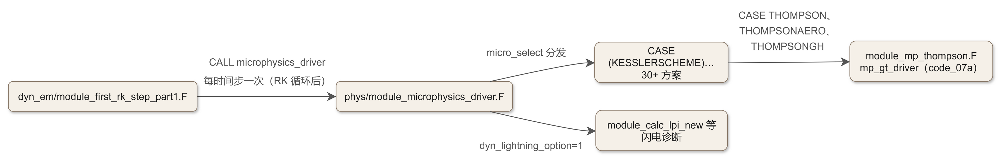
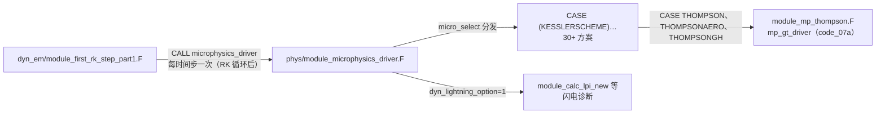

# 文库 code_21：module_microphysics_driver.F——微物理方案的总装配面

<!-- 本文件为骨架：CODE 占位符由 workspace/scripts/code_extract.py 注入保真块。
     组装命令：
     D:\Code\miniforge3\envs\WRFlearn\python.exe workspace\scripts\code_extract.py assemble source\WRFv4.8.0\WRFV4.8.0\phys\module_microphysics_driver.F workspace\code_library\skel_code_21.md doc\code\code_21_module_microphysics_driver.md -->

## 21.0 版本指纹与阅读说明

- **源文件**：`phys/module_microphysics_driver.F`（WRF 4.8.0），全文 3197 行。
- **收录级别**：B 级节选——本篇抽取十段（约 900 行源码），覆盖“模块头 → USE 普查 → 实参契约 → 前置处理 → 分发骨架 → Thompson 三 CASE → 收尾 → 扰动子程序”的完整主线；其余约 2300 行是**另外 30 余个方案的 CASE 调用段**，结构与 Thompson 三 CASE 完全同构，不逐一收录。
- **保真承诺**：同 code_07a——代码块由 `code_extract.py` 按字节抽取、附 md5 指纹、`verify` 可复核。
- **教材锚点**：ch13 §13.6（方案分发与调用链）、ch13 §13.6.4（Registry 方案号与包）、ch04（Registry 机制）、ch21（solve_em 调用位）。教材讲“分发为什么长这样”，本篇讲“每一行在做什么、加一个新方案要动哪里”。

## 21.1 一句话定位与调用链

**一句话**：`microphysics_driver` 是“一个 `mp_physics` 方案号 ↔ 三十多种微物理方案”的总装配面——它不做任何微物理计算，只做三件事：**核对实参在不在（PRESENT 检查墙）、按方案号分发（`micro_select`）、把 Registry 字段按各方案的形参名重新装配**。



<details><summary>原始 Mermaid 源码（可点击展开）</summary>

<!--

-->

</details>

- 上游调用位：`solve_em.F` 的 `moist_physics_prep_em → first_rk_step_part1 → moist_physics_finish` 链（教材 ch21 §21.4 有逐站走读；`dt` 如何传到这里见该节）。
- 下游：code_07a/07b（Thompson 本体）、以及其它 30+ 方案模块（不在文库收录范围）。
- **实参规模**：签名约 400 个实参（L9–L175）——这是全 WRF 物理层最大的单一实参表，原因是它要同时服务“单矩到五矩、无气溶胶到 CAM-MAM 模态气溶胶”的所有方案。

## 21.2 模块头

<!-- code_extract code_extract.py v1.1
source: phys/module_microphysics_driver.F
ranges: L1-L7
file_lines: 3197
file_md5: 656696e032aee870143a363485659cb4
display: line-numbered (strip L-prefix and !file: line to restore)
range_md5: a1a3c407daa212d4b201da595b89e3ab
seg_lines: 7
-->

```fortran
!file: phys/module_microphysics_driver.F    L1-L7
L00001  !WRF:MEDIATION_LAYER:PHYSICS
L00002  ! *** add new modules of schemes here
L00003  !
L00004  MODULE module_microphysics_driver
L00005    real, private, parameter :: QX_MIN = 1.E-12
L00006    real, private, parameter :: NI_MIN = 1.E-6
L00007  CONTAINS
```

> - `!WRF:MEDIATION_LAYER:PHYSICS`（L1）是 WRF 的**文件角色标签**——mediation layer（中介层）即“只装配不计算”的层。全模块除两个扰动子程序外只有一个子程序。
> - 模块级只有两个私有常数：`QX_MIN=1e-12`、`NI_MIN=1e-6`——专供扰动子程序钳位（§21.10），命名直白：质量最小值、数浓度最小值。
> - `CONTAINS` 之后直接进主子程序——没有模块级数据。**driver 是无状态的**：所有状态都在 `*_curr` 字段里（属于 Registry/网格），这使它天然线程安全（OpenMP 并行的前提）。

## 21.3 USE 普查：44 项依赖的分组解读

<!-- code_extract code_extract.py v1.1
source: phys/module_microphysics_driver.F
ranges: L177-L275
file_lines: 3197
file_md5: 656696e032aee870143a363485659cb4
display: line-numbered (strip L-prefix and !file: line to restore)
range_md5: f181a98abbcb824cf33979cf337bbf81
seg_lines: 99
-->

```fortran
!file: phys/module_microphysics_driver.F    L177-L275
L00177  ! Framework
L00178     USE module_state_description, ONLY :                                  &
L00179                       KESSLERSCHEME, LINSCHEME, SBU_YLINSCHEME, WSM3SCHEME, WSM5SCHEME    &
L00180                      ,WSM6SCHEME, ETAMPNEW, FER_MP_HIRES, THOMPSON, THOMPSONAERO, RCON_MP_SCHEME, THOMPSONGH, FAST_KHAIN_LYNN_SHPUND, MORR_TWO_MOMENT     &
L00181                      ,GSFCGCESCHEME, WDM5SCHEME, WDM6SCHEME, NSSL_2MOM, MADWRF_MP  &
L00182                      ,FER_MP_HIRES_ADVECT & 
L00183                      ,WSM7SCHEME, WDM7SCHEME, UDMSCHEME &
L00184                      ,NUWRF4ICESCHEME &
L00185                      ,MILBRANDT2MOM , CAMMGMPSCHEME,FULL_KHAIN_LYNN, P3_1CATEGORY, P3_1CATEGORY_NC, P3_2CATEGORY, P3_1CAT_3MOM &
L00186                      ,MORR_TM_AERO, JENSEN_ISHMAEL, SPRINKLER, NTU, TEMPO !,MILBRANDT3MOM
L00187     USE module_state_description, ONLY : WSM6RSCHEME
L00188  #if ( WRFPLUS == 1 )
L00189     USE module_state_description, ONLY : LSCONDSCHEME, MKESSLERSCHEME
L00190  #endif
L00191  #if ( WRF_CHEM == 1 )
L00192  ! NUWRF
L00193     USE module_state_description, ONLY :                                 &
L00194                       num_chem                                           & !inline gocart
L00195                      ,p_bc1, p_bc2, p_oc1, p_oc2                         & !inline gocart
L00196                      ,p_dust_1, p_dust_2, p_dust_3                       & !inline gocart
L00197                      ,p_dust_4, p_dust_5                                 & !inline gocart
L00198                      ,p_sulf, p_seas_1, p_seas_2                         & !inline gocart
L00199                      ,p_seas_3, p_seas_4 
L00200  
L00201  #endif
L00202  
L00203  #ifdef DM_PARALLEL
L00204    USE module_dm, ONLY : &
L00205                   local_communicator, mytask,  wrf_dm_min_real, wrf_dm_max_real
L00206  #endif
L00207  
L00208  ! Model Layer
L00209     USE module_model_constants
L00210     USE module_wrf_error
L00211     USE module_configure, only: grid_config_rec_type
L00212  #if ( WRF_CHEM == 1 )   
L00213  !mchen   USE module_state_description, only: num_scalar               ! For CAMMGMP scheme Prognostic aerosols
L00214     USE module_state_description, only: num_chem               ! mchen 
L00215     USE modal_aero_data, only:  ntot_amode_cam_mam => ntot_amode ! For CAMMGMP scheme Prognostic aerosols
L00216  #endif
L00217  
L00218  ! *** add new modules of schemes here
L00219  
L00220     USE module_mp_kessler
L00221  #if ( WRFPLUS == 1 )
L00222     USE module_mp_mkessler
L00223     USE module_mp_nconvp    !  added by Zhuxiao
L00224  #endif
L00225     USE module_mp_lin
L00226     USE module_mp_sbu_ylin
L00227     USE module_mp_wsm3
L00228     USE module_mp_wsm5
L00229     USE module_mp_wsm6
L00230     USE module_mp_wsm6r, ONLY:wsm6r
L00231     USE module_mp_wsm7
L00232     USE module_mp_etanew
L00233     USE module_mp_fer_hires
L00234     USE module_mp_rcon
L00235     USE module_mp_thompson
L00236     USE module_mp_tempo_cfgs, only : ty_tempo_cfgs
L00237     USE module_mp_tempo_driver, only : tempo_run, ty_tempo_driver_diags, &
L00238        tempo_aerosol_surface_emissions
L00239     USE module_mp_full_sbm
L00240  #if ( BUILD_SBM_FAST == 1 )
L00241     USE module_mp_fast_sbm
L00242  #endif
L00243     USE module_mp_gsfcgce
L00244     USE module_mp_gsfcgce_4ice_nuwrf, only: gsfcgce_4ice_nuwrf
L00245     USE module_mp_morr_two_moment
L00246     USE microphy_p3
L00247     USE module_mp_jensen_ishmael
L00248  # if (EM_CORE == 1)
L00249     USE module_mp_morr_two_moment_aero
L00250     USE module_mp_ntu
L00251  # endif
L00252     USE module_mp_wdm5
L00253     USE module_mp_wdm6
L00254     USE module_mp_wdm7
L00255     USE module_mp_udm
L00256     USE module_mp_milbrandt2mom
L00257  # if (EM_CORE == 1)
L00258     USE module_mp_cammgmp_driver, ONLY: CAMMGMP ! CAM5's microphysics driver
L00259  # endif
L00260  !  USE module_mp_milbrandt3mom
L00261  #if (WRFPLUS != 1) & !defined( VAR4D )
L00262     USE module_mp_nssl_2mom
L00263  #endif
L00264     USE module_mixactivate, only: prescribe_aerosol_mixactivate
L00265  
L00266  ! For checking model timestep is history time (for radar reflectivity)
L00267     USE module_utility, ONLY: WRFU_Clock, WRFU_Alarm
L00268     USE module_domain, ONLY : HISTORY_ALARM, Is_alarm_tstep
L00269     USE module_irrigation
L00270  
L00271     USE module_fire_emis
L00272     USE module_calc_lpi_new
L00273     USE module_ltng_pe
L00274     USE module_ltng_strokes
L00275  
```

> 44 项 USE 按功能分五组（方案普查底账在文库方案 §三）：
>
> 1. **方案号字典**（L178–L199）：`module_state_description` 提供全部方案号常量——`KESSLERSCHEME=1 … THOMPSON=8 … THOMPSONAERO=28 … THOMPSONGH`（完整号表见 `frame/module_state_description.F` 与教材 ch13 §13.6.4）。`SELECT CASE(mp_physics)` 里的每个 `CASE` 标签都来自这里。`WSM6RSCHEME`（L187）单独一条 USE 是历史遗留的并入库方式；WRFPLUS/CHEM 条件下的 LSCOND/化学物种索引按编译开关增减。
> 2. **并行与模型层**（L203–L216）：`module_dm`（`wrf_dm_min/max_real`——调试块与气溶胶归约用）、`module_model_constants`（`ep_2/svp1…xlv/xls/xlf/cp/g` 等常数——注意**常数经 driver 传给方案**而非方案自取，Kessler 的 `XLV=xlv, CP=cp` 实参就是这种“常数也走实参”的老派风格）、`module_configure`（`grid_config_rec_type`——namelist 配置结构体，`config_flags%aer_init_opt` 这类字段由此读）。
> 3. **方案实体模块**（L220–L263，25 个 USE）：每个被分发的方案各一条——“*** add new modules of schemes here”注释出现两次（模块头 L2 与此处 L218），**加新方案的第一动刀点**。注意三个带条件的：`BUILD_SBM_FAST`（快速分档方案）、`EM_CORE==1`（Morrison 气溶胶版/NTU/CAMMGMP）、`WRFPLUS!=1`（NSSL）。`USE module_mp_wsm6` 是**整模块引用**（wsm6 子程序名不限定），而 `module_mp_wsm6r` 用 `ONLY:wsm6r` 限定——同一文件里两种风格并存。
> 4. **横向支撑**（L264–L275）：`module_mixactivate`（LIN/Morrison 方案的气溶胶活化前置）、`module_utility`+`module_domain` 的 `HISTORY_ALARM/Is_alarm_tstep`（**反射率只在历史输出时刻算**——`diagflag` 的时钟依据）、`module_irrigation`（喷灌方案）、`module_fire_emis`（生物质燃烧气溶胶注入）、闪电三件（`calc_lpi_new/ltng_pe/ltng_strokes`）。
> 5. **头注释**（L276–L296）列了方案清单——但它停在 WDM6 时代（2011 年口径），**注释维护落后于代码**（P3/NSSL/TEMPO 都没进清单）。读 WRF 要有“注释是快照、代码是事实”的觉悟。

## 21.4 网格结构与变量定义注释

<!-- code_extract code_extract.py v1.1
source: phys/module_microphysics_driver.F
ranges: L298-L351
file_lines: 3197
file_md5: 656696e032aee870143a363485659cb4
display: line-numbered (strip L-prefix and !file: line to restore)
range_md5: 37e090b1e5861b74c1cb547ee0a58b56
seg_lines: 54
-->

```fortran
!file: phys/module_microphysics_driver.F    L298-L351
L00298     IMPLICIT NONE
L00299  !======================================================================
L00300  ! Grid structure in physics part of WRF
L00301  !----------------------------------------------------------------------
L00302  ! The horizontal velocities used in the physics are unstaggered
L00303  ! relative to temperature/moisture variables. All predicted
L00304  ! variables are carried at half levels except w, which is at full
L00305  ! levels. Some arrays with names (*8w) are at w (full) levels.
L00306  !
L00307  !----------------------------------------------------------------------
L00308  ! In WRF, kms (smallest number) is the bottom level and kme (largest
L00309  ! number) is the top level.  In your scheme, if 1 is at the top level,
L00310  ! then you have to reverse the order in the k direction.
L00311  !
L00312  !         kme      -   half level (no data at this level)
L00313  !         kme    ----- full level
L00314  !         kme-1    -   half level
L00315  !         kme-1  ----- full level
L00316  !         .
L00317  !         .
L00318  !         .
L00319  !         kms+2    -   half level
L00320  !         kms+2  ----- full level
L00321  !         kms+1    -   half level
L00322  !         kms+1  ----- full level
L00323  !         kms      -   half level
L00324  !         kms    ----- full level
L00325  !
L00326  !======================================================================
L00327  ! Definitions
L00328  !-----------
L00329  ! Rho_d      dry density (kg/m^3)
L00330  ! Theta_m    moist potential temperature (K)
L00331  ! Qv         water vapor    mixing ratio (kg/kg)
L00332  ! Qc         cloud water    mixing ratio (kg/kg)
L00333  ! Qr         rain water     mixing ratio (kg/kg)
L00334  ! Qi         cloud ice      mixing ratio (kg/kg)
L00335  ! Qs         snow           mixing ratio (kg/kg)
L00336  ! Qg         graupel        mixing ratio (kg/kg)
L00337  ! Qh         hail           mixing ratio (kg/kg)
L00338  ! Qndrop     droplet number mixing ratio (#/kg)
L00339  ! Qni        cloud ice number concentration (#/kg)
L00340  ! Qns        snow      number concentration (#/kg)
L00341  ! Qnr        rain      number concentration (#/kg)
L00342  ! Qng        graupel   number concentration (#/kg)
L00343  ! Qnh        hail      number concentration (#/kg)
L00344  
L00345  ! Qzr        rain             reflectivity (m6/kg)
L00346  ! Qzi        ice              reflectivity (m6/kg)
L00347  ! Qzs        snow             reflectivity (m6/kg)
L00348  ! Qzg        graupel          reflectivity (m6/kg)
L00349  ! Qzh        hail             reflectivity (m6/kg)
L00350  
L00351  ! Qvolg        graupel   particle volume (m3/kg)
```

> - **k 方向的层约定**（L300–L326 原注释）：物理层所有预报量在半层（mass 点）、`w` 在整层（w 点）、`*8w` 数组在整层；`kms` 是**底层**——方案若内部用“1 在顶”的老惯例，要自己倒 k。**这段注释是所有物理方案作者必读的网格契约**（教材 ch10 讲垂直坐标时的工程对应面）。
> - 变量定义段（L329 起）是实参契约的“字典前言”：`Qv/Qc/Qr/Qi/Qs/Qg/Qh` 七个混合比 + `Qndrop/Qni/Qns/Qnr/Qng/Qnh` 六个数浓度 + 五个反射量 `Qz*`——**这就是 Thompson 的 `mp_gt_driver` 实参在 driver 层的“全集”**：Thompson 只取其中子集，全集里还有雪数浓度 `qns`、雹 `qh` 等它不需要的项。
> - `P_QV` 系注释（L391 起）：`P_*` 是 Registry 生成的**物种下标**（`P_QV=param_first_scalar` 起），用于在 `moist/scalar` 数组里索引物种——本文件签名用“独立数组”风格（`qv_curr` 等），`P_*` 索引风格在 `first_rk_step_part1` 装配层（文库 code_31）。

## 21.5 实参契约：约 400 个实参的分组地图

<!-- code_extract code_extract.py v1.1
source: phys/module_microphysics_driver.F
ranges: L9-L175
file_lines: 3197
file_md5: 656696e032aee870143a363485659cb4
display: line-numbered (strip L-prefix and !file: line to restore)
range_md5: 173296e7b5596e4e6d01cd268f0dbc4b
seg_lines: 167
-->

```fortran
!file: phys/module_microphysics_driver.F    L9-L175
L00009  SUBROUTINE microphysics_driver(                                          &
L00010                         th, rho, pi_phy, p                                &
L00011                        ,ht, dz8w, p8w, dt,dx,dy                           &
L00012                        ,mp_physics, spec_zone                             &
L00013                        ,specified, channel_switch                         &
L00014                        ,warm_rain                                         &
L00015                        ,t8w                                               &
L00016                        ,chem_opt, progn                                   &
L00017                        ,cldfra, cldfra_old, exch_h, nsource               &
L00018                        ,qlsink, precr, preci, precs, precg                &
L00019                        ,xland,snowh,xice,itimestep                        &
L00020                        ,f_ice_phy,f_rain_phy,f_rimef_phy                  &
L00021                        ,lowlyr,sr, id                                     &
L00022                        ,ids,ide, jds,jde, kds,kde                         &
L00023                        ,ims,ime, jms,jme, kms,kme                         &
L00024                        ,ips,ipe, jps,jpe, kps,kpe                         &
L00025                        ,i_start,i_end,j_start,j_end,kts,kte               &
L00026                        ,num_tiles, naer                                   &
L00027                        ,irrigation,sf_surf_irr_scheme, irr_daily_amount   &   
L00028                        ,irr_start_hour,irr_num_hours,julian_in            &
L00029                        ,irr_start_julianday,irr_end_julianday             &
L00030                        ,irr_freq,irr_ph,irr_rand_field                    &
L00031                        ,gmt,xtime                                         &
L00032  !======================
L00033                        !Variables required for CAMMGMP Scheme
L00034                        ,dlf,dlf2,t_phy,p_hyd,p8w_hyd,tke_pbl,pblh         &
L00035                        ,z_at_mass,z_at_w,qfx                              &
L00036                        ,rliq,turbtype3d,smaw3d,wsedl3d,cldfra_old_mp      &
L00037                        ,cldfra_mp,cldfra_mp_all,lradius,iradius           &
L00038                        ,cldfrai,cldfral,cldfra_conv                       &
L00039                        ,alt                                               &
L00040                        ,accum_mode,aitken_mode,coarse_mode                &
L00041                        ,icwmrsh3d,icwmrdp3d,shfrc3d,cmfmc3d,cmfmc2_3d     &
L00042                        ,config_flags,fnm,fnp,rh_old_mp,lcd_old_mp         &
L00043  #if ( WRF_CHEM == 1 )
L00044                        ,chem                                              &! For CAMMGMP scheme Prognostic aerosols
L00045                        ,qme3d,prain3d,nevapr3d,rate1ord_cw2pr_st3d        &
L00046                        ,dgnum4D,dgnumwet4D                                &
L00047  #endif
L00048  !======================                                   
L00049                        ,qv_curr,qc_curr,qr_curr,qi_curr,qs_curr,qg_curr   &
L00050                        ,qic_curr,qip_curr,qid_curr &
L00051                        ,qnic_curr,qnip_curr,qnid_curr &
L00052                        ,qndrop_curr,qni_curr,qh_curr,qnh_curr             &
L00053                        ,qzr_curr,qzi_curr,qzs_curr,qzg_curr,qzh_curr      &
L00054                        ,qns_curr,qnr_curr,qng_curr,qnn_curr,qnc_curr      &
L00055                        ,qnwfa_curr,qnifa_curr,qnbca_curr                  & ! for water/ice-friendly/black carbon aerosols
L00056                        ,f_qnwfa,f_qnifa,f_qnbca                           & ! for water/ice-friendly/black carbon aerosols
L00057                        ,qvolg_curr,qvolh_curr                             &
L00058                        ,qdcn_curr,qtcn_curr,qccn_curr,qrcn_curr           & ! for ntu3m
L00059                        ,qnin_curr,fi_curr,fs_curr,vi_curr,vs_curr         & ! for ntu3m
L00060                        ,vg_curr,ai_curr,as_curr,ag_curr,ah_curr,i3m_curr  & ! for ntu3m
L00061                        ,f_qdcn,f_qtcn,f_qccn,f_qrcn,f_qnin,f_fi,f_fs      & ! for ntu3m
L00062                        ,f_vi,f_vs,f_vg,f_ai,f_as,f_ag,f_ah,f_i3m          & ! for ntu3m
L00063                        ,qir_curr,qib_curr                                 & ! for P3
L00064                        ,qi2_curr,qni2_curr,qir2_curr,qib2_curr            & ! for P3
L00065                        ,qvoli_curr,qaoli_curr                             & ! for Jensen ISHMAEL
L00066                        ,qvoli2_curr,qaoli2_curr                           & ! for Jensen ISHMAEL
L00067                        ,qi3_curr,qni3_curr,qvoli3_curr,qaoli3_curr        & ! for Jensen ISHMAEL
L00068                        ,effr_curr,ice_effr_curr,tot_effr_curr             &
L00069                        ,qic_effr_curr,qip_effr_curr,qid_effr_curr         &             
L00070                        ,f_qv,f_qc,f_qr,f_qi,f_qs,f_qg,f_qndrop,f_qni      &
L00071                        ,f_qns,f_qnr,f_qng,f_qnc,f_qnn,f_qh,f_qnh          &
L00072                        ,            f_qzr,f_qzi,f_qzs,f_qzg,f_qzh         &
L00073                        ,f_qvolg,f_qvolh                                   &
L00074                        ,f_qic,f_qip,f_qid                                 &
L00075                        ,f_qnic,f_qnip,f_qnid                              &
L00076                        ,f_qir,f_qib                                       & ! for P3
L00077                        ,f_qi2,f_qni2,f_qir2,f_qib2                        & ! for P3
L00078                        ,f_qvoli,f_qaoli                                   & ! for Jensen ISHMAEL
L00079                        ,f_qvoli2,f_qaoli2                                 & ! for Jensen ISHMAEL
L00080                        ,f_qi3,f_qni3,f_qvoli3,f_qaoli3                    & ! for Jensen ISHMAEL
L00081                        ,f_effr,f_ice_effr,f_tot_effr                      &
L00082                        ,f_qic_effr,f_qip_effr,f_qid_effr                  &                 
L00083                        ,cu_used                                           &
L00084                        ,qrcuten, qscuten, qicuten, qccuten                &
L00085                        ,qt_curr,f_qt                                      &
L00086                        ,mp_restart_state,tbpvs_state,tbpvs0_state         & ! for etampnew or fer_mp_hires
L00087                        ,hail,ice2                                         & ! for mp_gsfcgce
L00088  !NUWRF JJS 20110525 vvvvv
L00089                        ,phys_tot, physc, physe, physd, physs, physm, physf& ! for gsfcgce
L00090                        ,acphys_tot, acphysc, acphyse, acphysd             & ! for gsfcgce
L00091                        ,acphyss, acphysm, acphysf                         & ! for gsfcgce
L00092                        ,re_cloud_gsfc, re_rain_gsfc, re_ice_gsfc          &
L00093                        ,re_snow_gsfc, re_graupel_gsfc, re_hail_gsfc       & ! cloud effective radius
L00094                        ,precr3d, preci3d, precs3d, precg3d, prech3d       &
L00095  #if ( WRF_CHEM == 1 )
L00096                        ,icn_diag, nc_diag                           &  ! inline gocart
L00097                        ,gsfcgce_gocart_coupling                           &
L00098  #endif
L00099  !NUWRF JJS 20110525 ^^^^^
L00100  !                     ,ccntype                                           & ! for mp_milbrandt2mom
L00101                        ,u,v,w,z                                          &   
L00102                        ,rainnc,    rainncv                                &
L00103                        ,snownc,    snowncv                                &
L00104                        ,hailnc,    hailncv                                &
L00105                        ,graupelnc, graupelncv                             &
L00106                        ,hail_maxk1, hail_max2d                            &
L00107  #if ( WRF_CHEM == 1 )
L00108                        ,rainprod, evapprod                                &
L00109                        ,qv_b4mp, qc_b4mp, qi_b4mp, qs_b4mp                &
L00110  #endif
L00111                        ,qnwfa2d, qnifa2d, qnbca2d                         & ! for water/ice-friendly/black carbon aerosols
L00112                        ,qnocbb2d, qnbcbb2d                                & ! for biomass burning aerosols
L00113                        ,ssat,ssati                                        &
L00114                        ,refl_10cm                                         & ! HM, 9/22/09, add for refl
L00115                        ,vmi3d                                             & ! for P3 
L00116                        ,di3d                                              & ! for P3 
L00117                        ,rhopo3d                                           & ! for P3 
L00118                        ,phii3d                                            & ! for Jensen ISHMAEL
L00119                        ,vmi3d_2                                           & ! for P3 
L00120                        ,di3d_2                                            & ! for P3 
L00121                        ,rhopo3d_2                                         & ! for P3 
L00122                        ,phii3d_2                                          & ! for Jensen ISHMAEL
L00123                        ,vmi3d_3                                           & ! for Jensen ISHMAEL
L00124                        ,di3d_3                                            & ! for Jensen ISHMAEL
L00125                        ,rhopo3d_3                                         & ! for Jensen ISHMAEL
L00126                        ,phii3d_3                                          & ! for Jensen ISHMAEL
L00127                        ,itype                                             & ! for Jensen ISHMAEL
L00128                        ,itype_2                                           & ! for Jensen ISHMAEL
L00129                        ,itype_3                                           & ! for Jensen ISHMAEL
L00130  
L00131  ! YLIN
L00132  ! Added the RI_CURR array to the call
L00133                        ,ri_curr                                           &
L00134                        ,diagflag,   do_radar_ref                          &
L00135                        ,ke_diag                                           &
L00136                        ,re_cloud, re_ice, re_snow                         & ! G. Thompson
L00137                        ,has_reqc, has_reqi, has_reqs                      & ! G. Thompson
L00138                        ,ccn_conc                                          & ! RAS
L00139                        ,scalar,num_scalar                                   &
L00140                        ,kext_ql,kext_qs,kext_qg            &
L00141                        ,kext_qh,kext_qa                         &
L00142                        ,kext_qic,kext_qid,kext_qip         &
L00143                        ,kext_ft_qic,kext_ft_qid,kext_ft_qip         &
L00144                        ,kext_ft_qs,kext_ft_qg            &
L00145                        ,height,tempc &
L00146                        ,TH_OLD                                            &
L00147                        ,QV_OLD                                            &
L00148                        ,xlat,xlong,ivgtyp                                 &
L00149                        ,qrimef_curr,f_qrimef                              &
L00150                        ,aercu_opt                                         &
L00151  # if( EM_CORE==1 )
L00152                        ,sbmradar,num_sbmradar                             &
L00153                        ,sbm_diagnostics                                   &
L00154                        ,aerocu,aercu_fct,no_src_types_cu                  &
L00155                        ,PBL,EFCG,EFIG,EFSG,WACT,CCN1_GS,CCN2_GS           &
L00156                        ,CCN3_GS,CCN4_GS,CCN5_GS,CCN6_GS,CCN7_GS           &
L00157                        ,NR_CU,QR_CU,NS_CU,QS_CU,CU_UAF,mskf_refl_10cm     &
L00158  # endif
L00159                        ,multi_perturb                                     &
L00160                        ,pert_thom, perts_qvapor, perts_qcloud, perts_qice &
L00161                        ,perts_qsnow, perts_ni                             &
L00162                        ,pert_thom_qv,pert_thom_qc,pert_thom_qi            &
L00163                        ,pert_thom_qs,pert_thom_ni                         &
L00164                        ,cloudnc                                           &
L00165  !Dynamic Lightning
L00166                        ,light_pe_curr                                     &
L00167                        ,light_ne_curr                                     &
L00168                        ,light_neu_curr                                    &
L00169                        ,lpi2d                                             &
L00170                        ,lpi3d                                             &
L00171                        ,f_light_pe                                        &
L00172                        ,f_light_ne                                        &
L00173                        ,f_light_neu                                       &
L00174                        ,lpos,lneg,lneu                                    &
L00175                                                                           )
```

> 签名太长不适合逐行讲，给**分组地图**（行段位置按指纹注释中的 ranges 对照）：
>
> | 组 | 代表实参 | 说明 |
> |---|---|---|
> | 动力环境 | `th, rho, pi_phy, p, ht, dz8w, p8w, dt, dx, dy, t8w, u, v, w, z` | 全方案共用的环境场；`pi_phy` 是非 NCAR 命名的 Exner 函数（`pii` 的 driver 层叫法） |
> | 配置 | `mp_physics, spec_zone, specified, warm_rain, config_flags, chem_opt, progn, hail, ice2` | 方案号与运行开关；`config_flags` 透传 namelist |
> | 水凝物字段 | `qv_curr … qg_curr, qnc/qni/qnr/qns/qng/qnn/qnh_curr, qz*_curr, qvol*_curr, qrimef_curr` | `*_curr` = 当前时步值（INOUT）；命名带方案注释（`! for P3`、`! for ntu3m`）——**字段的方案归属写在行尾** |
> | 在场标志 | `f_qv … f_qnwfa, f_qb…` | 与 OPTIONAL 实参配对的 LOGICAL——**双保险**：OPTIONAL 让编译器处理在场性，`f_*` 让方案内部也能判断（经实参透传） |
> | 降水诊断 | `rainnc, rainncv, snownc/v, graupelnc/v, hailnc/v, sr, cloudnc, hail_max*` | 网格尺度降水账本 |
> | 垂直廓线诊断 | `qlsink, precr, preci, precs, precg, nsource` | 三维廓线（PBW 老接口，多数方案不填） |
> | 有效半径 | `re_cloud, re_ice, re_snow, has_reqc/i/s` | 辐射接口（Thompson 填写，见 code_07a §07a.7.4） |
> | 雷达/饱和诊断 | `refl_10cm, ssat, ssati, do_radar_ref, diagflag, ke_diag` | `diagflag`=本步是否出诊断 |
> | 气溶胶 | `qnwfa_curr, qnifa_curr, qnbca_curr, qnwfa2d, qnifa2d, qnbca2d, qnocbb2d, qnbcbb2d, naer, ccn_conc, aercu_opt, aerocu…` | Thompson-aerosol 与化学耦合的家当；2D 项是排放通量 |
> | 积云耦合 | `cu_used, qrcuten, qscuten, qicuten, qccuten` | 积云方案给的“对流性云水/雨倾向”（SCM 耦合用） |
> | CAMMGMP/P3/ISHMAEL/ntu3m/SBM | `dlf, dlf2, tke_pbl, pblh, …` | 大段方案专用字段（行尾注释标注归属），非专用方案不 PRESENT |
> | 灌溉 | `irrigation, sf_surf_irr_scheme, irr_*` | 喷灌参数（见 §21.6） |
> | 闪电 | `light_pe/ne/neu_curr, lpi2d/3d, lpos/lneg/lneu, f_light_*` | 动力闪电参数化字段 |
> | 扰动 | `multi_perturb, pert_thom, perts_*, pert_thom_q*` | WRF-Solar EPS 集合扰动（§21.10） |
> | restart 状态 | `mp_restart_state, tbpvs_state, tbpvs0_state` | eta/Ferrier 方案的查找表重启快照 |
>
> **为什么签名必须这么大**：driver 是“一个接口服务所有方案”的代价面。Registry 里每个 `state` 变量都可能在某个方案的包里，包的并集就是这张表。**加新字段的标准流程**：Registry 加 state → `module_state_description` 加常量 → 本签名加实参 + 声明 → 方案 CASE 里装配——教材 ch20 的 T2 案例走的就是这条链。

<!-- code_extract code_extract.py v1.1
source: phys/module_microphysics_driver.F
ranges: L437-L456
file_lines: 3197
file_md5: 656696e032aee870143a363485659cb4
display: line-numbered (strip L-prefix and !file: line to restore)
range_md5: 66e86b11c0b92ae7da139efdea7dd891
seg_lines: 20
-->

```fortran
!file: phys/module_microphysics_driver.F    L437-L456
L00437  !======================================================================
L00438    INTEGER,parameter :: iunit=6
L00439    INTEGER :: mpi_error_code=1
L00440  
L00441     TYPE(grid_config_rec_type),  INTENT(IN   ) , OPTIONAL   :: config_flags
L00442     INTEGER,    INTENT(IN   )    :: mp_physics
L00443     LOGICAL,    INTENT(IN   )    :: specified
L00444     INTEGER, OPTIONAL, INTENT(IN   )    :: chem_opt, progn
L00445     INTEGER, OPTIONAL, INTENT(IN   )    :: hail, ice2 !, ccntype
L00446  !
L00447     INTEGER,      INTENT(IN   )    ::       ids,ide, jds,jde, kds,kde
L00448     INTEGER,      INTENT(IN   )    ::       ims,ime, jms,jme, kms,kme,num_scalar
L00449  #if (EM_CORE == 1)
L00450     INTEGER,      INTENT(IN   )    ::     num_sbmradar
L00451     INTEGER,      INTENT(IN   )    ::     sbm_diagnostics
L00452  #endif
L00453     INTEGER, OPTIONAL, INTENT(IN   )    ::       ips,ipe, jps,jpe, kps,kpe
L00454     INTEGER,      INTENT(IN   )    ::                         kts,kte
L00455     INTEGER,      INTENT(IN   )    ::     itimestep,num_tiles,spec_zone
L00456     INTEGER, DIMENSION(num_tiles), INTENT(IN) ::                       &
```

> `config_flags` 是 OPTIONAL 结构体（唯一 PRESENT 检查在调用方做）；`mp_physics` 是**非 OPTIONAL 的 IN**——方案号是 driver 存在的理由。三套维度（domain/memory/tile）+ `num_tiles` tile 表——WRF 物理层标准的“三维度组”（教材 ch03 架构章讲过 dims 三元组语义）。

<!-- code_extract code_extract.py v1.1
source: phys/module_microphysics_driver.F
ranges: L638-L731
file_lines: 3197
file_md5: 656696e032aee870143a363485659cb4
display: line-numbered (strip L-prefix and !file: line to restore)
range_md5: 8f8a8c8a47c83ad4107e809d5e21e346
seg_lines: 94
-->

```fortran
!file: phys/module_microphysics_driver.F    L638-L731
L00638     LOGICAL, OPTIONAL :: f_qdcn,f_qtcn,f_qccn,f_qrcn,f_qnin,f_fi,f_fs,   &  ! for ntu3m
L00639                          f_vi,f_vs,f_vg,f_ai,f_as,f_ag,f_ah,f_i3m           ! for ntu3m
L00640     REAL, OPTIONAL, DIMENSION( ims:ime , kms:kme, jms:jme ) , INTENT(OUT) :: vmi3d,di3d,rhopo3d,    & ! for P3
L00641                                                                           vmi3d_2,di3d_2,rhopo3d_2,  & ! for P3
L00642                                                                           phii3d,         & ! for Jensen ISHMAEL
L00643                                                                           phii3d_2,       & ! for Jensen ISHMAEL
L00644                                                                           vmi3d_3,di3d_3,rhopo3d_3,  & ! for Jensen ISHMAEL
L00645                                                                           phii3d_3,       & ! for Jensen ISHMAEL
L00646                                                                           itype,itype_2,itype_3             ! for Jensen ISHMAEL
L00647     LOGICAL,  OPTIONAL,   INTENT(IN   )    :: channel_switch
L00648     REAL, OPTIONAL,  INTENT(INOUT   ) :: naer  ! aerosol number concentration (/kg)
L00649     REAL, DIMENSION( ims:ime, jms:jme ), INTENT(INOUT) , OPTIONAL :: qnwfa2d, qnifa2d, qnbca2d, &
L00650                                                                      qnocbb2d, qnbcbb2d
L00651     REAL, DIMENSION( ims:ime, kms:kme, jms:jme ),                  &
L00652           OPTIONAL,                                                &
L00653           INTENT(INOUT ) ::                                        &
L00654                    u,v,w, z, t8w                                       &
L00655                   ,cldfra, cldfra_old, exch_h                      &
L00656                   ,qv_curr,qc_curr,qr_curr,qi_curr,qs_curr,qg_curr &
L00657                   ,qt_curr,qndrop_curr,qni_curr,qh_curr,qnh_curr   &
L00658                   ,qns_curr,qnr_curr,qng_curr,qnn_curr,qnc_curr    &
L00659                   ,qic_curr,qip_curr,qid_curr &
L00660                   ,qnic_curr,qnip_curr,qnid_curr &
L00661                   ,qzr_curr,qzi_curr,qzs_curr,qzg_curr,qzh_curr    &
L00662                   ,qir_curr,qib_curr                               & ! for P3
L00663                   ,qi2_curr,qni2_curr,qir2_curr,qib2_curr          & ! for P3
L00664                   ,qvoli_curr,qaoli_curr                           & ! for Jensen ISHMAEL
L00665                   ,qvoli2_curr,qaoli2_curr                         & ! for Jensen ISHMAEL
L00666                   ,qi3_curr,qni3_curr,qvoli3_curr,qaoli3_curr      & ! for Jensen ISHMAEL
L00667                   ,effr_curr,ice_effr_curr,tot_effr_curr           &
L00668                   ,qic_effr_curr,qip_effr_curr,qid_effr_curr           &
L00669                   ,kext_ql,kext_qs,kext_qg          &
L00670                   ,kext_qh,kext_qa                       &
L00671                   ,kext_qic,kext_qip,kext_qid,tempc,height      &
L00672                   ,kext_ft_qic,kext_ft_qip,kext_ft_qid &
L00673                   ,kext_ft_qs,kext_ft_qg                           &
L00674                   ,qnwfa_curr,qnifa_curr,qnbca_curr                & ! Added by G. Thompson
L00675                   ,qvolg_curr,qvolh_curr,qrimef_curr
L00676  
L00677     REAL, DIMENSION( ims:ime, kms:kme, jms:jme ),                  &
L00678           OPTIONAL,                                                &
L00679           INTENT(INOUT ) :: light_pe_curr,light_neu_curr,light_ne_curr        ! Dynamic Lightning
L00680  
L00681     REAL, DIMENSION( ims:ime, kms:kme, jms:jme ),                  &
L00682           OPTIONAL,                                                &
L00683           INTENT(IN) :: qrcuten, qscuten, qicuten, qccuten
L00684     INTEGER, INTENT(IN), optional ::     cu_used
L00685  #if ( WRF_CHEM == 1 )
L00686     REAL, DIMENSION( ims:ime, kms:kme, jms:jme ),                  &
L00687           INTENT(INOUT) :: rainprod, evapprod
L00688     REAL, DIMENSION( ims:ime, kms:kme, jms:jme ),                  &
L00689           INTENT(INOUT) :: qv_b4mp, qc_b4mp, qi_b4mp, qs_b4mp
L00690  #endif
L00691  ! YLIN
L00692  ! Added RI_CURR similar to microphysics fields above
L00693     REAL, DIMENSION( ims:ime, kms:kme, jms:jme ),                  &
L00694           OPTIONAL,                                                &
L00695           INTENT(INOUT) :: ri_curr
L00696  
L00697  
L00698     REAL, DIMENSION(ims:ime, kms:kme, jms:jme ),                   &
L00699           OPTIONAL,                                                &
L00700           INTENT(OUT ) ::                                          &
L00701                    nsource
L00702  
L00703  !
L00704     REAL, DIMENSION( ims:ime , jms:jme ),                          &
L00705           INTENT(INOUT),                                           &
L00706           OPTIONAL   ::                                            &
L00707                                                             RAINNC &
L00708                                                           ,RAINNCV &
L00709                                                            ,SNOWNC &
L00710                                                           ,SNOWNCV &
L00711                                                         ,GRAUPELNC &
L00712                                                        ,GRAUPELNCV &
L00713                                                            ,HAILNC &
L00714                                                           ,HAILNCV &
L00715                                                           ,CLOUDNC &
L00716                                            ,hail_maxk1, hail_max2d
L00717                                                            
L00718  #if ( WRF_CHEM == 1)
L00719  ! NUWRF JJS 20110525 vvvvv
L00720  ! for inline Gocart coupling
L00721   integer :: i24h
L00722   INTEGER, PARAMETER :: num_go = 14  ! number of the gocart aerosol species
L00723   REAL, DIMENSION( ims:ime, kms:kme, jms:jme, num_go) :: aero
L00724   REAL, DIMENSION( ims:ime, kms:kme, jms:jme), INTENT(OUT) :: icn_diag
L00725   REAL, DIMENSION( ims:ime, kms:kme, jms:jme), INTENT(OUT) :: nc_diag
L00726   integer, intent(in) :: gsfcgce_gocart_coupling ! EMK
L00727   REAL, PARAMETER :: frac(4)=(/ 0.01053,0.08421,0.25263,0.65263 /) !fraction for fine dust
L00728   
L00729  ! NUWRF JJS 20110525 ^^^^^
L00730  #endif
L00731  
```

> - 声明段的**行尾注释密度极高**（`! for ntu3m`、`! for P3`、`! Added by G. Thompson`）——每个字段的“东家”直接可查。**这是读 driver 的关键技巧：先看注释归属，再决定这个字段与你关心的方案有没有关系。**
> - 大段 OPTIONAL INOUT（L651–L675）把全部水凝物/诊断场声明在一起——`INTENT(INOUT)` 意味着**方案就地改场**（无本地副本、无回写段——Thompson 的 `mp_gt_driver` 直接改 `qv_curr` 等）。
> - WRF_CHEM 块（L718–L730）：`aero(…,14)` 打包数组与 `num_go=14` 是 GOCART 内联耦合的局部工作区；`frac(4)` 尘埃细粒占比常数。
> - 局部变量极少（L800–L825）：`i,j,k,its…` + 灌溉临时量 + TEMPO 配置结构——**driver 无状态**的另一佐证。

## 21.6 前置处理：从进入函数到 tile 循环

<!-- code_extract code_extract.py v1.1
source: phys/module_microphysics_driver.F
ranges: L800-L851
file_lines: 3197
file_md5: 656696e032aee870143a363485659cb4
display: line-numbered (strip L-prefix and !file: line to restore)
range_md5: 44c51780c55fe011e046402c04ded9c5
seg_lines: 52
-->

```fortran
!file: phys/module_microphysics_driver.F    L800-L851
L00800     INTEGER :: i,j,k,its,ite,jts,jte,ij,sz,n
L00801     LOGICAL :: channel
L00802     LOGICAL :: nssl_progn = .false.
L00803     REAL    :: z0, z1, z2, w1, w2
L00804  
L00805     integer, parameter :: ntot = 50
L00806     real :: wmin, wmax
L00807     integer :: ierr
L00808  ! IRRIGATION
L00809  
L00810     REAL, DIMENSION( ims:ime , jms:jme ), OPTIONAL, INTENT(IN):: IRRIGATION !ARI
L00811     REAL,  OPTIONAL, INTENT(IN)::  irr_daily_amount, julian_in, xtime, gmt
L00812     INTEGER, OPTIONAL, INTENT(IN ):: sf_surf_irr_scheme, irr_start_hour, irr_num_hours, &
L00813                                      irr_start_julianday,irr_end_julianday,irr_freq,irr_ph
L00814     REAL, PARAMETER    :: PI_GRECO=3.14159
L00815     INTEGER  :: end_hour,a,b,xt24,irr_day,timing
L00816     REAL :: constants_irrigation,tloc,irr_start,phase
L00817     INTEGER, OPTIONAL, DIMENSION( ims:ime , jms:jme ), INTENT(INOUT) :: irr_rand_field
L00818  
L00819  ! To accommodate shared physics
L00820     character*256 :: errmsg
L00821     integer :: errflg
L00822  
L00823     type(ty_tempo_cfgs) :: tempo_cfgs
L00824     type(ty_tempo_driver_diags) :: tempo_driver_diags
L00825     logical :: config_tempo_aerosolaware, config_tempo_hailaware
L00826  !---------------------------------------------------------------------
L00827  !  check for microphysics type.  We need a clean way to
L00828  !  specify these things!
L00829  !---------------------------------------------------------------------
L00830  
L00831     channel = .FALSE.
L00832     IF ( PRESENT ( channel_switch ) ) channel = channel_switch
L00833  
L00834     if (mp_physics .eq. 0) return
L00835     IF( specified ) THEN
L00836       sz = spec_zone
L00837     ELSE
L00838       sz = 0
L00839     ENDIF
L00840  
L00841  ! set this to true to print out the global max/min for W on each time step.
L00842     IF ( .false. ) THEN
L00843        wmax = maxval( w(ips:ipe,kps:kpe,jps:jpe) )
L00844        wmin = minval( w(ips:ipe,kps:kpe,jps:jpe) )
L00845  #if ( defined(DM_PARALLEL)  &&   ! defined(STUBMPI) )
L00846        wmax = wrf_dm_max_real ( wmax )
L00847        wmin = wrf_dm_min_real ( wmin )
L00848  #endif
L00849        WRITE( wrf_err_message , * ) 'microphysics_driver: GLOBAL w max/min = ', wmax, wmin
L00850        CALL wrf_message ( wrf_err_message )
L00851     ENDIF
```

> - **三道早退/裁剪闸**：①`channel`（信道开关，L831–L832）——理想的 channel 模式不裁侧界；②`mp_physics==0 直接 return`（L834）——**“无微物理”是一等公民**（理想实验用）；③`specified → sz = spec_zone`（L835–L839）——侧边界松弛区内不跑微物理，`sz` 圈进 tile 循环的下标裁剪（L908–L912）。**物理不在 spec 区计算是 WRF 的通用纪律**，这里能看到它的实现位。
> - 被关死的调试块（L842–L851，`IF (.false.)`）：全局 W 极值打印——需要时手开。注意 `wrf_dm_max/min_real` 的并行归约写法。

<!-- code_extract code_extract.py v1.1
source: phys/module_microphysics_driver.F
ranges: L853-L898
file_lines: 3197
file_md5: 656696e032aee870143a363485659cb4
display: line-numbered (strip L-prefix and !file: line to restore)
range_md5: fdbfe5d4d20fdbd12291f6c6266df703
seg_lines: 46
-->

```fortran
!file: phys/module_microphysics_driver.F    L853-L898
L00853  #ifdef XEON_OPTIMIZED_WSM5
L00854     ! the OpenMP loops are inside the scheme when running on MIC
L00855     IF ( mp_physics .EQ. WSM5SCHEME ) THEN
L00856         IF (channel) THEN
L00857           its = max(ips,ids)
L00858           ite = min(ipe,ide-1)
L00859         ELSE
L00860           its = max(ips,ids+sz)
L00861           ite = min(ipe,ide-1-sz)
L00862         ENDIF
L00863         jts = max(jps,jds+sz)
L00864         jte = min(jpe,jde-1-sz)
L00865  
L00866         CALL wsm5(                                              &
L00867               TH=th                                             &
L00868              ,Q=qv_curr                                         &
L00869              ,QC=qc_curr                                        &
L00870              ,QR=qr_curr                                        &
L00871              ,QI=qi_curr                                        &
L00872              ,QS=qs_curr                                        &
L00873              ,DEN=rho,PII=pi_phy,P=p,DELZ=dz8w                  &
L00874              ,DELT=dt,G=g,CPD=cp,CPV=cpv                        &
L00875              ,RD=r_d,RV=r_v,T0C=svpt0                           &
L00876              ,EP1=ep_1, EP2=ep_2, QMIN=epsilon                  &
L00877              ,XLS=xls, XLV0=xlv, XLF0=xlf                       &
L00878              ,DEN0=rhoair0, DENR=rhowater                       &
L00879              ,CLIQ=cliq,CICE=cice,PSAT=psat                     &
L00880              ,RAIN=rainnc ,RAINNCV=rainncv                      &
L00881              ,SNOW=snownc ,SNOWNCV=snowncv                      &
L00882              ,SR=sr                                             &
L00883              ,REFL_10CM=refl_10cm                               &
L00884              ,diagflag=diagflag                                 &
L00885              ,do_radar_ref=do_radar_ref                         &
L00886              ,has_reqc=has_reqc                                 &  ! for radiation +
L00887              ,has_reqi=has_reqi                                 &
L00888              ,has_reqs=has_reqs                                 &
L00889              ,re_cloud=re_cloud                                 &
L00890              ,re_ice=re_ice                                     &
L00891              ,re_snow=re_snow                                   &  ! for radiation -  
L00892              ,IDS=ids,IDE=ide, JDS=jds,JDE=jde, KDS=kds,KDE=kde &
L00893              ,IMS=ims,IME=ime, JMS=jms,JME=jme, KMS=kms,KME=kme &
L00894              ,ITS=its,ITE=ite, JTS=jts,JTE=jte, KTS=kts,KTE=kte &
L00895              )
L00896  
L00897     ELSE
L00898  #endif
```

> **XEON 优化特例**：`XEON_OPTIMIZED_WSM5` 编译宏下 WSM5 走独立路径——OpenMP 循环在方案**内部**（MIC/至强_phi 时代遗产），tile 循环退化为单 tile。整段是“方案级并行 vs driver 级并行”的对照样本：本文件默认是 driver 级（下一段），WSM5 特例是方案级。

<!-- code_extract code_extract.py v1.1
source: phys/module_microphysics_driver.F
ranges: L900-L935
file_lines: 3197
file_md5: 656696e032aee870143a363485659cb4
display: line-numbered (strip L-prefix and !file: line to restore)
range_md5: 347296520c3a7eb10cc29495c6039ea9
seg_lines: 36
-->

```fortran
!file: phys/module_microphysics_driver.F    L900-L935
L00900     !$OMP PARALLEL DO   &
L00901     !$OMP PRIVATE ( ij, its, ite, jts, jte, i,j,k,n )
L00902  
L00903     DO ij = 1 , num_tiles
L00904         IF (channel) THEN
L00905           its = max(i_start(ij),ids)
L00906           ite = min(i_end(ij),ide-1)
L00907         ELSE
L00908           its = max(i_start(ij),ids+sz)
L00909           ite = min(i_end(ij),ide-1-sz)
L00910         ENDIF
L00911         jts = max(j_start(ij),jds+sz)
L00912         jte = min(j_end(ij),jde-1-sz)
L00913  
L00914  # if( EM_CORE==1 )
L00915         sf_surf_irr: SELECT CASE(sf_surf_irr_scheme)
L00916              CASE(SPRINKLER)
L00917               CALL sprinkler_irrigation(  julian_in                    & 
L00918       &          ,irrigation, irr_daily_amount,rho,dz8w                & 
L00919       &          ,irr_start_hour,irr_num_hours,irr_start_julianday     & 
L00920       &          ,irr_end_julianday,irr_freq,irr_ph,qr_curr            &
L00921       &          ,gmt,xtime,dt,irr_rand_field                          &
L00922       &          ,ids,ide, jds,jde                                     & ! domain dims
L00923       &          ,ims,ime, jms,jme, kms,kme                            & ! memory dims
L00924       &          ,its,ite, jts,jte               )
L00925         END SELECT sf_surf_irr
L00926  #endif
L00927  
L00928  
L00929  
L00930  ! 2009-06009 rce - zero all these for safety
L00931         IF( PRESENT(qlsink) ) qlsink(its:ite,kts:kte,jts:jte) = 0.
L00932         IF( PRESENT(precr ) ) precr(its:ite,kts:kte,jts:jte)  = 0.
L00933         IF( PRESENT(preci ) ) preci(its:ite,kts:kte,jts:jte)  = 0.
L00934         IF( PRESENT(precs ) ) precs(its:ite,kts:kte,jts:jte)  = 0.
L00935         IF( PRESENT(precg ) ) precg(its:ite,kts:kte,jts:jte)  = 0.
```

> - **`!$OMP PARALLEL DO` 包住整个 tile 循环**（L900–L903）——后续全部方案调用都在线程私有 tile 上执行。**这是物理层并行的实际发生地**：每个线程处理自己的 tile，方案内部不再并行（多数方案）。结合 ch21 的 solve_em 走读：动力内核的 MPI 分解 × 物理层的 OpenMP tile 分解，两层正交。
> - **tile 循环第一件事是灌溉**（L914–L925，`sf_surf_irr: SELECT CASE`）：`SPRINKLER` 方案直接往 `qr_curr` 里加水——**喷灌被实现为“微物理前的雨量注入”**，位置在方案调用之前、tile 循环之内。
> - **安全清零**（L930–L935，rce 2009-06-09 注释）：`qlsink/precr/preci/precs/precg` 每步清零——这些三维诊断多数方案不填，不清零就会带着上一步的旧值进历史输出。

<!-- code_extract code_extract.py v1.1
source: phys/module_microphysics_driver.F
ranges: L938-L974
file_lines: 3197
file_md5: 656696e032aee870143a363485659cb4
display: line-numbered (strip L-prefix and !file: line to restore)
range_md5: 5f92aa103eb0e929e129341eded385fc
seg_lines: 37
-->

```fortran
!file: phys/module_microphysics_driver.F    L938-L974
L00938         IF( PRESENT(chem_opt) .AND. PRESENT(progn) ) THEN
L00939         
L00940         ! ERM: check whether to use built-in droplet nucleation or use qndrop from CHEM
L00941         IF ( mp_physics==NSSL_2MOM .and. config_flags%nssl_2moment_on==1 ) THEN
L00942           IF ( progn > 0 ) THEN
L00943            IF ( .not. (chem_opt == 0 .or. chem_opt == 401) ) nssl_progn = .true.
L00944           ELSE
L00945             nssl_progn = .false. ! use NUCOND for droplet nucleation
L00946           ENDIF
L00947         ENDIF
L00948         
L00949         !Add pass for dust-only wrf-chem option - RAS
L00950         IF( (chem_opt==0 .OR. chem_opt==401) .AND. progn==1 .AND. (mp_physics==LINSCHEME  .OR. mp_physics==MORR_TWO_MOMENT)) THEN
L00951            IF( PRESENT( QNDROP_CURR ) ) THEN
L00952               CALL wrf_debug ( 100 , 'microphysics_driver: calling prescribe_aerosol_mixactivate' )
L00953  ! 06-nov-2005 rce - id  & itimestep added to arg list
L00954               call prescribe_aerosol_mixactivate (               &
L00955                    id, itimestep, dt, naer,                      &
L00956                    ccn_conc, chem_opt,                           & !RAS13.1
L00957                    rho, th, pi_phy, w, cldfra, cldfra_old,       &
L00958                    z, dz8w, p8w, t8w, exch_h,                    &
L00959                    qv_curr, qc_curr, qi_curr, qndrop_curr,       &
L00960                    nsource,                                      &
L00961                    ids,ide, jds,jde, kds,kde,                    &
L00962                    ims,ime, jms,jme, kms,kme,                    &
L00963                    its,ite, jts,jte, kts,kte,                    &
L00964                    F_QC=f_qc, F_QI=f_qi                          )
L00965            END IF
L00966         ELSEIF ( (chem_opt==0 .OR. chem_opt==401) .AND. progn==1 .AND.    &
L00967                   (mp_physics==NSSL_2MOM .and. config_flags%nssl_2moment_on==1)) THEN
L00968  !          Do nothing here for the moment. Use activation of CCN within the NSSL_2MOM scheme instead, based on nssl_cccn namelist value.
L00969         ELSEIF ( progn==1 .AND. mp_physics/=LINSCHEME .AND. mp_physics/=MORR_TWO_MOMENT &
L00970                  .AND. .not. (mp_physics==NSSL_2MOM .and. config_flags%nssl_2moment_on==1) ) THEN
L00971               call wrf_error_fatal( &
L00972               "SETTINGS ERROR: Prognostic cloud droplet number can only be used with the mp_physics=LINSCHEME or MORRISON or NSSL_2MOM.")
L00973         END IF
L00974         END IF
```

> **化学-微物理联动**（`chem_opt + progn`）：LIN/Morrison 方案 + `progn=1`（预报云滴数）时先调 `prescribe_aerosol_mixactivate`（化学供 CCN → 活化出 `qndrop`）；NSSL 双矩走自己的内生活化；**其它方案配 `progn=1` 直接 fatal**（L969–L972 的 “SETTINGS ERROR”）——**兼容矩阵在 driver 里逐条硬编码**，这是 WRF 防错误配置的主要手段之一（教材 ch13 §13.6.4 的兼容表源码实证）。

<!-- code_extract code_extract.py v1.1
source: phys/module_microphysics_driver.F
ranges: L976-L1006
file_lines: 3197
file_md5: 656696e032aee870143a363485659cb4
display: line-numbered (strip L-prefix and !file: line to restore)
range_md5: 40c432025e978ffb8015dccc8a2d4cf4
seg_lines: 31
-->

```fortran
!file: phys/module_microphysics_driver.F    L976-L1006
L00976  #if ( WRF_CHEM == 1)
L00977  !NUWRF JJS 20110525 vvvvv
L00978  ! Pack gocart aerosol species
L00979  ! All aerosol species in chem are in "ug/kg-dryair"
L00980  !  and conerted to (g/m**3)
L00981  
L00982     aero(:,:,:,:) = 0.
L00983     do k = kts, kte
L00984        do j = jts, jte
L00985           do i = its, ite
L00986           aero(i,k,j, 1) = max(0.0, chem(i,k,j,p_sulf)*1.0e-6*p(i,k,j)*    &
L00987                            96.0/(8.314*th(i,k,j)*pi_phy(i,k,j)))  ! 1 = SO4
L00988           aero(i,k,j, 2) = max(0.0, (chem(i,k,j,p_bc1)+chem(i,k,j,p_bc2))*1.0e-6*rho(i,k,j))  ! 2 = BC1+BC2
L00989           aero(i,k,j, 3) = max(0.0, chem(i,k,j,p_oc1)*1.0e-6*rho(i,k,j)*1.4e0)          !  3 = OC1
L00990           aero(i,k,j, 4) = max(0.0, chem(i,k,j,p_oc2)*1.0e-6*rho(i,k,j)*1.4e0)          !  4 = OC2
L00991           aero(i,k,j, 5) = max(0.0, chem(i,k,j,p_seas_1)*1.0e-6*rho(i,k,j))           !  5 = SS1
L00992           aero(i,k,j, 6) = max(0.0, (chem(i,k,j,p_seas_2)+chem(i,k,j,p_seas_3)+  &
L00993                                     chem(i,k,j,p_seas_4))*1.0e-6*rho(i,k,j))          !  6 = SS2+SS3+SS4
L00994           aero(i,k,j, 7) = max(0.0, chem(i,k,j,p_dust_1)*1.0e-6*rho(i,k,j)*frac(1))   !  7 = DU1 dust mode 1
L00995           aero(i,k,j, 8) = max(0.0, chem(i,k,j,p_dust_1)*1.0e-6*rho(i,k,j)*frac(2))   !  8 = DU1 dust mode 2
L00996           aero(i,k,j, 9) = max(0.0, chem(i,k,j,p_dust_1)*1.0e-6*rho(i,k,j)*frac(3))   !  9 = DU1 dust mode 3
L00997           aero(i,k,j,10) = max(0.0, chem(i,k,j,p_dust_1)*1.0e-6*rho(i,k,j)*frac(4))   ! 10 = DU1 dust mode 4
L00998           aero(i,k,j,11) = max(0.0, chem(i,k,j,p_dust_2)*1.0e-6*rho(i,k,j))           ! 11 = DU2 dust mode 5
L00999           aero(i,k,j,12) = max(0.0, chem(i,k,j,p_dust_3)*1.0e-6*rho(i,k,j))           ! 11 = DU3 dust mode 6
L01000           aero(i,k,j,13) = max(0.0, chem(i,k,j,p_dust_4)*1.0e-6*rho(i,k,j))           ! 11 = DU4 dust mode 7
L01001           aero(i,k,j,14) = max(0.0, chem(i,k,j,p_dust_5)*1.0e-6*rho(i,k,j))           ! 11 = DU5 dust mode 8
L01002           enddo ! !
L01003        enddo ! j
L01004     enddo ! k
L01005  !NUWRF JJS 20110525 ^^^^^
L01006  #endif
```

> GOCART 气溶胶打包：chem 数组（μg/kg 干空气）逐物种换算成 μg/m³ 并拆尘埃模态（`frac(4)` 细粒占比）——**单位换算链写在算式里**：`×1e-6×ρ` 或 `×1e-6×p×96/(R·T)`（硫酸盐按摩尔质量 96 换算）——化学接口的量纲陷阱密集区。

## 21.7 分发骨架：`micro_select` 与 KESSLER 样板

<!-- code_extract code_extract.py v1.1
source: phys/module_microphysics_driver.F
ranges: L1008-L1032
file_lines: 3197
file_md5: 656696e032aee870143a363485659cb4
display: line-numbered (strip L-prefix and !file: line to restore)
range_md5: a5ae46b423f94b06fd6fd620298e3d5a
seg_lines: 25
-->

```fortran
!file: phys/module_microphysics_driver.F    L1008-L1032
L01008       micro_select: SELECT CASE(mp_physics)
L01009  
L01010          CASE (KESSLERSCHEME)
L01011               CALL wrf_debug ( 100 , 'microphysics_driver: calling kessler' )
L01012               IF ( PRESENT( QV_CURR ) .AND. PRESENT( QC_CURR ) .AND.  &
L01013                                             PRESENT( QR_CURR ) .AND.  &
L01014                    PRESENT( RAINNC  ) .AND. PRESENT ( RAINNCV ) .AND.  &
L01015                                             PRESENT( Z       ))  THEN
L01016                 CALL kessler(                                        &
L01017                    T=th                                              &
L01018                   ,QV=qv_curr                                        &
L01019                   ,QC=qc_curr                                        &
L01020                   ,QR=qr_curr                                        &
L01021                   ,RHO=rho, PII=pi_phy,DT_IN=dt, Z=z, XLV=xlv, CP=cp &
L01022                   ,EP2=ep_2,SVP1=svp1,SVP2=svp2                      &
L01023                   ,SVP3=svp3,SVPT0=svpt0,RHOWATER=rhowater           &
L01024                   ,DZ8W=dz8w                                         &
L01025                   ,RAINNC=rainnc,RAINNCV=rainncv                     &
L01026                   ,IDS=ids,IDE=ide, JDS=jds,JDE=jde, KDS=kds,KDE=kde &
L01027                   ,IMS=ims,IME=ime, JMS=jms,JME=jme, KMS=kms,KME=kme &
L01028                   ,ITS=its,ITE=ite, JTS=jts,JTE=jte, KTS=kts,KTE=kte &
L01029                                                                      )
L01030               ELSE
L01031                  CALL wrf_error_fatal ( 'arguments not present for calling kessler' )
L01032               ENDIF
```

> - **标签 SELECT**（`micro_select: SELECT CASE(mp_physics)`）：Fortran 命名块结构——`END SELECT micro_select`（L3035）配对，3000 行的分发体里随时能定位边界。
> - **KESSLER 是最小样板**：`wrf_debug(100, …)` 报进入 → `IF (PRESENT(五件套))` 实参墙 → `CALL kessler(T=th, QV=qv_curr, …, XLV=xlv, CP=cp, …)`。三个可学习的细节：①**关键字实参**（`T=th`）——方案形参名与 driver 实参名不必相同，装配的“翻译”就发生在这些 `=` 号上；②**常数也走实参**（`XLV=xlv, CP=cp, SVP1=svp1…`）——Kessler 是老派风格，Thompson 则常数自养（code_07a §07a.4）；③实参墙失败即 `wrf_error_fatal`——**配置错误在第一时步就炸，不带病运行**。
> - 对照 RCON/THOMPSON 家族的实参墙（十几行 PRESENT 链）可见：**方案维度越高，墙越长**——实参墙长度就是方案的“Registry 依赖面积”。

## 21.8 Thompson 三 CASE：8 号、28 号、38 号

<!-- code_extract code_extract.py v1.1
source: phys/module_microphysics_driver.F
ranges: L1146-L1249
file_lines: 3197
file_md5: 656696e032aee870143a363485659cb4
display: line-numbered (strip L-prefix and !file: line to restore)
range_md5: ce02138895bdbd373d6a75708ec24dac
seg_lines: 104
-->

```fortran
!file: phys/module_microphysics_driver.F    L1146-L1249
L01146          CASE (THOMPSONAERO)
L01147                if (pert_thom .and. multi_perturb == 1) then
L01148                  allocate (qv_tmp(its:ite, kts:kte, jts:jte))
L01149                  allocate (qc_tmp(its:ite, kts:kte, jts:jte))
L01150                  allocate (qi_tmp(its:ite, kts:kte, jts:jte))
L01151                  allocate (qs_tmp(its:ite, kts:kte, jts:jte))
L01152                  allocate (qni_tmp(its:ite, kts:kte, jts:jte))
L01153  
L01154                  call Add_multi_perturb_mp_perturbations (perts_qvapor, perts_qcloud, perts_qice, &
L01155                    perts_qsnow, perts_ni, pert_thom_qv, pert_thom_qc, pert_thom_qi, pert_thom_qs, &
L01156                    pert_thom_ni, qv_curr, qc_curr, qi_curr, qs_curr, qni_curr, qv_tmp, qc_tmp, qi_tmp, &
L01157                    qs_tmp, qni_tmp, its, ite, jts, jte, ims, ime, jms, jme, kms, kme, kts, kte)
L01158                end if
L01159  
L01160               CALL wrf_debug ( 100 , 'microphysics_driver: calling thompson' )
L01161               IF ( PRESENT( QV_CURR ) .AND. PRESENT ( QC_CURR )   .AND.  &
L01162                    PRESENT( QR_CURR ) .AND. PRESENT ( QI_CURR )   .AND.  &
L01163                    PRESENT( QS_CURR ) .AND. PRESENT ( QG_CURR )   .AND.  &
L01164                    PRESENT( QNR_CURR) .AND. PRESENT ( QNI_CURR)   .AND.  &
L01165                    PRESENT( QNC_CURR) .AND. PRESENT ( QNWFA_CURR) .AND.  &
L01166                    PRESENT( QNIFA_CURR).AND.PRESENT ( QNWFA2D)    .AND.  &
L01167                    PRESENT( QNIFA2D)                              .AND.  &
L01168                    PRESENT( SNOWNC)   .AND. PRESENT ( SNOWNCV)    .AND.  &
L01169                    PRESENT( GRAUPELNC).AND. PRESENT ( GRAUPELNCV) .AND.  &
L01170                    PRESENT( RAINNC  ) .AND. PRESENT ( RAINNCV ) ) THEN
L01171  #if ( WRF_CHEM == 1 )
L01172                   qv_b4mp(its:ite,kts:kte,jts:jte) = qv_curr(its:ite,kts:kte,jts:jte)
L01173                   qc_b4mp(its:ite,kts:kte,jts:jte) = qc_curr(its:ite,kts:kte,jts:jte)
L01174                   qi_b4mp(its:ite,kts:kte,jts:jte) = qi_curr(its:ite,kts:kte,jts:jte)
L01175                   qs_b4mp(its:ite,kts:kte,jts:jte) = qs_curr(its:ite,kts:kte,jts:jte)
L01176  #endif
L01177               CALL mp_gt_driver(                          &
L01178                       QV=qv_curr,                         &
L01179                       QC=qc_curr,                         &
L01180                       QR=qr_curr,                         &
L01181                       QI=qi_curr,                         &
L01182                       QS=qs_curr,                         &
L01183                       QG=qg_curr,                         &
L01184                       NI=qni_curr,                        &
L01185                       NR=qnr_curr,                        &
L01186                       NC=qnc_curr,                        &
L01187                       NWFA=qnwfa_curr,                    &
L01188                       NIFA=qnifa_curr,                    &
L01189                       NBCA=qnbca_curr,                    &
L01190                       NWFA2D=qnwfa2d,                     &
L01191                       NIFA2D=qnifa2d,                     &
L01192                       NBCA2D=qnbca2d,                     &
L01193                       aer_init_opt=config_flags%aer_init_opt,   &
L01194                       wif_input_opt=config_flags%wif_input_opt, &
L01195                       TH=th,                              &
L01196                       PII=pi_phy,                         &
L01197                       P=p,                                &
L01198                       W=w,                                &
L01199                       DZ=dz8w,                            &
L01200                       DT_IN=dt,                           &
L01201                       ITIMESTEP=itimestep,                &
L01202                       RAINNC=RAINNC,                      &
L01203                       RAINNCV=RAINNCV,                    &
L01204                       SNOWNC=SNOWNC,                      &
L01205                       SNOWNCV=SNOWNCV,                    &
L01206                       GRAUPELNC=GRAUPELNC,                &
L01207                       GRAUPELNCV=GRAUPELNCV,              &
L01208                       SR=SR,                              &
L01209  #if ( WRF_CHEM == 1 )
L01210                       WETSCAV_ON=config_flags%wetscav_onoff == 1, &
L01211                       RAINPROD=rainprod,                  &
L01212                       EVAPPROD=evapprod,                  &
L01213  #endif
L01214                       REFL_10CM=refl_10cm,                &
L01215                       diagflag=diagflag,                  &
L01216                       ke_diag = ke_diag,                  &
L01217                       do_radar_ref=do_radar_ref,          &
L01218                       re_cloud=re_cloud,                  &
L01219                       re_ice=re_ice,                      &
L01220                       re_snow=re_snow,                    &
L01221                       has_reqc=has_reqc,                  & ! G. Thompson
L01222                       has_reqi=has_reqi,                  & ! G. Thompson
L01223                       has_reqs=has_reqs,                  & ! G. Thompson
L01224                   IDS=ids,IDE=ide, JDS=jds,JDE=jde, KDS=kds,KDE=kde, &
L01225                   IMS=ims,IME=ime, JMS=jms,JME=jme, KMS=kms,KME=kme, &
L01226                   ITS=its,ITE=ite, JTS=jts,JTE=jte, KTS=kts,KTE=kte)
L01227  
L01228                if (pert_thom .and. multi_perturb == 1) then
L01229                  call Remove_multi_perturb_mp_perturbations (perts_qvapor, perts_qcloud, perts_qice, &
L01230                    perts_qsnow, perts_ni, pert_thom_qv, pert_thom_qc, pert_thom_qi, pert_thom_qs, &
L01231                    pert_thom_ni, qv_curr, qc_curr, qi_curr, qs_curr, qni_curr, qv_tmp, qc_tmp, qi_tmp, &
L01232                    qs_tmp, qni_tmp, its, ite, jts, jte, ims, ime, jms, jme, kms, kme, kts, kte)
L01233                  deallocate (qv_tmp)
L01234                  deallocate (qc_tmp)
L01235                  deallocate (qi_tmp)
L01236                  deallocate (qs_tmp)
L01237                  deallocate (qni_tmp)
L01238                end if
L01239  
L01240                IF (config_flags%aer_fire_emit_opt.gt.0)  then
L01241                  CALL wrf_debug ( 200 , ' call fire_emis_simple_plumerise' )
L01242                  CALL fire_emis_simple_plumerise (config_flags%wif_fire_inj, config_flags%aer_fire_emit_opt  &
L01243                      ,z_at_mass, pblh, qnwfa_curr, qnbca_curr   &
L01244                      ,qnocbb2d, qnbcbb2d, dt, ids, ide, jds, jde, kds, kde                    &
L01245                      ,ims, ime, jms, jme, kms, kme, its, ite, jts, jte, kts, kte                       )
L01246                ENDIF
L01247               ELSE
L01248                  CALL wrf_error_fatal ( 'arguments not present for calling thompson_et_al' )
L01249               ENDIF
```

> **THOMPSONAERO（mp_physics=28，aerosol-aware）**：
> - **集合扰动前置**（L1147–L1158）：`pert_thom .and. multi_perturb==1` 时先 `Add_multi_perturb_mp_perturbations` 把扰动场乘进 qv/qc/qi/qs/qni——**扰动在方案调用前加、调用后减（L1228–L1238），方案在“被扰动的世界”里跑一步**，输出趋势再作用回原场——WRF-Solar EPS 的微物理参数化不确定性表征。
> - 实参墙检查 `QNC/QNWFA/QNIFA/QNWFA2D/QNIFA2D` 在场——**28 号比 8 号多五个气溶胶字段**。
> - `CALL mp_gt_driver` 的装配表：`NC=qnc_curr, NWFA=qnwfa_curr, NIFA=qnifa_curr, NBCA=qnbca_curr, NWFA2D=qnwfa2d, NIFA2D=qnifa2d, NBCA2D=qnbca2d` + `aer_init_opt/wif_input_opt` 两个 config 字段——**code_07a §07a.7 里 `mp_gt_driver` 的 OPTIONAL 实参全部在这里供上**。
> - `WETSCAV_ON=config_flags%wetscav_onoff == 1`（L1210）——**逻辑表达式直接作实参**：namelist 开关换算成 LOGICAL 传给方案。
> - 生物质燃烧注入（L1240–L1246，`aer_fire_emit_opt>0`）：方案跑完后把火排放注入 `qnwfa/qnbca`——**排放发生在微物理之后**，下一时步才被活化。

<!-- code_extract code_extract.py v1.1
source: phys/module_microphysics_driver.F
ranges: L1251-L1324
file_lines: 3197
file_md5: 656696e032aee870143a363485659cb4
display: line-numbered (strip L-prefix and !file: line to restore)
range_md5: 336675663602f02c5c08a1fff7954b52
seg_lines: 74
-->

```fortran
!file: phys/module_microphysics_driver.F    L1251-L1324
L01251          CASE (THOMPSONGH)
L01252               CALL wrf_debug ( 100 , 'microphysics_driver: calling thompsongh' )
L01253               IF ( PRESENT( QV_CURR ) .AND. PRESENT ( QC_CURR )   .AND.  &
L01254                    PRESENT( QR_CURR ) .AND. PRESENT ( QI_CURR )   .AND.  &
L01255                    PRESENT( QS_CURR ) .AND. PRESENT ( QG_CURR )   .AND.  &
L01256                    PRESENT( QNR_CURR) .AND. PRESENT ( QNI_CURR)   .AND.  &
L01257                    PRESENT( QNG_CURR) .AND. PRESENT ( QVOLG_CURR) .AND.  &
L01258                    PRESENT( QNC_CURR) .AND. PRESENT ( QNWFA_CURR) .AND.  &
L01259                    PRESENT( QNIFA_CURR).AND.PRESENT ( QNWFA2D)    .AND.  &
L01260                    PRESENT( QNIFA2D)                              .AND.  &
L01261                    PRESENT( SNOWNC)   .AND. PRESENT ( SNOWNCV)    .AND.  &
L01262                    PRESENT( GRAUPELNC).AND. PRESENT ( GRAUPELNCV) .AND.  &
L01263                    PRESENT( RAINNC  ) .AND. PRESENT ( RAINNCV ) ) THEN
L01264  #if ( WRF_CHEM == 1 )
L01265                   qv_b4mp(its:ite,kts:kte,jts:jte) = qv_curr(its:ite,kts:kte,jts:jte)
L01266                   qc_b4mp(its:ite,kts:kte,jts:jte) = qc_curr(its:ite,kts:kte,jts:jte)
L01267                   qi_b4mp(its:ite,kts:kte,jts:jte) = qi_curr(its:ite,kts:kte,jts:jte)
L01268                   qs_b4mp(its:ite,kts:kte,jts:jte) = qs_curr(its:ite,kts:kte,jts:jte)
L01269  #endif
L01270               CALL mp_gt_driver(                          &
L01271                       QV=qv_curr,                         &
L01272                       QC=qc_curr,                         &
L01273                       QR=qr_curr,                         &
L01274                       QI=qi_curr,                         &
L01275                       QS=qs_curr,                         &
L01276                       QG=qg_curr,                         &
L01277                       QB=qvolg_curr,                      &
L01278                       NI=qni_curr,                        &
L01279                       NR=qnr_curr,                        &
L01280                       NC=qnc_curr,                        &
L01281                       NG=qng_curr,                        &
L01282                       NWFA=qnwfa_curr,                    &
L01283                       NIFA=qnifa_curr,                    &
L01284                       NBCA=qnbca_curr,                    &
L01285                       NWFA2D=qnwfa2d,                     &
L01286                       NIFA2D=qnifa2d,                     &
L01287                       NBCA2D=qnbca2d,                     &
L01288                       aer_init_opt=config_flags%aer_init_opt,   &
L01289                       wif_input_opt=config_flags%wif_input_opt, &
L01290                       TH=th,                              &
L01291                       PII=pi_phy,                         &
L01292                       P=p,                                &
L01293                       W=w,                                &
L01294                       DZ=dz8w,                            &
L01295                       DT_IN=dt,                           &
L01296                       ITIMESTEP=itimestep,                &
L01297                       RAINNC=RAINNC,                      &
L01298                       RAINNCV=RAINNCV,                    &
L01299                       SNOWNC=SNOWNC,                      &
L01300                       SNOWNCV=SNOWNCV,                    &
L01301                       GRAUPELNC=GRAUPELNC,                &
L01302                       GRAUPELNCV=GRAUPELNCV,              &
L01303                       SR=SR,                              &
L01304  #if ( WRF_CHEM == 1 )
L01305                       WETSCAV_ON=config_flags%wetscav_onoff == 1, &
L01306                       RAINPROD=rainprod,                  &
L01307                       EVAPPROD=evapprod,                  &
L01308  #endif
L01309                       REFL_10CM=refl_10cm,                &
L01310                       diagflag=diagflag,                  &
L01311                       ke_diag = ke_diag,                  &
L01312                       do_radar_ref=do_radar_ref,          &
L01313                       re_cloud=re_cloud,                  &
L01314                       re_ice=re_ice,                      &
L01315                       re_snow=re_snow,                    &
L01316                       has_reqc=has_reqc,                  & ! G. Thompson 
L01317                       has_reqi=has_reqi,                  & ! G. Thompson 
L01318                       has_reqs=has_reqs,                  & ! G. Thompson 
L01319                   IDS=ids,IDE=ide, JDS=jds,JDE=jde, KDS=kds,KDE=kde, &
L01320                   IMS=ims,IME=ime, JMS=jms,JME=jme, KMS=kms,KME=kme, &
L01321                   ITS=its,ITE=ite, JTS=jts,JTE=jte, KTS=kts,KTE=kte)
L01322               ELSE
L01323                  CALL wrf_error_fatal ( 'arguments not present for calling thompson_et_al' )
L01324               ENDIF
```

> **THOMPSONGH（三矩霰/雹版）**：与 28 号几乎逐行相同，**唯二差异**在装配表——多传 `QB=qvolg_curr, NG=qng_curr`。回到 code_07a §07a.6.1 的结论：`mp_gt_driver` 靠 `PRESENT(ng)` 判 `is_hail_aware`——**driver 传不传这两个参数，就是三矩开关本身**。THOMPSONGH 的实参墙也多了 `QNG_CURR/QVOLG_CURR` 两项。方案的“家族梯度”（8 单矩云→28 双矩云→38 三矩霰）在 driver 层表现为**装配表的增量**。

<!-- code_extract code_extract.py v1.1
source: phys/module_microphysics_driver.F
ranges: L1326-L1410
file_lines: 3197
file_md5: 656696e032aee870143a363485659cb4
display: line-numbered (strip L-prefix and !file: line to restore)
range_md5: 64ecf6279dd2088d387496aab9596a95
seg_lines: 85
-->

```fortran
!file: phys/module_microphysics_driver.F    L1326-L1410
L01326          CASE (THOMPSON)
L01327               CALL wrf_debug ( 100 , 'microphysics_driver: calling thompson' )
L01328               IF ( PRESENT( QV_CURR ) .AND. PRESENT ( QC_CURR ) .AND.  &
L01329                    PRESENT( QR_CURR ) .AND. PRESENT ( QI_CURR ) .AND.  &
L01330                    PRESENT( QS_CURR ) .AND. PRESENT ( QG_CURR ) .AND.  &
L01331                    PRESENT( QNR_CURR) .AND. PRESENT ( QNI_CURR) .AND.  &
L01332  !                  PRESENT( SNOWNC) .AND. PRESENT ( SNOWNCV) .AND.        &
L01333  !                  PRESENT( GRAUPELNC) .AND. PRESENT ( GRAUPELNCV) .AND.  &
L01334                    PRESENT( RAINNC  ) .AND. PRESENT ( RAINNCV ) ) THEN
L01335  #if ( WRF_CHEM == 1 )
L01336                   qv_b4mp(its:ite,kts:kte,jts:jte) = qv_curr(its:ite,kts:kte,jts:jte)
L01337                   qc_b4mp(its:ite,kts:kte,jts:jte) = qc_curr(its:ite,kts:kte,jts:jte)
L01338                   qi_b4mp(its:ite,kts:kte,jts:jte) = qi_curr(its:ite,kts:kte,jts:jte)
L01339                   qs_b4mp(its:ite,kts:kte,jts:jte) = qs_curr(its:ite,kts:kte,jts:jte)
L01340  #endif
L01341                if (pert_thom .and. multi_perturb == 1) then
L01342                  allocate (qv_tmp(its:ite, kts:kte, jts:jte))
L01343                  allocate (qc_tmp(its:ite, kts:kte, jts:jte))
L01344                  allocate (qi_tmp(its:ite, kts:kte, jts:jte))
L01345                  allocate (qs_tmp(its:ite, kts:kte, jts:jte))
L01346                  allocate (qni_tmp(its:ite, kts:kte, jts:jte))
L01347  
L01348                  call Add_multi_perturb_mp_perturbations (perts_qvapor, perts_qcloud, perts_qice, &
L01349                    perts_qsnow, perts_ni, pert_thom_qv, pert_thom_qc, pert_thom_qi, pert_thom_qs, &
L01350                    pert_thom_ni, qv_curr, qc_curr, qi_curr, qs_curr, qni_curr, qv_tmp, qc_tmp, qi_tmp, &
L01351                    qs_tmp, qni_tmp, its, ite, jts, jte, ims, ime, jms, jme, kms, kme, kts, kte)
L01352                end if
L01353  
L01354               CALL mp_gt_driver(                          &
L01355                       QV=qv_curr,                         &
L01356                       QC=qc_curr,                         &
L01357                       QR=qr_curr,                         &
L01358                       QI=qi_curr,                         &
L01359                       QS=qs_curr,                         &
L01360                       QG=qg_curr,                         &
L01361                       NI=qni_curr,                        &
L01362                       NR=qnr_curr,                        &
L01363                       TH=th,                              &
L01364                       PII=pi_phy,                         &
L01365                       P=p,                                &
L01366                       W=w,                                &
L01367                       DZ=dz8w,                            &
L01368                       DT_IN=dt,                           &
L01369                       ITIMESTEP=itimestep,                &
L01370                       RAINNC=RAINNC,                      &
L01371                       RAINNCV=RAINNCV,                    &
L01372                       SNOWNC=SNOWNC,                      &
L01373                       SNOWNCV=SNOWNCV,                    &
L01374                       GRAUPELNC=GRAUPELNC,                &
L01375                       GRAUPELNCV=GRAUPELNCV,              &
L01376                       SR=SR,                              &
L01377  #if ( WRF_CHEM == 1 )
L01378                       WETSCAV_ON=config_flags%wetscav_onoff == 1, &
L01379                       RAINPROD=rainprod,                  &
L01380                       EVAPPROD=evapprod,                  &
L01381  #endif
L01382                       REFL_10CM=refl_10cm,                &
L01383                       diagflag=diagflag,                  &
L01384                       ke_diag = ke_diag,                  &
L01385                       do_radar_ref=do_radar_ref,          &
L01386                       re_cloud=re_cloud,                  & ! G. Thompson
L01387                       re_ice=re_ice,                      & ! G. Thompson
L01388                       re_snow=re_snow,                    & ! G. Thompson
L01389                       has_reqc=has_reqc,                  & ! G. Thompson
L01390                       has_reqi=has_reqi,                  & ! G. Thompson
L01391                       has_reqs=has_reqs,                  & ! G. Thompson
L01392                   IDS=ids,IDE=ide, JDS=jds,JDE=jde, KDS=kds,KDE=kde, &
L01393                   IMS=ims,IME=ime, JMS=jms,JME=jme, KMS=kms,KME=kme, &
L01394                   ITS=its,ITE=ite, JTS=jts,JTE=jte, KTS=kts,KTE=kte)
L01395  
L01396                if (pert_thom .and. multi_perturb == 1) then
L01397                  call Remove_multi_perturb_mp_perturbations (perts_qvapor, perts_qcloud, perts_qice, & 
L01398                    perts_qsnow, perts_ni, pert_thom_qv, pert_thom_qc, pert_thom_qi, pert_thom_qs, &
L01399                    pert_thom_ni, qv_curr, qc_curr, qi_curr, qs_curr, qni_curr, qv_tmp, qc_tmp, qi_tmp, &
L01400                    qs_tmp, qni_tmp, its, ite, jts, jte, ims, ime, jms, jme, kms, kme, kts, kte)
L01401                  deallocate (qv_tmp)
L01402                  deallocate (qc_tmp)
L01403                  deallocate (qi_tmp)
L01404                  deallocate (qs_tmp)
L01405                  deallocate (qni_tmp)
L01406                end if
L01407  
L01408               ELSE
L01409                  CALL wrf_error_fatal ( 'arguments not present for calling thompson_et_al' )
L01410               ENDIF
```

> **THOMPSON（mp_physics=8）**：
> - 实参墙**没有气溶胶字段**（SNOWNC/GRAUPELNC 的检查还被注释掉，L1332–L1333）——8 号可在最小 moist 包下运行。
> - `CALL mp_gt_driver` 不传 `NC/NWFA/NIFA/NBCA`——OPTIONAL 缺席 → `is_aerosol_aware=.FALSE.` → 方案内部走常数 `Nt_c` 分支。**“不传就是配置”**——OPTIONAL 实参架构的全部意义。
> - 扰动对（Add/Remove）同样在场（L1341–L1406）——8 号也能做 EPS 扰动。

## 21.9 SELECT 收尾与闪电诊断

<!-- code_extract code_extract.py v1.1
source: phys/module_microphysics_driver.F
ranges: L3036-L3098
file_lines: 3197
file_md5: 656696e032aee870143a363485659cb4
display: line-numbered (strip L-prefix and !file: line to restore)
range_md5: 8ed52ad755644902747b87be611d3087
seg_lines: 63
-->

```fortran
!file: phys/module_microphysics_driver.F    L3036-L3098
L03036  
L03037        IF (config_flags%dyn_lightning_option.eq.1) THEN
L03038        IF (  PRESENT( QC_CURR ) .AND.  &
L03039              PRESENT( QR_CURR ) .AND. PRESENT ( QI_CURR )   .AND.  &
L03040              PRESENT( QS_CURR ) .AND. PRESENT ( QG_CURR )) THEN
L03041              CALL calc_lpi_new(                           &
L03042                       W=w,                                &
L03043                       PI_PHY=pi_phy, RHO_PHY=rho,         &
L03044                       TH_PHY=TH,P_PHY=p,                  &
L03045                       DZ8w=dz8w,                          &
L03046                       QC=qc_curr,                         &
L03047                       QR=qr_curr,                         &
L03048                       QI=qi_curr,                         &
L03049                       QS=qs_curr,                         &
L03050                       QG=qg_curr,                         &
L03051                       QH=qh_curr,                         &
L03052                       lpi2d = lpi2d,                      &
L03053                       lpi3d = lpi3d                       &
L03054                      ,IDS=ids,IDE=ide, JDS=jds,JDE=jde, KDS=kds,KDE=kde &
L03055                      ,IMS=ims,IME=ime, JMS=jms,JME=jme, KMS=kms,KME=kme &
L03056                      ,ITS=its,ITE=ite, JTS=jts,JTE=jte, KTS=kts,KTE=kte)
L03057              CALL   calc_dyn_pe(dx=dx,dy=dy, &
L03058                       W=w,                                &
L03059                       PI_PHY=pi_phy, RHO_PHY=rho,         &
L03060                       TH_PHY=TH,P_PHY=p,                  &
L03061                       DZ8w=dz8w,                          &
L03062                       QC=qc_curr,                         &
L03063                       QR=qr_curr,                         &
L03064                       QI=qi_curr,                         &
L03065                       QS=qs_curr,                         &
L03066                       QG=qg_curr,                         &
L03067                       QH=qh_curr,                         &
L03068                       light_pe=light_pe_curr,             &
L03069                       light_ne=light_ne_curr,             &
L03070                       light_neu=light_neu_curr,           &
L03071                       dt=dt                               &
L03072                      ,coul_pos=config_flags%coul_pos      &
L03073                      ,coul_neg=config_flags%coul_neg      &
L03074                      ,coul_neu=config_flags%coul_neu      &
L03075                      ,IDS=ids,IDE=ide, JDS=jds,JDE=jde, KDS=kds,KDE=kde &
L03076                      ,IMS=ims,IME=ime, JMS=jms,JME=jme, KMS=kms,KME=kme &
L03077                      ,ITS=its,ITE=ite, JTS=jts,JTE=jte, KTS=kts,KTE=kte)
L03078               CALL   calcstroke(dx=dx,dy=dy,              &
L03079                       W=w,                                &
L03080                       PI_PHY=pi_phy, RHO_PHY=rho,         &
L03081                       TH_PHY=TH,P_PHY=p,                  &
L03082                       DZ8w=dz8w,                          &
L03083                       light_pe=light_pe_curr,             &
L03084                       light_ne=light_ne_curr,             &
L03085                       light_neu=light_neu_curr,           &
L03086                       lpos=lpos,lneg=lneg,lneu=lneu       &
L03087                      ,j_pos=config_flags%j_pos            &
L03088                      ,j_neg=config_flags%j_neg            &
L03089                      ,j_neu=config_flags%j_neu            &
L03090                      ,IDS=ids,IDE=ide, JDS=jds,JDE=jde, KDS=kds,KDE=kde &
L03091                      ,IMS=ims,IME=ime, JMS=jms,JME=jme, KMS=kms,KME=kme &
L03092                      ,ITS=its,ITE=ite, JTS=jts,JTE=jte, KTS=kts,KTE=kte)
L03093        ELSE
L03094                CALL wrf_error_fatal ( 'arguments not present for calling dynamic lightning scheme' )
L03095        ENDIF
L03096        END IF
L03097  
L03098     ENDDO
```

> - `END SELECT micro_select` 之后、tile 循环 `ENDDO`（L3097）之前，是**方案无关的收尾诊断**：`dyn_lightning_option=1` 时用微物理后的水凝物场算闪电——`calc_lpi_new`（LPI 指数）、`calc_dyn_pe`（正/负/总电荷产生率）、`calcstroke`（闪光定位）。**闪电紧贴微物理的原因**：它消费的是“本步刚算完”的水凝物与上升速度。
> - `!$OMP END PARALLEL DO`（L3098）与 L900 配对——tile 循环到此结束，driver 的主体就这一个循环。

## 21.10 扰动子程序对

<!-- code_extract code_extract.py v1.1
source: phys/module_microphysics_driver.F
ranges: L3130-L3164
file_lines: 3197
file_md5: 656696e032aee870143a363485659cb4
display: line-numbered (strip L-prefix and !file: line to restore)
range_md5: bb1ae409598b9cbf10089fc4f098e771
seg_lines: 35
label: subroutine Add_multi_perturb_mp_perturbations
-->

```fortran
!file: phys/module_microphysics_driver.F    L3130-L3164    (subroutine Add_multi_perturb_mp_perturbations)
L03130     subroutine Add_multi_perturb_mp_perturbations (perts_qvapor, perts_qcloud, perts_qice, &
L03131         perts_qsnow, perts_ni, pert_thom_qv, pert_thom_qc, pert_thom_qi, pert_thom_qs, &
L03132         pert_thom_ni, qv_curr, qc_curr, qi_curr, qs_curr, qni_curr, qv_tmp, qc_tmp, qi_tmp, &
L03133         qs_tmp, qni_tmp, its, ite, jts, jte, ims, ime, jms, jme, kms, kme, kts, kte)
L03134  
L03135       implicit none
L03136  
L03137       integer, intent(in) :: its, ite, jts, jte, ims, ime, jms, jme, kms, kme, kts, kte
L03138       real, intent(in) :: pert_thom_qv, pert_thom_qc, pert_thom_qi, pert_thom_qs, pert_thom_ni
L03139       real, dimension(ims:ime, kms:kme, jms:jme), optional, intent (in) :: perts_qvapor, perts_qcloud, perts_qice, &
L03140           perts_qsnow, perts_ni
L03141       real, dimension(ims:ime, kms:kme, jms:jme), intent (inout) :: qv_curr, qc_curr, qi_curr, qs_curr, qni_curr
L03142       real, dimension (its:ite, kts:kte, jts:jte), intent (out) :: qv_tmp, qc_tmp, qi_tmp, qs_tmp, qni_tmp
L03143  
L03144       integer :: i, j, k
L03145  
L03146  
L03147       do j = jts, jte
L03148         do k = kts, kte
L03149           do i = its, ite
L03150             qv_tmp(i, k, j) = qv_curr(i, k, j)
L03151             qv_curr(i, k, j) = max (QX_MIN, (1.0 + perts_qvapor(i, k, j) * pert_thom_qv) * qv_curr(i, k, j))
L03152             qc_tmp(i, k, j) = qc_curr(i, k, j)
L03153             qc_curr(i, k, j) = max (QX_MIN, (1.0 + perts_qcloud(i, k, j) * pert_thom_qc) * qc_curr(i, k, j))
L03154             qi_tmp(i, k, j) = qi_curr(i, k, j)
L03155             qi_curr(i, k, j) = max (QX_MIN, (1.0 + perts_qice(i, k, j) * pert_thom_qi) * qi_curr(i, k, j))
L03156             qs_tmp(i, k, j) = qs_curr(i, k, j)
L03157             qs_curr(i, k, j) = max (QX_MIN, (1.0 + perts_qsnow(i, k, j) * pert_thom_qs) * qs_curr(i, k, j))
L03158             qni_tmp(i, k, j) = qni_curr(i, k, j)
L03159             qni_curr(i, k, j) = max (NI_MIN, (1.0 + perts_ni(i, k, j) * pert_thom_ni) * qni_curr(i, k, j))
L03160           end do
L03161         end do
L03162       end do
L03163  
L03164     end subroutine Add_multi_perturb_mp_perturbations
```

<!-- code_extract code_extract.py v1.1
source: phys/module_microphysics_driver.F
ranges: L3166-L3195
file_lines: 3197
file_md5: 656696e032aee870143a363485659cb4
display: line-numbered (strip L-prefix and !file: line to restore)
range_md5: e8c12491971d72f7ceafe99c09fc75a6
seg_lines: 30
label: subroutine Remove_multi_perturb_mp_perturbations
-->

```fortran
!file: phys/module_microphysics_driver.F    L3166-L3195    (subroutine Remove_multi_perturb_mp_perturbations)
L03166     subroutine Remove_multi_perturb_mp_perturbations (perts_qvapor, perts_qcloud, perts_qice, &
L03167         perts_qsnow, perts_ni, pert_thom_qv, pert_thom_qc, pert_thom_qi, pert_thom_qs, &
L03168         pert_thom_ni, qv_curr, qc_curr, qi_curr, qs_curr, qni_curr, qv_tmp, qc_tmp, qi_tmp, &
L03169         qs_tmp, qni_tmp, its, ite, jts, jte, ims, ime, jms, jme, kms, kme, kts, kte)
L03170  
L03171       implicit none
L03172  
L03173       integer, intent(in) :: its, ite, jts, jte, ims, ime, jms, jme, kms, kme, kts, kte
L03174       real, intent(in) :: pert_thom_qv, pert_thom_qc, pert_thom_qi, pert_thom_qs, pert_thom_ni
L03175       real, dimension(ims:ime, kms:kme, jms:jme), optional, intent (in) :: perts_qvapor, perts_qcloud, perts_qice, &
L03176           perts_qsnow, perts_ni
L03177       real, dimension(ims:ime, kms:kme, jms:jme), intent (inout) :: qv_curr, qc_curr, qi_curr, qs_curr, qni_curr
L03178       real, dimension (its:ite, kts:kte, jts:jte), intent (in) :: qv_tmp, qc_tmp, qi_tmp, qs_tmp, qni_tmp
L03179  
L03180       integer :: i, j, k
L03181  
L03182  
L03183       do j = jts, jte
L03184         do k = kts, kte
L03185           do i = its, ite
L03186             qv_curr(i, k, j) = max (QX_MIN, qv_curr(i, k, j) - perts_qvapor(i, k, j) * pert_thom_qv * qv_tmp(i, k, j))
L03187             qc_curr(i, k, j) = max (QX_MIN, qc_curr(i, k, j) - perts_qcloud(i, k, j) * pert_thom_qc * qc_tmp(i, k, j))
L03188             qi_curr(i, k, j) = max (QX_MIN, qi_curr(i, k, j) - perts_qice(i, k, j) * pert_thom_qi * qi_tmp(i, k, j))
L03189             qs_curr(i, k, j) = max (QX_MIN, qs_curr(i, k, j) - perts_qsnow(i, k, j) * pert_thom_qs * qs_tmp(i, k, j))
L03190             qni_curr(i, k, j) = max (NI_MIN, qni_curr(i, k, j) - perts_ni(i, k, j) * pert_thom_ni * qni_tmp(i, k, j))
L03191           end do
L03192         end do
L03193       end do
L03194  
L03195     end subroutine Remove_multi_perturb_mp_perturbations
```

> - **Add**：`q_curr ← max(QX_MIN, (1 + perts_field·pert_thom_qx)·q_curr)`——乘性扰动（`perts_*` 是标准化扰动场、`pert_thom_q*` 是幅度系数），备份到 `_tmp`；**Remove** 不是简单还原——`q_curr ← max(QX_MIN, q_curr − perts·pert·q_tmp)`：**减去的是“扰动场作用于备份值”的增量**，即把方案跑完后的场上“扰动贡献”剥离、保留方案的趋势。这是随机参数扰动（SPPT 家族）的正确数学形态——直接还原会把方案的物理趋势也一起扔掉。
> - 两个子程序是本文件里唯二的“实际计算”——也不过是逐点乘法。**mediation layer 的“薄”是纪律而非偶然**。
> - `QX_MIN=1e-12/NI_MIN=1e-6` 钳位（模块头那两个常数）保证扰动不产生负值/零下溢。

## 21.11 改造入口：加一个新微物理方案的完整清单

| 步骤 | 动哪里 | 对应本篇 |
|---|---|---|
| 1. 注册方案号 | `frame/module_state_description.F` 加 `NEWSCHME=n` 常量 | §21.3 |
| 2. Registry 包与字段 | `Registry/Registry.EM_COMMON` 加 package/state（touch Registry/Registry.EM 触发重建） | 教材 ch04/ch20 |
| 3. USE 方案模块 | 本文件 `add new modules of schemes here` 两处 | §21.3 |
| 4. 签名扩容（若新字段） | L9–L175 签名 + 声明段 + `f_*` 标志 | §21.5 |
| 5. 写 CASE | `micro_select` 内加 `CASE (NEWSCHEME)`：PRESENT 墙 + CALL 装配 | §21.7/§21.8 |
| 6. namelist 口径 | `run/README.namelist` 的 `mp_physics` 表 | 教材 ch13 §13.6.4 |
| 7. 初始化 | `module_first_rk_step_part1.F` 的 `MP_INIT` 分发加 init 调用 | 文库 code_31 |
| 8. 兼容性检查 | 与 PBL/辐射/化学的接口矩阵（re_*/气溶胶） | §21.6/教材 ch12–13 |

> 教材 ch20 的五个实测案例（T2 峰值修正、虚拟温度阈值、BEM 反照率）走的就是这条链的子集——本表是它们的“通用化”。

## 21.12 上下游链接

- **上游**：code_31——`module_first_rk_step_part1.F`（本 driver 的调用方，`dt`/`config_flags` 的装配现场）；code_50——`solve_em.F` 导航页（`moist_physics_prep_em` 链条）。
- **下游**：code_07a/07b——Thompson 三 CASE 的实际目的地；其余方案模块不在文库收录范围（README 取舍说明）。
- **教材**：ch04（Registry）、ch13 §13.6（分发与方案号）、ch20（改造案例）、ch21（solve_em 调用位与 RK 节拍）。
