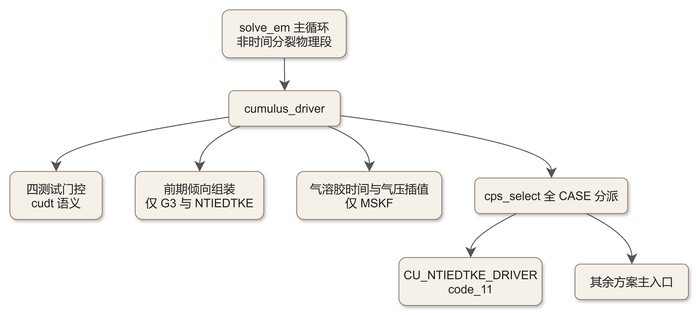
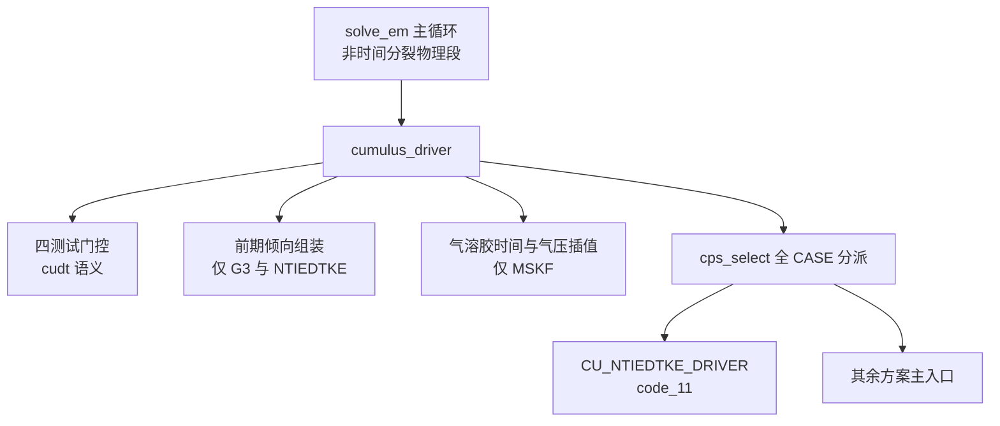

# code_23 — 积云参数化公共调度器（module_cumulus_driver.F：时间门控与全 CASE 分派）

## 一、版本指纹

| 源文件 | 行数 | md5（整文件，按字节） |
|---|---|---|
| phys/module_cumulus_driver.F | 1902 | e91ad7c7472fece6ae891a2e6d897ca8 |

- 抽取工具：workspace/scripts/code_extract.py v1.2，2026-10-12；块首指纹注释自带 range_md5。
- 收录分级（B）：分派与门控全部选段走读 + 气溶胶插值两单元全文；主签名（L6–L142，约 20 组方案专用 OPTIONAL 参数军团）与变量文档注释块（L222–L380）引用不录。

## 二、定位

一句话：**十几个积云方案的公共调度器**——不管任何方案的物理，只管三件事：什么时候调（CUDT/STEPCU 四测试门控）、给方案什么（外部倾向组装、气溶胶插值）、按 cu_physics 的 CASE 把状态量字典式转发给对应方案主入口。

**谁在调它**：dyn_em/solve_em.F 的时间步主循环（RK 子步之外的非时间分裂物理段，调用序辐射→陆面→PBL→积云→浅对流→FDDA，见 [ch21_solve_em_dynamics.md](../ch21_solve_em_dynamics.md)）；方案名单与编号的权威定义在 frame/module_state_description.F。教材锚点：[ch15_cumulus_family.md](../ch15_cumulus_family.md) 全章；[ch20_modifying_wrf.md](../ch20_modifying_wrf.md)（加新 CASE 的挂点就在 cps_select）。

**CASE 全家福**（符号名以 module_state_description 为准）：KF、BMJ、KFETA、MSKF、GD、GFL、SAS/SCALESAS/OSAS、G3、CAMZM、TIEDTKE（旧）、NTIEDTKE（新，[code_11_module_cu_ntiedtke.md](code_11_module_cu_ntiedtke.md)）、KSAS、NSAS、KFCUP、DUCU（仅 WRFPLUS）。



<details><summary>原始 Mermaid 源码（可点击展开）</summary>

<!--

-->

</details>

## 三、USE 链与方案名单

<!-- code_extract code_extract.py v1.2
source: phys/module_cumulus_driver.F
ranges: L143-L220
file_lines: 1902
file_md5: e91ad7c7472fece6ae891a2e6d897ca8
display: line-numbered (strip L-prefix and !file: line to restore)
range_md5: 2fafc8a2212e6a5b1e40e39d39cc43db
seg_lines: 78
-->

```fortran
!file: phys/module_cumulus_driver.F    L143-L220
L00143  !----------------------------------------------------------------------
L00144     USE module_model_constants
L00145     USE module_state_description, ONLY:     KFSCHEME,BMJSCHEME         &
L00146                                            ,KFETASCHEME,GDSCHEME       &
L00147                                            ,G3SCHEME,GFLSCHEME         &
L00148                                            ,P_QC,P_QI,Param_FIRST_SCALAR &
L00149                                            ,CAMZMSCHEME, SASSCHEME     &
L00150                                            ,OSASSCHEME                 &  
L00151                                            ,SCALESASSCHEME             &  ! scale-sware sas
L00152                                            ,KSASSCHEME, NSASSCHEME     &
L00153  #if (EM_CORE == 1)
L00154                                            ,MSKFSCHEME                 &
L00155                                            ,CAMMGMPSCHEME              &
L00156                                            ,KFCUPSCHEME                & !CuP, wig 3-Aug-2006  !BSINGH - For WRFCuP scheme
L00157                                            ,num_chem                   & !CuP, rce 10-may-2012 !BSINGH - For WRFCuP scheme
L00158  #endif
L00159  #if ( WRF_CHEM == 1)
L00160                                            ,num_tracer                 &
L00161  #endif
L00162                                            ,TIEDTKESCHEME              &
L00163                                            ,NTIEDTKESCHEME             
L00164  
L00165  #if ( WRF_CHEM == 1 )
L00166    USE module_chem_share, only:      get_last_gas
L00167  #endif
L00168  #if ( WRFPLUS == 1 )
L00169     USE module_state_description, ONLY:    DUCUSCHEME
L00170  #endif
L00171  
L00172  
L00173  ! *** add new modules of schemes here
L00174  
L00175     USE module_cu_kf     ,  ONLY : kfcps
L00176     USE module_cu_bmj    ,  ONLY : bmjdrv
L00177  #ifdef DM_PARALLEL
L00178     USE module_dm        , ONLY : ntasks_x,ntasks_y,local_communicator,mytask,ntasks 
L00179  #if (EM_CORE == 1)
L00180     USE module_comm_dm   ,  ONLY : halo_cup_g3_in_sub, halo_cup_g3_out_sub
L00181  #endif
L00182  #endif
L00183     USE module_domain    , ONLY: domain
L00184     USE module_cu_kfeta  , ONLY : kf_eta_cps
L00185  #if (EM_CORE==1)
L00186     USE module_cu_mskf   , ONLY : mskf_cps
L00187  #endif
L00188     USE module_cu_gd     , ONLY : grelldrv
L00189     USE module_cu_gfl    , ONLY : cu_grell_freitas_li
L00190     USE module_cu_g3     , ONLY : g3drv,conv_grell_spread3d
L00191  #if ( WRFPLUS == 1 )
L00192     USE module_cu_du     , ONLY : DUCU   
L00193  #endif
L00194     USE module_cu_sas    , ONLY : cu_sas
L00195     USE module_cu_scalesas    , ONLY : cu_scalesas
L00196  
L00197  #if (EM_CORE == 1)
L00198     USE module_cu_kfcup  , ONLY : KF_CUP_CPS !wig, 3-Aug-2006 !BSINGH - For WRFCuP scheme 
L00199  #endif
L00200     USE module_cu_osas   , ONLY : cu_osas
L00201     USE module_cu_camzm_driver, ONLY : camzm_driver
L00202     USE module_cu_tiedtke, ONLY : cu_tiedtke
L00203     USE module_cu_ntiedtke,ONLY : cu_ntiedtke_driver
L00204     USE module_cu_ksas   , ONLY : cu_ksas
L00205     USE module_cu_nsas   , ONLY : cu_nsas
L00206     USE module_wrf_error , ONLY : wrf_err_message
L00207  
L00208     !  This driver calls subroutines for the cumulus parameterizations.
L00209     !
L00210     !  1. Kain & Fritsch (1993)
L00211     !  2. Betts-Miller-Janjic (Janjic, 1994)
L00212     !  3. Grell-Devenyi (Grell and Devenyi, 2002)
L00213     !  4. Simplified Arakawa-Schubert scheme (NCEP)
L00214     !     (adapted by Zhang and Wang to work with ARW in V3.3)
L00215     !  5. Grell 3D ensemble scheme
L00216     !  6. Modified Tiedtke scheme (Zhang and Wang 2010)
L00217     ! 14. New simplified Arakawa-Schubert scheme (NCEP, YSU)
L00218     ! 16. New Tiedtke scheme (Bechtold et al. 2004, 2008, 2014)
L00219     !
L00220  !----------------------------------------------------------------------
```

> 讲解：①module_state_description 的符号常量导入是 CASE 判断的唯一依据——方案编号**不写在 driver 里**，加方案先改 state_description；②USE 链即方案名单：kfcps/bmjdrv/kf_eta_cps/mskf_cps/grelldrv/cu_grell_freitas_li/g3drv/cu_sas/cu_scalesas/cu_osas/camzm_driver/cu_tiedtke/cu_ntiedtke_driver/cu_ksas/cu_nsas/KF_CUP_CPS（DUCU 仅 WRFPLUS）——**每加一个方案 = 一行 USE + 一个 CASE**，这是 WRF 物理驱动器的标准扩展模式；③头部注释的方案清单（KF 1993、BMJ 1994、GD 2002、SAS、G3、旧/新 Tiedtke…）与实际 USE 链一致；④DM_PARALLEL 下 G3 还要用 halo_cup_g3 的通信子程序（集合成员的邻域交换）。

## 四、本地初始化与缺省值

<!-- code_extract code_extract.py v1.2
source: phys/module_cumulus_driver.F
ranges: L747-L798
file_lines: 1902
file_md5: e91ad7c7472fece6ae891a2e6d897ca8
display: line-numbered (strip L-prefix and !file: line to restore)
range_md5: 934fca2089e145a013e6317f55a6cacd
seg_lines: 52
-->

```fortran
!file: phys/module_cumulus_driver.F    L747-L798
L00747  ! To accommodate shared physics
L00748     character*256 :: errmsg
L00749     integer :: errflg
L00750  
L00751  !-----------------------------------------------------------------
L00752      pattern_spp_conv=0.
L00753      field_conv=0.
L00754      spp_conv=0
L00755  
L00756  
L00757     l_flux=.FALSE.
L00758     if (present(f_flux)) l_flux=f_flux
L00759     if (.not. PRESENT(CURR_SECS)) then
L00760        curr_secs_pass = -1
L00761     else 
L00762        curr_secs_pass = curr_secs
L00763     endif
L00764  
L00765     if (.not. PRESENT(CUDT)) then
L00766        cudt_pass = -1
L00767        cudtacttime_pass = -1
L00768     else
L00769        cudt_pass = cudt
L00770        cudtacttime_pass = cudtacttime
L00771     endif
L00772  
L00773     if (.not. PRESENT(adapt_step_flag)) then
L00774        adapt_step_flag_pass = .false.
L00775     else
L00776        adapt_step_flag_pass = adapt_step_flag
L00777     endif
L00778  
L00779     ! Initialize tmppratec to pratec
L00780  
L00781     if ( PRESENT ( pratec ) ) then
L00782        tmppratec(:,:) = pratec(:,:)
L00783     else
L00784        tmppratec(:,:) = 0.
L00785     end if
L00786  
L00787     if (.not. PRESENT(kfeta_trigger)) then
L00788        trigger_kf = 1
L00789     else
L00790        trigger_kf = kfeta_trigger
L00791     endif
L00792  
L00793     if (.not. PRESENT(nsas_dx_factor)) then
L00794        dx_factor_nsas = 0
L00795     else
L00796        dx_factor_nsas = nsas_dx_factor
L00797     endif
L00798  
```

> 讲解：①spp_conv 的 pattern/field 数组本地清零——随机参数化（SPP）在 4.8.0 的积云侧是占位；②l_flux 从 optional 的 f_flux 取；③**缺省值模板**：CURR_SECS/CUDT 缺席时传 −1（多数方案不关心，仅 CAMZM/自适应 dt 用）、adapt_step_flag 缺席为 false；④**tmppratec 暂存**——PRATEC 是 OPTIONAL，但绝大多数方案的实参表里都要它：先拷进 tmppratec，调用后按 PRESENT(PRATEC) 决定是否写回（§九）；⑤trigger_kf 缺省 1、dx_factor_nsas 缺省 0——两个 namelist 可调开关的兜底。

## 五、四测试门控：CUDT 的真实语义

<!-- code_extract code_extract.py v1.2
source: phys/module_cumulus_driver.F
ranges: L799-L864
file_lines: 1902
file_md5: e91ad7c7472fece6ae891a2e6d897ca8
display: line-numbered (strip L-prefix and !file: line to restore)
range_md5: e2c4c45dee8cf99dd79a00ec7bedaf0f
seg_lines: 66
-->

```fortran
!file: phys/module_cumulus_driver.F    L799-L864
L00799     IF (cu_physics .eq. 0) return
L00800  
L00801  !  Initialization for adaptive time step.
L00802  
L00803     IF ( adapt_step_flag_pass ) THEN
L00804        doing_adapt_dt = .TRUE.
L00805        IF ( cudtacttime_pass .EQ. 0. ) THEN
L00806           cudtacttime_pass = curr_secs_pass + cudt_pass*60.
L00807        END IF
L00808     ELSE
L00809        doing_adapt_dt = .FALSE.
L00810     END IF
L00811  
L00812  !  Do we run through this scheme or not?
L00813  
L00814  !    Test 1:  If this is the initial model time, then yes.
L00815  !                ITIMESTEP=1
L00816  !    Test 2:  If the user asked for the cumulus to be run every time step, then yes.
L00817  !                CUDT=0 or STEPCU=1
L00818  !    Test 3:  If not adaptive dt, and this is on the requested cumulus frequency, then yes.
L00819  !                MOD(ITIMESTEP,STEPCU)=0
L00820  !    Test 4:  If using adaptive dt and the current time is past the last requested activate cumulus time, then yes.
L00821  !                CURR_SECS >= CUDTACTTIME
L00822  
L00823  !  If we do run through the scheme, we set the flag run_param to TRUE and we set the decided flag
L00824  !  to TRUE.  The decided flag says that one of these tests was able to say "yes", run the scheme.
L00825  !  We only proceed to other tests if the previous tests all have left decided as FALSE.
L00826  
L00827  !  If we set run_param to TRUE and this is adaptive time stepping, we set the time to the next
L00828  !  cumulus run.
L00829  
L00830     decided = .FALSE.
L00831     run_param = .FALSE.
L00832     IF ( ( .NOT. decided ) .AND. &
L00833          ( itimestep .EQ. 1 ) ) THEN
L00834        run_param   = .TRUE.
L00835        decided     = .TRUE.
L00836     END IF
L00837  
L00838     IF ( ( .NOT. decided ) .AND. &
L00839          ( ( cudt_pass .EQ. 0. ) .OR. ( stepcu .EQ. 1 ) ) ) THEN
L00840        run_param   = .TRUE.
L00841        decided     = .TRUE.
L00842     END IF
L00843  
L00844     IF ( ( .NOT. decided ) .AND. &
L00845          ( .NOT. doing_adapt_dt ) .AND. &
L00846          ( MOD(itimestep,stepcu) .EQ. 0 ) ) THEN
L00847        run_param   = .TRUE.
L00848        decided     = .TRUE.
L00849     END IF
L00850  
L00851     IF ( ( .NOT. decided ) .AND. &
L00852          ( doing_adapt_dt ) .AND. &
L00853          ( curr_secs_pass .GE. cudtacttime_pass ) ) THEN
L00854        run_param   = .TRUE.
L00855        decided     = .TRUE.
L00856        cudtacttime_pass = curr_secs_pass + cudt_pass*60
L00857     END IF
L00858  
L00859     IF ( run_param ) THEN
L00860  !print *,'calling CU scheme'
L00861     ELSE
L00862  !print *,'NOT calling CU scheme'
L00863        RETURN
L00864     END IF
```

> 讲解：cu_physics=0 直接 return（无积云）。然后是**「要不要调方案」的四测试**（注释原文即测试清单）：①itimestep=1 必调；②cudt_pass=0 或 stepcu=1 每步都调；③非自适应时间步下 MOD(itimestep,stepcu)=0 按周期调——**cudt（分钟）经换算给出 stepcu，门控本身只认整数周期**；④自适应 dt 下 curr_secs≥cudtacttime 时调，并把 cudtacttime 推进到下一激活时刻（curr_secs+cudt·60）——自适应步长下「次数」不可靠，改用「物理时刻」。decided/run_param 两旗标的短路写法是标准的「多条件或」展开。**这四测试解释了为什么 KF 系不能在这里做时间步判定**（§八注释：KF 需要跨步累积的 W 场，判步在方案内部自己做）。

## 六、前期倾向组装：G3 与 NTIEDTKE 专属

<!-- code_extract code_extract.py v1.2
source: phys/module_cumulus_driver.F
ranges: L866-L895
file_lines: 1902
file_md5: e91ad7c7472fece6ae891a2e6d897ca8
display: line-numbered (strip L-prefix and !file: line to restore)
range_md5: 6a2aebfabd3243aeeb42648b8fc5999d
seg_lines: 30
-->

```fortran
!file: phys/module_cumulus_driver.F    L866-L895
L00866  #if  ( EM_CORE == 1 )
L00867        if(cu_physics == G3SCHEME .or. cu_physics == NTIEDTKESCHEME) then
L00868        !$OMP PARALLEL DO   &
L00869        !$OMP PRIVATE ( ij,i,j,k,its,ite,jts,jte )
L00870  
L00871        DO ij = 1 , num_tiles
L00872          its = i_start(ij)
L00873          ite = i_end(ij)
L00874          jts = j_start(ij)
L00875          jte = j_end(ij)
L00876          do j=jts,min(jte,jde-1)
L00877          do k=kts,kte
L00878          do i=its,min(ite,ide-1)
L00879             RTHFTEN(i,k,j)=(RTHFTEN(i,k,j)+RTHRATEN(i,k,j) &
L00880                                 +RTHBLTEN(i,k,j))*pi(i,k,j)
L00881             RQVFTEN(i,k,j)=RQVFTEN(i,k,j)+RQVBLTEN(i,k,j)
L00882         enddo
L00883         enddo
L00884         enddo
L00885        ENDDO
L00886        !$OMP END PARALLEL DO
L00887        endif
L00888  
L00889        IF ( cu_physics == G3SCHEME .OR.  cu_physics == GFLSCHEME .OR.     &
L00890             cu_physics == KFETASCHEME .OR. cu_physics == MSKFSCHEME) THEN 
L00891  #ifdef DM_PARALLEL
L00892  #include "HALO_CUP_G3_IN.inc"
L00893  #endif
L00894        ENDIF
L00895  #endif
```

> 讲解：cu_physics 为 G3SCHEME 或 NTIEDTKESCHEME 时，闭合式需要的「外部强迫倾向」在此组装：**RTHFTEN=(RTHFTEN+RTHRATEN+RTHBLTEN)·pi**——平流倾向（动力部分每步刷新）叠加辐射倾向与 PBL 温度倾向，再乘 Exner 函数 pi 把「温度倾向 K/s」转成「位温倾向 K/s」；**RQVFTEN 加 RQVBLTEN**。这与旧 Tiedtke 只吃 RQVBLTEN（§十 CASE 对照）形成鲜明对比——新 Tiedtke 的 moisture-convergence 闭合要看到全部非对流水汽强迫。注意这是 inout 数组：组装值写回 RTHFTEN/RQVFTEN，方案读取后 driver 不再还原——下个时间步动力部分会重新刷新，故无累积误差。G3/GFL/KFETA/MSKF 四案还需 HALO_CUP_G3_IN 交换（集合成员邻域）。

## 七、tile 循环与 MSKF 气溶胶插值

<!-- code_extract code_extract.py v1.2
source: phys/module_cumulus_driver.F
ranges: L902-L952
file_lines: 1902
file_md5: e91ad7c7472fece6ae891a2e6d897ca8
display: line-numbered (strip L-prefix and !file: line to restore)
range_md5: 416386ac8578da4a401fbb6576350638
seg_lines: 51
-->

```fortran
!file: phys/module_cumulus_driver.F    L902-L952
L00902        !$OMP PARALLEL DO   &
L00903        !$OMP PRIVATE ( ij ,its,ite,jts,jte, i,j,k)
L00904  
L00905        DO ij = 1 , num_tiles
L00906          its = i_start(ij)
L00907          ite = i_end(ij)
L00908          jts = j_start(ij)
L00909          jte = j_end(ij)
L00910          
L00911  #if (EM_CORE == 1)
L00912          !BSINGH - For WRFCuP scheme
L00913          !wig, beg: testing for kpbl to get output to wrfout since kpbl won't output as an integer
L00914          do j=jts,jte
L00915             do i=its,ite
L00916                akpbl(i,j) = kpbl(i,j)
L00917             end do
L00918          end do
L00919          !wig, end.
L00920          !BSINGH - ENDS
L00921  
L00922          !The following is for introducing aerosol data into the MSKF scheme !
L00923          !If the flag is set, the aerosol data will be interpolated in       !
L00924          !time and then pressure to the current state.
L00925          IF ( aercu_opt .GT. 0 ) THEN
L00926            IF ( aercu_opt .GT. 0 .AND. id .EQ. 1 ) THEN
L00927              call aer_time_int_cu(julday,julian,aeromcu,aerotcu,alevsiz_cu,num_months,no_src_types_cu,&
L00928                                    ids , ide , jds , jde , kds , kde ,     &
L00929                                    ims , ime , jms , jme , kms , kme ,     &
L00930                                    its , ite , jts , jte , kts , kte )
L00931  
L00932              ! INTERPOLATE PRESSURE IN TIME
L00933              call aer_time_int_cu(julday,julian,aeropcu,aeroptcu,alevsiz_cu,num_months,1, &
L00934                                    ids , ide , jds , jde , kds , kde ,     &
L00935                                    ims , ime , jms , jme , kms , kme ,     &
L00936                                    its , ite , jts , jte , kts , kte )
L00937  
L00938              call aer_p_int_cu(p ,aeroptcu, alevsiz_cu, aerotcu, aerocu, no_src_types_cu, p8w, &
L00939                                     ids , ide , jds , jde , kds , kde ,     &
L00940                                     ims , ime , jms , jme , kms , kme ,     &
L00941                                     its , ite , jts , jte , kts , kte )
L00942  
L00943            do j=jts,jte
L00944               do k=kts,kte
L00945                  do i=its,ite
L00946                     aerovar(i,k,j)=aerocu(i,k,j,2)
L00947                  end do
L00948                end do
L00949            end do
L00950  
L00951            ENDIF
L00952          ENDIF
```

> 讲解：OpenMP tile 循环从这里开始（CASE 分派整段都在 ij 循环内）；akpbl=kpbl 的整型转实型输出（kpbl 不入 wrfout 的 workaround）；**aercu_opt>0 且仅主域 id=1** 时为 MSKF 做气溶胶预处理：aer_time_int_cu 做月平均场的时间插值（调两次——分层量与气压量）、aer_p_int_cu 把数据层插到模式层、aerovar 取第 2 类源（硫酸盐类）作有效变量。气溶胶-对流交互（活化 CCN、降水效率修正）只喂给 MSKF 一个方案。

## 八、CASE 分派·上：KF 家族、BMJ、MSKF、GD

<!-- code_extract code_extract.py v1.2
source: phys/module_cumulus_driver.F
ranges: L956-L1128
file_lines: 1902
file_md5: e91ad7c7472fece6ae891a2e6d897ca8
display: line-numbered (strip L-prefix and !file: line to restore)
range_md5: 49577385add03535d6945ade84b89787
seg_lines: 173
-->

```fortran
!file: phys/module_cumulus_driver.F    L956-L1128
L00956     cps_select: SELECT CASE(cu_physics)
L00957  
L00958       CASE (KFSCHEME)
L00959            CALL wrf_debug(100,'in kfcps')
L00960  
L00961            CALL KFCPS(                                           &
L00962                ! order independent arguments
L00963                  DT=dt ,KTAU=itimestep ,DX=dx , CUDT=cudt_pass   &
L00964                 ,ADAPT_STEP_FLAG=adapt_step_flag_pass            &
L00965                 ,RHO=rho                                         &
L00966                 ,U=u ,V=v ,TH=th ,T=t ,W=w                       &
L00967                 ,PCPS=p ,PI=pi                                   &
L00968                 ,XLV0=xlv0 ,XLV1=xlv1 ,XLS0=xls0 ,XLS1=xls1      &
L00969                 ,RAINCV=raincv, PRATEC=tmppratec, NCA=nca        &
L00970                 ,DZ8W=dz8w                                       &
L00971                 ,W0AVG=w0avg                                     &
L00972                 ,CP=cp ,R=r_d ,G=g ,EP1=ep_1 ,EP2=ep_2           &
L00973                 ,SVP1=svp1 ,SVP2=svp2 ,SVP3=svp3 ,SVPT0=svpt0    &
L00974                 ,STEPCU=stepcu                                   &
L00975                 ,CU_ACT_FLAG=cu_act_flag                         &
L00976                 ,WARM_RAIN=warm_rain                             &
L00977                 ,QV=qv_curr                                      &
L00978                 ,IDS=ids,IDE=ide,JDS=jds,JDE=jde,KDS=kds,KDE=kde &
L00979                 ,IMS=ims,IME=ime,JMS=jms,JME=jme,KMS=kms,KME=kme &
L00980                 ,ITS=its,ITE=ite,JTS=jts,JTE=jte,KTS=kts,KTE=kte &
L00981                ! optionals
L00982                 ,RTHCUTEN=rthcuten ,RQVCUTEN=rqvcuten            &
L00983                 ,RQCCUTEN=rqccuten ,RQRCUTEN=rqrcuten            &
L00984                 ,RQICUTEN=rqicuten ,RQSCUTEN=rqscuten            &
L00985                 ,F_QV=f_qv,F_QC=f_qc,F_QR=f_qr                   &
L00986                 ,F_QI=f_qi,F_QS=f_qs                             &
L00987                 ,UDR_KF=udr_kf,DDR_KF=ddr_kf                     & !kf_edrates
L00988                 ,UER_KF=uer_kf,DER_KF=der_kf                     & 
L00989                 ,TIMEC_KF=timec_kf,KF_EDRATES=kf_edrates         & 
L00990                                                                  )
L00991  
L00992       CASE (BMJSCHEME)
L00993            CALL wrf_debug(100,'in bmj_cps')
L00994            CALL BMJDRV(                                          &
L00995                  TH=th,T=T ,RAINCV=raincv, PRATEC=tmppratec      &
L00996                 ,RHO=rho                                         &
L00997                 ,DT=dt ,ITIMESTEP=itimestep ,STEPCU=stepcu       &
L00998                 ,CUTOP=htop, CUBOT=hbot, KPBL=kpbl               &
L00999                 ,DZ8W=dz8w ,PINT=p8w, PMID=p, PI=pi              &
L01000                 ,CP=cp ,R=r_d ,ELWV=xlv ,ELIV=xls ,G=g           &
L01001                 ,TFRZ=svpt0 ,D608=ep_1 ,CLDEFI=cldefi            &
L01002                 ,LOWLYR=lowlyr ,XLAND=xland                      &
L01003                 ,CU_ACT_FLAG=cu_act_flag                         &
L01004                 ,QV=qv_curr                                      &
L01005                 ,CCLDFRA=ccldfra, CONVCLD=convcld                &
L01006                 ,QCCONV=qcconv, QICONV=qiconv                    &
L01007                 ,BMJ_RAD_FEEDBACK=bmj_rad_feedback               &
L01008                 ,IDS=ids,IDE=ide,JDS=jds,JDE=jde,KDS=kds,KDE=kde &
L01009                 ,IMS=ims,IME=ime,JMS=jms,JME=jme,KMS=kms,KME=kme &
L01010                 ,ITS=its,ITE=ite,JTS=jts,JTE=jte,KTS=kts,KTE=kte &
L01011                ! optionals
L01012                 ,RTHCUTEN=rthcuten ,RQVCUTEN=rqvcuten            &
L01013                                                                  )
L01014  
L01015       CASE (KFETASCHEME)
L01016            CALL wrf_debug(100,'in kf_eta_cps')
L01017            CALL KF_ETA_CPS(                                      &
L01018                  U=u ,V=v ,TH=th ,T=t ,W=w ,RHO=rho              &
L01019                 ,CUDT=cudt_pass                                  &
L01020                 ,ADAPT_STEP_FLAG=adapt_step_flag_pass            &
L01021                 ,RAINCV=raincv, PRATEC=tmppratec, NCA=nca        &
L01022                 ,DZ8W=dz8w                                       &
L01023                 ,PCPS=p, PI=pi ,W0AVG=W0AVG                      &
L01024                 ,CUTOP=HTOP,CUBOT=HBOT                           &
L01025                 ,XLV0=XLV0 ,XLV1=XLV1 ,XLS0=XLS0 ,XLS1=XLS1      &
L01026                 ,CP=CP ,R=R_d ,G=G ,EP1=EP_1 ,EP2=EP_2           &
L01027                 ,SVP1=SVP1 ,SVP2=SVP2 ,SVP3=SVP3 ,SVPT0=SVPT0    &
L01028                 ,DT=dt ,KTAU=itimestep ,DX=dx                    &
L01029                 ,STEPCU=stepcu                                   &
L01030                 ,CU_ACT_FLAG=cu_act_flag ,WARM_RAIN=warm_rain    &
L01031                 ,QV=qv_curr                                      &
L01032                 ,SHALL=shall                                     & !BSINGH - For WRFCuP scheme added "shall"
L01033                 ,IDS=ids,IDE=ide,JDS=jds,JDE=jde,KDS=kds,KDE=kde &
L01034                 ,IMS=ims,IME=ime,JMS=jms,JME=jme,KMS=kms,KME=kme &
L01035                 ,ITS=its,ITE=ite,JTS=jts,JTE=jte,KTS=kts,KTE=kte &
L01036                 ,trigger=trigger_kf                              &
L01037                ! optionals
L01038                 ,RTHCUTEN=rthcuten                               &
L01039                 ,RQVCUTEN=rqvcuten ,RQCCUTEN=rqccuten            &
L01040                 ,RQRCUTEN=rqrcuten ,RQICUTEN=rqicuten            &
L01041                 ,RQSCUTEN=rqscuten, RQVFTEN=RQVFTEN              &
L01042                 ,F_QV=f_qv,F_QC=f_qc,F_QR=f_qr                   &
L01043                 ,F_QI=f_qi,F_QS=f_qs                             &
L01044                 ,CLDFRA_DP_KF=cldfra_dp                          & ! ckay for sub-grid cloud
L01045                 ,CLDFRA_SH_KF=cldfra_sh                          &
L01046                 ,QC_KF=QC_CU,QI_KF=QI_CU                         &
L01047                 ,UDR_KF=udr_kf,DDR_KF=ddr_kf                     & !kf_edrates
L01048                 ,UER_KF=uer_kf,DER_KF=der_kf                     & 
L01049                 ,TIMEC_KF=timec_kf,KF_EDRATES=kf_edrates         ) 
L01050  #if (EM_CORE==1)
L01051       CASE (MSKFSCHEME)
L01052            CALL wrf_debug(100,'in mskf_cps_mp')
L01053        
L01054            CALL MSKF_CPS(                                        &
L01055                  U=u ,V=v ,TH=th ,T=t ,W=w ,RHO=rho              &
L01056                 ,CUDT=cudt_pass                                  &
L01057                 ,ADAPT_STEP_FLAG=adapt_step_flag_pass            &
L01058                 ,RAINCV=raincv, PRATEC=tmppratec, NCA=nca        &
L01059                 ,DZ8W=dz8w                                       &
L01060                 ,PCPS=p, PI=pi ,W0AVG=W0AVG                      &
L01061                 ,CUTOP=HTOP,CUBOT=HBOT                           &
L01062                 ,XLV0=XLV0 ,XLV1=XLV1 ,XLS0=XLS0 ,XLS1=XLS1      &
L01063                 ,CP=CP ,R=R_d ,G=G ,EP1=EP_1 ,EP2=EP_2           &
L01064                 ,SVP1=SVP1 ,SVP2=SVP2 ,SVP3=SVP3 ,SVPT0=SVPT0    &
L01065                 ,DT=dt ,KTAU=itimestep ,DX=dx                    &
L01066                 ,STEPCU=stepcu                                   &
L01067                 ,CU_ACT_FLAG=cu_act_flag ,WARM_RAIN=warm_rain    &
L01068                 ,QV=qv_curr                                      &
L01069                 ,IDS=ids,IDE=ide,JDS=jds,JDE=jde,KDS=kds,KDE=kde &
L01070                 ,IMS=ims,IME=ime,JMS=jms,JME=jme,KMS=kms,KME=kme &
L01071                 ,ITS=its,ITE=ite,JTS=jts,JTE=jte,KTS=kts,KTE=kte &
L01072                 ,trigger=trigger_kf                              &
L01073                ! optionals
L01074                 ,RTHCUTEN=rthcuten                               &
L01075                 ,RQVCUTEN=rqvcuten ,RQCCUTEN=rqccuten            &
L01076                 ,RQRCUTEN=rqrcuten ,RQICUTEN=rqicuten            &
L01077                 ,RQSCUTEN=rqscuten, RQVFTEN=RQVFTEN              &
L01078                 ,F_QV=f_qv,F_QC=f_qc,F_QR=f_qr                   &
L01079                 ,F_QI=f_qi,F_QS=f_qs                             &
L01080                 ,CLDFRA_DP_KF=cldfra_dp                          & ! ckay for sub-grid cloud
L01081                 ,CLDFRA_SH_KF=cldfra_sh                          &
L01082                 ,QC_KF=QC_CU,QI_KF=QI_CU,QR_KF=QR_CU,QS_KF=QS_CU &
L01083                 ,NC_KF=NC_CU,NI_KF=NI_CU,NR_KF=NR_CU,NS_KF=NS_CU &
L01084                 ,CCN_KF=CCN_CU,AINC_FRAC=CU_UAF                  &
L01085                 ,UDR_KF=udr_kf,DDR_KF=ddr_kf                     & !kf_edrates
L01086                 ,UER_KF=uer_kf,DER_KF=der_kf                     & 
L01087                 ,TIMEC_KF=timec_kf,KF_EDRATES=kf_edrates         & 
L01088                 ,ZOL=zol,HFX=hfx,UST=ust,PBLH=pblh               & !ckay
L01089                 ,AEROCU=aerocu,NO_SRC_TYPES_CU=no_src_types_cu   &
L01090                 ,AERCU_FCT=aercu_fct,AERCU_OPT=aercu_opt        &
L01091                 ,EFCS=EFCS,EFIS=EFIS,EFSS=EFSS                   &
L01092                 ,RUCUTEN=RUCUTEN,RVCUTEN=RVCUTEN,XLAND=XLAND)       !JTR
L01093  #endif  
L01094   
L01095       CASE (GDSCHEME)
L01096            CALL wrf_debug(100,'in grelldrv')
L01097            CALL GRELLDRV(                                        &
L01098                  DT=dt, ITIMESTEP=itimestep, DX=dx               &
L01099                 ,U=u,V=v,T=t,W=w ,RHO=rho                        &
L01100                 ,P=p,PI=pi ,Q=qv_curr ,RAINCV=raincv             &
L01101                 ,DZ8W=dz8w,P8W=p8w,XLV=xlv,CP=cp,G=g,R_V=r_v     &
L01102                 ,PRATEC=tmppratec                                &
L01103                 ,APR_GR=apr_gr,APR_W=apr_w,APR_MC=apr_mc         &
L01104                 ,APR_ST=apr_st,APR_AS=apr_as                     &
L01105                 ,APR_CAPMA=apr_capma,APR_CAPME=apr_capme         &
L01106                 ,APR_CAPMI=apr_capmi,MASS_FLUX=mass_flux         &
L01107                 ,XF_ENS=xf_ens,PR_ENS=pr_ens,HT=ht               &
L01108                 ,xland=xland,gsw=gsw                             &
L01109                 ,GDC=gd_cloud,GDC2=gd_cloud2 &
L01110                 ,ENSDIM=ensdim,MAXIENS=maxiens,MAXENS=maxens     &
L01111                 ,MAXENS2=maxens2,MAXENS3=maxens3                 &
L01112                 ,htop=htop,hbot=hbot                             &
L01113                 ,ktop_deep=ktop_deep                             &
L01114                 ,CU_ACT_FLAG=CU_ACT_FLAG,warm_rain=warm_rain     &
L01115                 ,IDS=ids,IDE=ide,JDS=jds,JDE=jde,KDS=kds,KDE=kde &
L01116                 ,IMS=ims,IME=ime,JMS=jms,JME=jme,KMS=kms,KME=kme &
L01117                 ,ITS=its,ITE=ite,JTS=jts,JTE=jte,KTS=kts,KTE=kte &
L01118                 ,PERIODIC_X=periodic_x,PERIODIC_Y=periodic_y     &
L01119                ! optionals
L01120                 ,RTHCUTEN=RTHCUTEN ,RTHFTEN=RTHFTEN              &
L01121                 ,RQICUTEN=RQICUTEN ,RQVFTEN=RQVFTEN              &
L01122                 ,RTHRATEN=RTHRATEN,RTHBLTEN=RTHBLTEN             &
L01123                 ,RQVCUTEN=RQVCUTEN,RQCCUTEN=RQCCUTEN             &
L01124                 ,RQVBLTEN=RQVBLTEN                               &
L01125                 ,F_QV=f_qv,F_QC=f_qc,F_QR=f_qr                   &
L01126                 ,F_QI=f_qi,F_QS=f_qs                             &
L01127                 ,CFU1=CFU1,CFD1=CFD1,DFU1=DFU1,EFU1=EFU1         &
L01128                 ,DFD1=DFD1,EFD1=EFD1,f_flux=l_flux               )
```

> 讲解：全 CASE 公共模式先立此存照：关键字实参字典、主倾向对 RTHCUTEN/RQVCUTEN、PRATEC=tmppratec、CU_ACT_FLAG 透传、F_Q* 压缩开关、IDS…KTE 六套索引。分案差异：**KF**——W0AVG（跨步累积垂直速度，KF 判步在内部）、NCA 云弛豫计数器、kf_edrates 四组诊断收支（udr/ddr/uer/der）；**BMJ**——最简参表（只回 RTHCUTEN/RQVCUTEN），加 CONVCLD/QCCONV 对流云水与 CLDEFI 降水效率、bmj_rad_feedback 开关（BMJ 温度倾向回溃给辐射）；**KFETA**——trigger=trigger_kf（namelist kfeta_trigger 选触发函数）、cldfra_dp/cldfra_sh 亚格深/浅云量、QC_KF/QI_KF 方案内云水冰诊断；**MSKF**（仅 EM_CORE）——在 KFETA 基础上加气溶胶全套（AEROCU/EFCS 效率系数组）与动量倾向 RUCUTEN/RVCUTEN、ZOL/HFX/UST/PBLH 边界层交互量；**GD（Grell–Devenyi）**——集合参数五件套 ensdim/maxiens/maxens/maxens2/maxens3 与 XF_ENS/PR_ENS 成员场、APR 系逐过程降水收支（apr_gr/w/mc/st/as）、质量通量诊断 CFU1 系六数组（f_flux 开关）。

## 九、CASE 分派·中：SAS 三兄弟、G3、GFL

<!-- code_extract code_extract.py v1.2
source: phys/module_cumulus_driver.F
ranges: L1131-L1296
file_lines: 1902
file_md5: e91ad7c7472fece6ae891a2e6d897ca8
display: line-numbered (strip L-prefix and !file: line to restore)
range_md5: 90d922d99bf2ca5c723bfc56624f6462
seg_lines: 166
-->

```fortran
!file: phys/module_cumulus_driver.F    L1131-L1296
L01131       CASE (SASSCHEME)
L01132                                                                                                                                             
L01133            IF ( adapt_step_flag_pass ) THEN
L01134              WRITE( wrf_err_message , * ) 'The SAS cumulus option will not work properly with an adaptive time step'
L01135              CALL wrf_error_fatal ( wrf_err_message )
L01136            END IF
L01137            CALL wrf_debug(100,'in cu_sas')
L01138            CALL CU_SAS(                                          &
L01139                  DT=dt,ITIMESTEP=itimestep,STEPCU=STEPCU         &
L01140                 ,RTHCUTEN=RTHCUTEN,RQVCUTEN=RQVCUTEN             &
L01141                 ,RQCCUTEN=RQCCUTEN,RQICUTEN=RQICUTEN             &
L01142                 ,RUCUTEN=RUCUTEN, RVCUTEN=RVCUTEN                &
L01143                 ,RAINCV=RAINCV,PRATEC=tmpPRATEC,HTOP=HTOP,HBOT=HBOT &
L01144                 ,U3D=u,V3D=v,W=w,T3D=t                           &
L01145                 ,QV3D=QV_CURR,QC3D=QC_CURR,QI3D=QI_CURR          &
L01146                 ,PI3D=pi,RHO3D=rho                               &
L01147                 ,DZ8W=dz8w,PCPS=p,P8W=p8w,XLAND=XLAND            &
L01148                 ,CU_ACT_FLAG=CU_ACT_FLAG                         &
L01149                 ,P_QC=p_qc                                       &
L01150                 ,MOMMIX=MOMMIX  &
L01151                 ,pgcon=pgcon,sas_mass_flux=sas_mass_flux         &
L01152                 ,pert_sas=pert_sas,ens_random_seed=ens_random_seed   &
L01153                 ,ens_sasamp=ens_sasamp &
L01154                 ,shalconv=shalconv,shal_pgcon=shal_pgcon         &
L01155                 ,hpbl2d=hpbl2d,evap2d=evap2d,heat2d=heat2d       &
L01156                 ,P_QI=p_qi,P_FIRST_SCALAR=param_first_scalar     &
L01157                 ,IDS=ids,IDE=ide,JDS=jds,JDE=jde,KDS=kds,KDE=kde &
L01158                 ,IMS=ims,IME=ime,JMS=jms,JME=jme,KMS=kms,KME=kme &
L01159                 ,ITS=its,ITE=ite,JTS=jts,JTE=jte,KTS=kts,KTE=kte &
L01160                                                                  )
L01161       CASE (SCALESASSCHEME)   ! 2015-12-11 added to call scale-aware SAS
L01162  
L01163            IF ( adapt_step_flag_pass ) THEN
L01164              WRITE( wrf_err_message , * ) 'The SCALE-AWARE SAS cumulus option will not work properly with an adaptive time step'
L01165              CALL wrf_error_fatal ( wrf_err_message )
L01166            END IF
L01167            CALL wrf_debug(100,'in cu_scalesas')
L01168            CALL CU_SCALESAS(                                     &
L01169                  DT=dt,ITIMESTEP=itimestep,STEPCU=STEPCU         &
L01170                 ,RTHCUTEN=RTHCUTEN,RQVCUTEN=RQVCUTEN             &
L01171                 ,RQCCUTEN=RQCCUTEN,RQICUTEN=RQICUTEN             &
L01172                 ,RUCUTEN=RUCUTEN, RVCUTEN=RVCUTEN                &
L01173                 ,RAINCV=RAINCV,PRATEC=tmpPRATEC,HTOP=HTOP,HBOT=HBOT &
L01174                 ,U3D=u,V3D=v,W=w,T3D=t                           &
L01175                 ,QV3D=QV_CURR,QC3D=QC_CURR,QI3D=QI_CURR          &
L01176                 ,PI3D=pi,RHO3D=rho                               &
L01177                 ,DZ8W=dz8w,PCPS=p,P8W=p8w,XLAND=XLAND            &
L01178                 ,CU_ACT_FLAG=CU_ACT_FLAG                         &
L01179                 ,P_QC=p_qc                                       &
L01180                 ,MOMMIX=MOMMIX  &
L01181                 ,pgcon=pgcon,sas_mass_flux=sas_mass_flux         &
L01182                 ,shalconv=shalconv,shal_pgcon=shal_pgcon         &
L01183                 ,hpbl2d=hpbl2d,evap2d=evap2d,heat2d=heat2d       &
L01184                 ,P_QI=p_qi,P_FIRST_SCALAR=param_first_scalar     &
L01185                 ,DX2D=dx2d,DY=dynmm                              & ! 2 new 
L01186                 ,SCALEFUN=SCALEFUN,SCALEFUN1=SCALEFUN1           & ! CNV scale functions
L01187                 ,SIGMU=SIGMU,SIGMU1=SIGMU1                       & ! CNV updraft fractions
L01188                 ,IDS=ids,IDE=ide,JDS=jds,JDE=jde,KDS=kds,KDE=kde &
L01189                 ,IMS=ims,IME=ime,JMS=jms,JME=jme,KMS=kms,KME=kme &
L01190                 ,ITS=its,ITE=ite,JTS=jts,JTE=jte,KTS=kts,KTE=kte &
L01191                                                                  )
L01192       CASE (OSASSCHEME)
L01193                                                                                                                                             
L01194            IF ( adapt_step_flag_pass ) THEN
L01195              WRITE( wrf_err_message , * ) 'The SAS cumulus option will not work properly with an adaptive time step'
L01196              CALL wrf_error_fatal ( wrf_err_message )
L01197            END IF
L01198            CALL wrf_debug(100,'in cu_osas')
L01199            CALL CU_OSAS(                                          &
L01200                  DT=dt,ITIMESTEP=itimestep,STEPCU=STEPCU         &
L01201                 ,RTHCUTEN=RTHCUTEN,RQVCUTEN=RQVCUTEN             &
L01202                 ,RQCCUTEN=RQCCUTEN,RQICUTEN=RQICUTEN             &
L01203                 ,RUCUTEN=RUCUTEN, RVCUTEN=RVCUTEN                &
L01204                 ,RAINCV=RAINCV,PRATEC=tmpPRATEC,HTOP=HTOP,HBOT=HBOT &
L01205                 ,U3D=u,V3D=v,W=w,T3D=t                           &
L01206                 ,QV3D=QV_CURR,QC3D=QC_CURR,QI3D=QI_CURR          &
L01207                 ,PI3D=pi,RHO3D=rho                               &
L01208                 ,DZ8W=dz8w,PCPS=p,P8W=p8w,XLAND=XLAND            &
L01209                 ,CU_ACT_FLAG=CU_ACT_FLAG                         &
L01210                 ,P_QC=p_qc                                       &
L01211                 ,store_rand=store_rand  &
L01212                 ,MOMMIX=MOMMIX  &
L01213                 ,P_QI=p_qi,P_FIRST_SCALAR=param_first_scalar     &
L01214                 ,IDS=ids,IDE=ide,JDS=jds,JDE=jde,KDS=kds,KDE=kde &
L01215                 ,IMS=ims,IME=ime,JMS=jms,JME=jme,KMS=kms,KME=kme &
L01216                 ,ITS=its,ITE=ite,JTS=jts,JTE=jte,KTS=kts,KTE=kte &
L01217                                                                  )
L01218       CASE (G3SCHEME)
L01219            CALL wrf_debug(100,'in grelldrv')
L01220  #if ( WRF_DFI_RADAR == 1 )
L01221            if (do_capsuppress == 1) then
L01222              WRITE( wrf_err_message , * ) 'G3 do CAP suppress',its,jts,min( jte,jde-1 ),min( ite,ide-1 ),kte
L01223              CALL wrf_debug(200, wrf_err_message)
L01224              DO j = jts, min( jte,jde-1 )
L01225              DO i = its, min( ite,ide-1 )
L01226                 cap_suppress_loc(i,j) = grid%dfi_tten_rad(i,kte,j)
L01227              ENDDO
L01228              ENDDO
L01229           endif
L01230  #endif
L01231            CALL G3DRV(                                           &
L01232                  DT=dt, ITIMESTEP=itimestep, DX=dx               &
L01233                 ,U=u,V=v,T=t,W=w ,RHO=rho                        &
L01234                 ,P=p,PI=pi,Q=qv_curr,RAINCV=raincv               &
L01235                 ,DZ8W=dz8w ,P8W=p8w,XLV=xlv,CP=cp,G=g,R_V=r_v    &
L01236                 ,APR_GR=apr_gr,APR_W=apr_w,APR_MC=apr_mc         &
L01237                 ,APR_ST=apr_st,APR_AS=apr_as,PRATEC=tmppratec    &
L01238                 ,APR_CAPMA=apr_capma,APR_CAPME=apr_capme         &
L01239                 ,APR_CAPMI=apr_capmi,MASS_FLUX=mass_flux         &
L01240                 ,XF_ENS=xf_ens,PR_ENS=pr_ens,HT=ht               &
L01241                 ,xland=xland,gsw=gsw,edt_out=edt_out             &
L01242                 ,GDC=gd_cloud,GDC2=gd_cloud2,kpbl=kpbl           &
L01243                 ,k22_shallow=k22_shallow                         &
L01244                 ,kbcon_shallow=kbcon_shallow                     &
L01245                 ,ktop_shallow=ktop_shallow                       &
L01246                 ,xmb_shallow=xmb_shallow                         &
L01247                 ,ktop_deep=ktop_deep                             &
L01248                 ,cugd_tten=cugd_tten,cugd_qvten=cugd_qvten       &
L01249                 ,cugd_ttens=cugd_ttens,cugd_qvtens=cugd_qvtens   &
L01250                 ,cugd_qcten=cugd_qcten,cugd_avedx=cugd_avedx     &
L01251                 ,imomentum=imomentum,ishallow_g3=ishallow        &
L01252                 ,ENSDIM=ensdim,MAXIENS=maxiens,MAXENS=maxens     &
L01253                 ,MAXENS2=maxens2,MAXENS3=maxens3,ichoice=clos_choice &
L01254                 ,htop=htop,hbot=hbot                             &
L01255                 ,CU_ACT_FLAG=CU_ACT_FLAG,warm_rain=warm_rain     &
L01256                 ,IDS=ids,IDE=ide,JDS=jds,JDE=jde,KDS=kds,KDE=kde &
L01257                 ,IMS=ims,IME=ime,JMS=jms,JME=jme,KMS=kms,KME=kme &
L01258                 ,IPS=ips,IPE=ipe,JPS=jps,JPE=jpe,KPS=kps,KPE=kpe &
L01259                 ,ITS=its,ITE=ite,JTS=jts,JTE=jte,KTS=kts,KTE=kte &
L01260                 ,PERIODIC_X=periodic_x,PERIODIC_Y=periodic_y     &
L01261                ! optionals
L01262                 ,RTHCUTEN=RTHCUTEN ,RTHFTEN=RTHFTEN              &
L01263                 ,RQICUTEN=RQICUTEN ,RQVFTEN=RQVFTEN              &
L01264                 ,rqvblten=rqvblten,rthblten=rthblten             &
L01265                 ,RQVCUTEN=RQVCUTEN,RQCCUTEN=RQCCUTEN             &
L01266                 ,F_QV=f_qv,F_QC=f_qc,F_QR=f_qr                   &
L01267                 ,F_QI=f_qi,F_QS=f_qs                             &
L01268  #if ( WRF_DFI_RADAR == 1 )
L01269                   ! Optional CAP suppress option
L01270                ,do_capsuppress=do_capsuppress                    &
L01271                ,cap_suppress_loc=cap_suppress_loc                &
L01272  #endif                                 
L01273                                                                  )
L01274       CASE (GFLSCHEME)
L01275           CALL wrf_debug(100,'in grelldrv')
L01276  
L01277           CALL CU_GRELL_FREITAS_LI(                                  &
L01278                 itimestep=itimestep,dt=dt,dxcell=dx,u=u,v=v,w=w      &
L01279                ,t=t,q=qv_curr,rho=rho,p=p,pi=pi,p8w=p8w,dz8w=dz8w    &
L01280                ,ht=ht,xland=xland,hfx=hfx,qfx=qfx,gsw=gsw            &
L01281                ,rqvften=rqvften,rthften=rthften,rthblten=rthblten    &
L01282                ,rqvblten=rqvblten,rthraten=rthraten,kpbl=kpbl        &
L01283                ,xlv=xlv,cp=cp,g=g,r_v=r_v,ichoice_deep=clos_choice   &
L01284                ,ishallow_g3=ishallow,htop=htop,hbot=hbot             &
L01285                ,k22_shallow=k22_shallow,kbcon_shallow=kbcon_shallow  &
L01286                ,ktop_shallow=ktop_shallow,xmb_shallow=xmb_shallow    &
L01287                ,raincv=raincv,pratec=tmppratec,gdc=gd_cloud          &
L01288                ,gdc2=gd_cloud2,rthcuten=rthcuten,rqvcuten=rqvcuten   &
L01289                ,rqccuten=rqccuten,rqicuten=rqicuten                  &
L01290                ,rucuten=rucuten,rvcuten=rvcuten                      &
L01291  #if ( WRF_CHEM == 1 )
L01292                ,num_chem=num_chem,chem3d_in=grid%chem                &
L01293  #endif
L01294                ,IMS=ims,IME=ime,JMS=jms,JME=jme,KMS=kms,KME=kme      &
L01295                ,IDS=ids,IDE=ide,JDS=jds,JDE=jde,KDS=kds,KDE=kde      &
L01296                ,ITS=its,ITE=ite,JTS=jts,JTE=jte,KTS=kts,KTE=kte)
```

> 讲解：**SAS/SCALESAS/OSAS 三兄弟**共同点：自适应时间步直接 FATAL_ERROR——SAS 内部有跨步状态（HPBL_HOLD 等），步长可变会破坏其收支（注释原话「will not work properly with an adaptive time step」）；差异：SCALESAS 吃 dx2d/DYNMM 并输出尺度函数 SCALEFUN/SIGMU 上升气流分数（scale-aware 改造点）；OSAS 吃 store_rand 随机场。**G3（Grell 3D 集合）**：浅对流五件套（k22/kbcon/ktop/xmb_shallow + ktop_deep）、cugd_tten/qvten 系倾向缓存（供 §十一的 spread 平滑）、DFI 雷达抑制（WRF_DFI_RADAR 下 cap_suppress_loc 取 dfi_tten_rad 顶层的强加热作 CAP 屏障）、周期边界标记。**GFL（Grell–Freitas 尺度自适应）**：参表最「现代」——吃 hfx/qfx/gsw 地表通量与 rthraten 辐射倾向、kpbl，WRF_CHEM 下直接把 grid%chem 整段传入（化学-对流交互在线耦合的样板）。

## 十、CASE 分派·下：CAMZM、新旧 Tiedtke、KSAS/NSAS、KFCUP

<!-- code_extract code_extract.py v1.2
source: phys/module_cumulus_driver.F
ranges: L1298-L1552
file_lines: 1902
file_md5: e91ad7c7472fece6ae891a2e6d897ca8
display: line-numbered (strip L-prefix and !file: line to restore)
range_md5: 0c12f52bfeccd5f389d9f1486902ba23
seg_lines: 255
-->

```fortran
!file: phys/module_cumulus_driver.F    L1298-L1552
L01298       CASE (CAMZMSCHEME)
L01299            IF (PRESENT(z_at_w) .AND. PRESENT(mavail)                 &
L01300                   .AND. PRESENT(pblh) .AND. PRESENT(psfc).AND.PRESENT(RQCNCUTEN))THEN
L01301            CALL wrf_debug(100,'in camzm_cps')
L01302        IF(.not.f_qi)THEN
L01303           WRITE( wrf_err_message , * ) 'This cumulus option requires ice microphysics option: f_qi = ', f_qi
L01304           CALL wrf_error_fatal ( wrf_err_message )
L01305        ENDIF
L01306            CALL CAMZM_DRIVER(                                        &
L01307                  IDS=ids,IDE=ide,JDS=jds,JDE=jde,KDS=kds,KDE=kde     &
L01308                 ,IMS=ims,IME=ime,JMS=jms,JME=jme,KMS=kms,KME=kme     &
L01309                 ,ITS=its,ITE=ite,JTS=jts,JTE=jte,KTS=kts,KTE=kte     &
L01310                 ,ITIMESTEP=itimestep, BL_PBL_PHYSICS=bl_pbl_physics  &
L01311                 ,SF_SFCLAY_PHYSICS=sf_sfclay_physics                 &
L01312                 ,TH=th, T_PHY=t, TSK=tsk, TKE_PBL=tke_pbl            &
L01313                 ,UST=ust, QV=qv_curr, QC=qc_curr, QI=qi_curr         &
L01314                 ,MAVAIL=mavail,KPBL=kpbl, PBLH=pblh, XLAND=xland     & 
L01315                 ,Z=z, Z_AT_W=z_at_w                                  &
L01316                 ,DZ8W=dz8w, HT=ht                                    &
L01317                 ,P=p, P8W=p8w, PI_PHY=pi, PSFC=psfc                  &
L01318                 ,U_PHY=u, V_PHY=v, HFX=hfx, QFX=qfx, CLDFRA=cldfra   &
L01319                 ,CLDFRA_MP_ALL=cldfra_mp_all                         &
L01320                 ,IS_CAMMGMP_USED=is_CAMMGMP_used                     &
L01321                 ,TPERT_CAMUWPBL=tpert2d                              &
L01322                 ,DX=dx, DT=dt, STEPCU=stepcu, CUDT=cudt              &
L01323                 ,CURR_SECS=curr_secs                                 &
L01324                 ,ADAPT_STEP_FLAG=adapt_step_flag                     &
L01325                 ,CUDTACTTIME=cudtacttime_pass                        & 
L01326                 ,CAPE_OUT=cape                                       &
L01327                 ,MU_OUT=zmmu, MD_OUT=zmmd                            &
L01328                 ,ZMDT=zmdt, ZMDQ=zmdq, DLF_OUT=dlf, RLIQ_OUT=rliq    &
L01329                 ,PCONVT=pconvt, PCONVB=pconvb, CUBOT=hbot, CUTOP=htop&
L01330                 ,RAINCV=raincv, PRATEC=tmppratec                     &
L01331                 ,RUCUTEN=rucuten, RVCUTEN=rvcuten                    &
L01332                 ,RTHCUTEN=rthcuten, RQVCUTEN=rqvcuten                &
L01333                 ,RQCCUTEN=rqccuten, RQICUTEN=rqicuten                &
L01334                 ,RQCNCUTEN=rqcncuten, RQINCUTEN=rqincuten            &
L01335                 ,EVAPTZM=evaptzm, FZSNTZM=fzsntzm, EVSNTZM=evsntzm   &
L01336                 ,EVAPQZM=evapqzm, ZMFLXPRC=zmflxprc                  &
L01337                 ,ZMFLXSNW=zmflxsnw, ZMNTPRPD=zmntprpd                &
L01338                 ,ZMNTSNPD=zmntsnpd, ZMEIHEAT=zmeiheat                &
L01339                 ,CMFMC=cmfmc, CMFMCDZM=cmfmcdzm                      &
L01340                 ,PRECCDZM=preccdzm, PRECZ=precz                      &
L01341                 ,ZMMTU=zmmtu, ZMMTV=zmmtv, ZMUPGU=zmupgu             &
L01342                 ,ZMUPGD=zmupgd, ZMVPGU=zmvpgu, ZMVPGD=zmvpgd         &
L01343                 ,ZMICUU=zmicuu, ZMICUD=zmicud, ZMICVU=zmicvu         &
L01344                 ,ZMICVD=zmicvd, ZMDICE=zmdice, ZMDLIQ=zmdliq         &
L01345                 ,EVAPCDP3D=evapcdp3d, ICWMRDP3D=icwmrdp3d            &
L01346                 ,RPRDDP3D=rprddp3d,DP3D=dp3d, DU3D=du3d, ED3D=ed3d   &
L01347                 ,EU3D=eu3d, MD3D=md3d, MU3D=mu3d,DSUBCLD2D=dsubcld2d &
L01348                 ,IDEEP2D=ideep2d, JT2D=jt2d, MAXG2D=maxg2d           &
L01349                 ,LENGATH2D=lengath2d                                 )
L01350            ELSE
L01351               WRITE( wrf_err_message , * ) 'Insufficient arguments to call CAMZM cu scheme'
L01352               CALL wrf_error_fatal ( wrf_err_message )
L01353            ENDIF
L01354  ! TIEDTKE SCHEME - ZCX&YQW (U of Hawaii)
L01355       CASE (TIEDTKESCHEME)
L01356  
L01357          IF ( PRESENT ( QFX ) .AND. PRESENT( ZNU ) ) THEN
L01358  
L01359            CALL wrf_debug(100,'in cu_tiedtke')
L01360            CALL CU_TIEDTKE(                                      &
L01361                  DT=dt,ITIMESTEP=itimestep,STEPCU=STEPCU         &
L01362                 ,RAINCV=RAINCV,PRATEC=tmppratec,QFX=qfx,ZNU=znu  &
L01363                 ,U3D=u,V3D=v,W=w,T3D=t,PI3D=pi,RHO3D=rho         &
L01364                 ,QV3D=QV_CURR,QC3D=QC_CURR,QI3D=QI_CURR          &
L01365                 ,QVPBLTEN=RQVBLTEN                               &
L01366                 ,DZ8W=dz8w,PCPS=p,P8W=p8w,XLAND=XLAND            &
L01367                 ,CU_ACT_FLAG=CU_ACT_FLAG                         &
L01368                 ,IDS=ids,IDE=ide,JDS=jds,JDE=jde,KDS=kds,KDE=kde &
L01369                 ,IMS=ims,IME=ime,JMS=jms,JME=jme,KMS=kms,KME=kme &
L01370                 ,ITS=its,ITE=ite,JTS=jts,JTE=jte,KTS=kts,KTE=kte &
L01371                ! optionals
L01372                 ,QVFTEN=RQVFTEN                                  &
L01373                 ,RTHCUTEN=RTHCUTEN,RQVCUTEN=RQVCUTEN             &
L01374                 ,RQCCUTEN=RQCCUTEN,RQICUTEN=RQICUTEN             &
L01375                 ,RUCUTEN = RUCUTEN,RVCUTEN = RVCUTEN             &
L01376                 ,F_QV=f_qv,F_QC=f_qc,F_QR=f_qr                   &
L01377                 ,F_QI=f_qi,F_QS=f_qs                             &
L01378                                                               )
L01379          ELSE
L01380            CALL wrf_error_fatal('Lacking arguments for CU_TIEDTKE in cumulus driver')
L01381          ENDIF
L01382  
L01383  ! NEW TIEDTKE SCHEME - ZCX&YQW (U of Hawaii)
L01384       CASE (NTIEDTKESCHEME)
L01385  
L01386            CALL wrf_debug(100,'in cu_ntiedtke')
L01387            CALL CU_NTIEDTKE_DRIVER(                               &
L01388                  DT=dt,ITIMESTEP=itimestep,STEPCU=STEPCU,HFX=hfx  &
L01389                 ,RAINCV=RAINCV,PRATEC=tmppratec,QFX=qfx          &
L01390                 ,U3D=u,V3D=v,W=w,T3D=t,PI3D=pi,RHO3D=rho         &
L01391                 ,QV3D=QV_CURR,QC3D=QC_CURR,QI3D=QI_CURR          &
L01392                 ,DZ8W=dz8w,PCPS=p,P8W=p8w,XLAND=XLAND,DX=dx2d    &
L01393                 ,CU_ACT_FLAG=CU_ACT_FLAG                         &
L01394                 ,IDS=ids,IDE=ide,JDS=jds,JDE=jde,KDS=kds,KDE=kde &
L01395                 ,IMS=ims,IME=ime,JMS=jms,JME=jme,KMS=kms,KME=kme &
L01396                 ,ITS=its,ITE=ite,JTS=jts,JTE=jte,KTS=kts,KTE=kte &
L01397                ! optionals
L01398                 ,QVFTEN=RQVFTEN,THFTEN=RTHFTEN                   &
L01399                 ,RTHCUTEN=RTHCUTEN,RQVCUTEN=RQVCUTEN             &
L01400                 ,RQCCUTEN=RQCCUTEN,RQICUTEN=RQICUTEN             &
L01401                 ,RUCUTEN = RUCUTEN,RVCUTEN = RVCUTEN             &
L01402                 ,F_QV=f_qv,F_QC=f_qc,F_QR=f_qr                   &
L01403                 ,F_QI=f_qi,F_QS=f_qs                             &
L01404                 ,GRAV=g,XLF=xlf,XLS=xls,XLV=xlv                  &
L01405                 ,RD=r_d,RV=r_v,CP=cp                             &
L01406                 ,errmsg=errmsg,errflg=errflg                     &
L01407                                                               )
L01408  
L01409  ! New KIM SAS SCHEME - (KIAPS, South Korea)
L01410       CASE (KSASSCHEME)
L01411          IF ( PRESENT ( QFX ) .AND. PRESENT( HFX ) ) THEN
L01412            CALL wrf_debug(100,'in ksas_cps')
L01413            CALL CU_KSAS(                                         &
L01414                  DT=dt,DX=dx,P3DI=p8w,P3D=p,PI3D=pi,             &
L01415                  QC3D=QC_CURR,QI3D=QI_CURR,RHO3D=rho,            &
L01416                  ITIMESTEP=itimestep,STEPCU=STEPCU,              &
L01417                  HBOT=HBOT,HTOP=HTOP,                            &
L01418                  CU_ACT_FLAG=CU_ACT_FLAG,                        &
L01419                  RTHCUTEN=RTHCUTEN,RQVCUTEN=RQVCUTEN,            &
L01420                  RQCCUTEN=RQCCUTEN,RQICUTEN=RQICUTEN,            &
L01421                  RUCUTEN=RUCUTEN,RVCUTEN=RVCUTEN,                &
L01422                  QV3D=QV_CURR,T3D=t,                             &
L01423                  RAINCV=RAINCV,PRATEC=tmpPRATEC,                 &
L01424                  XLAND=XLAND,DZ8W=dz8w,W=w,U3D=u,V3D=v,          &
L01425                  HPBL=pblh,HFX=hfx,QFX=qfx,                      & 
L01426                  HPBL_HOLD=hpbl_hold,                            &
L01427                  ZNU=znu,                                        &
L01428                  MP_PHYSICS=mp_physics,                          & 
L01429                  DX_FACTOR_NSAS=dx_factor_nsas,                  & 
L01430                  pgcon=pgcon,                                    &
L01431                  P_QC=p_qc,P_QI=p_qi,                            &
L01432                  P_FIRST_SCALAR=param_first_scalar               &
L01433                 ,CP=cp,CLIQ=cliq,CPV=cpv,G=g,XLV=xlv,R_D=r_d     &
L01434                 ,R_V=r_v,EP_1=ep_1,EP_2=EP_2                     &
L01435                 ,CICE=cice,XLS=xls,PSAT=psat                     &
L01436                 ,F_QI=f_qi,F_QC=f_qc                             & 
L01437                 ,IDS=ids,IDE=ide,JDS=jds,JDE=jde,KDS=kds,KDE=kde &
L01438                 ,IMS=ims,IME=ime,JMS=jms,JME=jme,KMS=kms,KME=kme &
L01439                 ,ITS=its,ITE=ite,JTS=jts,JTE=jte,KTS=kts,KTE=kte &
L01440                                                                  )
L01441          ELSE
L01442            CALL wrf_error_fatal('Lacking arguments for CU_KSAS in cumulus driver')
L01443          ENDIF
L01444  
L01445  ! New GFS SAS SCHEME - (Yonsei Univ., South Korea)
L01446       CASE (NSASSCHEME)
L01447          IF ( PRESENT ( QFX ) .AND. PRESENT( HFX ) ) THEN
L01448            CALL wrf_debug(100,'in nsas_cps')
L01449            CALL CU_NSAS(                                         &
L01450                  DT=dt,DX=dx,P3DI=p8w,P3D=p,PI3D=pi,             &
L01451                  QC3D=QC_CURR,QI3D=QI_CURR,RHO3D=rho,            &
L01452                  ITIMESTEP=itimestep,STEPCU=STEPCU,              &
L01453                  HBOT=HBOT,HTOP=HTOP,                            &
L01454                  CU_ACT_FLAG=CU_ACT_FLAG,                        &
L01455                  RTHCUTEN=RTHCUTEN,RQVCUTEN=RQVCUTEN,            &
L01456                  RQCCUTEN=RQCCUTEN,RQICUTEN=RQICUTEN,            &
L01457                  RUCUTEN=RUCUTEN,RVCUTEN=RVCUTEN,                &
L01458                  QV3D=QV_CURR,T3D=t,                             &
L01459                  RAINCV=RAINCV,PRATEC=tmpPRATEC,                 &
L01460                  XLAND=XLAND,DZ8W=dz8w,W=w,U3D=u,V3D=v,          &
L01461                  HPBL=pblh,HFX=hfx,QFX=qfx,                      & 
L01462                  MP_PHYSICS=mp_physics,                          & 
L01463                  DX_FACTOR_NSAS=dx_factor_nsas,                  & 
L01464                  pgcon=pgcon,                                    &
L01465                 P_QC=p_qc,P_QI=p_qi,                            &
L01466                  P_FIRST_SCALAR=param_first_scalar               &
L01467                 ,CP=cp,CLIQ=cliq,CPV=cpv,G=g,XLV=xlv,R_D=r_d     &
L01468                 ,R_V=r_v,EP_1=ep_1,EP_2=EP_2                     &
L01469                 ,CICE=cice,XLS=xls,PSAT=psat                     &
L01470                 ,F_QI=f_qi,F_QC=f_qc                             & 
L01471                ,IDS=ids,IDE=ide,JDS=jds,JDE=jde,KDS=kds,KDE=kde &
L01472                 ,IMS=ims,IME=ime,JMS=jms,JME=jme,KMS=kms,KME=kme &
L01473                ,ITS=its,ITE=ite,JTS=jts,JTE=jte,KTS=kts,KTE=kte &
L01474                                                                  )
L01475          ELSE
L01476            CALL wrf_error_fatal('Lacking arguments for CU_NSAS in cumulus driver')
L01477          ENDIF
L01478  
L01479  #if (EM_CORE == 1)
L01480          !BSINGH -  For WRFCuP scheme
L01481       CASE (KFCUPSCHEME)
L01482          
L01483          CALL wrf_debug(100,'in cu_kfcup')        
L01484          CALL KF_CUP_CPS( GRID_ID=grid%grid_id                        & !rce 10-may-2012 add grid%id
L01485               ,U=u ,V=v ,TH=th ,T=t ,W=w ,RHO=rho                &
L01486               ,RAINCV=raincv,NCA=nca ,DZ8W=dz8w,XLAND=xland      & !LD add PRATEC 21-Apr-2011
L01487               ,PCPS=p, PI=pi ,W0AVG=W0AVG                        &
L01488               ,CUTOP=HTOP,CUBOT=HBOT                             &
L01489               ,XLV0=XLV0 ,XLV1=XLV1 ,XLS0=XLS0 ,XLS1=XLS1        &
L01490               ,CP=CP ,R=R_d ,G=G ,EP1=EP_1 ,EP2=EP_2             &
L01491               ,SVP1=SVP1 ,SVP2=SVP2 ,SVP3=SVP3 ,SVPT0=SVPT0      &
L01492               ,DT=dt ,KTAU=itimestep ,DX=dx                      &
L01493               ,STEPCU=stepcu                                     &
L01494               ,CU_ACT_FLAG=cu_act_flag ,warm_rain=warm_rain      &
L01495               ,QV=qv_curr                                        &
L01496               ,IDS=ids,IDE=ide,JDS=jds,JDE=jde,KDS=kds,KDE=kde   &
L01497               ,IMS=ims,IME=ime,JMS=jms,JME=jme,KMS=kms,KME=kme   &
L01498               ,ITS=its,ITE=ite,JTS=jts,JTE=jte,KTS=kts,KTE=kte   &
L01499               ,PSFC=psfc,Z=z,Z_AT_W=z_at_w,HT=ht,TSK=tsk         & !CuP, wig 5-Oct-2006
L01500               ,HFX=hfx,QFX=qfx                                   & !CuP, wig, 24-Aug-2006
L01501               ,MAVAIL=mavail,SF_SFCLAY_PHYSICS=sf_sfclay_physics & !CuP, wig, 24-Aug-2006
L01502               ,BR=br,REGIME=regime,PBLH=pblh,KPBL=kpbl           & !CuP, wig, 24-Aug-2006
L01503               ,T2=t2,Q2=q2                                       & !CuP, wig, 24-Aug-2006
L01504               ,SLOPESFC=slopeSfc,SLOPEEZ=slopeEZ                 & !CuP, wig, 24-Aug-2006
L01505               ,SIGMASFC=sigmasfc,SIGMAEZ=sigmaEZ                 & !CuP, wig, 24-Aug-2006
L01506               ,CUPFLAG=cupflag,CLDFRA_CUP=cldfra_cup             & !CuP, wig, 18-Sep-2006
L01507               ,CLDFRATEND_CUP=cldfratend_cup                     & !CuP, wig, 18-Sep-2006
L01508               ,SHALL=shall,TAUCLOUD=taucloud,TACTIVE=tactive     & !CuP, wig, 18-Sep-2006
L01509               ,ACTIVEFRAC=activeFrac                             & !CuP, lkb, 5-May-2010
L01510               ,TSTAR=tstar, LNTERMS=lnterms                      & !CuP, wig 4-Oct-2006
L01511               ,LNINT=lnint                                       & !CuP, wig 4-Oct-2006
L01512               ,NUMBINS=numBins                                   & !CuP, lkb 4-Nov-2009
L01513               ,THBINSIZE=thBinSize, RBINSIZE=rBinSize            & !CuP, lkb 4-Nov-2009
L01514               ,MINDEEPFREQ=minDeepFreq, MINSHALLOWFREQ=minShallowFreq  & !CuP, lkb 4-Nov-2009
L01515               ,WCLOUDBASE=wCloudBase                             & !CuP, lkb 29-April-2010
L01516               ,WACT_CUP=wact_cup                                 & !CuP, rce 10-may-2012
L01517               ,WULCL_CUP=wulcl_cup                               & !CuP, rce 10-may-2012
L01518               ,WUP_CUP=wup_cup                                   & !CuP, rce 15-mar-2013 !BSINGH (12/06/2013)
L01519               ,QC_IC_CUP=qc_ic_cup                               & !CuP, rce 10-may-2012
L01520               ,QNDROP_IC_CUP=qndrop_ic_cup                       & !CuP, rce 10-may-2012
L01521               ,QC_IU_CUP=qc_iu_cup                               & !CuP, rce 10-may-2012
L01522               ,FCVT_QC_TO_PR_CUP=fcvt_qc_to_pr_cup               & !CuP, rce 10-may-2012
L01523               ,FCVT_QC_TO_QI_CUP=fcvt_qc_to_qi_cup               & !CuP, rce 10-may-2012
L01524               ,FCVT_QI_TO_PR_CUP=fcvt_qi_to_pr_cup               & !CuP, rce 10-may-2012
L01525               ,MFUP_CUP=mfup_cup                                 & !CuP, rce 10-may-2012
L01526               ,MFUP_ENT_CUP=mfup_ent_cup                         & !CuP, rce 10-may-2012
L01527               ,MFDN_CUP=mfdn_cup                                 & !CuP, rce 10-may-2012
L01528               ,MFDN_ENT_CUP=mfdn_ent_cup                         & !CuP, rce 10-may-2012
L01529               ,UPDFRA_CUP=updfra_cup                             & !CuP, rce 10-may-2012
L01530               ,TCLOUD_CUP=tcloud_cup                             & !CuP, rce 10-may-2012
L01531               ,SHCU_AEROSOLS_OPT=shcu_aerosols_opt               & !CuP, rce 10-may-2012
L01532  #if ( WRF_CHEM == 1 )
L01533               ,CHEM_OPT=chem_opt                                 & !CuP, rce 10-may-2012
L01534               ,CHEM=grid%chem                                    & !CuP, rce 10-may-2012
L01535  #endif
L01536               ! optionals
L01537               ,RTHCUTEN=rthcuten                                 &
L01538               ,RQVCUTEN=rqvcuten ,RQCCUTEN=rqccuten              &
L01539               ,RQRCUTEN=rqrcuten ,RQICUTEN=rqicuten              &
L01540               ,RQSCUTEN=rqscuten                                 &
L01541               ,F_QV=f_qv,F_QC=f_qc,F_QR=f_qr                     &
L01542               ,F_QI=f_qi,F_QS=f_qs                               &
L01543               )
L01544          
L01545          
L01546          DO J = jts,jte
L01547             DO I=its,ite
L01548                tmppratec(i,j)=raincv(i,j)/DT      !!!!!byang, move the pratec after calling cup
L01549             end do
L01550          end do
L01551          !BSINGH -ENDS
L01552  #endif
```

> 讲解：**CAMZM**：入口自检五件 PRESENT（z_at_w/mavail/pblh/psfc/RQCNCUTEN）缺一 FATAL；f_qi=false 直接 FATAL（CAMZM 必须配冰相微物理）；输出 CAM 全套诊断（质量通量 zmmu/zmmd、云内加热 zmdt/zmdq、降水蒸发 evaptzm 系、与 CAMMGMP 气溶胶耦合的 dp3d/du3d 系）。**旧 Tiedtke**：PRESENT(QFX,ZNU) 检查；QVPBLTEN=RQVBLTEN——闭合只看 PBL 水汽倾向（§六对比）。**新 Tiedtke**：THFTEN=RTHFTEN（已含辐射+PBL 的组装版）、常数注入 G/XLF/XLS/XLV/RD/RV/CP、errmsg/errflg CCPP 协议——外壳见 [code_11_module_cu_ntiedtke.md](code_11_module_cu_ntiedtke.md)。**KSAS/NSAS**：PRESENT(QFX,HFX) 检查；常数表注入最全（CP/CLIQ/CPV/CICE/PSAT/XLS/EP_1/EP_2——GFS 风格物理库不吃隐含常数）；NSAS 有 nsas_dx_factor 格距因子与 hpbl_hold（注意 NSAS 未传 hpbl_hold，KSAS 传——两方案的同源差异）。**KFCUP（WRF-CuP）**：气溶胶-云交互 20 余组诊断数组（mfup/mfdn 质量通量、fcvt_* 转换分数、qndrop_ic 活化数浓度）全在这一案；调用后手工 **tmppratec=raincv/DT**（byang 注释——KF_CUP 不自己回 PRATEC，与其他方案又一个差异点）。DUCU 案（L1553–L1582，仅 WRFPLUS 编译，切线性伴随方案）注记不录。**CASE DEFAULT**：未知方案 FATAL——加新方案漏写 CASE 时的兜底见 §十三块尾。

<!-- code_extract code_extract.py v1.2
source: phys/module_cumulus_driver.F
ranges: L1584-L1589
file_lines: 1902
file_md5: e91ad7c7472fece6ae891a2e6d897ca8
display: line-numbered (strip L-prefix and !file: line to restore)
range_md5: 3decde6004f11f06be067c608b6b3203
seg_lines: 6
-->

```fortran
!file: phys/module_cumulus_driver.F    L1584-L1589
L01584       CASE DEFAULT 
L01585  
L01586           WRITE( wrf_err_message , * ) 'The cumulus option does not exist: cu_physics = ', cu_physics
L01587           CALL wrf_error_fatal ( wrf_err_message )
L01588  
L01589     END SELECT cps_select
```

> 讲解：DEFAULT 出口与 END SELECT——cps_select 结构到此闭合。

## 十一、收尾：G3 平滑、PRATEC 与激活时刻回写

<!-- code_extract code_extract.py v1.2
source: phys/module_cumulus_driver.F
ranges: L1591-L1634
file_lines: 1902
file_md5: e91ad7c7472fece6ae891a2e6d897ca8
display: line-numbered (strip L-prefix and !file: line to restore)
range_md5: c51b758cf904d48a4b2462430fb68aec
seg_lines: 44
-->

```fortran
!file: phys/module_cumulus_driver.F    L1591-L1634
L01591        ENDDO
L01592        !$OMP END PARALLEL DO
L01593  #if  ( EM_CORE == 1 )
L01594     IF(cu_physics .eq. 5 )then
L01595  #ifdef DM_PARALLEL
L01596  #     include "HALO_CUP_G3_OUT.inc"
L01597  #endif
L01598        !$OMP PARALLEL DO   &
L01599        !$OMP PRIVATE ( ij ,its,ite,jts,jte, i,j,k)
L01600        DO ij = 1 , num_tiles
L01601          its = i_start(ij)
L01602          ite = i_end(ij)
L01603          jts = j_start(ij)
L01604          jte = j_end(ij)
L01605  
L01606          call conv_grell_spread3d(rthcuten=rthcuten,rqvcuten=rqvcuten                &
L01607       &            ,rqccuten=rqccuten,raincv=raincv,cugd_avedx=cugd_avedx            &
L01608       &            ,cugd_tten=cugd_tten,cugd_qvten=cugd_qvten,rqicuten=rqicuten      &
L01609       &            ,cugd_ttens=cugd_ttens,cugd_qvtens=cugd_qvtens                    &
L01610       &            ,cugd_qcten=cugd_qcten,pi_phy=pi,moist_qv=qv_curr                 &
L01611       &            ,PRATEC=tmppratec,dt=dt,num_tiles=num_tiles                       &
L01612       &            ,imomentum=imomentum                             &
L01613       &            ,F_QV=F_QV,F_QC=F_QC,F_QR=F_QR,F_QI=F_QI,F_QS=F_QS                &
L01614       &            ,ids=IDS,ide=IDE, jds=JDS,jde=JDE, kds=KDS,kde=KDE                &
L01615       &            ,ips=IPS,ipe=IPE, jps=JPS,jpe=JPE, kps=KPS,kpe=KPE                &
L01616       &            ,ims=IMS,ime=IME, jms=JMS,jme=JME, kms=KMS,kme=KME                &
L01617       &            ,its=its,ite=ite, jts=jts,jte=jte, kts=kts,kte=kte)
L01618        ENDDO
L01619        !$OMP END PARALLEL DO
L01620     endif
L01621  #endif
L01622  
L01623  
L01624     ! Copy pratec back to output array, if necessary.
L01625  
L01626     if (PRESENT(PRATEC)) then
L01627        pratec(:,:) = tmppratec(:,:)
L01628     endif
L01629  
L01630     ! Copy cudtacttime back if necessary
L01631  
L01632     if ( PRESENT(CUDTACTTIME) ) then
L01633        cudtacttime = cudtacttime_pass
L01634     end if
```

> 讲解：①tile 循环收尾；②**cu_physics==5（G3 硬编码数字！）**时调 conv_grell_spread3d：把 G3 的 cugd_* 缓存倾向做水平平滑（cugd_avedx 平均格距）后并入 rthcuten/rqvcuten 系，浅对流倾向同时落账——G3 的「深对流平滑+浅对流直加」两段式输出全在这；③tmppratec 按 PRESENT(PRATEC) 写回（§四的暂存闭环）；④cudtacttime_pass 回写（自适应 dt 的下一激活时刻）。

## 十二、气溶胶插值两单元（全文）

<!-- code_extract code_extract.py v1.2
source: phys/module_cumulus_driver.F
ranges: L1647-L1754
file_lines: 1902
file_md5: e91ad7c7472fece6ae891a2e6d897ca8
display: line-numbered (strip L-prefix and !file: line to restore)
range_md5: e663ed37fd81e7f03847461b2a4dbb74
seg_lines: 108
label: subroutine aer_time_int_cu
-->

```fortran
!file: phys/module_cumulus_driver.F    L1647-L1754    (subroutine aer_time_int_cu)
L01647  SUBROUTINE aer_time_int_cu(julday,julian,aerodm,aerodt,levsiz,num_months,no_src,&
L01648                                ids , ide , jds , jde , kds , kde ,     &
L01649                                ims , ime , jms , jme , kms , kme ,     &
L01650                                its , ite , jts , jte , kts , kte )
L01651  
L01652  ! adapted from oznint from CAM module
L01653  !  input: aerodm - read from physics_init
L01654  ! output: aerodt - time interpolated
L01655  
L01656  !  USE module_ra_cam_support, ONLY : getfactors
L01657  
L01658     IMPLICIT NONE
L01659  
L01660     INTEGER,    INTENT(IN) ::           ids,ide, jds,jde, kds,kde, &
L01661                                         ims,ime, jms,jme, kms,kme, &
L01662                                         its,ite, jts,jte, kts,kte
L01663  
L01664     INTEGER,      INTENT(IN   )    ::   levsiz, num_months, no_src
L01665  
L01666     REAL,  DIMENSION( ims:ime, levsiz, jms:jme, num_months, no_src ),      &
L01667            INTENT(IN   ) ::                                  aerodm
L01668  
L01669     INTEGER, INTENT(IN )      ::        JULDAY
L01670     REAL,    INTENT(IN )      ::        JULIAN
L01671  
L01672     REAL,  DIMENSION( ims:ime, levsiz, jms:jme, no_src ),      &
L01673            INTENT(OUT  ) ::                                  aerodt
L01674  
L01675     !Local
L01676     REAL      :: intJULIAN
L01677     integer   :: np1,np,nm,m,k,i,j,s
L01678     integer   :: IJUL
L01679     integer, dimension(12) ::  date_oz
L01680     data date_oz/16, 45, 75, 105, 136, 166, 197, 228, 258, 289, 319, 350/
L01681     real, parameter :: daysperyear = 365.  ! number of days in a year
L01682     real      :: cdayozp, cdayozm
L01683     real      :: fact1, fact2, deltat
L01684     logical   :: finddate
L01685     logical   :: ozncyc
L01686     CHARACTER(LEN=256) :: msgstr
L01687  
L01688     ozncyc = .true.
L01689     ! JULIAN starts from 0.0 at 0Z on 1 Jan.
L01690     intJULIAN = JULIAN + 1.0       ! offset by one day
L01691  ! jan 1st 00z is julian=1.0 here
L01692     IJUL=INT(intJULIAN)
L01693  !  Note that following will drift.
L01694  !    Need to use actual month/day info to compute julian.
L01695     intJULIAN=intJULIAN-FLOAT(IJUL)
L01696     IJUL=MOD(IJUL,365)
L01697     IF(IJUL.EQ.0)IJUL=365
L01698     intJULIAN=intJULIAN+IJUL
L01699     np1=1
L01700     finddate=.false.
L01701  
L01702  !  do m=1,num_months
L01703     do m=1,12
L01704        if(date_oz(m).gt.intjulian.and..not.finddate) then
L01705          np1=m
L01706          finddate=.true.
L01707        endif
L01708     enddo
L01709     cdayozp=date_oz(np1)
L01710  
L01711     if(np1.gt.1) then
L01712        cdayozm=date_oz(np1-1)
L01713        np=np1
L01714        nm=np-1
L01715     else
L01716        cdayozm=date_oz(12)
L01717        np=np1
L01718        nm=12
L01719     endif
L01720  
L01721  !  call getfactors(ozncyc,np1, cdayozm, cdayozp,intjulian, &
L01722  !                   fact1, fact2)
L01723  !
L01724  ! Determine time interpolation factors.  Account for December-January
L01725  ! interpolation if dataset is being cycled yearly.
L01726  !
L01727     if (ozncyc .and. np1 == 1) then                      ! Dec-Jan interpolation
L01728        deltat = cdayozp + daysperyear - cdayozm
L01729        if (intjulian > cdayozp) then                     ! We are in December
L01730           fact1 = (cdayozp + daysperyear - intjulian)/deltat
L01731           fact2 = (intjulian - cdayozm)/deltat
L01732        else                                              ! We are in January
L01733           fact1 = (cdayozp - intjulian)/deltat
L01734           fact2 = (intjulian + daysperyear - cdayozm)/deltat
L01735        end if
L01736     else
L01737        deltat = cdayozp - cdayozm
L01738        fact1 = (cdayozp - intjulian)/deltat
L01739        fact2 = (intjulian - cdayozm)/deltat
L01740     end if
L01741  !
L01742  ! Time interpolation.
L01743  !
L01744        do s=1, no_src
L01745          do j=jts,jte
L01746            do k=1,levsiz
L01747              do i=its,ite
L01748              aerodt(i,k,j,s) = aerodm(i,k,j,nm,s)*fact1 + aerodm(i,k,j,np,s)*fact2
L01749              end do
L01750            end do
L01751          end do
L01752        end do
L01753  
L01754  END SUBROUTINE aer_time_int_cu
```

> 讲解：从辐射驱动拷来的月平均场时间插值（注释自承 adapted from oznint of CAM）：①锚点表 date_oz 取每月 16 日（16/45/75/…/350）——月平均值的代表时刻；②JULIAN 的 365 日循环处理（intJULIAN 修正链）；③**Dec–Jan 环绕插值**：np1=1 时分「在 12 月」与「在 1 月」两支分别算 fact1/fact2 权重——年度循环数据无断点；④插值 aerodt=aerodm(上月)·fact1+aerodm(当月)·fact2。

<!-- code_extract code_extract.py v1.2
source: phys/module_cumulus_driver.F
ranges: L1757-L1897
file_lines: 1902
file_md5: e91ad7c7472fece6ae891a2e6d897ca8
display: line-numbered (strip L-prefix and !file: line to restore)
range_md5: c5c111246fb6c73e80044cca40962e54
seg_lines: 141
label: subroutine aer_p_int_cu
-->

```fortran
!file: phys/module_cumulus_driver.F    L1757-L1897    (subroutine aer_p_int_cu)
L01757  SUBROUTINE aer_p_int_cu(p ,pin_cu, levsiz_cu, aerotcu, aerocu, no_src_cu, pf, &
L01758                       ids , ide , jds , jde , kds , kde ,     &
L01759                       ims , ime , jms , jme , kms , kme ,     &
L01760                       its , ite , jts , jte , kts , kte )
L01761  
L01762  !-----------------------------------------------------------------------
L01763  !
L01764  ! Purpose: Interpolate aerosol from current time-interpolated values to model
L01765  ! levels
L01766  !
L01767  ! Method: Use pressure values to determine interpolation levels
L01768  !
L01769  ! Author: Bruce Briegleb
L01770  ! WW: Adapted for general use
L01771  ! PSH: Modified to not calculate totaod 
L01772  ! 
L01773  !   p:  model level pressure at half levels (Pa, bottom-up)
L01774  !   pf: model level pressure at full levles (Pa, bottom-up)
L01775  !
L01776  !--------------------------------------------------------------------------
L01777     implicit none
L01778  !--------------------------------------------------------------------------
L01779  !
L01780  ! Arguments
L01781  !
L01782  
L01783     INTEGER,    INTENT(IN) ::           ids,ide, jds,jde, kds,kde, &
L01784                                         ims,ime, jms,jme, kms,kme, &
L01785                                         its,ite, jts,jte, kts,kte
L01786  
L01787     integer, intent(in) :: levsiz_cu              ! number of aerosol layers
L01788     integer, intent(in) :: no_src_cu              ! types of aerosol 
L01789  
L01790     real, intent(in) :: p(ims:ime,kms:kme,jms:jme)
L01791     real, intent(in) :: pf(ims:ime,kms:kme,jms:jme)
L01792     real, intent(in) :: pin_cu(ims:ime,levsiz_cu,jms:jme)        ! aerosol data level pressures (mks, top-down)
L01793     real, intent(in) :: aerotcu(ims:ime,levsiz_cu,jms:jme,no_src_cu) ! aerosol optical depth
L01794     real, intent(out) :: aerocu(ims:ime,kms:kme,jms:jme,no_src_cu+1) ! aerosol optical depth
L01795  !
L01796  ! local storage
L01797  !
L01798     real    pmid(its:ite,kts:kte)
L01799     integer i,j                 ! longitude index
L01800     integer k, kk, kkstart, kout! level indices
L01801     integer kupper(its:ite)     ! Level indices for interpolation
L01802     integer kount               ! Counter
L01803     integer ncol, pver, s
L01804  
L01805     real    dpu                 ! upper level pressure difference
L01806     real    dpl                 ! lower level pressure difference
L01807  
L01808     ncol = ite - its + 1
L01809     pver = kte - kts + 1
L01810  
L01811     do s=1,no_src_cu
L01812     do j=jts,jte
L01813  !
L01814  ! Initialize index array
L01815  !
L01816     do i=its, ite
L01817        kupper(i) = 1
L01818     end do
L01819  !
L01820  ! The pressure from incoming data is in hPa and top-down, 
L01821  !     while model pressure is in Pa and bottom-up
L01822  !
L01823        do k = kts,kte
L01824           kk = kte - k + kts
L01825        do i = its,ite
L01826           pmid(i,kk) = p(i,k,j)!*0.01
L01827        enddo
L01828        enddo
L01829  
L01830     do k=1,pver
L01831  
L01832        kout = pver - k + 1
L01833  
L01834  !
L01835  ! Top level we need to start looking is the top level for the previous k
L01836  ! for all longitude points
L01837  !
L01838        kkstart = levsiz_cu
L01839        do i=its,ite
L01840           kkstart = min0(kkstart,kupper(i))
L01841        end do
L01842        kount = 0
L01843  
L01844  !
L01845  ! Store level indices for interpolation
L01846  !
L01847        do kk=kkstart,levsiz_cu-1
L01848           do i=its,ite
L01849              if (pin_cu(i,kk,j).lt.pmid(i,k) .and. pmid(i,k).le.pin_cu(i,kk+1,j)) then
L01850                 kupper(i) = kk
L01851                 kount = kount + 1
L01852              end if
L01853           end do
L01854  !
L01855  ! If all indices for this level have been found, do the interpolation and
L01856  ! go to the next level
L01857  !
L01858           if (kount.eq.ncol) then
L01859              do i=its,ite
L01860                 dpu = pmid(i,k) - pin_cu(i,kupper(i),j)
L01861                 dpl = pin_cu(i,kupper(i)+1,j) - pmid(i,k)
L01862                 aerocu(i,kout,j,s) = (aerotcu(i,kupper(i),j,s)*dpl + &
L01863                               aerotcu(i,kupper(i)+1,j,s)*dpu)/(dpl + dpu)
L01864              end do
L01865              goto 35
L01866           end if
L01867        end do
L01868  
L01869  !
L01870  ! If we've fallen through the kk=1,levsiz_cu-1 loop, we cannot interpolate and
L01871  ! must extrapolate from the bottom or top aerosol data level for at least some
L01872  ! of the longitude points.
L01873  !
L01874        do i=its,ite
L01875           if (pmid(i,k) .lt. pin_cu(i,1,j)) then
L01876              aerocu(i,kout,j,s) = aerotcu(i,1,j,s)*pmid(i,k)/pin_cu(i,1,j)
L01877           else if (pmid(i,k) .gt. pin_cu(i,levsiz_cu,j)) then
L01878              aerocu(i,kout,j,s) = aerotcu(i,levsiz_cu,j,s)
L01879           else
L01880              dpu = pmid(i,k) - pin_cu(i,kupper(i),j)
L01881              dpl = pin_cu(i,kupper(i)+1,j) - pmid(i,k)
L01882              aerocu(i,kout,j,s) = (aerotcu(i,kupper(i),j,s)*dpl + &
L01883                            aerotcu(i,kupper(i)+1,j,s)*dpu)/(dpl + dpu)
L01884           end if
L01885        end do
L01886  
L01887        if (kount.gt.ncol) then
L01888           call wrf_error_fatal ('AER_P_INT: Bad aerosol data: non-monotonicity suspected')
L01889        end if
L01890  35    continue
L01891  
L01892     end do
L01893     end do
L01894     end do
L01895  
L01896     return
L01897  END SUBROUTINE aer_p_int_cu
```

> 讲解：数据层到模式层的气压插值（CAM 拷贝件）：①**坐标翻转**——气溶胶数据 top-down（pin_cu 注释 mks 制、自顶向下），模式气压 bottom-up，pmid 先翻转（kk=kte−k+kts）；②逐模式层找夹逼层 kupper（kkstart 用全列最小值做扫描起点——逐点缓存加速），线性插值 aerocu=(上·dpl+下·dpu)/(dpl+dpu)；③**越界外推**：模式顶高于数据顶按 pmid/pin 比例外推（气压递减→浓度递减的物理假设）、模式底低于数据底取常数；④kount>ncol 判非单调数据 FATAL。goto 35 的提前跳出是老式插值代码的活化石。

## 十三、改造入口

1. **加新积云方案**：state_description 加符号 → USE 一行 → CASE 一案（§三）；参列表学 NTIEDTKE 的显式常数注入（§十）而非依赖 module_model_constants。
2. **改调用频率**：四测试门控（§五）——cudt/stepcu 语义、自适应 dt 的时刻推进都在这；想按 CAPE/湿度自适应调频改 run_param 判定。
3. **闭合式强迫**：前期倾向组装段（§六）——给闭合式「看什么」的开关；加新方案时决定它吃 RTHFTEN 组装版还是裸平流。
4. **气溶胶-对流交互**：aer_* 两单元 + MSKF 案的 AEROCU 管线——推广到其他方案（如 KFCUP）照抄 §七三步。
5. **亚格云诊断**：cldfra_dp/cldfra_sh、QC_CU/QI_CU 的 CASE 间差异——辐射驱动怎么用这些量见 code_18（辐射驱动，待批 4）。

## 十四、上下游链接

- 下游方案外壳：[code_11_module_cu_ntiedtke.md](code_11_module_cu_ntiedtke.md)（NTIEDTKE 全文精读）
- 上游调用：[ch21_solve_em_dynamics.md](../ch21_solve_em_dynamics.md)（非时间分裂物理调用序）；倾向消费：动力核 RK 循环
- 同级驱动器：[code_22_module_pbl_driver.md](code_22_module_pbl_driver.md)、[code_24_module_surface_driver.md](code_24_module_surface_driver.md)
- 教材正文：[ch15_cumulus_family.md](../ch15_cumulus_family.md)、[ch20_modifying_wrf.md](../ch20_modifying_wrf.md)
