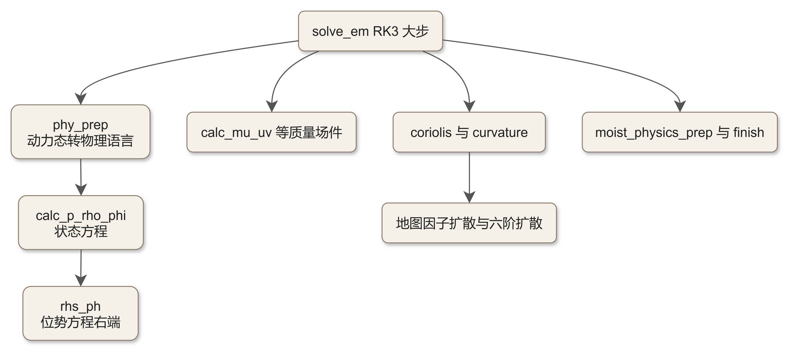
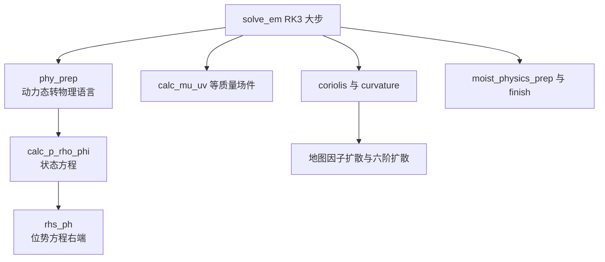

# code_30 — 大步长动力工具箱（dyn_em/module_big_step_utilities_em.F：状态方程、phy_prep 与 rhs_ph）

## 一、版本指纹

| 源文件 | 行数 | md5（整文件，按字节） |
|---|---|---|
| dyn_em/module_big_step_utilities_em.F | 6758 | 23a6e9f7a1d4b39a5243b36bee662e62 |

- 抽取工具：workspace/scripts/code_extract.py v1.2，2026-10-12；块首指纹注释自带 range_md5。
- 收录分级（B）：六件核心（calc_mu_uv/calc_alt/calc_p_rho_phi/calc_php/phy_prep 全文 + rhs_ph 头段）；43 单元的分组总表见 §九。教材锚点：[ch21_solve_em_dynamics.md](../ch21_solve_em_dynamics.md)（十四站）、[ch10_vertical_coords_hydrostatics.md](../ch10_vertical_coords_hydrostatics.md)（垂直坐标与静力平衡的公式源头）。

## 二、定位

一句话：**动力核的「大步长」工具箱**——RK3 大步里所有非平流的支持件：质量场换算（mu 系）、状态方程诊断（p/ρ/φ）、物理语言翻译（phy_prep）、位势方程右端（rhs_ph）、Coriolis/曲率项、地图因子扩散、六阶扩散、Rayleigh 阻尼、水物质的 RK 内准备等。

**谁在调它**：solve_em 的各站（part1 的 phy_prep、advance_w/advance_mu_t 等的 rhs_ph/coriolis/couple 系，见 [code_50_solve_em.md](code_50_solve_em.md)）；part2 亦用 conv_t_tendf_to_moist（code_32 §十）。仅 5 项 USE（L0 底座级依赖，plan §三）。

**43 单元分组总表**：

| 组 | 单元 | 行段 | 说明 |
|---|---|---|---|
| 质量场 | calc_mu_uv / calc_mu_uv_1 / calc_mu_staggered / couple / couple_momentum / decouple | L26–L949, L4475–L4568 | mu 交错换算与 mu 耦合/解耦 |
| 状态诊断 | calc_ww_cp / calc_cq / calc_alt / calc_p_rho_phi / calc_php / diagnose_w | L640–L1361 | ω/cq/比重容/状态方程/全位势/w 诊断 |
| 动力右端 | rhs_ph / horizontal_pressure_gradient / pg_buoy_w / w_damp | L1365–L2711 | 位势方程右端/水平气压梯度/浮力/w 阻尼 |
| 扩散 | horizontal_diffusion 系 4 件 / vertical_diffusion 系 5 件 / sixth_order_diffusion | L2715–L3581, L6220–L6636 | 地图因子扩散族（与 module_diffusion_em 分工） |
| 旋转项 | coriolis / perturbation_coriolis / curvature | L3640–L4469 | 科氏力/扰动科氏/曲率项 |
| 工具 | calculate_full / zero_tend 系 / pole_point_bc / zero_pole | L3587–L4724 | 极点与清零杂件 |
| 物理准备 | phy_prep / phy_prep_part2 / moist_physics_prep_em / moist_physics_finish_em / initialize_moist_old / conv_t_tendf_to_moist / Cloud_tracer_nudge | L4730–L6756 | 动力↔物理翻译与水物质 RK 内管理 |
| 框架 | init_module_big_step / set_tend / rk_rayleigh_damp / theta_relaxation | L5789–L6216 | 倾向设零/Rayleigh 阻尼/θ 松弛 |



<details><summary>原始 Mermaid 源码（可点击展开）</summary>

<!--

-->

</details>

## 三、质量场：calc_mu_uv

<!-- code_extract code_extract.py v1.2
source: dyn_em/module_big_step_utilities_em.F
ranges: L26-L180
file_lines: 6758
file_md5: 23a6e9f7a1d4b39a5243b36bee662e62
display: line-numbered (strip L-prefix and !file: line to restore)
range_md5: 9ccc75da2c9b193cd8b6716196ebd1f0
seg_lines: 155
label: subroutine calc_mu_uv
-->

```fortran
!file: dyn_em/module_big_step_utilities_em.F    L26-L180    (subroutine calc_mu_uv)
L00026  SUBROUTINE calc_mu_uv ( config_flags,                 &
L00027                          mu, mub, muu, muv,            &
L00028                          ids, ide, jds, jde, kds, kde, &
L00029                          ims, ime, jms, jme, kms, kme, &
L00030                          its, ite, jts, jte, kts, kte )
L00031  
L00032     IMPLICIT NONE
L00033     
L00034     ! Input data
L00035  
L00036     TYPE(grid_config_rec_type   ) ,   INTENT(IN   ) :: config_flags
L00037  
L00038     INTEGER ,          INTENT(IN   ) :: ids, ide, jds, jde, kds, kde, &
L00039                                         ims, ime, jms, jme, kms, kme, &
L00040                                         its, ite, jts, jte, kts, kte
L00041  
L00042     REAL, DIMENSION( ims:ime , jms:jme ) , INTENT(  OUT) :: muu, muv
L00043     REAL, DIMENSION( ims:ime , jms:jme ) , INTENT(IN   ) :: mu, mub
L00044  
L00045     !  local stuff
L00046  
L00047     INTEGER :: i, j, itf, jtf, im, jm
L00048  
L00049  !<DESCRIPTION>
L00050  !
L00051  !  calc_mu_uv calculates the full column dry-air mass at the staggered
L00052  !  horizontal velocity points (u,v) and places the results in muu and muv.
L00053  !  This routine uses the reference state (mub) and perturbation state (mu)
L00054  !
L00055  !</DESCRIPTION>
L00056  
L00057  
L00058        itf=ite
L00059        jtf=MIN(jte,jde-1)
L00060  
L00061        IF      ( ( its .NE. ids ) .AND. ( ite .NE. ide ) ) THEN
L00062           DO j=jts,jtf
L00063           DO i=its,itf
L00064              MUU(i,j) = 0.5*(MU(i,j)+MU(i-1,j)+MUB(i,j)+MUB(i-1,j))
L00065           ENDDO
L00066           ENDDO
L00067        ELSE IF ( ( its .EQ. ids ) .AND. ( ite .NE. ide ) ) THEN
L00068           DO j=jts,jtf
L00069           DO i=its+1,itf
L00070              MUU(i,j) = 0.5*(MU(i,j)+MU(i-1,j)+MUB(i,j)+MUB(i-1,j))
L00071           ENDDO
L00072           ENDDO
L00073           i=its
L00074           im = its
L00075           if(config_flags%periodic_x) im = its-1
L00076           DO j=jts,jtf
L00077  !            MUU(i,j) =      MU(i,j)          +MUB(i,j)
L00078  !  fix for periodic b.c., 13 march 2004, wcs
L00079              MUU(i,j) = 0.5*(MU(i,j)+MU(im,j)+MUB(i,j)+MUB(im,j))
L00080           ENDDO
L00081        ELSE IF ( ( its .NE. ids ) .AND. ( ite .EQ. ide ) ) THEN
L00082           DO j=jts,jtf
L00083           DO i=its,itf-1
L00084              MUU(i,j) = 0.5*(MU(i,j)+MU(i-1,j)+MUB(i,j)+MUB(i-1,j))
L00085           ENDDO
L00086           ENDDO
L00087           i=ite
L00088           im = ite-1
L00089           if(config_flags%periodic_x) im = ite
L00090           DO j=jts,jtf
L00091  !            MUU(i,j) =      MU(i-1,j)        +MUB(i-1,j)
L00092  !  fix for periodic b.c., 13 march 2004, wcs
L00093              MUU(i,j) = 0.5*(MU(i-1,j)+MU(im,j)+MUB(i-1,j)+MUB(im,j))
L00094           ENDDO
L00095        ELSE IF ( ( its .EQ. ids ) .AND. ( ite .EQ. ide ) ) THEN
L00096           DO j=jts,jtf
L00097           DO i=its+1,itf-1
L00098              MUU(i,j) = 0.5*(MU(i,j)+MU(i-1,j)+MUB(i,j)+MUB(i-1,j))
L00099           ENDDO
L00100           ENDDO
L00101           i=its
L00102           im = its
L00103           if(config_flags%periodic_x) im = its-1
L00104           DO j=jts,jtf
L00105  !            MUU(i,j) =      MU(i,j)          +MUB(i,j)
L00106  !  fix for periodic b.c., 13 march 2004, wcs
L00107              MUU(i,j) = 0.5*(MU(i,j)+MU(im,j)+MUB(i,j)+MUB(im,j))
L00108           ENDDO
L00109           i=ite
L00110           im = ite-1
L00111           if(config_flags%periodic_x) im = ite
L00112           DO j=jts,jtf
L00113  !            MUU(i,j) =      MU(i-1,j)        +MUB(i-1,j)
L00114  !  fix for periodic b.c., 13 march 2004, wcs
L00115              MUU(i,j) = 0.5*(MU(i-1,j)+MU(im,j)+MUB(i-1,j)+MUB(im,j))
L00116           ENDDO
L00117        END IF
L00118  
L00119        itf=MIN(ite,ide-1)
L00120        jtf=jte
L00121  
L00122        IF      ( ( jts .NE. jds ) .AND. ( jte .NE. jde ) ) THEN
L00123           DO j=jts,jtf
L00124           DO i=its,itf
L00125               MUV(i,j) = 0.5*(MU(i,j)+MU(i,j-1)+MUB(i,j)+MUB(i,j-1))
L00126           ENDDO
L00127           ENDDO
L00128        ELSE IF ( ( jts .EQ. jds ) .AND. ( jte .NE. jde ) ) THEN
L00129           DO j=jts+1,jtf
L00130           DO i=its,itf
L00131               MUV(i,j) = 0.5*(MU(i,j)+MU(i,j-1)+MUB(i,j)+MUB(i,j-1))
L00132           ENDDO
L00133           ENDDO
L00134           j=jts
L00135           jm = jts
L00136           if(config_flags%periodic_y) jm = jts-1
L00137           DO i=its,itf
L00138  !             MUV(i,j) =      MU(i,j)          +MUB(i,j)
L00139  !  fix for periodic b.c., 13 march 2004, wcs
L00140               MUV(i,j) = 0.5*(MU(i,j)+MU(i,jm)+MUB(i,j)+MUB(i,jm))
L00141           ENDDO
L00142        ELSE IF ( ( jts .NE. jds ) .AND. ( jte .EQ. jde ) ) THEN
L00143           DO j=jts,jtf-1
L00144           DO i=its,itf
L00145               MUV(i,j) = 0.5*(MU(i,j)+MU(i,j-1)+MUB(i,j)+MUB(i,j-1))
L00146           ENDDO
L00147           ENDDO
L00148           j=jte
L00149           jm = jte-1
L00150           if(config_flags%periodic_y) jm = jte
L00151           DO i=its,itf
L00152  !            MUV(i,j) =      MU(i,j-1)        +MUB(i,j-1)
L00153  !  fix for periodic b.c., 13 march 2004, wcs
L00154               MUV(i,j) = 0.5*(MU(i,j-1)+MU(i,jm)+MUB(i,j-1)+MUB(i,jm))
L00155           ENDDO
L00156        ELSE IF ( ( jts .EQ. jds ) .AND. ( jte .EQ. jde ) ) THEN
L00157           DO j=jts+1,jtf-1
L00158           DO i=its,itf
L00159               MUV(i,j) = 0.5*(MU(i,j)+MU(i,j-1)+MUB(i,j)+MUB(i,j-1))
L00160           ENDDO
L00161           ENDDO
L00162           j=jts
L00163           jm = jts
L00164           if(config_flags%periodic_y) jm = jts-1
L00165           DO i=its,itf
L00166  !             MUV(i,j) =      MU(i,j)          +MUB(i,j)
L00167  !  fix for periodic b.c., 13 march 2004, wcs
L00168               MUV(i,j) = 0.5*(MU(i,j)+MU(i,jm)+MUB(i,j)+MUB(i,jm))
L00169           ENDDO
L00170           j=jte
L00171           jm = jte-1
L00172           if(config_flags%periodic_y) jm = jte
L00173           DO i=its,itf
L00174  !             MUV(i,j) =      MU(i,j-1)        +MUB(i,j-1)
L00175  !  fix for periodic b.c., 13 march 2004, wcs
L00176               MUV(i,j) = 0.5*(MU(i,j-1)+MU(i,jm)+MUB(i,j-1)+MUB(i,jm))
L00177           ENDDO
L00178        END IF
L00179  
L00180  END SUBROUTINE calc_mu_uv
```

> 讲解：交错 u/v 点上的干空气柱质量：MUU(i,j)=0.5·(MU(i,j)+MU(i−1,j)+MUB(i,j)+MUB(i−1,j))——扰动 mu 与基态 mub 同式平均（**全量 muu=μ′+μ̄ 在交错点线性内插**）；四角 if 分类处理 patch 边界，**周期边界的越界点用 im=its−1/ite 取环回值**（wcs 2004-03-13 的 fix——旧式直接用单点会破坏周期守恒）；v 侧同构。calc_mu_uv_1/calc_mu_staggered 是单点与整层变体。

## 四、状态诊断：calc_alt、calc_p_rho_phi、calc_php

<!-- code_extract code_extract.py v1.2
source: dyn_em/module_big_step_utilities_em.F
ranges: L910-L949
file_lines: 6758
file_md5: 23a6e9f7a1d4b39a5243b36bee662e62
display: line-numbered (strip L-prefix and !file: line to restore)
range_md5: a8b9903550e10867e20def9cd38681db
seg_lines: 40
label: subroutine calc_alt
-->

```fortran
!file: dyn_em/module_big_step_utilities_em.F    L910-L949    (subroutine calc_alt)
L00910  SUBROUTINE calc_alt ( alt, al, alb,                  &
L00911                        ids, ide, jds, jde, kds, kde,  &
L00912                        ims, ime, jms, jme, kms, kme,  &
L00913                        its, ite, jts, jte, kts, kte  )
L00914  
L00915     IMPLICIT NONE
L00916     
L00917     ! Input data
L00918  
L00919     INTEGER ,          INTENT(IN   ) :: ids, ide, jds, jde, kds, kde, &
L00920                                         ims, ime, jms, jme, kms, kme, &
L00921                                         its, ite, jts, jte, kts, kte
L00922  
L00923     REAL, DIMENSION( ims:ime , kms:kme , jms:jme ), INTENT(IN   ) :: alb, al
L00924     REAL, DIMENSION( ims:ime , kms:kme , jms:jme ), INTENT(  OUT) :: alt
L00925  
L00926     ! Local stuff
L00927  
L00928     INTEGER :: i, j, k, itf, jtf, ktf
L00929  
L00930  !<DESCRIPTION>
L00931  !
L00932  ! calc_alt computes the full inverse density
L00933  !
L00934  !</DESCRIPTION>
L00935  
L00936        itf=MIN(ite,ide-1)
L00937        jtf=MIN(jte,jde-1)
L00938        ktf=MIN(kte,kde-1)
L00939  
L00940        DO j=jts,jtf
L00941        DO k=kts,ktf
L00942        DO i=its,itf
L00943          alt(i,k,j) = al(i,k,j)+alb(i,k,j)
L00944        ENDDO
L00945        ENDDO
L00946        ENDDO
L00947  
L00948  
L00949  END SUBROUTINE calc_alt
```

> 讲解：全比重容 alt=al+alb（扰动+基态）——一行件，但它是物理方案密度（ρ=1/alt·(1+qv)，见 phy_prep）的源头。

<!-- code_extract code_extract.py v1.2
source: dyn_em/module_big_step_utilities_em.F
ranges: L953-L1223
file_lines: 6758
file_md5: 23a6e9f7a1d4b39a5243b36bee662e62
display: line-numbered (strip L-prefix and !file: line to restore)
range_md5: eee6745c26c61d32b52fa389a374ab59
seg_lines: 271
label: subroutine calc_p_rho_phi
-->

```fortran
!file: dyn_em/module_big_step_utilities_em.F    L953-L1223    (subroutine calc_p_rho_phi)
L00953  SUBROUTINE calc_p_rho_phi ( moist, n_moist, hypsometric_opt,      &
L00954                              al, alb, mu, muts,                    &
L00955                              c1, c2, c3h, c4h, c3f, c4f,           &
L00956                              ph, phb, p, pb,                       &
L00957                              t, p0, t0, ptop, znu, znw, dnw, rdnw, &
L00958                              rdn, non_hydrostatic, use_theta_m,    &
L00959                              ids, ide, jds, jde, kds, kde,         &
L00960                              ims, ime, jms, jme, kms, kme,         &
L00961                              its, ite, jts, jte, kts, kte          )
L00962  
L00963    IMPLICIT NONE
L00964     
L00965     ! Input data
L00966  
L00967    LOGICAL ,          INTENT(IN   ) :: non_hydrostatic
L00968    INTEGER ,          INTENT(IN   ) :: use_theta_m
L00969  
L00970    INTEGER ,          INTENT(IN   ) :: ids, ide, jds, jde, kds, kde, &
L00971                                        ims, ime, jms, jme, kms, kme, &
L00972                                        its, ite, jts, jte, kts, kte
L00973  
L00974    INTEGER ,          INTENT(IN   ) :: n_moist
L00975    INTEGER ,          INTENT(IN   ) :: hypsometric_opt
L00976  
L00977    REAL, DIMENSION( ims:ime , kms:kme , jms:jme ), INTENT(IN   ) :: alb,  &
L00978                                                                     pb,   &
L00979                                                                     t
L00980  
L00981    REAL, DIMENSION( ims:ime , kms:kme , jms:jme, n_moist ), INTENT(IN   ) :: moist
L00982  
L00983    REAL, DIMENSION( ims:ime , kms:kme , jms:jme ), INTENT(  OUT) :: al, p
L00984  
L00985    REAL, DIMENSION( ims:ime , kms:kme , jms:jme ), INTENT(INOUT) :: ph, phb
L00986  
L00987    REAL, DIMENSION( ims:ime , jms:jme ), INTENT(IN   ) :: mu, muts
L00988  
L00989    REAL, DIMENSION( kms:kme ), INTENT(IN   ) :: znu, znw, dnw, rdnw, rdn
L00990  
L00991    REAL, DIMENSION( kms:kme ), INTENT(IN   ) :: c1, c2, c3h, c4h, c3f, c4f
L00992  
L00993    REAL,   INTENT(IN   ) :: t0, p0, ptop
L00994  
L00995    ! Local stuff
L00996  
L00997    INTEGER :: i, j, k, kk, itf, jtf, ktf, ispe
L00998    REAL    :: qtot, qf1, qf2, qvf
L00999    REAL, DIMENSION( its:ite) :: temp,cpovcv_v
L01000    REAL    :: pfu, phm, pfd
L01001  
L01002  !<DESCRIPTION>
L01003  !
L01004  ! For the nonhydrostatic option, calc_p_rho_phi calculates the
L01005  ! diagnostic quantities pressure and (inverse) density from the
L01006  ! prognostic variables using the equation of state.
L01007  !
L01008  ! For the hydrostatic option, calc_p_rho_phi calculates the
L01009  ! diagnostic quantities (inverse) density and geopotential from the
L01010  ! prognostic variables using the equation of state and the hydrostatic
L01011  ! equation.
L01012  !
L01013  !</DESCRIPTION>
L01014  
L01015    itf=MIN(ite,ide-1)
L01016    jtf=MIN(jte,jde-1)
L01017    ktf=MIN(kte,kde-1)
L01018  
L01019  #ifndef INTELMKL
L01020    cpovcv_v = cpovcv
L01021  #endif
L01022  
L01023    nonhydro : IF (non_hydrostatic) THEN
L01024  
L01025        hypso_nonhydro : IF (hypsometric_opt == 1) THEN
L01026          DO j=jts,jtf
L01027          DO k=kts,ktf
L01028          DO i=its,itf
L01029            al(i,k,j)=-1./(c1(k)*muts(i,j)+c2(k))*(alb(i,k,j)*(c1(k)*mu(i,j)) + rdnw(k)*(ph(i,k+1,j)-ph(i,k,j)))
L01030          END DO
L01031          END DO
L01032          END DO
L01033        ELSE IF (hypsometric_opt == 2) THEN hypso_nonhydro
L01034  
L01035          ! The relation used to get specific volume, al, is: al = -dZ/dp,
L01036          ! where dp = mut * d(eta). The pressure depth, dp, is replaced with
L01037          ! p*(dp/p) ~ p*LOG((p+0.5dp)/(p-0.5dp)). Difference between dp and p*dLOG(p)
L01038          ! is as follows: p*dLOG(p) - dp = 1/12*(dp/p)**3 + 1/90*(dp/p)**5 + ...
L01039          ! Therefore, p*dLOG(p) is always larger than dp and the difference is
L01040          ! in proportion to dp/p. TKW, 02/16/2010
L01041  
L01042          DO j=jts,jtf
L01043          DO k=kts,ktf
L01044          DO i=its,itf
L01045            pfu = c3f(k+1)*MUTS(i,j) + c4f(k+1) + ptop
L01046            pfd = c3f(k  )*MUTS(i,j) + c4f(k  ) + ptop
L01047            phm = c3h(k  )*MUTS(i,j) + c4h(k  ) + ptop
L01048            al(i,k,j) = (ph(i,k+1,j)-ph(i,k,j)+phb(i,k+1,j)-phb(i,k,j))/phm/LOG(pfd/pfu)-alb(i,k,j)
L01049          END DO
L01050          END DO
L01051          END DO
L01052        ELSE hypso_nonhydro
L01053          CALL wrf_error_fatal ( 'calc_p_rho_phi: hypsometric_opt should be 1 or 2' )
L01054        END IF hypso_nonhydro
L01055  
L01056        moist_nonhydro : IF (n_moist >= PARAM_FIRST_SCALAR ) THEN  
L01057  
L01058          DO j=jts,jtf
L01059          DO k=kts,ktf
L01060          DO i=its,itf
L01061          IF ( use_theta_m .EQ. 1 ) THEN
L01062            temp(i)=(r_d*(t0+t(i,k,j)))/(p0*(al(i,k,j)+alb(i,k,j)))
L01063          ELSE
L01064            qvf = 1.+rvovrd*moist(i,k,j,P_QV)
L01065            temp(i)=(r_d*(t0+t(i,k,j))*qvf)/(p0*(al(i,k,j)+alb(i,k,j)))
L01066          ENDIF
L01067          ENDDO
L01068  #ifdef INTELMKL
L01069          CALL VPOWX ( itf-its+1, temp(its), cpovcv, p(its,k,j) )
L01070  #else
L01071  ! use vector version from libmassv or from compat lib in frame/libmassv.F
L01072          CALL VPOW  ( p(its,k,j), temp(its), cpovcv_v(its), itf-its+1 )
L01073  #endif
L01074          DO i=its,itf
L01075             p(i,k,j)= p(i,k,j)*p0-pb(i,k,j)
L01076          ENDDO
L01077          ENDDO
L01078          ENDDO
L01079  
L01080        ELSE moist_nonhydro           
L01081  
L01082          DO j=jts,jtf
L01083          DO k=kts,ktf
L01084          DO i=its,itf
L01085            p(i,k,j)=p0*( (r_d*(t0+t(i,k,j)))/                     &
L01086                          (p0*(al(i,k,j)+alb(i,k,j))) )**cpovcv  &
L01087                             -pb(i,k,j)
L01088          ENDDO
L01089          ENDDO
L01090          ENDDO
L01091  
L01092        END IF moist_nonhydro
L01093  
L01094     ELSE nonhydro
L01095  
L01096  !  hydrostatic pressure, al, and ph1 calc; WCS, 5 sept 2001
L01097  
L01098  
L01099        moist_hydro : IF (n_moist >= PARAM_FIRST_SCALAR ) THEN  
L01100  
L01101          DO j=jts,jtf
L01102  
L01103            k=ktf          ! top layer
L01104            DO i=its,itf
L01105  
L01106              qtot = 0.
L01107              DO ispe=PARAM_FIRST_SCALAR,n_moist
L01108                qtot = qtot + moist(i,k,j,ispe)
L01109              ENDDO
L01110              qf2 = 1.
L01111              qf1 = qtot*qf2
L01112  
L01113              p(i,k,j) = - 0.5*((c1(k)*mu(i,j))+qf1*(c1(k)*muts(i,j)+c2(k)))/rdnw(k)/qf2
L01114              IF ( use_theta_m .EQ. 1 ) THEN
L01115              al(i,k,j) = (r_d/p1000mb)*(t(i,k,j)+t0)* &
L01116                  (((p(i,k,j)+pb(i,k,j))/p1000mb)**cvpm) - alb(i,k,j)
L01117              ELSE
L01118              qvf = 1.+rvovrd*moist(i,k,j,P_QV)
L01119              al(i,k,j) = (r_d/p1000mb)*(t(i,k,j)+t0)*qvf* &
L01120                  (((p(i,k,j)+pb(i,k,j))/p1000mb)**cvpm) - alb(i,k,j)
L01121              END IF
L01122  
L01123            ENDDO
L01124  
L01125            DO k=ktf-1,kts,-1  ! remaining layers, integrate down
L01126              DO i=its,itf
L01127  
L01128              qtot = 0.
L01129              DO ispe=PARAM_FIRST_SCALAR,n_moist
L01130                qtot = qtot + 0.5*(  moist(i,k  ,j,ispe) + moist(i,k+1,j,ispe) )
L01131              ENDDO
L01132              qf2 = 1.
L01133              qf1 = qtot*qf2
L01134  
L01135              p(i,k,j) = p(i,k+1,j) - ((c1(k)*mu(i,j)) + qf1*(c1(k)*muts(i,j)+c2(k)))/qf2/rdn(k+1)
L01136              IF ( use_theta_m .EQ. 1 ) THEN
L01137              al(i,k,j) = (r_d/p1000mb)*(t(i,k,j)+t0)* &
L01138                          (((p(i,k,j)+pb(i,k,j))/p1000mb)**cvpm) - alb(i,k,j)
L01139              ELSE
L01140              qvf = 1.+rvovrd*moist(i,k,j,P_QV)
L01141              al(i,k,j) = (r_d/p1000mb)*(t(i,k,j)+t0)*qvf* &
L01142                          (((p(i,k,j)+pb(i,k,j))/p1000mb)**cvpm) - alb(i,k,j)
L01143              END IF
L01144              ENDDO
L01145            ENDDO
L01146  
L01147          ENDDO
L01148  
L01149        ELSE moist_hydro
L01150  
L01151          DO j=jts,jtf
L01152  
L01153            k=ktf          ! top layer
L01154            DO i=its,itf
L01155  
L01156              qtot = 0.
L01157              qf2 = 1.
L01158              qf1 = qtot*qf2
L01159  
L01160              p(i,k,j) = - 0.5*((c1(k)*mu(i,j))+qf1*(c1(k)*muts(i,j)+c2(k)))/rdnw(k)/qf2
L01161              al(i,k,j) = (r_d/p1000mb)*(t(i,k,j)+t0)* &
L01162                  (((p(i,k,j)+pb(i,k,j))/p1000mb)**cvpm) - alb(i,k,j)
L01163  
L01164            ENDDO
L01165  
L01166            DO k=ktf-1,kts,-1  ! remaining layers, integrate down
L01167              DO i=its,itf
L01168  
L01169              qtot = 0.
L01170              qf2 = 1.
L01171              qf1 = qtot*qf2
L01172  
L01173              p(i,k,j) = p(i,k+1,j) - ((c1(k)*mu(i,j)) + qf1*(c1(k)*muts(i,j)+c2(k)))/qf2/rdn(k+1)
L01174              al(i,k,j) = (r_d/p1000mb)*(t(i,k,j)+t0)* &
L01175                          (((p(i,k,j)+pb(i,k,j))/p1000mb)**cvpm) - alb(i,k,j)
L01176              ENDDO
L01177            ENDDO
L01178  
L01179          ENDDO
L01180  
L01181       END IF moist_hydro
L01182  
L01183       hypso_hydro : IF (hypsometric_opt == 1) THEN
L01184          DO j=jts,jtf
L01185            DO kk=2,ktf+1  ! integrate hydrostatic equation for geopotential
L01186              k = kk-1
L01187              DO i=its,itf
L01188                ph(i,k+1,j) = ph(i,k,j) - (dnw(k))*(           &
L01189                             ((c1(k)*muts(i,j)+c2(k)))*al(i,k,j)+            &
L01190                              (c1(k)*mu(i,j))*alb(i,k,j)  )
L01191              ENDDO
L01192            ENDDO
L01193          ENDDO
L01194       ELSE hypso_hydro
L01195  
L01196       ! Revised hypsometric eq.: dZ=-al*p*dLOG(p), where p is dry pressure
L01197  
L01198        DO j=jts,jtf
L01199          DO i=its,itf
L01200             ph(i,kts,j) = phb(i,kts,j)
L01201          END DO
L01202  
L01203          DO k=kts+1,ktf+1
L01204            DO i=its,itf
L01205              pfu = c3f(k  )*MUTS(i,j) + c4f(k  ) + ptop
L01206              pfd = c3f(k-1)*MUTS(i,j) + c4f(k-1) + ptop
L01207              phm = c3h(k-1)*MUTS(i,j) + c4h(k-1) + ptop
L01208              ph(i,k,j) = ph(i,k-1,j) + (al(i,k-1,j)+alb(i,k-1,j))*phm*LOG(pfd/pfu)
L01209            ENDDO
L01210          ENDDO
L01211  
L01212          DO k=kts,ktf+1
L01213            DO i=its,itf
L01214               ph(i,k,j) = ph(i,k,j) - phb(i,k,j)
L01215            END DO
L01216          END DO
L01217        END DO
L01218  
L01219       END IF hypso_hydro
L01220  
L01221     END IF nonhydro
L01222  
L01223  END SUBROUTINE calc_p_rho_phi
```

> 讲解：**状态方程与静力平衡的核心件**，四路分支：①**非静力 hypsometric_opt=1**（默认）：al=−[alb·c1μ+rdnw·Δph]/(c1μ+c2)——由位势厚度反解比重容（c1/c2 是高度坐标系数、rdnw=1/dnw 层厚倒数）；②**opt=2（TKW 2010-02-16）**：al=Δφ/(φ_m·ln(pfd/pfu))−alb——注释给了误差展开 p·dlnp−dp=(1/12)(dp/p)³+…，**用对数气压厚度代替线性厚度的高阶修订**；③气压：先 temp=r_d(t0+t)·qvf/(p0·al_full)（qvf=1+rvovrd·qv 的虚温订正；use_theta_m=1 时 t 已含水汽、不加 qvf），**p_full=p0·temp^cpovcv**——用 libmassv 的向量幂函数 VPOW（INTELMKL 时 VPOWX），再减基态 pb 得扰动气压 p——注意 **cvpm=−cv/cp 出现在静力分支**而这里用正的 cpovcv，两条状态方程口径；④**静力模式**：从顶层起算 p(i,ktf)=−0.5(c1μ+qf1(c1μ+c2))/rdnw（顶边界条件），逐层向下 p(k)=p(k+1)−(c1μ+qf1(c1μ+c2))/rdn(k+1)——**qf1=Σ水物质**：气压由干空气柱 μ 与水物质重量共同承担；al 用 (r_d/p1000mb)(t+t0)qvf·(p_full/p1000mb)^cvpm−alb；静力位势 ph 向下积分 ph(k+1)=ph(k)−dnw[(c1μ+c2)·al+c1μ·alb]，修订版走 dZ=−al·p·dlnp（TKW 同款高阶口径）。**这一件是教材 ch10 全部公式的源码本体**。

<!-- code_extract code_extract.py v1.2
source: dyn_em/module_big_step_utilities_em.F
ranges: L1227-L1266
file_lines: 6758
file_md5: 23a6e9f7a1d4b39a5243b36bee662e62
display: line-numbered (strip L-prefix and !file: line to restore)
range_md5: 5dd310f76595b89e5aa488e58bbfcda1
seg_lines: 40
label: subroutine calc_php
-->

```fortran
!file: dyn_em/module_big_step_utilities_em.F    L1227-L1266    (subroutine calc_php)
L01227  SUBROUTINE calc_php ( php, ph, phb,                  &
L01228                        ids, ide, jds, jde, kds, kde,  &
L01229                        ims, ime, jms, jme, kms, kme,  &
L01230                        its, ite, jts, jte, kts, kte  )
L01231  
L01232     IMPLICIT NONE
L01233     
L01234     ! Input data
L01235  
L01236     INTEGER ,          INTENT(IN   ) :: ids, ide, jds, jde, kds, kde, &
L01237                                         ims, ime, jms, jme, kms, kme, &
L01238                                         its, ite, jts, jte, kts, kte
L01239  
L01240     REAL, DIMENSION( ims:ime, kms:kme , jms:jme ), INTENT(IN   ) :: phb, ph
L01241     REAL, DIMENSION( ims:ime, kms:kme , jms:jme ), INTENT(  OUT) :: php
L01242  
L01243     ! Local stuff
L01244  
L01245     INTEGER :: i, j, k, itf, jtf, ktf
L01246  
L01247  !<DESCRIPTION>
L01248  !
L01249  !  calc_php calculates the full geopotential from the reference state
L01250  !  geopotential and the perturbation geopotential (phb_ph).
L01251  !
L01252  !</DESCRIPTION>
L01253  
L01254        itf=MIN(ite,ide-1)
L01255        jtf=MIN(jte,jde-1)
L01256        ktf=MIN(kte,kde-1)
L01257  
L01258        DO j=jts,jtf
L01259        DO k=kts,ktf
L01260        DO i=its,itf
L01261          php(i,k,j) = 0.5*(phb(i,k,j)+phb(i,k+1,j)+ph(i,k,j)+ph(i,k+1,j))
L01262        ENDDO
L01263        ENDDO
L01264        ENDDO
L01265  
L01266  END SUBROUTINE calc_php
```

> 讲解：全位惠（half-level 上的 full geopotential）php=0.5(phb+phb 上层+ph+ph 上层)——w 层与质量层之间的插值件，w 方程的气压梯度项用它。

## 五、物理翻译官 phy_prep（全文）

<!-- code_extract code_extract.py v1.2
source: dyn_em/module_big_step_utilities_em.F
ranges: L4730-L4973
file_lines: 6758
file_md5: 23a6e9f7a1d4b39a5243b36bee662e62
display: line-numbered (strip L-prefix and !file: line to restore)
range_md5: a92a4692ca916d54a55394f0e1067b0c
seg_lines: 244
label: subroutine phy_prep
-->

```fortran
!file: dyn_em/module_big_step_utilities_em.F    L4730-L4973    (subroutine phy_prep)
L04730     SUBROUTINE phy_prep ( config_flags,                                &  ! input
L04731                           mut, muu, muv,                               &
L04732                           c1h, c2h, c1f, c2f,                          &
L04733                           u, v, p, pb, alt, ph,                        &  ! input
L04734                           phb, t, moist, n_moist,                      &  ! input
L04735                           rho, th_phy, th_phy_m_t0,                    &  ! output
L04736                           p_phy , pi_phy ,                             &  ! output
L04737                           u_phy, v_phy, p8w, t_phy, t8w,               &  ! output
L04738                           z, z_at_w, dz8w,                             &  ! output
L04739                           p_hyd, p_hyd_w, dnw,                         &  ! output
L04740                           fzm, fzp, znw, p_top,                        &  ! params
L04741                           ids, ide, jds, jde, kds, kde,                &
L04742                           ims, ime, jms, jme, kms, kme,                &
L04743                           its, ite, jts, jte, kts, kte                )
L04744  !----------------------------------------------------------------------
L04745     IMPLICIT NONE
L04746  !----------------------------------------------------------------------
L04747  
L04748     TYPE(grid_config_rec_type) ,     INTENT(IN   ) :: config_flags
L04749  
L04750     INTEGER ,        INTENT(IN   ) ::   ids, ide, jds, jde, kds, kde, &
L04751                                         ims, ime, jms, jme, kms, kme, &
L04752                                         its, ite, jts, jte, kts, kte
L04753     INTEGER ,          INTENT(IN   ) :: n_moist
L04754  
L04755     REAL, DIMENSION( ims:ime, kms:kme , jms:jme , n_moist ), INTENT(IN) :: moist
L04756  
L04757  
L04758     REAL , DIMENSION( ims:ime, jms:jme ), INTENT(IN   )   ::     mut, muu, muv
L04759  
L04760     REAL , DIMENSION( ims:ime , kms:kme , jms:jme ) ,                 &
L04761            INTENT(  OUT)                                  ::   u_phy, &
L04762                                                                v_phy, &
L04763                                                               pi_phy, &
L04764                                                                p_phy, &
L04765                                                                  p8w, &
L04766                                                                t_phy, &
L04767                                                               th_phy, &
L04768                                                          th_phy_m_t0, &
L04769                                                                  t8w, &
L04770                                                                  rho, &
L04771                                                                    z, &
L04772                                                                 dz8w, &
L04773                                                                z_at_w
L04774  
L04775     REAL , DIMENSION( ims:ime , kms:kme , jms:jme ) ,                 &
L04776            INTENT(  OUT)                                  ::   p_hyd, &
L04777                                                                p_hyd_w
L04778  
L04779     REAL , INTENT(IN   )                                  ::   p_top
L04780  
L04781     REAL , DIMENSION( ims:ime , kms:kme , jms:jme ) ,                 &
L04782            INTENT(IN   )                                  ::      pb, &
L04783                                                                    p, &
L04784                                                                    u, &
L04785                                                                    v, &
L04786                                                                  alt, &
L04787                                                                   ph, &
L04788                                                                  phb, &
L04789                                                                    t
L04790  
L04791  
L04792     REAL , DIMENSION( kms:kme ) ,           INTENT(IN   ) ::     fzm,   &
L04793                                                                  fzp
L04794  
L04795     REAL , DIMENSION( kms:kme ) ,           INTENT(IN   ) ::     znw, &
L04796                                                                  dnw
L04797  
L04798     REAL, DIMENSION( kms:kme ) ,            INTENT(IN   ) ::     c1h, c2h, c1f, c2f
L04799  
L04800     REAL, DIMENSION( kms:kme ) :: c1, c2
L04801     INTEGER :: i_start, i_end, j_start, j_end, k_start, k_end, i_startu, j_startv
L04802     INTEGER :: i, j, k
L04803     REAL    :: w1, w2, z0, z1, z2
L04804     REAL    :: qtot
L04805     INTEGER :: n
L04806  
L04807  !-----------------------------------------------------------------------
L04808  
L04809  !<DESCRIPTION>
L04810  !
L04811  !  phys_prep calculates a number of diagnostic quantities needed by
L04812  !  the physics routines.  
L04813  !
L04814  !</DESCRIPTION>
L04815  
L04816      c1 = c1h
L04817      c2 = c2h
L04818  !  set up loop bounds for this grid's boundary conditions
L04819  
L04820      i_start = its
L04821      i_end   = min( ite,ide-1 )
L04822      j_start = jts
L04823      j_end   = min( jte,jde-1 )
L04824  
L04825      k_start = kts
L04826      k_end = min( kte, kde-1 )
L04827  
L04828  !  compute thermodynamics and velocities at pressure points (or half levels)
L04829  
L04830      IF ( ( config_flags%use_theta_m .EQ. 1 ) .AND. (P_Qv .GE. PARAM_FIRST_SCALAR) ) THEN
L04831         do j = j_start,j_end
L04832         do k = k_start, k_end
L04833         do i = i_start, i_end
L04834           th_phy(i,k,j) = (t(i,k,j)+t0)/(1.+R_v/R_d*moist(i,k,j,P_QV))
L04835         enddo
L04836         enddo
L04837         enddo
L04838      ELSE
L04839         do j = j_start,j_end
L04840         do k = k_start, k_end
L04841         do i = i_start, i_end
L04842           th_phy(i,k,j) =  t(i,k,j)+t0
L04843         enddo
L04844         enddo
L04845         enddo
L04846      END IF
L04847  
L04848      do j = j_start,j_end
L04849      do k = k_start, k_end
L04850      do i = i_start, i_end
L04851  
L04852        th_phy_m_t0(i,k,j) = th_phy(i,k,j)-t0
L04853        p_phy(i,k,j) = p(i,k,j) + pb(i,k,j)
L04854        pi_phy(i,k,j) = (p_phy(i,k,j)/p1000mb)**rcp
L04855        t_phy(i,k,j) = th_phy(i,k,j)*pi_phy(i,k,j)
L04856        rho(i,k,j) = 1./alt(i,k,j)*(1.+moist(i,k,j,P_QV))
L04857        u_phy(i,k,j) = 0.5*(u(i,k,j)+u(i+1,k,j))
L04858        v_phy(i,k,j) = 0.5*(v(i,k,j)+v(i,k,j+1))
L04859  
L04860      enddo
L04861      enddo
L04862      enddo
L04863  
L04864  !  compute z at w points
L04865  
L04866      do j = j_start,j_end
L04867      do k = k_start, kte
L04868      do i = i_start, i_end
L04869        z_at_w(i,k,j) = (phb(i,k,j)+ph(i,k,j))/g
L04870      enddo
L04871      enddo
L04872      enddo
L04873  
L04874      do j = j_start,j_end
L04875      do k = k_start, kte-1
L04876      do i = i_start, i_end
L04877        dz8w(i,k,j) = z_at_w(i,k+1,j)-z_at_w(i,k,j)
L04878      enddo
L04879      enddo
L04880      enddo
L04881  
L04882      do j = j_start,j_end
L04883      do i = i_start, i_end
L04884        dz8w(i,kte,j) = 0.
L04885      enddo
L04886      enddo
L04887  
L04888  !  compute z at p points or half levels (average of z at full levels)
L04889  
L04890      do j = j_start,j_end
L04891      do k = k_start, k_end
L04892      do i = i_start, i_end
L04893        z(i,k,j) = 0.5*(z_at_w(i,k,j) +z_at_w(i,k+1,j) )
L04894      enddo
L04895      enddo
L04896      enddo
L04897  
L04898  !  interp t and p to full levels
L04899  
L04900      do j = j_start,j_end
L04901      do k = 2, k_end
L04902      do i = i_start, i_end
L04903        p8w(i,k,j) = fzm(k)*p_phy(i,k,j)+fzp(k)*p_phy(i,k-1,j)
L04904        t8w(i,k,j) = fzm(k)*t_phy(i,k,j)+fzp(k)*t_phy(i,k-1,j)
L04905      enddo
L04906      enddo
L04907      enddo
L04908  
L04909  !  extrapolate p and t to surface and top.
L04910  !  we'll use an extrapolation in z for now
L04911  
L04912      do j = j_start,j_end
L04913      do i = i_start, i_end
L04914  
L04915  ! bottom
L04916  
L04917        z0 = z_at_w(i,1,j)
L04918        z1 = z(i,1,j)
L04919        z2 = z(i,2,j)
L04920        w1 = (z0 - z2)/(z1 - z2)
L04921        w2 = 1. - w1
L04922        p8w(i,1,j) = w1*p_phy(i,1,j)+w2*p_phy(i,2,j)
L04923        t8w(i,1,j) = w1*t_phy(i,1,j)+w2*t_phy(i,2,j)
L04924  
L04925  ! top
L04926  
L04927        z0 = z_at_w(i,kte,j)
L04928        z1 = z(i,k_end,j)
L04929        z2 = z(i,k_end-1,j)
L04930        w1 = (z0 - z2)/(z1 - z2)
L04931        w2 = 1. - w1
L04932  
L04933  !      p8w(i,kde,j) = w1*p_phy(i,kde-1,j)+w2*p_phy(i,kde-2,j)
L04934  !!!  bug fix      extrapolate ln(p) so p is positive definite
L04935        p8w(i,kde,j) = exp(w1*log(p_phy(i,kde-1,j))+w2*log(p_phy(i,kde-2,j)))
L04936        t8w(i,kde,j) = w1*t_phy(i,kde-1,j)+w2*t_phy(i,kde-2,j)
L04937  
L04938      enddo
L04939      enddo
L04940  
L04941  ! calculate hydrostatic pressure at both full and half levels
L04942  ! first, full level p: assuming dry over model top
L04943  
L04944      do j = j_start,j_end
L04945      do i = i_start, i_end
L04946         p_hyd_w(i,kte,j) = p_top
L04947      enddo
L04948      enddo
L04949  
L04950      do j = j_start,j_end
L04951      do k = kte-1, k_start, -1
L04952      do i = i_start, i_end
L04953         qtot = 0.
L04954         do n = PARAM_FIRST_SCALAR,n_moist
L04955                qtot = qtot + moist(i,k,j,n)
L04956         enddo
L04957         p_hyd_w(i,k,j) = p_hyd_w(i,k+1,j) - (1.+qtot)*(c1(k)*MUT(i,j)+c2(k))*dnw(k)
L04958  !      p_hyd_w(i,k,j) = p_hyd_w(i,k+1,j)+1./alt(i,k,j)*(1.+moist(i,k,j,P_QV))*g*dz8w(i,k,j)
L04959      enddo
L04960      enddo
L04961      enddo
L04962  
L04963  ! now calculate hydrostatic pressure at half levels
L04964  
L04965      do j = j_start,j_end
L04966      do k = k_start, k_end
L04967      do i = i_start, i_end
L04968         p_hyd(i,k,j) = 0.5*(p_hyd_w(i,k,j)+p_hyd_w(i,k+1,j))
L04969      enddo
L04970      enddo
L04971      enddo
L04972  
L04973  END SUBROUTINE phy_prep
```

> 讲解：code_31 §四调用对象的本体，动力态→物理语言的全部换算：①th_phy：use_theta_m=1 时 (t+t0)/(1+rvovrd·qv)（湿位温还原干位温），否则 t+t0；**th_phy_m_t0=th_phy−t0**（physics 里常见减 t0 口径的来源）；②p_phy=p+pb（扰动+基态=全气压）、pi_phy=(p_phy/p1000mb)^rcp（Exner）、t_phy=θ·π；③**rho=1/alt·(1+qv)**——干空气比重容的倒数乘 (1+qv) 得湿空气密度（水物质质量计入分母的隐式处理）；④u_phy/v_phy 消交错；⑤z_at_w=φ/g、dz8w 层厚（**顶层 dz8w=0**——上层厚度的哨兵）、z 层中；⑥p8w/t8w 在 w 层的垂直插值（fzm/fzp 系数），**底边界 z 外插两点线性、顶边界 p 用 ln(p) 外插**（注释 bug fix——线性外插 p 可能出负值）；⑦**p_hyd_w 从顶层 p_top 向下静水积分**：p_hyd_w(k)=p_hyd_w(k+1)−(1+Σmoist)(c1·mut+c2)·dnw——含水柱重的静水压（注释保留老式 alt·g·dz 口径），半层平均得 p_hyd——**物理方案吃的「静水压分量」在此成形**（radiation_driver 的 P=grid%p_hyd、noahdrv 的 P8W=P_hyd_w）。

## 六、位势方程右端 rhs_ph（头段）

<!-- code_extract code_extract.py v1.2
source: dyn_em/module_big_step_utilities_em.F
ranges: L1365-L1520
file_lines: 6758
file_md5: 23a6e9f7a1d4b39a5243b36bee662e62
display: line-numbered (strip L-prefix and !file: line to restore)
range_md5: d2cba913a517161894afe9c115c0c94f
seg_lines: 156
-->

```fortran
!file: dyn_em/module_big_step_utilities_em.F    L1365-L1520
L01365  SUBROUTINE rhs_ph( ph_tend, u, v, ww,               &
L01366                     ph, ph_old, phb, w,              &
L01367                     mut, muuf, muvf,                 &
L01368                     c1f, c2f,                        &
L01369                     fnm, fnp,                        &
L01370                     rdnw, cfn, cfn1, rdx, rdy,       &
L01371                     msfux, msfuy, msfvx,             &
L01372                     msfvx_inv, msfvy,                &
L01373                     msftx, msfty,                    &
L01374                     non_hydrostatic,                 &
L01375                     config_flags,                    &
L01376                     ids, ide, jds, jde, kds, kde,    &
L01377                     ims, ime, jms, jme, kms, kme,    &
L01378                     its, ite, jts, jte, kts, kte    )
L01379     IMPLICIT NONE
L01380  
L01381     TYPE(grid_config_rec_type), INTENT(IN   ) :: config_flags
L01382  
L01383     INTEGER ,          INTENT(IN   ) :: ids, ide, jds, jde, kds, kde, &
L01384                                         ims, ime, jms, jme, kms, kme, &
L01385                                         its, ite, jts, jte, kts, kte
L01386  
L01387     REAL, DIMENSION( ims:ime, kms:kme , jms:jme ), INTENT(IN   ) ::        &
L01388                                                                       u,   &
L01389                                                                       v,   &
L01390                                                                       ww,  &
L01391                                                                       ph,  &
L01392                                                                       ph_old, &
L01393                                                                       phb, &
L01394                                                                      w
L01395  
L01396     REAL, DIMENSION( ims:ime, kms:kme , jms:jme ), INTENT(INOUT) :: ph_tend
L01397  
L01398     REAL, DIMENSION( ims:ime, jms:jme ), INTENT(IN   ) :: muuf, muvf, mut,   &
L01399                                                              msfux, msfuy, &
L01400                                                              msfvx, msfvy, &
L01401                                                              msftx, msfty, &
L01402                                                              msfvx_inv
L01403  
L01404     REAL, DIMENSION( kms:kme ), INTENT(IN   ) :: rdnw, fnm, fnp
L01405  
L01406     REAL, DIMENSION( kms:kme ), INTENT(IN   ) :: c1f, c2f
L01407     
L01408  
L01409     REAL,  INTENT(IN   ) :: cfn, cfn1, rdx, rdy
L01410  
L01411     LOGICAL,  INTENT(IN   )  ::  non_hydrostatic
L01412  
L01413     ! Local stuff
L01414  
L01415     INTEGER :: i, j, k, itf, jtf, ktf, kz, i_start, j_start
L01416     REAL    :: ur, ul, ub, vr, vl, vb
L01417     REAL, DIMENSION(its:ite,kts:kte) :: wdwn
L01418  
L01419     INTEGER :: advective_order
L01420  
L01421     LOGICAL :: specified
L01422  
L01423  !<DESCRIPTION>
L01424  !
L01425  ! rhs_ph calculates the large-timestep tendency terms for the geopotential
L01426  ! equation.  These terms include the advection and "gw".  The geopotential
L01427  ! equation is cast in advective form, so we don't use the flux form advection
L01428  ! algorithms here.
L01429  !
L01430  !</DESCRIPTION>
L01431  
L01432     specified = .false.
L01433     if(config_flags%specified .or. config_flags%nested) specified = .true.
L01434  
L01435     advective_order = config_flags%h_sca_adv_order
L01436  
L01437     itf=MIN(ite,ide-1)
L01438     jtf=MIN(jte,jde-1)
L01439     ktf=MIN(kte,kde-1)
L01440  
L01441  !  Notes on map scale factors (WCS, 2 march 2008)
L01442  !  phi equation is:   mu/my d/dt(phi) = -(1/my) mx mu u  d/dx(phi)
L01443  !                                       -(1/my) my mu v d/dy(phi)
L01444  !                                       - omega d/d_eta(phi)
L01445  !                                               +mu g w/my
L01446  !
L01447  !  A little further explanation...
L01448  !  The tendency term we are computing here is for mu/my d/dt(phi).  It is advective form
L01449  !  but it is multiplied be mu/my.  It will be decoupled from (mu/my) when the implicit w-phi
L01450  !  solution is computed in subourine advance_w.  The formulation dates from the early
L01451  !  days of the mass coordinate model when we were testing both a flux and an advective formulation
L01452  !  for the geopotential equation and different forms of the vertical momentum equation and the
L01453  !  vertically implicit solver.
L01454  
L01455  ! advective form for the geopotential equation
L01456  
L01457     !  RHS term 3 is: - omega partial d/dnu(phi)
L01458  
L01459     DO j = jts, jtf
L01460        IF (config_flags%phi_adv_z == 2) THEN
L01461           !  First get staggered partial d/dnu(phi) and then multiply with omega
L01462           !  to avoid double staggering of omega
L01463  
L01464           DO k = 2, kte
L01465           DO i = its, itf
L01466                wdwn(i,k) = rdnw(k-1)*(ph(i,k,j)-ph(i,k-1,j)+phb(i,k,j)-phb(i,k-1,j))
L01467           ENDDO
L01468           ENDDO
L01469  
L01470           DO k = 2, kte-1
L01471           DO i = its, itf
L01472                ph_tend(i,k,j) = ph_tend(i,k,j)                           &
L01473                                  - ww(i,k,j)*(fnm(k)*wdwn(i,k+1)+fnp(k)*wdwn(i,k))
L01474           ENDDO
L01475           ENDDO
L01476        ELSE
L01477           !  First destagger omega and multiply with partial d/dnu(phi), then stagger the product
L01478  
L01479           DO k = 2, kte
L01480           DO i = its, itf
L01481                wdwn(i,k) = .5*(ww(i,k,j)+ww(i,k-1,j))*rdnw(k-1)               &
L01482                              *(ph(i,k,j)-ph(i,k-1,j)+phb(i,k,j)-phb(i,k-1,j))
L01483           ENDDO
L01484           ENDDO
L01485  
L01486           DO k = 2, kte-1
L01487           DO i = its, itf
L01488                 ph_tend(i,k,j) = ph_tend(i,k,j)                           &
L01489                                   - (fnm(k)*wdwn(i,k+1)+fnp(k)*wdwn(i,k))
L01490           ENDDO
L01491           ENDDO
L01492       ENDIF
L01493  
L01494     ENDDO
L01495  
L01496     IF (non_hydrostatic) THEN  ! add in "gw" term.
L01497     DO j = jts, jtf            ! in hydrostatic mode, "gw" will be diagnosed
L01498                                ! after the timestep to give us "w"
L01499       DO i = its, itf
L01500          ph_tend(i,kde,j) = 0.
L01501       ENDDO
L01502  
L01503       DO k = 2, kte
L01504       DO i = its, itf
L01505          ! phi equation RHS term 4
L01506          ph_tend(i,k,j) = ph_tend(i,k,j) + (c1f(k)*mut(i,j)+c2f(k))*g*w(i,k,j)/msfty(i,j)
L01507       ENDDO
L01508       ENDDO
L01509  
L01510     ENDDO
L01511  
L01512     END IF
L01513  
L01514  !  Notes on map scale factors:
L01515  !  RHS terms 1 and 2 are: -(1/my) mx u mu partial d/dx(phi)
L01516  !                         -(1/my) my v mu partial d/dy(phi)
L01517  
L01518     IF (advective_order <= 2) THEN
L01519  
L01520  !  y (v) advection
```

> 讲解：φ 方程大步倾向的**对流形式**（注释：mu/my·dφ/dt=−(1/my)mx·μu·∂xφ−(1/my)my·μv·∂yφ−ω·∂ηφ+μgw/my）——不用通量形式的历史原因（质量坐标早期通式/ advective 两版并测，「will be decoupled from (mu/my) in advance_w」——μ/my 因子在 advance_w 的隐式解里解耦）；①**ω·∂ηφ 项**：phi_adv_z=2 先差分 φ 再乘 ω（避免 ω 双重交错）、否则先消 ω 交错再差分（phi_adv_z namelist 的两种差分序）；②**gw 项仅非静力模式**（静力模式的 w 在时间步后诊断），ph_tend(kde)=0 顶边界、μ·g·w/msfty——地图因子只除 y 向；③地图因子注记（WCS 2008-03-02）推导 mx/my 的位置；后续段（未录）是二阶/高阶水平平流（h_sca_adv_order）与 specified/nested 边界处理。rhs_ph 与 horizontal_pressure_gradient/pg_buoy_w/w_damp 同属大步右端族（2183–2711 行，未录）。

## 七、未录单元注记

1. **coriolis/perturbation_coriolis/curvature（L3640–L4469）**：科氏力（地图投影的 f/旋转项）、扰动流场科氏、曲率项（地图投影 β 平面修正）——q 向量与地图因子的配套，公式见 ch10。
2. **horizontal_pressure_gradient/pg_buoy_w/w_damp（L2183–L2711）**：非静力水平气压梯度（全位势 php 差分）、w 方程浮力项、w_damp（namelist w-damping，w_alpha/w_beta 常数在 code_01）。
3. **couple/decouple/couple_momentum（L524–L949, L4475–L4568）**：μ 耦合/解耦——通量形式变量（μu）与速度（u）的互相换算，RK 平流前 couple、倾向后 decouple。
4. **moist_physics_prep_em/finish（L5394–L5784）**：RK 子步内水物质的前后处理（饱和调整前的负值清理与守恒回填，与微物理的五保险衔接，见 ch13）。
5. **rk_rayleigh_damp/theta_relaxation（L5836–L6216）**：大步 Rayleigh 阻尼与 θ 松弛（damp_opt 分派）；sixth_order_diffusion（L6220–L6636）六阶数值扩散（diff_6th_opt）。
6. **horizontal/vertical_diffusion 系（L2715–L3581）**：地图因子版扩散族——与 module_diffusion_em（TKE/Km 系，part2 用）分工：这里是无 TKE 的经典 Km 扩散。

## 八、改造入口

1. **状态方程**：calc_p_rho_phi 的 hypsometric_opt 两式与静水积分——高阶静力平衡修订（如 CAPF 式）的挂点；use_theta_m 分支同步。
2. **物理翻译**：phy_prep 的新诊断量出口（如加等效位温）——下游 physics 全部自动获得。
3. **顶边界外插**：phy_prep 的 ln(p) 外插——模式顶气压异常的第一嫌疑处。
4. **地图因子**：rhs_ph/coriolis/diffusion 系的 msf 系——极区/兰勃特变形敏感实验的统一入口。

## 九、上下游链接

- 调用方：[code_50_solve_em.md](code_50_solve_em.md)、[code_31_module_first_rk_step_part1.md](code_31_module_first_rk_step_part1.md)（phy_prep）、[code_32_module_first_rk_step_part2.md](code_32_module_first_rk_step_part2.md)（conv_t_tendf_to_moist）
- 常数底座：[code_01_module_model_constants.md](code_01_module_model_constants.md)（cpovcv/cvpm/rvovrd/p1000mb）
- 教材正文：[ch10_vertical_coords_hydrostatics.md](../ch10_vertical_coords_hydrostatics.md)、[ch21_solve_em_dynamics.md](../ch21_solve_em_dynamics.md)
