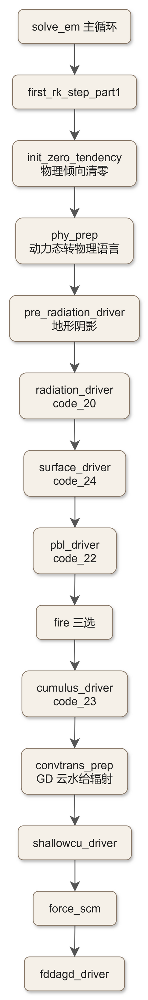
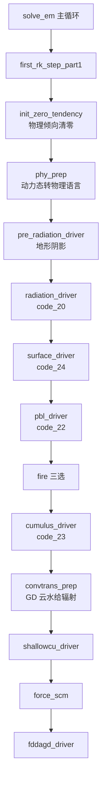

# code_31 — 非时间分裂物理总装·上（dyn_em/module_first_rk_step_part1.F：辐射→陆面→PBL→积云→浅对流→FDDA 调用序）

## 一、版本指纹

| 源文件 | 行数 | md5（整文件，按字节） |
|---|---|---|
| dyn_em/module_first_rk_step_part1.F | 2027 | c5f5921d9fef20d6f1e9227dd472bdec |

- 抽取工具：workspace/scripts/code_extract.py v1.2，2026-10-12；块首指纹注释自带 range_md5。
- 收录分级（B）：单子程序 first_rk_step_part1（L10–L2025）按调用段全收——正是本篇价值所在：每个物理驱动器的**完整实参表**（谁把哪个 Registry 态喂给谁）在别处看不到全景；讲解聚焦调用序与关键实参，方案内部见各方案篇。

## 二、定位

一句话：solve_em 时间步主循环里、RK3 循环**之前**调用的物理总装上半——把物理倾向数组清零、把动力态换算成物理语言（phy_prep），然后按**辐射→陆面→PBL→积云→浅对流→SCM 强迫→格点 nudging** 的顺序逐个驱动（教材 ch21 §21.2 的「非时间分裂物理」在源码层的本尊）。

**谁在调它**：dyn_em/solve_em.F 的主循环（[code_50_solve_em.md](code_50_solve_em.md) 的调用点地图）；下半（微物理等）在 [code_32_first_rk_step_part2.md](code_32_first_rk_step_part2.md)。教材锚点：[ch21_solve_em_dynamics.md](../ch21_solve_em_dynamics.md)。

**调用序地图**：



<details><summary>原始 Mermaid 源码（可点击展开）</summary>

<!--

-->

</details>

## 三、模块头与 USE 链

<!-- code_extract code_extract.py v1.2
source: dyn_em/module_first_rk_step_part1.F
ranges: L6-L72
file_lines: 2027
file_md5: c5f5921d9fef20d6f1e9227dd472bdec
display: line-numbered (strip L-prefix and !file: line to restore)
range_md5: 81a0c6007e16655a8ede59b6bda9513a
seg_lines: 67
-->

```fortran
!file: dyn_em/module_first_rk_step_part1.F    L6-L72
L00006  MODULE module_first_rk_step_part1
L00007  
L00008  CONTAINS
L00009  
L00010    SUBROUTINE first_rk_step_part1 (   grid , config_flags              &
L00011                               , moist , moist_tend               &
L00012                               , chem  , chem_tend                &
L00013                               , tracer, tracer_tend              &
L00014                               , scalar , scalar_tend             &
L00015                               , fdda3d, fdda2d                   &
L00016                               , aerod                            &
L00017                               , ru_tendf, rv_tendf               &
L00018                               , rw_tendf, t_tendf                &
L00019                               , ph_tendf, mu_tendf               &
L00020                               , tke_tend                         &
L00021                               , adapt_step_flag , curr_secs      &
L00022                               , curr_mins2                       &
L00023                               , psim , psih , gz1oz0 , chklowq   &
L00024                               , cu_act_flag , hol , th_phy       &
L00025                               , pi_phy , p_phy , t_phy           &
L00026                               , dz8w , p8w , t8w                 &
L00027                               , ids, ide, jds, jde, kds, kde     &
L00028                               , ims, ime, jms, jme, kms, kme     &
L00029                               , ips, ipe, jps, jpe, kps, kpe     &
L00030                               , imsx,imex,jmsx,jmex,kmsx,kmex    &
L00031                               , ipsx,ipex,jpsx,jpex,kpsx,kpex    &
L00032                               , imsy,imey,jmsy,jmey,kmsy,kmey    &
L00033                               , ipsy,ipey,jpsy,jpey,kpsy,kpey    &
L00034                               , k_start , k_end                  &
L00035                               , f_flux                           &
L00036                               , aerocu                           &
L00037                               , restart_flag                     &
L00038                               , feedback_is_ready                &
L00039                              )
L00040      USE module_state_description
L00041      USE module_model_constants
L00042      USE module_domain, ONLY : domain, domain_clock_get, get_ijk_from_subgrid
L00043      USE module_configure, ONLY : grid_config_rec_type, model_config_rec
L00044      USE module_radiation_driver, ONLY : pre_radiation_driver, radiation_driver
L00045      USE module_surface_driver, ONLY : surface_driver
L00046      USE module_cumulus_driver, ONLY : cumulus_driver
L00047      USE module_shallowcu_driver, ONLY : shallowcu_driver
L00048      USE module_pbl_driver, ONLY : pbl_driver
L00049      USE module_fr_fire_driver_wrf, ONLY : fire_driver_em_step
L00050      USE module_fddagd_driver, ONLY : fddagd_driver
L00051      USE module_em, ONLY : init_zero_tendency
L00052      USE module_force_scm
L00053      USE module_convtrans_prep
L00054      USE module_big_step_utilities_em, ONLY : phy_prep
L00055  !use module_scalar_tables
L00056  #ifdef DM_PARALLEL
L00057      USE module_dm, ONLY : local_communicator, mytask, ntasks, ntasks_x, ntasks_y, local_communicator_periodic, wrf_dm_maxval
L00058      USE module_comm_dm, ONLY : halo_em_phys_a_sub,halo_em_fdda_sfc_sub,halo_pwp_sub,halo_em_chem_e_3_sub, &
L00059      halo_em_chem_e_5_sub, halo_em_hydro_noahmp_sub, halo_em_tracer_e_5_sub, halo_em_cfbm_sub
L00060  #if ( WRFPLUS == 1 )
L00061      USE module_comm_dm, ONLY : halo_em_phys_a_bl_surf_sub
L00062  #endif
L00063  #endif
L00064      USE module_utility
L00065  
L00066  #ifdef WRF_CFBM
L00067        ! CFBM modules
L00068      use advance_mod, only : Advance_state
L00069      use wrf_mod, only : Interp_wrfwinds_to_cfbm, Provide_atm_feedback
L00070      use interp_mod, only : VINTERP_WINDS_FROM_3D_WINDS, VINTERP_WINDS_FROM_10M_WINDS
L00071      use coupling_mod, only : Interp_horizontal
L00072  #endif
```

> 讲解：USE 链就是调用序的静态清单——五大驱动器（radiation/surface/cumulus/shallowcu/pbl）+ fire + fddagd + force_scm + convtrans_prep + big_step_utilities 的 phy_prep；DM_PARALLEL 下八种 HALO 交换子程序（phys_a/fdda_sfc/pwp/chem_e_3/chem_e_5/noahmp/tracer_e_5/cfbm）——**每次调用前后的 halo 刷新都是显式 include 的**（§四各段的 include 行）；WRF_CFBM（耦合火灾模式）单独一组模块。

## 四、倾向清零与状态换算

<!-- code_extract code_extract.py v1.2
source: dyn_em/module_first_rk_step_part1.F
ranges: L171-L233
file_lines: 2027
file_md5: c5f5921d9fef20d6f1e9227dd472bdec
display: line-numbered (strip L-prefix and !file: line to restore)
range_md5: 2f5d66cbea4922e2487370a5701994c8
seg_lines: 63
-->

```fortran
!file: dyn_em/module_first_rk_step_part1.F    L171-L233
L00171    CALL get_ijk_from_subgrid (  grid ,                   &
L00172                              sids, side, sjds, sjde, skds, skde,    &
L00173                              sims, sime, sjms, sjme, skms, skme,    &
L00174                              sips, sipe, sjps, sjpe, skps, skpe    )
L00175  
L00176   ! initialize all tendencies to zero in order to update physics
L00177   ! tendencies first (separate from dry dynamics).
L00178  
L00179     l_flux=.FALSE.
L00180     if (present(f_flux)) l_flux=f_flux
L00181  
L00182      rk_step = 1
L00183  
L00184  BENCH_START(init_zero_tend_tim)
L00185         !$OMP PARALLEL DO   &
L00186         !$OMP PRIVATE ( ij )
L00187  
L00188         DO ij = 1 , grid%num_tiles
L00189  
L00190           CALL wrf_debug ( 200 , ' call init_zero_tendency' )
L00191           CALL init_zero_tendency ( ru_tendf, rv_tendf, rw_tendf,     &
L00192                                     ph_tendf, t_tendf, tke_tend,      &
L00193                                     mu_tendf,                         &
L00194                                     moist_tend,chem_tend,scalar_tend, &
L00195                                     tracer_tend,num_tracer,           &
L00196                                     num_moist,num_chem,num_scalar,    &
L00197                                     rk_step,                          &
L00198                                     ids, ide, jds, jde, kds, kde,     &
L00199                                     ims, ime, jms, jme, kms, kme,     &
L00200                                     grid%i_start(ij), grid%i_end(ij), &
L00201                                     grid%j_start(ij), grid%j_end(ij), &
L00202                                     k_start, k_end                   )
L00203  
L00204         END DO
L00205         !$OMP END PARALLEL DO
L00206  BENCH_END(init_zero_tend_tim)
L00207  
L00208  #ifdef DM_PARALLEL
L00209  #     include "HALO_EM_PHYS_A.inc"
L00210  #endif
L00211  
L00212        !$OMP PARALLEL DO   &
L00213        !$OMP PRIVATE ( ij )
L00214        DO ij = 1 , grid%num_tiles
L00215  
L00216          CALL wrf_debug ( 200 , ' call phy_prep' )
L00217          CALL phy_prep ( config_flags,                                    &
L00218                          grid%mut, grid%muu, grid%muv,                    &
L00219                          grid%c1h, grid%c2h, grid%c1f, grid%c2f,          &
L00220                          grid%u_2, grid%v_2, grid%p, grid%pb, grid%alt,   &
L00221                          grid%ph_2, grid%phb, grid%t_2, moist, num_moist, &
L00222                          grid%rho,th_phy, grid%th_phy_m_t0,               &
L00223                          p_phy, pi_phy, grid%u_phy, grid%v_phy,           &
L00224                          p8w, t_phy, t8w, grid%z, grid%z_at_w, dz8w,      &
L00225                          grid%p_hyd, grid%p_hyd_w, grid%dnw,              &
L00226                          grid%fnm, grid%fnp, grid%znw, grid%p_top,        &
L00227                          ids, ide, jds, jde, kds, kde,                    &
L00228                          ims, ime, jms, jme, kms, kme,                    &
L00229                          grid%i_start(ij), grid%i_end(ij),                &
L00230                          grid%j_start(ij), grid%j_end(ij),                &
L00231                          k_start, k_end                                   )
L00232        ENDDO
L00233        !$OMP END PARALLEL DO
```

> 讲解：①get_ijk_from_subgrid 取子格索引（共享内存 OpenMP 的纵向分块 k_start/k_end 就是传给各物理调用的 kte）；②**rk_step=1 硬编码**——物理倾向数组（ru_tendf 系）独立于动力倾向，init_zero_tendency 只在每步开头清一次（微物理的 tendency 走另一条账，见 code_32）；③**phy_prep 是动力↔物理的「翻译官」**：从半拉格朗日动力态（u_2/v_2/p/pb/alt/ph_2/t_2/moist）换算出物理语言全套（th_phy/pi_phy/p_phy/t_phy/p8w/t8w/z/z_at_w/dz8w）——注意入参带 **grid%th_phy_m_t0**（湿位温减 t0，use_theta_m 选项的痕迹）与 **grid%p_hyd/p_hyd_w**（静力气压——物理方案吃的是静水压分量而非全气压）；前面 include 的 HALO_EM_PHYS_A 保证云水等标量 halo 新鲜。

## 五、辐射段：pre_radiation_driver + radiation_driver

<!-- code_extract code_extract.py v1.2
source: dyn_em/module_first_rk_step_part1.F
ranges: L237-L268
file_lines: 2027
file_md5: c5f5921d9fef20d6f1e9227dd472bdec
display: line-numbered (strip L-prefix and !file: line to restore)
range_md5: dd6a55b1e4f52be607988496dac5e745
seg_lines: 32
-->

```fortran
!file: dyn_em/module_first_rk_step_part1.F    L237-L268
L00237  ! radiation
L00238       CALL domain_clock_get( grid, current_time=currentTime, &
L00239                              current_timestr=mesg )
L00240       CALL WRFU_TimeGet( currentTime, YY=yr, dayOfYear=day, H=hr, M=minute, S=sec, rc=rc)
L00241           IF( rc/= WRFU_SUCCESS)THEN
L00242           CALL wrf_error_fatal('WRFU_TimeGet failed')
L00243           ENDIF
L00244  
L00245  ! this driver is only needed to handle non-local shadowing effects
L00246        CALL pre_radiation_driver ( grid, config_flags                           &
L00247       &        ,itimestep=grid%itimestep, ra_call_offset=grid%ra_call_offset    &
L00248       &        ,XLAT=grid%xlat, XLONG=grid%xlong, GMT=grid%gmt                  &
L00249       &        ,julian=grid%julian, xtime=grid%xtime, RADT=grid%radt            &
L00250       &        ,STEPRA=grid%stepra                                              &
L00251       &        ,ht=grid%ht,dx=grid%dx,dy=grid%dy                                &
L00252       &        ,dx2d=grid%dx2d,area2d=grid%area2d                               &
L00253       &        ,sina=grid%sina,cosa=grid%cosa                                   &
L00254       &        ,shadowmask=grid%shadowmask,slope_rad=config_flags%slope_rad     &
L00255       &        ,topo_shading=config_flags%topo_shading                          &
L00256       &        ,shadlen=config_flags%shadlen,ht_shad=grid%ht_shad,ht_loc=ht_loc &
L00257       &        ,ht_shad_bxs=grid%ht_shad_bxs, ht_shad_bxe=grid%ht_shad_bxe      &
L00258       &        ,ht_shad_bys=grid%ht_shad_bys, ht_shad_bye=grid%ht_shad_bye      &
L00259       &        ,nested=config_flags%nested, min_ptchsz=grid%min_ptchsz          &
L00260       &        ,spec_bdy_width=config_flags%spec_bdy_width                      &
L00261              ! indexes
L00262       &        ,IDS=ids,IDE=ide, JDS=jds,JDE=jde, KDS=kds,KDE=kde               &
L00263       &        ,IMS=ims,IME=ime, JMS=jms,JME=jme, KMS=kms,KME=kme               &
L00264       &        ,IPS=ips,IPE=ipe, JPS=jps,JPE=jpe, KPS=kps,KPE=kpe               &
L00265       &        ,i_start=grid%i_start,i_end=min(grid%i_end, ide-1)               &
L00266       &        ,j_start=grid%j_start,j_end=min(grid%j_end, jde-1)               &
L00267       &        ,kts=k_start, kte=min(k_end,kde-1)                               &
L00268       &        ,num_tiles=grid%num_tiles                                        )
```

> 讲解：①先取当前时刻（WRFU_TimeGet 拆 yr/hr/min/s——ESMF 时钟，yr 直通 radiation_driver 的 ghg_input）；②pre_radiation_driver 的注释自承「only needed to handle non-local shadowing effects」——topo_shading=1 时的跨 patch 阴影提前算（阴影要越过处理器 patch 边界，放在物理 tile 循环外做全局迭代，见 code_20 §九）；实参里 ht_shad_bxs/bxe/bys/bye 是**边界缓冲版本阴影场**（嵌套域边界交换用）。

<!-- code_extract code_extract.py v1.2
source: dyn_em/module_first_rk_step_part1.F
ranges: L270-L543
file_lines: 2027
file_md5: c5f5921d9fef20d6f1e9227dd472bdec
display: line-numbered (strip L-prefix and !file: line to restore)
range_md5: b5ec32883f853f8b432a8c1956747aa8
seg_lines: 274
-->

```fortran
!file: dyn_em/module_first_rk_step_part1.F    L270-L543
L00270        CALL wrf_debug ( 200 , ' call radiation_driver' )
L00271  BENCH_START(rad_driver_tim)
L00272  
L00273        CALL radiation_driver(                                                  &
L00274       &         p_top=grid%p_top & !DJW 140312 added p_top for vertical nesting
L00275       &        ,ACFRCV=grid%acfrcv      ,ACFRST=grid%acfrst      ,ALBEDO=grid%albedo  &
L00276       &        ,CFRACH=grid%cfrach      ,CFRACL=grid%cfracl      ,CFRACM=grid%cfracm  &
L00277       &        ,CUPPT=grid%cuppt        ,CZMEAN=grid%czmean      ,DT=grid%dt          &
L00278       &        ,DZ8W=dz8w               ,EMISS=grid%emiss        ,GLW=grid%glw        &
L00279       &        ,GMT=grid%gmt            ,GSW=grid%gsw            ,HBOT=grid%hbot      &
L00280       &        ,HTOP=grid%htop          ,HBOTR=grid%hbotr        ,HTOPR=grid%htopr    &
L00281       &        ,ICLOUD=config_flags%icloud                                            &
L00282       &        ,ITIMESTEP=grid%itimestep,JULDAY=grid%julday      , JULIAN=grid%julian &
L00283       &        ,JULYR=grid%julyr        ,LW_PHYSICS=config_flags%ra_lw_physics        &
L00284       &        ,NCFRCV=grid%ncfrcv      ,NCFRST=grid%ncfrst      ,NPHS=1              &
L00285       &        ,o3input=config_flags%o3input     ,O3rad=grid%o3rad                    &
L00286       &        ,aer_opt=config_flags%aer_opt ,aerod=aerod(:,:,:,P_ocarbon:P_upperaer) &
L00287       &        ,swint_opt=config_flags%swint_opt                                      &
L00288       &        ,solar_opt=config_flags%solar_diagnostics                              &
L00289       &        ,P8W=grid%p_hyd_w        ,P=grid%p_hyd            ,PI=pi_phy           &
L00290       &        ,RADT=grid%radt          ,RA_CALL_OFFSET=grid%ra_call_offset           &
L00291       &        ,RHO=grid%rho            ,RLWTOA=grid%rlwtoa                           &
L00292       &        ,RSWTOA=grid%rswtoa      ,RTHRATEN=grid%rthraten                       &
L00293       &        ,RTHRATENLW=grid%rthratenlw       ,RTHRATENSW=grid%rthratensw          &
L00294       &        ,RTHRATENLWC=grid%rthratenlwc     ,RTHRATENSWC=grid%rthratenswc        &
L00295       &        ,SNOW=grid%snow          ,STEPRA=grid%stepra      ,SWDOWN=grid%swdown  &
L00296       &        ,SWDOWNC=grid%swdownc    ,SW_PHYSICS=config_flags%ra_sw_physics        &
L00297       &        ,T8W=t8w                 ,T=grid%t_phy           ,TAUCLDC=grid%taucldc &
L00298       &        ,TAUCLDI=grid%taucldi    ,TSK=grid%tsk            ,VEGFRA=grid%vegfra  &
L00299       &        ,WARM_RAIN=grid%warm_rain ,XICE=grid%xice         ,XLAND=grid%xland    &
L00300       &        ,XLAT=grid%xlat          ,XLONG=grid%xlong        ,YR=yr               &
L00301             ! SSiB LSM radiation components (fds 06/2010)
L00302       &        ,ALSWVISDIR=grid%alswvisdir ,ALSWVISDIF=grid%alswvisdif      &  !ssib 
L00303       &        ,ALSWNIRDIR=grid%alswnirdir ,ALSWNIRDIF=grid%alswnirdif      &  !ssib
L00304       &        ,SWVISDIR=grid%swvisdir ,SWVISDIF=grid%swvisdif              &  !ssib
L00305       &        ,SWNIRDIR=grid%swnirdir ,SWNIRDIF=grid%swnirdif              &  !ssib
L00306       &        ,SF_SURFACE_PHYSICS=config_flags%sf_surface_physics          &  !ssib
L00307  ! WRF-solar and aerosol variables from jararias 2013/8 and 2013/11
L00308       &       ,SWDDIR=grid%swddir,SWDDNI=grid%swddni,SWDDIF=grid%swddif                              & 
L00309       &       ,SWDDIRC=grid%swddirc, SWDDNIC=grid%swddnic                                            &
L00310       &       ,Gx=grid%Gx,Bx=grid%Bx,gg=grid%gg,bb=grid%bb                                           &
L00311       &       ,swdown_ref=grid%swdown_ref,swddir_ref=grid%swddir_ref                                 &
L00312       &       ,coszen_ref=grid%coszen_ref                                                            &
L00313       &       ,aer_type=config_flags%aer_type                                                        &
L00314       &       ,aer_aod550_opt=config_flags%aer_aod550_opt,aer_aod550_val=config_flags%aer_aod550_val &
L00315       &       ,aer_angexp_opt=config_flags%aer_angexp_opt,aer_angexp_val=config_flags%aer_angexp_val &
L00316       &       ,aer_ssa_opt=config_flags%aer_ssa_opt,aer_ssa_val=config_flags%aer_ssa_val             &
L00317       &       ,aer_asy_opt=config_flags%aer_asy_opt,aer_asy_val=config_flags%aer_asy_val             &
L00318       &       ,aod5502d=grid%aod5502d,angexp2d=grid%angexp2d,aerssa2d=grid%aerssa2d                  &
L00319       &       ,aerasy2d=grid%aerasy2d,aod5503d=grid%aod5503d                                         &
L00320       &       ,taod5502d=grid%taod5502d,taod5503d=grid%taod5503d                                     & ! Trude
L00321  !Optional solar variables
L00322       &        ,DECLINX=grid%declin ,SOLCONX=grid%solcon ,COSZEN=grid%coszen ,HRANG=grid%hrang    &
L00323       &        , CEN_LAT=grid%cen_lat                                      &
L00324       &        ,Z=grid%z                                                   &
L00325       &        ,ALEVSIZ=grid%alevsiz, no_src_types=grid%no_src_types       &
L00326       &        ,LEVSIZ=grid%levsiz, N_OZMIXM=num_ozmixm                    &
L00327       &        ,N_AEROSOLC=num_aerosolc                                    &
L00328       &        ,PAERLEV=grid%paerlev   ,ID=grid%id                         &
L00329       &        ,CAM_ABS_DIM1=grid%cam_abs_dim1, CAM_ABS_DIM2=grid%cam_abs_dim2 &
L00330       &        ,CAM_ABS_FREQ_S=grid%cam_abs_freq_s                         &
L00331       &        ,XTIME=grid%xtime                                           &
L00332                ,CURR_SECS=curr_secs, ADAPT_STEP_FLAG=adapt_step_flag       &
L00333  #if ( EM_CORE == 1)
L00334       &        ,swdown2=grid%swdown2, swddni2=grid%swddni2                 & ! FARMS coupling
L00335       &        ,swddif2=grid%swddif2, swddir2=grid%swddir2                 & ! FARMS coupling
L00336       &        ,swdownc2=grid%swdownc2, swddnic2=grid%swddnic2             & ! FARMS coupling
L00337       &        ,couple_farms=config_flags%couple_farms                     &
L00338  #endif
L00339  ! WRF-Solar EPS: FARMS
L00340       &       ,multi_perturb=config_flags% multi_perturb                   & 
L00341       &       ,pert_farms=config_flags%pert_farms                          & 
L00342       &       ,perts_albedo=grid%pert3d(:,:,:,P_PALBEDO)                   &
L00343       &       ,perts_aod=grid%pert3d(:,:,:,P_PAOD)                         &
L00344       &       ,perts_angstrom=grid%pert3d(:,:,:,P_PANGSTROM)               &
L00345       &       ,perts_assymfac=grid%pert3d(:,:,:,P_PASSYMFAC)               &
L00346       &       ,perts_qvapor=grid%pert3d(:,:,:,P_PQVAPOR)                   &
L00347       &       ,perts_qcloud=grid%pert3d(:,:,:,P_PQCLOUD)                   &
L00348       &       ,perts_qsnow=grid%pert3d(:,:,:,P_PQSNOW)                     &
L00349       &       ,pert_farms_albedo=config_flags%pert_farms_albedo            &
L00350       &       ,pert_farms_aod=config_flags%pert_farms_aod                  &
L00351       &       ,pert_farms_angexp=config_flags%pert_farms_angexp            &
L00352       &       ,pert_farms_aerasy=config_flags%pert_farms_aerasy            &
L00353       &       ,pert_farms_qv=config_flags%pert_farms_qv                    &
L00354       &       ,pert_farms_qc=config_flags%pert_farms_qc                    &
L00355       &       ,pert_farms_qs=config_flags%pert_farms_qs                    &
L00356  ! WRF-Solar EPS: cld3
L00357       &       ,pert_cld3=config_flags%pert_cld3                            &
L00358       &       ,perts_th=grid%pert3d(:,:,:,P_PTH)                             &
L00359       &       ,pert_cld3_qv=config_flags%pert_cld3_qv                      &
L00360       &       ,pert_cld3_t=config_flags%pert_cld3_t                        &
L00361  !BSINGH - For WRFCuP scheme
L00362       &        ,CU_PHYSICS=config_flags%cu_physics                         & !CuP, wig 5-Oct-2006
L00363       &        ,SHALLOWCU_FORCED_RA=config_flags%shallowcu_forced_ra       & !CuP, wig
L00364       &        ,CUBOT=grid%cubot, CUTOP=grid%cutop                         & !CuP, wig 9-Oct-2006
L00365       &        ,CLDFRA_CUP=grid%cldfra_cup                                 & !CuP, wig 1-Oct-2006
L00366       &        ,SHALL=grid%shall                                           & !CuP, wig 4-Feb-2008
L00367  !BSINGH - ENDS
L00368              ! indexes
L00369       &        ,IDS=ids,IDE=ide, JDS=jds,JDE=jde, KDS=kds,KDE=kde          &
L00370       &        ,IMS=ims,IME=ime, JMS=jms,JME=jme, KMS=kms,KME=kme          &
L00371       &        ,i_start=grid%i_start,i_end=min(grid%i_end, ide-1)          &
L00372       &        ,j_start=grid%j_start,j_end=min(grid%j_end, jde-1)          &
L00373       &        ,kts=k_start, kte=min(k_end,kde-1)                          &
L00374       &        ,num_tiles=grid%num_tiles                                   &
L00375              ! Optional
L00376  !JJS 20101020 vvvvv
L00377  #if ( WRF_CHEM == 1)
L00378       &        , CHEM=chem                                                 &
L00379       &        , AOD_OUT=grid%aod_out                                      &
L00380       &        , AOD2D_OUT=grid%aod2d_out                                  &  !goddardrad
L00381       &        , ATOP2D_OUT=grid%atop2d_out                                &  !goddardrad
L00382       &        , CHEM_OPT=config_flags%chem_opt                            &
L00383       &        , GSFCRAD_GOCART_COUPLING=config_flags%gsfcrad_gocart_coupling &
L00384  #endif
L00385       &        , TLWDN=grid%tlwdn, TLWUP=grid%tlwup                        & ! goddard schemes
L00386       &        , SLWDN=grid%slwdn, SLWUP=grid%slwup                        & ! goddard schemes
L00387       &        , TSWDN=grid%tswdn, TSWUP=grid%tswup                        & ! goddard schemes
L00388       &        , SSWDN=grid%sswdn, SSWUP=grid%sswup                        & ! goddard schemes
L00389       &        , RE_CLOUD_GSFC=grid%re_cloud_gsfc                          & ! goddard schemes
L00390       &        , RE_RAIN_GSFC=grid%re_rain_gsfc                            & ! goddard schemes
L00391       &        , RE_ICE_GSFC=grid%re_ice_gsfc                              & ! goddard schemes
L00392       &        , RE_SNOW_GSFC=grid%re_snow_gsfc                            & ! goddard schemes
L00393       &        , RE_GRAUPEL_GSFC=grid%re_graupel_gsfc                      & ! goddard schemes
L00394       &        , RE_HAIL_GSFC=grid%re_hail_gsfc                            & ! goddard schemes
L00395       &        , COD2D_OUT=grid%cod2d_out                                  & ! goddardrad
L00396       &        , CTOP2D_OUT=grid%ctop2d_out                                & ! goddardrad
L00397  !JJS 20101020 ^^^^^
L00398  !ZCX+ cloud fraction for CLWRF
L00399       &        , CLDT=grid%cldt, ZNU=grid%znu                              &
L00400  !ZCX-
L00401       &        , CLDFRA=grid%cldfra, CLDFRA_MP_ALL=grid%cldfra_mp_all      &
L00402       &        , CCLDFRA=grid%ccldfra                                      &
L00403       &        , QCCONV=grid%qcconv, QICONV=grid%qiconv                    &
L00404       &        , BMJ_RAD_FEEDBACK=config_flags%bmj_rad_feedback            &
L00405       &        , LRADIUS=grid%LRADIUS,IRADIUS=grid%IRADIUS                 & !BSINGH(01/22/2014)
L00406       &        , CLDFRA_DP=grid%cldfra_dp                                  & ! ckay for subgrid cloud
L00407       &        , CLDFRA_SH=grid%cldfra_sh                                  &
L00408       &        , icloud_bl=config_flags%icloud_bl                          &
L00409       &        , cldovrlp=config_flags%cldovrlp                            &
L00410       &        , idcor=config_flags%idcor                                  &
L00411       &        , qc_bl=grid%qc_bl,qi_bl=grid%qi_bl,cldfra_bl=grid%cldfra_bl&
L00412       &        , re_cloud=grid%re_cloud, re_ice=grid%re_ice, re_snow=grid%re_snow & ! G. Thompson
L00413       &        , has_reqc=grid%has_reqc, has_reqi=grid%has_reqi, has_reqs=grid%has_reqs & ! G. Thompson
L00414       &        , PB=grid%pb                                                &
L00415       &        , F_ICE_PHY=grid%f_ice_phy,F_RAIN_PHY=grid%f_rain_phy       &
L00416       &        , F_QNC=F_QNC                                               &
L00417       &        , QNC_CURR=scalar(ims,kms,jms,P_QNC)                        &
L00418       &        , QV=moist(ims,kms,jms,P_QV), F_QV=F_QV                     &
L00419       &        , QC=moist(ims,kms,jms,P_QC), F_QC=F_QC                     &
L00420       &        , QR=moist(ims,kms,jms,P_QR), F_QR=F_QR                     &
L00421       &        , QI=moist(ims,kms,jms,P_QI), F_QI=F_QI                     &
L00422       &        , QI2=moist(ims,kms,jms,P_QI2), F_QI2=F_QI2                 & ! for P3
L00423       &        , QI3=moist(ims,kms,jms,P_QI3), F_QI3=F_QI3                 & ! for Jensen ISHMAEL
L00424       &        , QS=moist(ims,kms,jms,P_QS), F_QS=F_QS                     &
L00425       &        , QG=moist(ims,kms,jms,P_QG), F_QG=F_QG                     &
L00426       &        , QH=moist(ims,kms,jms,P_QH), F_QH=F_QH                     & ! goddardrad
L00427       &        , QNDROP=scalar(ims,kms,jms,P_QNDROP), F_QNDROP=F_QNDROP    &
L00428       &        ,QNIFA=scalar(ims,kms,jms,P_QNIFA),F_QNIFA=F_QNIFA          & !Trude
L00429       &        ,QNWFA=scalar(ims,kms,jms,P_QNWFA),F_QNWFA=F_QNWFA          & !Trude
L00430       &        ,QNBCA=scalar(ims,kms,jms,P_QNBCA)                          &
L00431       &        ,wif_input_opt=config_flags%wif_input_opt                   &
L00432       &        ,qc_tot=grid%qc_tot, qi_tot=grid%qi_tot                     & ! Solar diag
L00433       &        ,ACSWUPT=grid%acswupt    ,ACSWUPTC=grid%acswuptc            &
L00434       &        ,ACSWDNT=grid%acswdnt    ,ACSWDNTC=grid%acswdntc            &
L00435       &        ,ACSWUPB=grid%acswupb    ,ACSWUPBC=grid%acswupbc            &
L00436       &        ,ACSWDNB=grid%acswdnb    ,ACSWDNBC=grid%acswdnbc            &
L00437       &        ,ACLWUPT=grid%aclwupt    ,ACLWUPTC=grid%aclwuptc            &
L00438       &        ,ACLWDNT=grid%aclwdnt    ,ACLWDNTC=grid%aclwdntc            &
L00439       &        ,ACLWUPB=grid%aclwupb    ,ACLWUPBC=grid%aclwupbc            &
L00440       &        ,ACLWDNB=grid%aclwdnb    ,ACLWDNBC=grid%aclwdnbc            &
L00441       &        ,SWUPT=grid%swupt,SWUPTC=grid%swuptc,SWUPTCLN=grid%swuptcln &
L00442       &        ,SWDNT=grid%swdnt,SWDNTC=grid%swdntc,SWDNTCLN=grid%swdntcln &
L00443       &        ,SWUPB=grid%swupb,SWUPBC=grid%swupbc,SWUPBCLN=grid%swupbcln &
L00444       &        ,SWDNB=grid%swdnb,SWDNBC=grid%swdnbc,SWDNBCLN=grid%swdnbcln &
L00445       &        ,LWUPT=grid%lwupt,LWUPTC=grid%lwuptc,LWUPTCLN=grid%lwuptcln &
L00446       &        ,LWDNT=grid%lwdnt,LWDNTC=grid%lwdntc,LWDNTCLN=grid%lwdntcln &
L00447       &        ,LWUPB=grid%lwupb,LWUPBC=grid%lwupbc,LWUPBCLN=grid%lwupbcln &
L00448       &        ,LWDNB=grid%lwdnb,LWDNBC=grid%lwdnbc,LWDNBCLN=grid%lwdnbcln &
L00449       &        ,LWCF=grid%lwcf                                                  &
L00450       &        ,SWCF=grid%swcf                                                  &
L00451       &        ,OLR=grid%olr                                                    &
L00452       &        ,AERODM=grid%aerodm, PINA=grid%pina, AODTOT=grid%aodtot          &
L00453       &        ,OZMIXM=grid%ozmixm, PIN=grid%pin                                &
L00454       &        ,M_PS_1=grid%m_ps_1, M_PS_2=grid%m_ps_2, AEROSOLC_1=grid%aerosolc_1        &
L00455       &        ,AEROSOLC_2=grid%aerosolc_2, M_HYBI0=grid%m_hybi                      &
L00456       &        ,ABSTOT=grid%abstot, ABSNXT=grid%absnxt, EMSTOT=grid%emstot                &
L00457       &        ,RADTACTTIME=grid%radtacttime                                         &  
L00458       &        ,ICLOUD_CU=config_flags%ICLOUD_CU                            &
L00459       &        ,QC_CU=grid%QC_CU , QI_CU=grid%QI_CU                         &
L00460       &        ,CALC_CLEAN_ATM_DIAG=config_flags%calc_clean_atm_diag                  &
L00461  #if (WRF_CHEM == 1)
L00462       &        ,AER_RA_FEEDBACK=config_flags%aer_ra_feedback                &
L00463       &        ,PM2_5_DRY=grid%pm2_5_dry, PM2_5_WATER=grid%pm2_5_water               &
L00464       &        ,PM2_5_DRY_EC=grid%pm2_5_dry_ec                                  &
L00465       &        ,TAUAER300=grid%tauaer1, TAUAER400=grid%tauaer2 & ! jcb
L00466       &        ,TAUAER600=grid%tauaer3, TAUAER999=grid%tauaer4 & ! jcb
L00467       &        ,GAER300=grid%gaer1, GAER400=grid%gaer2, GAER600=grid%gaer3, GAER999=grid%gaer4 & ! jcb
L00468       &        ,WAER300=grid%waer1, WAER400=grid%waer2, WAER600=grid%waer3, WAER999=grid%waer4 & ! jcb
L00469       &        ,TAUAERlw1  =grid%tauaerlw1,  TAUAERlw2=grid%tauaerlw2    & 
L00470       &        ,TAUAERlw3  =grid%tauaerlw3,  TAUAERlw4=grid%tauaerlw4    & 
L00471       &        ,TAUAERlw5  =grid%tauaerlw5,  TAUAERlw6=grid%tauaerlw6    & 
L00472       &        ,TAUAERlw7  =grid%tauaerlw7,  TAUAERlw8=grid%tauaerlw8    & 
L00473       &        ,TAUAERlw9  =grid%tauaerlw9,  TAUAERlw10=grid%tauaerlw10    & 
L00474       &        ,TAUAERlw11 =grid%tauaerlw11, TAUAERlw12=grid%tauaerlw12    & 
L00475       &        ,TAUAERlw13 =grid%tauaerlw13, TAUAERlw14=grid%tauaerlw14    & 
L00476       &        ,TAUAERlw15 =grid%tauaerlw15, TAUAERlw16=grid%tauaerlw16   & 
L00477       &        ,progn=config_flags%progn                                            &
L00478  #endif
L00479       &         ,slope_rad=config_flags%slope_rad,topo_shading=config_flags%topo_shading     &
L00480       &         ,shadowmask=grid%shadowmask,ghg_input=config_flags%ghg_input   &
L00481       &         ,ht=grid%ht,dx=grid%dx,dy=grid%dy,dx2d=grid%dx2d,area2d=grid%area2d &           
L00482       &         ,diffuse_frac=grid%diffuse_frac &  
L00483       &         ,obscur=grid%ECOBSC, mask=grid%ECMASK                       &
L00484       &         ,elat_track=grid%elat_track,elon_track=grid%elon_track      &
L00485       &         ,SW_ECLIPSE=config_flags%ra_sw_eclipse                      &         
L00486       &         ,IS_CAMMGMP_USED = grid%is_CAMMGMP_used    &
L00487       &         ,cw_rad=grid%cw_rad                     &
L00488       &         ,shcu_physics=config_flags%shcu_physics                     &
L00489       &         ,MP_PHYSICS=CONFIG_FLAGS%MP_PHYSICS        &
L00490       &         ,EFCG=grid%EFCG,EFCS=grid%EFCS,EFIG=grid%EFIG &
L00491       &         ,EFIS=grid%EFIS,EFSG=grid%EFSG,aercu_opt=config_flags%aercu_opt & 
L00492       &         ,EFSS=grid%EFSS,QS_CU=grid%QS_CU &
L00493       &         ,feedback_is_ready=feedback_is_ready   &
L00494  #if ( WRF_CMAQ == 1)
L00495       &         ,mass_ws_i=grid%mass_ws_i              &
L00496       &         ,mass_ws_j=grid%mass_ws_j              &
L00497       &         ,mass_ws_k=grid%mass_ws_k              &
L00498       &         ,mass_in_i=grid%mass_in_i              &
L00499       &         ,mass_in_j=grid%mass_in_j              &
L00500       &         ,mass_in_k=grid%mass_in_k              &
L00501       &         ,mass_ec_i=grid%mass_ec_i              &
L00502       &         ,mass_ec_j=grid%mass_ec_j              &
L00503       &         ,mass_ec_k=grid%mass_ec_k              &
L00504       &         ,mass_ss_i=grid%mass_ss_i              &
L00505       &         ,mass_ss_j=grid%mass_ss_j              &
L00506       &         ,mass_ss_k=grid%mass_ss_k              &
L00507       &         ,mass_h2o_i=grid%mass_h2o_i            &
L00508       &         ,mass_h2o_j=grid%mass_h2o_j            &
L00509       &         ,mass_h2o_k=grid%mass_h2o_k            &
L00510       &         ,dgn_i=grid%dgn_i                      &
L00511       &         ,dgn_j=grid%dgn_j                      &
L00512       &         ,dgn_k=grid%dgn_k                      &
L00513       &         ,sig_i=grid%sig_i                      &
L00514       &         ,sig_j=grid%sig_j                      &
L00515       &         ,sig_k=grid%sig_k                      &
L00516       &         ,sw_gtauxar_01=grid%sw_gtauxar_01      &
L00517       &         ,sw_gtauxar_02=grid%sw_gtauxar_02      &
L00518       &         ,sw_gtauxar_03=grid%sw_gtauxar_03      &
L00519       &         ,sw_gtauxar_04=grid%sw_gtauxar_04      &
L00520       &         ,sw_gtauxar_05=grid%sw_gtauxar_05      &
L00521       &         ,sw_ttauxar_01=grid%sw_ttauxar_01      &
L00522       &         ,sw_ttauxar_02=grid%sw_ttauxar_02      &
L00523       &         ,sw_ttauxar_03=grid%sw_ttauxar_03      &
L00524       &         ,sw_ttauxar_04=grid%sw_ttauxar_04      &
L00525       &         ,sw_ttauxar_05=grid%sw_ttauxar_05      &
L00526       &         ,sw_asy_fac_01=grid%sw_asy_fac_01      &
L00527       &         ,sw_asy_fac_02=grid%sw_asy_fac_02      &
L00528       &         ,sw_asy_fac_03=grid%sw_asy_fac_03      &
L00529       &         ,sw_asy_fac_04=grid%sw_asy_fac_04      &
L00530       &         ,sw_asy_fac_05=grid%sw_asy_fac_05      &
L00531       &         ,sw_ssa_01=grid%sw_ssa_01              &
L00532       &         ,sw_ssa_02=grid%sw_ssa_02              &
L00533       &         ,sw_ssa_03=grid%sw_ssa_03              &
L00534       &         ,sw_ssa_04=grid%sw_ssa_04              &
L00535       &         ,sw_ssa_05=grid%sw_ssa_05              &
L00536       &         ,ozone=grid%ozone                      &
L00537       &         ,sw_zbbcddir=grid%sw_zbbcddir          &
L00538       &         ,sw_dirdflux=grid%sw_dirdflux          &
L00539       &         ,sw_difdflux=grid%sw_difdflux          &
L00540  #endif
L00541                                                        )
L00542  
L00543  BENCH_END(rad_driver_tim)
```

> 讲解：radiation_driver 实参全景（274 行），分拣要点：①**NPHS=1**——辐射的累积输出频率恒 1（辐射自带 radt 门控，这里不设频率）；②**P=grid%p_hyd**——物理气压取静水压分量（对照 phy_prep）；③水物质按 P_QV/P_QC…直接切片 moist(ims,kms,jms,P_XX) 传入并配 F_XX 在场标志——**P3 方案的 QI2/QI3、Ishmael 的 QI3 也在列**；④气溶胶三通道全接通：aer_opt/aerod(P_ocarbon:P_upperaer 切片——**aerod 是 Registry 数组的连续切片直接当入参**)、aod550 系（code_60）、QNWFA/QNIFA/QNBCA（aer_opt=3）；⑤WRF-Solar 全家（swddir/dni/dif、Gx/Bx/gg/bb 插值状态、FARMS 的 swdown2 系、SPP 的 pert3d 七切片）；⑥WRF_CHEM 的 300/400/600/999 四波长气溶胶与 tauaerlw1..16；⑦CuP 的 cubot/cutop/cldfra_cup（积云云量给辐射）、EFCG/EFCS 五套有效半径系数（MSKF 交互）；⑧CLDT/ZNU（CLWRF 云顶诊断）、obscur/mask（日食）、AC 系 16 组累积通量、RADTACTTIME（自适应 dt）。下游细节见 [code_20_module_radiation_driver.md](code_20_module_radiation_driver.md)。

## 六、陆面段：surface_driver

<!-- code_extract code_extract.py v1.2
source: dyn_em/module_first_rk_step_part1.F
ranges: L545-L1150
file_lines: 2027
file_md5: c5f5921d9fef20d6f1e9227dd472bdec
display: line-numbered (strip L-prefix and !file: line to restore)
range_md5: 488afe21fd6776b8098851edd677fc1f
seg_lines: 606
-->

```fortran
!file: dyn_em/module_first_rk_step_part1.F    L545-L1150
L00545  !********* Surface driver
L00546  ! surface
L00547  
L00548  BENCH_START(surf_driver_tim)
L00549  
L00550  !gmm halo of wtd and riverflow for leafhydro
L00551  #ifdef DM_PARALLEL
L00552    IF ( ( config_flags%sf_surface_physics.eq.NOAHMPSCHEME ) .and. (config_flags%opt_runsub.eq.5 ) ) THEN
L00553         IF ( mod(grid%itimestep,grid%STEPWTD).eq.0 )  THEN
L00554  #     include "HALO_EM_HYDRO_NOAHMP.inc"
L00555         ENDIF
L00556    ENDIF
L00557  #endif
L00558  
L00559  !-----------------------------------------------------------------
L00560  ! urban related variable are added to arguments of surface_driver
L00561  !-----------------------------------------------------------------
L00562        num_roof_layers = grid%num_soil_layers !urban
L00563        num_wall_layers = grid%num_soil_layers !urban
L00564        num_road_layers = grid%num_soil_layers !urban
L00565        CALL nl_get_iswater(grid%id, iswater)
L00566        CALL nl_get_isurban(grid%id, isurban)
L00567        call nl_get_mminlu(grid%id, mminlu)
L00568  
L00569  #ifdef DM_PARALLEL
L00570  #     include "HALO_PWP.inc"
L00571  #endif
L00572  
L00573        CALL wrf_debug ( 200 , ' call surface_driver' )
L00574  
L00575        if( grid%num_nests .lt. 1 )then
L00576            HYDRO_dt = 0
L00577        else
L00578            HYDRO_dt = -1
L00579        endif
L00580  
L00581  !  Ensure WRF_Chem is compiled if bio_emiss_opt is tested, and add flag to read MEGANv2.1
L00582  !  file if bio_emiss_opt is set properly (even if chem_opt == 0).  
L00583  !  Also explicitly set do_bioe to .false. if chem_opt <= 0.   BJG 3/28/19
L00584  #if( WRF_USE_CLM == 1) && (WRF_CHEM == 1)
L00585        if( config_flags%bio_emiss_opt == MEGAN2_CLM ) then
L00586          do_meganfile = .true.
L00587          if(config_flags%chem_opt > 0) then !czhao +++++
L00588            do_bioe = grid%itimestep == 1 .or. mod( grid%itimestep,grid%stepbioe ) == 0
L00589          else
L00590            do_bioe = .false.
L00591          endif
L00592        else
L00593          do_bioe = .false.
L00594          do_meganfile = .false.
L00595        endif !czhao-----
L00596  #else
L00597        do_bioe = .false.
L00598        do_meganfile = .false.
L00599  #endif
L00600  
L00601  
L00602  
L00603        CALL surface_driver(                                                &
L00604       &        HYDRO_dt=HYDRO_dt,  sfcheadrt=grid%sfcheadrt,               &
L00605       &        INFXSRT=grid%INFXSRT,  soldrain=grid%soldrain,              &
L00606       &        qtiledrain=grid%qtiledrain,ZWATBLE2D=grid%ZWATBLE2D,        & ! tile drainage for WRF-Hydro
L00607       &         ACGRDFLX=grid%acgrdflx  ,ACHFX=grid%achfx        ,ACLHF=grid%aclhf        &
L00608       &        ,ACSNOM=grid%acsnom      ,ACSNOW=grid%acsnow      ,AKHS=grid%akhs          &
L00609       &        ,AKMS=grid%akms          ,ALBBCK=grid%albbck      ,ALBEDO=grid%albedo      &
L00610       &        ,EMBCK=grid%embck                                                          &
L00611       &        ,BR=grid%br              ,CANWAT=grid%canwat      ,CHKLOWQ=chklowq    &
L00612       &        ,CT=grid%ct              ,DT=grid%dt         ,DX=grid%dx              &
L00613       &        ,DX2D=grid%dx2d          ,AREA2d=grid%area2d                          &
L00614       &        ,DZ8W=dz8w          ,DZS=grid%dzs            ,FLHC=grid%flhc          &
L00615       &        ,FM=grid%fm         ,FHH=grid%fh                                      &
L00616       &        ,FLQC=grid%flqc          ,GLW=grid%glw            ,GRDFLX=grid%grdflx      &
L00617       &        ,GSW=grid%gsw    ,SWDOWN=grid%swdown        ,GZ1OZ0=gz1oz0      ,HFX=grid%hfx              &
L00618       &        ,HT=grid%ht              ,IFSNOW=config_flags%ifsnow      ,ISFFLX=config_flags%isfflx      &
L00619       &        ,FRACTIONAL_SEAICE=config_flags%fractional_seaice           &
L00620       &        ,SEAICE_ALBEDO_OPT=config_flags%seaice_albedo_opt           &
L00621       &        ,SEAICE_ALBEDO_DEFAULT=config_flags%seaice_albedo_default   &
L00622       &        ,SEAICE_THICKNESS_OPT=config_flags%seaice_thickness_opt     &
L00623       &        ,SEAICE_THICKNESS_DEFAULT=config_flags%seaice_thickness_default     &
L00624       &        ,SEAICE_SNOWDEPTH_OPT=config_flags%seaice_snowdepth_opt     &
L00625       &        ,SEAICE_SNOWDEPTH_MAX=config_flags%seaice_snowdepth_max     &
L00626       &        ,SEAICE_SNOWDEPTH_MIN=config_flags%seaice_snowdepth_min     &
L00627       &        ,TICE2TSK_IF2COLD=config_flags%tice2tsk_if2cold             &
L00628       &        ,IFNDALBSI=grid%ifndalbsi, IFNDICEDEPTH=grid%ifndicedepth   &
L00629  #if ( WRF_CHEM == 1 )
L00630                ,NE_AREA=grid%ne_area,E_BIO=grid%e_bio &
L00631  #endif
L00632                ,IFNDSNOWSI=grid%ifndsnowsi, DO_BIOE=do_bioe, DO_MEGANFILE=do_meganfile          &
L00633       &        ,ISLTYP=grid%isltyp      ,ITIMESTEP=grid%itimestep, JULIAN_IN=grid%julian                  &
L00634       &        ,IRRIGATION=grid%irrigation,SF_SURF_IRR_SCHEME=config_flags%sf_surf_irr_scheme  & 
L00635       &        ,IRR_DAILY_AMOUNT=config_flags%irr_daily_amount                                                & 
L00636       &        ,IRR_START_HOUR=config_flags%irr_start_hour,IRR_NUM_HOURS=config_flags%irr_num_hours           &
L00637       &        ,IRR_START_JULIANDAY=config_flags%irr_start_julianday                                          &
L00638       &        ,IRR_END_JULIANDAY=config_flags%irr_end_julianday                                              &
L00639       &        ,IRR_FREQ=config_flags%irr_freq,IRR_PH=config_flags%irr_ph,IRR_RAND_FIELD=grid%irr_rand_field  & 
L00640       &        ,IVGTYP=grid%ivgtyp      ,LH=grid%lh              ,LOWLYR=grid%lowlyr      &
L00641       &        ,MAVAIL=grid%mavail      ,NUM_SOIL_LAYERS=config_flags%num_soil_layers        &
L00642       &        ,P8W=grid%p_hyd_w            ,PBLH=grid%pblh          ,PI_PHY=pi_phy      &
L00643       &        ,PSFC=grid%psfc          ,PSHLTR=grid%pshltr      ,PSIH=psih          &
L00644       &        ,BLDT=grid%bldt     ,CURR_SECS=curr_secs, ADAPT_STEP_FLAG=adapt_step_flag  &
L00645       &        ,BLDTACTTIME=grid%bldtacttime                                              & 
L00646       &        ,PSIM=psim          ,P_PHY=grid%p_hyd        ,Q10=grid%q10            &
L00647       &        ,Q2=grid%q2              ,QFX=grid%qfx            ,QSFC=grid%qsfc          &
L00648       &        ,QSHLTR=grid%qshltr      ,QZ0=grid%qz0            ,RAINCV=grid%raincv      &
L00649       &        ,RA_LW_PHYSICS=config_flags%ra_lw_physics         ,RHO=grid%rho            &
L00650       &        ,RMOL=grid%rmol          ,SFCEVP=grid%sfcevp      ,SFCEXC=grid%sfcexc      &
L00651       &        ,SFCRUNOFF=grid%sfcrunoff,ACRUNOFF=grid%ACRUNOFF                           &
L00652       &        ,opt_thcnd=config_flags%opt_thcnd                                          &
L00653       &        ,SF_SFCLAY_PHYSICS=config_flags%sf_sfclay_physics                          &
L00654       &        ,BL_PBL_PHYSICS=config_flags%bl_pbl_physics                                &
L00655       &        ,SF_SURFACE_PHYSICS=config_flags%sf_surface_physics  ,SH2O=grid%sh2o       &
L00656       &        ,SF_MYNN_SFCFLUX_LAND=config_flags%sf_mynn_sfcflux_land                    &
L00657       &        ,SF_MYNN_SFCFLUX_WATER=config_flags%sf_mynn_sfcflux_water                  &
L00658       &        ,SHDMAX=grid%shdmax      ,SHDMIN=grid%shdmin      ,SMOIS=grid%smois        &
L00659       &        ,SHDAVG=grid%shdavg                                                        &
L00660       &        ,SMSTAV=grid%smstav      ,SMSTOT=grid%smstot      ,SNOALB=grid%snoalb      &
L00661       &        ,SNOW=grid%snow          ,SNOWC=grid%snowc        ,SNOWH=grid%snowh        &
L00662       &        ,SMCREL=grid%smcrel                                                        &
L00663       &        ,SST=grid%sst            ,SST_INPUT=grid%sst_input,SST_UPDATE=grid%sst_update                  &
L00664       &        ,SSTSK=grid%sstsk        ,DTW=grid%dtw            ,SST_SKIN=grid%sst_skin  &
L00665       &        ,SCM_FORCE_SKINTEMP=grid%scm_force_skintemp                                &
L00666       &        ,SCM_FORCE_FLUX=grid%scm_force_flux                                        &
L00667       &        ,STEPBL=grid%stepbl      ,TH10=grid%th10          ,TH2=grid%th2            &
L00668       &        ,THZ0=grid%thz0          ,TH_PHY=th_phy      ,TKE_PBL=grid%tke_pbl    &
L00669       &        ,TMN=grid%tmn            ,TSHLTR=grid%tshltr      ,TSK=grid%tsk            &
L00670       &        ,TYR=grid%tyr            ,TYRA=grid%tyra          ,TDLY=grid%tdly          &
L00671       &        ,TLAG=grid%tlag          ,LAGDAY=config_flags%lagday      ,NYEAR=grid%nyear        &
L00672       &        ,NDAY=grid%nday          ,TMN_UPDATE=grid%tmn_update      ,YR=yr            &
L00673       &        ,TSLB=grid%tslb          ,T_PHY=t_phy        ,U10=grid%u10            &
L00674       &        ,URATX=grid%uratx        ,VRATX=grid%vratx   ,TRATX=grid%tratx        &
L00675       &        ,UDRUNOFF=grid%udrunoff  ,UST=grid%ust       ,UZ0=grid%uz0            &
L00676       &        ,U_FRAME=grid%u_frame    ,U_PHY=grid%u_phy   ,V10=grid%v10            &
L00677       &        ,U10E=grid%u10e          ,V10E=grid%v10e                              &
L00678       &        ,UOCE=grid%uoce          ,VOCE=grid%voce                              &
L00679       &        ,VEGFRA=grid%vegfra      ,VZ0=grid%vz0       ,V_FRAME=grid%v_frame    &
L00680       &        ,V_PHY=grid%v_phy        ,WARM_RAIN=grid%warm_rain                    &
L00681       &        ,WSPD=grid%wspd          ,XICE=grid%xice     ,XLAND=grid%xland        &
L00682       &        ,MAX_EDOM=grid%num_ext_model_couple_dom      ,CPLMASK=grid%cplmask    &
L00683       &        ,Z0=grid%z0              ,Z=grid%z        ,ZNT=grid%znt               &
L00684       &        ,ZS=grid%zs              ,ALBSI=grid%albsi , ICEDEPTH=grid%icedepth   &
L00685       &        ,SNOWSI=grid%snowsi                                                   &
L00686       &        ,XICEM=grid%xicem   ,ISICE=grid%landuse_isice                         &
L00687       &        ,USTM=grid%ustm          ,CK=grid%ck         ,CKA=grid%cka            &
L00688       &                                 ,CD=grid%cd         ,CDA=grid%cda            &
L00689       &        ,ISFTCFLX=config_flags%isftcflx, IZ0TLND=config_flags%iz0tlnd         &
L00690       &        ,SF_OCEAN_PHYSICS=config_flags%sf_ocean_physics                       &
L00691       &        ,OML_HML0=config_flags%oml_hml0 ,OML_GAMMA=config_flags%oml_gamma     &
L00692       &        ,TML=grid%tml, T0ML=grid%t0ml, HML=grid%hml, H0ML=grid%h0ml           &
L00693       &        ,HUML=grid%huml, HVML=grid%hvml, F=grid%f                             &
L00694       &        ,TMOML=grid%TMOML,ISWATER=iswater                                     &
L00695       &        ,OML_RELAXATION_TIME=grid%OML_RELAXATION_TIME                         &
L00696       &        ,shalwater_z0=config_flags%shalwater_z0                               &
L00697       &        ,water_depth=grid%water_depth                                         & 
L00698       &        ,shalwater_depth=config_flags%shalwater_depth                         & 
L00699       &        ,lakedepth2d=grid%lakedepth2d,    savedtke12d=grid%savedtke12d        &   
L00700       &        ,snowdp2d=grid%snowdp2d,          h2osno2d=grid%h2osno2d              & !lake
L00701       &        ,snl2d=grid%snl2d,                t_grnd2d=grid%t_grnd2d              &   
L00702       &        ,t_lake3d=grid%t_lake3d,          lake_icefrac3d=grid%lake_icefrac3d  & !lake  
L00703       &        ,z_lake3d=grid%z_lake3d,          dz_lake3d=grid%dz_lake3d            &   
L00704       &        ,t_soisno3d=grid%t_soisno3d,      h2osoi_ice3d=grid%h2osoi_ice3d      & !lake
L00705       &        ,h2osoi_liq3d=grid%h2osoi_liq3d,  h2osoi_vol3d=grid%h2osoi_vol3d      &   
L00706       &        ,z3d=grid%z3d,                    dz3d=grid%dz3d                      & !lake
L00707       &        ,zi3d=grid%zi3d,                  watsat3d=grid%watsat3d              &   
L00708       &        ,csol3d=grid%csol3d,              tkmg3d=grid%tkmg3d                  & !lake     
L00709       &        ,tkdry3d=grid%tkdry3d,            tksatu3d=grid%tksatu3d              &   
L00710       &        ,LakeModel=grid%sf_lake_physics,  lake_min_elev=grid%lake_min_elev    & !lake  
L00711  #if ( EM_CORE == 1)
L00712       &        ,LakeMask=grid%LakeMask                                               & !lake
L00713       &        ,restart_flag=restart_flag                                            & !flag showing if is a restart timestep
L00714  ! TOFD for KIM gwdo scheme
L00715       &        ,kim_tofd=config_flags%kim_tofd                                       &
L00716       &        ,tofd_factor=config_flags%tofd_factor                                 &
L00717       &        ,VAR2D=grid%var2d                                                     &
L00718  #endif
L00719  ! CLM Varaibles
L00720       &        ,NUMC=grid%numc,NUMP=grid%nump,SABV=grid%sabv,SABG=grid%sabg,         &
L00721       &         LWUP=grid%lwup,SNL=grid%snl,                                         &
L00722       &         HISTORY_INTERVAL=config_flags%history_interval ,                     & !ylu add hist inverval for accumulation T max/min
L00723       &         SNOWDP=grid%snowdp, WTC=grid%wtc,WTP=grid%wtp, H2OSNO=grid%h2osno,   &
L00724       &         T_GRND=grid%t_grnd,T_VEG=grid%t_veg,                                 &
L00725       &         H2OCAN=grid%h2ocan, H2OCAN_COL=grid%h2ocan_col,T2M_MAX=grid%t2m_max, &
L00726       &         T2M_MIN=grid%t2m_min,T2CLM=grid%t2clm,                               &
L00727       &         T_REF2M=grid%t_ref2m,H2OSOI_LIQ_S1=grid%h2osoi_liq_s1,               &
L00728       &         H2OSOI_LIQ_S2=grid%h2osoi_liq_s2,                                    &
L00729       &         H2OSOI_LIQ_S3=grid%h2osoi_liq_s3,H2OSOI_LIQ_S4=grid%h2osoi_liq_s4,   &
L00730       &         H2OSOI_LIQ_S5=grid%h2osoi_liq_s5,                                    &
L00731       &         H2OSOI_LIQ1=grid%h2osoi_liq1,H2OSOI_LIQ2=grid%h2osoi_liq2,           &
L00732       &         H2OSOI_LIQ3=grid%h2osoi_liq3,H2OSOI_LIQ4=grid%h2osoi_liq4,           &
L00733       &         H2OSOI_LIQ5=grid%h2osoi_liq5,H2OSOI_LIQ6=grid%h2osoi_liq6,           &
L00734       &         H2OSOI_LIQ7=grid%h2osoi_liq7,H2OSOI_LIQ8=grid%h2osoi_liq8,           &
L00735       &         H2OSOI_LIQ9=grid%h2osoi_liq9, H2OSOI_LIQ10=grid%h2osoi_liq10,        &
L00736       &         H2OSOI_ICE_S1=grid%h2osoi_ice_s1,H2OSOI_ICE_S2=grid%h2osoi_ice_s2,   &
L00737       &         H2OSOI_ICE_S3=grid%h2osoi_ice_s3, H2OSOI_ICE_S4=grid%h2osoi_ice_s4,  &
L00738       &         H2OSOI_ICE_S5=grid%h2osoi_ice_s5,                                    &
L00739       &         H2OSOI_ICE1=grid%h2osoi_ice1, H2OSOI_ICE2=grid%h2osoi_ice2,          &
L00740       &         H2OSOI_ICE3=grid%h2osoi_ice3,H2OSOI_ICE4=grid%h2osoi_ice4,           &
L00741       &         H2OSOI_ICE5=grid%h2osoi_ice5, H2OSOI_ICE6=grid%h2osoi_ice6,          &
L00742       &         H2OSOI_ICE7=grid%h2osoi_ice7,H2OSOI_ICE8=grid%h2osoi_ice8,           &
L00743       &         H2OSOI_ICE9=grid%h2osoi_ice9,H2OSOI_ICE10=grid%h2osoi_ice10,         &
L00744       &         T_SOISNO_S1=grid%t_soisno_s1,T_SOISNO_S2=grid%t_soisno_s2,           &
L00745       &         T_SOISNO_S3=grid%t_soisno_s3,T_SOISNO_S4=grid%t_soisno_s4,           &
L00746       &         T_SOISNO_S5=grid%t_soisno_s5,T_SOISNO1=grid%t_soisno1,               &
L00747       &         T_SOISNO2=grid%t_soisno2,T_SOISNO3=grid%t_soisno3,                   &
L00748       &         T_SOISNO4=grid%t_soisno4,T_SOISNO5=grid%t_soisno5,                   &
L00749       &         T_SOISNO6=grid%t_soisno6,T_SOISNO7=grid%t_soisno7,                   &
L00750       &         T_SOISNO8=grid%t_soisno8,T_SOISNO9=grid%t_soisno9,                   &
L00751       &         T_SOISNO10=grid%t_soisno10,DZSNOW1=grid%dzsnow1,DZSNOW2=grid%dzsnow2,& 
L00752       &         DZSNOW3=grid%dzsnow3,DZSNOW4=grid%dzsnow4, DZSNOW5=grid%dzsnow5,     &
L00753       &         SNOWRDS1=grid%snowrds1,SNOWRDS2=grid%snowrds2,                       &
L00754       &         SNOWRDS3=grid%snowrds3 ,SNOWRDS4=grid%snowrds4,                      &
L00755       &         SNOWRDS5=grid%snowrds5,                                              &
L00756       &         T_LAKE1=grid%t_lake1,T_LAKE2=grid%t_lake2,T_LAKE3=grid%t_lake3,      &
L00757       &         T_LAKE4=grid%t_lake4,                                                &
L00758       &         T_LAKE5=grid%t_lake5,T_LAKE6=grid%t_lake6, T_LAKE7=grid%t_lake7,     &
L00759       &         T_LAKE8=grid%t_lake8, T_LAKE9=grid%t_lake9,T_LAKE10=grid%t_lake10,   &
L00760       &         H2OSOI_VOL1=grid%h2osoi_vol1,H2OSOI_VOL2=grid%h2osoi_vol2,           &
L00761       &         H2OSOI_VOL3=grid%h2osoi_vol3,H2OSOI_VOL4=grid%h2osoi_vol4,           &
L00762       &         H2OSOI_VOL5=grid%h2osoi_vol5,                                        &
L00763       &         H2OSOI_VOL6=grid%h2osoi_vol6,H2OSOI_VOL7=grid%h2osoi_vol7,           &
L00764       &         H2OSOI_VOL8=grid%h2osoi_vol8,                                        &
L00765       &         H2OSOI_VOL9=grid%h2osoi_vol9,H2OSOI_VOL10=grid%h2osoi_vol10,         &
L00766       &         MAXPATCH=config_flags%maxpatch,                                      &
L00767       &         INEST=grid%id,ALBEDOsubgrid=grid%ALBEDOsubgrid,                      &
L00768       &         LHsubgrid=grid%LHsubgrid,                                            &
L00769       &         HFXsubgrid=grid%HFXsubgrid,LWUPsubgrid=grid%LWUPsubgrid,             &
L00770       &         Q2subgrid=grid%Q2subgrid,SABVsubgrid=grid%SABVsubgrid,               &
L00771       &         SABGsubgrid=grid%SABGsubgrid,NRAsubgrid=grid%NRAsubgrid,             &
L00772       &         SWUPsubgrid=grid%SWUPsubgrid,LHsoi=grid%LHsoi,                       &
L00773       &         LHveg=grid%LHveg, LHtran=grid%LHtran                                 &
L00774                 ,t_veg24=grid%t_veg24,            t_veg240=grid%t_veg240,            & !voce accum variables
L00775                 fsun24=grid%fsun24,              fsun240=grid%fsun240,               & !voce accum variables
L00776                 fsd24=grid%fsd24,                fsd240=grid%fsd240,                 & !voce accum variables
L00777                 fsi24=grid%fsi24,                fsi240=grid%fsi240,                 & !voce accum variables
L00778                 laip=grid%laip,                                                      & !voce accum variables
L00779                 pct_pft_input=grid%pct_pft_input,num_pft_input=grid%num_pft_clm,  &
L00780                 input_pft_flag=config_flags%input_pft                             &
L00781  ! end of CLM variables
L00782       &        ,SLOPE_RAD=config_flags%slope_rad,TOPO_SHADING=config_flags%topo_shading & ! solar
L00783       &        ,SHADOWMASK=grid%shadowmask,DIFFUSE_FRAC=grid%diffuse_frac               & ! solar
L00784       &        ,SLOPE=grid%slope, SLP_AZI=grid%slp_azi, SWNORM=grid%swnorm              & ! solar
L00785       &        ,DECLIN=grid%declin ,SOLCON=grid%solcon ,COSZEN=grid%coszen ,HRANG=grid%hrang    &
L00786       &        ,xlat_urb2d=grid%XLAT                                       & !I urban
L00787       &        ,NUM_ROOF_LAYERS=num_roof_layers                            & !I urban
L00788       &        ,NUM_WALL_LAYERS=num_wall_layers                            & !I urban
L00789       &        ,NUM_ROAD_LAYERS=num_road_layers                            &
L00790       &        ,DZR=grid%dzr ,DZB=grid%dzb ,DZG=grid%dzg                   & !I urban
L00791       &        ,TR_URB2D=grid%tr_urb2d ,TB_URB2D=grid%tb_urb2d             &
L00792       &        ,TG_URB2D=grid%tg_urb2d                                     & !H urban
L00793       &        ,TC_URB2D=grid%tc_urb2d ,QC_URB2D=grid%qc_urb2d             & !H urban
L00794       &        ,UC_URB2D=grid%uc_urb2d                                     & !H urban
L00795       &        ,XXXR_URB2D=grid%xxxr_urb2d                                 &
L00796       &        ,XXXB_URB2D=grid%xxxb_urb2d                                 & !H urban
L00797       &        ,XXXG_URB2D=grid%xxxg_urb2d                                 &
L00798       &        ,XXXC_URB2D=grid%xxxc_urb2d                                 & !H urban
L00799       &        ,CMCR_URB2D=grid%cmcr_urb2d,TGR_URB2D=grid%tgr_urb2d        & !H urban
L00800       &        ,TGRL_URB3D=grid%tgrl_urb3d,SMR_URB3D=grid%smr_urb3d        & !H urban
L00801       &        ,JULIAN=grid%julday, JULYR=grid%julyr                       & !I urban
L00802       &        ,DRELR_URB2D=grid%drelr_urb2d,DRELB_URB2D=grid%drelb_urb2d  & !H urban
L00803       &        ,DRELG_URB2D=grid%drelg_urb2d                               & !H urban
L00804       &        ,FLXHUMR_URB2D=grid%flxhumr_urb2d                           & !H urban
L00805       &        ,FLXHUMB_URB2D=grid%flxhumb_urb2d                           & !H urban
L00806       &        ,FLXHUMG_URB2D=grid%flxhumg_urb2d                           & !H urban
L00807                ! added by Chenghao Wang
L00808       &        ,TVG_URB2D=grid%tvg_urb2d                                   & !H urban
L00809       &        ,XXXVG_URB2D=grid%xxxvg_urb2d                               & !H urban
L00810       &        ,TVGL_URB3D=grid%tvgl_urb3d                                 & !H urban
L00811       &        ,SMG_URB3D=grid%smg_urb3d                                   & !H urban
L00812       &        ,TT_URB2D=grid%tt_urb2d                                     & !H urban
L00813       &        ,CMCG_URB2D=grid%cmcg_urb2d                                 & !H urban
L00814       &        ,FLXHUMVG_URB2D=grid%flxhumvg_urb2d                         & !H urban
L00815       &        ,FLXHUMT_URB2D=grid%flxhumt_urb2d                           & !H urban
L00816       &        ,TRL_URB3D=grid%trl_urb3d   ,TBL_URB3D=grid%tbl_urb3d       & !H urban
L00817       &        ,TGL_URB3D=grid%tgl_urb3d                                   & !H urban
L00818       &        ,SH_URB2D=grid%sh_urb2d     ,LH_URB2D=grid%lh_urb2d         &
L00819       &        ,G_URB2D=grid%g_urb2d                                       & !H urban
L00820       &        ,RN_URB2D=grid%rn_urb2d     , TS_URB2D=grid%ts_urb2d        & !H urban
L00821       &        ,FRC_URB2D=grid%frc_urb2d                                   & !H urban
L00822       &        ,UTYPE_URB2D=grid%utype_urb2d                               & !H urban
L00823       &        ,SWDDIR=grid%swddir,SWDDIF=grid%swddif                      & !multi-layer urban _gl
L00824           ! Optional urban for BEP scheme
L00825       &        ,SF_URBAN_PHYSICS=config_flags%sf_urban_physics             &
L00826       &        ,num_urban_ndm = config_flags%num_urban_ndm                 & !multi-layer urban
L00827       &        ,urban_map_zrd = config_flags%urban_map_zrd                 & !multi-layer urban
L00828       &        ,urban_map_zwd = config_flags%urban_map_zwd                 & !multi-layer urban
L00829       &        ,urban_map_gd  = config_flags%urban_map_gd                  & !multi-layer urban
L00830       &        ,urban_map_zd  = config_flags%urban_map_zd                  & !multi-layer urban
L00831       &        ,urban_map_zdf = config_flags%urban_map_zdf                 & !multi-layer urban
L00832       &        ,urban_map_bd  = config_flags%urban_map_bd                  & !multi-layer urban
L00833       &        ,urban_map_wd  = config_flags%urban_map_wd                  & !multi-layer urban
L00834       &        ,urban_map_gbd = config_flags%urban_map_gbd                 & !multi-layer urban
L00835       &        ,urban_map_fbd = config_flags%urban_map_fbd                 & !multi-layer urban
L00836       &        ,urban_map_zgrd = config_flags%urban_map_zgrd               & !multi-layer urban
L00837       &        ,NUM_URBAN_HI=config_flags%num_urban_hi                     & !multi-layer urban
L00838       &        ,use_wudapt_lcz=config_flags%use_wudapt_lcz                 & !wudapt
L00839       &        ,slucm_distributed_drag=config_flags%slucm_distributed_drag & !SLUCM
L00840       &        ,TSK_RURAL=grid%tsk_rural                                   & !multi-layer urban
L00841       &        ,TRB_URB4D=grid%trb_urb4d,TW1_URB4D=grid%tw1_urb4d          & !multi-layer urban
L00842       &        ,TW2_URB4D=grid%tw2_urb4d,TGB_URB4D=grid%tgb_urb4d          & !multi-layer urban
L00843       &        ,TLEV_URB3D=grid%tlev_urb3d                               & !multi-layer urban
L00844       &        ,QLEV_URB3D=grid%qlev_urb3d                               & !multi-layer urban
L00845       &        ,TW1LEV_URB3D=grid%tw1lev_urb3d                           & !multi-layer urban
L00846       &        ,TW2LEV_URB3D=grid%tw2lev_urb3d                           & !multi-layer urban
L00847       &        ,TGLEV_URB3D=grid%tglev_urb3d                             & !multi-layer urban
L00848       &        ,TFLEV_URB3D=grid%tflev_urb3d                             & !multi-layer urban
L00849       &        ,SF_AC_URB3D=grid%sf_ac_urb3d                             & !multi-layer urban
L00850       &        ,LF_AC_URB3D=grid%lf_ac_urb3d                             & !multi-layer urban
L00851       &        ,CM_AC_URB3D=grid%cm_ac_urb3d                             & !multi-layer urban
L00852       &        ,SFVENT_URB3D=grid%sfvent_urb3d                           & !multi-layer urban
L00853       &        ,LFVENT_URB3D=grid%lfvent_urb3d                           & !multi-layer urban
L00854       &        ,SFWIN1_URB3D=grid%sfwin1_urb3d                           & !multi-layer urban
L00855       &        ,SFWIN2_URB3D=grid%sfwin2_urb3d                           & !multi-layer urban
L00856       &        ,SFW1_URB3D=grid%sfw1_urb3d,SFW2_URB3D=grid%sfw2_urb3d      & !multi-layer urban
L00857       &        ,SFR_URB3D=grid%sfr_urb3d,SFG_URB3D=grid%sfg_urb3d          & !multi-layer urban
L00858       &        ,EP_PV_URB3D=grid%ep_pv_urb3d                               & !GRZ
L00859       &        ,T_PV_URB3D=grid%t_pv_urb3d                                 & !GRZ
L00860       &        ,TRV_URB4D=grid%trv_urb4d                                   & !GRZ
L00861       &        ,QR_URB4D=grid%qr_urb4d                                     & !GRZ
L00862       &        ,QGR_URB3D=grid%qgr_urb3d                                   & !GRZ
L00863       &        ,TGR_URB3D=grid%tgr_urb3d                                   & !GRZ
L00864       &        ,DRAIN_URB4D=grid%drain_urb4d                               & !GRZ
L00865       &        ,DRAINGR_URB3D=grid%draingr_urb3d                           & !GRZ
L00866       &        ,SFRV_URB3D=grid%sfrv_urb3d                                 & !GRZ
L00867       &        ,LFRV_URB3D=grid%lfrv_urb3d                                 & !GRZ
L00868       &        ,DGR_URB3D=grid%dgr_urb3d                                   & !GRZ
L00869       &        ,DG_URB3D=grid%dg_urb3d                                     & !GRZ
L00870       &        ,LFR_URB3D=grid%lfr_urb3d                                   & !GRZ
L00871       &        ,LFG_URB3D=grid%lfg_urb3d                                   & !GRZ
L00872       &        ,LP_URB2D=grid%lp_urb2d,HI_URB2D=grid%hi_urb2d              & !multi-layer urban
L00873       &        ,LB_URB2D=grid%lb_urb2d,HGT_URB2D=grid%hgt_urb2d            & !multi-layer urban
L00874       &        ,MH_URB2D=grid%mh_urb2d,STDH_URB2D=grid%stdh_urb2d          & !SLUCM
L00875       &        ,LF_URB2D=grid%lf_urb2d                                           & 
L00876       &        ,lf_urb2d_s=grid%lf_urb2d_s, z0_urb2d=grid%z0_urb2d               &
L00877       &        ,GMT=grid%gmt,XLAT=grid%xlat,XLONG=grid%xlong,JULDAY=grid%julday  &
L00878       &        ,distributed_ahe_opt=grid%distributed_ahe_opt, ahe=grid%ahe       & !For anthropogenic heat
L00879       &        ,A_U_BEP=grid%a_u_bep,A_V_BEP=grid%a_v_bep,A_T_BEP=grid%a_t_bep   &
L00880       &        ,A_Q_BEP=grid%a_q_bep                                             &
L00881       &        ,B_U_BEP=grid%b_u_bep,B_V_BEP=grid%b_v_bep,B_T_BEP=grid%b_t_bep   &
L00882       &        ,B_Q_BEP=grid%b_q_bep                                             &
L00883       &        ,SF_BEP=grid%sf_bep,VL_BEP=grid%vl_bep                            &
L00884       &        ,A_E_BEP=grid%a_e_bep,B_E_BEP=grid%b_e_bep,DLG_BEP=grid%dlg_bep   &
L00885       &        ,DL_U_BEP=grid%dl_u_bep                                           &
L00886       &        ,CMR_SFCDIF=grid%cmr_sfcdif, CHR_SFCDIF=grid%chr_sfcdif     & !I/O urban
L00887       &        ,CMC_SFCDIF=grid%cmc_sfcdif, CHC_SFCDIF=grid%chc_sfcdif     & !I/O urban
L00888       &        ,CMGR_SFCDIF=grid%cmgr_sfcdif, CHGR_SFCDIF=grid%chgr_sfcdif & !I/O urban
L00889             ! P-X LSM Variables
L00890       &        ,LANDUSEF=grid%landusef, SOILCTOP=grid%soilctop             &   ! P-X LSM
L00891       &        ,SOILCBOT=grid%soilcbot                                     &   ! P-X LSM
L00892       &        ,RA=grid%ra, RS=grid%rs, LAI=grid%lai, IMPERV=grid%imperv   &   ! P-X LSM
L00893       &        ,CANFRA=grid%canfra, NLCAT=grid%num_land_cat                &   ! P-X LSM
L00894       &        ,NSCAT=grid%num_soil_cat                                    &   ! P-X LSM
L00895       &        ,VEGF_PX=grid%vegf_px, SNOWNCV=grid%snowncv                 &   ! P-X LSM
L00896       &        ,ANAL_INTERVAL=config_flags%auxinput9_interval_s+config_flags%auxinput9_interval_m*60  &   ! P-X LSM
L00897       &        ,PXLSM_SMOIS_INIT=config_flags%pxlsm_smois_init             &   ! P-X LSM
L00898       &        ,PXLSM_SOIL_NUDGE=config_flags%pxlsm_soil_nudge             &   ! P-X LSM
L00899             ! SSiB LSM variables (fds 06/2010)
L00900       &        ,alswvisdir=grid%alswvisdir, alswvisdif=grid%alswvisdif    & !ssib
L00901       &        ,alswnirdir=grid%alswnirdir, alswnirdif=grid%alswnirdif    & !ssib
L00902       &        ,swvisdir=grid%swvisdir, swvisdif=grid%swvisdif            & !ssib
L00903       &        ,swnirdir=grid%swnirdir, swnirdif=grid%swnirdif            & !ssib 
L00904       &        ,ssib_br=grid%ssib_br,  ssib_fm=grid%ssib_fm               & !ssib
L00905       &        ,ssib_fh=grid%ssib_fh,  ssib_cm=grid%ssib_cm               & !ssib
L00906       &        ,ssibxdd=grid%ssibxdd,  ssib_lhf=grid%ssib_lhf             & !ssib
L00907       &        ,ssib_shf=grid%ssib_shf, ssib_ghf=grid%ssib_ghf            & !ssib
L00908       &        ,ssib_egs=grid%ssib_egs, ssib_eci=grid%ssib_eci            & !ssib
L00909       &        ,ssib_ect=grid%ssib_ect, ssib_egi=grid%ssib_egi            & !ssib
L00910       &        ,ssib_egt=grid%ssib_egt, ssib_sdn=grid%ssib_sdn            & !ssib
L00911       &        ,ssib_sup=grid%ssib_sup, ssib_ldn=grid%ssib_ldn            & !ssib
L00912       &        ,ssib_lup=grid%ssib_lup, ssib_wat=grid%ssib_wat            & !ssib
L00913       &        ,ssib_shc=grid%ssib_shc, ssib_shg=grid%ssib_shg            & !ssib
L00914       &        ,ssib_lai=grid%ssib_lai, ssib_vcf=grid%ssib_vcf            & !ssib
L00915       &        ,ssib_z00=grid%ssib_z00, ssib_veg=grid%ssib_veg            & !ssib
L00916       &        ,cldfra=grid%cldfra                                        & !ssib
L00917       &        ,ISNOW=grid%isnow, SWE=grid%swe, SNOWDEN=grid%snowden      & !ssib snow
L00918       &        ,SNOWDEPTH=grid%snowdepth, TKAIR=grid%tkair                & !ssib snow
L00919       &        ,DZO1=grid%dzo1, WO1=grid%wo1, TSSN1=grid%tssn1, TSSNO1=grid%tssno1     & !ssib snow
L00920       &        ,BWO1=grid%bwo1, BTO1=grid%bto1, CTO1=grid%cto1, FIO1=grid%fio1         & !ssib snow
L00921       &        ,FLO1=grid%flo1, BIO1=grid%bio1, BLO1=grid%blo1, HO1=grid%ho1           & !ssib snow
L00922       &        ,DZO2=grid%dzo2, WO2=grid%wo2, TSSN2=grid%tssn2, TSSNO2=grid%tssno2     & !ssib snow
L00923       &        ,BWO2=grid%bwo2, BTO2=grid%bto2, CTO2=grid%cto2, FIO2=grid%fio2         & !ssib snow
L00924       &        ,FLO2=grid%flo2, BIO2=grid%bio2, BLO2=grid%blo2, HO2=grid%ho2           & !ssib snow
L00925       &        ,DZO3=grid%dzo3, WO3=grid%wo3, TSSN3=grid%tssn3, TSSNO3=grid%tssno3     & !ssib snow
L00926       &        ,BWO3=grid%bwo3, BTO3=grid%bto3, CTO3=grid%cto3, FIO3=grid%fio3         & !ssib snow
L00927       &        ,FLO3=grid%flo3, BIO3=grid%bio3, BLO3=grid%blo3, HO3=grid%ho3           & !ssib snow
L00928       &        ,DZO4=grid%dzo4, WO4=grid%wo4, TSSN4=grid%tssn4, TSSNO4=grid%tssno4     & !ssib snow
L00929       &        ,BWO4=grid%bwo4, BTO4=grid%bto4, CTO4=grid%cto4, FIO4=grid%fio4         & !ssib snow
L00930       &        ,FLO4=grid%flo4, BIO4=grid%bio4, BLO4=grid%blo4, HO4=grid%ho4           & !ssib snow
L00931       &        ,RA_SW_PHYSICS=config_flags%ra_sw_physics                  & !ssib
L00932  !------------------------------------------------------------------------------
L00933             ! Optional PX LSM nudging
L00934       &        ,t2_ndg_old=grid%t2_ndg_old                  &
L00935       &        ,q2_ndg_old=grid%q2_ndg_old                  &
L00936       &        ,t2_ndg_new=grid%t2_ndg_new                  &
L00937       &        ,q2_ndg_new=grid%q2_ndg_new                  &
L00938       &        ,sn_ndg_old=grid%sn_ndg_old                  &
L00939       &        ,sn_ndg_new=grid%sn_ndg_new                  &
L00940       &        ,pxlsm_modis_veg=config_flags%pxlsm_modis_veg                   &
L00941       &        ,LAI_PX=grid%lai_px                                             &
L00942       &        ,WWLT_PX=grid%wwlt_px, WFC_PX=grid%wfc_px                       &
L00943       &        ,WSAT_PX=grid%wsat_px, CLAY_PX=grid%clay_px                     &
L00944       &        ,CSAND_PX=grid%csand_px, FMSAND_PX=grid%fmsand_px               &
L00945  ! for Noah-MP LSM
L00946       &        ,idveg=config_flags%dveg,         iopt_crs=config_flags%opt_crs &
L00947       &        ,iopt_btr=config_flags%opt_btr,iopt_runsub=config_flags%opt_runsub &
L00948       &        ,iopt_sfc=config_flags%opt_sfc,   iopt_frz=config_flags%opt_frz &
L00949       &        ,iopt_inf=config_flags%opt_inf,   iopt_rad=config_flags%opt_rad &
L00950       &        ,iopt_alb=config_flags%opt_alb,   iopt_snf=config_flags%opt_snf &
L00951       &        ,iopt_tbot=config_flags%opt_tbot, iopt_stc=config_flags%opt_stc & 
L00952       &        ,iopt_gla=config_flags%opt_gla,   iopt_rsf=config_flags%opt_rsf & 
L00953       &        ,iopt_soil=config_flags%opt_soil, iopt_pedo=config_flags%opt_pedo  &
L00954       &        ,iopt_crop=config_flags%opt_crop, iopt_irr=config_flags%opt_irr    &
L00955       &        ,iopt_irrm=config_flags%opt_irrm                                   &
L00956       &        ,iopt_infdv=config_flags%opt_infdv,iopt_tdrn=config_flags%opt_tdrn &
L00957       &        ,soiltstep=config_flags%soiltstep                                  &
L00958       &        ,iopt_runsrf=config_flags%opt_runsrf,iopt_tksno=config_flags%opt_tksno &
L00959       &        ,iopt_compact=config_flags%opt_compact, iopt_scf=config_flags%opt_scf  &
L00960       &        ,iopt_wetland=config_flags%opt_wetland                                 &
L00961       &        , isnowxy=grid%isnowxy  ,    tvxy=grid%tvxy    ,    tgxy=grid%tgxy     &
L00962       &        ,canicexy=grid%canicexy ,canliqxy=grid%canliqxy,   eahxy=grid%eahxy    &
L00963       &        ,   tahxy=grid%tahxy    ,    cmxy=grid%cmxy    ,    chxy=grid%chxy     &
L00964       &        ,  fwetxy=grid%fwetxy   ,sneqvoxy=grid%sneqvoxy,alboldxy=grid%alboldxy &
L00965       &        , qsnowxy=grid%qsnowxy  ,qrainxy=grid%qrainxy  ,wslakexy=grid%wslakexy &
L00966       &        , zwtxy=grid%zwtxy                                                     &
L00967       &        ,    waxy=grid%waxy     ,    wtxy=grid%wtxy    ,  tsnoxy=grid%tsnoxy   &
L00968       &        , zsnsoxy=grid%zsnsoxy  , snicexy=grid%snicexy , snliqxy=grid%snliqxy  &
L00969       &        ,lfmassxy=grid%lfmassxy ,rtmassxy=grid%rtmassxy,stmassxy=grid%stmassxy &
L00970       &        ,  woodxy=grid%woodxy   ,stblcpxy=grid%stblcpxy,fastcpxy=grid%fastcpxy &
L00971       &        , grainxy=grid%grainxy  ,   gddxy=grid%gddxy   ,   pgsxy=grid%pgsxy    &
L00972       &        , cropcat=grid%cropcat                                                 &
L00973       &        ,planting=grid%planting , harvest=grid%harvest ,season_gdd=grid%season_gdd  &
L00974       &        , soilcomp=grid%soilcomp                                               &
L00975       &        , soilcl1=grid%soilcl1  , soilcl2=grid%soilcl2                         &
L00976       &        , soilcl3=grid%soilcl3  , soilcl4=grid%soilcl4                         &
L00977       &        ,  xsaixy=grid%xsaixy   , taussxy=grid%taussxy                         &
L00978       &        ,  t2mvxy=grid%t2mvxy   ,  t2mbxy=grid%t2mbxy                          &
L00979       &        ,  q2mvxy=grid%q2mvxy   ,  q2mbxy=grid%q2mbxy                          & 
L00980       &        ,  tradxy=grid%tradxy   ,   neexy=grid%neexy   ,   gppxy=grid%gppxy    &
L00981       &        ,   nppxy=grid%nppxy    ,  fvegxy=grid%fvegxy  , runsfxy=grid%runsfxy  &
L00982       &        , runsbxy=grid%runsbxy  ,  ecanxy=grid%ecanxy  ,  edirxy=grid%edirxy   &
L00983       &        , etranxy=grid%etranxy  ,   fsaxy=grid%fsaxy   ,  firaxy=grid%firaxy   &
L00984       &        ,  aparxy=grid%aparxy   ,   psnxy=grid%psnxy   ,   savxy=grid%savxy    &
L00985       &        ,   sagxy=grid%sagxy    , rssunxy=grid%rssunxy , rsshaxy=grid%rsshaxy  &
L00986       &        ,  bgapxy=grid%bgapxy   ,  wgapxy=grid%wgapxy  ,   tgvxy=grid%tgvxy    &
L00987       &        ,   tgbxy=grid%tgbxy    ,   chvxy=grid%chvxy   ,   chbxy=grid%chbxy    &
L00988       &        ,   shgxy=grid%shgxy    ,   shcxy=grid%shcxy   ,   shbxy=grid%shbxy    &
L00989       &        ,   evgxy=grid%evgxy    ,   evbxy=grid%evbxy   ,   ghvxy=grid%ghvxy    &
L00990       &        ,   ghbxy=grid%ghbxy    ,   irgxy=grid%irgxy   ,   ircxy=grid%ircxy    &
L00991       &        ,   irbxy=grid%irbxy    ,    trxy=grid%trxy    ,   evcxy=grid%evcxy    &
L00992       &        ,chleafxy=grid%chleafxy ,  chucxy=grid%chucxy                          &                       
L00993       &        ,  chv2xy=grid%chv2xy   ,  chb2xy=grid%chb2xy , chstarxy=grid%chstarxy &
L00994  ! Noah-MP extra output fields
L00995       &        ,    qintsxy=grid%qintsxy    ,   qintrxy=grid%qintrxy   ,   qdripsxy=grid%qdripsxy   &
L00996       &        ,   qdriprxy=grid%qdriprxy   ,  qthrosxy=grid%qthrosxy  ,   qthrorxy=grid%qthrorxy   &
L00997       &        ,   qsnsubxy=grid%qsnsubxy   ,  qsnfroxy=grid%qsnfroxy  ,    qsubcxy=grid%qsubcxy    &
L00998       &        ,    qfrocxy=grid%qfrocxy    ,   qfrzcxy=grid%qfrzcxy   ,   qmeltcxy=grid%qmeltcxy   &
L00999       &        ,   qsnbotxy=grid%qsnbotxy   , pondingxy=grid%pondingxy ,      PAHXY=grid%PAHXY      &
L01000       &        ,     PAHGXY=grid%PAHGXY     ,    PAHVXY=grid%PAHVXY    ,     PAHBXY=grid%PAHBXY     &
L01001       &        ,    qmeltxy=grid%qmeltxy    ,   FPICEXY=grid%FPICEXY   ,   qevacxy=grid%qevacxy     &
L01002       &        ,    qdewcxy=grid%qdewcxy    ,   RAINLSM=grid%RAINLSM   ,    SNOWLSM=grid%SNOWLSM    &
L01003       &        ,   forctlsm=grid%forctlsm   ,  forcqlsm=grid%forcqlsm  ,   forcplsm=grid%forcplsm   &
L01004       &        ,   forczlsm=grid%forczlsm   ,  forcwlsm=grid%forcwlsm                               &
L01005       &        ,  acc_ssoil=grid%acc_ssoil  ,acc_qinsur=grid%acc_qinsur,  acc_qseva=grid%acc_qseva  &
L01006       &        , acc_etrani=grid%acc_etrani ,   eflxbxy=grid%eflxbxy                                &
L01007       &        , soilenergy=grid%soilenergy ,snowenergy=grid%snowenergy,    canhsxy=grid%canhsxy    &
L01008       &        , ACC_DWATERXY=grid%ACC_DWATERXY, ACC_PRCPXY=grid%ACC_PRCPXY,ACC_ECANXY=grid%ACC_ECANXY &
L01009       &        , ACC_ETRANXY=grid%ACC_ETRANXY, ACC_EDIRXY=grid%ACC_EDIRXY  &
L01010  ! Noah-MP wetland
L01011       &        , FSATXY=grid%FSATXY, WSURFXY=grid%WSURFXY  &
L01012  ! Noah-MP SNICAR snow albedo
L01013       &        ,SNICAR_BANDNUMBER_OPT=config_flags%SNICAR_BANDNUMBER_OPT   &
L01014       &        ,SNICAR_SOLARSPEC_OPT=config_flags%SNICAR_SOLARSPEC_OPT     &
L01015       &        ,SNICAR_SNOWOPTICS_OPT=config_flags%SNICAR_SNOWOPTICS_OPT   &
L01016       &        ,SNICAR_DUSTOPTICS_OPT=config_flags%SNICAR_DUSTOPTICS_OPT   &
L01017       &        ,SNICAR_RTSOLVER_OPT=config_flags%SNICAR_RTSOLVER_OPT       &
L01018       &        ,SNICAR_SNOWSHAPE_OPT=config_flags%SNICAR_SNOWSHAPE_OPT     &
L01019       &        ,SNICAR_USE_AEROSOL=config_flags%SNICAR_USE_AEROSOL         &
L01020       &        ,SNICAR_SNOWBC_INTMIX=config_flags%SNICAR_SNOWBC_INTMIX     &
L01021       &        ,SNICAR_SNOWDUST_INTMIX=config_flags%SNICAR_SNOWDUST_INTMIX &
L01022       &        ,SNICAR_USE_OC=config_flags%SNICAR_USE_OC                   &
L01023       &        ,SNICAR_AEROSOL_READTABLE=config_flags%SNICAR_AEROSOL_READTABLE   &
L01024       &        ,SNRDSXY=grid%SNRDSXY, SNFRXY=grid%SNFRXY, BCPHIXY=grid%BCPHIXY   &
L01025       &        ,BCPHOXY=grid%BCPHOXY, OCPHIXY=grid%OCPHIXY, OCPHOXY=grid%OCPHOXY &
L01026       &        ,DUST1XY=grid%DUST1XY, DUST2XY=grid%DUST2XY, DUST3XY=grid%DUST3XY &
L01027       &        ,DUST4XY=grid%DUST4XY, DUST5XY=grid%DUST5XY    &
L01028       &        ,MassConcBCPHIXY=grid%MassConcBCPHIXY          &
L01029       &        ,MassConcBCPHOXY=grid%MassConcBCPHOXY, MassConcOCPHIXY=grid%MassConcOCPHIXY  &
L01030       &        ,MassConcOCPHOXY=grid%MassConcOCPHOXY, MassConcDUST1XY=grid%MassConcDUST1XY  &
L01031       &        ,MassConcDUST2XY=grid%MassConcDUST2XY, MassConcDUST3XY=grid%MassConcDUST3XY  &
L01032       &        ,MassConcDUST4XY=grid%MassConcDUST4XY, MassConcDUST5XY=grid%MassConcDUST5XY  &
L01033       &        ,ALBSOILDIRXY=grid%ALBSOILDIRXY, ALBSOILDIFXY=grid%ALBSOILDIFXY        &
L01034  ! Noah-MP irrigation
L01035       &        , IRFRACT=grid%IRFRACT  , SIFRACT=grid%SIFRACT ,MIFRACT=grid%MIFRACT   &
L01036       &        , FIFRACT=grid%FIFRACT  , IRNUMSI=grid%IRNUMSI ,IRNUMMI=grid%IRNUMMI   &
L01037       &        , IRNUMFI=grid%IRNUMFI  , IRWATSI=grid%IRWATSI ,IRWATMI=grid%IRWATMI   &
L01038       &        , IRWATFI=grid%IRWATFI  , IRELOSS=grid%IRELOSS ,IRSIVOL=grid%IRSIVOL   &
L01039       &        , IRMIVOL=grid%IRMIVOL  , IRFIVOL=grid%IRFIVOL ,IRRSPLH=grid%IRRSPLH   &                       
L01040  ! Noah-MP tile drainage
L01041       &        , QTDRAIN=grid%QTDRAIN  , TD_FRACTION=grid%TD_FRACTION                 &
L01042  ! Optional hydro variables in NOAHMP
L01043       &        ,smcwtdxy=grid%smcwtdxy ,rechxy=grid%rechxy ,deeprechxy=grid%deeprechxy &
L01044       &        ,fdepthxy=grid%fdepthxy, areaxy=grid%areaxy, rivercondxy=grid%rivercondxy  &
L01045       &        ,riverbedxy=grid%riverbedxy, eqzwt=grid%eqzwt, pexpxy=grid%pexpxy &
L01046       &        ,qrfxy=grid%qrfxy, qspringxy=grid%qspringxy, qslatxy=grid%qslatxy, qrfsxy=grid%qrfsxy, qlatxy=grid%qlatxy &
L01047       &        ,qspringsxy=grid%qspringsxy, smoiseq=grid%smoiseq, wtddt=config_flags%wtddt, stepwtd=grid%stepwtd &
L01048       &        ,gecros_state=grid%gecros_state                                   &   ! Optional gecros crop
L01049             ! Noah UA changes
L01050       &        ,ua_phys=config_flags%ua_phys,flx4=grid%flx4,fvb=grid%fvb       &
L01051       &        ,fbur=grid%fbur,fgsn=grid%fgsn                                  &
L01052             ! Indexes
L01053       &        ,IDS=ids,IDE=ide, JDS=jds,JDE=jde, KDS=kds,KDE=kde          &
L01054       &        ,IMS=ims,IME=ime, JMS=jms,JME=jme, KMS=kms,KME=kme          &
L01055       &        ,IPS=ips,IPE=ipe, JPS=jps,JPE=jpe, KPS=kps,KPE=kpe          &
L01056       &        , I_START=grid%i_start,I_END=min(grid%i_end, ide-1)         &
L01057       &        , J_START=grid%j_start,J_END=min(grid%j_end, jde-1)         &
L01058       &        , KTS=k_start, KTE=min(k_end,kde-1)                         &
L01059       &        , NUM_TILES=grid%num_tiles                                  &
L01060            ! Variables required by TEMF PBL - WA 1/7/09
L01061                ,te_temf=grid%te_temf,hd_temf=grid%hd_temf                  &
L01062                ,fCor=grid%f,exch_temf=exch_temf,wm_temf=grid%wm_temf       &
L01063            ! Variables required by IDEAL SCM sfc scheme - WA 1/6/10
L01064                ,hfx_force=grid%hfx_force,lh_force=grid%lh_force            &
L01065                ,tsk_force=grid%tsk_force                                   &
L01066                ,hfx_force_tend=grid%hfx_force_tend                         &
L01067                ,lh_force_tend=grid%lh_force_tend                           &
L01068                ,tsk_force_tend=grid%tsk_force_tend                         &
L01069             ! Optional
L01070       &        ,QV_CURR=moist(ims,kms,jms,P_QV), F_QV=F_QV                 &
L01071       &        ,QC_CURR=moist(ims,kms,jms,P_QC), F_QC=F_QC                 &
L01072       &        ,QR_CURR=moist(ims,kms,jms,P_QR), F_QR=F_QR                 &
L01073       &        ,QI_CURR=moist(ims,kms,jms,P_QI), F_QI=F_QI                 &
L01074       &        ,QS_CURR=moist(ims,kms,jms,P_QS), F_QS=F_QS                 &
L01075       &        ,QG_CURR=moist(ims,kms,jms,P_QG), F_QG=F_QG                 &
L01076       &        ,CAPG=grid%capg, EMISS=grid%emiss, HOL=hol,MOL=grid%mol     &
L01077       &        ,T2OBS=grid%t2obs, Q2OBS=grid%q2obs                         &
L01078       &        ,RAINBL=grid%rainbl,SR=grid%sr,RAINSHV=grid%rainshv         &
L01079       &        ,GRAUPELNCV=grid%graupelncv, HAILNCV=grid%hailncv           &
L01080       &        ,RAINNCV=grid%rainncv,REGIME=grid%regime,T2=grid%t2,THC=grid%thc            &
L01081       &        ,QSG=grid%qsg,QVG=grid%qvg,QCG=grid%qcg,SOILT1=grid%soilt1,TSNAV=grid%tsnav & ! ruc lsm
L01082       &        ,SMFR3D=grid%smfr3d,KEEPFR3DFLAG=grid%keepfr3dflag,DEW=grid%dew             & ! ruc lsm
L01083       &        ,POTEVP=grid%POTEVP, SNOPCX=grid%SNOPCX, SOILTB=grid%SOILTB                 & ! ruc lsm
L01084       &        ,rhosnf=grid%rhosnf ,precipfr=grid%precipfr                 &   ! RUC LSM
L01085       &        ,snowfallac=grid%snowfallac                                 &   ! RUC LSM
L01086       &        ,MOSAIC_LU=config_flags%mosaic_lu                           & ! RUC LSM
L01087       &        ,MOSAIC_SOIL=config_flags%mosaic_soil                       &   ! RUC LSM
L01088       &        ,ISURBAN=isurban, MMINLU=TRIM(mminlu)                       &
L01089       &        ,SNOTIME = grid%SNOTIME                                     &
L01090       &        ,RDLAI2D=config_flags%rdlai2d                               &
L01091       &        ,usemonalb=config_flags%usemonalb                           &
L01092       &        ,NOAHRES=grid%noahres                                       &
L01093       &        ,TSK_SAVE=grid%tsk_save                                     &
L01094       &        ,ch=grid%ch                                                 &
L01095       &        ,fgdp=grid%fgdp,dfgdp=grid%dfgdp,vdfg=grid%vdfg             & !Katata - fogdes
L01096       &        ,grav_settling=config_flags%grav_settling                   & !Katata - fogdes
L01097       &        ,OM_TMP=grid%om_tmp, OM_S=grid%om_s, OM_U=grid%om_u, OM_V=grid%om_v   & !cyl:3DPWP
L01098       &        ,OM_DEPTH=grid%om_depth, OM_ML=grid%OM_ML, OM_LON=grid%om_lon         & !cyl:3DPWP
L01099       &        ,OM_LAT=grid%om_lat                                                  & !cy:3DPWP
L01100       &        , okms = 1, okme=config_flags%ocean_levels                  & ! cyl:3DPWP
L01101       &        ,rdx=grid%rdx, rdy=grid%rdy,msfu=grid%msfu,msfv=grid%msfv,msft=grid%msft &!cyl: 3DPWP
L01102       &        ,XTIME=grid%xtime,OM_TINI=grid%om_tini,OM_SINI=grid%om_sini,id=grid%id,omdt=config_flags%omdt &!cyl: 3DPWP 
L01103       &        ,sf_surface_mosaic=config_flags%sf_surface_mosaic,  mosaic_cat=config_flags%mosaic_cat    &
L01104       &        ,mosaic_cat_index=grid%mosaic_cat_index                                                   &  !danli mosaic
L01105       &        ,landusef2=grid%landusef2,TSK_mosaic=grid%TSK_mosaic,QSFC_mosaic=grid%QSFC_mosaic         &
L01106       &        ,TSLB_mosaic=grid%TSLB_mosaic,SMOIS_mosaic=grid%SMOIS_mosaic,SH2O_mosaic=grid%SH2O_mosaic &  !danli mosaic
L01107       &        ,CANWAT_mosaic=grid%CANWAT_mosaic,SNOW_mosaic=grid%SNOW_mosaic                            &
L01108       &        ,SNOWH_mosaic=grid%SNOWH_mosaic,SNOWC_mosaic=grid%SNOWC_mosaic                            &  !danli mosaic
L01109       &        ,ALBEDO_mosaic=grid%ALBEDO_mosaic,ALBBCK_mosaic=grid%ALBBCK_mosaic                        &
L01110       &        ,EMISS_mosaic=grid%EMISS_mosaic, EMBCK_mosaic=grid%EMBCK_mosaic                           &
L01111       &        ,ZNT_mosaic=grid%ZNT_mosaic, Z0_mosaic=grid%Z0_mosaic                                     &  !danli mosaic
L01112       &        ,HFX_mosaic=grid%HFX_mosaic,QFX_mosaic=grid%QFX_mosaic, LH_mosaic=grid%LH_mosaic          &
L01113       &        ,GRDFLX_mosaic=grid%GRDFLX_mosaic,SNOTIME_mosaic=grid%SNOTIME_mosaic                      &  !danli mosaic
L01114       &        ,RS_mosaic=grid%RS_mosaic,LAI_mosaic=grid%LAI_mosaic                                      &
L01115       &        ,TR_URB2D_mosaic=grid%TR_URB2D_mosaic,TB_URB2D_mosaic=grid%TB_URB2D_mosaic                &  !danli mosaic 
L01116       &        ,TG_URB2D_mosaic=grid%TG_URB2D_mosaic,TC_URB2D_mosaic=grid%TC_URB2D_mosaic                &  !danli mosaic 
L01117       &        ,QC_URB2D_mosaic=grid%QC_URB2D_mosaic,UC_URB2D_mosaic=grid%UC_URB2D_mosaic                &  !danli mosaic
L01118       &        ,TRL_URB3D_mosaic=grid%TRL_URB3D_mosaic,TBL_URB3D_mosaic=grid%TBL_URB3D_mosaic            &  !danli mosaic 
L01119       &        ,TGL_URB3D_mosaic=grid%TGL_URB3D_mosaic                                                   &  !danli mosaic 
L01120       &        ,SH_URB2D_mosaic=grid%SH_URB2D_mosaic,LH_URB2D_mosaic=grid%LH_URB2D_mosaic                &  !danli mosaic 
L01121       &        ,G_URB2D_mosaic=grid%G_URB2D_mosaic,RN_URB2D_mosaic=grid%RN_URB2D_mosaic                  &  !danli mosaic 
L01122       &        ,TS_URB2D_mosaic=grid%TS_URB2D_mosaic                                                     &  !danli mosaic 
L01123       &        ,TS_RUL2D_mosaic=grid%TS_RUL2D_mosaic                                                     &  !danli mosaic
L01124       &        ,ZOL=grid%ZOL                                                                             &
L01125       &        ,SDA_HFX=grid%SDA_HFX, SDA_QFX=grid%SDA_QFX,HFX_BOTH=grid%HFX_BOTH                        &  !fasdas
L01126       &        ,QFX_BOTH=grid%QFX_BOTH,QNORM=grid%QNORM,fasdas=config_flags%fasdas                       &  !fasdas
L01127       &        ,XLAIDYN=grid%XLAIDYN                                                                     &
L01128       &        ,spp_lsm=config_flags%spp_lsm,pattern_spp_lsm=grid%pattern_spp_lsm     & !SPP
L01129       &        ,field_sf=grid%field_sf                                                & !SPP
L01130       &        ,spp_pbl=config_flags%spp_pbl,pattern_spp_pbl=grid%pattern_spp_pbl     & !SPP
L01131    ! WRF-Solar EPS: Noah LSM
L01132       &        ,multi_perturb=config_flags% multi_perturb                             & 
L01133       &        ,pert_noah=config_flags%pert_noah                                      &
L01134       &        ,perts_qvapor=grid%pert3d(:,:,:,P_PQVAPOR)                             &
L01135       &        ,perts_th=grid%pert3d(:,:,:,P_PTH)                                     &
L01136       &        ,perts_smois=grid%pert3d(:,:,:,P_PSMOIS)                               &
L01137       &        ,perts_tsoil=grid%pert3d(:,:,:,P_PTSOIL)                               &
L01138       &        ,pert_noah_qv=config_flags%pert_noah_qv                                &
L01139       &        ,pert_noah_t=config_flags%pert_noah_t                                  &
L01140       &        ,pert_noah_smois=config_flags%pert_noah_smois                          &
L01141       &        ,pert_noah_tslb=config_flags%pert_noah_tslb                            &
L01142       &                                                           )
L01143  
L01144  #ifdef WRF_HYDRO
L01145          if(HYDRO_dt .gt. 1 ) call wrf_drv_HYDRO(HYDRO_dt, grid,  &
L01146       &     grid%i_start(1),min(grid%i_end(1), ide-1),      &
L01147       &     grid%j_start(1),min(grid%j_end(1), jde-1) )
L01148  #endif
L01149  
L01150  BENCH_END(surf_driver_tim)
```

> 讲解：最长的一段（605 行实参），前置三件：①Noah-MP 的 opt_runsub=5 时按 STEPWTD 周期刷 HALO_EM_HYDRO_NOAHMP（径流汇流的 halo）；②**城市层数临时赋值 num_roof/wall/road_layers=num_soil_layers**（ Urban 参数表的层数下限兜底——namelist 的 num_urban_* 只在多层方案下覆盖）；③nl_get 取 iswater/isurban/mminlu（土地利用字符串走 namelist 而非 Registry）。实参分拣：海冰五选项（fractional_seaice/albedo/thickness/snowdepth 系——code_13 的 ICE 分支数据源）、**灌溉全家桶**（IRRIGATION/IRR_DAILY_AMOUNT/START_HOUR/NUM_HOURS/START_END_JULIANDAY/FREQ/PH/RAND_FIELD——sf_surf_irr_scheme 的新灌溉体系，与 code_13 的 IRI_SCHEME 是两代挂点）、OML 海洋混合层、lake 三维态、CLM 全套（H2OSOI 系 10 层雪/土壤）、SSiB 全套（ssib_* 约 40 项）、PX LSM 与其 nudging、Noah-MP 的 opt_* 全表 22 项与输出 xy 系（含 PAH 系人为热分配）、urban 全家（2D/3D 状态、BEP 的 a_*/b_* 源项、CMR/CHR 系面层系数）、distributed_ahe_opt/ahe（code_22 §六的 AHE 数据）、slope_rad/solar 系（坡面辐射）。下游见 [code_24_module_surface_driver.md](code_24_module_surface_driver.md)。

## 七、边界层段：pbl_driver

<!-- code_extract code_extract.py v1.2
source: dyn_em/module_first_rk_step_part1.F
ranges: L1152-L1402
file_lines: 2027
file_md5: c5f5921d9fef20d6f1e9227dd472bdec
display: line-numbered (strip L-prefix and !file: line to restore)
range_md5: 2f7754293abcf601a95deebee0177ac5
seg_lines: 251
-->

```fortran
!file: dyn_em/module_first_rk_step_part1.F    L1152-L1402
L01152  !*********
L01153  ! pbl
L01154  #if ( WRFPLUS == 1 )
L01155  #ifdef DM_PARALLEL
L01156        IF ( config_flags%bl_pbl_physics .EQ. 98 ) THEN
L01157  #     include "HALO_EM_PHYS_A_BL_SURF.inc"
L01158        ENDIF
L01159  #endif
L01160  #endif
L01161  
L01162        CALL wrf_debug ( 200 , ' call pbl_driver' )
L01163  BENCH_START(pbl_driver_tim)
L01164        CALL pbl_driver(                                                              &
L01165       &         AKHS=grid%akhs          ,AKMS=grid%akms                              &
L01166       &        ,BL_PBL_PHYSICS=config_flags%bl_pbl_physics                           &
L01167       &        ,WINDFARM_OPT=config_flags%windfarm_opt,power=grid%power              &
L01168       ! THE FOLLOWING LINES OF CODE ARE LICENSED UNDER doc/licenses/fraunhofer_license.txt
L01169       &        ,thrust=grid%thrust                                                   & 
L01170       ! END LICENSE
L01171       &        ,windfarm_wake_model=config_flags%windfarm_wake_model          & ! Yulong add for WLM
L01172       &        ,windfarm_overlap_method=config_flags%windfarm_overlap_method  & ! Yulong add for WLM
L01173       &        ,BLDT=grid%bldt, CURR_SECS=curr_secs, ADAPT_STEP_FLAG=adapt_step_flag &
L01174       &        ,BLDTACTTIME=grid%bldtacttime                               &  
L01175       &        ,BR=grid%br         ,CHKLOWQ=chklowq    ,CT=grid%ct                   &
L01176       &        ,DT=grid%dt         ,DX=grid%dx         ,DY=grid%dy                   &
L01177       &        ,DX2D=grid%dx2d     ,AREA2D=grid%area2d                               &
L01178       &        ,DZ8W=dz8w          ,HPBL_HOLD=hpbl_hold                              &
L01179       &        ,EXCH_H=grid%exch_h     ,EXCH_M=grid%exch_m                           &
L01180       &        ,FM=grid%fm         ,FHH=grid%fh                                      &
L01181       &        ,F=grid%f  ,GRDFLX=grid%grdflx      &
L01182       &        ,GZ1OZ0=gz1oz0      ,HFX=grid%hfx            ,HT=grid%ht              &
L01183       &        ,ID=grid%id         ,ITIMESTEP=grid%itimestep     ,KPBL=grid%kpbl          &
L01184       &        ,LH=grid%lh              ,LOWLYR=grid%lowlyr      ,P8W=grid%p_hyd_w   &
L01185       &        ,PBLH=grid%pblh          ,PI_PHY=pi_phy      ,PSIH=psih          &
L01186       &        ,PSIM=psim          ,P_PHY=grid%p_hyd        ,QFX=grid%qfx            &
L01187       &        ,QSFC=grid%qsfc          ,QZ0=grid%qz0  ,MIXHT=mixht                  &
L01188       &        ,RA_LW_PHYSICS=config_flags%ra_lw_physics                   &
L01189       &        ,RHO=grid%rho            ,RQCBLTEN=grid%rqcblten  ,RQIBLTEN=grid%rqiblten  &
L01190       &        ,RQVBLTEN=grid%rqvblten  ,RTHBLTEN=grid%rthblten  ,RUBLTEN=grid%rublten    &
L01191       &        ,RVBLTEN=grid%rvblten    ,SNOW=grid%snow          ,STEPBL=grid%stepbl      &
L01192       &        ,THZ0=grid%thz0          ,TH_PHY=th_phy                               &
L01193       &        ,TSK=grid%tsk            ,T_PHY=grid%t_phy        ,UST=grid%ust       &
L01194       &        ,U10=grid%u10 ,UZ0=grid%uz0      ,U_FRAME=grid%u_frame    ,U_PHY=grid%u_phy   &
L01195       &        ,V10=grid%v10 ,VZ0=grid%vz0      ,V_FRAME=grid%v_frame    ,V_PHY=grid%v_phy   &
L01196       &        ,W=grid%w_2   ,UOCE=grid%uoce    ,VOCE=grid%voce                              &
L01197                ,T2=grid%t2 &
L01198       &        ,WARM_RAIN=grid%warm_rain                    ,WSPD=grid%wspd     &
L01199       &        ,XICE=grid%xice          ,XLAND=grid%xland        ,Z=grid%z                &
L01200       &        ,ZNT=grid%znt                                                    &
L01201       &        ,ysu_topdown_pblmix=config_flags%ysu_topdown_pblmix              &
L01202       &        ,shinhong_tke_diag=config_flags%shinhong_tke_diag               &
L01203       &        ,shinhong_scu_mixing=config_flags%shinhong_scu_mixing               &
L01204       &        ,shinhong_nonlocal_flux=config_flags%shinhong_nonlocal_flux               &
L01205       &        ,shinhong_ke_dissipation=config_flags%shinhong_ke_dissipation               &
L01206  ! paj: topo_wind
L01207       &        ,CTOPO=grid%ctopo,CTOPO2=grid%ctopo2                                   &
L01208  ! variables added for BEP
L01209       &          ,FRC_URB2D=grid%frc_urb2d                                                  &
L01210       &          ,A_U_BEP=grid%a_u_bep,A_V_BEP=grid%a_v_bep,A_T_BEP=grid%a_t_bep          &
L01211       &          ,A_Q_BEP=grid%a_q_bep                                                    &
L01212       &          ,B_U_BEP=grid%b_u_bep,B_V_BEP=grid%b_v_bep,B_T_BEP=grid%b_t_bep          &
L01213       &          ,B_Q_BEP=grid%b_q_bep                                                    &
L01214       &          ,SF_BEP=grid%sf_bep,VL_BEP=grid%vl_bep                                   &
L01215       &          ,A_E_BEP=grid%a_e_bep,B_E_BEP=grid%b_e_bep,DLG_BEP=grid%dlg_bep          &
L01216       &          ,DL_U_BEP=grid%dl_u_bep                                                  &
L01217       &          ,SF_SFCLAY_PHYSICS=config_flags%sf_sfclay_physics                        &
L01218       &          ,SF_URBAN_PHYSICS=config_flags%sf_urban_physics                          &
L01219  ! Bep changes end
L01220  ! add tke_pbl, and turbulent fluxes
L01221       &          ,TKE_PBL=grid%tke_pbl,EL_PBL=grid%el_pbl,WU_TUR=grid%wu_tur              &
L01222       &          , gmt=grid%gmt, xtime=grid%xtime,julday=grid%julday,julyr=grid%julyr     &
L01223       &          , ahe=grid%ahe,distributed_ahe_opt=grid%distributed_ahe_opt              &
L01224       &          ,WV_tur=grid%wv_tur,WT_tur=grid%wt_tur,WQ_tur=grid%wq_tur                &
L01225       &          ,DISS_PBL=grid%diss_pbl,TPE_PBL=grid%tpe_pbl                             &
L01226       &          ,TKE_ADV=scalar(ims,kms,jms,P_tke_adv)                                   &
L01227       &          ,DISS_ADV=scalar(ims,kms,jms,P_diss_adv)                                 &
L01228       &          ,TPE_ADV=scalar(ims,kms,jms,P_tpe_adv),PR_PBL=grid%pr_pbl                &
L01229  ! end add tke_pbl, and turbulent fluxes
L01230  ! GBMPBL change: add exch_tke, rthraten
L01231       &        ,EXCH_TKE=grid%exch_tke, RTHRATEN=grid%rthraten             &
L01232       &        ,IDS=ids,IDE=ide, JDS=jds,JDE=jde, KDS=kds,KDE=kde          &
L01233       &        ,IMS=ims,IME=ime, JMS=jms,JME=jme, KMS=kms,KME=kme          &
L01234       &        ,I_START=grid%i_start,I_END=min(grid%i_end, ide-1)          &
L01235       &        ,J_START=grid%j_start,J_END=min(grid%j_end, jde-1)          &
L01236       &        ,KTS=k_start, KTE=min(k_end,kde-1)                          &
L01237       &        ,NUM_TILES=grid%num_tiles                                   &
L01238            ! Variables Required by ACM PBL  - jp
L01239       &        ,ZNU=grid%znu,ZNW=grid%znw,MUT=grid%mut,P_TOP=grid%p_top    &
L01240            ! Variables required by TEMF PBL - WA 9/9/08
L01241                ,te_temf=grid%te_temf                                 &
L01242                ,kh_temf=grid%kh_temf,km_temf=grid%km_temf            &
L01243                ,shf_temf=grid%shf_temf,qf_temf=grid%qf_temf          &
L01244                ,uw_temf=grid%uw_temf,vw_temf=grid%vw_temf            &
L01245                ,hd_temf=grid%hd_temf,lcl_temf=grid%lcl_temf          &
L01246                ,wupd_temf=grid%wupd_temf,mf_temf=grid%mf_temf          &
L01247                ,thup_temf=grid%thup_temf,qtup_temf=grid%qtup_temf          &
L01248                ,qlup_temf=grid%qlup_temf          &
L01249                ,cf3d_temf=grid%cf3d_temf,cfm_temf=grid%cfm_temf          &
L01250                ,hct_temf=grid%hct_temf                               &
L01251                ,flhc=grid%flhc,flqc=grid%flqc                        &
L01252                ,exch_temf=exch_temf                      &
L01253            ! optional
L01254       &        ,QV_CURR=moist(ims,kms,jms,P_QV), F_QV=F_QV                 &
L01255       &        ,QC_CURR=moist(ims,kms,jms,P_QC), F_QC=F_QC                 &
L01256       &        ,QR_CURR=moist(ims,kms,jms,P_QR), F_QR=F_QR                 &
L01257       &        ,QI_CURR=moist(ims,kms,jms,P_QI), F_QI=F_QI                 &
L01258       &        ,QS_CURR=moist(ims,kms,jms,P_QS), F_QS=F_QS                 &
L01259       &        ,QG_CURR=moist(ims,kms,jms,P_QG), F_QG=F_QG                 &
L01260       &        ,QNIFA_CURR=scalar(ims,kms,jms,P_QNIFA),F_QNIFA=F_QNIFA     &
L01261       &        ,QNWFA_CURR=scalar(ims,kms,jms,P_QNWFA),F_QNWFA=F_QNWFA     &
L01262       &        ,QNBCA_CURR=scalar(ims,kms,jms,P_QNBCA),F_QNBCA=F_QNBCA     &
L01263       &        ,HOL=HOL, MOL=grid%mol, REGIME=grid%REGIME                  &
L01264  !mynn mp@
L01265       &        ,QKE=grid%qke, Sh3d=grid%sh3d, Sm3d=grid%sm3d               &
L01266       &        ,QKE_ADV=scalar(ims,kms,jms,P_qke_adv)                      & !ACF-QKE advection
L01267       &        ,bl_mynn_tkeadvect=config_flags%bl_mynn_tkeadvect           & !ACF-QKE advection
L01268       &        ,tsq=grid%tsq, qsq=grid%qsq, cov=grid%cov                   &
L01269       &        ,DQKE=grid%dqke,QWT=grid%qWT                                &
L01270       &        ,QSHEAR=grid%qSHEAR,QBUOY=grid%qBUOY,QDISS=grid%qDISS       &
L01271       &        ,tke_budget=config_flags%tke_budget                         &
L01272       &        ,bl_mynn_cloudpdf=config_flags%bl_mynn_cloudpdf             &
L01273       &        ,bl_mynn_mixlength=config_flags%bl_mynn_mixlength           &
L01274       &        ,qc_bl=grid%qc_bl,qi_bl=grid%qi_bl,cldfra_bl=grid%cldfra_bl &
L01275       &        ,bl_mynn_edmf=config_flags%bl_mynn_edmf                     &
L01276                ,bl_mynn_edmf_dd=config_flags%bl_mynn_edmf_dd               &
L01277       &        ,bl_mynn_edmf_mom=config_flags%bl_mynn_edmf_mom             &
L01278       &        ,bl_mynn_edmf_tke=config_flags%bl_mynn_edmf_tke             &
L01279       &        ,bl_mynn_mixscalars=config_flags%bl_mynn_mixscalars         &
L01280       &        ,bl_mynn_mixaerosols=config_flags%bl_mynn_mixaerosols       &
L01281       &        ,bl_mynn_mixnumcon=config_flags%bl_mynn_mixnumcon           &
L01282       &        ,bl_mynn_output=config_flags%bl_mynn_output                 &
L01283       &        ,bl_mynn_cloudmix=config_flags%bl_mynn_cloudmix             &
L01284       &        ,bl_mynn_mixqt=config_flags%bl_mynn_mixqt                   &
L01285       &        ,bl_mynn_ess=config_flags%bl_mynn_ess                       &     
L01286       &        ,bl_mynn_closure=config_flags%bl_mynn_closure               &
L01287       &        ,edmf_a=grid%edmf_a,edmf_w=grid%edmf_w                      &
L01288       &        ,edmf_thl=grid%edmf_thl,edmf_qt=grid%edmf_qt                &
L01289       &        ,edmf_ent=grid%edmf_ent,edmf_qc=grid%edmf_qc                &
L01290       &        ,sub_thl3D=grid%sub_thl3D,sub_sqv3D=grid%sub_sqv3D          &
L01291       &        ,det_thl3D=grid%det_thl3D,det_sqv3D=grid%det_sqv3D          &
L01292       &        ,rmol=grid%rmol, ch=grid%ch                                 &
L01293       &        ,qcg=grid%qcg, grav_settling=config_flags%grav_settling     &
L01294  !    &        ,K_m=grid%K_m, K_h=grid%K_h, K_q=grid%K_q                   &
L01295       &        ,vdfg=grid%vdfg,maxwidth=grid%maxwidth,maxMF=grid%maxmf     &
L01296       &        ,ztop_plume=grid%ztop_plume,maxmf_dd=grid%maxmf_dd          &
L01297       &        ,maxtkeprod=grid%maxtkeprod,maxwidth_dd=grid%maxwidth_dd    &
L01298       &        ,cldtop_cooling=grid%cldtop_cooling,ent_eff=grid%ent_eff    &
L01299       &        ,excess_h=grid%excess_h,excess_q=grid%excess_q              &    
L01300       &        ,spp_pbl=config_flags%spp_pbl                               &
L01301       &        ,pattern_spp_pbl=grid%pattern_spp_pbl                       &
L01302       &        ,restart=config_flags%restart,cycling=config_flags%cycling  &
L01303  !EEPS for ARW
L01304       &        ,pek=grid%pek_pbl,pep=grid%pep_pbl                          &
L01305       &        ,PEK_ADV=scalar(ims,kms,jms,P_pek_adv)                      &!TKEadvection
L01306       &        ,PEP_ADV=scalar(ims,kms,jms,P_pep_adv)                      &!TKEadvection
L01307  !GWD for ARW
L01308       &        ,GWD_OPT=config_flags%gwd_opt                              &
L01309       &        ,gwd_diags=config_flags%gwd_diags                          &
L01310       &        ,dx_factor=config_flags%gwd_dx_factor                      &
L01311       &        ,if_nonhyd=config_flags%gwd_if_nonhyd                      &
L01312       &        ,DTAUX3D=grid%dtaux3d,DTAUY3D=grid%dtauy3d &
L01313       &        ,DUSFCG=grid%dusfcg,DVSFCG=grid%dvsfcg &
L01314       &        ,VAR2D=grid%var2d,OC12D=grid%oc12d     &
L01315       &        ,OA1=grid%oa1,OA2=grid%oa2,OA3=grid%oa3,OA4=grid%oa4        &
L01316       &        ,OL1=grid%ol1,OL2=grid%ol2,OL3=grid%ol3,OL4=grid%ol4        &
L01317       &        ,elvmax=grid%elvmax                                         &
L01318       &        ,SINA=grid%sina,COSA=grid%cosa                              &
L01319       &        ,dtaux3d_ls=grid%dtaux3d_ls,dtauy3d_ls=grid%dtauy3d_ls      &
L01320       &        ,dtaux3d_bl=grid%dtaux3d_bl,dtauy3d_bl=grid%dtauy3d_bl      &
L01321       &        ,dtaux3d_ss=grid%dtaux3d_ss,dtauy3d_ss=grid%dtauy3d_ss      &
L01322       &        ,dtaux3d_fd=grid%dtaux3d_fd,dtauy3d_fd=grid%dtauy3d_fd      &
L01323       &        ,DUSFCG_ls=grid%dusfcg_ls,DVSFCG_ls=grid%dvsfcg_ls &
L01324       &        ,DUSFCG_bl=grid%dusfcg_bl,DVSFCG_bl=grid%dvsfcg_bl &
L01325       &        ,DUSFCG_ss=grid%dusfcg_ss,DVSFCG_ss=grid%dvsfcg_ss &
L01326       &        ,DUSFCG_fd=grid%dusfcg_fd,DVSFCG_fd=grid%dvsfcg_fd &
L01327       &        ,VAR2DLS=grid%var2dls,OC12DLS=grid%oc12dls                  &
L01328       &        ,OA1LS=grid%oa1ls,OA2LS=grid%oa2ls,OA3LS=grid%oa3ls         &
L01329       &        ,OA4LS=grid%oa4ls,OL1LS=grid%ol1ls,OL2LS=grid%ol2ls         &
L01330       &        ,OL3LS=grid%ol3ls,OL4LS=grid%ol4ls                          &
L01331       &        ,VAR2DSS=grid%var2dss,OC12DSS=grid%oc12dss                  &
L01332       &        ,OA1SS=grid%oa1ss,OA2SS=grid%oa2ss,OA3SS=grid%oa3ss         &
L01333       &        ,OA4SS=grid%oa4ss,OL1SS=grid%ol1ss,OL2SS=grid%ol2ss         &
L01334       &        ,OL3SS=grid%ol3ss,OL4SS=grid%ol4ss                          &
L01335       &        ,MFSHCONV=config_flags%mfshconv                             &
L01336       &        ,MASSFLUX_EDKF=grid%massflux_EDKF                           & 
L01337       &        ,ENTR_EDKF=grid%entr_EDKF, DETR_EDKF=grid%detr_EDKF         &
L01338       &        ,THL_UP=grid%thl_up                                         &
L01339       &        ,THV_UP=grid%thv_up, RT_UP=grid%rt_up ,RV_UP=grid%rv_up     &
L01340       &        ,RC_UP=grid%rc_up, U_UP=grid% u_up, V_UP=grid%v_up          &
L01341       &        ,FRAC_UP=grid%frac_up, RC_MF=grid%RC_MF                     &
L01342  ! For Wind Turbine Drag Parameterizations
L01343       &        ,phb=grid%phb                                               &
L01344       &        ,XLAT_U=grid%xlat_u,XLONG_U=grid%xlong_u                    &
L01345    ! WRF-Solar EPS: MYNN
L01346       &        ,multi_perturb=config_flags%multi_perturb                   &
L01347       &        ,pert_mynn=config_flags%pert_mynn                           &
L01348       &        ,perts_qvapor=grid%pert3d(:,:,:,P_PQVAPOR)                  &
L01349       &        ,perts_qcloud=grid%pert3d(:,:,:,P_PQCLOUD)                  &
L01350       &        ,perts_th=grid%pert3d(:,:,:,P_PTH)                          &
L01351       &        ,perts_tke=grid%pert3d(:,:,:,P_PTKE)                        &
L01352       &        ,pert_mynn_qv=config_flags%pert_mynn_qv                     &
L01353       &        ,pert_mynn_qc=config_flags%pert_mynn_qc                     &
L01354       &        ,pert_mynn_t=config_flags%pert_mynn_t                       &
L01355       &        ,pert_mynn_qke=config_flags%pert_mynn_qke                   &
L01356  !Variables required for camuwpbl scheme
L01357       &        ,Z_AT_W=grid%z_at_w,CLDFRA_OLD_MP=grid%cldfra_old_mp        &
L01358       &        ,CLDFRA=grid%cldfra                                         &
L01359       &        ,RTHRATENLW=grid%rthratenlw,TAURESX2D=grid%tauresx2d        &
L01360       &        ,TAURESY2D=grid%tauresy2d                                   &
L01361       &        ,TPERT2D=grid%tpert2d,QPERT2D=grid%qpert2d                  &
L01362       &        ,WPERT2D=grid%wpert2d,WSEDL3D=grid%wsedl3d                  &
L01363       &        ,TURBTYPE3D=grid%turbtype3d,SMAW3D=grid%smaw3d              &
L01364       &        ,QNC_CURR=scalar(ims,kms,jms,P_QNC), F_QNC=f_qnc            &
L01365       &        ,QNI_CURR=scalar(ims,kms,jms,P_QNI), F_QNI=f_qni            &
L01366       &        ,RQNIBLTEN=grid%rqniblten                                   &
L01367       &        ,XLAT_V=grid%xlat_v,XLONG_V=grid%xlong_v,FNM=grid%fnm       &
L01368       &        ,FNP=grid%fnp, IS_CAMMGMP_USED = grid%is_CAMMGMP_used       &
L01369  ! for grims shallow convection with ysupbl
L01370       &        ,WSTAR=grid%wstar_ysu,DELTA=grid%delta_ysu                  &
L01371  ! for pbl mixing of scalars and tracers
L01372       &        ,SCALAR=scalar,SCALAR_TEND=scalar_tend,NUM_SCALAR=num_scalar&
L01373       &        ,TRACER=tracer,TRACER_TEND=tracer_tend,NUM_TRACER=num_tracer&
L01374       &        ,SCALAR_PBLMIX=config_flags%scalar_pblmix                   &
L01375       &        ,TRACER_PBLMIX=config_flags%tracer_pblmix                   &
L01376  #if (WRF_CHEM == 1)
L01377       &        ,mynn_chem_vertmx=config_flags%mynn_chem_vertmx             &
L01378       &        ,CHEM=chem,VD=grid%dep_vel                                  &
L01379       &        ,NCHEM=num_chem,kdvel=config_flags%kdepvel                  &
L01380       &        ,ndvel=config_flags%ndepvel                                 &
L01381       &        ,NUM_VERT_MIX=grid%num_vert_mix                             &
L01382  #endif
L01383       &        ,QNORM=grid%QNORM, fasdas=config_flags%fasdas               & !fasdas
L01384       &        )
L01385  
L01386  #if (WRF_CHEM == 1)
L01387  #ifdef DM_PARALLEL
L01388       IF ( num_chem >= PARAM_FIRST_SCALAR .AND. (config_flags%bl_pbl_physics == &
L01389       & mynnpblscheme)  ) then
L01390           CALL wrf_debug ( 200 , ' call HALO CHEM AFTER PBL' )
L01391           IF      ( config_flags%h_sca_adv_order <= 4 ) THEN
L01392  #      include "HALO_EM_CHEM_E_3.inc"
L01393           ELSE IF ( config_flags%h_sca_adv_order <= 6 ) THEN
L01394  #      include "HALO_EM_CHEM_E_5.inc"
L01395           ELSE
L01396                WRITE(message,*)'solve_em: invalid h_sca_adv_order = ',&
L01397                & config_flags%h_sca_adv_order
L01398          ENDIF
L01399       ENDIF
L01400  #endif
L01401  #endif
L01402  
```

> 讲解：pbl_driver 实参段（251 行）——除常规态量外注意：exch_temf（MYJ 系交换系数回传给面层）、u_phytmp/v_phytmp（移动嵌套参考系，code_22 §三）、rthraten/rthblten/rqvblten（辐射与 PBL 的前期倾向，供积云闭合的组合原料）、WRF_CHEM 的标量倾向 mix_chem 通道；段尾 HALO CHEM AFTER PBL（化学标量倾向的 halo）。下游见 [code_22_module_pbl_driver.md](code_22_module_pbl_driver.md)。

## 八、火段：ifire 三选

<!-- code_extract code_extract.py v1.2
source: dyn_em/module_first_rk_step_part1.F
ranges: L1404-L1551
file_lines: 2027
file_md5: c5f5921d9fef20d6f1e9227dd472bdec
display: line-numbered (strip L-prefix and !file: line to restore)
range_md5: c353abe70e7d5b76be8cbe21d55907ca
seg_lines: 148
-->

```fortran
!file: dyn_em/module_first_rk_step_part1.F    L1404-L1551
L01404  
L01405  !*****
L01406  ! fire 
L01407       Select_fire_model: select case (config_flags%ifire)
L01408         case (0)
L01409           continue
L01410  #ifdef WRF_CFBM
L01411         case (1)
L01412             ! Interpolate from Atm to fire grid
L01413  #ifdef DM_PARALLEL
L01414  #     include "HALO_EM_CFBM.inc"
L01415  #endif
L01416           call Interp_horizontal (grid%znt, grid%fire_state%proj, ims, ime, jms, jme, &
L01417               grid%fire_state%ifms, grid%fire_state%ifme, grid%fire_state%jfms, grid%fire_state%jfme, &
L01418               grid%fire_state%num_tiles, grid%fire_state%i_start, grid%fire_state%i_end, grid%fire_state%j_start, &
L01419               grid%fire_state%j_end, grid%cfbm_namelist%hinterp_opt, grid%fire_state%lats, grid%fire_state%lons, &
L01420               grid%fire_state%fz0)
L01421  
L01422           call Interp_horizontal (grid%t2, grid%fire_state%proj, ims, ime, jms, jme, &
L01423               grid%fire_state%ifms, grid%fire_state%ifme, grid%fire_state%jfms, grid%fire_state%jfme, &
L01424               grid%fire_state%num_tiles, grid%fire_state%i_start, grid%fire_state%i_end, grid%fire_state%j_start, &
L01425               grid%fire_state%j_end, grid%cfbm_namelist%hinterp_opt, grid%fire_state%lats, grid%fire_state%lons, &
L01426               grid%fire_state%fire_t2)
L01427  
L01428           call Interp_horizontal (grid%q2, grid%fire_state%proj, ims, ime, jms, jme, &
L01429               grid%fire_state%ifms, grid%fire_state%ifme, grid%fire_state%jfms, grid%fire_state%jfme, &
L01430               grid%fire_state%num_tiles, grid%fire_state%i_start, grid%fire_state%i_end, grid%fire_state%j_start, &
L01431               grid%fire_state%j_end, grid%cfbm_namelist%hinterp_opt, grid%fire_state%lats, grid%fire_state%lons, &
L01432               grid%fire_state%fire_q2)
L01433  
L01434           call Interp_horizontal (grid%psfc, grid%fire_state%proj, ims, ime, jms, jme, &
L01435               grid%fire_state%ifms, grid%fire_state%ifme, grid%fire_state%jfms, grid%fire_state%jfme, &
L01436               grid%fire_state%num_tiles, grid%fire_state%i_start, grid%fire_state%i_end, grid%fire_state%j_start, &
L01437               grid%fire_state%j_end, grid%cfbm_namelist%hinterp_opt, grid%fire_state%lats, grid%fire_state%lons, &
L01438               grid%fire_state%fire_psfc)
L01439  
L01440           call Interp_horizontal (grid%rainc + grid%rainnc, grid%fire_state%proj, ims, ime, jms, jme, &
L01441               grid%fire_state%ifms, grid%fire_state%ifme, grid%fire_state%jfms, grid%fire_state%jfme, &
L01442               grid%fire_state%num_tiles, grid%fire_state%i_start, grid%fire_state%i_end, grid%fire_state%j_start, &
L01443               grid%fire_state%j_end, grid%cfbm_namelist%hinterp_opt, grid%fire_state%lats, grid%fire_state%lons, &
L01444               grid%fire_state%fire_rain)
L01445  
L01446           Select_vinterp_opt: select case  (grid%cfbm_namelist%wind_vinterp_opt)
L01447             case (VINTERP_WINDS_FROM_3D_WINDS)
L01448               call Interp_wrfwinds_to_cfbm (grid%u_phy, grid%v_phy, grid%z_at_w, ims, ime, kms, kme, jms, jme, &
L01449                   grid%fire_state%ifms, grid%fire_state%ifme, grid%fire_state%jfms, grid%fire_state%jfme, &
L01450                   grid%fire_state%ifps, grid%fire_state%ifpe, grid%fire_state%jfps, grid%fire_state%jfpe, &
L01451                   grid%fire_state%kfds, grid%fire_state%kfde, &
L01452                   grid%fire_state%lats, grid%fire_state%lons, grid%fire_state%proj, grid%fire_state%fz0,  &
L01453                   grid%cfbm_namelist%fire_lsm_zcoupling, grid%cfbm_namelist%fire_lsm_zcoupling_ref, &
L01454                   grid%cfbm_namelist%fire_wind_height, grid%fire_state%uf, grid%fire_state%vf)
L01455  
L01456             case (VINTERP_WINDS_FROM_10M_WINDS)
L01457               call Interp_horizontal (grid%u10, grid%fire_state%proj, ims, ime, jms, jme, &
L01458                   grid%fire_state%ifms, grid%fire_state%ifme, grid%fire_state%jfms, grid%fire_state%jfme, &
L01459                   grid%fire_state%num_tiles, grid%fire_state%i_start, grid%fire_state%i_end, grid%fire_state%j_start, &
L01460                   grid%fire_state%j_end, grid%cfbm_namelist%hinterp_opt, grid%fire_state%lats, grid%fire_state%lons, &
L01461                   grid%fire_state%uf)
L01462  
L01463               call Interp_horizontal (grid%v10, grid%fire_state%proj, ims, ime, jms, jme, &
L01464                   grid%fire_state%ifms, grid%fire_state%ifme, grid%fire_state%jfms, grid%fire_state%jfme, &
L01465                   grid%fire_state%num_tiles, grid%fire_state%i_start, grid%fire_state%i_end, grid%fire_state%j_start, &
L01466                   grid%fire_state%j_end, grid%cfbm_namelist%hinterp_opt, grid%fire_state%lats, grid%fire_state%lons, &
L01467                   grid%fire_state%vf)
L01468  
L01469               call grid%fire_state%Apply_wafs ()
L01470  
L01471             case default
L01472               call wrf_error_fatal ('The vertical wind interpolation option does not exist in CFBM')
L01473  
L01474           end select Select_vinterp_opt
L01475  
L01476           call Advance_state (grid = grid%fire_state, config_flags = grid%cfbm_namelist)
L01477  
L01478           if (grid%fire_state%num_tiles == grid%num_tiles .and. &
L01479              grid%cfbm_namelist%tile_strategy == config_flags%tile_strategy) then
L01480             !$OMP PARALLEL DO   &
L01481             !$OMP PRIVATE (ij)
L01482             do ij = 1, grid%num_tiles
L01483               call Provide_atm_feedback (grid%cfbm_namelist,            &
L01484                 grid%fire_state%ifms, grid%fire_state%ifme,             &
L01485                 grid%fire_state%jfms, grid%fire_state%jfme,             &
L01486                 grid%fire_state%i_start(ij), grid%fire_state%i_end(ij), &
L01487                 grid%fire_state%j_start(ij), grid%fire_state%j_end(ij), &
L01488                 grid%fire_state%ifps, grid%fire_state%ifpe,             &
L01489                 grid%fire_state%jfps, grid%fire_state%jfpe,             &
L01490                 ids, ide, kds, kde, jds, jde,                           &
L01491                 ims, ime, kms, kme, jms, jme,                           &
L01492                 grid%i_start(ij), grid%i_end(ij),                       &
L01493                 k_start, k_end,                                         &
L01494                 grid%j_start(ij), grid%j_end(ij),                       &
L01495                 grid%sr_x, grid%sr_y,                                   &
L01496                 grid%fire_state%emis_smoke, tracer(:,:,:,p_fire_smoke), &
L01497                 config_flags%tracer_opt,                                &
L01498                 p_phy, t_phy, moist(ims,kms,jms,P_QV),                  &
L01499                 grid%aod5502d_smoke,                                    &
L01500                 grid%fire_state%fgrnhfx, grid%fire_state%fgrnqfx,       &
L01501                 grid%grnhfx, grid%grnqfx, grid%canhfx, grid%canqfx,     &
L01502                 grid%grnsmk,                                            &
L01503                 ! obsolete WRF flags
L01504                 config_flags%fire_ext_grnd,config_flags%fire_ext_crwn,  &
L01505                 config_flags%fire_crwn_hgt, grid%rho, dz8w,             &
L01506                 grid%z_at_w, grid%mut, grid%c1h, grid%c2h,              &
L01507                 grid%rthfrten, grid%rqvfrten)          ! theta and Qv tendencies
L01508             end do
L01509             !$OMP END PARALLEL DO
L01510  
L01511             if (config_flags%tracer_opt == 3) then
L01512  #ifdef DM_PARALLEL
L01513  #     include "HALO_EM_TRACER_E_5.inc"
L01514  #endif
L01515             end if
L01516           else
L01517             call wrf_error_fatal ('num_tiles in WRF and CFBM should match')
L01518           endif
L01519  
L01520           call grid%fire_state%Handle_output (grid%cfbm_namelist)
L01521  #endif
L01522         case (2)
L01523  ! Jan Mandel's call to SFIRE
L01524  
L01525        IF ((grid%sr_x > 0 .OR. grid%sr_y > 0) .AND. config_flags%ifire == 2) THEN
L01526  
L01527  BENCH_START(fire_driver_tim)
L01528          if(config_flags%ifire.eq.2)then 
L01529              ! initialization moved to start_em:start_domain_em
L01530  !            if(grid%initestep.eq.1) &
L01531  !            call fire_driver_em_init (  grid , config_flags    &
L01532  !            ,ids,ide, kds,kde, jds,jde                              &
L01533  !            ,ims,ime, kms,kme, jms,jme                              &
L01534  !            ,ips,ipe, kps,kpe, jps,jpe  )
L01535              ! one timestep of the fire model
L01536              call fire_driver_em_step (  grid , config_flags    &
L01537              ,ids,ide, kds,kde, jds,jde                              &
L01538              ,ims,ime, kms,kme, jms,jme                              &
L01539              ,ips,ipe, kps,kpe, jps,jpe                              &
L01540              ,grid%rho,grid%z_at_w,dz8w)
L01541          endif
L01542  
L01543  BENCH_END(fire_driver_tim)
L01544         ENDIF
L01545  
L01546         case default
L01547           CALL wrf_error_fatal('The selected fire model does not exist')
L01548  
L01549       end select Select_fire_model
L01550  
L01551  ! cumulus para.
```

> 讲解：Select_fire_model 按 namelist ifire 三分支：0 直通；1 是 **WRF-CFBM 耦合路径**——把 znt/t2/q2/psfc/降水水平插值到火网格（fire_state 的专用投影 proj）、风场按两种垂插方案（3D 风 or 10m 风）换算，然后 Advance_state 推进火模型、Provide_atm_feedback 回给大气；2 是标准 WRF-Fire：call fire_driver_em_step。火方案不在五大驱动器之列、但同在本总装层——ch20 案例库的耦合改造样板。

## 九、积云段：cumulus_driver + convtrans_prep

<!-- code_extract code_extract.py v1.2
source: dyn_em/module_first_rk_step_part1.F
ranges: L1553-L1750
file_lines: 2027
file_md5: c5f5921d9fef20d6f1e9227dd472bdec
display: line-numbered (strip L-prefix and !file: line to restore)
range_md5: 5abaf2ea284cbefaf17627d14300f04e
seg_lines: 198
-->

```fortran
!file: dyn_em/module_first_rk_step_part1.F    L1553-L1750
L01553        CALL wrf_debug ( 200 , ' call cumulus_driver' )
L01554  
L01555  #if ( WRF_DFI_RADAR == 1 )
L01556        do_capsupress=0
L01557           if(grid%dfi_stage == DFI_FWD ) do_capsupress=1
L01558           if(grid%itimestep <= 31 .and. grid%dfi_stage == DFI_FST ) do_capsupress=1
L01559  #endif
L01560  
L01561  BENCH_START(cu_driver_tim)
L01562        CALL cumulus_driver(grid                                             &
L01563                   ! Prognostic variables
L01564       &             ,U=grid%u_phy   ,V=grid%v_phy   ,TH=th_phy  ,T=grid%t_phy                  &
L01565       &             ,W=grid%w_2     ,P=grid%p_hyd   ,PI=pi_phy  ,RHO=grid%rho             &
L01566                   ! Other arguments
L01567       &             ,ITIMESTEP=grid%itimestep ,DT=grid%dt      ,DX=grid%dx              &
L01568       &             ,DX2D=grid%dx2d, AREA2D=grid%area2d                                 &
L01569       &             ,CUDT=grid%cudt,CURR_SECS=curr_secs,ADAPT_STEP_FLAG=adapt_step_flag &
L01570       &             ,CCLDFRA=grid%ccldfra     ,CONVCLD=grid%convcld                     &
L01571       &             ,QCCONV=grid%qcconv     ,QICONV=grid%qiconv                         &
L01572       &             ,CUDTACTTIME=grid%cudtacttime                                       & 
L01573       &             ,RAINC=grid%rainc   ,RAINCV=grid%raincv   ,PRATEC=grid%pratec       &
L01574       &             ,NCA=grid%nca                                                       &
L01575       &             ,CLDFRA_DP=grid%cldfra_dp  ,CLDFRA_SH=grid%cldfra_sh                &
L01576       &             ,QC_CU=grid%QC_CU, QI_CU=grid%QI_CU, QR_CU=grid%QR_CU, QS_CU=grid%QS_CU &
L01577       &             ,NC_CU=grid%NC_CU, NI_CU=grid%NI_CU, NR_CU=grid%NR_CU, NS_CU=grid%NS_CU &
L01578       &             ,CCN_CU=grid%CCN_CU, CU_UAF=grid%CU_UAF                                 &
L01579       &             ,UDR_KF=grid%udr_kf,DDR_KF=grid%ddr_kf                              & ! kf_edrates
L01580       &             ,UER_KF=grid%uer_kf,DER_KF=grid%der_kf,TIMEC_KF=grid%timec_kf       &
L01581       &             ,KF_EDRATES=config_flags%kf_edrates                                 &
L01582       &             ,HTOP=grid%cutop     ,HBOT=grid%cubot       ,KPBL=grid%kpbl         &
L01583       &             ,Z=grid%z ,Z_AT_W=grid%z_at_w ,MAVAIL=grid%mavail ,PBLH=grid%pblh   &
L01584       &             ,HPBL_HOLD=hpbl_hold                                                &
L01585       &             ,DZ8W=dz8w     ,P8W=grid%p_hyd_w, PSFC=grid%psfc, TSK=grid%tsk      &
L01586       &             ,TKE_PBL=grid%tke_pbl, UST=grid%ust                                 &
L01587       &             ,W0AVG=grid%w0avg   ,STEPCU=grid%stepcu                             &
L01588       &             ,CLDEFI=grid%cldefi ,LOWLYR=grid%lowlyr ,XLAND=grid%xland           &
L01589       &             ,APR_GR=grid%apr_gr ,APR_W=grid%apr_w   ,APR_MC=grid%apr_mc         &
L01590       &             ,APR_ST=grid%apr_st ,APR_AS=grid%apr_as ,APR_CAPMA=grid%apr_capma   &
L01591       &             ,APR_CAPME=grid%apr_capme          ,APR_CAPMI=grid%apr_capmi     &
L01592       &             ,MASS_FLUX=grid%mass_flux          ,XF_ENS=grid%xf_ens           &
L01593       &             ,PR_ENS=grid%pr_ens ,HT=grid%ht,EDT_OUT=grid%edt_out             &
L01594       &             ,imomentum=grid%imomentum,clos_choice=grid%clos_choice           &
L01595       &             ,ishallow=config_flags%ishallow                                  &
L01596       &             ,cugd_tten=grid%cugd_tten,cugd_qvten=grid%cugd_qvten,cugd_qcten=grid%cugd_qcten   &
L01597       &             ,cugd_ttens=grid%cugd_ttens,cugd_qvtens=grid%cugd_qvtens   &
L01598       &             ,ENSDIM=config_flags%ensdim ,MAXIENS=config_flags%maxiens ,MAXENS=config_flags%maxens         &
L01599       &             ,MAXENS2=config_flags%maxens2 ,MAXENS3=config_flags%maxens3       &
L01600       &             ,CU_ACT_FLAG=cu_act_flag   ,WARM_RAIN=grid%warm_rain   &
L01601       &             ,HFX=grid%hfx, QFX=grid%qfx                            &
L01602       &             ,CLDFRA=grid%cldfra,CLDFRA_MP_ALL=grid%cldfra_mp_all  &
L01603       &             ,TPERT2D=grid%tpert2d                                 &
L01604       &             ,GSW=grid%gsw,cugd_avedx=config_flags%cugd_avedx       &
L01605       !BSINGH - For WRFCuP scheme
L01606       &             ,AKPBL=grid%akpbl,BR=grid%br, REGIME=grid%regime, T2=grid%t2, Q2=grid%q2   & !CuP, wig 3-Aug-2006
L01607       &             ,SLOPESFC=grid%slopeSfc, SLOPEEZ=grid%slopeEZ                    & !CuP, wig 7-Aug-2006
L01608       &             ,SIGMASFC=grid%sigmaSfc, SIGMAEZ=grid%sigmaEZ                    & !CuP, wig 7-Aug-2006
L01609       &             ,CUPFLAG=grid%cupflag                                       & !CuP, wig 9-Oct-2006
L01610       &             ,CLDFRA_CUP=grid%cldfra_cup, CLDFRATEND_CUP=grid%cldfratend_cup  & !CuP, wig 18-Sep-2006
L01611       &             ,SHALL=grid%shall, TAUCLOUD=grid%taucloud, TACTIVE=grid%tactive       & !CuP, wig 18-Sep-2006
L01612       &             ,TSTAR=grid%tstar, LNTERMS=grid%lnterms, LNINT=grid%lnint             & !CuP, wig 4-Oct-2006
L01613       &             ,ACTIVEFRAC=grid%activeFrac                                 & !CuP, lkb
L01614       &             ,NUMBINS=config_flags%numBins                               & !CuP, wig
L01615       &             ,THBINSIZE=config_flags%thBinSize                           & !CuP, wig
L01616       &             ,RBINSIZE=config_flags%rBinSize                             & !CuP, wig
L01617       &             ,MINDEEPFREQ=config_flags%minDeepFreq                       & !CuP, wig
L01618       &             ,MINSHALLOWFREQ=config_flags%minShallowFreq                 & !CuP, wig
L01619       &             ,WCLOUDBASE=grid%wCloudBase                                 & !CuP, lkb
L01620       &             ,WACT_CUP=grid%wact_cup                                     & !CuP, rce 25-aug-2011
L01621       &             ,WULCL_CUP=grid%wulcl_cup                                   & !CuP, rce 23-jan-2012
L01622       &             ,WUP_CUP=grid%wup_cup                                       & !CuP, rce 15-mar-2013 !BSINGH(12/05/2013)
L01623       &             ,QC_IC_CUP=grid%qc_ic_cup                                   & !CuP, rce 29-aug-2011
L01624       &             ,QNDROP_IC_CUP=grid%qndrop_ic_cup                           & !CuP, rce 29-aug-2011
L01625       &             ,QC_IU_CUP=grid%qc_iu_cup                                   & !CuP, rce 08-feb-2012
L01626       &             ,FCVT_QC_TO_PR_CUP=grid%fcvt_qc_to_pr_cup                   & !CuP, rce 12-apr-2012
L01627       &             ,FCVT_QC_TO_QI_CUP=grid%fcvt_qc_to_qi_cup                   & !CuP, rce 12-apr-2012
L01628       &             ,FCVT_QI_TO_PR_CUP=grid%fcvt_qi_to_pr_cup                   & !CuP, rce 12-apr-2012
L01629       &             ,MFUP_CUP=grid%mfup_cup                                     & !CuP, rce 23-jan-2012
L01630       &             ,MFUP_ENT_CUP=grid%mfup_ent_cup                             & !CuP, rce 23-jan-2012
L01631       &             ,MFDN_CUP=grid%mfdn_cup                                     & !CuP, rce 12-apr-2012
L01632       &             ,MFDN_ENT_CUP=grid%mfdn_ent_cup                             & !CuP, rce 12-apr-2012
L01633       &             ,UPDFRA_CUP=grid%updfra_cup                                 & !CuP, rce 23-jan-2012
L01634       &             ,TCLOUD_CUP=grid%tcloud_cup                                 & !CuP, rce 06-feb-2012
L01635       !BSINGH -ENDS
L01636       &             ,k22_shallow=grid%k22_shallow,kbcon_shallow=grid%kbcon_shallow &
L01637       &             ,ktop_shallow=grid%ktop_shallow,xmb_shallow=grid%xmb_shallow   &
L01638       &             ,ktop_deep=grid%ktop_deep                              &
L01639       &             ,PERIODIC_X=(config_flags%polar .OR. config_flags%periodic_x)  &
L01640       &             ,PERIODIC_Y=config_flags%periodic_y                    &
L01641       &             ,IS_CAMMGMP_USED = grid%is_CAMMGMP_used  & !BSINGH - TKE at the interfaces for Zhang-McFarlane Scheme 
L01642                   ! Zhang-McFarlane outputs
L01643       &             ,EVAPCDP3D=grid%evapcdp3d, ICWMRDP3D=grid%icwmrdp3d    & !Balwinder.Singh@pnnl.gov: For CAM's wetscavenging
L01644       &             ,RPRDDP3D=grid%rprddp3d                                & 
L01645       &             ,CAPE=grid%cape ,ZMMU=grid%zmmu ,ZMMD=grid%zmmd        &
L01646       &             ,ZMDT=grid%zmdt ,ZMDQ=grid%zmdq                        &
L01647       &             ,DLF=grid%dlf, RLIQ=grid%rliq                          &
L01648       &             ,PCONVB=grid%pconvb, PCONVT=grid%pconvt                &
L01649       &             ,EVAPTZM=grid%evaptzm, FZSNTZM=grid%fzsntzm, EVSNTZM=grid%evsntzm     &
L01650       &             ,EVAPQZM=grid%evapqzm, ZMFLXPRC=grid%zmflxprc          &
L01651       &             ,ZMFLXSNW=grid%zmflxsnw, ZMNTPRPD=grid%zmntprpd        &
L01652       &             ,ZMNTSNPD=grid%zmntsnpd, ZMEIHEAT=grid%zmeiheat        &
L01653       &             ,CMFMC=grid%cmfmc, CMFMCDZM=grid%cmfmcdzm              &
L01654       &             ,PRECCDZM=grid%preccdzm, PRECZ=grid%precz              &
L01655       &             ,ZMMTU=grid%zmmtu, ZMMTV=grid%zmmtv  &
L01656       &             ,ZMUPGU=grid%zmupgu, ZMUPGD=grid%zmupgd                &
L01657       &             ,ZMVPGU=grid%zmvpgu, ZMVPGD=grid%zmvpgd                &
L01658       &             ,ZMICUU=grid%zmicuu, ZMICUD=grid%zmicud                &
L01659       &             ,ZMICVU=grid%zmicvu, ZMICVD=grid%zmicvd                &
L01660       &             ,ZMDICE=grid%zmdice, ZMDLIQ=grid%zmdliq                &
L01661       &             ,dp3d=grid%dp3d, du3d=grid%du3d, ed3d=grid%ed3d        &
L01662       &             ,eu3d=grid%eu3d, md3d=grid%md3d, mu3d=grid%mu3d        &
L01663       &             ,dsubcld2d=grid%dsubcld2d,ideep2d=grid%ideep2d         &
L01664       &             ,jt2d=grid%jt2d,maxg2d=grid%maxg2d                     &
L01665       &             ,lengath2d=grid%lengath2d                              &
L01666                   ! Selection flag
L01667       &             ,pgcon=config_flags%sas_pgcon                          &
L01668       &             ,BMJ_RAD_FEEDBACK=config_flags%bmj_rad_feedback        &
L01669       &             ,CU_PHYSICS=config_flags%cu_physics                    &
L01670       &             ,BL_PBL_PHYSICS=config_flags%bl_pbl_physics            &
L01671       &             ,SF_SFCLAY_PHYSICS=config_flags%sf_sfclay_physics      &
L01672       !BSINGH - For WRFCuP scheme
L01673       &             ,SHCU_AEROSOLS_OPT=config_flags%shcu_aerosols_opt           & !CuP, rce 22-aug-2011
L01674       !BSINGH -ENDS
L01675       &             ,KFETA_TRIGGER=config_flags%kfeta_trigger              &
L01676       &             ,NSAS_DX_FACTOR=config_flags%nsas_dx_factor            &
L01677                   ! Dimension arguments
L01678       &             ,IDS=ids,IDE=ide, JDS=jds,JDE=jde, KDS=kds,KDE=kde     &
L01679       &             ,IMS=ims,IME=ime, JMS=jms,JME=jme, KMS=kms,KME=kme     &
L01680       &             ,IPS=ips,IPE=ipe, JPS=jps,JPE=jpe, KPS=kps,KPE=kpe     &
L01681       &             ,I_START=grid%i_start,I_END=min(grid%i_end, ide-1)     &
L01682       &             ,J_START=grid%j_start,J_END=min(grid%j_end, jde-1)     &
L01683       &             ,KTS=k_start, KTE=min(k_end,kde-1)                     &
L01684       &             ,NUM_TILES=grid%num_tiles                              &
L01685                   ! Moisture tendency arguments
L01686       &             ,RQVCUTEN=grid%rqvcuten , RQCCUTEN=grid%rqccuten       &
L01687       &             ,RQSCUTEN=grid%rqscuten , RQICUTEN=grid%rqicuten       &
L01688       &             ,RQRCUTEN=grid%rqrcuten , RQCNCUTEN=grid%rqcncuten     &
L01689       &             ,RQINCUTEN=grid%rqincuten                              &
L01690       &             ,RQVBLTEN=grid%rqvblten , RQVFTEN=grid%rqvften         &
L01691                   ! Other tendency arguments
L01692       &             ,RTHRATEN=grid%rthraten , RTHBLTEN=grid%rthblten       &
L01693       &             ,RUCUTEN=grid%rucuten   , RVCUTEN=grid%rvcuten         &
L01694       &             ,RTHCUTEN=grid%rthcuten , RTHFTEN=grid%rthften         &
L01695                   ! Moisture tracer arguments
L01696       &             ,QV_CURR=moist(ims,kms,jms,P_QV), F_QV=F_QV            &
L01697       &             ,QC_CURR=moist(ims,kms,jms,P_QC), F_QC=F_QC            &
L01698       &             ,QR_CURR=moist(ims,kms,jms,P_QR), F_QR=F_QR            &
L01699       &             ,QI_CURR=moist(ims,kms,jms,P_QI), F_QI=F_QI            &
L01700       &             ,QS_CURR=moist(ims,kms,jms,P_QS), F_QS=F_QS            &
L01701       &             ,QG_CURR=moist(ims,kms,jms,P_QG), F_QG=F_QG            &
L01702       &             ,ZOL=grid%ZOL                                          & !ckay
L01703  ! Variables for Tiedtke and NSAS schemes
L01704       &             ,ZNU=grid%znu                                          &
L01705       &             ,MP_PHYSICS=config_flags%mp_physics                    &
L01706       &             ,GD_CLOUD=grid%GD_CLOUD,GD_CLOUD2=grid%GD_CLOUD2       &
L01707  #if (WRF_CHEM == 1)
L01708       &             ,CHEM_OPT=config_flags%chem_opt                             & !CuP, rce 22-aug-2011 !BSINGH - For WRFCuP scheme
L01709       &             ,CONV_TR_WETSCAV=config_flags%conv_tr_wetscav          &
L01710       &             ,CONV_TR_AQCHEM=config_flags%conv_tr_aqchem            &
L01711       &             ,CHEM_CONV_TR=config_flags%chem_conv_tr                &
L01712       &             ,TRACEROPT=config_flags%tracer_opt                     &
L01713  #endif
L01714  
L01715  #if ( WRF_DFI_RADAR == 1 )
L01716       &             ,DO_CAPSUPPRESS=do_capsupress                          &
L01717  #endif
L01718       &             ,cfu1=grid%cfu1,cfd1=grid%cfd1,dfu1=grid%dfu1,efu1=grid%efu1,dfd1=grid%dfd1,efd1=grid%efd1,f_flux=l_flux &
L01719                     ,alevsiz_cu=grid%alevsiz_cu,num_months=grid%num_months               &
L01720                     ,no_src_types_cu=grid%no_src_types_cu                                &
L01721                     ,aercu_opt=config_flags%aercu_opt                                    &
L01722                     ,aercu_fct=config_flags%aercu_fct                                    &
L01723                     ,aeromcu=grid%aeromcu,aerocu=aerocu(:,:,:,P_cu_sulfate:P_cu_phibcar) &
L01724                     ,aeropcu=grid%aeropcu,ID=grid%id                                     &
L01725                     ,JULDAY=grid%julday, JULIAN=grid%julian                              &
L01726                     ,aerovar=grid%aerovar,EFCS=grid%EFCS,EFIS=grid%EFIS,EFSS=grid%EFSS)
L01727  BENCH_END(cu_driver_tim)
L01728  !
L01729  ! this for calculating (G3 scheme only)  time averaged variables for online (WRF-CHem) or offline (other models) chem runs
L01730  !
L01731       if(config_flags%cu_diag.eq.1)then
L01732        !$OMP PARALLEL DO   &
L01733        !$OMP PRIVATE ( ij )
L01734        DO ij = 1 , grid%num_tiles
L01735             call convtrans_prep(grid%gd_cloud,grid%gd_cloud2,grid%gd_cloud_a,&
L01736       &          grid%QC_CU,grid%raincv,grid%raincv_a,grid%raincv_b,     &
L01737       &          grid%gd_cldfr,moist,p_QV,p_QC,p_qi,T_PHY,P_PHY,num_moist,    &
L01738       &          grid%gd_cloud2_a,grid%QI_CU,grid%convtrans_avglen_m,&
L01739       &          adapt_step_flag,curr_secs,                &
L01740       &          grid%itimestep,grid%dt,                                      &
L01741       &          config_flags%cu_physics,                                     &
L01742       &          ids,ide, jds,jde, kds,kde,                                   &
L01743       &          ims,ime, jms,jme, kms,kme                                    &
L01744       &          ,ITS=grid%i_start(ij),ITE=min(grid%i_end(ij), ide-1)                 &
L01745       &          ,JTS=grid%j_start(ij),JTE=min(grid%j_end(ij), jde-1)                 &
L01746       &          ,KTS=k_start, KTE=min(k_end,kde-1))
L01747        ENDDO
L01748        !$OMP END PARALLEL DO
L01749       endif
L01750  
```

> 讲解：cumulus_driver 实参段——关键项：**RTHRATEN/RTHBLTEN/RQVBLTEN 与 RTHFTEN/RQVFTEN 同时传入**（新 Tiedtke/G3 的闭合式要吃组合倾向，code_23 §六）、forcet/forceq（SCM 强迫同入口）、kfeta_trigger/NSAS_DX_FACTOR 等 namelist 开关、XENSLV 系集合成员数组、CFU1 系通量诊断；**段尾 convtrans_prep（L1735）**——把 GD/G3 的云水/云冰（gd_cloud 系）整理给辐射的 CuP 云量，注意它在 cumulus 之后：**先算对流再供辐射**，与主循环里辐射在前的顺序互补（辐射用的是上一步的积云云量，code_20 §八的 CUTOP/CUBOT 入口）。下游见 [code_23_module_cumulus_driver.md](code_23_module_cumulus_driver.md)。

## 十、浅对流与 SCM 强迫

<!-- code_extract code_extract.py v1.2
source: dyn_em/module_first_rk_step_part1.F
ranges: L1752-L1866
file_lines: 2027
file_md5: c5f5921d9fef20d6f1e9227dd472bdec
display: line-numbered (strip L-prefix and !file: line to restore)
range_md5: 9db31248159308048c1e67d35bd303fa
seg_lines: 115
-->

```fortran
!file: dyn_em/module_first_rk_step_part1.F    L1752-L1866
L01752        CALL wrf_debug ( 200 , ' call shallow_cumulus_driver' )
L01753  
L01754  BENCH_START(shcu_driver_tim)
L01755        CALL shallowcu_driver(                                              &
L01756       &              IDS=ids,IDE=ide, JDS=jds,JDE=jde, KDS=kds,KDE=kde     &
L01757       &             ,IMS=ims,IME=ime, JMS=jms,JME=jme, KMS=kms,KME=kme     &
L01758       &             ,IPS=ips,IPE=ipe, JPS=jps,JPE=jpe, KPS=kps,KPE=kpe     &
L01759       &             ,I_START=grid%i_start, I_END=min(grid%i_end, ide-1)    &
L01760       &             ,J_START=grid%j_start, J_END=min(grid%j_end, jde-1)    &
L01761       &             ,KTS=k_start, KTE=min(k_end, kde-1)                    &
L01762       &             ,NUM_TILES=grid%num_tiles                              &
L01763       &             ,U=grid%u_phy, V=grid%v_phy, TH=th_phy, T=t_phy        &
L01764       &             ,P=grid%p_hyd, PI=pi_phy, RHO=grid%rho, MOIST=moist    &
L01765       &             ,NUM_MOIST=num_moist                                   &
L01766       &             ,ITIMESTEP=grid%itimestep, DT=grid%dt, DX=grid%dx      &
L01767       &             ,DX2D=grid%dx2d, AREA2D=grid%area2d                    &
L01768       &             ,CUDT=grid%cudt                                        &
L01769       &             ,CURR_SECS=curr_secs, ADAPT_STEP_FLAG=adapt_step_flag  &
L01770       &             ,RAINSH=grid%rainsh, PRATESH=grid%pratesh, NCA=grid%nca&
L01771       &             ,RAINSHV=grid%rainshv                                  &
L01772       &             ,Z=grid%z, Z_AT_W=grid%z_at_w, DZ8W=dz8w               &
L01773       &             ,MAVAIL=grid%mavail, PBLH=grid%pblh, P8W=grid%p_hyd_w  &
L01774       &             ,TKE_PBL=grid%tke_pbl                                  &
L01775       &             ,CLDFRA=grid%cldfra, CLDFRA_OLD=grid%cldfra_old        &
L01776       &             ,CLDFRA_OLD_MP=grid%cldfra_old_mp                      &
L01777       &             ,CLDFRA_CONV=grid%cldfra_conv                          &
L01778       &             ,CLDFRASH=grid%cldfrash, HTOP=grid%htop, HBOT=grid%hbot&
L01779       &             ,SHCU_PHYSICS=grid%shcu_physics                        &
L01780       &             ,QV_CURR=moist(ims,kms,jms,P_QV)                       &
L01781       &             ,QC_CURR=moist(ims,kms,jms,P_QC)                       &
L01782       &             ,QR_CURR=moist(ims,kms,jms,P_QR)                       &
L01783       &             ,QI_CURR=moist(ims,kms,jms,P_QI)                       &
L01784       &             ,QS_CURR=moist(ims,kms,jms,P_QS)                       &
L01785       &             ,QG_CURR=moist(ims,kms,jms,P_QG)                       &
L01786       &             ,QNC_CURR=scalar(ims,kms,jms,P_QNC)                    & !BSINGH - Neede for UWSHCU scheme
L01787       &             ,QNI_CURR=scalar(ims,kms,jms,P_QNI)                    & !BSINGH - Neede for UWSHCU schem 
L01788  #if (WRF_CHEM == 1)
L01789       &             ,CHEM=chem,chem_opt=config_flags%chem_opt              &
L01790  #endif
L01791       &             ,DLF=grid%dlf, RLIQ=grid%rliq, RLIQ2=grid%rliq2        &
L01792       &             ,DLF2=grid%dlf2                                        & ! Required for CAMMGMP microphysics scheme
L01793       &             ,CMFMC=grid%cmfmc, CMFMC2=grid%cmfmc2                  &
L01794       &             ,CUSH=grid%cush, SNOWSH=grid%snowsh                    &
L01795       &             ,ICWMRSH=grid%icwmrsh, RPRDSH=grid%rprdsh              &
L01796       &             ,CBMF=grid%cbmf_cu, CMFSL=grid%cmfsl, CMFLQ=grid%cmflq &
L01797       &             ,EVAPCSH=grid%evapcsh                                  &
L01798       &             ,RQVSHTEN=grid%rqvshten, RQCSHTEN=grid%rqcshten        &
L01799       &             ,RQRSHTEN=grid%rqrshten, RQISHTEN=grid%rqishten        &
L01800       &             ,RQSSHTEN=grid%rqsshten, RQGSHTEN=grid%rqgshten        &
L01801       &             ,RQCNSHTEN=grid%rqcnshten, RQINSHTEN=grid%rqinshten    &  
L01802       &             ,RQVBLTEN=grid%rqvblten, RQVFTEN=grid%rqvften          &
L01803       &             ,RUSHTEN=grid%rushten, RVSHTEN=grid%rvshten            &
L01804       &             ,RTHSHTEN=grid%rthshten, RTHRATEN=grid%rthraten        &
L01805       &             ,RTHBLTEN=grid%rthblten, RTHFTEN=grid%rthften          &
L01806       &             ,F_QV=f_qv,F_QC=f_qc,F_QR=f_qr                         &
L01807       &             ,F_QI=f_qi,F_QS=f_qs,F_QG=f_qg                         &
L01808       &             ,HT=grid%ht                                            &
L01809       &             ,SHFRC3D=grid%shfrc3d                                  & !Balwinder.Singh@pnnl.gov: For CAM's wetscavenging
L01810       &             ,IS_CAMMGMP_USED = grid%is_CAMMGMP_used                &
L01811       &             ,WSTAR=grid%wstar_ysu,DELTA=grid%delta_ysu             &
L01812       &             ,KPBL=grid%kpbl,ZNU=grid%znu                           &
L01813       &             ,RAINCV=grid%raincv                                    &
L01814       &             ,W=grid%w_2 ,XLAND=grid%xland                          &
L01815       &             ,HFX=grid%hfx, QFX=grid%qfx                            &
L01816       &             ,MP_PHYSICS=config_flags%mp_physics                    &
L01817       &             ,pgcon=config_flags%sas_pgcon                          &
L01818       &             ,RDCASHTEN=grid%RDCASHTEN, RQCDCSHTEN=grid%RQCDCSHTEN  & ! Deng sh
L01819       &             ,W0AVG=grid%W0AVG                                      &
L01820       &             ,clddpthb=grid%clddpthb, cldtopb=grid%cldtopb          &
L01821       &             ,cldareaa=grid%cldareaa, cldareab=grid%cldareab        &
L01822       &             ,cldliqa=grid%cldliqa, cldliqb=grid%cldliqb            &
L01823       &             ,cldfra_sh=grid%cldfra_sh,ca_rad=grid%ca_rad,  cw_rad=grid%cw_rad                &
L01824       &             ,wub=grid%wub, pblmax=grid%pblmax, xlong=grid%xlong    &
L01825       &             ,rainshvb=grid%rainshvb, capesave=grid%capesave        &
L01826       &             ,radsave=grid%radsave, ainckfsa=grid%ainckfsa          &
L01827       &             ,ltopb=grid%ltopb, kdcldtop=grid%kdcldtop              &
L01828       &             ,kdcldbas=grid%kdcldbas                                &
L01829       &             ,el_pbl=grid%el_pbl                                    &
L01830       &             ,rthratenlw=grid%rthratenlw, rthratensw=grid%rthratensw & 
L01831       &             ,exch_h=grid%exch_h                                    &
L01832       &             ,dnw=grid%dnw, XTIME=grid%XTIME, XTIME1=grid%XTIME1    &
L01833       &             ,GMT=grid%gmt                                          &
L01834       &             ,qke=grid%qke                                          &
L01835       &             ,PBLHAVG=grid%PBLHAVG, TKEAVG=grid%TKEAVG              &
L01836       &             ,BL_PBL_PHYSICS=config_flags%bl_pbl_physics            &
L01837    ! WRF-Solar EPS
L01838       &             ,multi_perturb=config_flags%multi_perturb              & 
L01839       &             ,pert_deng=config_flags%pert_deng                      &
L01840       &             ,perts_qvapor=grid%pert3d(:,:,:,P_PQVAPOR)             &
L01841       &             ,perts_qcloud=grid%pert3d(:,:,:,P_PQCLOUD)             &
L01842       &             ,perts_th=grid%pert3d(:,:,:,P_PTH)                     &
L01843       &             ,perts_w=grid%pert3d(:,:,:,P_PW)                       &
L01844       &             ,pert_deng_qv=config_flags%pert_deng_qv                &
L01845       &             ,pert_deng_qc=config_flags%pert_deng_qc                &
L01846       &             ,pert_deng_t=config_flags%pert_deng_t                  &
L01847       &             ,pert_deng_w=config_flags%pert_deng_w                  &
L01848       &                                                                    )
L01849  
L01850  #if (WRF_CHEM == 1)
L01851  #ifdef DM_PARALLEL
L01852        IF( config_flags%shcu_physics == CAMUWSHCUSCHEME ) THEN
L01853           CALL wrf_debug ( 200 , ' call HALO CHEM AFTER SHALLOW CUMULUS' )
L01854           IF      ( config_flags%h_sca_adv_order <= 4 ) THEN
L01855  #      include "HALO_EM_CHEM_E_3.inc"
L01856           ELSE IF ( config_flags%h_sca_adv_order <= 6 ) THEN
L01857  #      include "HALO_EM_CHEM_E_5.inc"
L01858           ELSE
L01859              WRITE(message,*)'module_first_rk_step_part1: invalid h_sca_adv_order = ',config_flags%h_sca_adv_order
L01860              CALL wrf_error_fatal(TRIM(message))
L01861           ENDIF
L01862        ENDIF
L01863  #endif
L01864  #endif
L01865  BENCH_END(shcu_driver_tim)
L01866  
```

> 讲解：shallowcu_driver 是**独立于 cumulus_driver 的第二积云通道**（shcu_physics 方案号独立——与主积云可同时开，教材 ch15 的「独立浅对流」；G3 的浅对流则在 cumulus 内部，两套并存注意别叠加）。force_scm：单柱模式（SCM）的强迫倾向注入（itimestep/dt 键字实参）。

## 十一、格点 nudging 收尾

<!-- code_extract code_extract.py v1.2
source: dyn_em/module_first_rk_step_part1.F
ranges: L1955-L2025
file_lines: 2027
file_md5: c5f5921d9fef20d6f1e9227dd472bdec
display: line-numbered (strip L-prefix and !file: line to restore)
range_md5: 5f67370e4ca6f0b7aa9b1dfd40c6617d
seg_lines: 71
-->

```fortran
!file: dyn_em/module_first_rk_step_part1.F    L1955-L2025
L01955        CALL wrf_debug ( 200 , ' call fddagd_driver' )
L01956  
L01957  BENCH_START(fdda_driver_tim)
L01958        CALL fddagd_driver(itimestep=grid%itimestep,dt=grid%dt,xtime=grid%XTIME,      &
L01959                    curr_mins2=curr_mins2, id=grid%id,                                &
L01960                    RUNDGDTEN=grid%rundgdten,RVNDGDTEN=grid%rvndgdten,                &
L01961                    RTHNDGDTEN=grid%rthndgdten,RPHNDGDTEN=grid%rphndgdten,            &
L01962                    RQVNDGDTEN=grid%rqvndgdten,RMUNDGDTEN=grid%rmundgdten,            &
L01963  !
L01964  ! FASDAS
L01965  !
L01966                    SDA_HFX=grid%SDA_HFX, SDA_QFX=grid%SDA_QFX,      &
L01967                    HFX_FDDA=grid%HFX_FDDA,  & 
L01968  !
L01969  ! END FASDAS
L01970  !
L01971                    u_ndg_old=fdda3d(ims,kms,jms,P_u_ndg_old),                        &
L01972                    v_ndg_old=fdda3d(ims,kms,jms,P_v_ndg_old),                        &
L01973                    t_ndg_old=fdda3d(ims,kms,jms,P_t_ndg_old),                        &
L01974                    ph_ndg_old=fdda3d(ims,kms,jms,P_ph_ndg_old),                      &
L01975                    q_ndg_old=fdda3d(ims,kms,jms,P_q_ndg_old),                        &
L01976                    mu_ndg_old=fdda2d(ims,1,jms,P_mu_ndg_old),                        &
L01977                    u_ndg_new=fdda3d(ims,kms,jms,P_u_ndg_new),                        &
L01978                    v_ndg_new=fdda3d(ims,kms,jms,P_v_ndg_new),                        &
L01979                    t_ndg_new=fdda3d(ims,kms,jms,P_t_ndg_new),                        &
L01980                    ph_ndg_new=fdda3d(ims,kms,jms,P_ph_ndg_new),                      &
L01981                    q_ndg_new=fdda3d(ims,kms,jms,P_q_ndg_new),                        &
L01982                    mu_ndg_new=fdda2d(ims,1,jms,P_mu_ndg_new),                        &
L01983                    u3d=grid%u_2,v3d=grid%v_2,th_phy=th_phy,                          &
L01984                    ph=grid%ph_2,rho=grid%rho,moist=moist,                            &
L01985                    p_phy=p_phy,pi_phy=pi_phy,p8w=p8w,t_phy=grid%t_phy,               &
L01986                    dz8w=dz8w,z=grid%z,z_at_w=grid%z_at_w,                            &
L01987                    grid=grid,config_flags=config_flags,dx=grid%DX,n_moist=num_moist, &
L01988                    STEPFG=grid%STEPFG,                                               &
L01989                    pblh=grid%pblh,ht=grid%ht,REGIME=grid%regime,ZNT=grid%znt         &
L01990                     ,IDS=ids,IDE=ide, JDS=jds,JDE=jde, KDS=kds,KDE=kde               &
L01991                     ,IMS=ims,IME=ime, JMS=jms,JME=jme, KMS=kms,KME=kme               &
L01992                     ,I_START=grid%i_start,I_END=min(grid%i_end, ide-1)               &
L01993                     ,J_START=grid%j_start,J_END=min(grid%j_end, jde-1)               &
L01994                     ,KTS=k_start, KTE=min(k_end,kde-1)                               &
L01995                     , num_tiles=grid%num_tiles,                                      &
L01996                     u10=grid%u10, v10=grid%v10, th2=grid%th2, q2=grid%q2,            &
L01997                     u10_ndg_old=grid%u10_ndg_old,                    &
L01998                     v10_ndg_old=grid%v10_ndg_old,                    &
L01999                     t2_ndg_old=grid%t2_ndg_old,                      &
L02000                     th2_ndg_old=grid%th2_ndg_old,                    &
L02001                     q2_ndg_old=grid%q2_ndg_old,                      &
L02002                     rh_ndg_old=grid%rh_ndg_old,                      &
L02003                     psl_ndg_old=grid%psl_ndg_old,                    &
L02004                     ps_ndg_old=grid%ps_ndg_old,                      &
L02005                     tob_ndg_old=grid%tob_ndg_old,                                    &
L02006                     odis_ndg_old=grid%odis_ndg_old,                                  &
L02007                     u10_ndg_new=grid%u10_ndg_new,                    &
L02008                     v10_ndg_new=grid%v10_ndg_new,                    &
L02009                     t2_ndg_new=grid%t2_ndg_new,                      &
L02010                     th2_ndg_new=grid%th2_ndg_new,                    &
L02011                     q2_ndg_new=grid%q2_ndg_new,                      &
L02012                     rh_ndg_new=grid%rh_ndg_new,                      &
L02013                     psl_ndg_new=grid%psl_ndg_new,                    &
L02014                     ps_ndg_new=grid%ps_ndg_new,                      &
L02015                     tob_ndg_new=grid%tob_ndg_new,                                    &
L02016                     odis_ndg_new=grid%odis_ndg_new                                   &
L02017                     ,IPS=ips,IPE=ipe, JPS=jps,JPE=jpe, KPS=kps,KPE=kpe               &
L02018                     ,IMSX=imsx,IMEX=imex,JMSX=jmsx,JMEX=jmex,KMSX=kmsx,KMEX=kmex     &
L02019                     ,IPSX=ipsx,IPEX=ipex,JPSX=jpsx,JPEX=jpex,KPSX=kpsx,KPEX=kpex     &
L02020                     ,IMSY=imsy,IMEY=imey,JMSY=jmsy,JMEY=jmey,KMSY=kmsy,KMEY=kmey     &
L02021                     ,IPSY=ipsy,IPEY=ipey,JPSY=jpsy,JPEY=jpey,KPSY=kpsy,KPEY=kpey     )
L02022  
L02023  BENCH_END(fdda_driver_tim)
L02024  
L02025    END SUBROUTINE first_rk_step_part1
```

> 讲解：fddagd_driver——格点松弛逼近（grid nudging）的驱动，吃 fdda3d/fdda2d 态与 nudging 系数（XMASS/XMASS_V 等）；放总装末尾的意义：nudging 是「观测对模式的拉回」，加在所有物理倾向之后、动力倾向之前——物理不 nudging 自身，nudging 修正进动力方程。

## 十二、改造入口

1. **加第七个物理驱动器**（如大气化学在线耦合到主循环）：USE + 本文件插段 + solve_em 传参——本文件就是「非时间分裂物理」的定义处。
2. **调用序实验**：交换 radiation/surface 顺序等——注意积云→辐射的云量时序（§九）与 pbl→surface 的交换系数依赖（exch_temf）。
3. **倾向记账**：init_zero_tendency 的 rk_step=1——把某物理倾向改成跨步累积的挂点。
4. **子格并行**：k_start/k_end 的纵向分块——GPU/OpenMP 移植的现成结构。

## 十三、上下游链接

- 上游调用：[code_50_solve_em.md](code_50_solve_em.md)（主循环位置）；下半：[code_32_first_rk_step_part2.md](code_32_first_rk_step_part2.md)
- 五大驱动器：[code_20_module_radiation_driver.md](code_20_module_radiation_driver.md)、[code_24_module_surface_driver.md](code_24_module_surface_driver.md)、[code_22_module_pbl_driver.md](code_22_module_pbl_driver.md)、[code_23_module_cumulus_driver.md](code_23_module_cumulus_driver.md)
- 教材正文：[ch21_solve_em_dynamics.md](../ch21_solve_em_dynamics.md)、[ch20_modifying_wrf.md](../ch20_modifying_wrf.md)
