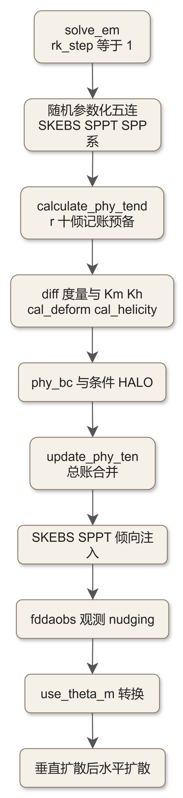
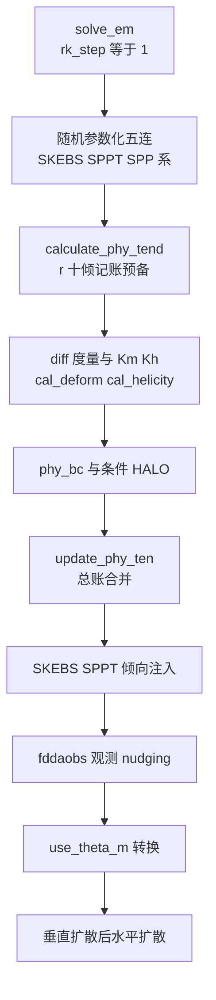

# code_32 — 非时间分裂物理总装·下（dyn_em/module_first_rk_step_part2.F：倾向记账、TKE 混合与随机扰动）

## 一、版本指纹

| 源文件 | 行数 | md5（整文件，按字节） |
|---|---|---|
| dyn_em/module_first_rk_step_part2.F | 1132 | 10f3fc73e862a80a7330437dd53d4783 |

- 抽取工具：workspace/scripts/code_extract.py v1.2，2026-10-12；块首指纹注释自带 range_md5。
- 收录分级（B）：十段精选全收（随机参数化五连、倾向记账、扩散度量与 Km/Kh、条件 HALO、倾向合并、观测 nudging、use_theta_m 转换、垂直+水平扩散）；主签名与声明区引用不录。上游：[code_31_module_first_rk_step_part1.md](code_31_module_first_rk_step_part1.md)。

## 二、定位

一句话：总装下半——**没有微物理**（微物理由 solve_em 在 RK 循环后直接调，[ch21_solve_em_dynamics.md](../ch21_solve_em_dynamics.md)），本文件做四件事：①把各物理方案写出的 r*ten 数组**记账进** ru_tendf 系总账（calculate_phy_tend + update_phy_ten）；②算次格距混合的全部原料（变形率/散度/TKE/Km/Kh）并在无 PBL 方案时补垂直扩散；③SKEBS/SPPT/SPP 随机扰动的生成与注入；④obs nudging 与 use_theta_m 的倾向口径转换。

**谁在调它**：solve_em 主循环、rk_step==1 时（与 part1 配对）。教材锚点：[ch21_solve_em_dynamics.md](../ch21_solve_em_dynamics.md)。



<details><summary>原始 Mermaid 源码（可点击展开）</summary>

<!--

-->

</details>

## 三、USE 链

<!-- code_extract code_extract.py v1.2
source: dyn_em/module_first_rk_step_part2.F
ranges: L36-L64
file_lines: 1132
file_md5: 10f3fc73e862a80a7330437dd53d4783
display: line-numbered (strip L-prefix and !file: line to restore)
range_md5: b75da31b85904f1601fa528173bc551d
seg_lines: 29
-->

```fortran
!file: dyn_em/module_first_rk_step_part2.F    L36-L64
L00036      USE module_state_description
L00037      USE module_model_constants
L00038      USE module_domain, ONLY : domain
L00039      USE module_configure, ONLY : grid_config_rec_type, model_config_rec
L00040      USE module_big_step_utilities_em, ONLY : conv_t_tendf_to_moist
L00041  #ifdef DM_PARALLEL
L00042      USE module_dm, ONLY : local_communicator, mytask, ntasks, ntasks_x, ntasks_y, local_communicator_periodic, &
L00043                            wrf_dm_maxval, wrf_err_message, local_communicator_x, local_communicator_y
L00044      USE module_comm_dm, ONLY : halo_em_tke_c_sub,halo_em_tke_d_sub,halo_em_tke_e_sub            &
L00045              ,halo_em_phys_pbl_sub,halo_em_phys_shcu_sub &
L00046              ,halo_em_fdda_sub,halo_em_phys_diffusion_sub,halo_em_tke_3_sub &
L00047              ,halo_em_tke_5_sub,halo_obs_nudge_sub,period_bdy_em_a1_sub,period_bdy_em_phy_bc_sub &
L00048              ,period_bdy_em_fdda_bc_sub,period_bdy_em_chem_sub,halo_em_phys_cu_sub,halo_em_helicity_sub
L00049  #endif
L00050  
L00051      USE module_driver_constants
L00052      USE module_diffusion_em, ONLY : phy_bc, cal_deform_and_div, compute_diff_metrics, &
L00053                                      vertical_diffusion_2, horizontal_diffusion_2, calculate_km_kh, &
L00054                                      tke_rhs, cal_helicity, &
L00055                                      nonlocal_flux,meso_length_scale,free_atmos_length, &
L00056                                      vertical_diffusion_implicit !XZ 
L00057      USE module_em, ONLY : calculate_phy_tend
L00058      USE module_fddaobs_driver, ONLY : fddaobs_driver
L00059      USE module_bc, ONLY : set_physical_bc3d, set_physical_bc2d
L00060      USE module_physics_addtendc, ONLY : update_phy_ten
L00061  
L00062      USE module_sfs_driver !JDM
L00063      USE module_stoch, ONLY : update_stoch_ten, perturb_physics_tend, RAND_PERT_UPDATE, contiguize_2d
L00064  
```

> 讲解：本文件的「工具箱」清单：module_diffusion_em 六件（phy_bc/cal_deform_and_div/compute_diff_metrics/vertical_diffusion_2/horizontal_diffusion_2/calculate_km_kh/tke_rhs/cal_helicity + km_opt=5 的 nonlocal_flux/meso_length_scale/vertical_diffusion_implicit）；module_em 的 calculate_phy_tend（倾向记账）；fddaobs_driver（观测 nudging）；physics_addtendc 的 update_phy_ten（总账合并）；**sfs_driver（JDM 的 SFS 湍流模式）与 module_stoch（SKEBS/SPPT 的随机引擎）**；halo 子程序 14 种。

## 四、随机参数化五连

<!-- code_extract code_extract.py v1.2
source: dyn_em/module_first_rk_step_part2.F
ranges: L153-L381
file_lines: 1132
file_md5: 10f3fc73e862a80a7330437dd53d4783
display: line-numbered (strip L-prefix and !file: line to restore)
range_md5: 5e3cfdb9af18e4687e41606d1f95fbea
seg_lines: 229
-->

```fortran
!file: dyn_em/module_first_rk_step_part2.F    L153-L381
L00153     rk_step = 1
L00154  
L00155        IF ((grid%skebs_on==1).and.(grid%id .EQ. 1 )) then
L00156            ! update and backtransform T
L00157            CALL RAND_PERT_UPDATE(grid,'T',                                     &
L00158                            grid%SPTFORCS,grid%SPTFORCC,                        &
L00159                            grid%SPT_AMP,grid%ALPH_T,                           &
L00160                            ips, ipe, jps, jpe, kps, kpe,                       &
L00161                            ids, ide, jds, jde, kds, kde,                       &
L00162                            ims, ime, jms, jme, kms, kme,                       &
L00163                            k_start, k_end,                                     &
L00164                            imsx,imex,jmsx,jmex,kmsx,kmex,                      &
L00165                            ipsx,ipex,jpsx,jpex,kpsx,kpex,                      &
L00166                            imsy,imey,jmsy,jmey,kmsy,kmey,                      &
L00167                            ipsy,ipey,jpsy,jpey,kpsy,kpey,                      &
L00168                            grid%num_stoch_levels,grid%num_stoch_levels,        &
L00169                            grid%num_stoch_levels,grid%num_stoch_levels,        &
L00170                            config_flags%restart, grid%iseedarr_skebs,          &
L00171                            config_flags%seed_dim,                              &
L00172                            grid%DX,grid%DY,grid%skebs_vertstruc,               &
L00173                            grid%rt_tendf_stoch,                                &
L00174                            grid%stddev_cutoff_sppt,grid%gridpt_stddev_sppt, & 
L00175                            grid%VERTSTRUCC,grid%VERTSTRUCS,grid%VERTAMPUV      )
L00176            ! Update streamfunction, backtransform U
L00177             CALL RAND_PERT_UPDATE(grid,'U',                                    &
L00178                             grid%SPSTREAMFORCS,grid%SPSTREAMFORCC,             &
L00179                             grid%SPSTREAM_AMP,grid%ALPH_PSI,                   &
L00180                             ips, ipe, jps, jpe, kps, kpe,                      &
L00181                             ids, ide, jds, jde, kds, kde,                      &
L00182                             ims, ime, jms, jme, kms, kme,                      &
L00183                             k_start, k_end,                                    &
L00184                             imsx,imex,jmsx,jmex,kmsx,kmex,                     &
L00185                             ipsx,ipex,jpsx,jpex,kpsx,kpex,                     &
L00186                             imsy,imey,jmsy,jmey,kmsy,kmey,                     &
L00187                             ipsy,ipey,jpsy,jpey,kpsy,kpey,                     &
L00188                             grid% num_stoch_levels,grid% num_stoch_levels,     &
L00189                             grid% num_stoch_levels,grid% num_stoch_levels,     &
L00190                             config_flags%restart, grid%iseedarr_skebs,         &
L00191                             config_flags%seed_dim,                             &
L00192                             grid%DX,grid%DY,grid%skebs_vertstruc,              &
L00193                             grid%ru_tendf_stoch,                               &
L00194                             grid%stddev_cutoff_sppt,grid%gridpt_stddev_sppt, & 
L00195                             grid%VERTSTRUCC,grid%VERTSTRUCS,grid%VERTAMPUV     )
L00196            ! Don't update streamfunction, backtransform V
L00197             CALL RAND_PERT_UPDATE(grid,'V',                                    &
L00198                             grid%SPSTREAMFORCS,grid%SPSTREAMFORCC,             &
L00199                             grid%SPSTREAM_AMP,grid%ALPH_PSI,                   &
L00200                             ips, ipe, jps, jpe, kps, kpe,                      &
L00201                             ids, ide, jds, jde, kds, kde,                      &
L00202                             ims, ime, jms, jme, kms, kme,                      &
L00203                             k_start, k_end,                                    &
L00204                             imsx,imex,jmsx,jmex,kmsx,kmex,                     &
L00205                             ipsx,ipex,jpsx,jpex,kpsx,kpex,                     &
L00206                             imsy,imey,jmsy,jmey,kmsy,kmey,                     &
L00207                             ipsy,ipey,jpsy,jpey,kpsy,kpey,                     &
L00208                             grid% num_stoch_levels,grid% num_stoch_levels,     &
L00209                             grid% num_stoch_levels,grid% num_stoch_levels,     &
L00210                             config_flags%restart, grid%iseedarr_skebs,         &
L00211                             config_flags%seed_dim,                             &
L00212                             grid%DX,grid%DY,grid%skebs_vertstruc,              &
L00213                             grid%rv_tendf_stoch,                               &
L00214                             grid%stddev_cutoff_sppt,grid%gridpt_stddev_sppt, & 
L00215                             grid%VERTSTRUCC,grid%VERTSTRUCS,grid%VERTAMPT      )
L00216         ENDIF !skebs_on 
L00217  
L00218       if ((grid%sppt_on==1).and.(grid%id .EQ. 1 )) then
L00219            CALL RAND_PERT_UPDATE(grid,'T',                                     &
L00220                            grid%SPPTFORCS,grid%SPPTFORCC,                      &
L00221                            grid%SPPT_AMP,grid%ALPH_SPPT,                       &
L00222                            ips, ipe, jps, jpe, kps, kpe,                       &
L00223                            ids, ide, jds, jde, kds, kde,                       &
L00224                            ims, ime, jms, jme, kms, kme,                       &
L00225                            k_start, k_end,                                     &
L00226                            imsx,imex,jmsx,jmex,kmsx,kmex,                      &
L00227                            ipsx,ipex,jpsx,jpex,kpsx,kpex,                      &
L00228                            imsy,imey,jmsy,jmey,kmsy,kmey,                      &
L00229                            ipsy,ipey,jpsy,jpey,kpsy,kpey,                      &
L00230                            grid%num_stoch_levels,grid%num_stoch_levels,        &
L00231                            grid%num_stoch_levels,grid%num_stoch_levels,        &
L00232                            config_flags%restart, grid%iseedarr_sppt,           &
L00233                            config_flags%seed_dim,                              &
L00234                            grid%DX,grid%DY,grid%sppt_vertstruc,                &
L00235                            grid%rstoch,                                        &
L00236                            grid%stddev_cutoff_sppt,grid%gridpt_stddev_sppt, & 
L00237                            grid%VERTSTRUCC,grid%VERTSTRUCS,grid%VERTAMPT       )
L00238         ENDIF !sppt_on
L00239  
L00240        if ((grid%rand_perturb_on==1).and.(grid%id .EQ. 1 )) then
L00241             CALL RAND_PERT_UPDATE(grid,'T',                                     &
L00242                             grid%SPFORCS,grid%SPFORCC,                          &
L00243                             grid%SP_AMP,grid%ALPH_RAND,                         &
L00244                             ips, ipe, jps, jpe, kps, kpe,                       &
L00245                             ids, ide, jds, jde, kds, kde,                       &
L00246                             ims, ime, jms, jme, kms, kme,                       &
L00247                             k_start, k_end,                                     &
L00248                             imsx,imex,jmsx,jmex,kmsx,kmex,                      &
L00249                             ipsx,ipex,jpsx,jpex,kpsx,kpex,                      &
L00250                             imsy,imey,jmsy,jmey,kmsy,kmey,                      &
L00251                             ipsy,ipey,jpsy,jpey,kpsy,kpey,                      &
L00252                             grid%num_stoch_levels,grid%num_stoch_levels,        &
L00253                             grid%num_stoch_levels,grid%num_stoch_levels,        &
L00254                             config_flags%restart, grid%iseedarr_rand_pert,      &
L00255                             config_flags%seed_dim,                              &
L00256                             grid%DX,grid%DY,grid%rand_pert_vertstruc,           &
L00257                             grid%RAND_PERT,                                     &
L00258                             grid%stddev_cutoff_rand_pert,grid%gridpt_stddev_rand_pert, & 
L00259                             grid%VERTSTRUCC,grid%VERTSTRUCS,grid%VERTAMPT       )
L00260        ENDIF !rand_perturb_on
L00261  
L00262        IF ( grid%stepsp > 0 ) THEN
L00263           stepsp_test = ( MOD(grid%itimestep, grid%stepsp) == 0 )
L00264        ELSE
L00265           stepsp_test = .FALSE.
L00266        END IF
L00267        If_multi_perturb: if ((config_flags%multi_perturb==1).and.(grid%id == 1) .and. &
L00268            (stepsp_test .or. grid%itimestep == 1)) then
L00269          Loop_multi_perturb: DO n = 2, config_flags%num_pert_3d
L00270             CALL contiguize_2d ( .TRUE. , grid%SPFORCS3d, SPFORCS3d_loc, n,       &
L00271                                  ips, ipe, jps, jpe, 1, config_flags%num_pert_3d, &
L00272                                  ids, ide, jds, jde, 1, config_flags%num_pert_3d, &
L00273                                  ims, ime, jms, jme, 1, config_flags%num_pert_3d  )
L00274             CALL contiguize_2d ( .TRUE. , grid%SPFORCC3d, SPFORCC3d_loc, n,       &
L00275                                  ips, ipe, jps, jpe, 1, config_flags%num_pert_3d, &
L00276                                  ids, ide, jds, jde, 1, config_flags%num_pert_3d, &
L00277                                  ims, ime, jms, jme, 1, config_flags%num_pert_3d  )
L00278             CALL contiguize_2d ( .TRUE. , grid%SP_AMP3d,  SP_AMP3d_loc,  n,       &
L00279                                  ips, ipe, jps, jpe, 1, config_flags%num_pert_3d, &
L00280                                  ids, ide, jds, jde, 1, config_flags%num_pert_3d, &
L00281                                  ims, ime, jms, jme, 1, config_flags%num_pert_3d  )
L00282             CALL RAND_PERT_UPDATE(grid,'T',                                     &
L00283                             SPFORCS3d_loc, SPFORCC3d_loc, SP_AMP3d_loc,         &
L00284                             grid%ALPH_RAND3d(n),                                &
L00285                             ips, ipe, jps, jpe, kps, kpe,                       &
L00286                             ids, ide, jds, jde, kds, kde,                       &
L00287                             ims, ime, jms, jme, kms, kme,                       &
L00288                             k_start, k_end,                                     &
L00289                             imsx,imex,jmsx,jmex,kmsx,kmex,                      &
L00290                             ipsx,ipex,jpsx,jpex,kpsx,kpex,                      &
L00291                             imsy,imey,jmsy,jmey,kmsy,kmey,                      &
L00292                             ipsy,ipey,jpsy,jpey,kpsy,kpey,                      &
L00293                             grid%num_stoch_levels,grid%num_stoch_levels,        &
L00294                             grid%num_stoch_levels,grid%num_stoch_levels,        &
L00295                             config_flags%restart, grid%iseedarr_mult3d(:,n),    &
L00296                             config_flags%seed_dim,                              &
L00297                             grid%DX,grid%DY,grid%mult3d_vertstruc(n),           &
L00298                             grid%PERT3D(:,:,:,n),                               &
L00299                             grid%stddev_cutoff_mult3d(n),                       &
L00300                             grid%gridpt_stddev_mult3d(n),                       &
L00301                             grid%VERTSTRUCC3d(:,:,:,n),                         &
L00302                             grid%VERTSTRUCS3d(:,:,:,n),                         &
L00303                             grid%VERTAMPT3d(:,n)                                )
L00304             CALL contiguize_2d ( .FALSE., grid%SPFORCS3d, SPFORCS3d_loc, n,       &
L00305                                  ips, ipe, jps, jpe, 1, config_flags%num_pert_3d, &
L00306                                  ids, ide, jds, jde, 1, config_flags%num_pert_3d, &
L00307                                  ims, ime, jms, jme, 1, config_flags%num_pert_3d  )
L00308             CALL contiguize_2d ( .FALSE., grid%SPFORCC3d, SPFORCC3d_loc, n,       &
L00309                                  ips, ipe, jps, jpe, 1, config_flags%num_pert_3d, &
L00310                                  ids, ide, jds, jde, 1, config_flags%num_pert_3d, &
L00311                                  ims, ime, jms, jme, 1, config_flags%num_pert_3d  )
L00312             CALL contiguize_2d ( .FALSE., grid%SP_AMP3d,  SP_AMP3d_loc,  n,       &
L00313                                  ips, ipe, jps, jpe, 1, config_flags%num_pert_3d, &
L00314                                  ids, ide, jds, jde, 1, config_flags%num_pert_3d, &
L00315                                  ims, ime, jms, jme, 1, config_flags%num_pert_3d  )
L00316          END DO Loop_multi_perturb
L00317        ENDIF If_multi_perturb
L00318  
L00319        if ((grid%spp_conv==1).and.(grid%id .EQ. 1 )) then
L00320             CALL RAND_PERT_UPDATE(grid,'T',                                     &
L00321                             grid%SPFORCS2,grid%SPFORCC2,                        &
L00322                             grid%SP_AMP2,grid%ALPH_RAND2,                       &
L00323                             ips, ipe, jps, jpe, kps, kpe,                       &
L00324                             ids, ide, jds, jde, kds, kde,                       &
L00325                             ims, ime, jms, jme, kms, kme,                       &
L00326                             k_start, k_end,                                     &
L00327                             imsx,imex,jmsx,jmex,kmsx,kmex,                      &
L00328                             ipsx,ipex,jpsx,jpex,kpsx,kpex,                      &
L00329                             imsy,imey,jmsy,jmey,kmsy,kmey,                      &
L00330                             ipsy,ipey,jpsy,jpey,kpsy,kpey,                      &
L00331                             grid%num_stoch_levels,grid%num_stoch_levels,        &
L00332                             grid%num_stoch_levels,grid%num_stoch_levels,        &
L00333                             config_flags%restart, grid%iseedarr_spp_conv,       &
L00334                             config_flags%seed_dim,                              &
L00335                             grid%DX,grid%DY,grid%vertstruc_spp_conv,            &
L00336                             grid%pattern_spp_conv,                              & 
L00337                             grid%stddev_cutoff_spp_conv,grid%gridpt_stddev_spp_conv, & 
L00338                             grid%VERTSTRUCC,grid%VERTSTRUCS,grid%VERTAMPT       )
L00339        ENDIF !spp_conv
L00340        if ((grid%spp_pbl==1).and.(grid%id .EQ. 1 )) then
L00341             CALL RAND_PERT_UPDATE(grid,'T',                                     &
L00342                             grid%SPFORCS3,grid%SPFORCC3,                        &
L00343                             grid%SP_AMP3,grid%ALPH_RAND3,                       &
L00344                             ips, ipe, jps, jpe, kps, kpe,                       &
L00345                             ids, ide, jds, jde, kds, kde,                       &
L00346                             ims, ime, jms, jme, kms, kme,                       &
L00347                             k_start, k_end,                                     &
L00348                             imsx,imex,jmsx,jmex,kmsx,kmex,                      &
L00349                             ipsx,ipex,jpsx,jpex,kpsx,kpex,                      &
L00350                             imsy,imey,jmsy,jmey,kmsy,kmey,                      &
L00351                             ipsy,ipey,jpsy,jpey,kpsy,kpey,                      &
L00352                             grid%num_stoch_levels,grid%num_stoch_levels,        &
L00353                             grid%num_stoch_levels,grid%num_stoch_levels,        &
L00354                             config_flags%restart, grid%iseedarr_spp_pbl,        &
L00355                             config_flags%seed_dim,                              &
L00356                             grid%DX,grid%DY,grid%vertstruc_spp_pbl,             &
L00357                             grid%pattern_spp_pbl,                               & 
L00358                             grid%stddev_cutoff_spp_pbl,grid%gridpt_stddev_spp_pbl, & 
L00359                             grid%VERTSTRUCC,grid%VERTSTRUCS,grid%VERTAMPT       )
L00360        ENDIF !spp_pbl
L00361        if ((grid%spp_lsm==1).and.(grid%id .EQ. 1 )) then
L00362             CALL RAND_PERT_UPDATE(grid,'T',                                     &
L00363                             grid%SPFORCS4,grid%SPFORCC4,                        &
L00364                             grid%SP_AMP4,grid%ALPH_RAND4,                       &
L00365                             ips, ipe, jps, jpe, kps, kpe,                       &
L00366                             ids, ide, jds, jde, kds, kde,                       &
L00367                             ims, ime, jms, jme, kms, kme,                       &
L00368                             k_start, k_end,                                     &
L00369                             imsx,imex,jmsx,jmex,kmsx,kmex,                      &
L00370                             ipsx,ipex,jpsx,jpex,kpsx,kpex,                      &
L00371                             imsy,imey,jmsy,jmey,kmsy,kmey,                      &
L00372                             ipsy,ipey,jpsy,jpey,kpsy,kpey,                      &
L00373                             grid%num_stoch_levels,grid%num_stoch_levels,        &
L00374                             grid%num_stoch_levels,grid%num_stoch_levels,        &
L00375                             config_flags%restart, grid%iseedarr_spp_lsm,        &
L00376                             config_flags%seed_dim,                              &
L00377                             grid%DX,grid%DY,grid%vertstruc_spp_lsm,             &
L00378                             grid%pattern_spp_lsm,                               & 
L00379                             grid%stddev_cutoff_spp_lsm,grid%gridpt_stddev_spp_lsm, & 
L00380                             grid%VERTSTRUCC,grid%VERTSTRUCS,grid%VERTAMPT       )
L00381        ENDIF !spp_lsm
```

> 讲解：五组随机扰动全部走 module_stoch 的 **RAND_PERT_UPDATE**（谱空间生成→投影回格点→按 stddev_cutoff/gridpt_stddev 钳幅），仅主域 id=1：①**SKEBS**（随机动能背散射）三次调 T/U/V——T 用 SPTFORCS/CC 谱系数、U/V 共用流函数谱 SPSTREAMFORCS（注释点明 U 更新流函数、V 不更新）；②**SPPT**（随机物理倾向扰动）——输出 rstoch 场（后面 perturb_physics_tend 消费）；③rand_perturb（通用随机强迫）；④**multi_perturb**（WRF-Solar EPS）：contiguize_2d 把第 n 个成员的谱系数抽成连续临时数组、扰动、再写回——PERT3D(:,:,:,n) 第三维是成员维；⑤**spp_conv/spp_pbl/spp_lsm** 三件——给积云/PBL/陆面方案用的随机场（pattern_spp_*，与 code_23 的 pattern_spp_conv 占位、code_22 的 SPP 包裹对应）。每件的垂直结构由 vertstruc 控制、种子 iseedarr_* 独立。

## 五、倾向记账预备 calculate_phy_tend

<!-- code_extract code_extract.py v1.2
source: dyn_em/module_first_rk_step_part2.F
ranges: L383-L423
file_lines: 1132
file_md5: 10f3fc73e862a80a7330437dd53d4783
display: line-numbered (strip L-prefix and !file: line to restore)
range_md5: 26a6792551516189b40e40f6a33632de
seg_lines: 41
-->

```fortran
!file: dyn_em/module_first_rk_step_part2.F    L383-L423
L00383  ! calculate_phy_tend
L00384  
L00385  BENCH_START(cal_phy_tend)
L00386        !$OMP PARALLEL DO   &
L00387        !$OMP PRIVATE ( ij )
L00388  
L00389        DO ij = 1 , grid%num_tiles
L00390  
L00391          CALL wrf_debug ( 200 , ' call calculate_phy_tend' )
L00392          CALL calculate_phy_tend (config_flags,grid%c1h,grid%c2h,       &
L00393                       grid%mut,grid%muu,grid%muv,pi_phy,                &
L00394                       grid%rthraten,                                    &
L00395                       grid%rublten,grid%rvblten,grid%rthblten,          &
L00396                       grid%rqvblten,grid%rqcblten,grid%rqiblten,        &
L00397                       grid%rucuten,grid%rvcuten,grid%rthcuten,          &
L00398                       grid%rqvcuten,grid%rqccuten,grid%rqrcuten,        &
L00399                       grid%rqicuten,grid%rqscuten,                      &
L00400                       grid%rushten,grid%rvshten,grid%rthshten,          &
L00401                       grid%rqvshten,grid%rqcshten,grid%rqrshten,        &
L00402                       grid%rqishten,grid%rqsshten,grid%rqgshten,        &
L00403                       grid%RUNDGDTEN,grid%RVNDGDTEN,grid%RTHNDGDTEN,grid%RQVNDGDTEN, &
L00404                       grid%RMUNDGDTEN,                                  &
L00405                       grid%ruiauten,grid%rviauten,grid%rthiauten,       &
L00406                       grid%rqviauten,grid%rqciauten,grid%rqriauten,     &
L00407                       grid%rqiiauten,grid%rqsiauten,grid%rqgiauten,     &
L00408                       grid%rmuiauten,grid%rphiauten,                    &
L00409                       grid%u_iau,grid%v_iau,grid%t_iau,grid%ph_iau,     &
L00410                       grid%mu_iau,grid%qv_iau,grid%qc_iau,grid%qr_iau,  &
L00411                       grid%qs_iau,grid%qi_iau,grid%qg_iau,              &
L00412                       grid%itimestep,                                   &
L00413                       scalar, scalar_tend, num_scalar,                  &
L00414                       tracer, tracer_tend, num_tracer,                  &
L00415                       ids,ide, jds,jde, kds,kde,                        &
L00416                       ims,ime, jms,jme, kms,kme,                        &
L00417                       grid%i_start(ij), min(grid%i_end(ij),ide-1),      &
L00418                       grid%j_start(ij), min(grid%j_end(ij),jde-1),      &
L00419                       k_start    , min(k_end,kde-1)                     )
L00420  
L00421        ENDDO
L00422        !$OMP END PARALLEL DO
L00423  BENCH_END(cal_phy_tend)
```

> 讲解：把 40 余个 r*ten 数组（辐射 rthraten、PBL 五件、积云六件、浅对流六件、格点 nudging 五件、IAU 十二件+u_iau 等分析增量）一次性交给 module_em 的 calculate_phy_tend——它按 **mu（干空气柱质量）与 c1h/c2h 坐标系数加权**把「方案倾向」换算成动力方程口径的倾向增量。IAU（incremental analysis update）的两组数组（r*iauten 倾向与 *_iau 增量）也在此入口。

## 六、扩散度量与 Km/Kh

<!-- code_extract code_extract.py v1.2
source: dyn_em/module_first_rk_step_part2.F
ranges: L427-L647
file_lines: 1132
file_md5: 10f3fc73e862a80a7330437dd53d4783
display: line-numbered (strip L-prefix and !file: line to restore)
range_md5: 70c3475d7dd3ecdda3c4025951db6015
seg_lines: 221
-->

```fortran
!file: dyn_em/module_first_rk_step_part2.F    L427-L647
L00427         IF(config_flags%diff_opt .eq. 2 .OR. config_flags%diff_opt .eq. 1) THEN
L00428  
L00429  BENCH_START(comp_diff_metrics_tim)
L00430           !$OMP PARALLEL DO   &
L00431           !$OMP PRIVATE ( ij )
L00432           DO ij = 1 , grid%num_tiles
L00433             CALL wrf_debug ( 200 , ' call compute_diff_metrics ' )
L00434             CALL compute_diff_metrics ( config_flags, grid%ph_2, grid%phb, grid%z, grid%rdz, grid%rdzw, &
L00435                                         grid%zx, grid%zy, grid%rdx, grid%rdy,                      &
L00436                                         ids, ide, jds, jde, kds, kde,          &
L00437                                         ims, ime, jms, jme, kms, kme,          &
L00438                                         grid%i_start(ij), grid%i_end(ij),      &
L00439                                         grid%j_start(ij), grid%j_end(ij),      &
L00440                                         k_start    , k_end                    )
L00441           ENDDO
L00442           !$OMP END PARALLEL DO
L00443  BENCH_END(comp_diff_metrics_tim)
L00444  
L00445  #ifdef DM_PARALLEL
L00446  #  include "HALO_EM_TKE_C.inc"
L00447  #  include "PERIOD_BDY_EM_A1.inc"
L00448  #endif
L00449  
L00450  BENCH_START(tke_diff_bc_tim)
L00451           !$OMP PARALLEL DO   &
L00452           !$OMP PRIVATE ( ij )
L00453  
L00454           DO ij = 1 , grid%num_tiles
L00455  
L00456             CALL wrf_debug ( 200 , ' call bc for diffusion_metrics ' )
L00457             CALL set_physical_bc3d( grid%rdzw , 'w', config_flags,           &
L00458                                     ids, ide, jds, jde, kds, kde,       &
L00459                                     ims, ime, jms, jme, kms, kme,       &
L00460                                     ips, ipe, jps, jpe, kps, kpe,       &
L00461                                     grid%i_start(ij), grid%i_end(ij),   &
L00462                                     grid%j_start(ij), grid%j_end(ij),   &
L00463                                     k_start    , k_end                 )
L00464             CALL set_physical_bc3d( grid%rdz , 'w', config_flags,            &
L00465                                     ids, ide, jds, jde, kds, kde,       &
L00466                                     ims, ime, jms, jme, kms, kme,       &
L00467                                     ips, ipe, jps, jpe, kps, kpe,       &
L00468                                     grid%i_start(ij), grid%i_end(ij),   &
L00469                                     grid%j_start(ij), grid%j_end(ij),   &
L00470                                     k_start    , k_end                 )
L00471             CALL set_physical_bc3d( grid%z , 'w', config_flags,              &
L00472                                     ids, ide, jds, jde, kds, kde,       &
L00473                                     ims, ime, jms, jme, kms, kme,       &
L00474                                     ips, ipe, jps, jpe, kps, kpe,       &
L00475                                     grid%i_start(ij), grid%i_end(ij),   &
L00476                                     grid%j_start(ij), grid%j_end(ij),   &
L00477                                     k_start    , k_end                 )
L00478             CALL set_physical_bc3d( grid%zx , 'e', config_flags,             &
L00479                                     ids, ide, jds, jde, kds, kde,       &
L00480                                     ims, ime, jms, jme, kms, kme,       &
L00481                                     ips, ipe, jps, jpe, kps, kpe,       &
L00482                                     grid%i_start(ij), grid%i_end(ij),   &
L00483                                     grid%j_start(ij), grid%j_end(ij),   &
L00484                                     k_start    , k_end                 )
L00485             CALL set_physical_bc3d( grid%zy , 'f', config_flags,             &
L00486                                     ids, ide, jds, jde, kds, kde,       &
L00487                                     ims, ime, jms, jme, kms, kme,       &
L00488                                     ips, ipe, jps, jpe, kps, kpe,       &
L00489                                     grid%i_start(ij), grid%i_end(ij),   &
L00490                                     grid%j_start(ij), grid%j_end(ij),   &
L00491                                     k_start    , k_end                 )
L00492             CALL set_physical_bc2d( grid%ustm, 't', config_flags,            &
L00493                                     ids, ide, jds, jde,                 &
L00494                                     ims, ime, jms, jme,                 &
L00495                                     ips, ipe, jps, jpe,                 &
L00496                                     grid%i_start(ij), grid%i_end(ij),   &
L00497                                     grid%j_start(ij), grid%j_end(ij)   )
L00498            CALL set_physical_bc2d( grid%ust, 't', config_flags,              &
L00499                                     ids, ide, jds, jde,                 &
L00500                                     ims, ime, jms, jme,                 &
L00501                                     ips, ipe, jps, jpe,                 &
L00502                                     grid%i_start(ij), grid%i_end(ij),   &
L00503                                     grid%j_start(ij), grid%j_end(ij)   )
L00504   
L00505           ENDDO
L00506           !$OMP END PARALLEL DO
L00507  BENCH_END(tke_diff_bc_tim)
L00508  
L00509  BENCH_START(deform_div_tim)
L00510  
L00511           !$OMP PARALLEL DO   &
L00512           !$OMP PRIVATE ( ij )
L00513  
L00514           DO ij = 1 , grid%num_tiles
L00515  
L00516             CALL wrf_debug ( 200 , ' call cal_deform_and_div' )
L00517             CALL cal_deform_and_div ( config_flags,grid%u_2,grid%v_2,grid%w_2,grid%div,  &
L00518                                       grid%defor11,grid%defor22,grid%defor33,            &
L00519                                       grid%defor12,grid%defor13,grid%defor23,            &
L00520                                       nba_rij, n_nba_rij,                                & !JDM
L00521                                       grid%u_base, grid%v_base,grid%msfux,grid%msfuy,    &
L00522                                       grid%msfvx,grid%msfvy,grid%msftx,grid%msfty,       &
L00523                                       grid%rdx, grid%rdy, grid%dn, grid%dnw, grid%rdz,   &
L00524                                       grid%rdzw,grid%fnm,grid%fnp,grid%cf1,grid%cf2,     &
L00525                                       grid%cf3,grid%zx,grid%zy,            &
L00526                                       ids, ide, jds, jde, kds, kde,        &
L00527                                       ims, ime, jms, jme, kms, kme,        &
L00528                                       grid%i_start(ij), grid%i_end(ij),    &
L00529                                       grid%j_start(ij), grid%j_end(ij),    &
L00530                                       k_start    , k_end                  )
L00531           ENDDO
L00532           !$OMP END PARALLEL DO
L00533  BENCH_END(deform_div_tim)
L00534  
L00535  ! Updraft helicity between output times
L00536  
L00537  #ifdef DM_PARALLEL
L00538  #     include "HALO_EM_HELICITY.inc"
L00539  #endif
L00540  
L00541         IF ( ( config_flags%nwp_diagnostics .eq. 1 ) .OR. &
L00542              ( ( config_flags%afwa_diag_opt .eq. 1 ) .AND. ( config_flags%afwa_severe_opt .EQ. 1 ) ) ) THEN
L00543  BENCH_START(helicity_tim)
L00544  
L00545         !$OMP PARALLEL DO   &
L00546         !$OMP PRIVATE ( ij )
L00547  
L00548         DO ij = 1 , grid%num_tiles
L00549  
L00550            CALL wrf_debug ( 200 , ' call cal_helicity' )
L00551            CALL cal_helicity ( config_flags,grid%u_2,grid%v_2,grid%w_2,  &
L00552                                grid%uh,                             &
L00553                                grid%up_heli_max,                    &
L00554                                grid%ph_2,grid%phb,                  &
L00555                                grid%msfux,grid%msfuy,               &
L00556                                grid%msfvx,grid%msfvy,               &
L00557                                grid%ht,                             &
L00558                                grid%rdx, grid%rdy, grid%dn, grid%dnw, grid%rdz, grid%rdzw,   &
L00559                                grid%fnm,grid%fnp,grid%cf1,grid%cf2,grid%cf3,grid%zx,grid%zy, &
L00560                                ids, ide, jds, jde, kds, kde,        &
L00561                                ims, ime, jms, jme, kms, kme,        &
L00562                                grid%i_start(ij), grid%i_end(ij),    &
L00563                                grid%j_start(ij), grid%j_end(ij),    &
L00564                                k_start    , k_end                  )
L00565         ENDDO
L00566         !$OMP END PARALLEL DO
L00567  BENCH_END(helicity_tim)
L00568         ENDIF
L00569  
L00570  #ifdef DM_PARALLEL
L00571  #     include "HALO_EM_TKE_D.inc"
L00572  #endif
L00573  
L00574  ! calculate tke, kmh, and kmv
L00575  
L00576  BENCH_START(calc_tke_tim)
L00577           !$OMP PARALLEL DO   &
L00578           !$OMP PRIVATE ( ij )
L00579           DO ij = 1 , grid%num_tiles
L00580  
L00581  !XZ
L00582           IF( config_flags%diff_opt .eq. 2 .and. config_flags%km_opt .eq. 5 ) THEN
L00583             CALL nonlocal_flux(config_flags,grid%nlflux,grid%gamu,grid%gamv,      &
L00584                                grid%pblh,grid%kpbl,grid%dx,grid%dy,grid%dt,       &
L00585                                grid%ust,grid%hfx,grid%qfx,grid%br,ep_1,ep_2,      & 
L00586                                karman,grid%u_phy,grid%v_phy,th_phy,grid%rho,      & 
L00587                                moist,num_moist,                                   &
L00588                                grid%msftx,grid%msfty,grid%rdzw,                   &
L00589                                grid%u10,grid%v10,grid%wspd,                       &
L00590                                ids, ide, jds, jde, kds, kde,                      &
L00591                                ims, ime, jms, jme, kms, kme,                      &
L00592                                grid%i_start(ij), grid%i_end(ij),                  &
L00593                                grid%j_start(ij), grid%j_end(ij),                  &
L00594                                k_start, k_end  )
L00595   
L00596             CALL free_atmos_length(config_flags,grid%dx,grid%dy,grid%rdzw,        &
L00597                                    grid%rdz,grid%tke_2,th_phy,grid%elmin,         &
L00598                                    grid%hfx,grid%qfx,moist,num_moist,             &
L00599                                    ids, ide, jds, jde, kds, kde,                  &
L00600                                    ims, ime, jms, jme, kms, kme,                  &
L00601                                    grid%i_start(ij),grid%i_end(ij),               &
L00602                                    grid%j_start(ij), grid%j_end(ij),              &
L00603                                    k_start, k_end  )
L00604    
L00605             CALL meso_length_scale(config_flags,grid%dx,grid%dy,grid%rdzw,        &
L00606                                    grid%rdz,grid%tke_2,p8w,t8w,th_phy,            &
L00607                                    grid%dlk,grid%pblh,grid%elmin,                 &
L00608                                    grid%rmol,grid%rho,grid%hfx,grid%qfx,          &
L00609                                    moist,num_moist,                               &
L00610                                    ids, ide, jds, jde, kds, kde,                  &
L00611                                    ims, ime, jms, jme, kms, kme,                  &
L00612                                    grid%i_start(ij), grid%i_end(ij),              &
L00613                                    grid%j_start(ij), grid%j_end(ij),              &
L00614                                    k_start, k_end  ) 
L00615           ENDIF
L00616  !!
L00617  
L00618             CALL wrf_debug ( 200 , ' call calculate_km_kh' )
L00619             CALL calculate_km_kh( config_flags,grid%dt,grid%dampcoef,grid%zdamp,         &
L00620                                   config_flags%damp_opt,                                 &
L00621                                   grid%xkmh,grid%xkmv,grid%xkhh,grid%xkhv,grid%bn2,      &
L00622                                   grid%khdif,grid%kvdif,grid%div,                        &
L00623                                   grid%defor11,grid%defor22,grid%defor33,grid%defor12,   &
L00624                                   grid%defor13,grid%defor23,                             &
L00625                                   grid%tke_2,p8w,t8w,th_phy,                             &
L00626                                   t_phy,p_phy,moist,grid%dn,grid%dnw,                    &
L00627                                   grid%dx,grid%dy,grid%rdz,grid%rdzw,                    &
L00628                                   config_flags%mix_isotropic,num_moist,                  &
L00629                                   grid%cf1, grid%cf2, grid%cf3, grid%warm_rain,          &
L00630                                   grid%mix_upper_bound,                                  &
L00631                                   grid%msftx, grid%msfty,                                &
L00632                                   grid%zx, grid%zy,                                      &
L00633                                   grid%pblh, grid%dlk, grid%xkmv_meso,                   &  
L00634                                   ids,ide, jds,jde, kds,kde,                             &
L00635                                   ims,ime, jms,jme, kms,kme,                             &
L00636                                   grid%i_start(ij), grid%i_end(ij),                      &
L00637                                   grid%j_start(ij), grid%j_end(ij),                      &
L00638                                   k_start    , k_end                          )
L00639           ENDDO
L00640         !$OMP END PARALLEL DO
L00641  BENCH_END(calc_tke_tim)
L00642  
L00643  #ifdef DM_PARALLEL
L00644  #     include "HALO_EM_TKE_E.inc"
L00645  #endif
L00646  
L00647         ENDIF
```

> 讲解：diff_opt≥1 时的混合原料流水线（每步重算）：①compute_diff_metrics（rdz/rdzw/zx/zy——**斜坡地形下的度量项**）；②六组 set_physical_bc3d + 两组 2D（rdzw/rdz/z/zx/zy/ustm/ust 的物理边界——**扩散量也守 BC**）；③cal_deform_and_div（六个变形率分量 defor11..23 + 散度 div + 基本流扣除，nba_rij 是 SFS 模式的各向异性变形率）；④cal_helicity（nwp_diagnostics/afwa_severe_opt=1 时的上升气流螺旋度诊断）；⑤km_opt=5（TKE-ε 闭合）的三件套：nonlocal_flux（PBL 非局地通量 nlflux/gamu/gamv）、free_atmos_length（自由大气混合长 elmin）、meso_length_scale（中尺度混合长 dlk）；⑥**calculate_km_kh**——四张混合系数场（xkmh/xkmv/xkhh/xkhv）按 km_opt 分派（1/2/3/4/5 各式），bn2 浮力频率、mix_isotropic 各向同性开关、mix_upper_bound 上限。HALO_EM_TKE_C/D/E 三次刷新保证每步的 halo 新鲜。

## 七、条件 HALO 与点阵地图

<!-- code_extract code_extract.py v1.2
source: dyn_em/module_first_rk_step_part2.F
ranges: L691-L770
file_lines: 1132
file_md5: 10f3fc73e862a80a7330437dd53d4783
display: line-numbered (strip L-prefix and !file: line to restore)
range_md5: b293a7af03ffdf2918185a13ca27a76c
seg_lines: 80
-->

```fortran
!file: dyn_em/module_first_rk_step_part2.F    L691-L770
L00691  #ifdef DM_PARALLEL
L00692  !-----------------------------------------------------------------------
L00693  !
L00694  ! MPP for some physics tendency, km, kh, deformation, and divergence
L00695  !
L00696  !                                                         * * * * * * *
L00697  !                                            * * * * *    * * * * * * *
L00698  !               *                     *      * * * * *    * * * * * * *
L00699  !             * + *      * + *        +      * * + * *    * * * + * * *
L00700  !               *                     *      * * * * *    * * * * * * *
L00701  !                                            * * * * *    * * * * * * *
L00702  !                                                         * * * * * * *
L00703  !
L00704  ! (for PBL)
L00705  ! rublten                  x
L00706  ! rvblten                             x
L00707  !
L00708  ! (for Cumulus)
L00709  ! rucuten                  x
L00710  ! rvcuten                             x
L00711  !
L00712  ! (for Shallow Cumulus)
L00713  ! rushten                  x
L00714  ! rvshten                             x
L00715  !
L00716  ! (for FDDA)
L00717  ! rundgdten     x
L00718  ! rvndgdten     x
L00719  !
L00720  ! (for TKE3)
L00721  ! tke_2                                          x               
L00722  ! (for TKE5)
L00723  ! tke_2                                                         x
L00724  !
L00725  ! (for diff_opt >= 1)
L00726  ! defor11                  x
L00727  ! defor22                             x
L00728  ! defor12       x
L00729  ! defor13                  x
L00730  ! defor23                             x
L00731  ! div           x
L00732  ! xkmv          x
L00733  ! xkmh          x
L00734  ! xkhv          x
L00735  ! xkhh          x
L00736  ! tke           x
L00737  !
L00738  !-----------------------------------------------------------------------
L00739         IF ( config_flags%bl_pbl_physics .ge. 1 ) THEN
L00740  #      include "HALO_EM_PHYS_PBL.inc"
L00741         ENDIF
L00742         IF ( config_flags%shcu_physics .gt. 1 ) THEN
L00743  #      include "HALO_EM_PHYS_SHCU.inc"
L00744         ENDIF
L00745         IF ( config_flags%cu_physics == SASSCHEME      .or.   &
L00746              config_flags%cu_physics == TIEDTKESCHEME  .or.   &
L00747              config_flags%cu_physics == NTIEDTKESCHEME .or.   &
L00748              config_flags%cu_physics == MSKFSCHEME     .or.   &
L00749              config_flags%cu_physics == CAMZMSCHEME    .or.   &
L00750              config_flags%cu_physics == SCALESASSCHEME .or.   &
L00751              config_flags%cu_physics == NSASSCHEME     .or.   &
L00752              config_flags%cu_physics == KSASSCHEME ) THEN
L00753  #      include "HALO_EM_PHYS_CU.inc"
L00754         ENDIF
L00755         IF ( config_flags%grid_fdda .ge. 1) THEN
L00756  #      include "HALO_EM_FDDA.inc"
L00757         ENDIF
L00758         IF ( config_flags%diff_opt .ge. 1 ) THEN
L00759  #      include "HALO_EM_PHYS_DIFFUSION.inc"
L00760         ENDIF
L00761  
L00762         IF      ( config_flags%h_sca_adv_order <= 4 ) THEN
L00763  #       include "HALO_EM_TKE_3.inc"
L00764         ELSE IF ( config_flags%h_sca_adv_order <= 6 ) THEN
L00765  #       include "HALO_EM_TKE_5.inc"
L00766         ELSE
L00767           WRITE(wrf_err_message,*)'solve_em: invalid h_sca_adv_order = ',config_flags%h_sca_adv_order
L00768           CALL wrf_error_fatal(TRIM(wrf_err_message))
L00769         ENDIF
L00770  #endif
```

> 讲解：① phy_bc（扩散量与倾向的物理边界）；②**sfs_driver**——sfs_opt>0 且 diff_opt=2 时的 SFS（subfilter-scale）湍流模式驱动（JDM；与 BEP 的 A/B 分解思想同族的另一套各向异性变形率账户）。③本文件的 ASCII 点阵图（MP for some physics tendency…）是**halo 覆盖需求表**——哪个数组需要哪个方向哪些点的 halo 一目了然；④条件 HALO：PBL/SHCU 各一；**HALO_EM_PHYS_CU 的八方案名单（SAS/TIEDTKE/NTIEDTKE/MSKF/CAMZM/SCALESAS/NSAS/KSAS）**——恰好是会写动量倾向的积云方案（KF 系与 BMJ 不在名单，与 code_23 各案不传 RUCUTEN 交叉印证；G3 的动量倾向走 imomentum 选项与 G3 专用 halo）；FDDA/diffusion 各一；TKE_3/TKE_5 按 h_sca_adv_order 四阶/六阶标量平流精度选。

## 八、总账合并 update_phy_ten

<!-- code_extract code_extract.py v1.2
source: dyn_em/module_first_rk_step_part2.F
ranges: L772-L832
file_lines: 1132
file_md5: 10f3fc73e862a80a7330437dd53d4783
display: line-numbered (strip L-prefix and !file: line to restore)
range_md5: 1a727b6ec824395a3b623d5325a1b02e
seg_lines: 61
-->

```fortran
!file: dyn_em/module_first_rk_step_part2.F    L772-L832
L00772  BENCH_START(update_phy_ten_tim)
L00773         !$OMP PARALLEL DO   &
L00774         !$OMP PRIVATE ( ij )
L00775  
L00776         DO ij = 1 , grid%num_tiles
L00777  
L00778           CALL wrf_debug ( 200 , ' call update_phy_ten' )
L00779  #if ( WRF_DFI_RADAR == 1 )
L00780           if (config_flags%cu_physics .gt. 0) then
L00781             i_start = grid%i_start(ij)
L00782             i_end   = min( grid%i_end(ij),ide-1 )
L00783             j_start = grid%j_start(ij)
L00784             j_end   = min( grid%j_end(ij),jde-1 )
L00785             if (grid%dfi_stage == DFI_FWD ) &
L00786                   CALL wrf_debug ( 200 , ' Zero out cu_physics' )
L00787             DO j = j_start, j_end
L00788             DO k = k_start, min( k_end,kde-1 ) - 1
L00789             DO i = i_start, i_end
L00790               if (grid%dfi_stage ==DFI_FWD  &
L00791               .and. grid%dfi_tten_rad(i,k,j) >= 1.0e-7 .and.  &
L00792                     grid%dfi_tten_rad(i,k,j) <= 10.) then
L00793  ! zero out cu-param temp tendency
L00794                  grid%rthcuten(i,k,j) = 0.0
L00795               endif
L00796             ENDDO
L00797             ENDDO
L00798             ENDDO
L00799           ENDIF
L00800  #endif
L00801           CALL update_phy_ten(ph_tendf,t_tendf, ru_tendf, rv_tendf,moist_tend ,&
L00802                             scalar_tend, mu_tendf,                           &
L00803                             grid%rthraten,grid%rthblten,grid%rthcuten,grid%rthshten, &
L00804                             grid%rublten,grid%rucuten,grid%rushten,          &
L00805                             grid%rvblten,grid%rvcuten,grid%rvshten,          &
L00806                             grid%rqvblten,grid%rqcblten,grid%rqiblten,       &
L00807                             grid%rqniblten,                                  & !CAMUWPBL scheme
L00808                             grid%rqvcuten,grid%rqccuten,grid%rqrcuten,       &
L00809                             grid%rqicuten,grid%rqscuten,                     &
L00810                             grid%rqcncuten,grid%rqincuten,                   & !BSINGH - Added two CU tends
L00811                             grid%rqvshten,grid%rqcshten,grid%rqrshten,       &
L00812                             grid%rqishten,grid%rqsshten,grid%rqgshten,       &
L00813                             grid%rqcnshten,grid%rqinshten,                   &!BSINGH - Added two SHCU tends
L00814                             grid%RUNDGDTEN,                                  &
L00815                             grid%RVNDGDTEN,grid%RTHNDGDTEN,grid%RPHNDGDTEN,  &
L00816                             grid%RQVNDGDTEN,grid%RMUNDGDTEN,                 &
L00817                             grid%rthfrten,grid%rqvfrten,                     &  ! fire
L00818                             grid%ruiauten,grid%rviauten,grid%rthiauten,      &
L00819                             grid%rqviauten,grid%rqciauten,grid%rqriauten,    &
L00820                             grid%rqiiauten,grid%rqsiauten,grid%rqgiauten,    &
L00821                             grid%rphiauten,grid%rmuiauten,                   &
L00822                             num_moist,num_scalar,config_flags,rk_step,       &
L00823                             grid%adv_moist_cond,                             &
L00824                             ids, ide, jds, jde, kds, kde,                    &
L00825                             ims, ime, jms, jme, kms, kme,                    &
L00826                             grid%i_start(ij), grid%i_end(ij),                &
L00827                             grid%j_start(ij), grid%j_end(ij),                &
L00828                             k_start, k_end                               )
L00829  
L00830         END DO
L00831         !$OMP END PARALLEL DO
L00832  BENCH_END(update_phy_ten_tim)
```

> 讲解：**物理倾向的最终合并**：update_phy_ten（module_physics_addtendc）把 rthraten+rthblten+rthcuten+rthshten+rthndgdt+rthfrten(火)+iau 系全部加进 t_tendf/ru_tendf/rv_tendf/moist_tend/scalar_tend/mu_tendf——**此后 t_tendf 等才是 RK3 动力步消费的总倾向**。DFI_RADAR 细节：dfi_fwd 阶段且 dfi_tten_rad∈[1e-7,10] 的点把 rthcuten 清零（雷达 DFI 的 CAP 屏蔽——与 code_23 G3 案的 cap_suppress 是同一机制的两端）。rk_step 参数随行（总账只在 rk_step=1 记，RK 其余子步复用）。

<!-- code_extract code_extract.py v1.2
source: dyn_em/module_first_rk_step_part2.F
ranges: L834-L871
file_lines: 1132
file_md5: 10f3fc73e862a80a7330437dd53d4783
display: line-numbered (strip L-prefix and !file: line to restore)
range_md5: 3ae8aff7c5d5cee9f8163cae713dd8ab
seg_lines: 38
-->

```fortran
!file: dyn_em/module_first_rk_step_part2.F    L834-L871
L00834        IF (grid%skebs_on==1) then
L00835            !$OMP PARALLEL DO   &
L00836            !$OMP PRIVATE ( ij )
L00837            DO ij = 1 , grid%num_tiles
L00838                 CALL wrf_debug ( 200 , ' call update_stoch_ten' )
L00839                  CALL update_stoch_ten(ru_tendf, rv_tendf, t_tendf,&
L00840                                 grid%ru_tendf_stoch,                          &
L00841                                 grid%rv_tendf_stoch,                          &
L00842                                 grid%rt_tendf_stoch,                          &
L00843                                 grid%mu_2, grid%mub, grid%c1h, grid%c2h,      &
L00844                                 ids, ide, jds, jde, kds, kde,                 &
L00845                                 ims, ime, jms, jme, kms, kme,                 &
L00846                                 grid%i_start(ij), grid%i_end(ij),             &
L00847                                 grid%j_start(ij), grid%j_end(ij),             &
L00848                                 k_start, k_end,                               &
L00849                                 grid%num_stoch_levels,grid%num_stoch_levels   )
L00850  
L00851             ENDDO
L00852             !$OMP END PARALLEL DO
L00853        ENDIF !skebs_on
L00854  
L00855        IF (grid%sppt_on==1) then
L00856            !$OMP PARALLEL DO   &
L00857            !$OMP PRIVATE ( ij )
L00858            DO ij = 1 , grid%num_tiles
L00859                   call perturb_physics_tend(grid%gridpt_stddev_sppt,          &
L00860                          grid%stddev_cutoff_sppt,grid%rstoch,                 &
L00861                          ru_tendf,rv_tendf,t_tendf,                           &
L00862                          moist_tend(ims,kms,jms,p_qv),                        &
L00863                          ids, ide, jds, jde, kds, kde,                        &
L00864                          ims, ime, jms, jme, kms, kme,                        &
L00865                          grid%i_start(ij), grid%i_end(ij),                    &
L00866                          grid%j_start(ij), grid%j_end(ij),                    &
L00867                          k_start, k_end,                                      &
L00868                          grid%num_stoch_levels,grid%num_stoch_levels          )
L00869             ENDDO
L00870            !$OMP END PARALLEL DO
L00871    ENDIF
```

> 讲解：随机倾向注入的落点：update_stoch_ten（SKEBS 的 ru/rv/rt_tendf_stoch 按 mu 加权加进总账）；perturb_physics_tend（SPPT——把 rstoch 场乘到 ru/rv/t/qv 四类倾向上；**moist_tend 只切 P_QV 一片**）。

## 九、PLANET 彩蛋 damptop

<!-- code_extract code_extract.py v1.2
source: dyn_em/module_first_rk_step_part2.F
ranges: L873-L902
file_lines: 1132
file_md5: 10f3fc73e862a80a7330437dd53d4783
display: line-numbered (strip L-prefix and !file: line to restore)
range_md5: b6e43e5712e2b0b769b0bba3dd558259
seg_lines: 30
-->

```fortran
!file: dyn_em/module_first_rk_step_part2.F    L873-L902
L00873  #ifdef PLANET
L00874         ! do rayleigh (and zonal-average newtonian) damping during
L00875         ! first iteration of RK loop only
L00876  
L00877  =============================================================
L00878  INTENTIONALLY PLACED HERE TO BREAK COMPILE
L00879  1. The DAMPTOP routine needs to have 1d column arrays c1 and c2
L00880  to correctly use the column pressures mut, muu, and muv.
L00881  2. The DAMPTOP routine needs to have the grid%t_2 evaluated
L00882  to see if perturbation of moist potential temperature is OK.
L00883  =============================================================
L00884  
L00885         IF ( (config_flags%damp_opt == 101) .OR. &
L00886              (config_flags%damp_opt == 103)      ) THEN
L00887           !$OMP PARALLEL DO   &
L00888           !$OMP PRIVATE ( ij )
L00889           DO ij = 1 , grid%num_tiles
L00890             CALL damptop( grid%u_2, grid%v_2, grid%t_2, &
L00891                           grid%mut, grid%muu, grid%muv, &
L00892                           pi_phy,                                &
L00893                           t_tendf, ru_tendf, rv_tendf, P2SI,     &
L00894                           ids, ide, jds, jde, kds, kde,          &
L00895                           ims, ime, jms, jme, kms, kme,          &
L00896                           grid%i_start(ij), grid%i_end(ij),      &
L00897                           grid%j_start(ij), grid%j_end(ij),      &
L00898                           k_start, k_end                         )
L00899           END DO
L00900           !$OMP END PARALLEL DO
L00901         END IF
L00902  #endif
```

> 讲解：`#ifdef PLANET` 段里**故意断编译的源码**——「INTENTIONALLY PLACED HERE TO BREAK COMPILE」+ 两条理由（damptop 需要 c1/c2 列压数组、需要 t_2 判断湿位温扰动）。行星 WRF（火星等）的 Rayleigh 顶层阻尼代码改到一半没人收尾，作者把断编译当 TODO 提醒——读 WRF 源码的幽默时刻，也是「非地球行星仍共用本模块」的证据。

## 十、观测 nudging 与 use_theta_m

<!-- code_extract code_extract.py v1.2
source: dyn_em/module_first_rk_step_part2.F
ranges: L941-L1003
file_lines: 1132
file_md5: 10f3fc73e862a80a7330437dd53d4783
display: line-numbered (strip L-prefix and !file: line to restore)
range_md5: 42108cb88f6fd1f6d9b14a6f4ff9b94d
seg_lines: 63
-->

```fortran
!file: dyn_em/module_first_rk_step_part2.F    L941-L1003
L00941         IF ( grid%obs_nudge_opt .EQ. 1 .AND. grid%xtime <= grid%fdda_end ) THEN
L00942  # ifdef DM_PARALLEL
L00943  #       include "HALO_OBS_NUDGE.inc"
L00944  #endif
L00945  !***********************************************************************
L00946  ! This section for obs nudging
L00947           !$OMP PARALLEL DO   &
L00948           !$OMP PRIVATE ( ij )
L00949  
L00950           DO ij = 1 , grid%num_tiles
L00951  
L00952             CALL fddaobs_driver (grid%grid_id, model_config_rec%grid_id, &
L00953                     model_config_rec%parent_id, config_flags%restart,    &
L00954                     config_flags,                                        &
L00955                     grid%obs_nudge_opt,                                  &
L00956                     grid%obs_ipf_errob,                                  &
L00957                     grid%obs_ipf_nudob,                                  &
L00958                     grid%fdda_start,                                     &
L00959                     grid%fdda_end,                                       &
L00960                     grid%obs_nudge_wind,                                 &
L00961                     grid%obs_nudge_temp,                                 &
L00962                     grid%obs_nudge_mois,                                 &
L00963                     grid%obs_nudge_pstr,                                 &
L00964                     grid%obs_coef_wind,                                  &
L00965                     grid%obs_coef_temp,                                  &
L00966                     grid%obs_coef_mois,                                  &
L00967                     grid%obs_coef_pstr,                                  &             
L00968                     grid%obs_rinxy,                                      &
L00969                     grid%obs_rinsig,                                     &
L00970                     grid%obs_npfi,                                       &
L00971                     grid%obs_ionf,                                       &
L00972                     grid%obs_prt_max,                                    &
L00973                     grid%obs_prt_freq,                                   &
L00974                     grid%obs_idynin,                                     &
L00975                     grid%obs_dtramp,                                     &
L00976                     grid%parent_grid_ratio,                              &
L00977                     grid%max_dom, grid%itimestep,                        &
L00978                     grid%xtime,                                          &
L00979                     grid%dt, grid%gmt, grid%julday, grid%fdob,           &
L00980                     grid%max_obs,                                        &
L00981                     model_config_rec%nobs_ndg_vars,                      &
L00982                     model_config_rec%nobs_err_flds,                      &
L00983                     grid%fdob%nstat, grid%fdob%varobs, grid%fdob%errf,   &
L00984                     grid%dx, grid%KPBL,grid%HT,                          &
L00985                     grid%mut, grid%muu, grid%muv, grid%c1h, grid%c2h,    &
L00986                     grid%msftx, grid%msfty, grid%msfux, grid%msfuy, grid%msfvx, grid%msfvy, &
L00987                     p_phy, t_tendf, t0,                                  &
L00988                     grid%u_2, grid%v_2, grid%th_phy_m_t0,                &
L00989                     moist(ims,kms,jms,P_QV),                             &
L00990                     grid%pb, grid%p_top, grid%p, grid%phb, grid%ph_2,    &
L00991                     grid%uratx, grid%vratx, grid%tratx,                  &
L00992                     ru_tendf, rv_tendf,                                  &
L00993                     moist_tend(ims,kms,jms,P_QV), grid%obs_savwt,        &
L00994                     grid%regime, grid%pblh, grid%z_at_w, grid%z,         &
L00995                     ids,ide, jds,jde, kds,kde,                           &
L00996                     ims,ime, jms,jme, kms,kme,                           &
L00997                     grid%i_start(ij), min(grid%i_end(ij),ide-1),         &
L00998                     grid%j_start(ij), min(grid%j_end(ij),jde-1),         &
L00999                     k_start    , min(k_end,kde-1)                     )
L01000   
L01001           ENDDO
L01002           !$OMP END PARALLEL DO
L01003         ENDIF  ! obs_nudge_opt .eq. 1
```

> 讲解：obs_nudge_opt=1 且 xtime≤fdda_end 时调 fddaobs_driver——观测逼近（obs nudging）的整套控制参数（风/温/湿/地表气压四开关、系数、时间窗 obs_dtramp、隔离半径 rinxy、ipf 错误防护标志）与观测数组 fdob（nstat/varobs/errf）；注意它直接改 ru/rv/t/moist_qv 的**总账**而非 r*ten——obs nudging 是对状态的直接拉回。th_phy_m_t0 入参再次出现（use_theta_m 口径）。

<!-- code_extract code_extract.py v1.2
source: dyn_em/module_first_rk_step_part2.F
ranges: L1005-L1018
file_lines: 1132
file_md5: 10f3fc73e862a80a7330437dd53d4783
display: line-numbered (strip L-prefix and !file: line to restore)
range_md5: 98109c96038c8ef500142f96edd81b6c
seg_lines: 14
-->

```fortran
!file: dyn_em/module_first_rk_step_part2.F    L1005-L1018
L01005         IF ( config_flags%use_theta_m .EQ. 1 ) THEN
L01006           !$OMP PARALLEL DO   &
L01007           !$OMP PRIVATE ( ij )
L01008           DO ij = 1 , grid%num_tiles
L01009             CALL conv_t_tendf_to_moist ( grid%t_1 , moist_old(ims,kms,jms,P_qv) ,  &
L01010                                          t_tendf  , moist_tend(ims,kms,jms,P_qv) , &
L01011                                          ids, ide, jds, jde, kds, kde ,            &
L01012                                          ims, ime, jms, jme, kms, kme ,            &
L01013                                          grid%i_start(ij), grid%i_end(ij),         &
L01014                                          grid%j_start(ij), grid%j_end(ij),         &
L01015                                          k_start    , k_end                        )
L01016           END DO 
L01017           !$OMP END PARALLEL DO
L01018         END IF ! use moist theta
```

> 讲解：use_theta_m=1（湿位温为预报量）时，conv_t_tendf_to_moist 把干位温口径的温度倾向转成湿位温倾向（用 moist_old 的 qv 与 t_1）——两套热力学变量并存的核心换算点（教材 ch21 的 use_theta_m 注记在此落地）。

## 十一、垂直扩散后水平扩散

<!-- code_extract code_extract.py v1.2
source: dyn_em/module_first_rk_step_part2.F
ranges: L1020-L1124
file_lines: 1132
file_md5: 10f3fc73e862a80a7330437dd53d4783
display: line-numbered (strip L-prefix and !file: line to restore)
range_md5: 2bb41f6f3494d1c16563827193854957
seg_lines: 105
-->

```fortran
!file: dyn_em/module_first_rk_step_part2.F    L1020-L1124
L01020  ! calculate vertical diffusion first and then horizontal
L01021  ! (keep this order)
L01022  
L01023         IF(config_flags%diff_opt .eq. 2) THEN
L01024  
L01025           IF (config_flags%bl_pbl_physics .eq. 0) THEN
L01026  
L01027  !XZ    implicit solver for vertical diffusion tendency
L01028           IF( config_flags%km_opt .eq. 5 ) THEN
L01029                !$OMP PARALLEL DO   &
L01030                !$OMP PRIVATE ( ij )
L01031                DO ij = 1 , grid%num_tiles
L01032                CALL vertical_diffusion_implicit(ru_tendf, rv_tendf, rw_tendf,                              &
L01033                                                 t_tendf, tke_tend,                                         &
L01034                                                 moist_tend, num_moist,                                     &
L01035                                                 chem_tend, num_chem,                                       &
L01036                                                 scalar_tend, num_scalar,                                   &
L01037                                                 tracer_tend, num_tracer,                                   &
L01038                                                 grid%u_2, grid%v_2,grid%w_2,grid%dt,                       &
L01039                                                 grid%t_2,grid%u_base,grid%v_base,grid%t_base,grid%qv_base, &
L01040                                                 grid%mut,grid%tke_2,th_phy,config_flags,                   &
L01041                                                 moist, chem, scalar, tracer,                               &
L01042                                                 grid%xkmv, grid%xkhv, grid%xkmh, config_flags%km_opt,      &
L01043                                                 grid%fnm, grid%fnp, grid%dn, grid%dnw, grid%rdz, grid%rdzw,&
L01044                                                 grid%hfx, grid%qfx, grid%ustm, grid%rho,                   &
L01045                                                 grid%nlflux, grid%gamu, grid%gamv,                         & 
L01046                                                 grid%xkmv_meso, grid%l_diss,                               &
L01047                                                 grid%c1h, grid%c2h, grid%c1f, grid%c2f,                    &
L01048                                                 ids, ide, jds, jde, kds, kde,                              &
L01049                                                 ims, ime, jms, jme, kms, kme,                              &
L01050                                                 grid%i_start(ij), grid%i_end(ij),                          &
L01051                                                 grid%j_start(ij), grid%j_end(ij),                          &
L01052                                                 k_start, k_end      )
L01053                ENDDO
L01054                !$OMP END PARALLEL DO
L01055  
L01056           ELSE  ! original explicit 
L01057  
L01058  BENCH_START(vert_diff_tim)
L01059             !$OMP PARALLEL DO   &
L01060             !$OMP PRIVATE ( ij )
L01061             DO ij = 1 , grid%num_tiles
L01062  
L01063               CALL wrf_debug ( 200 , ' call vertical_diffusion_2 ' )
L01064               CALL vertical_diffusion_2( ru_tendf, rv_tendf, rw_tendf,            &
L01065                                        t_tendf, tke_tend,                         &
L01066                                        moist_tend, num_moist,                      &
L01067                                        chem_tend, num_chem,                       &
L01068                                        scalar_tend, num_scalar,                     &
L01069                                        tracer_tend, num_tracer,                     &
L01070                                        grid%u_2, grid%v_2,                                  &
L01071                                        grid%t_2,grid%u_base,grid%v_base,grid%t_base,grid%qv_base,          &
L01072                                        grid%tke_2, th_phy, config_flags,              &
L01073                                        grid%defor13,grid%defor23,grid%defor33,                   &
L01074                                        nba_mij, num_nba_mij,          & !JDM
L01075                                        grid%div, moist, chem, scalar,tracer,         &
L01076                                        grid%xkmv, grid%xkhv, grid%xkmh, config_flags%km_opt,       & ! xkmh added Oct2013
L01077                                        grid%fnm, grid%fnp, grid%dn, grid%dnw, grid%rdz, grid%rdzw, &
L01078                                        grid%hfx, grid%qfx, grid%ustm, grid%rho,   &
L01079                                        ids, ide, jds, jde, kds, kde,              &
L01080                                        ims, ime, jms, jme, kms, kme,              &
L01081                                        grid%i_start(ij), grid%i_end(ij),          &
L01082                                        grid%j_start(ij), grid%j_end(ij),          &
L01083                                        k_start, k_end                             )
L01084  
L01085             ENDDO
L01086             !$OMP END PARALLEL DO
L01087  BENCH_END(vert_diff_tim)
L01088  
L01089           ENDIF
L01090          ENDIF
L01091  !
L01092  BENCH_START(hor_diff_tim)
L01093           !$OMP PARALLEL DO   &
L01094           !$OMP PRIVATE ( ij )
L01095           DO ij = 1 , grid%num_tiles
L01096  
L01097             CALL wrf_debug ( 200 , ' call horizontal_diffusion_2' )
L01098             CALL horizontal_diffusion_2( t_tendf, ru_tendf, rv_tendf, rw_tendf, &
L01099                                        tke_tend,                              &
L01100                                        moist_tend, num_moist,                  &
L01101                                        chem_tend, num_chem,                   &
L01102                                        scalar_tend, num_scalar,                 &
L01103                                        tracer_tend, num_tracer,                 &
L01104                                        grid%t_2, th_phy,                           &
L01105                                        grid%tke_2, config_flags,              &
L01106                                        grid%defor11, grid%defor22, grid%defor12,             &
L01107                                        grid%defor13, grid%defor23,   &
L01108                                        nba_mij, num_nba_mij,         & !JDM
L01109                                        grid%div,                     &
L01110                                        moist, chem, scalar,tracer,               &
L01111                                        grid%msfux,grid%msfuy, grid%msfvx,grid%msfvy, grid%msftx,  &
L01112                                        grid%msfty, grid%xkmh, grid%xkmv, grid%xkhh, config_flags%km_opt,     &
L01113                                        grid%rdx, grid%rdy, grid%rdz, grid%rdzw,                   &
L01114                                        grid%fnm, grid%fnp, grid%cf1, grid%cf2, grid%cf3,          &
L01115                                        grid%zx, grid%zy, grid%dn, grid%dnw, grid%rho,             &
L01116                                        ids, ide, jds, jde, kds, kde,          &
L01117                                        ims, ime, jms, jme, kms, kme,          &
L01118                                        grid%i_start(ij), grid%i_end(ij),      &
L01119                                        grid%j_start(ij), grid%j_end(ij),      &
L01120                                        k_start    , k_end                    )
L01121           ENDDO
L01122           !$OMP END PARALLEL DO
L01123  BENCH_END(hor_diff_tim)
L01124         ENDIF
```

> 讲解：①**注释明令顺序「keep this order」**：先垂直后水平；②垂直扩散**只在 bl_pbl_physics=0 时做**——PBL 方案自带垂直混合，开了 PBL 再做会双重混合；③km_opt=5 走 vertical_diffusion_implicit（**隐式求解**——非局地通量 nlflux/gamu/gamv 与中尺度混合长 xkmv_meso 入账），其余走显式 vertical_diffusion_2（吃 defor13/23/33 三分量与 nba_mij）；④水平扩散 horizontal_diffusion_2 吃 defor11/22/12/13/23 五分量与地图因子 msf 系——**真正的地方差分在 module_diffusion_em（code_30 同族）**，本文件只管编排。

## 十二、改造入口

1. **随机扰动体系**：RAND_PERT_UPDATE 的五连调用——加新 SPP 分量的模板（谱系数 Registry 态 + contiguize + 调用）。
2. **倾向记账**：update_phy_ten 的实参表——加新物理倾向数组的最后一站（Registry r*ten → 总账）。
3. **HALO 名单**：HALO_EM_PHYS_CU 的八方案——新积云方案若带动量倾向要加名单。
4. **扩散体系**：km_opt/diff_opt 组合的分派树——换湍流闭合（如 TKE-ε 改进）在 calculate_km_kh/tke_rhs。
5. **双重混合陷阱**：bl_pbl_physics>0 时垂直扩散自动关闭——自定义 PBL 若不闭合垂直混合会漏混合。

## 十三、上下游链接

- 上半：[code_31_module_first_rk_step_part1.md](code_31_module_first_rk_step_part1.md)；主循环：[code_50_solve_em.md](code_50_solve_em.md)
- 扩散与混合工具：code_30（big_step_utilities，同族 module_diffusion_em 的伴随件）
- 教材正文：[ch21_solve_em_dynamics.md](../ch21_solve_em_dynamics.md)、[ch14_pbl_family.md](../ch14_pbl_family.md)（TKE 闭合）
