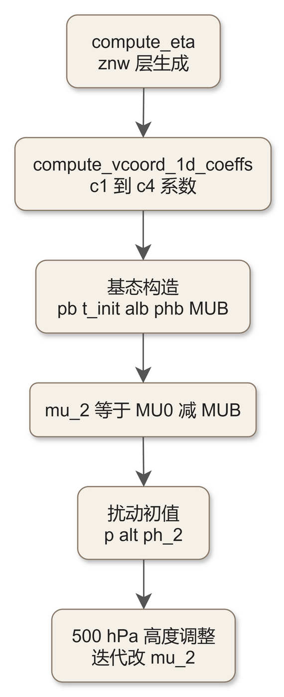
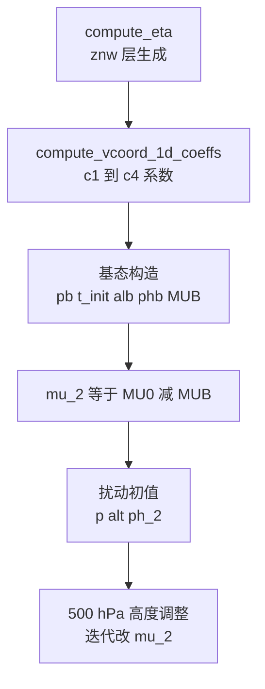

# code_40 — real 初始化的基态构造（dyn_em/module_initialize_real.F 选段：基态气压/温度/位势与 500 hPa 调整）

## 一、版本指纹

| 源文件 | 行数 | md5（整文件，按字节） |
|---|---|---|
| dyn_em/module_initialize_real.F | 9214 | f37acbd0b368169c6dc211519f57aa24 |

- 抽取工具：workspace/scripts/code_extract.py v1.2，2026-10-12；块首指纹注释自带 range_md5。
- 收录分级（B）：**只收基态构造段**（init_domain_rk 的 L1584–L1620 与 L3768–L4108 五段）——9214 行中的其余单元（vert_interp/lagrange 插值族、sfcprs 系、filter_topo 系等）不属基态主线，注记见 §五。教材锚点：[ch07_real_namelist.md](../ch07_real_namelist.md)（real 流程）、[ch10_vertical_coords_hydrostatics.md](../ch10_vertical_coords_hydrostatics.md)（基态公式）、[code_41_nest_init_utils.md](code_41_nest_init_utils.md)（znw/c1..c4 系数的生成）。

## 二、定位

一句话：**wrfinput 基态的出生地**——init_domain_rk（4891 行单体）里把 metgrid 场重整成 WRF 预报量的全套过程，本篇只取其中的静力基态构造：基态气压 pb/温度 t_init/比重容 alb/位势 phb、扰动 mu_2/p/ph_2 的初值，以及 500 hPa 高度对 MU_2 的迭代调整。

**谁在调它**：share/module_initialize（real.exe 的 init_modules）→ init_domain → init_domain_rk；rebalance（垂直嵌套反馈后重平衡）复用同一套公式。42 单元总表（42 units）不另列，分组见 §五。



<details><summary>原始 Mermaid 源码（可点击展开）</summary>

<!--

-->

</details>

## 三、调用点：znw 与 c1..c4 系数的生成

<!-- code_extract code_extract.py v1.2
source: dyn_em/module_initialize_real.F
ranges: L1584-L1620
file_lines: 9214
file_md5: f37acbd0b368169c6dc211519f57aa24
display: line-numbered (strip L-prefix and !file: line to restore)
range_md5: a0821012741fdd88b3ecbb8d41e16801
seg_lines: 37
-->

```fortran
!file: dyn_em/module_initialize_real.F    L1584-L1620
L01584              max_dz            = model_config_rec%max_dz
L01585              dzbot             = model_config_rec%dzbot
L01586              dzstretch_s       = model_config_rec%dzstretch_s
L01587              dzstretch_u       = model_config_rec%dzstretch_u
L01588              auto_levels_opt  = model_config_rec%auto_levels_opt
L01589  
L01590              CALL compute_eta ( grid%znw , auto_levels_opt, &
L01591                                 eta_levels , max_eta , max_dz , dzbot , dzstretch_s , dzstretch_u , &
L01592                                 grid%p_top , g , p00 , cvpm , a , r_d , cp , &
L01593                                 t00 , p1000mb , t0 , tiso , p_strat , a_strat , &
L01594                                 ids , ide , jds , jde , kds , kde , &
L01595                                 ims , ime , jms , jme , kms , kme , &
L01596                                 its , ite , jts , jte , kts , kte )
L01597           END IF
L01598  
L01599           !  For vertical coordinate, compute 1d arrays.
L01600  
L01601           CALL compute_vcoord_1d_coeffs ( grid%ht, grid%etac, grid%znw, &
L01602                                           config_flags%hybrid_opt, &
L01603                                           r_d, g, p1000mb, &
L01604                                           grid%p_top, grid%p00, grid%t00, grid%tlp, &
L01605                                           ids, ide, jds, jde, kds, kde, &
L01606                                           ims, ime, jms, jme, kms, kme, &
L01607                                           its, ite, jts, jte, kts, kte, &
L01608                                           grid%znu, &
L01609                                           grid%c1f, grid%c2f, grid%c3f, grid%c4f, &
L01610                                           grid%c1h, grid%c2h, grid%c3h, grid%c4h )
L01611  
L01612           IF ( config_flags%interp_theta ) THEN
L01613  
L01614              !  The input field is temperature, we want potential temp.
L01615  
L01616              CALL t_to_theta ( grid%t_gc , grid%p_gc , p00 , &
L01617                                ids , ide , jds , jde , 1   , num_metgrid_levels , &
L01618                                ims , ime , jms , jme , 1   , num_metgrid_levels , &
L01619                                its , ite , jts , jte , 1   , num_metgrid_levels )
L01620           END IF
```

> 讲解：①znw 的三种生成策略汇于 compute_eta 的 auto_levels_opt（namelist eta_levels 手工层 / auto_levels 等 Δz 生成，max_dz/dzbot/dzstretch_s/u 四参数控制——namelist 对应 &dynamics 的 auto_levels_opt 等）；②compute_vcoord_1d_coeffs（code_41）随即生成 znu 与 c1..c4 八个一维系数（hybrid_opt 四选）；③interp_theta 时 metgrid 输入的温度场先转位温（t_to_theta）；④注意入参 grid%tlp——namelist 的 t00/a 组合在 Registry 里的别名。

## 四、基态构造五段

<!-- code_extract code_extract.py v1.2
source: dyn_em/module_initialize_real.F
ranges: L3768-L3834
file_lines: 9214
file_md5: f37acbd0b368169c6dc211519f57aa24
display: line-numbered (strip L-prefix and !file: line to restore)
range_md5: 9f5aea6cff38c61656f73f416a60c849
seg_lines: 67
-->

```fortran
!file: dyn_em/module_initialize_real.F    L3768-L3834
L03768        !  Some of the many weird geopotential initializations that we'll see today: grid%ph0 is total,
L03769        !  and grid%ph_2 is a perturbation from the base state geopotential.  We set the base geopotential
L03770        !  at the lowest level to terrain elevation * gravity.
L03771  
L03772        DO j=jts,jte
L03773           DO i=its,ite
L03774              IF ( skip_middle_points_t ( ids , ide , jds , jde , i , j , em_width , hold_ups ) ) CYCLE
L03775              grid%ph0(i,1,j) = grid%ht(i,j) * g
L03776              grid%ph_2(i,1,j) = 0.
L03777           END DO
L03778        END DO
L03779  
L03780        !  Base state potential temperature and inverse density (alpha = 1/rho) from
L03781        !  the half eta levels and the base-profile surface pressure.  Compute 1/rho
L03782        !  from equation of state.  The potential temperature is a perturbation from t0.
L03783  
L03784        DO j = jts, MIN(jte,jde-1)
L03785           DO i = its, MIN(ite,ide-1)
L03786  
L03787              IF ( skip_middle_points_t ( ids , ide , jds , jde , i , j , em_width , hold_ups ) ) CYCLE
L03788      
L03789              !  Base state pressure is a function of eta level and terrain, only, plus
L03790              !  the hand full of constants: p00 (sea level pressure, Pa), t00 (sea level
L03791              !  temperature, K), and A (temperature difference, from 1000 mb to 300 mb, K).
L03792  
L03793              p_surf = p00 * EXP ( -t00/a + ( (t00/a)**2 - 2.*g*grid%ht(i,j)/a/r_d ) **0.5 )
L03794  
L03795  
L03796              DO k = 1, kte-1
L03797                 grid%php(i,k,j) = grid%c3f(k)*(p_surf - grid%p_top)+grid%c4f(k) + grid%p_top ! temporary, full lev base pressure
L03798                 grid%pb(i,k,j)  = grid%c3h(k)*(p_surf - grid%p_top)+grid%c4h(k) + grid%p_top
L03799                 temp = MAX ( tiso, t00 + A*LOG(grid%pb(i,k,j)/p00) )
L03800                 IF ( grid%pb(i,k,j) .LT. p_strat ) THEN
L03801                     temp = tiso + A_strat * LOG ( grid%pb(i,k,j)/p_strat )
L03802                 ENDIF
L03803  !              temp =             t00 + A*LOG(grid%pb(i,k,j)/p00)
L03804                 grid%t_init(i,k,j) = temp*(p00/grid%pb(i,k,j))**(r_d/cp) - t0
L03805                 grid%alb(i,k,j) = (r_d/p1000mb)*(grid%t_init(i,k,j)+t0)*(grid%pb(i,k,j)/p1000mb)**cvpm
L03806              END DO
L03807              grid%php(i,kte,j) = grid%p_top
L03808              !  Base state mu is defined as base state surface pressure minus grid%p_top
L03809              grid%MUB(i,j) = p_surf - grid%p_top
L03810              !  Dry surface pressure is defined as the following (this mu is from the input file
L03811              !  computed from the dry pressure).  Here the dry pressure is just reconstituted.
L03812              pd_surf = grid%MU0(i,j) + grid%p_top
L03813              !  Integrate base geopotential, starting at terrain elevation.  This assures that
L03814              !  the base state is in exact hydrostatic balance with respect to the model equations.
L03815              !  This field is on full levels.
L03816              grid%phb(i,1,j) = grid%ht(i,j) * g
L03817              IF (grid%hypsometric_opt == 1) THEN
L03818                 DO kk  = 2,kte
L03819                    k = kk-1
L03820                    grid%phb(i,kk,j) = grid%phb(i,kk-1,j) - grid%dnw(kk-1)*(grid%c1h(k)*grid%mub(i,j)+grid%c2h(k))*grid%alb(i,kk-1,j)
L03821                 END DO
L03822              ELSE IF (grid%hypsometric_opt == 2) THEN
L03823                 DO k = 2,kte
L03824                    pfu = grid%c3f(k  )*grid%MUB(i,j)+grid%c4f(k  ) + grid%p_top
L03825                    pfd = grid%c3f(k-1)*grid%MUB(i,j)+grid%c4f(k-1) + grid%p_top
L03826                    phm = grid%c3h(k-1)*grid%MUB(i,j)+grid%c4h(k-1) + grid%p_top
L03827                    grid%phb(i,k,j) = grid%phb(i,k-1,j) + grid%alb(i,k-1,j)*phm*LOG(pfd/pfu)
L03828                 END DO
L03829              ELSE
L03830                 CALL wrf_error_fatal( 'initialize_real: hypsometric_opt should be 1 or 2' )
L03831              END IF
L03832  
L03833           END DO
L03834        END DO
```

> 讲解：**基态三件套**（「many weird geopotential initializations…today」的自嘲注释开场）：①**地面气压的 hypsometric 反解**：p_surf=p00·exp(−t00/a+((t00/a)²−2g·ht/a/r_d)^0.5)——由常数对（p00 海平面气压、t00 海平面温度、a=1000→300 hPa 温差参数）与地形高度解析反解，无需迭代；②**基态气压剖面**：pb(k)=c3h(k)·(p_surf−p_top)+c4h(k)+p_top（混合坐标的 B(η) 加权，code_41 的 c3/c4 在此落地；php 是全层版临时量）；③**两段式基态温度**：对流层 temp=max(tiso, t00+A·ln(pb/p00))（对数递减、tiso 折返防负递减），**pb<p_strat 切平流层** temp=tiso+A_strat·ln(pb/p_strat)（等温起步的递减）——ch10 基态公式的出处；t_init=temp·(p00/pb)^(r_d/cp)−t0（扰动口径）、alb=(r_d/p1000mb)(t_init+t0)(pb/p1000mb)^cvpm（**cvpm=−cv/cp 口径的状态方程**，与 calc_p_rho_phi 静力分支同式）；④MUB=p_surf−p_top（基态干空气柱质量）；⑤phb 静水积分两式（hypsometric_opt=1 逐层 dnw·(c1h·MUB+c2h)·alb；=2 对数式——**与 calc_p_rho_phi 运行时完全同式**，注释自证「exact hydrostatic balance」）。

<!-- code_extract code_extract.py v1.2
source: dyn_em/module_initialize_real.F
ranges: L3879-L3902
file_lines: 9214
file_md5: f37acbd0b368169c6dc211519f57aa24
display: line-numbered (strip L-prefix and !file: line to restore)
range_md5: ea1ed36d124b0cb0703903eea26f8959
seg_lines: 24
-->

```fortran
!file: dyn_em/module_initialize_real.F    L3879-L3902
L03879        !  Compute the total column perturbation dry pressure (grid%mub + grid%mu_2 + ptop = dry grid%psfc).
L03880  
L03881        DO j = jts, min(jde-1,jte)
L03882           DO i = its, min(ide-1,ite)
L03883              IF ( skip_middle_points_t ( ids , ide , jds , jde , i , j , em_width , hold_ups ) ) CYCLE
L03884              grid%MU_2(i,j) = grid%MU0(i,j) - grid%MUB(i,j)
L03885           END DO
L03886        END DO
L03887  
L03888        !  Fill in the outer rows and columns to allow us to be sloppy.
L03889  
L03890        IF ( ite .EQ. ide ) THEN
L03891        i = ide
L03892        DO j = jts, MIN(jde-1,jte)
L03893           grid%MU_2(i,j) = grid%MU_2(i-1,j)
L03894        END DO
L03895        END IF
L03896  
L03897        IF ( jte .EQ. jde ) THEN
L03898        j = jde
L03899        DO i = its, ite
L03900           grid%MU_2(i,j) = grid%MU_2(i,j-1)
L03901        END DO
L03902        END IF
```

> 讲解：**MU_2=MU0−MUB**——总干空气柱（MU0 来自 metgrid 的干气压积分）减基态即初始扰动；边界列复制（「allow us to be sloppy」——外圈 slop 填充的祖传注释）。

<!-- code_extract code_extract.py v1.2
source: dyn_em/module_initialize_real.F
ranges: L3904-L3943
file_lines: 9214
file_md5: f37acbd0b368169c6dc211519f57aa24
display: line-numbered (strip L-prefix and !file: line to restore)
range_md5: e0c4d49ef345e46212fb804d9a912e82
seg_lines: 40
-->

```fortran
!file: dyn_em/module_initialize_real.F    L3904-L3943
L03904        lev500 = 0
L03905        DO j = jts, min(jde-1,jte)
L03906           DO i = its, min(ide-1,ite)
L03907              IF ( skip_middle_points_t ( ids , ide , jds , jde , i , j , em_width , hold_ups ) ) CYCLE
L03908  
L03909              !  Assign the potential temperature (perturbation from t0) and qv on all the mass
L03910              !  point locations.
L03911  
L03912              DO k =  1 , kde-1
L03913                 grid%t_2(i,k,j)          = grid%t_2(i,k,j) - t0
L03914              END DO
L03915  
L03916              dpmu = 10001.
L03917              loop_count = 0
L03918  
L03919              DO WHILE ( ( ABS(dpmu) .GT. 10. ) .AND. &
L03920                         ( loop_count .LT. 5 ) )
L03921  
L03922                 loop_count = loop_count + 1
L03923  
L03924                 !  Integrate the hydrostatic equation (from the RHS of the bigstep vertical momentum
L03925                 !  equation) down from the top to get the pressure perturbation.  First get the pressure
L03926                 !  perturbation, moisture, and inverse density (total and perturbation) at the top-most level.
L03927  
L03928                 kk = kte-1
L03929                 k = kk+1
L03930  
L03931                 qtot=0.
L03932                 DO im = PARAM_FIRST_SCALAR, num_3d_m
L03933                   qtot = qtot + moist(i,kk,j,im)
L03934                 ENDDO
L03935                 qvf2 = 1./(1.+qtot)
L03936                 qvf1 = qtot*qvf2
L03937  
L03938                 grid%p(i,kk,j) = - 0.5*((grid%c1f(k)*grid%Mu_2(i,j))+qvf1*(grid%c1f(k)*grid%Mub(i,j)+grid%c2f(k)))/grid%rdnw(kk)/qvf2
L03939                 qvf = 1. + rvovrd*moist(i,kk,j,P_QV)
L03940                 grid%alt(i,kk,j) = (r_d/p1000mb)*(grid%t_2(i,kk,j)+t0)*qvf&
L03941                                   *(((grid%p(i,kk,j)+grid%pb(i,kk,j))/p1000mb)**cvpm)
L03942                 grid%al(i,kk,j) = grid%alt(i,kk,j) - grid%alb(i,kk,j)
L03943                 grid%p_hyd(i,kk,j) = grid%p(i,kk,j) + grid%pb(i,kk,j)
```

> 讲解：扰动初值：t_2 逐点减 t0 转扰动口径；**顶层起算的扰动气压** p(i,kte−1)=−0.5(c1f·mu_2+qvf1·(c1f·Mub+c2f))/rdnw（qvf1=Σ水物质/(1+Σ)——与 calc_p_rho_phi 静力分支同式、水量份额版本），向下积分同款；alt 全量比重容由状态方程、al=alt−alb、p_hyd=p+pb 存档。

<!-- code_extract code_extract.py v1.2
source: dyn_em/module_initialize_real.F
ranges: L3964-L3992
file_lines: 9214
file_md5: f37acbd0b368169c6dc211519f57aa24
display: line-numbered (strip L-prefix and !file: line to restore)
range_md5: 852ecc61c7fa5683649329227665537a
seg_lines: 29
-->

```fortran
!file: dyn_em/module_initialize_real.F    L3964-L3992
L03964  #if 1
L03965                 !  This is the hydrostatic equation used in the model after the small timesteps.  In
L03966                 !  the model, grid%al (inverse density) is computed from the geopotential.
L03967  
L03968                 IF (grid%hypsometric_opt == 1) THEN
L03969                    DO kk  = 2,kte
L03970                       k = kk - 1
L03971                       grid%ph_2(i,kk,j) = grid%ph_2(i,kk-1,j) - &
L03972                                     grid%dnw(kk-1) * ( ((grid%c1h(k)*grid%mub(i,j)+grid%c2h(k))+(grid%c1h(k)*grid%mu_2(i,j)))*grid%al(i,kk-1,j) &
L03973                                   + (grid%c1h(k)*grid%mu_2(i,j))*grid%alb(i,kk-1,j) )
L03974                       grid%ph0(i,kk,j) = grid%ph_2(i,kk,j) + grid%phb(i,kk,j)
L03975                    END DO
L03976                 ELSE IF (grid%hypsometric_opt == 2) THEN
L03977                  ! Alternative hydrostatic eq.: dZ = -al*p*dLOG(p), where p is dry pressure.
L03978                  ! Note that al*p approximates Rd*T and dLOG(p) does z.
L03979                  ! Here T varies mostly linear with z, the first-order integration produces better result.
L03980  
L03981                    grid%ph_2(i,1,j) = grid%phb(i,1,j)
L03982                    DO k = 2,kte
L03983                       pfu = grid%c3f(k  )*grid%MU0(i,j)+grid%c4f(k  ) + grid%p_top
L03984                       pfd = grid%c3f(k-1)*grid%MU0(i,j)+grid%c4f(k-1) + grid%p_top
L03985                       phm = grid%c3h(k-1)*grid%MU0(i,j)+grid%c4h(k-1) + grid%p_top
L03986                       grid%ph_2(i,k,j) = grid%ph_2(i,k-1,j) + grid%alt(i,k-1,j)*phm*LOG(pfd/pfu)
L03987                    END DO
L03988  
L03989                    DO k = 1,kte
L03990                       grid%ph_2(i,k,j) = grid%ph_2(i,k,j) - grid%phb(i,k,j)
L03991                    END DO
L03992                 END IF
```

> 讲解：**ph_2 的静水重建双式**：hypsometric_opt=1 用模型运行时的逐层式（注意 (c1h·mub+c2h)+(c1h·mu_2) 的合并写法——总柱质量分解为基态+扰动）；=2 走 dZ=−al·p·dlnp 对数修订（注释：T 随 z 近线性、一阶积分更好），最后统一减 phb 转扰动口径。#if 0 段保留「直接用 WPS 三维高度场减 phb」的废弃路线。

<!-- code_extract code_extract.py v1.2
source: dyn_em/module_initialize_real.F
ranges: L4001-L4041
file_lines: 9214
file_md5: f37acbd0b368169c6dc211519f57aa24
display: line-numbered (strip L-prefix and !file: line to restore)
range_md5: 9d83179b0b4d6d9fc09d98a4b69264de
seg_lines: 41
-->

```fortran
!file: dyn_em/module_initialize_real.F    L4001-L4041
L04001                 !  Recompute density, simlar to what the model does.
L04002  
L04003                 IF (grid%hypsometric_opt == 1) THEN
L04004                 DO k=kts,kte-1
L04005                    grid%al(i,k,j)=-1./((grid%c1h(k)*grid%mub(i,j)+grid%c2h(k))+(grid%c1h(k)*grid%mu_2(i,j)))*(grid%alb(i,k,j)*(grid%c1h(k)*grid%mu_2(i,j))  &
L04006                                   +grid%rdnw(k)*(grid%ph_2(i,k+1,j)-grid%ph_2(i,k,j)))
L04007                 ENDDO
L04008                 ELSE IF (grid%hypsometric_opt == 2) THEN
L04009                 DO k=kts,kte-1
L04010                    pfu = grid%c3f(k+1)*(grid%MUB(i,j)+grid%MU_2(i,j))+grid%c4f(k+1)+grid%p_top
L04011                    pfd = grid%c3f(k  )*(grid%MUB(i,j)+grid%MU_2(i,j))+grid%c4f(k  )+grid%p_top
L04012                    phm = grid%c3h(k  )*(grid%MUB(i,j)+grid%MU_2(i,j))+grid%c4h(k  )+grid%p_top
L04013                    qvf=-1./((grid%c1h(k)*grid%mub(i,j)+grid%c2h(k))+(grid%c1h(k)*grid%mu_2(i,j)))*(grid%alb(i,k,j)*(grid%c1h(k)*grid%mu_2(i,j))  &
L04014                                   +grid%rdnw(k)*(grid%ph_2(i,k+1,j)-grid%ph_2(i,k,j)))
L04015                    grid%al(i,k,j) = (grid%ph_2(i,k+1,j)-grid%ph_2(i,k,j)+grid%phb(i,k+1,j)-grid%phb(i,k,j)) &
L04016                                      /phm/LOG(pfd/pfu)-grid%alb(i,k,j)
L04017  #if 0
L04018  if ( internal_time_loop .EQ. 1 ) THEN
L04019  if (i.eq.its .and. j.eq.its)then
L04020  if (k.eq.kts)then
L04021  print *,'                             k        old al          new al             alb            new alt           dz (m)        pres up          Pres mid        Pres down           c3 k           c3 k+1             c4 k            c4 k+1'
L04022  print *,' ======================================================================================================================================================================================================================================='
L04023  endif
L04024  print *,'                  ',k,qvf,grid%al(i,k,j),grid%alb(i,k,j),grid%al(i,k,j)+grid%alb(i,k,j),(grid%ph_2(i,k+1,j)-grid%ph_2(i,k,j)+grid%phb(i,k+1,j)-grid%phb(i,k,j)),pfu,phm,pfd,grid%c3f(k),grid%c3f(k+1),grid%c4f(k),grid%c4f(k+1)
L04025  endif
L04026  endif
L04027  #endif
L04028            
L04029                 ENDDO     
L04030                 END IF
L04031       
L04032                 !  Compute pressure similarly to how computed within model.
L04033  
L04034                 DO k=kts,kte-1
L04035                    qvf = 1.+rvovrd*moist(i,k,j,P_QV)
L04036                    grid%p(i,k,j)=p1000mb*( (r_d*(t0+grid%t_2(i,k,j))*qvf)/                     &
L04037                                 (p1000mb*(grid%al(i,k,j)+grid%alb(i,k,j))) )**cpovcv  &
L04038                                 -grid%pb(i,k,j)
L04039                    grid%p_hyd(i,k,j) = grid%p(i,k,j) + grid%pb(i,k,j)
L04040                    grid%alt(i,k,j) = grid%al(i,k,j) + grid%alb(i,k,j)
L04041                 ENDDO
```

> 讲解：**「Recompute density, similar to what the model does」**——al 不用状态方程值而由 ph_2 的几何差分反解（与 calc_p_rho_phi 非静力分支同式的 1/2 两版；opt=2 的 qvf 变量名复用是排版残留，式子正确），随后 p 再走一次状态方程（cpovcv 正口径）、p_hyd=p+pb、alt=al+alb——**保证初值与模式第一小步的算法逐位同源**（wrfinput 的 p/alt 与运行第一步诊断一致的关键）。#if 0 段是 TKW 调 opt=2 时的对账打印表。

<!-- code_extract code_extract.py v1.2
source: dyn_em/module_initialize_real.F
ranges: L4043-L4108
file_lines: 9214
file_md5: f37acbd0b368169c6dc211519f57aa24
display: line-numbered (strip L-prefix and !file: line to restore)
range_md5: 7238f2822721e5e367a8ae72598c6c81
seg_lines: 66
-->

```fortran
!file: dyn_em/module_initialize_real.F    L4043-L4108
L04043                 !  Adjust the column pressure so that the computed 500 mb height is close to the
L04044                 !  input value (of course, not when we are doing hybrid input).
L04045  
L04046                 IF ( ( flag_metgrid .EQ. 1 ) .AND. ( i .EQ. i_valid ) .AND. ( j .EQ. j_valid ) ) THEN
L04047                    DO k = 1 , num_metgrid_levels
L04048                       IF ( ABS ( grid%p_gc(i,k,j) - 50000. ) .LT. 1. ) THEN
L04049                          lev500 = k
L04050                          EXIT
L04051                       END IF
L04052                    END DO
L04053                 END IF
L04054  
L04055                 !  We only do the adjustment of height if we have the input data on pressure
L04056                 !  surfaces, and folks have asked to do this option.
L04057  
L04058                 IF ( ( flag_metgrid .EQ. 1 ) .AND. &
L04059                      ( flag_ptheta  .EQ. 0 ) .AND. &
L04060                      ( config_flags%adjust_heights ) .AND. &
L04061                      ( lev500 .NE. 0 ) ) THEN
L04062  
L04063                    DO k = 2 , kte-1
L04064  
L04065                       !  Get the pressures on the full eta levels (grid%php is defined above as
L04066                       !  the full-lev base pressure, an easy array to use for 3d space).
L04067  
L04068                       pl = grid%php(i,k  ,j) + &
L04069                            ( grid%p(i,k-1  ,j) * ( grid%znw(k    ) - grid%znu(k  ) ) + &
L04070                              grid%p(i,k    ,j) * ( grid%znu(k-1  ) - grid%znw(k  ) ) ) / &
L04071                            ( grid%znu(k-1  ) - grid%znu(k  ) )
L04072                       pu = grid%php(i,k+1,j) + &
L04073                            ( grid%p(i,k-1+1,j) * ( grid%znw(k  +1) - grid%znu(k+1) ) + &
L04074                              grid%p(i,k  +1,j) * ( grid%znu(k-1+1) - grid%znw(k+1) ) ) / &
L04075                            ( grid%znu(k-1+1) - grid%znu(k+1) )
L04076  
L04077                       !  If these pressure levels trap 500 mb, use them to interpolate
L04078                       !  to the 500 mb level of the computed height.
L04079  
L04080                       IF ( ( pl .GE. 50000. ) .AND. ( pu .LT. 50000. ) ) THEN
L04081                          zl = ( grid%ph_2(i,k  ,j) + grid%phb(i,k  ,j) ) / g
L04082                          zu = ( grid%ph_2(i,k+1,j) + grid%phb(i,k+1,j) ) / g
L04083  
L04084                          z500 = ( zl * ( LOG(50000.) - LOG(pu    ) ) + &
L04085                                   zu * ( LOG(pl    ) - LOG(50000.) ) ) / &
L04086                                 ( LOG(pl) - LOG(pu) )
L04087  !                       z500 = ( zl * (    (50000.) -    (pu    ) ) + &
L04088  !                                zu * (    (pl    ) -    (50000.) ) ) / &
L04089  !                              (    (pl) -    (pu) )
L04090  
L04091                          !  Compute the difference of the 500 mb heights (computed minus input), and
L04092                          !  then the change in grid%mu_2.  The grid%php is still full-levels, base pressure.
L04093  
L04094                          dz500 = z500 - grid%ght_gc(i,lev500,j)
L04095                          tvsfc = ((grid%t_2(i,1,j)+t0)*((grid%p(i,1,j)+grid%php(i,1,j))/p1000mb)**(r_d/cp)) * &
L04096                                  (1.+0.6*moist(i,1,j,P_QV))
L04097                          dpmu = ( grid%php(i,1,j) + grid%p(i,1,j) ) * EXP ( g * dz500 / ( r_d * tvsfc ) )
L04098                          dpmu = dpmu - ( grid%php(i,1,j) + grid%p(i,1,j) )
L04099                          grid%MU_2(i,j) = grid%MU_2(i,j) - dpmu
L04100                          EXIT
L04101                       END IF
L04102  
L04103                    END DO
L04104                 ELSE
L04105                    dpmu = 0.
L04106                 END IF
L04107  
L04108              END DO
```

> 讲解：**500 hPa 高度迭代**（DO WHILE |dpmu|>10 且 <5 次）：adjust_heights=true 且输入在气压面时，找 metgrid 的 500 hPa 层（lev500），把计算柱在 500 hPa 的高度 z500（**ln(p) 对数插值**，注释保留线性旧式）与输入 ght_gc 之差 dz500，经地面虚温的 hypsometric 式 dpmu=p_sfc·exp(g·dz500/(r_d·Tv))−p_sfc 反推 MU_2 增量并 EXIT 重算整柱——**让初始 500 hPa 高度场与 metgrid 一致**的经典调整（教材 ch07 的 adjust_heights 语义在此落地）。

## 五、未录单元注记（42 单元分组）

1. **插值族**：vert_interp（752 行）/lagrange_setup/lagrange_interp/cubic_spline/TRIDIAGONAL_LINEAR_EQ——metgrid 层到模式层的垂直插值兵器库。
2. **干气压与转换**：p_dry/p_dts/p_dhs/find_p_top/t_to_theta/theta_to_t——干气压积分与温位温互转。
3. **水物质**：integ_moist/rh_to_mxrat1/2——RH→混合比（两套饱和式）。
4. **层生成**：compute_eta（本文件自己的 328 行版，含 dzstretch 拉伸与 prac_levels=59 的「silly levels」顶高估算——code_41 的 nest 版是同源简化）/levels。
5. **月平均场**：monthly_min_max/monthly_avg/monthly_interp_to_date/eightday_selector——SST/植被等月场插值。
6. **地面气压诊断**：sfcprs/sfcprs2/sfcprs3——诊断 2 m/10 m 场的静水外推。
7. **地形滤波**：filter_topo/filter_topo_old——topo_wind/GWD 用的高通滤波。
8. **杂项**：dry_stratos（平流层除湿，调用处被注释）/snowHires/make_IceNumber/skip_middle_points_t（亚域跳点谓词）。

## 六、改造入口

1. **基态廓线**：t00/a/tiso/p_strat/a_strat 五常数（namelist &dynamics 的 real 系）——理想基态敏感性实验。
2. **混合坐标**：hybrid_opt/etac（code_41）——本篇的 pb/phb/alb 全部自动跟随。
3. **500 hPa 调整**：adjust_heights=false 关闭迭代；dpmu 容差 10 Pa/5 次上限。
4. **初值同源性**：改 calc_p_rho_phi 的状态方程时必须同步本篇五段（「similar to what the model does」的对账关系）。

## 七、上下游链接

- 系数生成：[code_41_nest_init_utils.md](code_41_nest_init_utils.md)；运行时同式：[code_30_module_big_step_utilities_em.md](code_30_module_big_step_utilities_em.md)（calc_p_rho_phi）
- 常数底座：[code_01_module_model_constants.md](code_01_module_model_constants.md)
- 教材正文：[ch07_real_namelist.md](../ch07_real_namelist.md)、[ch10_vertical_coords_hydrostatics.md](../ch10_vertical_coords_hydrostatics.md)
