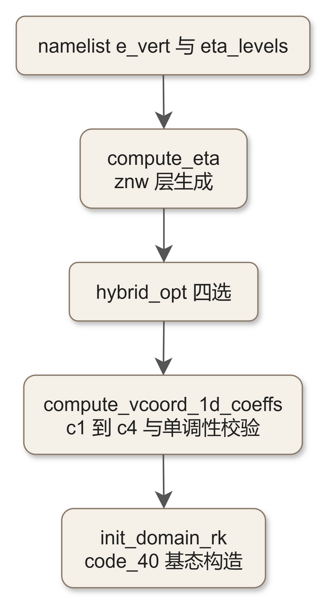
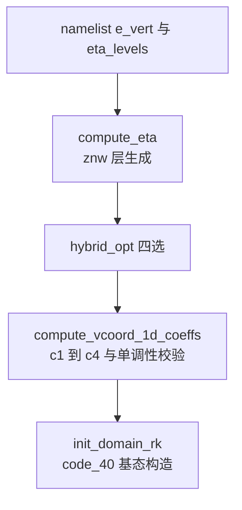

# code_41 — 垂直坐标系数生成（dyn_em/nest_init_utils.F：compute_eta 与 compute_vcoord_1d_coeffs）

## 一、版本指纹

| 源文件 | 行数 | md5（整文件，按字节） |
|---|---|---|
| dyn_em/nest_init_utils.F | 1184 | 89b5f314f5c278d518df21bfe8303d87 |

- 抽取工具：workspace/scripts/code_extract.py v1.2，2026-10-12；块首指纹注释自带 range_md5。
- 收录分级（B）：compute_vcoord_1d_coeffs 全段 + compute_eta 头段；其余 11 单元注记见 §五。教材锚点：[ch10_vertical_coords_hydrostatics.md](../ch10_vertical_coords_hydrostatics.md)（混合坐标公式）、[code_40_module_initialize_real.md](code_40_module_initialize_real.md)（消费方）。

## 二、定位

一句话：**垂直坐标的全部一维系数出生地**——znw（η 层面）由 compute_eta 生成（namelist 手工层或 auto_levels 等 Δz），compute_vcoord_1d_coeffs 随即按 hybrid_opt 四选生成混合坐标八系数 c1..c4（znu/c1f..c4f/c1h..c4h）并做参考气压单调性校验。

**谁在调它**：module_initialize_real 的 init_domain_rk（[code_40_module_initialize_real.md](code_40_module_initialize_real.md) §三调用点）与 nest 的垂直嵌套初始化（init_domain_vert_nesting）；rebalance 也走同款。

**13 单元表**：init_domain_constants_em（L4–133）/init_domain_vert_nesting（L138–180）/vert_cor_vertical_nesting_integer（L187–267）/vert_cor_vertical_nesting_arbitrary（L271–427）/**compute_eta（L429–708）**/blend_terrain（L712–785）/copy_3d_field（L787–810）/adjust_tempqv（L812–890）/input_terrain_rsmas（L892–975）/update_after_feedback_em（L977–1031）/**compute_vcoord_1d_coeffs（L1033–1184）**。



<details><summary>原始 Mermaid 源码（可点击展开）</summary>

<!--

-->

</details>

## 三、compute_vcoord_1d_coeffs（全文）

<!-- code_extract code_extract.py v1.2
source: dyn_em/nest_init_utils.F
ranges: L1033-L1184
file_lines: 1184
file_md5: 89b5f314f5c278d518df21bfe8303d87
display: line-numbered (strip L-prefix and !file: line to restore)
range_md5: f0de592dc2adc3593dbf533036c4f47d
seg_lines: 152
-->

```fortran
!file: dyn_em/nest_init_utils.F    L1033-L1184
L01033  SUBROUTINE compute_vcoord_1d_coeffs ( ht, etac, znw, &
L01034                                        hybrid_opt, &
L01035                                        r_d, g, p1000mb, &
L01036                                        p_top, p00, t00, a, &
L01037                                        ids, ide, jds, jde, kds, kde, &
L01038                                        ims, ime, jms, jme, kms, kme, &
L01039                                        its, ite, jts, jte, kts, kte, &
L01040                                        znu, &
L01041                                        c1f, c2f, c3f, c4f, &
L01042                                        c1h, c2h, c3h, c4h )
L01043  
L01044     IMPLICIT NONE
L01045  
L01046     !  Input 
L01047  
L01048     INTEGER ,                      INTENT(IN ) :: hybrid_opt
L01049     REAL    ,                      INTENT(IN ) :: etac
L01050     REAL    ,                      INTENT(IN ) :: r_d, g, p1000mb, p_top, p00, t00, a
L01051     INTEGER ,                      INTENT(IN ) :: ids, ide, jds, jde, kds, kde, &
L01052                                                   ims, ime, jms, jme, kms, kme, &
L01053                                                   its, ite, jts, jte, kts, kte
L01054     REAL    , DIMENSION(kms:kme) ,           INTENT(IN ) :: znw
L01055     REAL    , DIMENSION(ims:ime , jms:jme) , INTENT(IN ) :: ht
L01056  
L01057     !  Output
L01058  
L01059     REAL    , DIMENSION(kms:kme) , INTENT(OUT) :: znu
L01060     REAL    , DIMENSION(kms:kme) , INTENT(OUT) :: c1f, c2f, c3f, c4f, &
L01061                                                   c1h, c2h, c3h, c4h
L01062  
L01063     !  Local vars
L01064  
L01065     INTEGER :: i, j, k
L01066     REAL    :: B1, B2, B3, B4, B5
L01067     REAL    :: p_surf, press_above, press_below
L01068     CHARACTER (LEN=256) :: a_message
L01069  
L01070     DO k=kts, kte
L01071        IF      ( hybrid_opt .EQ. 0 ) THEN
L01072           c3f(k) = znw(k)
L01073        ELSE IF ( hybrid_opt .EQ. 1 ) THEN
L01074           c3f(k) = znw(k)
L01075        ELSE IF ( hybrid_opt .EQ. 2 ) THEN
L01076           B1 = 2. * etac**2 * ( 1. - etac )
L01077           B2 = -etac * ( 4. - 3. * etac - etac**3 )
L01078           B3 = 2. * ( 1. - etac**3 )
L01079           B4 = - ( 1. - etac**2 )
L01080           B5 = (1.-etac)**4
L01081           c3f(k) = ( B1 + B2*znw(k) + B3*znw(k)**2 + B4*znw(k)**3 ) / B5
L01082           IF ( znw(k) .LT. etac ) THEN
L01083              c3f(k) = 0.
L01084           END IF
L01085           IF ( k .EQ. kds ) THEN
L01086              c3f(k) = 1.
L01087           ELSE IF ( k .EQ. kde ) THEN
L01088              c3f(k) = 0.
L01089           END IF
L01090        ELSE IF ( hybrid_opt .EQ. 3 ) THEN
L01091           c3f(k) = znw(k)*sin(0.5*3.14159*znw(k))**2
L01092           IF      ( k .EQ. kds ) THEN
L01093              c3f(k) = 1.
L01094           ELSE IF ( k .EQ. kde ) THEN
L01095              c3f(kde) = 0.
L01096           END IF
L01097        ELSE
L01098           CALL wrf_message     ( 'ERROR: --- hybrid_opt' )
L01099           CALL wrf_message     ( 'ERROR: --- hybrid_opt=0    ==> Standard WRF terrain-following coordinate' )
L01100           CALL wrf_message     ( 'ERROR: --- hybrid_opt=1    ==> Standard WRF terrain-following coordinate, hybrid c1, c2, c3, c4' )
L01101           CALL wrf_message     ( 'ERROR: --- hybrid_opt=2    ==> Hybrid, Klemp polynomial' )
L01102           CALL wrf_message     ( 'ERROR: --- hybrid_opt=3    ==> Hybrid, sin^2' )
L01103           CALL wrf_error_fatal ( 'ERROR: --- Invalid option' )
L01104        END IF
L01105     END DO
L01106  
L01107     !  c4 is a function of c3 and eta.
L01108  
L01109     DO k=1, kde
L01110        c4f(k) = ( znw(k) - c3f(k) ) * ( p1000mb - p_top )
L01111     ENDDO
L01112  
L01113     !  Now on half levels, just add up and divide by 2 (for c3h).  Use (eta-c3)*(p00-pt) for c4 on half levels.
L01114  
L01115     DO k=1, kde-1
L01116        znu(k) = ( znw(k+1) + znw(k) ) * 0.5
L01117        c3h(k) = ( c3f(k+1) + c3f(k) ) * 0.5
L01118        c4h(k) = ( znu(k) - c3h(k) ) * ( p1000mb - p_top )
L01119     ENDDO
L01120  
L01121     !  c1 = d(B)/d(eta).  We define c1f as c1 on FULL levels.  For a vertical difference,
L01122     !  we need to use B and eta on half levels.  The k-loop ends up referring to the
L01123     !  full levels, neglecting the top and bottom.
L01124  
L01125     DO k=kds+1, kde-1
L01126        c1f(k) = ( c3h(k) - c3h(k-1) ) / ( znu(k) - znu(k-1) )
L01127     ENDDO
L01128  
L01129     !  The boundary conditions to get the coefficients:
L01130     !  1) At k=kts: define d(B)/d(eta) = 1.  This gives us the same value of B and d(B)/d(eta)
L01131     !     when doing the sigma-only B=eta.
L01132     !  2) At k=kte: define d(B)/d(eta) = 0.  The curve B SMOOTHLY goes to zero, and at the very
L01133     !     top, B continues to SMOOTHLY go to zero.  Note that for almost all cases of non B=eta,
L01134     !     B is ALREADY=ZERO at the top, so this is a reasonable BC to assume.
L01135  
L01136     c1f(kds) = 1.
L01137     IF ( ( hybrid_opt .EQ. 0 ) .OR. ( hybrid_opt .EQ. 1 ) ) THEN
L01138        c1f(kde) = 1.
L01139     ELSE
L01140        c1f(kde) = 0.
L01141     END IF
L01142  
L01143     !  c2 = ( 1. - c1(k) ) * (p00 - pt).  There is no vertical differencing, so we can do the
L01144     !  full kds to kde looping.
L01145  
L01146     DO k=kds, kde
L01147        c2f(k) = ( 1. - c1f(k) ) * ( p1000mb - p_top )
L01148     ENDDO
L01149  
L01150     !  Now on half levels for c1 and c2.  The c1h will result from the full level c3 and full
L01151     !  level eta differences.  The c2 value use the half level c1(k).
L01152  
L01153     DO k=1, kde-1
L01154        c1h(k) = ( c3f(k+1) - c3f(k) ) / ( znw(k+1) - znw(k) )
L01155        c2h(k) = ( 1. - c1h(k) ) * ( p1000mb - p_top )
L01156     ENDDO
L01157  
L01158     !  With c3 and c4 on full levels, we can verify that we are maintaining monotonically
L01159     !  decreasing reference pressure.
L01160     !  P_dry_ref(k)  = c3f(k) * ( psurf - p_top ) + c4f(k) + p_top
L01161  
L01162     DO j = jts, MIN(jde-1,jte)
L01163        DO i = its, MIN(ide-1,ite)
L01164           p_surf = p00 * EXP ( -t00/a + ( (t00/a)**2 - 2.*g*ht(i,j)/a/r_d ) **0.5 )
L01165           DO k=1, kde-1
L01166              press_above = c3f(k+1)*(p_surf-p_top) + c4f(k+1) + p_top
L01167              press_below = c3f(k  )*(p_surf-p_top) + c4f(k  ) + p_top
L01168              IF ( press_below - press_above .LE. 0.0 ) THEN
L01169                 CALL wrf_message ( '----- ERROR: The reference pressure is not monotonically decreasing' )
L01170                 CALL wrf_message ( '             This tends to be caused by very high topography')
L01171                 WRITE (a_message,*) '(i,j) = ',i,j,', topography = ',ht(i,j),' m'
L01172                 CALL wrf_message ( TRIM(a_message) )
L01173                 WRITE (a_message,*) 'k = ',k,', reference pressure = ',press_below,' Pa'
L01174                 CALL wrf_message ( TRIM(a_message) )
L01175                 WRITE (a_message,*) 'k = ',k+1,', reference pressure = ',press_above,' Pa'
L01176                 CALL wrf_message ( TRIM(a_message) )
L01177                 WRITE (a_message,*) 'In the dynamics namelist record, reduce etac from ',etac
L01178                 CALL wrf_error_fatal ( TRIM(a_message) )
L01179              END IF
L01180           ENDDO
L01181        ENDDO
L01182     ENDDO
L01183                                        
L01184  END SUBROUTINE compute_vcoord_1d_coeffs
```

> 讲解：混合坐标 B(η) 与四系数：①**hybrid_opt 四选**——0/1 标准地形追随坐标（c3f=znw，即 B=σ；1 只是用 c1..c4 通路实现）、**2 Klemp 多项式**：c3f=(B1+B2·η+B3·η²+B4·η³)/B5，五个系数只依赖 etac（B1=2ηc²(1−ηc)、B2=−ηc(4−3ηc−ηc³)、B3=2(1−ηc³)、B4=−(1−ηc²)、B5=(1−ηc)⁴），η<etac 时 c3f=0（纯等压面），边界处强制 c3f(kds)=1/c3f(kde)=0；**3 sin² 型**：c3f=η·sin²(π·η/2)——Klems 式之外的备选混合函数；②c4f=(η−c3)·(p00−pt)——**扰动气压=η 份额与 B 份额的组合**：p_dry=c3·(p_surf−pt)+c4+pt 的两系数分解（c3 权重地形气压、c4 补偿项）；③znu 半层 eta、c3h/c4h 半层平均；④**c1=dB/dη 用半层差分**（注释解释为什么用 B 与 η 的半层差而不是解析导数），边界条件：kds 处 c1f=1（与纯 σ 完全衔接）、kde 处非混合为 1、混合为 0（B 平滑归零）；c2f=(1−c1f)·(p00−pt)；c1h/c2h 半层版；⑤**单调性校验**（逐列！）：参考气压 P_dry_ref(k)=c3f(k)(p_surf−pt)+c4f(k)+pt 必须逐层递减，p_surf 由 hypsometric 反解（与 code_40 同式），否则 **wrf_error_fatal「reduce etac」并打印地形高度与两层气压**——高地形 + etac 过大时 real 报错的经典出处（兰州个例 3 km 域遇过），解法就是降 etac 或加层。

## 四、compute_eta（头段）

<!-- code_extract code_extract.py v1.2
source: dyn_em/nest_init_utils.F
ranges: L429-L563
file_lines: 1184
file_md5: 89b5f314f5c278d518df21bfe8303d87
display: line-numbered (strip L-prefix and !file: line to restore)
range_md5: 7196b18d200bd020e74a94d4e067557f
seg_lines: 135
-->

```fortran
!file: dyn_em/nest_init_utils.F    L429-L563
L00429  SUBROUTINE compute_eta ( znw , &
L00430                           eta_levels , max_eta , max_dz ,        &
L00431                           p_top_def , g_def , p00_def ,          &
L00432                           cvpm_def , a_def , r_d_def , cp_def ,  &
L00433                           t00_def , p1000mb_def , t0_def ,       &
L00434                           tiso_def , p_strat_def , a_strat_def , &
L00435                           ids , ide , jds , jde , kds , kde ,    &
L00436                           ims , ime , jms , jme , kms , kme ,    &
L00437                           its , ite , jts , jte , kts , kte )
L00438  
L00439        !  Compute eta levels, either using given values from the namelist (hardly
L00440        !  a computation, yep, I know), or assuming a constant dz above the PBL,
L00441        !  knowing p_top and the number of eta levels.
L00442  
L00443        IMPLICIT NONE
L00444  
L00445        INTEGER , INTENT(IN)        :: ids , ide , jds , jde , kds , kde , &
L00446                                       ims , ime , jms , jme , kms , kme , &
L00447                                       its , ite , jts , jte , kts , kte
L00448        REAL , INTENT(IN)           :: max_dz
L00449        REAL , INTENT(IN)           :: p_top_def , g_def , p00_def , cvpm_def , &
L00450                                       a_def , r_d_def , cp_def , t00_def ,     &
L00451                                       p1000mb_def , t0_def , tiso_def ,        &
L00452                                       p_strat_def , a_strat_def
L00453        INTEGER , INTENT(IN)        :: max_eta
L00454        REAL , DIMENSION (max_eta)  :: eta_levels
L00455  
L00456        REAL , DIMENSION (kts:kte) , INTENT(OUT) :: znw
L00457  
L00458        !  Local vars
L00459  
L00460        INTEGER :: k , kk
L00461        REAL(KIND=8) :: mub , t_init , p_surf , pb, ztop, ztop_pbl , dz , temp
L00462        REAL(KIND=8) , DIMENSION(kts:kte) :: dnw
L00463        REAL(KIND=8) :: p_top , g , p00 , cvpm , &
L00464                        a , r_d , cp , t00 ,     &
L00465                        p1000mb , t0 , tiso ,        &
L00466                        p_strat , a_strat
L00467  
L00468        INTEGER , PARAMETER :: prac_levels = 59
L00469        INTEGER :: loop , loop1
L00470        REAL(KIND=8) , DIMENSION(prac_levels) :: znw_prac , znu_prac , dnw_prac
L00471        REAL(KIND=8) , DIMENSION(MAX(prac_levels,kde)) :: alb , phb
L00472        REAL(KIND=8) :: alb_max, t_init_max, pb_max, phb_max
L00473  
L00474        CHARACTER(LEN=256) :: message
L00475  
L00476        !  Compute top of the atmosphere with some silly levels.  We just want to
L00477        !  integrate to get a reasonable value for ztop.  We use the planned
L00478        !  PBL-esque
L00479        !  levels, and then just coarse resolution above that.  We know p_top,
L00480        !  and we
L00481        !  have the base state vars.
L00482  
L00483        p_top   = p_top_def
L00484        g       = g_def
L00485        p00     = p00_def
L00486        cvpm    = cvpm_def
L00487        a       = a_def
L00488        r_d     = r_d_def
L00489        cp      = cp_def
L00490        t00     = t00_def
L00491        p1000mb = p1000mb_def
L00492        t0      = t0_def
L00493        tiso    = tiso_def
L00494        p_strat = p_strat_def
L00495        a_strat = a_strat_def
L00496  
L00497        p_surf = p00
L00498  
L00499        znw_prac = (/ 1.0000_8 , 0.9930_8 , 0.9830_8 , 0.9700_8 , 0.9540_8 , 0.9340_8 , 0.9090_8 , 0.8800_8 , &
L00500                      0.8500_8 , 0.8000_8 , 0.7500_8 , 0.7000_8 , 0.6500_8 , 0.6000_8 , 0.5500_8 , 0.5000_8 , &
L00501                      0.4500_8 , 0.4000_8 , 0.3500_8 , 0.3000_8 , 0.2500_8 , 0.2000_8 , 0.1500_8 , 0.1000_8 , &
L00502                      0.0800_8 , 0.0600_8 , 0.0400_8 , 0.0200_8 , &
L00503                      0.0150_8 , 0.0100_8 , 0.0090_8 , 0.0080_8 , 0.0070_8 , 0.0060_8 , 0.0050_8 , 0.0040_8 , &
L00504                      0.0035_8 , 0.0030_8 , &
L00505                      0.0028_8 , 0.0026_8 , 0.0024_8 , 0.0022_8 , 0.0020_8 , &
L00506                      0.0018_8 , 0.0016_8 , 0.0014_8 , 0.0012_8 , 0.0010_8 , &
L00507                      0.0009_8 , 0.0008_8 , 0.0007_8 , 0.0006_8 , 0.0005_8 , 0.0004_8 , 0.0003_8 , &
L00508                      0.0002_8 , 0.0001_8 , 0.00005_8, 0.0000_8 /)
L00509  
L00510        DO k = 1 , prac_levels - 1
L00511          znu_prac(k) = ( znw_prac(k) + znw_prac(k+1) ) * 0.5_8
L00512          dnw_prac(k) = znw_prac(k+1) - znw_prac(k)
L00513        END DO
L00514  
L00515        DO k = 1, prac_levels-1
L00516          pb = znu_prac(k)*(p_surf - p_top) + p_top
L00517          temp = MAX ( tiso, t00 + A*LOG(pb/p00) )
L00518          IF ( pb .LT. p_strat ) THEN
L00519            temp = tiso + A_strat*LOG(pb/p_strat)
L00520          END IF
L00521          t_init = temp*(p00/pb)**(r_d/cp) - t0
L00522          alb(k) = (r_d/p1000mb)*(t_init+t0)*(pb/p1000mb)**cvpm
L00523        END DO
L00524  
L00525        !  Base state mu is defined as base state surface pressure minus p_top
L00526  
L00527        mub = p_surf - p_top
L00528  
L00529        !  Integrate base geopotential, starting at terrain elevation.
L00530  
L00531        phb(1) = 0._8
L00532        DO k  = 2,prac_levels
L00533          phb(k) = phb(k-1) - dnw_prac(k-1)*mub*alb(k-1)
L00534        END DO
L00535  
L00536        !  So, now we know the model top in meters.  Get the average depth above the PBL
L00537        !  of each of the remaining levels.  We are going for a constant delta z thickness.
L00538  
L00539        ztop     = phb(prac_levels) / g
L00540        ztop_pbl = phb(8          ) / g
L00541        dz = ( ztop - ztop_pbl ) / REAL ( kde - 8 )
L00542  
L00543        IF ( dz .GE. max_dz ) THEN
L00544          WRITE (message,FMT='("With a requested ",F7.1," Pa model top, the model lid will be about ",F7.1," m.")') p_top, ztop
L00545          CALL wrf_message ( message )
L00546          WRITE (message,FMT='("With ",I3," levels above the PBL, the level thickness will be about ",F6.1," m.")') kde-8, dz
L00547          CALL wrf_message ( message )
L00548          WRITE (message,FMT='("Thicknesses greater than ",F7.1," m are not recommended.")') max_dz
L00549          CALL wrf_message ( message )
L00550          CALL wrf_error_fatal ( 'Add more levels to namelist.input for e_vert' )
L00551        END IF
L00552  
L00553        !  Standard levels near the surface so no one gets in trouble.
L00554  
L00555        DO k = 1 , 8
L00556          eta_levels(k) = znw_prac(k)
L00557        END DO
L00558  
L00559        !  Using d phb(k)/ d eta(k) = -mub * alb(k), eqn 2.9
L00560        !  Skamarock et al, NCAR TN 468.  Use full levels, so
L00561        !  use twice the thickness.
L00562  
L00563        DO k = 8, kte-1-2
```

> 讲解：znw 层面的三条生成路线之 auto_levels 分支的前半：①**prac_levels=59 个「silly levels」**——一套固定精细 η 层（近地面 8 层 1.0→0.88、对流层 0.85→0.02、平流层 0.015→0.00005），用「planned PBL-esque levels + coarse above」积分出模型顶高 ztop——注释自嘲「silly levels, yep, I know」；②基态温度廓线两段式（temp=max(tiso, t00+A·ln(pb/p00))、pb<p_strat 时 tiso+A_strat·ln(pb/p_strat)）——与 code_40 的基态同式；③mub=p_surf−p_top、phb 向上积分（dφ/dη=−mub·al，**注释引用 Skamarock et al. NCAR TN 468 式 2.9**——技术备忘录的正式出处）；④ztop=phb(59)/g、ztop_pbl=phb(8)/g（前 8 层视为 PBL 段），**dz=(ztop−ztop_pbl)/(kde−8)**——PBL 之上等厚分层；⑤**dz≥max_dz 时 FATAL「Add more levels to namelist.input for e_vert」**并打印模型顶高与层厚——e_vert 太少的经典报错出处（max_dz namelist 默认约 1100 m）；⑥前 8 层直接抄 znw_prac（「Standard levels near the surface so no one gets in trouble」）；后半（未录）是 dzstretch_s/u 的拉伸变体与 eta_levels 手工路径。

## 五、未录单元注记

1. **init_domain_constants_em（L4–133）**：map/lat-lon 等 2D 常数场的嵌套初始化框架。
2. **vert_cor_vertical_nesting_integer/arbitrary（两套，L150–427）**：嵌套域垂直层对齐（整数比与任意比两种映射——垂直嵌套的 eta 对齐策略；文件里同名子程序出现两次是嵌套两个调用语境）。
3. **blend_terrain（L712–785）**：嵌套边界带的地形平滑混合——feedback 后地形突变的缝合。
4. **adjust_tempqv（L812–890）**：嵌套后温湿的保守调整。
5. **input_terrain_rsmas（L892–975）**：RSMAS 高分辨率地形数据的读取。
6. **update_after_feedback_em（L977–1031）**：反馈后父域向子域的状态同步。

## 六、改造入口

1. **混合函数**：hybrid_opt=2 的五系数（etac 唯一形状参数）与 =3 sin² 型——加第四种混合函数（如 SKYHI 型）的挂点；单调性校验自动护航。
2. **层结构**：auto_levels 的 max_dz/dzbot/dzstretch_s/u——垂直分辨率设计（e_vert 配套）的解析生成。
3. **垂直嵌套对齐**：vert_cor 两套映射——e_vert 不同的父子域层对齐策略改造。

## 七、上下游链接

- 消费方：[code_40_module_initialize_real.md](code_40_module_initialize_real.md)（基态构造）、[code_30_module_big_step_utilities_em.md](code_30_module_big_step_utilities_em.md)（c1..c4 进状态方程）
- 常数底座：[code_01_module_model_constants.md](code_01_module_model_constants.md)
- 教材正文：[ch10_vertical_coords_hydrostatics.md](../ch10_vertical_coords_hydrostatics.md)、[ch07_real_namelist.md](../ch07_real_namelist.md)
