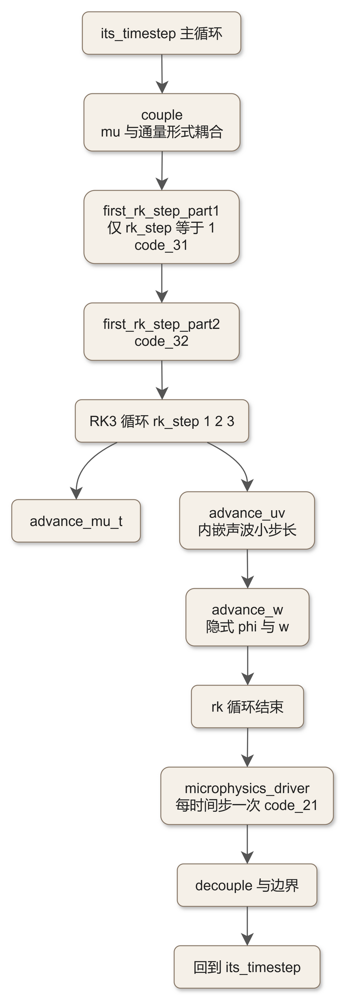
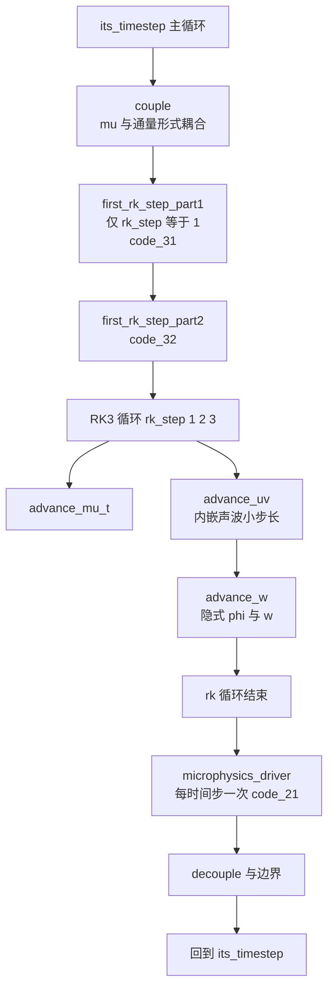

# code_50 — solve_em 主循环导航页（dyn_em/solve_em.F：十四站的地图与调用点索引）

## 一、版本指纹

| 源文件 | 行数 | md5（整文件，按字节） |
|---|---|---|
| dyn_em/solve_em.F | 5197 | 9bb6a4d80dcce68a3ec90598b49f5a27 |

- 本篇为 **C 级导航页**：不给代码块（十四站的逐行走读由教材承载，见 [ch21_solve_em_dynamics.md](../ch21_solve_em_dynamics.md)），只给主循环地图与**调用点行号索引**——按行号跳读 solve_em 用。

## 二、定位

一句话：ARW 动力核的总调度——单子程序 solve_em（约 5100 行）包一个 its_timestep 主循环：耦合/清账 → first_rk_step_part1/part2（仅 rk_step=1）→ RK3 三步（每步内嵌声波小步长循环）→ **RK 循环结束后调微物理**（每时间步一次）→ 解耦与边界。本页与文库各篇的接口：地图上的每个节点都有对应文库篇。

## 三、主循环地图

原始 Mermaid 源码（可点击展开）

<!--

-->

## 四、调用点行号索引（4.8.0 实测）

| 行号 | 调用 | 文库/教材锚点 |
|---|---|---|
| L812 | CALL first_rk_step_part1 | [code_31](code_31_module_first_rk_step_part1.md) |
| L850 | CALL first_rk_step_part2 | [code_32](code_32_module_first_rk_step_part2.md) |
| L1284 | CALL advance_uv | ch21 站位（水平动量平流） |
| L1397 | CALL advance_mu_t | ch21（μ 与 θ 大步平流） |
| L1504 | CALL advance_w | ch21（w-φ 垂直隐式解） |
| L3881 | CALL microphysics_driver | [code_21](code_21_module_microphysics_driver.md) |

> 讲解：六个锚点把两大总装件（part1/part2）与动力三巨头（mu_t/uv/w）和微物理钉在行号上；声波小步长的 advance_w 循环嵌在 advance_uv 与 advance_w 之间（RK 每步内 DO 小步）；**微物理在 RK 循环之后**——教材 ch13/ch21 的「微物理每时间步一次」判断的行号依据。其余站（Coriolis/diffusion/六阶扩散/Rayleigh 阻尼等）的调用位置随 config_flags 分派散布于 RK 循环内，明细见 ch21 的十四站表。

## 五、与文库各篇的对照

| solve_em 位置 | 内容 | 文库篇 |
|---|---|---|
| L812/L850 | 物理总装两件 | code_31/32 |
| RK 循环内 | phy_prep/状态方程/rhs_ph/Coriolis/diffusion 工具 | code_30 |
| L3881 | 微物理分发 | code_21（方案本体 code_07a/07b） |
| 边界与耦合 | couple/decouple/w_damp | code_30 §七注记 |
| 常数 | 全部 USE 自 | code_01 |
| 基态初值来源 | wrfinput（real 生成） | code_40/41 |

## 六、上下游链接

- 上游：main/wrf.F → module_integrate（时间循环）→ solve_em；下游：本页地图所列各篇
- 教材正文：[ch21_solve_em_dynamics.md](../ch21_solve_em_dynamics.md)（十四站逐行走读——本页不重复）
