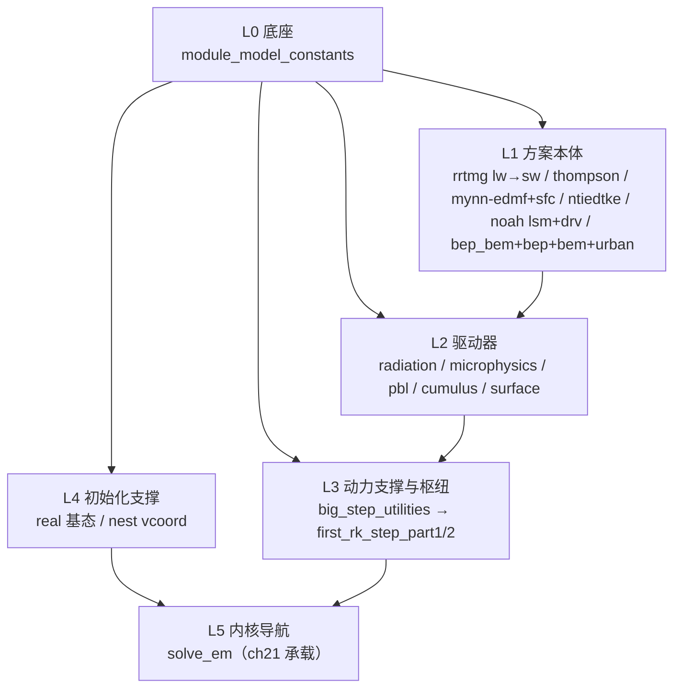

# 《WRF 源码精读》配套文库·建设方案 v1

> **状态**：方案已获用户批准（2026-10-12），本文为落盘底稿；批 1 试点待用户令启动。
> **版本锁定**：WRF 4.8.0（`source/WRFv4.8.0/WRFV4.8.0/`，与教材一致）；文库代码块一律脚本抽取保真并附 md5 指纹。
> **依赖实测**：2026-10-12 对 4.8.0 源码 use 语句普查（Explore agent），事实见 §三。

## 一、定位：与教材的硬切

| | 教材（doc\chNN） | 源码精读文库（doc\code） |
|---|---|---|
| 回答 | 为什么这样写、物理对应、方案脉络 | 这段代码在做什么、每个变量是谁、完整上下文 |
| 形态 | 节选 + 导读 | **完整源码（保真）+ 行段中文讲解** |
| 读法 | 顺序阅读 | 按需查阅、独立可读 |
| 重复度红线 | — | 不复述教材已讲结论；书公式对应只给指针（“书 (6.8.14) → 见 ch14 §14.8”式） |

- 版权：WRF 为 public domain（NCAR/美国政府作品），可自由转载注释，篇首注明版本。
- 价值：补“真动手改造时缺完整源码上下文”的缺口；与教材双向导航（教材“延伸阅读”→ 文库；文库每篇 → 教材 §）。

## 二、目录、命名与编号

- 位置：`doc/code/`（与教材平铺文件隔离）。
- 文件名：`code_NN_<模块名>.md`，NN = 依赖拓扑序号（两位）；总纲 `code_00_README.md`。
- A 级全文超过约 5000 行的拆 `_a`/`_b` 两文件（上半/下半），编号同段（如 code_09a、code_09b）。
- 编号段（层间留位，可扩展）：

| 段 | 层 | 内容 |
|---|---|---|
| 00 | — | README 总纲与双轨阅读顺序（依赖序 / 教材章序） |
| 01–04 | L0 底座 | share 常数层 |
| 05–19 | L1 方案本体 | 物理方案叶子模块（无相互依赖时按教材章序 ch12→ch17） |
| 20–29 | L2 驱动器 | 五大 physics driver |
| 30–39 | L3 动力支撑与调用枢纽 | big_step_utilities → first_rk_step_part1/2 |
| 40–49 | L4 初始化与框架支撑 | real 基态、混合坐标 |
| 50–59 | L5 内核导航 | solve_em.F 导航页（正文精读在 ch21，不重复） |
| 60–99 | C 段外围 | 头部 + 接口索引（批 6 可增补） |

## 三、排序原则：依赖拓扑序（用户要求，实测支撑）

- **原则**：①被依赖者在前（拓扑序）——读一篇时它用到的下层概念已读过；②同层无相互依赖时按教材章序排；③每篇开头仍给一行“谁在调它”，需要上层视角时跳读。
- **分层依赖图**：

- **实测依赖摘要**（关键行）：

| 文件 | 行数 | USE 依赖要点 |
|---|---|---|
| share/module_model_constants.F | 159 | 0 依赖（天然 01 号） |
| phys/module_mp_thompson.F | 6192 | 仅 6 项：MODEL_CONSTANTS/MP_RADAR/DM/TIMING/DOMAIN/WRF_ERROR |
| phys/MYNN-EDMF/module_bl_mynnedmf.F90 | 8776 | MYNN 编译实体（无 module_bl_mynn.F；教材 ch14 已勘正） |
| phys/MYNN-SFC/module_sf_mynnsfc.F90（+_ice/_land/_water） | 4087/1552/1749/2104 | 面层 MYNN 四件套 |
| phys/module_cu_ntiedtke.F | 533 | 0 依赖（完美首读件） |
| phys/module_sf_noahdrv.F / module_sf_noahlsm.F | 5447/4759 | Noah 双件；另有 seaice(1291)/seaice_drv(502)/glacial_only(1280) |
| phys/module_sf_bep_bem.F / sf_bep.F / sf_bem.F / sf_urban.F | 5706/3536/2636/5620 | bep USE bep_bem+urban（共享底座在前）；bep_bem_helper 仅 4 行 |
| phys/module_ra_rrtmg_lw.F / ra_rrtmg_sw.F | 14633/12786 | **sw 依赖 lw**；单体无子目录（4.8.0 已并入） |
| phys/module_microphysics_driver.F | 3197 | 44 项 USE（全方案）→ 必须排在方案层后 |
| pbl/cumulus/surface/radiation driver | 2887/1902/7428/5710 | 25/24/32/25 项 USE，同理 |
| dyn_em/module_big_step_utilities_em.F | 6758 | 仅 5 项；被 part1/2 与小步长消费 → 排 L3 头 |
| dyn_em/module_first_rk_step_part1.F / part2.F | 2027/1132 | part1 USE 全部五大 driver → 排 driver 层后 |
| dyn_em/module_initialize_real.F / nest_init_utils.F | 9214/1184 | initialize_real USE RADIATION_DRIVER（辐射初始化）→ 排 L2 后 |
| dyn_em/solve_em.F | 5197 | 实证 `CALL first_rk_step_part1`（L812）与 `CALL microphysics_driver`（L3881） |

- **普查修正三则**（相对最初设想）：①MYNN 无同名单文件，实体在 `phys/MYNN-EDMF/` 与 `phys/MYNN-SFC/` 子目录；②RRTMG 无 rrtmg_lw/sw 子目录，为两个单体巨文件；③phys/ 下无 ghg 文件——C 级外围以 `module_ra_aerosol.F`(1470)/`module_dust_emis.F`(189)+`module_data_gocart_dust.F`(39) 替代。**不收录**：`phys/noahmp/`（248 文件独立库）、module_dm/IO/通用工具、TEMPO/physics_mmm 目录（README 写明取舍）。

## 四、总清单（29 篇底账）

| 编号 | 文件 | 级 | 行数 | 教材锚点 | 备注 |
|---|---|---|---|---|---|
| 01 | share/module_model_constants.F | A 轻 | 159 | ch11/app_a | 全文逐常数注释 |
| 05 | phys/module_ra_rrtmg_lw.F | B | 14633 | ch12 | 选段：主入口/云光学/气体吸收 + 子程序总表 |
| 06 | phys/module_ra_rrtmg_sw.F | B | 12786 | ch12 | 同上；依赖 lw |
| 07 | phys/module_mp_thompson.F | **A** | 6192 | ch13 | 全文精讲 ★试点 |
| 08 | module_dust_emis.F + module_data_gocart_dust.F | C | 189+39 | ch13 | 合一篇（thompsonaero 前置 bulk_dust_emis） |
| 09 | phys/MYNN-EDMF/module_bl_mynnedmf.F90 | **A** | 8776 | ch14 | 全文，拆 _a/_b |
| 10 | phys/MYNN-SFC/module_sf_mynnsfc.F90（+3 件接口索引） | B | 4087 | ch14 | 节选 + 伴生件 C 注 |
| 11 | phys/module_cu_ntiedtke.F | **A** | 533 | ch15 | 全文（含 physics_mmm 实体对照） |
| 12 | phys/module_sf_noahlsm.F | **A** | 4759 | ch16 | 全文，拆 _a/_b |
| 13 | phys/module_sf_noahdrv.F | B | 5447 | ch16 | 节选；海冰/冰川件 C 注 |
| 14 | phys/module_sf_bep_bem.F | **A** | 5706 | ch17 | 全文拆 _a/_b ★论文2 |
| 15 | phys/module_sf_bep.F | **A** | 3536 | ch17 | 全文 ★ |
| 16 | phys/module_sf_bem.F | **A** | 2636 | ch17 | 全文 ★ |
| 17 | phys/module_sf_urban.F | B | 5620 | ch17 | 节选（SLUCM，教材已有精读） |
| 20 | phys/module_radiation_driver.F | B | 5710 | ch12 | 触发节拍/分发/ghg-o3 分支 |
| 21 | phys/module_microphysics_driver.F | **B** | 3197 | ch13 | ★试点 |
| 22 | phys/module_pbl_driver.F | B | 2887 | ch14 | 全 CASE 走读 |
| 23 | phys/module_cumulus_driver.F | B | 1902 | ch15 | 全 CASE 走读 |
| 24 | phys/module_surface_driver.F | B | 7428 | ch16/17 | 两族 SELECT CASE 选段 |
| 30 | dyn_em/module_big_step_utilities_em.F | B | 6758 | ch21 | 选段（calc_php 等） |
| 31 | dyn_em/module_first_rk_step_part1.F | B | 2027 | ch21 | 全调用段逐段注释 |
| 32 | dyn_em/module_first_rk_step_part2.F | B | 1132 | ch21 | 节选 |
| 40 | dyn_em/module_initialize_real.F（基态段） | B | 选段 | ch07/ch10 | 9214 行中选基态构造 |
| 41 | dyn_em/nest_init_utils.F（vcoord 段） | B | 1184 | ch10 | compute_vcoord_1d_coeffs 全段 |
| 50 | dyn_em/solve_em.F 导航页 | C | 5197 | ch21 | 只做地图，正文不重复 |
| 60 | phys/module_ra_aerosol.F | C | 1470 | ch11/12 | 头部+接口 |
| 61 | noah 海冰两件 + glacial_only | C | 1291+502+1280 | ch16 | 合一篇 |
| 62 | shallowcu/fire/fdda driver 头部 | C | — | ch21 | 合一篇；批 6 按 chapter_map 查漏补缺 |
| 00 | code_00_README.md | — | — | — | 总纲；批 6 成稿 |

## 五、每篇八段模板

1. 版本指纹（路径/行数/md5/抽取脚本与日期）；
2. 一句话定位 + “谁在调它”（上游调用链）+ 教材锚点（章 §）；
3. 文件头注释原文 + 中文精译；
4. USE 依赖逐项解读 + 模块级变量解读；
5. 子程序总表（名称/功能/被谁调/对应教材 §）；
6. 逐段：**保真代码块** + 段间中文讲解引用块 + 书公式指针 + Registry/namelist 关联；
7. 改造入口（→ ch20 案 N / ch21 案 N）；
8. 上下游文件链接（文库内编号）。

## 六、实施批次（生产顺序；编号已按拓扑固定，与生产顺序无关）

| 批 | 内容 | 级 | 说明 |
|---|---|---|---|
| 1 试点 | 07 Thompson + 21 microphysics_driver | A+B | 同一条微物理线，一体例验证；验收模板后再铺开 |
| 2 城市/边界层线 | 09、10、22、14、15、16、24 | A+B | **论文 2 优先** |
| 3 陆面/积云线 | 12、13、11、23 | A+B | |
| 4 辐射线 | 05、06、20、60 | A+B+C | |
| 5 底座/枢纽/框架 | 01、30、31、32、40、41、50 | A轻+B+C | |
| 6 收尾 | 08、61、62、00 README、教材“延伸阅读”回填、四件套 | C | |

## 七、保真与验收

- 抽取脚本 `workspace/scripts/code_extract.py`（批 1 前建）：子程序边界正则（SUBROUTINE/FUNCTION ↔ END 配对）+ 全文模式；输出保真代码块 + md5/行数指纹；**禁止手抄代码**。
- 每篇验收：md5 与源一致 → 抽 2 个子程序人工对照 → 教材锚点链接可解析（复用 batch5_linkcheck 思路）→ 讲解部分全角引号（代码块内保持 ASCII 原样）。
- 体例：源码引用只写 文件+子程序名（不写行号）；mermaid 图遵循全书样式约定。

## 八、风险与红线

| 风险 | 对策 |
|---|---|
| 与教材正文重复（最大坑） | §一 硬切表执行；每篇成稿自查“是否复述了教材结论” |
| 规模失控（A 级全文 6–9 千行） | >5000 行拆 _a/_b；B/C 级节选；六批交付、每批可独立使用 |
| 节选失真 | 一律脚本抽取 + md5 指纹；禁手抄 |
| 版本漂移 | 篇首锁定 4.8.0；指纹不符即报警 |
| 目录语义混乱 | doc\code\ 子目录 + code_ 前缀，与教材隔离 |

## 九、决策记录

- 2026-10-12 用户批准四项：doc\code\ 目录与命名；三级收录制与不收录清单；试点 = Thompson + microphysics_driver；规划落盘。
- 2026-10-12 用户追加要求：**按模块导入/依赖关系排列** → 本方案以拓扑序编号（§三），L1 段内按教材章序。
- 实施细化（我方决定）：编号前缀 `code_NN_`；>5000 行 A 级拆 _a/_b；`code_extract.py` 保真抽取；README 双轨读法。
- 批 1 试点待用户令启动；持续不标 goal complete。
